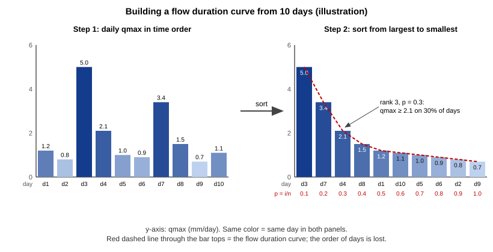
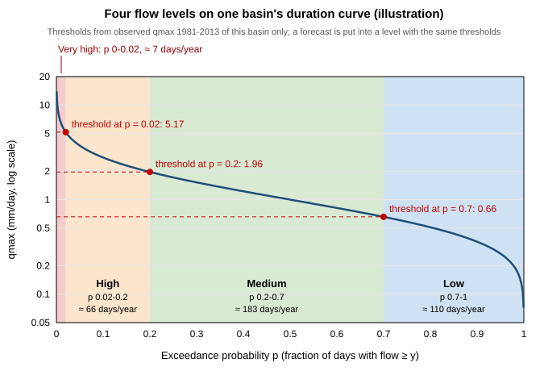
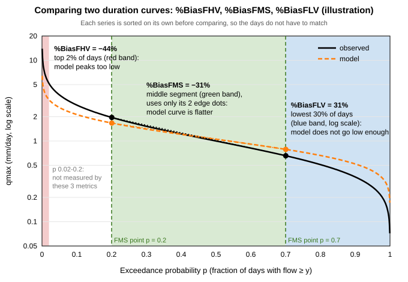
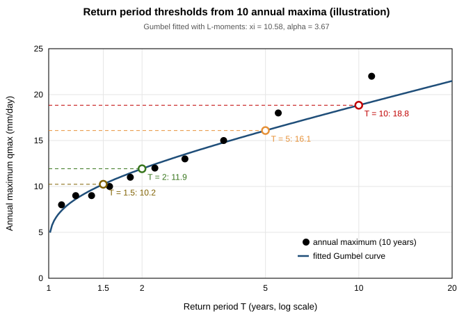
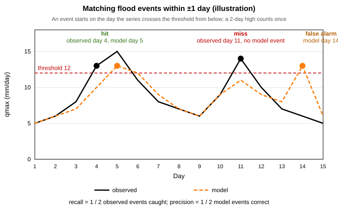
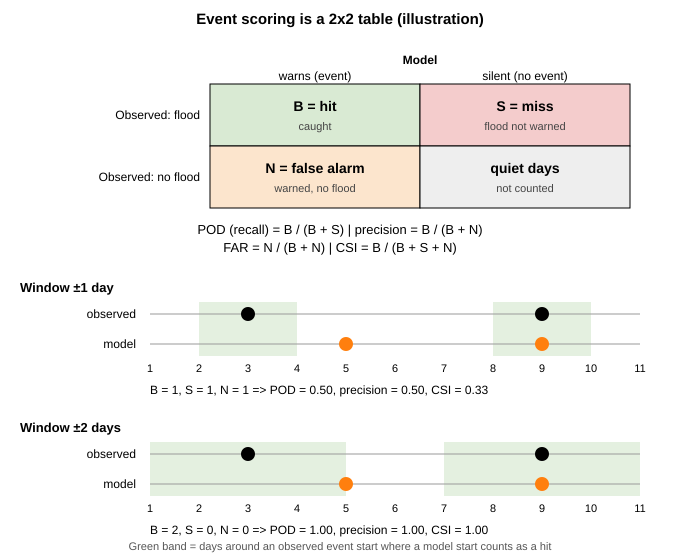
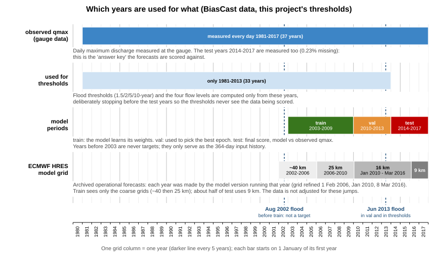

# BiasCast — Phần 3: Dữ liệu Extended LamaH-CE, nhìn từ phía lưu lượng

Phần 3 của ghi chú học BiasCast (Phần 1: `03_BiasCast1_Overview.md`, Phần 2: `04_BiasCast2_Metrics.md`). Phần 1 đã đi qua phía đầu vào (năm nguồn khí tượng, 31 biến, 33 thuộc tính, hình dạng một mẫu, cách chọn 451 lưu vực); Phần 3 đi vào phía lưu lượng: dữ liệu lưu lượng được làm ra thế nào, nó trông ra sao theo thời gian, thiếu và sai ở đâu, và các khái niệm thủy văn dùng để chia mức lưu lượng, xác định lũ. Đây là phần nền cho bước khảo sát dữ liệu A1 (`01_Plan/03_Pipeline.md` Mục 7).

Ký hiệu nguồn giữ như Phần 1, 2:

- **[Bài]**: bản chữ `PaperResearch/PaperResearchPDF/BasePaper/Konold2026_HESS_BiasCast_FullText.md`, kèm số dòng.
- **[LamaH-CE]**: Klingler, Schulz, Herrnegger, *LamaH-CE: LArge-SaMple DAta for Hydrology and Environmental Sciences for Central Europe*, Earth System Science Data 13, 4529–4565, 2021, DOI `10.5194/essd-13-4529-2021`; PDF ở `PaperResearch/PaperResearchPDF/Evidence/Klingler2021_ESSD_LamaHCE.pdf`, kèm mục và trang tạp chí.
- **[LamaH]**: `03_Data/01_LamaHCE.md` (ghi chú dữ liệu của đề tài), kèm mục.
- **[Mã]**: mã NeuralHydrology trong bản fork của tác giả, thư mục `PaperResearch/PaperResearchCode/BiasCast_NH/neuralhydrology/`, ghi tên tệp và số dòng.
- **[Cơ sở]**: `01_Plan/02_BasePaper.md`, kèm mục.
- **[Yilmaz]**: Yilmaz, Gupta, Wagener, *A process-based diagnostic approach to model evaluation: Application to the NWS distributed hydrologic model*, Water Resources Research 44, W09417, 2008, DOI `10.1029/2007WR006716`; PDF ở `PaperResearch/PaperResearchPDF/Evidence/Yilmaz2008_WRR_FlowDurationSegments.pdf`, trang theo số "x of 18" của bài.
- **[Nearing]**: Nearing và cs., *Global prediction of extreme floods in ungauged watersheds*, Nature 627, 559–563, 2024, DOI `10.1038/s41586-024-07145-1`; PDF ở `PaperResearch/PaperResearchPDF/Evidence/Nearing2024_Nature_GlobalFloods.pdf`.
- **[Nearing-mã]**: mã công bố kèm bài Nearing 2024, `github.com/google-research-datasets/global_streamflow_model_paper`, thư mục `notebooks/backend/` (nhánh `main`, đọc ngày 17/10/2026).
- **[AIFL]**: Taccari và cs., AIFL, Journal of Hydrology 678, 136064, 2026; số trang theo bản arXiv 2602.16579 ở `PaperResearch/PaperResearchPDF/Related/Taccari2026_arXiv_AIFL.pdf`.
- **[lmomco]**: tài liệu gói R `lmomco` 2.5.1 (W. H. Asquith), các trang `pargum`, `lmomgum`, `quagum` trên `search.r-project.org/CRAN/refmans/lmomco/`, dẫn Hosking, JRSS B 52:105–124 (1990).
- **[Kiểm định]**: trang *Forecast Verification* của nhóm công tác chung WWRP/WGNE, `jwgfvr.github.io/forecastverification` (trước ở `cawcr.gov.au/projects/verification`).
- **[ECMWF-2006]**: ECMWF, *Towards global meso-scale models: the high-resolution system T799L91 and T399L62 EPS* (ECMWF Newsletter, 2006), `ecmwf.int/sites/default/files/elibrary/2006/17954-towards-global-meso-scale-model-high-resolution-system-t799l91-and-t399l62-eps.pdf`: ngày 1/2/2006 (chu kỳ 30r1) HRES từ T511 lên T799.
- **[ECMWF-2010]**: tin ECMWF *Horizontal resolution increase* (2010), `ecmwf.int/en/about/media-centre/news/2010/horizontal-resolution-increase`: HRES từ T799 (lưới 25 km) lên T1279 (16 km).
- **[ECMWF-2016]**: ECMWF Newsletter 147, *New model cycle brings higher resolution*, `ecmwf.int/en/newsletter/147/meteorology/new-model-cycle-brings-higher-resolution`: chu kỳ 41r2 đưa vào vận hành 8/3/2016, lưới HRES 9 km.

Nội dung Phần 3: (3.1) LamaH-CE và dữ liệu lưu lượng trong đó; (3.2) lưu lượng như một chuỗi thời gian; (3.3) so sánh lưu lượng giữa các lưu vực; (3.4) chất lượng và dữ liệu thiếu; (3.5) đường duy trì lưu lượng và bốn mức lưu lượng; (3.6) lũ và chu kỳ lặp lại; (3.7) phân phối kỳ train và kỳ test; (3.8) tóm tắt và câu hỏi tự kiểm tra.

---

### 3.1. LamaH-CE và dữ liệu lưu lượng trong đó

**Bộ dữ liệu gốc.** LamaH-CE do nhóm Viện Thủy văn và Quản lý nước, Đại học BOKU Wien (Áo) công bố năm 2021, dựng theo khuôn của bộ CAMELS (Mỹ). Vùng phủ là toàn bộ thượng lưu sông Danube tới biên giới Áo – Slovakia cùng mọi lưu vực của Áo kể cả phần thượng nguồn nằm ở nước ngoài: khoảng 170 000 km², chín nước, từ đồng bằng khí hậu lục địa tới vùng núi cao có tuyết và băng hà ([LamaH-CE] tóm tắt, tr. 4529). Bộ gồm 859 lưu vực có trạm đo, hơn 60 thuộc tính lưu vực, chuỗi khí tượng và chuỗi lưu lượng theo ngày và theo giờ. Chuỗi khí tượng của bộ gốc chỉ lấy từ ERA5-Land: 15 biến khí tượng ([LamaH-CE] mục 4.2, Bảng A2), trong tệp ngày thành 21 cột vì một số biến có thêm giá trị lớn nhất trong ngày (VD `ERA5L_2m_temp_mean`, `ERA5L_2m_temp_max`); tức ERA5-Land là một phần của LamaH-CE ([Bài] dòng 80: *"the original version of LamaH only contains meteorological ERA5-Land data"*).

Bộ gốc chia thành bảy phần ([LamaH-CE] mục 7, tr. 4547):

| Phần | Nội dung | Có trong bản mở rộng của BiasCast |
|---|---|---|
| A — lưu vực toàn phần (`A_basins_total_upstrm`) | 859 lưu vực, mỗi lưu vực là toàn bộ vùng thượng nguồn đổ về trạm: thuộc tính, chuỗi khí tượng theo lưu vực, shapefile ranh giới | có (thêm 15 biến khí tượng) |
| B — lưu vực trung gian (`B_basins_intermediate_all`) | chỉ phần đất giữa trạm và các trạm ngay phía trên | không |
| C — lưu vực trung gian ít tác động (`C_basins_intermediate_lowimp`) | như B, chỉ giữ lưu vực ít chịu tác động của con người | không |
| D — trạm đo (`D_gauges`) | 882 trạm: thuộc tính trạm, chuỗi lưu lượng ngày và giờ kèm cờ chất lượng, shapefile vị trí | có (thêm `qmin`, `qmax`, bỏ cờ) |
| Mạng sông | shapefile dòng sông kèm thuộc tính | không |
| Mô hình thủy văn | đầu vào, đầu ra, đánh giá của mô hình khái niệm COSERO, dùng làm mốc | không |
| Phụ lục (`G_appendix`) | bảng mã phân loại, tài liệu phụ | không |

Thư mục `Info` ghi cấu trúc thư mục và nguồn trích dẫn. Ba mức A, B, C giải thích ở Phần 1, Mục 1.3; bản mở rộng chỉ có thư mục `A_basins_total_upstrm` và `D_gauges` ([LamaH] Mục 6).

**Lưu lượng đến từ đâu.** Có 882 trạm đo ở bốn nước, do các cơ quan thủy văn cung cấp ([LamaH-CE] mục 4.1, tr. 4532):

| Cơ quan | Vùng | Số trạm |
|---|---|---|
| HZB — Cục Thủy văn Trung ương Áo | Áo | 609 |
| GKD — cơ quan thủy văn bang Bayern | Đức | 125 |
| LUBW — cơ quan thủy văn bang Baden-Württemberg | Đức | 61 |
| BAFU — Cơ quan Môi trường Liên bang Thụy Sĩ | Thụy Sĩ | 25 |
| CHMI — Viện Khí tượng Thủy văn Séc | Séc | 61 |

Cộng các số bài ghi được 881, bài ghi tổng 882; bài không giải thích chênh lệch một trạm. Số trạm (882) nhiều hơn số lưu vực (859) vì 23 trạm không xác định được lưu vực rõ ràng, VD trạm trên kênh nhân tạo hay ngay dưới mạch nước karst, nên không được dựng lưu vực ([LamaH-CE] mục 4.1, tr. 4532).

**Lưu lượng không đo trực tiếp.** Trạm đo mực nước, rồi đổi sang lưu lượng bằng **đường quan hệ mực nước – lưu lượng** (rating curve) dựng từ các lần đo lưu lượng thủ công. Đường này sai khi lòng sông đổi hình dạng (VD sau lũ mang nhiều bùn cát), khi phải ngoại suy ra ngoài khoảng đã đo (thường gặp ở lũ lớn), khi nước dềnh từ hạ lưu, hay khi lũ lên và lũ xuống có quan hệ khác nhau; cơ quan thủy văn định kỳ chỉnh lại đường này nhưng tần suất chỉnh không công khai. LamaH-CE chỉ nhận trạm ở hạng chất lượng cao nhất ở những nơi có xếp hạng (Bayern, Séc) ([LamaH-CE] mục 4.1, tr. 4532).

Dạng thường gặp của đường quan hệ là hàm lũy thừa Q = a × (H − H₀)^b, trong đó H là mực nước, H₀ là mực nước ứng với lưu lượng bằng 0, a và b khớp từ các cặp (mực nước, lưu lượng) đo thủ công; thường chia nhiều đoạn theo khoảng mực nước. **Ngoại suy** là dùng chính công thức đã khớp cho mực nước cao hơn mọi lần đo, tức giả định lòng sông ở mực nước cao vẫn ứng xử như ở mực nước đã đo; khi nước tràn bãi hay đổi dạng mặt cắt, giả định này sai (Lang và cs., Hydrological Sciences Journal 55(6), 883–898, 2010, DOI `10.1080/02626667.2010.504186`). Bài LamaH-CE không nói từng cơ quan dùng dạng đường nào hay ngoại suy cách nào.

Ví dụ minh họa: đường quan hệ dựng từ các lần đo với lưu lượng tới 200 m³/s. Một trận lũ đẩy mực nước lên cao hơn mọi lần đo, lưu lượng 350 m³/s ghi trong tệp là con số ngoại suy, không phải số đo. Với đề tài, điều này có nghĩa là nhãn `qmax` kém chắc chắn nhất đúng ở những ngày quan trọng nhất — các đỉnh lũ lớn ([Bài] dòng 68 cũng nêu sai số của đường quan hệ khi lũ cực đoan).

**Từ chuỗi giờ ra chuỗi ngày.** Với Áo, Đức, Thụy Sĩ, nhóm LamaH-CE xin chuỗi theo giờ rồi tự tính chuỗi ngày từ các giá trị giờ trong khoảng **00:00–23:59 GMT**, cùng cách cho biến khí tượng. Riêng Séc, chuỗi giờ liên tục chỉ có từ sau 2005 nên nhóm xin cả chuỗi ngày lẫn chuỗi giờ ([LamaH-CE] mục 4.1, tr. 4533). Hệ quả:

- Ngày của lưu lượng (Áo, Đức, Thụy Sĩ) là ngày theo giờ GMT, trùng với ngày UTC của bản dự báo ECMWF HRES phát 00 UTC (Phần 1, Mục 1.2).
- Với trạm Séc, chuỗi ngày trước 2005 là chuỗi ngày của cơ quan Séc; bài không nói ranh giới ngày của chuỗi này.
- `qmin`, `qmax` của bản mở rộng được tác giả BiasCast trích từ chuỗi giờ ([Bài] dòng 80). Với trạm Séc trước khoảng 2005 không có chuỗi giờ liên tục, nên `qmax` của các năm đó lấy từ đâu (hay để trống) chưa kiểm — bước A1 kiểm bằng cách đếm ngày có `qmax` theo năm ở các trạm Séc trong 451 lưu vực.

**Xử lý lỗ hổng.** Lỗ hổng ngắn trong chuỗi giờ (tới 6 giờ liên tiếp) được nội suy tuyến tính; lỗ dài hơn ghi −999. Điều kiện xét trên độ dài của cả lỗ ("if the number of consecutive gaps was less than seven"), nên lỗ 12 giờ không được điền phần nào, cả 12 giờ đều là −999. Việc điền chỉ dùng chính chuỗi lưu lượng của trạm, không dùng dữ liệu khí tượng hay tái phân tích. Khoảng 80% trong 882 trạm không còn lỗ hổng sau bước này; vị trí lỗ hổng trước xử lý được lưu thành tệp riêng ([LamaH-CE] mục 4.1, tr. 4533).

Ví dụ minh họa: 10:00 đo 12,0 m³/s, 11:00–13:00 mất số, 14:00 đo 16,0 m³/s. Lỗ dài 3 giờ (dưới 6 giờ) nên được nội suy thẳng: 11:00 = 13,0; 12:00 = 14,0; 13:00 = 15,0 (mỗi giờ tăng (16,0 − 12,0) / 4 = 1,0). Nếu lỗ dài 8 giờ thì các giờ đó ghi −999. Nội suy thẳng không tạo được đỉnh mới: nếu đỉnh lũ thật rơi đúng vào lỗ 3 giờ đó thì `qmax` của ngày bị thấp hơn thực tế. Bài LamaH-CE không nói một ngày còn giờ −999 thì `qmean` ngày được tính thế nào.

**Kỳ dữ liệu.** Chuỗi lưu lượng giới hạn trong 1981–2017: 1981 là năm bắt đầu của ERA5-Land, 2017 là năm cuối có lưu lượng đã kiểm của Áo lúc nhóm xin dữ liệu ([LamaH-CE] mục 4.1, tr. 4533). Nhiều trạm bắt đầu đo muộn hơn 1981: năm 1981, tính trên mọi cặp (trạm, ngày), chỉ 67,3% có số lưu lượng; từ 2003 gần đủ ([LamaH] Mục 6.2).

**Đã kiểm hay chưa.** Mỗi bước thời gian của chuỗi lưu lượng gốc có cờ `ckhs` cho biết đã được nhân viên cơ quan thủy văn kiểm hay chưa (phạm vi kiểm không được mô tả). Số liệu Áo, Séc, Thụy Sĩ được cung cấp toàn bộ ở dạng đã kiểm; Bayern phần lớn đã kiểm tới 2014, 2015 hoặc 2016; Baden-Württemberg thường chỉ được kiểm từ 2010 ([LamaH-CE] mục 4.1, tr. 4533). Như vậy với trạm Baden-Württemberg, phần lớn kỳ train 2003–2009 là số liệu chưa kiểm. Bộ gốc còn hai cờ kiểm tra tự động: `qceq` — lưu lượng giữ nguyên giá trị ít nhất 10 bước liên tiếp, `qcol` — giá trị bị xếp là ngoại lai (có thể là lưu lượng rất thấp hoặc rất cao có thật). Ba cờ là cột trong chính tệp chuỗi lưu lượng ngày và giờ của bộ gốc ([LamaH-CE] Bảng A1 và chú thích e, tr. 4549).

**Tác giả BiasCast dùng cờ thế nào.** Tệp trạm của bản mở rộng chỉ có các cột `YYYY;MM;DD;qmin;qmean;qmax` ([LamaH] Mục 6), tức ba cờ đã bị bỏ khi tạo tệp. Bộ nạp của tác giả chỉ đổi giá trị âm (−999) thành NaN, không đọc cờ nào ([Mã] `datasetzoo/lamah.py` dòng 228–229). Bài cũng không nhắc tới cờ. Như vậy khi huấn luyện và đánh giá, ngày bị gắn cờ vẫn được dùng như ngày bình thường, trừ khi tác giả đã bỏ những ngày đó trước khi tạo tệp; điều này chưa kiểm được vì mã tạo bộ dữ liệu không công khai. Đề tài có sẵn chuỗi lưu lượng theo giờ của bộ gốc, kèm ba cờ, trong Kaggle Dataset `lamah-ce-core` (bộ này chỉ giữ chuỗi giờ, không có chuỗi ngày; [LamaH] Mục 1–5). Bước A1 kiểm bằng cách tính lại `qmax` ngày từ chuỗi giờ (00:00–23:59 GMT) rồi so với `qmax` của bản mở rộng ở những ngày có giờ bị gắn cờ: giá trị trùng nhau nghĩa là tác giả giữ nguyên các ngày đó; cách so này đồng thời kiểm ranh giới ngày tác giả dùng khi trích `qmax` (Mục 3.4).

**Bản mở rộng của BiasCast thêm gì.** So với LamaH-CE gốc, bản Extended LamaH-CE của tác giả thêm 15 biến từ bốn nguồn khí tượng (Phần 1, Mục 1.5) và thêm `qmin`, `qmax` vào tệp trạm theo ngày ([Bài] dòng 80); mọi thứ khác (lưu vực, thuộc tính, `qmean`) lấy từ LamaH-CE. Cách chọn 451 lưu vực (mức tác động của con người, 72,5% lưu vực đầu nguồn) đã ở Phần 1, Mục 1.3.

**Điều cần nhớ cho đề tài:**

| Sự thật | Ảnh hưởng | Kiểm ở |
|---|---|---|
| Ngày lưu lượng theo GMT | Nhãn ngày t và dự báo ECMWF HRES 00 UTC cùng mốc ngày | đã có nguồn |
| Lưu lượng là số suy từ mực nước, ngoại suy ở lũ lớn | Nhãn ở đỉnh lũ kém chắc chắn nhất; sai số này nằm sẵn trong mọi chỉ số đánh giá đỉnh | không kiểm được bằng dữ liệu |
| Trạm Séc không có chuỗi giờ liên tục trước khoảng 2005 | `qmax` các năm đó có thể thiếu hoặc lấy cách khác | A1 |
| Baden-Württemberg chỉ kiểm từ 2010 | Nhãn train 2003–2009 của các trạm này chưa kiểm | A1 (đếm trạm trong 451 lưu vực) |
| Bản mở rộng không có cờ `qceq`, `qcol` | Không thấy ngay ngày nào lưu lượng bị đứng giá trị hay ngoại lai | A1, đối chiếu bộ gốc |

**Câu hỏi tự kiểm tra (Mục 3.1):**

1. Vì sao LamaH-CE có 882 trạm nhưng chỉ 859 lưu vực?
2. Một trạm ghi lưu lượng 350 m³/s trong một trận lũ lớn, trong khi các lần đo thủ công chỉ tới 200 m³/s. Con số 350 m³/s đáng tin tới đâu, và điều đó ảnh hưởng gì tới việc đánh giá mô hình ở đỉnh lũ?
3. Ngày 15/05/2016 của chuỗi lưu lượng một trạm ở Áo bắt đầu và kết thúc lúc mấy giờ theo giờ Việt Nam?
4. Chuỗi giờ có 9:00 = 20,0 m³/s, mất số 10:00–11:00, 12:00 = 26,0 m³/s. Giá trị nội suy lúc 10:00 và 11:00 là bao nhiêu? Nếu mất số từ 10:00 tới 17:00 thì sao?
5. Vì sao nói nhãn của trạm ở bang Baden-Württemberg trong kỳ train kém chắc chắn hơn trạm ở Áo?

Đáp án: (1) 23 trạm không xác định được vùng thượng nguồn rõ ràng (trạm trên kênh nhân tạo, ngay dưới mạch nước karst), nên không dựng được lưu vực; 882 − 23 = 859. (2) Con số 350 m³/s là ngoại suy từ công thức khớp với các lần đo tới 200 m³/s, không phải số đo; sai lệch có thể theo cả hai chiều (cao hơn hoặc thấp hơn thực tế) và không biết trước chiều nào. Khi đánh giá, mô hình được so với một "đáp án" có thể sai ở chính các đỉnh lũ; NSE phạt nặng sai số lớn, mà sai số lớn tập trung ở đỉnh, nên một phần sai số đo dồn vào chỉ số ở các ngày đỉnh. (3) Từ 07:00 ngày 15/05 tới 06:59 ngày 16/05 giờ Việt Nam (GMT+7; Việt Nam không đổi giờ theo mùa). (4) Lỗ 2 giờ chia đoạn 9:00–12:00 thành 3 bước, mỗi bước (26 − 20) / 3 = 2: 10:00 = 22,0; 11:00 = 24,0. Lỗ 10:00–17:00 dài 8 giờ, vượt 6 giờ, nên cả 8 giờ ghi −999, không giờ nào được điền. (5) Số liệu Baden-Württemberg thường chỉ được nhân viên cơ quan thủy văn kiểm từ 2010, nên phần lớn kỳ train 2003–2009 chưa kiểm; số liệu Áo được cung cấp toàn bộ ở dạng đã kiểm. Lỗi như giá trị đứng yên, đỉnh giả còn có thể nằm trong số liệu chưa kiểm, và bản mở rộng đã bỏ cờ nên không thấy ngay.

---

### 3.2. Lưu lượng như một chuỗi thời gian

**Thủy đồ.** Đường lưu lượng theo thời gian của một trạm gọi là **thủy đồ** (hydrograph). Hình dạng điển hình của một trận lũ có ba đoạn: **nhánh lên** khi nước mưa đổ về trạm, **đỉnh**, rồi **nhánh xuống** khi nước rút dần. Nhánh lên thường ngắn và dốc, nhánh xuống dài và thoải, vì nước mưa chảy trên mặt đất về nhanh còn nước thấm vào đất, tầng nước ngầm thì nhả ra chậm. Giữa các trận lũ, sông vẫn chảy nhờ nước ngầm; phần lưu lượng nền này gọi là **dòng chảy nền** (baseflow).

Ví dụ minh họa — `qmax` (m³/s) bảy ngày của một lưu vực nhỏ có một trận mưa lớn đêm ngày 2:

| Ngày | 1 | 2 | 3 | 4 | 5 | 6 | 7 |
|---|---|---|---|---|---|---|---|
| `qmax` | 10 | 12 | 30 | 22 | 16 | 13 | 11 |
| Đoạn | nền | bắt đầu lên | đỉnh | xuống | xuống | xuống | gần về nền |

Lưu lượng tăng gần gấp ba trong một ngày nhưng mất bốn ngày mới về gần mức nền.

**Ba giá trị trong một ngày.** `qmin` ≤ `qmean` ≤ `qmax` luôn đúng vì cùng tính từ các giá trị giờ của một ngày. Ngày nước ổn định thì ba giá trị gần nhau; ngày có lũ lên nhanh thì `qmax` vượt xa `qmean` (VD ở Phần 1, Mục 1.4: `qmean` 30,7, `qmax` 61,5 m³/s). Lưu vực nhỏ, dốc phản ứng nhanh nên đỉnh nhọn, tỉ số `qmax`/`qmean` trong ngày lũ lớn; lưu vực lớn gộp nước từ nhiều nhánh về trạm vào những thời điểm khác nhau nên đỉnh tù, tỉ số nhỏ (lý giải định tính; bước A1 đo tỉ số này theo diện tích lưu vực trên 451 lưu vực).

**Hệ quả cho đầu vào.** Điều này liên quan tới đầu vào, không phải đầu ra (đầu ra vẫn là `qmax` ngày t, [Bài] dòng 74): phần quá khứ của bài chỉ có `qmean` (Phần 1, Mục 1.10), mà `qmean` và `qmax` chênh nhau nhiều nhất đúng ở ngày lũ, nên mô hình không thấy đỉnh của các ngày trước cao tới đâu. Bước B1 của đề tài thêm `qmax` quá khứ (t − 364 … t − 1) làm đầu vào; không rò rỉ vì các giá trị này đã đo xong lúc dự báo (`01_Plan/03_Pipeline.md` Mục 3.2, 7).

**Mùa dòng chảy và năm thủy văn.** Thủy văn thường không chia năm từ 1/1 mà dùng **năm thủy văn**; LamaH-CE lấy mốc 1/10 tới 30/9 năm sau ([LamaH-CE] mục 5.3, Bảng A5). Lý do là giữ trọn một vòng nước trong cùng một năm: ở vùng có tuyết, tuyết rơi và tích lại suốt mùa đông rồi tan thành dòng chảy vào xuân, hè. VD tuyết rơi tháng 12/2015 và tan tháng 5/2016: chia theo dương lịch thì bị tách thành hai năm; theo năm thủy văn 1/10/2015 – 30/9/2016 thì nằm cùng một năm. Đầu tháng 10 lại là cuối mùa khô, nước tích trong lưu vực đang thấp, nên lượng nước mang từ năm trước sang ít, tổng của từng năm tách bạch hơn.

**Thuộc tính `hfd_mean`.** LamaH-CE mô tả tính mùa của dòng chảy bằng thuộc tính `hfd_mean` (half-flow date): số ngày tính từ 1/10 tới ngày tổng lượng dòng chảy cộng dồn đạt nửa lượng cả năm, lấy trung bình nhiều năm. Lưu vực có `hfd_mean` lớn (nửa lượng nước năm về muộn) chủ yếu do nước tích dưới dạng tuyết hoặc băng hà rồi mới tan vào cuối xuân, mùa hè ([LamaH-CE] mục 5.3, tr. 4538).

**Ý nghĩa cho mô hình.** Vùng phủ của LamaH-CE trải từ đồng bằng tới núi cao (Mục 3.1), nên cùng một tháng có lưu vực đang mùa nước lớn, có lưu vực đang mùa cạn; mô hình chung cho 451 lưu vực phải học được cả hai kiểu, nhờ biến tuyết (`ERA5L_swe`), nhiệt độ và thuộc tính `frac_snow`, độ cao (Phần 1, Mục 1.5, 1.7).

Ví dụ minh họa — hai lưu vực, lượng dòng chảy theo mùa (% lượng cả năm):

| Lưu vực | Thu (10–12) | Đông (1–3) | Xuân (4–6) | Hè (7–9) | Ngày đạt nửa lượng năm |
|---|---|---|---|---|---|
| Đồng bằng, mưa là chính | 25% | 35% | 25% | 15% | khoảng đầu tháng 3 |
| Núi cao, tuyết tan | 10% | 5% | 45% | 40% | khoảng 10/6 |

Với lưu vực đồng bằng: hết tháng 12 đạt 25%, cần thêm 25% trong 35% của mùa đông, tức 25/35 ≈ 0,71 mùa đông ≈ 64 ngày sau 1/1, khoảng đầu tháng 3 (`hfd_mean` ≈ 92 + 64 = 156 ngày, giả định dòng chảy đều trong từng mùa). Với lưu vực núi: hết tháng 3 mới đạt 15%, cần thêm 35% trong 45% của mùa xuân, tức 35/45 ≈ 0,78 mùa xuân ≈ 71 ngày sau 1/4, khoảng 10/6 (`hfd_mean` ≈ 182 + 71 = 253 ngày).

**Persistence: sông dễ đoán hay khó đoán.** Phần này trả lời một câu: mô hình có thực sự giỏi, hay chỉ được điểm cao vì con sông vốn dễ đoán?

*Persistence là gì.* Cách dự báo đơn giản nhất: lưu lượng hôm nay bằng lưu lượng hôm qua, không cần mô hình hay thời tiết (Phần 2, Mục 2.6).

*Cách này tốt hay dở tùy con sông.* Lưu lượng hôm nay thường gần hôm qua vì nước trong lưu vực (đất, nước ngầm, tuyết, lòng sông) chỉ thay đổi dần; mức gần nhau này khác nhau giữa các sông:

| Loại sông | Đặc điểm | Ví dụ | Persistence |
|---|---|---|---|
| "Trơn" | lưu lượng đổi chậm, hôm nay gần như hôm qua | sông lớn, nhiều nước ngầm, hồ | đoán gần đúng |
| "Giật" | lưu lượng đổi mạnh giữa hai ngày liền nhau | suối núi nhỏ, mưa xuống là lũ ngay | đoán sai nhiều |

*Đo độ trơn bằng một con số.* Lấy hai cột: lưu lượng các ngày và lưu lượng của ngày liền trước, rồi tính hệ số tương quan giữa hai cột; con số này gọi là **hệ số tự tương quan trễ 1 ngày**, ký hiệu ρ₁. ρ₁ gần 1: hôm nay gần như lặp lại hôm qua (sông trơn); ρ₁ nhỏ: hôm nay khác xa hôm qua (sông giật).

*Nối độ trơn với điểm của persistence.* Với chuỗi dài, điểm NSE của persistence xấp xỉ:

NSE_persistence ≈ 2ρ₁ − 1

| ρ₁ | NSE persistence | Đọc |
|---|---|---|
| 0,50 | 0,00 | ngang lấy trung bình làm dự báo |
| 0,67 | 0,34 | |
| 0,90 | 0,80 | đoán "như hôm qua" đã khá tốt |
| 0,98 | 0,96 | gần như không thể vượt |

Cách ra công thức (đọc thêm): sai số của persistence là `qmax`(t) − `qmax`(t − 1); với chuỗi có trung bình và phương sai không đổi theo thời gian, trung bình bình phương của hiệu này bằng 2σ²(1 − ρ₁), σ² là phương sai của chuỗi; thay vào NSE = 1 − SSE / (n σ²) được 1 − 2(1 − ρ₁) = 2ρ₁ − 1. Kiểm bằng mô phỏng chuỗi tự hồi quy bậc 1 dài 200 000 bước: ρ₁ = 0,67 cho NSE 0,341; ρ₁ = 0,90 cho 0,800; ρ₁ = 0,98 cho 0,961 — khớp công thức.

*Hệ quả khi chấm mô hình.* Persistence `qmax`(t − 1) trên kỳ test có NSE trung vị 0,346, P10 −0,081, P90 0,800 qua 451 lưu vực ([LamaH] Mục 6.1); đổi ngược bằng ρ₁ = (NSE + 1) / 2 thì lưu vực giữa có ρ₁ khoảng 0,67, 10% lưu vực giật nhất khoảng 0,46, 10% lưu vực trơn nhất khoảng 0,90.

- Ở 10% lưu vực trơn nhất, persistence đã đạt 0,80, mô hình tốt nhất của bài đạt 0,876 (P90): mô hình chỉ hơn khoảng 0,08 vì còn rất ít chỗ để hơn.
- Ở lưu vực giật, persistence thấp, nên phần cải thiện thật của mô hình nằm chủ yếu ở đây.
- Vì vậy NSE = 0,9 chưa nói được mô hình giỏi: ở sông trơn, đoán "như hôm qua" đã được 0,8. Đề tài thêm **PNSE** — NSE lấy persistence làm mốc so (Phần 2, Mục 2.6) — để đo mô hình hơn cách đoán ngây thơ bao nhiêu, thay vì điểm tuyệt đối.

*Persistence hỏng ở đâu.* Ví dụ minh họa — persistence trên chuỗi 7 ngày ở đầu mục (dự báo ngày 2–7 bằng ngày trước):

| Ngày | 2 | 3 | 4 | 5 | 6 | 7 |
|---|---|---|---|---|---|---|
| Quan trắc | 12 | 30 | 22 | 16 | 13 | 11 |
| Persistence | 10 | 12 | 30 | 22 | 16 | 13 |
| Sai số | 2 | 18 | −8 | −6 | −3 | −2 |

SSE = 4 + 324 + 64 + 36 + 9 + 4 = 441. Trung bình quan trắc = 104 / 6 ≈ 17,33; tổng bình phương lệch khỏi trung bình ≈ 28,4 + 160,4 + 21,8 + 1,8 + 18,8 + 40,1 ≈ 271,3. NSE ≈ 1 − 441 / 271,3 ≈ −0,63.

Persistence luôn chậm một ngày: ngày nước lên nó vẫn báo mức hôm qua (sai 18), hôm sau nước đã rút nó lại báo đỉnh (sai −8). Đây đúng là chỗ mô hình có dữ liệu thời tiết giúp được: mô hình thấy mưa qua số liệu khí tượng quá khứ tới ngày t − 1 và dự báo ECMWF HRES cho ngày t (Phần 1, Mục 1.8), nên biết nước sắp lên trước khi lưu lượng kịp tăng. Nói cách khác, giá trị của BiasCast nằm chủ yếu ở **ngày nước lên** và ở **lưu vực giật**. Bước A1 đo ρ₁ thật của từng lưu vực; bước A3 tính PNSE.

**Các đặc trưng thủy văn có sẵn trong LamaH-CE.** Bộ gốc tính sẵn một nhóm chỉ số mô tả chuỗi lưu lượng của từng trạm (bảng A5), trên kỳ 01/10/1989–30/09/2009 cho trạm có đủ kỳ này, và chỉ khi tỉ lệ thiếu dưới 5% ([LamaH-CE] mục 5.3, tr. 4537–4538; Bảng A5, tr. 4553):

| Thuộc tính | Nghĩa |
|---|---|
| `q_mean` | lưu lượng trung bình ngày (mm/ngày) |
| `runoff_ratio` | tỉ lệ lượng mưa thành dòng chảy (lưu lượng trung bình / mưa trung bình) |
| `baseflow_index_ladson` | tỉ lệ dòng chảy nền trong tổng dòng chảy |
| `hfd_mean` | ngày đạt nửa lượng dòng chảy năm (tính mùa) |
| `slope_fdc` | độ dốc đường duy trì lưu lượng giữa phân vị 33 và 66 (độ biến động; Mục 3.5) |
| `Q5`, `Q95` | phân vị 5% (nước thấp) và 95% (nước cao) của lưu lượng ngày |
| `high_q_freq`, `high_q_dur` | số ngày mỗi năm và độ dài trung bình các đợt lưu lượng lớn hơn 9 lần trung vị |

Không chỉ số nào trong nhóm này nằm trong 33 thuộc tính bài dùng (Phần 1, Mục 1.7); bài không nêu lý do.

**Chú ý phân biệt** `q_mean` và `qmean`: `q_mean` (có gạch dưới) là **một con số cố định** cho mỗi lưu vực — lưu lượng trung bình ngày tính trên nhiều năm 1989–2009, đơn vị mm/ngày; còn `qmean` (không gạch dưới) là **chuỗi theo ngày**, mỗi ngày một giá trị m³/s, và `qmean` của 364 ngày quá khứ là đầu vào ở biến thể có `qmean` đầu vào (Phần 1, Mục 1.10).

**Vì sao bài không dùng nhóm này.** Một cách giải thích (suy luận, không phải lý do bài ghi): các chỉ số này chỉ tính được khi lưu vực đã có nhiều năm đo lưu lượng, nên mô hình dùng chúng không áp dụng được cho lưu vực chưa có trạm đo; các bộ thuộc tính chuẩn theo kiểu CAMELS thường chỉ đưa thuộc tính địa hình, khí hậu, lớp phủ vào mô hình vì lý do này (chưa đối chiếu nguồn cụ thể). Kỳ tính kết thúc năm 2009 nên không chứa kỳ test.

**Bản mở rộng có nhóm này không.** Bản mở rộng có giữ nhóm chỉ số này trong tệp thuộc tính hay không chưa kiểm (tệp có 62 thuộc tính, [LamaH] Mục 6.2, chưa đối chiếu tên cột); bước A1 in tên cột để kiểm — nếu có thì dùng thẳng, nếu không thì tự tính lại từ chuỗi `qmean` — rồi dùng để chia nhóm lưu vực (VD lưu vực tuyết tan, lưu vực nhiều dòng chảy nền) khi phân tích kết quả theo lưu vực.

**Câu hỏi tự kiểm tra (Mục 3.2):**

1. Vì sao nhánh xuống của thủy đồ thường dài hơn nhánh lên?
2. Một lưu vực núi cao có `hfd_mean` = 250 ngày. Ngày đạt nửa lượng dòng chảy năm rơi vào khoảng tháng nào? So với một lưu vực đồng bằng có `hfd_mean` = 130 ngày, khác nhau vì sao?
3. Một lưu vực có ρ₁ = 0,95. NSE của persistence xấp xỉ bao nhiêu? Mô hình có NSE 0,92 ở lưu vực này là tốt hay kém?
4. Tính NSE của persistence cho chuỗi `qmax` 50, 52, 55, 57, 58, 58 (dự báo ngày 2–6 bằng ngày trước). So với chuỗi 7 ngày ở ví dụ trên, vì sao khác nhau?
5. `q_mean` (thuộc tính tĩnh) và `qmean` (chuỗi theo ngày) khác nhau thế nào? Biến nào là đầu vào của mô hình có `qmean` đầu vào?

Đáp án: (1) Trong một trận lũ, nước mưa chảy trên mặt đất về trạm nhanh nên nhánh lên ngắn, dốc; nước đã thấm vào đất và tầng nước ngầm nhả ra từ từ nên nhánh xuống dài, thoải. Đây là chuyện của một trận lũ (vài giờ tới vài ngày), không phải mùa lũ. (2) 1/10 cộng 250 ngày rơi vào khoảng 7–8/6; 130 ngày rơi vào khoảng 8/2. Lưu vực núi tích mưa mùa đông dưới dạng tuyết, nước chỉ về trạm khi tuyết tan vào cuối xuân nên nửa lượng năm đạt muộn; lưu vực đồng bằng mưa là chính, mưa thu đông chảy về ngay nên đạt sớm. (3) NSE persistence ≈ 2 × 0,95 − 1 = 0,90. Mô hình 0,92 chỉ hơn persistence 0,02: điểm tuyệt đối cao nhưng gần như không hơn cách đoán "như hôm qua". Cùng chuỗi quan trắc thì SSE tỉ lệ với 1 − NSE, nên PNSE = 1 − (1 − 0,92) / (1 − 0,90) = 1 − 0,08 / 0,10 = 0,2: mô hình chỉ bớt 20% sai số của persistence. (4) Dự báo 50, 52, 55, 57, 58 cho quan trắc 52, 55, 57, 58, 58; sai số 2, 3, 2, 1, 0; SSE = 18. Trung bình quan trắc 56, tổng bình phương lệch 16 + 1 + 1 + 4 + 4 = 26. NSE = 1 − 18 / 26 ≈ 0,31. Sai số tuyệt đối nhỏ hơn nhiều so với chuỗi 7 ngày (lớn nhất 3 so với 18) và không có cú nhảy nào, nhưng NSE chỉ 0,31 vì chuỗi gần như không dao động (mẫu số nhỏ): NSE so sai số với độ dao động của chính chuỗi, không đo sai số tuyệt đối. (5) `q_mean` là một con số cố định cho mỗi lưu vực (trung bình 1989–2009, mm/ngày), bài không dùng; `qmean` là chuỗi theo ngày (m³/s), 364 ngày quá khứ của nó là đầu vào ở biến thể có `qmean` đầu vào.

---

### 3.3. So sánh lưu lượng giữa các lưu vực

**Vấn đề: m³/s phụ thuộc diện tích.** Lưu vực LamaH-CE rộng từ 4 km² tới 131 247 km², trung vị 178 km² (859 lưu vực, [LamaH-CE] mục 3, tr. 4531). Cùng một trận mưa, lưu vực lớn hứng nhiều nước hơn nên lưu lượng m³/s lớn hơn gấp nhiều lần, dù đất ở hai nơi "phản ứng" như nhau. Muốn so hai lưu vực, hay muốn một mô hình chung học được cho cả hai, phải bỏ phần chênh do diện tích.

**Cách bỏ: chia cho diện tích.** Đổi m³/s sang mm/ngày (Phần 1, Mục 1.4): q (mm/ngày) = Q (m³/s) × 86,4 / A (km²). Kết quả là chiều dày lớp nước nếu trải lượng nước chảy qua trạm trong một ngày lên khắp lưu vực — cùng đơn vị với lượng mưa, nên so được với mưa (VD tỉ lệ `runoff_ratio` ở Mục 3.2).

Ví dụ minh họa — hai lưu vực cùng "phản ứng" 2 mm/ngày:

| Lưu vực | Diện tích | Q (m³/s) | q (mm/ngày) |
|---|---|---|---|
| Suối nhỏ | 50 km² | 2 × 50 / 86,4 ≈ 1,16 | 2 |
| Sông lớn | 5 000 km² | 2 × 5 000 / 86,4 ≈ 115,7 | 2 |

Theo m³/s hai con số chênh 100 lần; theo mm/ngày bằng nhau.

**Diện tích nào.** Mã của tác giả chia cho `area_gov` — diện tích lưu vực do cơ quan thủy văn công bố (Phần 1, Mục 1.4). LamaH-CE còn có `area_calc` — diện tích tự tính từ ranh giới đã dựng; nhóm LamaH-CE kiểm hai con số bằng tỉ số `area_ratio` = `area_calc` / `area_gov`: nằm trong khoảng 0,89–1,34, độ lệch chuẩn 0,026, lưu vực lệch lớn đã được xem tay và sửa nếu thấy lỗi rõ ràng ([LamaH-CE] mục 3, tr. 4531). Lệch diện tích 10% làm q lệch 10% ở mọi ngày của lưu vực đó; NSE không đổi khi cả chuỗi nhân cùng một hằng số dương (Phần 1, Mục 1.4), nhưng mô hình chung thấy lưu vực đó "ướt" hơn hoặc "khô" hơn thực tế. Bước A1 xem `area_ratio` của 451 lưu vực.

**Vì sao chuyện này quan trọng khi chuẩn hóa.** NeuralHydrology chuẩn hóa mỗi biến bằng **một** trung bình và **một** độ lệch chuẩn chung cho mọi lưu vực, tính trên kỳ train (z = (x − trung bình) / độ lệch chuẩn; [LamaH] Mục 6.3). Nhãn `qmax` đã ở mm/ngày, nhưng `qmean` đầu vào của tác giả ở m³/s ([LamaH] Mục 6.3):

| `qmean`, kỳ train, 451 lưu vực | Trung bình | Độ lệch chuẩn | Độ lệch chuẩn / trung bình |
|---|---|---|---|
| m³/s (tác giả dùng) | 4,5778 | 16,1461 | 3,5 |
| mm/ngày | 2,0872 | 3,5224 | 1,7 |

Theo m³/s, độ lệch chuẩn gấp 3,5 lần trung bình: vài sông lớn có lưu lượng hàng trăm m³/s kéo giãn thang đo, còn phần lớn lưu vực nhỏ dồn về một khoảng hẹp.

Ví dụ minh họa — hai lưu vực ở trên, một ngày bình thường (2 mm/ngày) rồi một ngày lũ gấp ba (6 mm/ngày), chuẩn hóa bằng thống kê chung:

| Lưu vực | z ngày thường (m³/s) | z ngày lũ (m³/s) | Chênh | z ngày thường (mm/ngày) | z ngày lũ (mm/ngày) | Chênh |
|---|---|---|---|---|---|---|
| Suối nhỏ 50 km² | (1,16 − 4,58) / 16,15 ≈ −0,21 | (3,47 − 4,58) / 16,15 ≈ −0,07 | 0,14 | (2 − 2,09) / 3,52 ≈ −0,02 | (6 − 2,09) / 3,52 ≈ 1,11 | 1,14 |
| Sông lớn 5 000 km² | (115,7 − 4,58) / 16,15 ≈ 6,89 | (347,2 − 4,58) / 16,15 ≈ 21,2 | 14,3 | −0,02 | 1,11 | 1,14 |

Theo m³/s, trận lũ gấp ba của suối nhỏ chỉ làm đầu vào nhích 0,14 đơn vị — gần như không thấy — còn sông lớn nhảy 14,3 đơn vị, lệch hẳn khỏi khoảng giá trị thường gặp. Theo mm/ngày, hai lưu vực cho cùng tín hiệu. Đây là lý do bước B1 của đề tài đổi `qmean` đầu vào sang mm/ngày như nhãn (`01_Plan/03_Pipeline.md` Mục 3.3), và là một trong hai câu hỏi bước A1 phải trả lời cho DLinear ở A3: chuẩn hóa `qmean` chung cho mọi lưu vực hay riêng từng lưu vực (`01_Plan/03_Pipeline.md` Mục 7).

**Chuẩn hóa riêng từng lưu vực.** Cách khác là mỗi lưu vực tự trừ trung bình, chia độ lệch chuẩn của chính nó. Khi đó mọi lưu vực có cùng thang đo, nhưng mất thông tin lưu vực nào ướt hơn, lưu vực nào khô hơn (mọi lưu vực đều có trung bình 0). Mô hình chung của bài giữ thông tin này nhờ đơn vị mm/ngày và thuộc tính tĩnh (`p_mean`, `arid_1`…; Phần 1, Mục 1.7). Bước A1 đo trung bình, độ lệch chuẩn `qmean` của từng lưu vực theo cả hai đơn vị để thấy hai cách khác nhau bao nhiêu trên dữ liệu thật.

**Hàm mất mát cũng phải tính tới khác biệt giữa lưu vực.** Ngay cả theo mm/ngày, lưu vực ướt, nhiều lũ có sai số tuyệt đối lớn hơn lưu vực khô. Nếu hàm mất mát cộng thẳng bình phương sai số, lưu vực ướt sẽ chi phối việc học. NSE* của bài chia sai số mỗi mẫu cho độ lệch chuẩn `qmax` của chính lưu vực đó để cân lại (`01_Plan/03_Pipeline.md` Mục 3.1); chi tiết ở Phần 4.

**Câu hỏi tự kiểm tra (Mục 3.3):**

1. Lưu vực 800 km² có Q = 37 m³/s. Bằng bao nhiêu mm/ngày? Lưu vực 80 km² cần Q bao nhiêu để có cùng số mm/ngày?
2. Vì sao NSE của một lưu vực không đổi khi tính theo m³/s hay mm/ngày, mà mô hình chung vẫn học khác đi?
3. Theo bảng chuẩn hóa ở trên, nếu `qmean` của một lưu vực 20 km² tăng từ 0,3 lên 0,9 m³/s, giá trị z thay đổi bao nhiêu? Mô hình có dễ nhận ra thay đổi này không?
4. Chuẩn hóa riêng từng lưu vực được lợi gì và mất gì so với đổi sang mm/ngày rồi chuẩn hóa chung?
5. `area_ratio` của một lưu vực là 1,20. Nếu `area_gov` bị sai và `area_calc` mới đúng, `qmax` theo mm/ngày của lưu vực đó lệch theo chiều nào, bao nhiêu phần trăm?

Đáp án: (1) q = 37 × 86,4 / 800 ≈ 4,0 mm/ngày. Lưu vực 80 km² cần Q = q × A / 86,4 = 3,996 × 80 / 86,4 = 3,7 m³/s — diện tích nhỏ 10 lần thì Q nhỏ 10 lần. (2) Với một lưu vực, đổi đơn vị chỉ nhân cả quan trắc lẫn dự báo với cùng hằng số c = 86,4 / A; trong NSE = 1 − Σ(quan trắc − dự báo)² / Σ(quan trắc − trung bình)², tử và mẫu cùng nhân c², rút gọn được, nên NSE không đổi. Nhưng mô hình chung học từ mẫu của mọi lưu vực trộn lẫn, qua chuẩn hóa chung và hàm mất mát chung; đổi đơn vị làm độ lớn tương đối giữa các lưu vực thay đổi (m³/s: sông lớn có giá trị gấp hàng trăm lần suối nhỏ; mm/ngày: gần nhau), nên những gì mô hình "thấy" và ưu tiên học thay đổi theo. (3) Theo m³/s: z thay đổi (0,9 − 0,3) / 16,15 ≈ 0,04 — gần như không thấy. Nếu đổi sang mm/ngày: 0,3 → 1,30 và 0,9 → 3,89 mm/ngày, z thay đổi 2,59 / 3,52 ≈ 0,74 — rõ ràng. (4) Được: mọi lưu vực cùng thang đo, dao động của lưu vực nhỏ hiện rõ như lưu vực lớn. Mất: thông tin lưu vực nào ướt, khô hơn (mọi lưu vực có trung bình 0); ngoài ra cần đủ số liệu của chính lưu vực để tính trung bình và độ lệch chuẩn riêng. (5) `area_ratio` = 1,20 nghĩa là `area_calc` = 1,2 × `area_gov`. Nếu `area_calc` đúng thì mã đang chia cho diện tích nhỏ hơn thật 1,2 lần, nên `qmax` theo mm/ngày đang dùng bị **cao hơn** giá trị đúng 20%. Nói theo chiều ngược lại: giá trị đúng = giá trị đang dùng / 1,2, tức thấp hơn giá trị đang dùng khoảng 17%.

---

### 3.4. Chất lượng và dữ liệu thiếu

Mục này trả lời hai câu hỏi về số liệu lưu lượng:

- **Thiếu:** ngày nào không có số lưu lượng?
- **Sai:** ngày nào có số lưu lượng nhưng số đáng ngờ?

Khí tượng gần như không thiếu (cuối phần Thiếu), nên mục này chỉ nói về **lưu lượng ngày** — `qmean`, `qmax` trong tệp trạm của bản mở rộng.

#### Thiếu

**Lưu lượng thiếu là gì.** Ngày thiếu lưu lượng là ngày không có số `qmean`, `qmax` trong tệp trạm. Lỗ hổng ngắn ở chuỗi giờ gốc đã được nội suy (Mục 3.1) nên các ngày đó **có số, không tính là thiếu**; ngày thiếu đến từ lỗ dài hơn 6 giờ (chuỗi giờ gốc ghi −999) và từ thời gian trước khi trạm bắt đầu đo. Bài LamaH-CE không nói một ngày có vài giờ −999 thì giá trị ngày được tính thế nào.

**Lưu lượng thiếu trông thế nào trong tệp.** Trong kỳ 2003–2017 của 451 lưu vực, tệp trạm của bản mở rộng không có ô nào ghi −999 ([LamaH] Mục 6.1; các năm khác, kể cả năm khởi động 2002, chưa kiểm). Ngày thiếu có hai dạng: cả dòng của ngày đó không có trong tệp (hay gặp trước ngày trạm bắt đầu đo), hoặc dòng có nhưng ô để trống. `qmax` và `qmean` luôn thiếu cùng ngày ([LamaH] Mục 6.1). Khi đọc, bộ nạp đưa mọi lưu vực về một trục ngày liên tục, ngày không có dòng thành NaN ([Mã] `datasetzoo/basedataset.py` dòng 446–447), giá trị âm cũng thành NaN (Phần 1, Mục 1.4). Tóm lại, dù lưu lượng thiếu kiểu nào, mô hình đều thấy NaN.

**Lưu lượng thiếu bao nhiêu** — `qmax` của 451 lưu vực ([LamaH] Mục 6.1):

| Kỳ | Tỉ lệ ngày thiếu | Số lưu vực có thiếu | Trong đó thiếu trên 10% |
|---|---|---|---|
| Train 2003–2009 | 3,55% | 45 | 29 |
| Validation 2010–2013 | 0,40% | 10 | 5 |
| Test 2014–2017 | 0,23% | 10 | 3 |

Kỳ train thiếu nhiều nhất, chủ yếu vì **27 trạm bắt đầu đo sau 01/01/2003**. Ba trạm 623, 600, 324 chỉ có số từ năm 2010: không có ngày nào trong kỳ train nhưng vẫn được đánh giá ở kỳ test. Phần thiếu còn lại là lỗ hổng rải rác (lỗ dài hơn 6 giờ ở chuỗi giờ gốc, Mục 3.1). Dữ liệu khí tượng gần như đủ, mọi cột được dùng thiếu 0,00% ([LamaH] Mục 6.1), vì tái phân tích do mô hình tính cho mọi ô lưới, mọi ngày (Phần 1, Mục 1.5).

**Thiếu một ngày có thể làm mất cả năm mẫu.** Nhắc lại cách cắt mẫu (Phần 1, Mục 1.8): mỗi mẫu là một ngày t, gồm nhãn `qmax` của ngày t và 364 ngày quá khứ đứng trước nó. Mẫu sau dịch sang phải một ngày, nên **mỗi ngày nằm trong phần quá khứ của 364 mẫu liên tiếp**.

Ô thiếu và mẫu bị bỏ là hai chuyện khác nhau:

| Mức | Chuyện gì xảy ra | Nguồn |
|---|---|---|
| Dữ liệu | Ô lưu lượng thiếu được giữ nguyên chỗ, mang giá trị NaN; không ngày nào bị xóa khỏi trục ngày | [Mã] `datasetzoo/basedataset.py` dòng 446–447 |
| Mẫu huấn luyện | Bộ nạp đánh dấu mẫu không hợp lệ nếu nhãn của nó là NaN, **hoặc** bất kỳ ô đầu vào nào trong cửa sổ của nó là NaN; mẫu không hợp lệ không được đưa vào danh sách mẫu, nên mô hình không bao giờ thấy nó. Dữ liệu vẫn còn, chỉ mẫu bị bỏ hẳn | [Mã] `basedataset.py` dòng 860–919 (`_validate_samples`), 643–646 |
| Mẫu đánh giá (validation, test) | Không lọc theo NaN: mọi mẫu đủ độ dài lịch sử đều được chạy; mẫu có ô đầu vào NaN cho ra dự báo NaN, ngày có quan trắc NaN bị bỏ khi tính chỉ số | [Mã] `basedataset.py` dòng 617–630 (chú thích trong mã: *"during inference, we want all samples with sufficient history (even if input is NaN)"*) |

Nói ngắn: ô thiếu thành NaN; mẫu huấn luyện dính NaN thì bị bỏ hẳn; mẫu đánh giá dính NaN thì vẫn chạy nhưng ra NaN.

Ví dụ minh họa: lưu vực X thiếu số đúng một ngày, 10/03/2006.

| Mẫu ngày t | Nhãn ngày t | Phần quá khứ có chứa 10/03/2006? | Mô hình **không** dùng `qmean` | Mô hình **có** dùng `qmean` |
|---|---|---|---|---|
| 09/03/2006 | có | không | giữ | giữ |
| 10/03/2006 | **thiếu** | không | bỏ | bỏ |
| 11/03/2006 | có | có (ngày cuối của quá khứ) | giữ | **bỏ** |
| … | có | có | giữ | **bỏ** |
| 09/03/2007 | có | có (ngày đầu của quá khứ) | giữ | **bỏ** |
| 10/03/2007 | có | không | giữ | giữ |

- Mô hình không dùng `qmean`: ngày thiếu chỉ là nhãn thiếu, mất **1 mẫu**. Phần quá khứ của nó chỉ có khí tượng, mà khí tượng không thiếu.
- Mô hình có dùng `qmean`: mất 1 mẫu vì thiếu nhãn, cộng 364 mẫu vì `qmean` ngày 10/03/2006 nằm trong quá khứ của chúng — tổng **365 mẫu**, gần một năm.

Ở kỳ test, mẫu không bị bỏ mà cho ra dự báo NaN (bảng trên); khi tính chỉ số, chỉ giữ ngày có cả quan trắc lẫn dự báo ([Mã] `evaluation/metrics.py` dòng 38–45, `_mask_valid`), nên kết quả cuối cùng giống nhau — các ngày đó không được chấm.

**Hệ quả khi so hai mô hình:** ở cùng một lưu vực, mô hình có `qmean` đầu vào có thể được chấm trên ít ngày hơn mô hình không có `qmean` (trường hợp cực đoan là lưu vực 55 bên dưới); khi so hai mô hình, bước A3 kiểm số ngày được chấm của từng mô hình và tính thêm chỉ số trên tập ngày chung.

Hai trường hợp thật ([LamaH] Mục 6.3):

| Lưu vực | Tình trạng | Hậu quả ở mô hình có `qmean` |
|---|---|---|
| 800 | chỉ có số từ 24/11/2009, kỳ train hết 31/12/2009 | mẫu đầu tiên đủ 364 ngày quá khứ có số rơi vào cuối năm 2010, sau kỳ train, nên **không có mẫu train nào** |
| 55 | ở kỳ test (cộng 364 ngày khởi động) chỉ có `qmean` ở 1025 trên 1825 ngày | mẫu nào cũng có ngày thiếu trong quá khứ, nên **không có dự báo nào**; kết quả các run có `qmean` đầu vào chỉ còn 450 lưu vực |

Bài không báo cáo còn lại bao nhiêu mẫu train sau khi lọc; bước A1 sẽ đếm. Bước B2 của đề tài sửa đúng chỗ này: khi mô hình có cách xử lý ô thiếu (masked mean), chỉ bỏ mẫu thiếu nhãn, giữ lại mẫu có ô quá khứ thiếu (`01_Plan/03_Pipeline.md` Mục 3.3).

#### Sai

**Ba loại số đáng ngờ.** Bộ LamaH-CE gốc gắn cờ cho từng loại (Mục 3.1), nhưng bản mở rộng đã bỏ cờ, nên đề tài phải tự tìm:

| Loại | Trông thế nào | Có thể do | Cờ ở bộ gốc |
|---|---|---|---|
| Đứng giá trị | cùng một số nhiều ngày liền | cảm biến kẹt, băng phủ mặt sông, sông bị điều tiết, số điền tay | `qceq` |
| Ngoại lai | một ngày vọt lên hay tụt xuống bất thường rồi trở lại | ghi số sai, lỗi truyền tin; đôi khi là lũ hoặc cạn có thật | `qcol` |
| Chưa kiểm | nhìn số không thấy được | chưa qua kiểm tra của cơ quan thủy văn | `ckhs` |

**Trường hợp đã gặp: lưu vực 742 và 758.** Suốt kỳ test, `qmax` của hai lưu vực này gần như một đường thẳng: độ lệch chuẩn chỉ khoảng 0,014–0,017 mm/ngày. Mọi mô hình đều có NSE từ −4 tới −131 ở hai lưu vực này ([LamaH] Mục 6.3; hình `Workspace/03_Baseline/01_A2_LamaHCEExt_Reproduce/Figures/A2_Basin758.png`).

Mô hình không hẳn dở: NSE so sai số với độ dao động của chính quan trắc (NSE = 1 − SSE / (n × phương sai quan trắc)). Chuỗi gần như không dao động thì mẫu số gần 0, nên sai số rất nhỏ cũng làm NSE âm rất lớn.

Ví dụ minh họa: quan trắc 4 ngày 1,00; 1,01; 1,00; 0,99 mm/ngày. Trung bình 1,00; tổng bình phương lệch khỏi trung bình = 0 + 0,0001 + 0 + 0,0001 = 0,0002. Mô hình dự báo 1,02 cả bốn ngày, sai số 0,02; 0,01; 0,02; 0,03, SSE = 0,0004 + 0,0001 + 0,0004 + 0,0009 = 0,0018. NSE = 1 − 0,0018 / 0,0002 = **−8**, dù mô hình chỉ lệch khoảng 0,02 mm/ngày.

Hai lưu vực này kéo **trung bình** NSE của 451 lưu vực xuống mạnh nhưng gần như không ảnh hưởng **trung vị** — một lý do bài dùng trung vị (Phần 2, Mục 2.2). Vì sao lưu lượng đứng yên thì chưa rõ: sông bị điều tiết dù được xếp mức tác động thấp, trạm đo hỏng, hay sông thật sự rất ổn định. Bước A1 vẽ chuỗi nhiều năm, xem thuộc tính và cờ `qceq` ở bộ gốc theo giờ, rồi quyết định giữ hai lưu vực này khi so mô hình hay báo cáo riêng.

#### Bước A1 kiểm gì

| Câu hỏi | Cách kiểm |
|---|---|
| Thiếu ở đâu, khi nào | bản đồ nhiệt lưu vực × năm, độ dài từng đoạn thiếu |
| Có ô −999 ngoài kỳ 2003–2017 không | đếm ô âm của `qmean`, `qmax` theo năm trên toàn chuỗi 1981–2017 |
| Mất bao nhiêu mẫu | đếm mẫu còn lại sau bộ lọc của bài, cho từng cấu hình (có/không `qmean`, quá khứ 365 hay 730 ngày) |
| Đứng giá trị | đếm đoạn từ 10 ngày liền cùng giá trị ở mỗi lưu vực |
| Ngoại lai | ngày có `qmax` lệch rất xa phần còn lại của chính lưu vực đó, xem từng trường hợp |
| Tác giả có giữ ngày bị gắn cờ không | so với chuỗi giờ gốc kèm cờ (Mục 3.1) |
| 742, 758 | chuỗi nhiều năm, thuộc tính, cờ |

**Câu hỏi tự kiểm tra (Mục 3.4):**

1. Một lưu vực thiếu `qmean` 3 ngày liền (05–07/06/2005). Mô hình có `qmean` quá khứ làm đầu vào mất bao nhiêu mẫu train? Mô hình không có `qmean` đầu vào mất bao nhiêu?
2. Vì sao ba trạm 623, 600, 324 không có ngày nào trong kỳ train mà vẫn được đánh giá ở kỳ test? Điều đó nói gì về khả năng của mô hình?
3. Quan trắc 3 ngày 2,00; 2,00; 2,00 mm/ngày, mô hình dự báo 2,01 cả ba ngày. NSE bằng bao nhiêu? Vì sao?
4. 451 lưu vực có NSE trung vị 0,70; thêm hai lưu vực NSE −131 và −80. Trung vị và trung bình thay đổi thế nào?
5. Vì sao bản mở rộng mất ba cờ chất lượng lại là vấn đề, dù bộ nạp của tác giả vốn không đọc cờ?

Đáp án: (1) Ba ngày thiếu cả `qmean` lẫn `qmax` (luôn thiếu cùng ngày). Mô hình không dùng `qmean` mất 3 mẫu (ba ngày thiếu nhãn). Mô hình có `qmean` quá khứ làm đầu vào mất mọi mẫu có ngày t từ 05/06/2005 tới 06/06/2006: 3 mẫu thiếu nhãn (t = 05, 06, 07/06/2005) cộng 364 mẫu từ 08/06/2005 tới 06/06/2006 có ít nhất một ngày thiếu trong 364 ngày quá khứ; mẫu sớm nhất không còn dính là t = 07/06/2006, vì quá khứ của nó bắt đầu từ 08/06/2005. Tổng 367 mẫu = 3 + 364. (2) Ba trạm chỉ có số từ 2010, nên không có mẫu train nào, nhưng kỳ test 2014–2017 có số để chấm. Một mô hình chung học từ các lưu vực còn lại (với mô hình có `qmean` đầu vào, lưu vực 800 cũng không có mẫu train, bảng trên); khi chạy cho ba lưu vực này, nó dựa vào thuộc tính tĩnh và chuỗi khí tượng của chúng (cùng `qmean` quá khứ ở kỳ test nếu là mô hình có `qmean` đầu vào) để suy ra phản ứng — tức đây là ba trường hợp mô hình dự báo cho lưu vực nó chưa từng thấy lúc học. (3) Quan trắc không đổi nên phương sai bằng 0, mẫu số của NSE bằng 0: NSE không xác định (chia cho 0), dù sai số chỉ 0,01. Đây là trường hợp cực đoan của lưu vực 742, 758; hệ số tương quan r trong KGE cũng không xác định khi một chuỗi không đổi. (4) Trung vị gần như không đổi: 453 giá trị, trung vị là giá trị thứ 227, chỉ nhích một vị trí. Trung bình giảm mạnh: nếu trung bình cũ khoảng 0,65 thì trung bình mới khoảng (451 × 0,65 − 131 − 80) / 453 ≈ 0,18. (5) Bộ nạp không cần cờ để chạy, nhưng cờ là cách trực tiếp nhất để biết ngày nào đáng ngờ khi phân tích kết quả (VD vì sao mô hình sai lớn ở một ngày). Mất cờ thì đề tài phải tự phát hiện lại hoặc đối chiếu với bộ gốc theo giờ, và không biết ngay tác giả có loại các ngày bị gắn cờ trước khi tạo tệp hay không.

---

### 3.5. Đường duy trì lưu lượng và bốn mức lưu lượng

Mục này làm hai việc:

1. **Chia các ngày thành mức** (rất cao, cao, trung bình, thấp) để chấm mô hình như một bài toán phân loại — yêu cầu của GVHD: ngày nào thuộc mức cao, mô hình có báo đúng là mức cao không (`02_Meetings/Meeting_2026-09-27.md`).
2. **Thêm ba chỉ số** kiểm tra **chuỗi dự báo** của mô hình có đủ ngày nước lớn, đủ ngày nước cạn như chuỗi quan trắc không. Chuỗi dự báo là các số mô hình đưa ra, mỗi ngày test một số (kỳ test 2014–2017 có 1 461 ngày nên mỗi lưu vực có 1 461 số dự báo). VD quan trắc có 29 ngày `qmax` trên ngưỡng rất cao, nhưng trong 1 461 số dự báo chỉ có 10 số vượt ngưỡng đó, thì mô hình "thiếu ngày nước lớn" — nó hay báo thấp hơn thực tế ở các ngày lớn, dù có thể báo đúng ngày nào lớn hơn ngày nào.

Hai việc dùng chung nguyên liệu là đường duy trì lưu lượng và chung các mốc p (0,02; 0,2; 0,7) của Yilmaz, nhưng là **hai công cụ riêng, trả lời hai câu hỏi khác nhau**:

| | Chia mức (bước 2–3) | %BiasFHV, FMS, FLV (bước 4) |
|---|---|---|
| Hỏi gì | **từng ngày**, mô hình báo **đúng mức** không | **cả kỳ**, các số dự báo có **đủ lớn, đủ cạn** không |
| Có xét ngày không | **có**: ngày 5 thật rất cao thì mô hình ngày 5 báo mức gì | **không**: bỏ ngày, chỉ so hai đống số |
| Ra con số gì | recall, precision từng mức | % lệch so với quan trắc |
| Dùng để | chấm như bài toán phân loại (yêu cầu GVHD) | chỉ ra **kiểu sai**: hụt đỉnh, trơn quá, không đủ cạn |

VD mô hình báo đỉnh đủ lớn nhưng sớm một ngày: %BiasFHV gần 0 (đủ lớn) nhưng recall mức rất cao thấp (sai ngày). Mô hình đúng ngày nhưng hụt đỉnh: recall giảm và %BiasFHV âm cho biết hụt bao nhiêu. Dùng cả hai thì vừa biết điểm, vừa biết nguyên nhân.

Mục đi theo bốn bước: dựng đường (bước 1), cắt đường thành bốn mức (bước 2), chấm mô hình theo mức (bước 3), so đường của mô hình với đường quan trắc (bước 4). Phần tính tay ba chỉ số của bước 4 để ở cuối mục.

#### Bước 1: Xếp các ngày từ lớn tới nhỏ — đường duy trì lưu lượng

Lấy mọi ngày của một lưu vực, **bỏ thứ tự thời gian, xếp lưu lượng từ lớn tới nhỏ**. Ngày đứng thứ i trong n ngày được gán **xác suất vượt** p = i / n. Vẽ lưu lượng theo p là được **đường duy trì lưu lượng** (flow duration curve, FDC).

Ví dụ 10 ngày, làm theo đúng thứ tự ba bước:

(a) **Có số đo trước**, theo thứ tự thời gian:

| Ngày | 1 | 2 | 3 | 4 | 5 | 6 | 7 | 8 | 9 | 10 |
|---|---|---|---|---|---|---|---|---|---|---|
| `qmax` (mm/ngày) | 1,2 | 0,8 | 5,0 | 2,1 | 1,0 | 0,9 | 3,4 | 1,5 | 0,7 | 1,1 |

(b) **Sắp xếp** các số đó từ lớn tới nhỏ; vị trí sau khi xếp là thứ hạng i (ngày 3 có số lớn nhất nên đứng hạng 1).

(c) **Tính p** từ thứ hạng: p = i / n, ở đây n = 10.

| Thứ hạng i (sau khi xếp) | 1 | 2 | 3 | 4 | 5 | 6 | 7 | 8 | 9 | 10 |
|---|---|---|---|---|---|---|---|---|---|---|
| Đến từ ngày | 3 | 7 | 4 | 8 | 1 | 10 | 5 | 6 | 2 | 9 |
| `qmax` | 5,0 | 3,4 | 2,1 | 1,5 | 1,2 | 1,1 | 1,0 | 0,9 | 0,8 | 0,7 |
| p = i / 10 | 0,1 | 0,2 | 0,3 | 0,4 | 0,5 | 0,6 | 0,7 | 0,8 | 0,9 | 1,0 |

Hình dưới vẽ đúng ví dụ này. Ô trái là 10 ngày theo thời gian; ô phải là cùng 10 cột xếp lại từ cao xuống thấp (cùng màu là cùng một ngày; d3 là ngày 3). Đường đỏ nối đỉnh các cột chính là đường duy trì.

**Đọc đường thế nào.** Cột thứ 3 cao 2,1 và có p = 0,3, nghĩa là: *3 trong 10 ngày (30%) có lưu lượng từ 2,1 trở lên.* Tức p là "tỉ lệ số ngày lớn hơn hoặc bằng giá trị này":

- p nhỏ (bên trái đường) = ngày nước lớn, hiếm gặp.
- p gần 1 (bên phải đường) = ngày nước cạn, gần như ngày nào cũng vượt được.

Các sách và thư viện dùng công thức p hơi khác nhau (i / n, i / (n + 1)…); với hàng chục nghìn ngày thì khác biệt không đáng kể.

**Hai ngày bằng nhau thì xếp ngày nào trước?** Không quan trọng. VD hai ngày cùng 1,2 đứng hạng 5 và 6: đổi chỗ thì đường vẫn y hệt, vì ở cả hai vị trí lưu lượng đều là 1,2. Ngưỡng cũng không đổi, vì ngưỡng là **giá trị lưu lượng** đọc ra tại một p, không phải tên ngày. Khi xếp mức, đề tài dùng quy tắc "từ ngưỡng trở lên", nên mọi ngày bằng nhau luôn cùng một mức. Hệ quả: lưu vực có rất nhiều ngày cùng một giá trị (VD đứng giá trị, Mục 3.4) có thể có tỉ lệ ngày mỗi mức lệch khỏi 2%, 18%, 50%, 30%.

**Đường đã mất thông tin "ngày nào".** Nhìn ô phải, không biết đỉnh 5,0 rơi vào ngày 3 hay ngày 9; chỉ biết trong 10 ngày có một ngày lớn tới 5,0. Đường duy trì nói **lưu lượng phân bố thế nào**, không nói **lúc nào xảy ra gì** ([Yilmaz] mục 4.2.2, tr. 8: FDC *"relatively insensitive to the timing of hydrologic events"*). Điểm này quan trọng ở bước 4.

**Hình dạng đường nói lên tính chất lưu vực.** Đoạn giữa đường **dốc** (đi từ ngày nước lớn sang ngày nước nhỏ thì lưu lượng giảm nhanh) là lưu vực "giật", mưa phần lớn chảy tràn trên mặt; đoạn giữa **thoải** là lưu vực có nước ngầm nuôi dòng chảy đều ([Yilmaz] mục 4.2.2, tr. 8). Thuộc tính `slope_fdc` của LamaH-CE chính là độ dốc này, đo giữa phân vị 33 và 66 sau khi lấy log ([LamaH-CE] Bảng A5, tr. 4553; Mục 3.2).

#### Bước 2: Cắt đường thành bốn mức

Yilmaz và cs. (2008) cắt đường duy trì thành ba đoạn, mỗi đoạn ứng với một phần hoạt động của lưu vực ([Yilmaz] mục 4.2.2–4.2.3, tr. 8):

| Đoạn | Xác suất vượt | Phản ánh |
|---|---|---|
| Cao | 0–0,02 | phản ứng với mưa lớn |
| Giữa | 0,2–0,7 | mưa vừa, nước ngầm nông xả dần |
| Thấp | 0,7–1,0 | dòng chảy kiệt kéo dài: nước ngầm nuôi sông, bốc hơi ven sông lúc khô hạn |

Khoảng 0,02–0,2 nằm giữa hai đoạn, không thuộc đoạn nào. Đề tài cần **mọi ngày đều có mức**, nên tách khoảng này thành một mức riêng, được bốn mức (`01_Plan/03_Pipeline.md` Mục 6.2):

| Mức | Xác suất vượt | Nghĩa là | Trung bình mỗi năm |
|---|---|---|---|
| Rất cao | 0–0,02 | 2% số ngày lớn nhất | khoảng 7 ngày |
| Cao | 0,02–0,2 | 18% số ngày tiếp theo | khoảng 66 ngày |
| Trung bình | 0,2–0,7 | 50% số ngày ở giữa | khoảng 183 ngày |
| Thấp | 0,7–1,0 | 30% số ngày nhỏ nhất | khoảng 110 ngày |

(Kỳ 1981–2013 có 12 053 ngày; 2% là 241 ngày, chia 33 năm được khoảng 7 ngày mỗi năm. Lưu vực bắt đầu đo muộn — Mục 3.4 — có ít ngày hơn nhưng tỉ lệ giữ nguyên.)

**Cắt xong thì được ba ngưỡng.** Hình dưới là đường duy trì của một lưu vực tự đặt (minh họa, không phải số thật), trục lưu lượng theo thang log. Ba chấm đỏ là ba ngưỡng tại p = 0,02; 0,2; 0,7. Với lưu vực này:

- `qmax` từ 5,17 mm/ngày trở lên → **rất cao**
- từ 1,96 tới dưới 5,17 → **cao**
- từ 0,66 tới dưới 1,96 → **trung bình**
- dưới 0,66 → **thấp**

Ngày nào cũng xếp được mức chỉ bằng cách so với ba ngưỡng: VD `qmax` = 6,0 là rất cao, 1,5 là trung bình. Dải rất cao chỉ chiếm 2% bề ngang nên trong hình rất mảnh ở mép trái.

**Ngưỡng tính trước, chỉ từ quan trắc.** Ngưỡng của mỗi lưu vực được tính **một lần** ở bước A1, **trước khi chấm bất kỳ mô hình nào**, chỉ từ `qmax` **quan trắc** của chính lưu vực đó trong 1981–2013 — không dùng số dự báo nào. Kết quả lưu thành một bảng ngưỡng; mọi mô hình về sau (LSTM, Mamba, persistence…) đều chấm bằng chung bảng này. Khi chấm một ngày test:

- **Mức thật** = so `qmax` quan trắc ngày đó với ngưỡng.
- **Mức mô hình báo** = so số dự báo ngày đó với **cùng ngưỡng đó**.

Hai bên dùng chung một cây thước nên so được công bằng. (Kế hoạch có thêm một phân tích phụ tính ngưỡng riêng từ chuỗi dự báo của mô hình, theo Nearing và cs. 2024 và AIFL, nhưng chỉ cho ngưỡng lũ ở Mục 3.6, không cho bốn mức này — `01_Plan/03_Pipeline.md` Mục 6.2, dòng "Ngưỡng kép".)

**Ba điểm cần nhớ về cách dựng ngưỡng:**

1. **Mỗi lưu vực một bộ ngưỡng riêng.** Ngưỡng "rất cao" của lưu vực núi và lưu vực đồng bằng khác hẳn nhau. Lấy theo phân vị của chính lưu vực thì lưu vực nào cũng có khoảng 2% số ngày "rất cao", nên gộp được 451 lưu vực mà không bị lưu vực lớn hay lưu vực nhiều mưa lấn át (cùng ý với mm/ngày ở Mục 3.3).
2. **Chỉ dùng số trước kỳ test** (1981–2013). Nếu tính ngưỡng có cả kỳ test thì đã nhìn trước dữ liệu cần chấm. Nếu kỳ test 2014–2017 (1 461 ngày) có phân bố giống trước thì mỗi lưu vực có khoảng 29 ngày "rất cao"; phân bố có đổi không là việc của Mục 3.7.
3. **Dựng trên `qmax`, không trên `qmean`.** Đường duy trì thường dựng từ lưu lượng trung bình ngày; đề tài dựng từ `qmax` vì nhãn của mô hình là `qmax` (lựa chọn của đề tài).

"Rất cao" chưa phải là "lũ": khoảng 7 ngày mỗi năm thì năm nào cũng có. Lũ theo chu kỳ lặp lại (lũ 1,5 năm, 2 năm, 5 năm…) là việc của Mục 3.6.

#### Bước 3: Chấm mô hình theo mức — như bài toán phân loại

Mỗi ngày test được gắn **hai mức**: mức của quan trắc (đáp án) và mức của dự báo (mô hình trả lời). Ví dụ 6 ngày ở lưu vực trên (ngưỡng 5,17; 1,96; 0,66):

| Ngày | Quan trắc | Mức thật | Dự báo | Mức mô hình báo | Kết quả |
|---|---|---|---|---|---|
| 1 | 7,0 | rất cao | 4,5 | cao | **bỏ sót** ngày rất cao |
| 2 | 3,0 | cao | 3,4 | cao | đúng |
| 3 | 1,2 | trung bình | 1,0 | trung bình | đúng |
| 4 | 0,5 | thấp | 0,7 | trung bình | sai mức |
| 5 | 6,0 | rất cao | 6,3 | rất cao | đúng |
| 6 | 2,5 | cao | 5,5 | rất cao | **báo động nhầm** |

Từ bảng này tính ba con số:

- **Độ chính xác** (xét mọi mức) = số ngày đúng mức / tổng số ngày = 3 / 6 = 0,5 (ngày 2, 3, 5).
- **Recall mức rất cao** (recall và precision tính riêng cho từng mức; ở đây lấy mức rất cao) = trong các ngày *thật sự* rất cao, mô hình bắt được bao nhiêu = 1 / 2 = 0,5 (có ngày 1 và 5, bắt được ngày 5). Recall thấp = **bỏ sót nhiều**.
- **Precision mức rất cao** = trong các lần mô hình *báo* rất cao, đúng bao nhiêu = 1 / 2 = 0,5 (báo ngày 5 và 6, chỉ ngày 5 đúng). Precision thấp = **báo động nhầm nhiều**.

Đếm đủ mọi cặp (mức thật, mức báo) thành bảng 4 × 4 gọi là **ma trận nhầm lẫn**; recall và precision của từng mức đọc ra từ bảng đó. Ma trận còn cho thấy kiểu sai: nếu ngày bỏ sót đều bị báo **thấp hơn một mức** (như ngày 1), mô hình có xu hướng hạ đỉnh chứ không báo sai hoàn toàn.

GVHD ưu tiên báo động nhầm hơn bỏ sót, và nhấn mạnh hai đầu "mức lũ và mức rất thấp" vì tác động tới con người, môi trường (`02_Meetings/Meeting_2026-09-27.md`): bỏ sót một trận nước lớn hay một đợt cạn kiệt nguy hiểm hơn báo động thừa. Vì vậy ở mức rất cao và mức thấp (đầu cạn của đường duy trì), đề tài đọc **recall trước**.

**Nhược điểm:** chia mức làm mất độ lớn của sai số. Ngưỡng 5,17: quan trắc 5,16, dự báo 5,18 thì bị tính sai mức dù chỉ lệch 0,02; còn quan trắc 20, dự báo 5,2 thì vẫn "đúng mức" dù hụt gần 15. Vì vậy chấm theo mức đi kèm NSE, KGE và ba chỉ số ở bước 4, không thay chúng.

#### Bước 4: So đường duy trì của mô hình với đường quan trắc

**(a) Hai cách so một dự báo với quan trắc.** Ví dụ 3 ngày, quan trắc 2, **8**, 3 (đỉnh ở ngày 2), hai mô hình:

| | Ngày 1 | Ngày 2 | Ngày 3 | Xếp lại từ lớn tới nhỏ |
|---|---|---|---|---|
| Quan trắc | 2 | **8** | 3 | 8, 3, 2 |
| Mô hình A (báo đỉnh sớm một ngày) | **8** | 2 | 3 | 8, 3, 2 |
| Mô hình B (đúng ngày, đỉnh hơi thấp) | 2 | **6** | 3 | 6, 3, 2 |

- **Cách 1 — so từng ngày** (NSE, KGE: Phần 2): đặt ngày 1 cạnh ngày 1, ngày 2 cạnh ngày 2. A lệch 6 ở ngày 1 và 6 ở ngày 2: NSE ≈ −2,48, rất tệ. B chỉ lệch 2 ở ngày 2: NSE ≈ 0,81, tốt. → **B thắng.**
- **Cách 2 — so phân bố** (ba chỉ số dưới đây): mỗi chuỗi tự xếp từ lớn tới nhỏ rồi mới so (cột cuối). A xếp lại giống hệt quan trắc, nên không sai chút nào. B có đỉnh 6 so với 8, hụt 25%. → **A thắng.**

Hai cách trả lời hai câu hỏi khác nhau. So từng ngày hỏi *"mô hình có báo **đúng lúc** không"*; so phân bố hỏi *"trong cả kỳ, các số mô hình dự báo có **đủ ngày nước lớn, đủ ngày nước cạn** như quan trắc không"*. Một mô hình tốt cần cả hai, nên đề tài dùng cả hai loại.

**(b) Ba chỉ số so phân bố.** Yilmaz và cs. định nghĩa ba chỉ số theo cách 2, mỗi chỉ số nhìn một khúc của đường duy trì ([Yilmaz] mục 4.2.2–4.2.3, tr. 8; công thức ở Phụ lục A, tr. 15). NeuralHydrology có sẵn cả ba: `fdc_fhv`, `fdc_fms`, `fdc_flv`; mã xếp quan trắc và dự báo **riêng rẽ** rồi mới so, đúng như cách 2 ([Mã] `evaluation/metrics.py` dòng 48–49, 351–416, 419–469, 472–535). Bài BiasCast không dùng ba chỉ số này (bản chữ [Bài] không có từ "FHV", "duration curve" hay "exceedance").

| Chỉ số | Nhìn khúc nào | Hỏi gì | Âm (< 0) | Gần 0 | Dương (> 0) |
|---|---|---|---|---|---|
| %BiasFHV | 2% ngày lớn nhất (p 0–0,02) | ngày nước lớn có đủ lớn không | đường mô hình **nằm dưới**: **hụt đỉnh**, báo nước lớn thấp hơn thực tế — nguy hiểm vì cảnh báo lũ yếu | đỉnh vừa đủ | đường mô hình **nằm trên**: **thổi phồng đỉnh** — dễ báo động nhầm |
| %BiasFMS | độ dốc giữa hai điểm p = 0,2 và p = 0,7 | sông "giật" đúng mức không | đoạn giữa **thoải hơn**: mô hình "trơn" quá, ngày vừa và ngày nhỏ ít khác nhau | độ giật đúng | đoạn giữa **dốc hơn**: mô hình lên xuống mạnh hơn sông thật |
| %BiasFLV | 30% ngày nhỏ nhất (p 0,7–1) | ngày nước cạn có đúng không | đoạn thấp của mô hình trải rộng hơn quan trắc | khớp | đoạn thấp của mô hình phẳng hơn, không xuống thấp như sông thật |

Cả ba tính theo **phần trăm lệch so với quan trắc**: dấu cho biết **hướng** lệch, độ lớn cho biết **lệch bao nhiêu**; càng gần 0 càng tốt. Không có ngưỡng "đạt/không đạt" cố định — chỉ số dùng để so các mô hình với nhau (VD LSTM có %BiasFHV −20%, Mamba −8%: cả hai hụt đỉnh, Mamba hụt ít hơn) và để chỉ ra mô hình sai theo kiểu nào. %BiasFLV khó đọc nhất vì mỗi chuỗi được đo từ giá trị nhỏ nhất của chính nó, không phải từ mức nước thật.

**Ba chỉ số không phủ hết đường.** %BiasFMS chỉ dùng **hai điểm** p = 0,2 và p = 0,7 (không cộng các ngày ở giữa). Khoảng p 0,02–0,2 — mức "cao" của đề tài — không chỉ số nào trong ba chỉ số này đo; mức này chỉ được chấm qua recall, precision của mức cao ở bước 3. Hàm `fdc_fhv` của NeuralHydrology có tham số `h` (mặc định 0,02, [Mã] `metrics.py` dòng 419) nên tính được "%BiasFHV với 20% ngày lớn nhất" nếu cần, nhưng đó không còn là định nghĩa của Yilmaz; đề tài giữ h = 0,02.

**(c) Đọc trên hình.** Hình dưới so đường duy trì quan trắc (đen) với đường của một mô hình tự đặt (cam), cả hai là minh họa. Dải đỏ là khúc của %BiasFHV; dải xanh lá là đoạn giữa của %BiasFMS (chỉ số chỉ đọc hai mép dải — hai cặp chấm trên hai đường đứt); dải xanh dương là khúc của %BiasFLV; khúc trắng p 0,02–0,2 không chỉ số nào đo. Ba con số trong hình tính bằng đúng công thức của NeuralHydrology trên hai đường này.

Nhận xét bằng cách **nhìn hai đường**, không nhìn màu. Dải màu chỉ đánh dấu **khúc nào trên trục ngang** mà mỗi chỉ số xét; trong khúc đó, đường cam **nằm dưới** đường đen → mô hình báo **thấp hơn** thực tế; **nằm trên** → báo **cao hơn**; **trùng nhau** → khớp. Đọc hình trên:

- Dải đỏ: cam dưới đen → mô hình hụt đỉnh. Tổng 2% giá trị lớn nhất của mô hình nhỏ hơn của quan trắc 44% (đỉnh thật 13,9, mô hình chỉ 6,4) → %BiasFHV = −44%.
- Dải xanh lá: đoạn nối hai chấm cam thoải hơn đoạn nối hai chấm đen 31% → %BiasFMS = −31%, mô hình "trơn" quá.
- Dải xanh dương: cam nằm trên đen → mô hình không xuống thấp như thực tế (nhỏ nhất khoảng 0,17 so với 0,07) → %BiasFLV = +31%.

**(d) Cắt theo thứ hạng, không theo giá trị.** Dải màu cắt theo **thứ hạng p**, áp như nhau cho cả hai đường: mỗi chuỗi tự xếp rồi tự lấy 2% đầu hay 30% cuối **của chính nó**. Kỳ test 1 461 ngày thì 2% là khoảng 29 giá trị lớn nhất của quan trắc và 29 giá trị lớn nhất của mô hình — hai nhóm có thể rơi vào những ngày khác nhau. Điều này khác với chia mức ở bước 2–3:

| | Cắt theo | Ngưỡng lấy từ |
|---|---|---|
| Chia mức (rất cao, cao…) | **giá trị** lưu lượng (VD ≥ 5,17) | quan trắc 1981–2013, áp chung cho mô hình |
| %BiasFHV, FMS, FLV | **thứ hạng** p (2% đầu, 30% cuối…) | không có ngưỡng giá trị; mỗi chuỗi tự xếp, tự cắt |

VD mô hình hụt đỉnh, giá trị lớn nhất chỉ 4,0 (dưới ngưỡng 5,17): theo mức thì mô hình không có ngày "rất cao" nào, recall mức rất cao bằng 0; theo %BiasFHV thì vẫn lấy 29 giá trị lớn nhất của mô hình so với 29 giá trị thật, ra một số âm lớn.

**FHV đo mức nước, FMS và FLV đo hình dạng.** Thử một mô hình báo đúng lúc mọi ngày nhưng ngày nào cũng chỉ bằng 0,8 lần quan trắc:

| Chỉ số | Kết quả | Vì sao |
|---|---|---|
| %BiasFHV | −20% | mọi ngày thấp đi 20% thì 2% ngày lớn nhất cũng thấp đi 20% |
| %BiasFMS | 0% | nhân 0,8 thì tỉ lệ "gấp mấy lần" giữa ngày ở p = 0,2 và ngày ở p = 0,7 không đổi; sau khi lấy log, hằng số bị trừ mất |
| %BiasFLV | 0% | mỗi chuỗi đo từ giá trị nhỏ nhất của chính nó; nhân 0,8 thì đáy cũng thấp theo, độ trải sau log không đổi |

Một mô hình thấp đều mọi ngày chỉ bị %BiasFHV bắt; %BiasFMS, %BiasFLV báo 0 vì hình dạng đường vẫn đúng. Ba chỉ số bổ sung cho nhau: %BiasFHV hỏi "cao đủ chưa", %BiasFMS và %BiasFLV hỏi "hình dạng đúng chưa". Với %BiasFLV, dấu dương nghĩa là đoạn thấp của mô hình **phẳng hơn** (trải ra ít hơn tính từ đáy của nó) — do công thức nhân thêm −1, ngược với cảm giác "dương là cao hơn" của %BiasFHV.

**(e) Tính cho từng lưu vực, rồi mới gộp.** Mọi chỉ số ở bước 3 và bước 4 đều tính trong **một lưu vực** và cho ra **một con số** cho lưu vực đó (một NSE, một recall, một %BiasFHV). Làm cho đủ 451 lưu vực được 451 con số; đường CDF ở Phần 2 (Mục 2.2) là cách gộp 451 con số này. Đừng nhầm đường duy trì (FDC) với đường CDF:

| | Đường duy trì (FDC, Mục 3.5) | Đường CDF (Phần 2) |
|---|---|---|
| Vẽ cái gì | lưu lượng từng ngày của **một lưu vực** | điểm số (NSE, %BiasFHV…) của **451 lưu vực** |
| Mỗi điểm trên đường là | một **ngày** | một **lưu vực** |
| Đếm tỉ lệ | ngày có lưu lượng **≥** giá trị (từ lớn xuống) | lưu vực có điểm **≤** giá trị (từ nhỏ lên) |
| Dùng ở tầng | trong một lưu vực: chia mức, tính %BiasFHV/FMS/FLV | gộp 451 lưu vực: trung vị, so hai mô hình |

Hai đường cùng một họ — đều xếp giá trị rồi ghi tỉ lệ; FDC là CDF đọc ngược (p = 1 − tỉ lệ ≤). Thứ tự làm luôn là: điểm từng lưu vực → 451 con số → CDF hoặc trung vị.

#### Tóm tắt Mục 3.5

| Việc | Công cụ | Trả lời câu hỏi |
|---|---|---|
| Dựng đường duy trì | xếp ngày từ lớn tới nhỏ, p = i / n | lưu lượng của lưu vực phân bố thế nào |
| Chia mức | ba ngưỡng tại p = 0,02; 0,2; 0,7, riêng từng lưu vực, tính trên 1981–2013 | ngày này thuộc mức nào |
| Chấm theo mức | ma trận nhầm lẫn, độ chính xác, recall, precision | mô hình báo đúng mức không, bỏ sót hay báo nhầm |
| So phân bố | %BiasFHV, %BiasFMS, %BiasFLV | mô hình có đủ ngày nước lớn, đủ ngày nước cạn không |

#### Chi tiết: tính tay ba chỉ số của bước 4

Số nhỏ hơn hình cho dễ theo.

*%BiasFHV.* Lấy 2% giá trị lớn nhất của mỗi chuỗi, cộng chênh lệch (dự báo − quan trắc), chia cho tổng quan trắc, × 100 ([Mã] dòng 463–467). Ví dụ: ba giá trị lớn nhất của quan trắc 10, 8, 6; của dự báo 8, 7, 6 (mm/ngày). %BiasFHV = ((8 − 10) + (7 − 8) + (6 − 6)) / (10 + 8 + 6) × 100 = −3 / 24 × 100 = **−12,5%**: các ngày nước lớn của mô hình tổng cộng nhỏ hơn thực tế 12,5%.

*%BiasFMS.* Lấy log lưu lượng tại p = 0,2 và p = 0,7 của mỗi chuỗi; hiệu hai log là độ dốc; so độ dốc của mô hình với quan trắc ([Mã] dòng 409–415). Ví dụ: quan trắc tại p = 0,2 là 3,0 và tại p = 0,7 là 1,0; dự báo là 2,5 và 1,2. Độ dốc quan trắc = ln 3,0 − ln 1,0 = 1,099; độ dốc dự báo = ln 2,5 − ln 1,2 = 0,734. %BiasFMS = (0,734 − 1,099) / 1,099 × 100 ≈ **−33%**: đường mô hình thoải hơn.

*%BiasFLV.* Lấy 30% giá trị nhỏ nhất của mỗi chuỗi, lấy log (để nhạy với dòng chảy rất nhỏ — [Yilmaz] mục 4.2.3, tr. 8), trừ đi giá trị nhỏ nhất của **chính chuỗi đó**, cộng lại; so tổng của mô hình với của quan trắc ([Mã] dòng 522–535). Ví dụ: đoạn thấp của quan trắc 1,0; 0,8; 0,5, của dự báo 0,9; 0,8; 0,7.

- Quan trắc: ln = 0; −0,223; −0,693; trừ −0,693 được 0,693; 0,470; 0 → tổng 1,163.
- Dự báo: ln = −0,105; −0,223; −0,357; trừ −0,357 được 0,251; 0,134; 0 → tổng 0,385.
- %BiasFLV = −1 × (0,385 − 1,163) / 1,163 × 100 ≈ **+67%**: mô hình không xuống thấp như sông thật (nhỏ nhất 0,7 so với 0,5), đoạn thấp phẳng hơn.

Mã thay giá trị 0 của quan trắc, giá trị 0 và giá trị âm của dự báo bằng 10⁻⁶ trước khi lấy log ([Mã] dòng 404–406, 518–520); ln 10⁻⁶ ≈ −13,8, nên một lưu vực có vài ngày `qmax` = 0 làm %BiasFLV vọt lên rất lớn. LamaH-CE có ngày lưu lượng bằng 0 hay không thì chưa kiểm.

#### Bước A1 kiểm gì

| Câu hỏi | Cách kiểm |
|---|---|
| Ngưỡng bốn mức của từng lưu vực | tính phân vị tại xác suất vượt 0,02; 0,2; 0,7 trên `qmax` 1981–2013, lưu thành bảng để A3 và các bước sau dùng chung |
| Ngưỡng có ổn định không | so ngưỡng tính trên 1981–1997 với 1998–2013 |
| Số ngày mỗi mức ở kỳ test | kỳ test khô hay ướt hơn thì số ngày "rất cao" lệch xa 29 (nối sang Mục 3.7) |
| Có ngày `qmax` = 0 không | đếm theo lưu vực, vì ảnh hưởng %BiasFLV |
| Nhiều ngày bằng nhau không | đếm tỉ lệ ngày thực tế rơi vào mỗi mức ở từng lưu vực; lưu vực lệch xa 2/18/50/30% thì xem lại (thường do đứng giá trị) |
| Hình dạng đường duy trì | vẽ đường duy trì của vài lưu vực đại diện (núi, đồng bằng, 742, 758) trên trục log |

**Câu hỏi tự kiểm tra (Mục 3.5):**

1. Một lưu vực có 2 000 ngày `qmax`. Ngày đứng thứ 30 khi xếp từ lớn tới nhỏ có xác suất vượt bao nhiêu, thuộc mức nào? Ngày thứ 1 500 thì sao?
2. Vì sao ngưỡng mức phải tính riêng từng lưu vực mà không dùng một ngưỡng chung, VD "trên 10 mm/ngày là rất cao"?
3. Ngưỡng tính trên 1981–2013 thay vì cả 1981–2017. Nếu tính cả kỳ test thì sai ở đâu?
4. Mô hình A có recall mức rất cao 0,85, precision 0,60; mô hình B có recall 0,65, precision 0,85. Theo ưu tiên của GVHD, chọn mô hình nào? Vì sao?
5. Một mô hình báo đúng lúc mọi đỉnh, nhưng ngày nào cũng chỉ bằng 80% quan trắc. %BiasFHV của nó bằng bao nhiêu? Recall mức rất cao giữ nguyên hay giảm? Vì sao?

Đáp án: (1) Ngày thứ 30: p = 30 / 2 000 = 0,015, nhỏ hơn 0,02 nên thuộc mức **rất cao**. Ngày thứ 1 500: p = 1 500 / 2 000 = 0,75, lớn hơn 0,7 nên thuộc mức **thấp**. (2) Cùng một giá trị có thể là nước cạn ở lưu vực này nhưng là nước rất lớn ở lưu vực khác. Với ngưỡng chung "trên 10 mm/ngày", lưu vực núi nhiều mưa có thể vượt ngưỡng hàng chục ngày mỗi năm, còn lưu vực đồng bằng khô có thể không bao giờ vượt — khi đó lưu vực khô không có ngày "rất cao" nào để chấm, lưu vực ướt thì "rất cao" lại là chuyện thường. Ngưỡng theo phân vị của chính lưu vực làm mọi lưu vực có cùng tỉ lệ khoảng 2% ngày rất cao, nên chấm và gộp 451 lưu vực công bằng. (3) Đó là rò rỉ dữ liệu: ngưỡng dùng để chấm kỳ test được tính một phần từ chính kỳ test. VD kỳ test có vài trận lũ rất lớn; đưa chúng vào thì ngưỡng "rất cao" bị đẩy lên, và việc ngày nào được gọi là "rất cao" phụ thuộc vào chính những ngày cần chấm. Khi vận hành thật, ngưỡng phải có sẵn trước khi tương lai xảy ra, nên đánh giá đúng phải dùng ngưỡng chỉ từ số liệu trước kỳ test. (4) Chọn **A**. Recall cao nghĩa là **bỏ sót ít** (recall = trong các ngày thật sự rất cao, bắt được bao nhiêu): A bắt 85%, bỏ sót 15%; B bắt 65%, bỏ sót 35%. Precision thấp nghĩa là báo động nhầm nhiều: A có 40% lần báo là nhầm, B chỉ 15%. GVHD chấp nhận báo động nhầm để ít bỏ sót, nên A tốt hơn. Cách nhớ: recall nhìn từ **thực tế** ("lũ thật, có bắt được không"), precision nhìn từ **lời báo** ("đã báo, có đúng không"). (5) Mọi giá trị nhân 0,8 thì 2% giá trị lớn nhất cũng nhân 0,8, nên %BiasFHV = (0,8 × tổng − tổng) / tổng × 100 = **−20%**. Recall mức rất cao **giảm**: ngưỡng cố định từ quan trắc (VD 5,17), dự báo = 0,8 × quan trắc chỉ vượt 5,17 khi quan trắc từ 5,17 / 0,8 ≈ 6,46 trở lên. VD bốn ngày rất cao quan trắc 5,5; 6,0; 7,0; 9,0 → dự báo 4,4; 4,8; 5,6; 7,2 → chỉ bắt được 2 ngày, recall = 2 / 4 = 0,5, dù mô hình báo đúng lúc mọi đỉnh. Hai ngày bị sót đều bị báo xuống mức cao — đúng kiểu sai "thấp hơn một mức" của ma trận nhầm lẫn.

---

### 3.6. Lũ và chu kỳ lặp lại

Đây là **nhóm chỉ số thứ tư, cũng là nhóm cuối** của đề tài (`01_Plan/03_Pipeline.md` Mục 6.2):

| Nhóm | Hỏi | Ở đâu |
|---|---|---|
| 1. NSE, KGE | dự báo sát quan trắc **từng ngày** không | Phần 2 |
| 2. %BiasFHV, FMS, FLV | các số dự báo **đủ lớn, đủ cạn** không | Mục 3.5, bước 4 |
| 3. Recall, precision theo mức | mỗi ngày báo **đúng mức** không | Mục 3.5, bước 3 |
| 4. POD, FAR theo sự kiện lũ | có bắt được **trận lũ** không | Mục 3.6 |

Nhóm 4 giống nhóm 3 ở cách chấm (vẫn là bắt được / bỏ sót / báo động nhầm), chỉ khác hai chỗ:

- **Ngưỡng cao hơn nhiều.** Mức "rất cao" ở Mục 3.5 có khoảng 7 ngày mỗi năm — năm nào cũng có, chưa phải lũ. Ngưỡng lũ ở đây là mức hiếm, như "lũ 5 năm", "lũ 10 năm".
- **Đếm theo trận, không theo ngày.** Nước trên ngưỡng ba ngày liền là **một** trận lũ.

**"Lũ" trong đề tài nghĩa là gì.** Một **trận lũ T năm** là lúc `qmax` của một lưu vực **vượt từ dưới lên ngưỡng lũ T năm của chính lưu vực đó**. Đây là định nghĩa thống kê trên lưu lượng: không xét nước có tràn bờ, có gây ngập hay thiệt hại không, vì đề tài chỉ dự báo lưu lượng, không dự báo mực nước hay vùng ngập. Mỗi T (1,5; 2; 5; 10 năm) có một ngưỡng nên có một loại trận lũ; một lần nước vượt ngưỡng 10 năm cũng đồng thời vượt ngưỡng 1,5; 2 và 5 năm.

Phần "Ý chính" dưới đây đủ để hiểu mục này; phần "Chi tiết kỹ thuật" ở cuối là những thứ cần khi viết code ở bước A1.

#### Ý chính

**Bước 1 — "Lũ 10 năm" nghĩa là gì.** Là mức lưu lượng mà **mỗi năm chỉ có 10% khả năng bị vượt**. Tương tự, lũ 1,5 năm: mỗi năm khoảng 67%; lũ 2 năm: mỗi năm 50%; lũ 5 năm: mỗi năm 20%. Con số T năm gọi là **chu kỳ lặp lại** (return period).

Hiểu nhầm hay gặp: "lũ 10 năm" **không** có nghĩa cứ đúng 10 năm có một lần. Nó là xác suất: có thể hai năm liền đều vượt, rồi 20 năm không lần nào.

Hệ quả cho đề tài: kỳ test chỉ có 4 năm (2014–2017). Xác suất một lưu vực gặp ít nhất một lần trong 4 năm là 1 − (1 − 1/T)⁴:

| Loại lũ | Xác suất gặp ít nhất một lần trong 4 năm test |
|---|---|
| 1,5 năm | 1 − (1/3)⁴ ≈ 99% |
| 2 năm | 1 − 0,5⁴ ≈ 94% |
| 5 năm | 1 − 0,8⁴ ≈ 59% |
| 10 năm | 1 − 0,9⁴ ≈ 34% |

Tức chỉ khoảng một phần ba số lưu vực có lũ 10 năm để chấm (nếu các năm độc lập và khí hậu không đổi) — lũ càng hiếm, càng ít trận để chấm, kết quả càng kém chắc chắn. Nearing và cs. (2024) cũng gặp điều này: số trạm có sự kiện giảm từ 2 406 (lũ 1 năm) xuống 382 (lũ 10 năm) ([Nearing] Hình 3).

**Vì sao chia nhiều chu kỳ (1,5; 2; 5; 10 năm) mà không gộp thành một.** Mấu chốt: mô hình thường bắt tốt lũ nhỏ nhưng càng gặp lũ hiếm càng dễ hỏng; chia nhiều mức để thấy **mô hình hỏng từ mức nào**.

- **Độ chính xác giảm khi lũ hiếm hơn.** AIFL: POD 0,39 ở lũ 1,5 năm, 0,31 ở lũ 2 năm, 0,14 ở lũ 5 năm, 0 ở lũ 10 năm (khung ngưỡng kép; [AIFL] Bảng 4, tr. 17). Nearing và cs. (2024): mô hình AI báo lũ 5 năm chỉ ngang hoặc hơn độ chính xác của hệ thống hiện hành ở lũ 1 năm ([Nearing] tóm tắt) — lũ hiếm luôn khó hơn lũ thường. Gộp thành một con số thì các trận lũ thường (nhiều, dễ bắt) che mất chỗ mô hình trượt ở lũ hiếm.
- **Lũ hiếm nguy hiểm nhất nhưng ít trận để chấm.** Lũ 2 năm: nhiều trận, kết quả tin được, nhưng thiệt hại nhỏ. Lũ 10 năm: thiệt hại lớn, nhưng chỉ khoảng một phần ba số lưu vực có trận trong kỳ test, kết quả nhiễu. Chia nhiều mức thì thấy được cả hai đầu.
- **Khớp với cảnh báo nhiều cấp** (chú ý, nguy hiểm, rất nguy hiểm): kết quả đọc được thành "mô hình cảnh báo tốt tới cấp nào".

Với đề tài, câu hỏi đáng giá không chỉ là "LSTM hay Mamba tốt hơn" mà là "ở lũ 5 năm, 10 năm, lõi nào còn bắt được" — hai lõi có thể ngang nhau ở lũ 2 năm nhưng khác nhau ở lũ hiếm.

**Bước 2 — Tính ngưỡng lũ của từng lưu vực.** Ba việc, làm trên quan trắc 1981–2013 (trước kỳ test, như ngưỡng bốn mức ở Mục 3.5):

1. Mỗi năm lấy **một** số: `qmax` lớn nhất năm đó (gọi là **đỉnh năm**). 33 năm cho 33 con số.
2. Khớp một đường cong xác suất (**phân phối Gumbel**) vào các đỉnh năm này.
3. Đọc trên đường cong ra ngưỡng lũ 1,5; 2; 5; 10 năm.

Ví dụ một lưu vực có 10 đỉnh năm (mm/ngày): 8, 12, 9, 15, 10, 22, 11, 9, 13, 18. Khớp Gumbel được: **lũ 1,5 năm = 10,2; lũ 2 năm = 11,9; lũ 5 năm = 16,1; lũ 10 năm = 18,8** (cách tính ở phần chi tiết kỹ thuật).

**Đọc hình từng bước.**

*(1) Hai trục.* Trục đứng là độ lớn đỉnh năm (mm/ngày). Trục ngang là chu kỳ lặp lại T: đi sang phải là lũ **hiếm hơn**.

*(2) 10 chấm đen = 10 đỉnh năm*, xếp từ nhỏ (trái) tới lớn (phải). Mỗi chấm đặt ở T = (số năm + 1) / thứ hạng — một cách ước lượng thô "bao lâu mới gặp một lần" từ chính 10 năm này:

| Đỉnh năm | 22 | 18 | 15 | 13 | 12 | 11 | 10 | 9 | 9 | 8 |
|---|---|---|---|---|---|---|---|---|---|---|
| Thứ hạng (lớn nhất là 1) | 1 | 2 | 3 | 4 | 5 | 6 | 7 | 8 | 9 | 10 |
| T = 11 / thứ hạng | 11 | 5,5 | 3,7 | 2,8 | 2,2 | 1,8 | 1,6 | 1,4 | 1,2 | 1,1 |

VD đỉnh 22 là lớn nhất trong 10 năm, nên ước chừng "khoảng 11 năm mới gặp một lần"; đỉnh 8 là nhỏ nhất, năm nào cũng vượt được nên T gần 1.

*(3) Đường xanh = Gumbel đã khớp*: một đường trơn đi xuyên qua giữa đám chấm. 10 chấm thì lởm chởm và không có chấm nào nằm đúng ở T = 5 hay T = 10; đường trơn cho phép đọc ra giá trị ở **bất kỳ** T nào.

*(4) Đọc ngưỡng* — như tra đồ thị: chọn T trên trục ngang (VD T = 10), đi thẳng lên tới đường xanh, rồi đi ngang sang trục đứng → **18,8**. Đó là ngưỡng lũ 10 năm; vòng tròn màu đánh dấu đúng các điểm đó (T = 1,5 → 10,2; T = 2 → 11,9; T = 5 → 16,1; T = 10 → 18,8).

*(5) Kiểm tra cho yên tâm.*

- Ngưỡng 10 năm = 18,8: trong 10 năm chỉ **1** đỉnh vượt (22), tức 10% — khớp "mỗi năm 10% khả năng".
- Ngưỡng 5 năm = 16,1: **2** đỉnh vượt (22, 18), tức 20% — khớp "mỗi năm 20%".
- Ngưỡng 2 năm = 11,9: **5** đỉnh vượt (22, 18, 15, 13, 12), tức 50%; ngưỡng này cũng gần **trung vị** của 10 đỉnh năm (giữa 11 và 12, tức 11,5) — đúng nghĩa "năm nào cũng có một nửa khả năng vượt".

Đường xanh chỉ làm trơn lại điều mà 10 năm số liệu đã cho thấy, rồi giúp đọc chính xác ngưỡng ở T bất kỳ.

**Bước 3 — Đếm trận lũ và chấm mô hình.**

**Đỉnh, ngưỡng, lũ — ba chữ dễ lẫn:**

| Từ | Nghĩa | Ví dụ |
|---|---|---|
| Đỉnh | điểm **cao nhất** của một đợt nước lên, hay của cả năm | năm đó nước lên cao nhất 22 → đỉnh năm = 22 |
| Ngưỡng | một **vạch kẻ ngang** cố định, tính từ đỉnh các năm cũ (bước 2) | ngưỡng lũ 10 năm = 18,8 |
| Lũ (trong đề tài) | lúc nước **vượt lên trên vạch ngưỡng** | nước đi từ 17 lên 20 → vượt 18,8 → một trận lũ 10 năm |

Đợt nước lên nào cũng có đỉnh, nhưng chỉ đợt có đỉnh **cao hơn ngưỡng** mới là lũ. VD ngưỡng lũ 2 năm 11,9: nước đi 8 → 10 → 13 → 15 → 9 là một trận lũ 2 năm (đỉnh trận là 15); nước đi 8 → 10 → 11 → 9 không phải lũ, dù đợt đó cũng có đỉnh (11).

**Một năm có thể có nhiều trận, và một trận có thể thuộc nhiều mức.**

- Ngưỡng lồng nhau (11,9 < 16,1 < 18,8): đỉnh 22 vượt cả ba, nên trận đó **vừa là** lũ 2 năm, **vừa là** lũ 5 năm, **vừa là** lũ 10 năm, và được đếm ở cả ba bảng chấm.
- VD tháng 5 nước lên 13 rồi rút xuống dưới 11,9, tháng 8 lại lên 20: năm đó có **2 trận** lũ 2 năm, **1 trận** lũ 5 năm và **1 trận** lũ 10 năm.
- Chỗ tinh tế: lúc **tính ngưỡng** (bước 2) mỗi năm chỉ lấy **một** đỉnh lớn nhất (trận tháng 5 không được dùng); lúc **đếm trận để chấm** thì đếm **mọi** lần vượt ngưỡng trong chuỗi ngày, như mã Nearing. Nên "lũ 2 năm" không có nghĩa mỗi năm tối đa một trận — nó chỉ nói **đỉnh lớn nhất của một năm** có 50% khả năng vượt mức đó.

**Cách đếm và chấm:**

- **Một trận lũ bắt đầu** ở ngày nước **vượt ngưỡng từ dưới lên** (hôm trước dưới ngưỡng, hôm nay từ ngưỡng trở lên). **Không có độ dài tối thiểu**: một ngày trên ngưỡng đã là một trận; nước ở trên ngưỡng mấy ngày liền vẫn chỉ là một trận.
- **Hai lần vượt quá sát nhau thì gộp làm một trận** (lựa chọn của đề tài, chi tiết kỹ thuật (g)): nếu nước chỉ nhấp nhô quanh ngưỡng (VD 12,0 → 11,8 → 12,1 với ngưỡng 11,9) thì đó vẫn là một đợt lũ, không phải hai.
- **Ghép:** một trận lũ thật được tính là **bắt được** nếu mô hình cũng có trận bắt đầu **đúng ngày đó** (cửa sổ chính của đề tài, chi tiết kỹ thuật (e)). Ví dụ dưới đây dùng cửa sổ **±1 ngày** của bảng phụ để thấy rõ cách ghép; với cửa sổ chính, trận mô hình ngày 5 lệch 1 ngày nên thành báo động nhầm và trận thật ngày 4 thành bỏ sót.
- Trận thật mà mô hình không báo là **bỏ sót**; trận mô hình báo mà thực tế không có là **báo động nhầm**.

Ví dụ 15 ngày, ngưỡng 12:

| | Trận lũ bắt đầu ngày |
|---|---|
| Quan trắc (đen) | 4, 11 |
| Mô hình (cam) | 5, 14 |

- Thật ngày 4 ↔ mô hình ngày 5: lệch 1 ngày → **bắt được**.
- Thật ngày 11: mô hình không có trận nào từ ngày 10 tới 12 → **bỏ sót**.
- Mô hình ngày 14: thực tế không có trận nào từ ngày 13 tới 15 → **báo động nhầm**.
- Mô hình ở trên ngưỡng ngày 5 và 6 nhưng chỉ tính một trận.

Đếm xong (B = bắt được, S = bỏ sót, N = báo động nhầm; ví dụ trên B = 1, S = 1, N = 1) thì tính:

| Chỉ số | Công thức | Ví dụ | Hỏi gì |
|---|---|---|---|
| **POD** (= recall) | B / (B + S) | 1 / 2 = 0,5 | lũ thật xảy ra, bắt được bao nhiêu |
| **Precision** | B / (B + N) | 1 / 2 = 0,5 | đã báo lũ, đúng bao nhiêu |
| **FAR** | N / (B + N) = 1 − precision | 0,5 | trong các lần báo, bao nhiêu lần nhầm |
| **F1** | 2 × precision × recall / (precision + recall) | 0,5 | gộp precision và recall thành một số |
| **CSI** | B / (B + S + N) | 1 / 3 ≈ 0,33 | trong mọi trận có liên quan (thật hoặc báo), bao nhiêu trận trúng |

Như ở Mục 3.5, ưu tiên của GVHD là ít bỏ sót, nên đọc **POD** trước. Kết quả chính cộng dồn số trận B, S, N của cả 451 lưu vực ở mỗi mức T rồi mới tính chỉ số; phân bố chỉ số theo từng lưu vực báo cáo kèm (chi tiết kỹ thuật (h)). Định nghĩa POD, FAR, CSI theo [Kiểm định]; precision = 1 − FAR như [AIFL] mục 4.2, tr. 16; F1 là trung bình điều hòa của precision và recall như [Nearing]. Kế hoạch còn đo **sai số thời điểm đỉnh** (`01_Plan/03_Pipeline.md` Mục 6.2).

**Tóm tắt ý chính:** đỉnh các năm cũ → khớp Gumbel → ngưỡng lũ 1,5; 2; 5; 10 năm → đếm trận lũ thật và trận mô hình báo → ghép đúng ngày bắt đầu (bảng phụ ±1 ngày) → POD, precision, FAR, F1, CSI.

#### Chi tiết kỹ thuật (cần khi viết code A1)

**(a) Lấy đỉnh năm thế nào.** **Lựa chọn của đề tài: lấy đỉnh theo năm thủy văn 1/10 – 30/9**, bỏ năm có dưới một nửa số ngày có số liệu, như mã Nearing; lý do bên dưới. Với kỳ 1981–2013: năm thủy văn đầu tiên (1/10/1980 – 30/9/1981) chỉ có tối đa 273 ngày trong reference, được giữ trong mẫu chính nếu chính ID đó có đủ ít nhất nửa cả lịch năm (183/365 ngày); năm cuối là 1/10/2012 – 30/9/2013; ba tháng 10–12/2013 thuộc năm thủy văn 2014, chỉ có tối đa 92 ngày reference nên không đủ nửa cả năm và không dùng. Không lấy ngày test hoàn thành năm này. Mẫu chỉ gồm các năm nằm trọn reference (nhãn 1982–2013) được tính riêng để kiểm độ nhạy với năm biên; không thay mẫu chính theo độ khớp. Năm nhuận cần ít nhất 183/366 ngày; đủ quy tắc ngày chưa bảo đảm quan trắc đủ mùa hoặc đúng đỉnh năm. Mã của Nearing và cs. (2024) lấy đỉnh theo **năm thủy văn bắt đầu 1/10** (như LamaH-CE, Mục 3.2) — để một trận lũ lúc giao năm không bị tách vào hai năm — và bỏ năm có dưới một nửa số ngày có số liệu ([Nearing-mã] `extract_peaks_utilities.py`: `water_year`, `_MIN_FRACTION_OF_WATER_YEAR_IN_RECORD = 1/2`); chỉ tính khi có ít nhất 5 năm ([Nearing-mã] `return_period_calculator.py`: `_MIN_YEARS_OF_RECORD = 5`). Kế hoạch đề tài ghi số năm dùng để tính cho từng lưu vực và báo cáo riêng lưu vực dưới 10 năm (`01_Plan/03_Pipeline.md` Mục 6.2), vì 27 trạm bắt đầu đo muộn (Mục 3.4). Mỗi năm chỉ lấy một số để các số gần như độc lập (hai ngày liền nhau trong cùng một trận lũ thì không độc lập).

**(b) Công thức Gumbel và L-moments.** Gumbel có hai tham số: ξ (vị trí — đỉnh năm "điển hình" nằm quanh đâu) và α (độ trải). Ngưỡng lũ T năm ([lmomco] `quagum`):

x_T = ξ − α × ln(−ln(1 − 1/T))

Ước lượng ξ, α bằng L-moments ([lmomco] `lmomgum`, `pargum`, dẫn Hosking 1990):

- l₁ = trung bình các đỉnh năm.
- l₂ = **một nửa** trung bình độ chênh tuyệt đối giữa mọi cặp đỉnh năm. VD bốn đỉnh 10, 12, 15, 20: sáu cặp chênh 2, 5, 10, 3, 8, 5, trung bình 33 / 6 = 5,5, nên l₂ = 2,75.
- α = l₂ / ln 2; ξ = l₁ − 0,5772 × α (0,5772 là hằng số Euler).

Với 10 đỉnh năm ở bước 2: l₁ = 12,7; l₂ = 2,544 (45 cặp, tính bằng máy); α = 2,544 / 0,693 = 3,67; ξ = 12,7 − 0,5772 × 3,67 = 10,58. Thay vào công thức:

| T (năm) | 1 − 1/T | Ngưỡng x_T (mm/ngày) |
|---|---|---|
| 1,01 | 0,0099 | 5,0 |
| 1,5 | 0,333 | 10,2 |
| 2 | 0,5 | 11,9 |
| 5 | 0,8 | 16,1 |
| 10 | 0,9 | 18,8 |

L-moments dùng trung bình và độ chênh (không bình phương, không lập phương) nên ít bị một năm cực đoan kéo lệch; AIFL chọn cách này *"to provide stable estimates of the distribution's location and scale parameters"* ([AIFL] mục 4.2, tr. 16). Đề tài dùng Gumbel như AIFL; Nearing và cs. (2024) dùng phân phối log-Pearson III theo hướng dẫn Bulletin 17B của Cục Địa chất Mỹ ([Nearing] Methods, mục Metrics; mã gọi `SimpleLogPearson3Fitter`).

**(c) "Lũ 1 năm".** Với T = 1 thì 1 − 1/T = 0 và ln(−ln 0) không xác định, nên không tính được đúng T = 1. Các nghiên cứu dùng một giá trị gần 1:

| Nguồn | Các chu kỳ dùng |
|---|---|
| Nearing và cs. (2024) — bài báo ghi "1-year" | 1,01; 2; 5; 10; 20; 50 ([Nearing-mã] `evaluation_utils.py`: `RETURN_PERIODS = [1.01, 2, 5, 10, 20, 50]`) |
| AIFL | 1,5; 2; 5; 10; 20; 50; 100 ([AIFL] Bảng 4, tr. 17) |

**Lựa chọn của đề tài: mức thấp nhất là 1,5 năm (như AIFL), tức các mức 1,5; 2; 5; 10 năm** (`01_Plan/03_Pipeline.md` Mục 6.2). Lý do: (1) ngưỡng 1,01 năm thấp hơn khoảng 99% đỉnh năm (theo định nghĩa: mỗi năm chỉ 1% khả năng đỉnh năm dưới nó; ở ví dụ 5,0 so với đỉnh nhỏ nhất 8), có thể bị vượt nhiều lần trong một năm, nên trùng vai trò với mức "rất cao" của nhóm 3 (Mục 3.5) — chấm lại cùng một thứ; (2) ở T rất gần 1, ngưỡng nằm ở đuôi dưới của phân phối, ngoài vùng có đỉnh năm, nên ước lượng kém tin cậy; (3) lũ 1,5 năm vẫn là mức đỉnh năm vượt ở khoảng 2/3 số năm (1/1,5) — thường gặp nhưng đã là một trận lũ thật; trong thủy văn sông, lưu lượng đầy bờ (nước vừa chạm mép bờ, sắp tràn ra bãi) thường được ước bằng lũ khoảng 1,5 năm của chuỗi đỉnh năm, dao động 1–2 năm (USGS SIR 2004-5247, dẫn Dunne và Leopold), nên mức 1,5 năm tương ứng gần đúng với "nước bắt đầu tràn bờ". Đây là xấp xỉ trung bình; đầy bờ thật của từng trạm cần số liệu mặt cắt, LamaH-CE không có. Kết quả không so trực tiếp được với "lũ 1 năm" của Nearing, nhưng hai bài cũng khác dữ liệu nên vốn không so trực tiếp được. Ví dụ ở bước 2: ngưỡng 1,5 năm = 10,2.

**(d) Ngưỡng đơn và ngưỡng kép.** Ngưỡng chính của đề tài tính từ quan trắc rồi dùng chung cho quan trắc lẫn dự báo (**ngưỡng đơn**, như bốn mức ở Mục 3.5). Nearing và cs. (2024) và AIFL dùng **ngưỡng kép**: ngưỡng của mô hình tính trên chính chuỗi mô hình ([Nearing] Methods: *"Return periods were calculated separately … on both modelled and observed time series"*; [AIFL] mục 4.2, tr. 16) — vì mô hình hay hụt đỉnh, so với ngưỡng của chính nó thì hợp với cách phát cảnh báo hơn. Chọn khung ngưỡng làm kết quả đổi nhiều; AIFL báo cả hai cho lũ 1,5 năm ([AIFL] Bảng 4, tr. 17):

| Khung ngưỡng | Precision | POD | FAR |
|---|---|---|---|
| Kép | 0,847 | 0,390 | 0,153 |
| Đơn | 0,420 | 0,500 | 0,580 |

Đề tài dùng ngưỡng đơn làm kết quả chính, ngưỡng kép làm phân tích phụ, vì chuỗi dự báo của mô hình chỉ có 2003–2017 (gồm cả kỳ train) — quá ngắn để khớp Gumbel tin cậy (`01_Plan/03_Pipeline.md` Mục 6.2, dòng "Ngưỡng kép").

**(e) Cửa sổ ghép và cách đếm trong mã.**

| Nguồn | Cửa sổ |
|---|---|
| Nearing và cs. (2024) | trong vòng 2 ngày ([Nearing] Methods: *"within two days of each other"*; mã tính cả 0, 1, 2 ngày) |
| AIFL | 0 ngày — phải trùng đúng ngày ([AIFL] mục 4.2, tr. 16) |
| NOAA (kiểm định cảnh báo lũ) | đối xứng ±1/3 hạn dự báo quanh thời điểm dự báo vượt ngưỡng; VD hạn 12 giờ thì cửa sổ 8–16 giờ (Central Region Technical Attachment 98-03, [repository.library.noaa.gov/view/noaa/30340](https://repository.library.noaa.gov/view/noaa/30340)) |
| Đề tài | 0 ngày cho dự báo trước 1 ngày (±1/3 × 24 giờ = ±8 giờ, trên lịch ngày là cùng ngày); bước H ±⌊hạn/3⌋ ngày; bảng phụ ±1 ngày để so với Nearing (`01_Plan/03_Pipeline.md` Mục 6.2, 6.6) |

Lý do không lấy ±1 ngày làm chính: persistence chép qmax hôm qua nên mọi trận của nó bắt đầu trễ đúng một ngày; cửa sổ ±1 tính các trận trễ đó là bắt được, persistence đạt POD gần 1 dù báo sau khi lũ đã tới, không có giá trị cảnh báo. Với cửa sổ 0 ngày, persistence có POD bằng 0.

Trận lũ bắt đầu ở ngày vượt ngưỡng từ dưới lên theo đúng mã Nearing ([Nearing-mã] `return_period_metrics.py`: `np.maximum(0, np.diff(above_threshold))`).

**(f) Độ dài trận ở các mức.** Cùng một đợt nước, trận ở mức thấp **dài hơn và bắt đầu sớm hơn** trận ở mức cao, vì ngưỡng thấp bị vượt sớm hơn và rơi xuống muộn hơn. VD đợt nước `qmax` 8, 13, 17, 20, 16, 12, 9 (ngày 1–7): trên ngưỡng 2 năm (11,9) từ ngày 2 tới 6 — trận lũ 2 năm bắt đầu ngày 2, dài 5 ngày; trên ngưỡng 10 năm (18,8) chỉ ngày 4 — trận lũ 10 năm bắt đầu ngày 4, dài 1 ngày. Mỗi mức được ghép **riêng** theo ngày bắt đầu của mức đó: mô hình phải vượt 11,9 trong ngày 1–3 mới bắt được trận 2 năm, và vượt 18,8 trong ngày 3–5 mới bắt được trận 10 năm. Mô hình có thể bắt được trận 2 năm mà trượt trận 10 năm vì đỉnh dự báo không lên tới 18,8.

**(g) Gộp các lần vượt quá sát nhau.** Mã Nearing đếm **mọi** lần vượt ngưỡng từ dưới lên, không gộp ([Nearing-mã] `return_period_metrics.py`: chỉ dùng `np.diff`). Khi nước nhấp nhô quanh ngưỡng, một đợt lũ bị đếm thành nhiều trận — vừa thổi phồng số trận thật, vừa thổi phồng số trận báo, làm POD và precision nhiễu. Thủy văn có sẵn tiêu chí để quyết hai đỉnh có phải **hai trận độc lập** không, dùng khi chọn đỉnh lũ cho phân tích tần suất (tổng quan của Pan và cs., *Stochastic Environmental Research and Risk Assessment* 36, 2419–2435, 2022, DOI `10.1007/s00477-022-02174-6`):

| Tiêu chí | Hai đỉnh là hai trận độc lập khi | Cần gì |
|---|---|---|
| USWRC (1976), dùng trong hướng dẫn Bulletin 17 của Mỹ | cách nhau **ít nhất 5 + ln(A) ngày** (A là diện tích lưu vực theo dặm vuông), **và** lưu lượng giữa hai đỉnh **tụt xuống dưới 3/4 đỉnh nhỏ hơn** | chỉ cần diện tích |
| Cunnane (1979) | cách nhau ít nhất **3 lần thời gian lên đỉnh trung bình**, và lưu lượng nhỏ nhất giữa hai đỉnh dưới 2/3 đỉnh thứ nhất | phải ước lượng thời gian lên đỉnh từ thủy đồ |

Khoảng cách tối thiểu theo USWRC với diện tích thật của LamaH-CE (đổi km² sang dặm vuông: chia 1,609344² ≈ 2,59):

| Diện tích | 4 km² (nhỏ nhất) | 178 km² (trung vị) | 1 000 km² | 131 247 km² (lớn nhất) |
|---|---|---|---|---|
| 5 + ln(A dặm vuông) | 5,4 ngày | 9,2 ngày | 11,0 ngày | 15,8 ngày |

Lưu vực lớn phản ứng chậm, một trận lũ kéo dài, nên cần cách nhau lâu hơn mới coi là hai trận — tiêu chí tự tính tới điều này qua diện tích.

Ví dụ, ngưỡng lũ 2 năm 11,9, lưu vực trung vị (cần cách nhau 9,2 ngày). Quan trắc 7 ngày: 10; 12,5; **13**; 11,5; 12,2; **14**; 10. Nước vượt ngưỡng ở ngày 2, tụt xuống 11,5 một ngày, rồi vượt lại ở ngày 5. Đếm thô được 2 trận. Xét theo USWRC: hai đỉnh (13 ở ngày 3, 14 ở ngày 6) cách nhau 3 ngày, dưới 9,2; nước giữa hai đỉnh thấp nhất 11,5, chưa tụt dưới 3/4 × 13 = 9,75 — nên đây là **một trận**, giữ ngày bắt đầu 2. Giả sử mô hình báo một đợt lên trơn vượt ngưỡng từ ngày 2: không gộp thì B = 1, S = 1 (lần vượt ngày 5 bị tính là trận bỏ sót), POD = 0,5 dù mô hình đã báo đúng đợt lũ duy nhất; gộp thì B = 1, S = 0, POD = 1. Ngược lại, hai đỉnh ở ngày 3 và ngày 20, giữa chúng nước rút về 5, thì là hai trận thật, được đếm riêng.

**Lựa chọn của đề tài:** gộp theo tiêu chí USWRC, áp **giống hệt** cho chuỗi quan trắc và chuỗi dự báo: hai lần vượt ngưỡng liên tiếp của cùng một chuỗi được gộp làm một trận (giữ ngày bắt đầu của lần đầu) nếu đỉnh của chúng cách nhau dưới 5 + ln(A) ngày **hoặc** lưu lượng giữa hai đỉnh không tụt dưới 3/4 đỉnh nhỏ hơn. Lý do: (1) chỉ cần diện tích (`area_gov` có sẵn, Mục 3.3), không cần ước lượng thêm gì như Cunnane; (2) là tiêu chí chuẩn, có nguồn, thay vì tự đặt một số ngày; (3) đếm theo trận độc lập đúng với nghĩa "trận lũ" hơn. Kết quả **không gộp** (đúng như mã Nearing) vẫn báo cáo làm phân tích phụ để so được với cách đếm của Nearing. Bước A1 đếm xem có bao nhiêu lần vượt bị gộp ở mỗi mức T — nếu rất ít thì hai cách cho kết quả gần như nhau.

**Quy ước triển khai trên lịch ngày:** diện tích dặm vuông = area_gov_km2/(1,609344²); dùng ceil[5+ln(A)] ngày, phù hợp [HEC-USACE](https://www.hec.usace.army.mil/confluence/sspdocs/sspum/latest/peaks-over-threshold-analysis/peaks-over-threshold-filtering). Cụm giữ ngày bắt đầu đầu tiên và peak lớn nhất, kiểm lại cặp cụm kề sau gộp; đồng peak dùng ngày peak cuối bên trái và ngày peak đầu bên phải để lấy khoảng cách gần nhất. Đáy bằng đúng 0,75 peak nhỏ hơn chưa thỏa điều kiện rút nghiêm ngặt. Nếu thiếu ngày giữa hai peak, không nối cụm qua khoảng trống và giữ ranh giới chưa xác định; không coi hai phía đã độc lập. Ngữ cảnh chạm biên kỳ tiếp tục giữ. Đây là quy ước xử lý lịch/thiếu của đề tài, không khẳng định tương đương toàn bộ thuật toán HEC hoặc đã chứng minh độc lập vật lý/thống kê. Cùng quy tắc gộp phải áp cho quan trắc/dự báo khi đánh giá; A1 10.9 mới kiểm trên quan trắc.

**(h) Lưu vực không có trận lũ nào.** Mã Nearing quy ước: không có trận thật mà mô hình có báo → recall bằng 0; không có trận thật và mô hình cũng không báo → precision, recall đều bằng 1 ([Nearing-mã] `return_period_metrics.py`, hàm `_true_positives_fraction_in_window`). Kỳ test 4 năm nên nhiều lưu vực không có lũ 10 năm (bước 1); quy ước "= 1" làm các lưu vực đó trông như hoàn hảo dù không có gì để chấm, kéo con số gộp lên.

**Lựa chọn của đề tài:**

- **Không dùng quy ước "= 1".** POD của một lưu vực chỉ tính khi lưu vực đó có ít nhất một trận thật; precision chỉ tính khi mô hình báo ít nhất một trận; trường hợp còn lại để trống, không đưa vào trung vị. Luôn ghi kèm số lưu vực được tính ở mỗi mức T.
- **Kết quả chính cộng dồn trận của cả 451 lưu vực** cho mỗi mức T: tổng B, S, N rồi mới tính POD = ΣB / (ΣB + ΣS), precision = ΣB / (ΣB + ΣN). Lý do: ở lũ 10 năm, lưu vực có trận thường chỉ có 1–2 trận nên POD từng lưu vực chỉ là 0 hoặc 1, trung vị của chúng rất thô; cộng dồn dùng được mọi trận. Phân bố theo lưu vực (chỉ lưu vực có trận) báo cáo kèm.
- So hai mô hình bằng **cùng tập lưu vực và cùng tập trận thật**, nên POD cộng dồn so được trực tiếp.

**Tóm tắt các lựa chọn:** mức 1,5; 2; 5; 10 năm; đỉnh năm theo năm thủy văn 1/10 – 30/9; ngưỡng đơn từ quan trắc (ngưỡng kép làm phân tích phụ); gộp trận theo tiêu chí USWRC (không gộp báo cáo kèm); cửa sổ 0 ngày (bảng phụ ±1 ngày); kết quả chính cộng dồn trận của 451 lưu vực, không dùng quy ước "= 1".

#### Bước A1 kiểm gì

| Câu hỏi | Cách kiểm |
|---|---|
| Ngưỡng lũ của từng lưu vực | khớp Gumbel L-moments trên đỉnh năm 1981–2013, lưu cùng bảng ngưỡng bốn mức (Mục 3.5) |
| Số năm có đỉnh của từng lưu vực | đếm năm đủ số liệu; đánh dấu lưu vực dưới 10 năm |
| Gumbel có khớp không | vẽ đỉnh năm và đường Gumbel của vài lưu vực như hình ở bước 2 |
| Kỳ test có bao nhiêu trận lũ | đếm trận quan trắc mỗi mức T ở 2014–2017, số lưu vực có ít nhất một trận |
| Gộp trận ảnh hưởng bao nhiêu | đếm số lần vượt ngưỡng trước và sau khi gộp theo tiêu chí USWRC, ở mỗi mức T |
| Ngưỡng lũ so với ngưỡng bốn mức | so ngưỡng lũ 1,5 năm với ngưỡng "rất cao" (p = 0,02) của cùng lưu vực |

**Câu hỏi tự kiểm tra (Mục 3.6):**

1. "Lũ 5 năm" nghĩa là gì? Một bạn nói "năm 2015 vừa có lũ 5 năm thì phải 2020 mới có lại" — đúng hay sai?
2. Xác suất một lưu vực gặp ít nhất một lần lũ 2 năm trong kỳ test 4 năm là bao nhiêu? Lũ 20 năm thì sao?
3. Vì sao ngưỡng lũ ước lượng từ đỉnh năm (mỗi năm một số) chứ không dùng mọi ngày?
4. Với ví dụ 10 đỉnh năm (ξ = 10,58, α = 3,67), tính ngưỡng lũ 20 năm.
5. Quan trắc có trận lũ bắt đầu ngày 3 và ngày 9; mô hình có trận bắt đầu ngày 5 và ngày 9. Với cửa sổ ±1 ngày, tính POD, precision, CSI. Nếu cửa sổ là ±2 ngày thì sao?

Đáp án: (1) Lũ 5 năm là mức nước mà **đỉnh lớn nhất của một năm** có 1/5 = 20% khả năng vượt, năm nào cũng vậy. Câu "2015 có rồi thì phải 2020 mới có lại" là **sai**: khả năng 20% không phụ thuộc năm trước, nên 2016 vẫn có 20% khả năng gặp lại; "5 năm" chỉ là khoảng cách **trung bình** khi xét rất nhiều năm, không phải lịch hẹn. (2) Mỗi năm **không** gặp lũ 2 năm có khả năng 1 − 1/2 = 0,5; bốn năm liền không gặp là 0,5⁴ = 0,0625; vậy gặp ít nhất một lần là 1 − 0,0625 ≈ **94%**. Lũ 20 năm: mỗi năm không gặp là 1 − 1/20 = 0,95; bốn năm liền không gặp là 0,95⁴ ≈ 0,815; gặp ít nhất một lần ≈ **18,5%**. Số mũ là **số năm của kỳ test (4)**, còn T nằm trong cơ số (1 − 1/T). (3) Có hai lý do. Thứ nhất, chu kỳ lặp lại được **định nghĩa** trên đỉnh năm: "lũ T năm" là mức mà đỉnh lớn nhất của một năm có 1/T khả năng vượt, nên phải ước lượng từ chính các đỉnh năm; Gumbel là phân phối dành cho giá trị lớn nhất của từng khối (ở đây là từng năm). Thứ hai, các ngày liền nhau **không độc lập**: một trận lũ kéo dài 5 ngày cho 5 ngày nước cao, nếu dùng mọi ngày thì một trận bị đếm 5 lần, và hơn 95% số ngày là nước bình thường, kéo phân phối về vùng nước thường thay vì mô tả phần đuôi nước lớn. Đỉnh năm của các năm khác nhau thì gần như độc lập, mỗi năm đúng một số. "Lũ hiếm" không phải là lý do: ngưỡng 1,5 năm hay 2 năm không hiếm, vẫn ước lượng từ đỉnh năm. (4) x_T = ξ − α × ln(−ln(1 − 1/T)). Với T = 20: 1 − 1/20 = 0,95; ln(0,95) = −0,0513; đổi dấu: 0,0513; ln(0,0513) = −2,970; x_20 = 10,58 − 3,67 × (−2,970) = 10,58 + 10,90 = **21,5**. Kiểm: 21,5 cao hơn ngưỡng 10 năm (18,8), đúng vì lũ 20 năm hiếm hơn; trong 10 năm chỉ có đỉnh 22 vượt. (5) Chấm theo trận là một **bảng 2×2** như ma trận nhầm lẫn của bài toán phân loại hai lớp (có lũ / không lũ), nhưng ô "không lũ, không báo" không được đếm, vì không có cách đếm "số trận không xảy ra"; do đó các chỉ số theo trận chỉ dùng B, S, N (hình dưới). Cửa sổ ±1 ngày: trận thật ngày 3 cần mô hình bắt đầu trong ngày 2–4, mô hình bắt đầu ngày 5 nên **bỏ sót**; trận thật ngày 9 khớp trận mô hình ngày 9, **bắt được**; trận mô hình ngày 5 không ứng với trận thật nào trong ±1 ngày nên là **báo nhầm**. B = 1, S = 1, N = 1: POD = 1 / 2 = 0,5; precision = 1 / 2 = 0,5; CSI = 1 / 3 ≈ 0,33. Cửa sổ ±2 ngày: trận ngày 3 nhận ngày 1–5, nên trận mô hình ngày 5 tính là bắt được (báo trễ 2 ngày); B = 2, S = 0, N = 0: POD = precision = CSI = 1. Cùng một dự báo, nới cửa sổ từ ±1 lên ±2 ngày làm điểm từ 0,5 lên 1 — nên khi so với bài khác phải ghi rõ cửa sổ.

*Hình: chấm theo trận là bảng 2×2 (B bắt được, S bỏ sót, N báo nhầm; ô ngày yên ả không đếm). Phía dưới: dải xanh là các ngày quanh trận thật mà trận của mô hình bắt đầu trong đó được tính là bắt được.*

---

### 3.7. Phân phối kỳ train và kỳ test

Mô hình **học** từ các năm 2003–2009, được **chọn** (dừng sớm, chọn epoch) theo các năm 2010–2013, và được **chấm** trên các năm 2014–2017 ([Bài] dòng 98). Câu hỏi của mục này: ba khoảng thời gian đó có "giống nhau" không? Nếu kỳ test khác kỳ train — ướt hơn, khô hơn, có hoặc không có trận lũ lớn, đầu vào được làm ra theo cách khác — thì con số chấm được phản ánh cả **độ khó của kỳ test**, không chỉ năng lực mô hình. Mục này không có con số thật của LamaH-CE; con số thật là việc của bước A1.

| Cần biết | Trả lời ở |
|---|---|
| Ba kỳ là gì, vì sao chia theo năm chứ không chia ngẫu nhiên | bước 1 |
| Ba kỳ có thể khác nhau ở đâu | bước 2 |
| Khác nhau thì điểm số bị ảnh hưởng thế nào | bước 3 |
| Bước A1 kiểm gì | cuối mục |

*Hình: hàng 1 là khoảng có số đo `qmax` tại trạm; hàng 2 là phần số đo dùng tính ngưỡng lũ và ngưỡng bốn mức (Mục 3.5, 3.6); hàng 3 là ba kỳ của mô hình; hàng 4 là độ phân giải lưới của ECMWF HRES theo thời gian. Hai đường đứt là hai trận lũ lớn tháng 8/2002 và tháng 6/2013.*

**Đọc hình.** Trục ngang là năm, mỗi cột lưới là một năm (vạch đậm mỗi 5 năm); nhãn năm nằm giữa cột của năm đó, thanh bắt đầu từ 1/1 của năm đầu. Đọc từng hàng:

- **Hàng 1 (xanh đậm)** — số đo `qmax` tại trạm ("observed" = quan trắc, tức số đo thật, đối lập với số mô hình dự báo) có từ 1981 tới hết 2017 ([LamaH] Mục 6.1). Kỳ test cũng có số đo, thiếu 0,23%: đó chính là "đáp án" để chấm dự báo của mô hình.
- **Hàng 2 (xanh nhạt)** — riêng việc **tính ngưỡng** bốn mức (Mục 3.5) và ngưỡng lũ (Mục 3.6) chỉ dùng 33 năm 1981–2013, cố ý dừng trước kỳ test để ngưỡng không nhìn thấy dữ liệu cần chấm. Số đo 2014–2017 vẫn có, chỉ không đưa vào tính ngưỡng.
- **Hàng 3** — ba kỳ của mô hình nối nhau, không chồng: train 7 năm (2003–2009, xanh lá), validation 4 năm (2010–2013, cam), test 4 năm (2014–2017, đỏ). Các năm 1981–2002 có số liệu nhưng không làm nhãn; chúng chỉ là quá khứ đầu vào (364 ngày trước mỗi mẫu) hoặc chỉ dùng tính ngưỡng.
- **Hàng 4 (xám)** — lưới của mô hình thời tiết ECMWF HRES vào năm dự báo được tạo: từ 2002 tới 1/2/2006 lưới T511 (khoảng 40 km), tới đầu 2010 lưới 25 km, tới 8/3/2016 lưới 16 km, sau đó 9 km. Xám càng đậm, lưới càng mịn. Đặt hàng 4 dưới hàng 3: **kỳ train nằm dưới hai thanh nhạt nhất (khoảng 40 km rồi 25 km), còn gần nửa sau của kỳ test (3/2016–2017) nằm dưới thanh đậm nhất**.
- **Hai đường đứt xanh** — trận lũ 8/2002 cắt hàng 3 ở chỗ trống trước kỳ train (không thành nhãn), trận lũ 6/2013 cắt hàng 3 trong kỳ validation và cắt hàng 2 (nằm trong số liệu tính ngưỡng).

**Cùng nội dung, xếp theo từng khoảng năm:**

| Năm | Có số đo `qmax`? | Dùng tính ngưỡng? | Vai trò với mô hình | ECMWF HRES |
|---|---|---|---|---|
| 1981–2001 | có | có | không dùng: mẫu sớm nhất (1/1/2003) chỉ nhìn lại 364 ngày, tức tới đầu 2002 | chưa có |
| 2002 | có | có | quá khứ đầu vào 364 ngày của các mẫu đầu năm 2003, không làm nhãn | có, khoảng 40 km |
| 2003–2009 | có | có | **train**: nhãn để mô hình học | khoảng 40 km tới 1/2/2006, sau đó 25 km |
| 2010–2013 | có | có | **validation**: chọn epoch tốt nhất | lưới 16 km |
| 2014–2017 | có (thiếu 0,23%) | **không** | **test**: so dự báo với số đo để ra điểm | 16 km tới 8/3/2016, sau đó 9 km |

#### Ý chính

**Bước 1 — Ba kỳ và vì sao chia theo năm.**

| Kỳ | Năm | Số ngày | Dùng để |
|---|---|---|---|
| Train | 2003–2009 | 2 557 | cập nhật trọng số |
| Validation | 2010–2013 | 1 461 | chọn epoch tốt nhất (dừng sớm), chọn siêu tham số ([Bài] dòng 390) |
| Test | 2014–2017 | 1 461 | chấm điểm cuối, chỉ dùng một lần |

Có thể chia ngẫu nhiên các ngày (VD 70% ngày vào train, 30% vào test) như nhiều bài toán học máy khác không? **Không**, vì hai ngày liền nhau gần như giống nhau (lưu lượng hôm nay rất gần hôm qua, Mục 3.2). Nếu ngày 5/6 ở train, ngày 6/6 ở test, thì lúc chấm ngày 6/6 mô hình đã học một ngày gần như y hệt — cùng trận lũ, cùng đợt nước — và điểm test cao giả tạo. Chia theo năm thì mọi trận lũ của kỳ test đều chưa từng gặp lúc học. Cách chia này cũng giống vận hành thật: học từ quá khứ, dự báo tương lai.

Lưu ý nhỏ: mẫu đầu tiên của kỳ test (ngày 1/1/2014) nhìn lại 364 ngày quá khứ, tức các ngày của năm 2013 (kỳ validation), **làm đầu vào**. Đây không phải rò rỉ: khi vận hành, quá khứ luôn có sẵn; điều bị cấm là **nhãn** của kỳ test lọt vào lúc học hoặc lúc chọn mô hình.

**Bước 2 — Ba kỳ có thể khác nhau ở ba chỗ.**

*(a) Thời tiết của từng năm.* Có năm ướt, năm khô, năm nhiều tuyết. Kỳ test chỉ 4 năm nên rất có thể không "trung bình": VD ba năm khô liền thì nước ít dao động, ít ngày "rất cao", có lưu vực không có trận lũ 2 năm nào. Ở Mục 3.5 đã tính: nếu kỳ test giống quá khứ thì mỗi lưu vực có khoảng 2% × 1 461 ≈ 29 ngày "rất cao"; kỳ khô hơn thì ít hơn 29 nhiều.

*(b) Trận lũ lớn rơi vào kỳ nào.* Hai trận lũ lớn của vùng này nằm **ngoài** kỳ test:

- **Tháng 8/2002** — lũ lớn trên các nhánh sông Elbe và Danube (Ulbrich và cs., *Weather* 58, 2003, DOI `10.1256/wea.61.03A`). Năm 2002 nằm trước kỳ train, nên trận này **không phải nhãn** để học; nó chỉ xuất hiện như phần quá khứ đầu vào của các mẫu đầu năm 2003.
- **Tháng 6/2013** — một trong những trận lũ lớn nhất hai thế kỷ ở thượng lưu Danube (Blöschl và cs., HESS 17, 5197–5212, 2013). Trận này nằm trong **kỳ validation**: nó ảnh hưởng tới việc chọn epoch (epoch nào dự báo tốt trận 2013 thì được ưu tiên), và nằm trong kỳ 1981–2013 dùng tính ngưỡng lũ (đúng ý: ngưỡng cần các trận lớn trong lịch sử).

Kỳ test 2014–2017 có trận lớn cỡ đó không thì **chưa kiểm**; bước A1 đếm số trận ở mỗi mức T của từng kỳ.

*(c) Cách làm ra đầu vào đổi theo thời gian.* ECMWF HRES là dự báo vận hành lưu trữ lại, nên mỗi năm được tạo bằng phiên bản mô hình thời tiết **đang chạy năm đó**. ECMWF đã ba lần làm mịn lưới trong khoảng dữ liệu:

| Từ | Lưới ECMWF HRES | Nguồn |
|---|---|---|
| 2002 (đầu dữ liệu) | T511, khoảng 40 km (quy đổi thường dùng cho T511; tài liệu nguồn chỉ ghi T511) | [ECMWF-2006] |
| 1/2/2006 (chu kỳ 30r1) | T799, 25 km | [ECMWF-2006], [ECMWF-2010] |
| tháng 1/2010 | 16 km | [ECMWF-2010] |
| 8/3/2016 (chu kỳ 41r2) | 9 km | [ECMWF-2016] |

Bài lấy ECMWF HRES từ kho lưu trữ vận hành của ECMWF (*operational archive*, [Bài] dòng 486) rồi gộp theo lưu vực ([Bài] dòng 80); bài không nêu bước hiệu chỉnh nào để các năm làm bằng phiên bản khác nhau trở nên đồng nhất, nên dữ liệu giữ nguyên các bước nhảy này. Kỳ train dùng lưới khoảng 40 km (tới 1/2/2006) rồi 25 km, tức chính kỳ train đã có một bước nhảy; còn gần nửa kỳ test (3/2016–2017) dùng lưới 9 km. Lưới mịn hơn mô tả núi rõ hơn, nên mưa và nhiệt độ ở lưu vực núi có thể khác đi **dù thời tiết thật y hệt**. Nói cách khác, ngay trong ECMWF HRES đã có một lệch miền nhỏ giữa train và test, bên cạnh lệch miền giữa tái phân tích và dự báo mà bài nghiên cứu (Phần 1). Tái phân tích thì khác: ERA5 chạy lại toàn bộ kỳ bằng **một** phiên bản mô hình cố định (Hersbach và cs., QJRMS 146, 1999–2049, 2020), ERA5-Land dựng từ ERA5, nên không có bước nhảy kiểu này. Bài BiasCast không nhắc tới các lần nâng lưới (đã tìm "resolution" trong [Bài]: chỉ có câu chung dòng 64 rằng sai lệch dự báo một phần do độ phân giải mô hình).

**Bước 3 — Khác nhau thì điểm số bị ảnh hưởng thế nào.**

*NSE phụ thuộc độ dao động của kỳ test.* NSE = 1 − (tổng bình phương sai số) / (tổng bình phương lệch của quan trắc khỏi trung bình) (Phần 2). Mẫu số là độ dao động của chính kỳ test. Ví dụ cùng một mô hình, cùng tổng bình phương sai số 20:

| Kỳ test | Tổng bình phương lệch của quan trắc | NSE |
|---|---|---|
| ướt, nước lên xuống nhiều | 80 | 1 − 20 / 80 = 0,75 |
| khô, nước ít dao động | 40 | 1 − 20 / 40 = 0,50 |

Mô hình không tệ đi, chỉ là kỳ test "khó ghi điểm" hơn. Lưu vực 742, 758 (Mục 3.4) là trường hợp cực đoan: nước gần như không dao động, mẫu số gần 0, NSE rơi xuống −4 tới −131.

*Chỉ số theo trận phụ thuộc số trận.* Kỳ test ít lũ thì POD, precision được tính trên vài trận, một trận bắt được hay sót làm điểm nhảy mạnh (Mục 3.6, chi tiết kỹ thuật (h)).

*Hệ quả cho đề tài:*

- **So hai mô hình trên cùng kỳ test vẫn công bằng**: cả hai cùng gặp kỳ khó hay dễ như nhau, nên **chênh lệch** giữa chúng đáng tin hơn **điểm tuyệt đối**. Đó là lý do đề tài so theo từng lưu vực (ΔNSE, Phần 2) và kiểm định Wilcoxon.
- **Không so điểm tuyệt đối với bài dùng kỳ khác**: NSE 0,70 trên 2014–2017 và NSE 0,75 trên một kỳ khác không cho biết mô hình nào tốt hơn.
- Bài BiasCast chỉ có một kỳ test, không thử kỳ khác; điểm của bài cũng chịu ảnh hưởng của riêng bốn năm 2014–2017.

**Tóm tắt ý chính:** chia theo năm để không rò rỉ → nhưng mỗi kỳ có thời tiết, trận lũ và phiên bản ECMWF HRES riêng → NSE và chỉ số theo trận phụ thuộc kỳ test → so mô hình trên cùng kỳ, nhìn chênh lệch theo lưu vực, không so điểm tuyệt đối giữa các bài.

#### Bước A1 kiểm gì

| Kiểm | Cách làm |
|---|---|
| Kỳ test ướt hay khô so với kỳ train | với từng lưu vực: trung vị, phân vị 0,98, độ lệch chuẩn của `qmax` ở mỗi kỳ; tỉ số test / train; vẽ phân bố tỉ số trên 451 lưu vực |
| Số ngày "rất cao" ở kỳ test | đếm ngày vượt ngưỡng p = 0,02 (tính từ 1981–2013) ở kỳ test, so với kỳ vọng ≈ 29 |
| Số trận lũ mỗi kỳ | đếm trận ở mỗi mức 1,5; 2; 5; 10 năm trong train, validation, test; xem trận 6/2013 ở những lưu vực nào vượt mức 10 năm |
| Bước nhảy của ECMWF HRES | so mưa, nhiệt độ ECMWF HRES với ERA5-Land cùng ngày, theo từng năm 2002–2017 (VD trung bình chênh lệch, khoảng cách Wasserstein như bài, Phần 1); nếu chênh lệch đổi rõ ở 2010 hoặc 2016 mà ERA5-Land không đổi thì đó là do nâng lưới, không do thời tiết |
| Độ dao động kỳ test và NSE | tương quan giữa độ lệch chuẩn `qmax` kỳ test của từng lưu vực và NSE của run tác giả (A2) |

**Câu hỏi tự kiểm tra (Mục 3.7):**

1. Vì sao không chia ngẫu nhiên các ngày vào train và test? Mẫu ngày 1/1/2014 dùng 364 ngày của năm 2013 làm đầu vào — có phải rò rỉ không?
2. Một mô hình có tổng bình phương sai số 30 ở một lưu vực. Kỳ test có tổng bình phương lệch của quan trắc là 120; nếu kỳ test khô hơn, con số này chỉ còn 50. Tính NSE hai trường hợp và rút ra nhận xét.
3. Trận lũ 6/2013 nằm ở kỳ nào? Nó ảnh hưởng tới mô hình và tới ngưỡng lũ ra sao?
4. Ở một lưu vực núi, mưa ECMWF HRES năm 2017 lệch khỏi ERA5-Land nhiều hơn hẳn năm 2008, dù hai năm thời tiết tương tự. Giải thích khả năng có thể.
5. Mô hình A đạt NSE trung vị 0,70 trên 451 lưu vực kỳ 2014–2017; một bài khác đạt 0,75 trên cùng 451 lưu vực nhưng kỳ test 2010–2013. Kết luận "bài kia tốt hơn" có được không? Muốn so thì phải làm gì?

Đáp án: (1) Lý do không phải để "học quan hệ giữa hai ngày" mà để **tránh rò rỉ**: hai ngày liền nhau gần như giống nhau, nên nếu chia ngẫu nhiên thì ngày nào ở test cũng có ngày hôm trước, hôm sau nằm ở train — mô hình đã học gần đúng đáp án của chính trận đó, điểm test cao giả tạo và không nói gì về khả năng dự báo một trận lũ chưa gặp. Mẫu ngày 1/1/2014 đúng là dùng 364 ngày của năm 2013 làm đầu vào; đó **không** phải rò rỉ, vì khi vận hành quá khứ luôn có sẵn. Rò rỉ là khi **nhãn** của kỳ test (số đo `qmax` 2014–2017) được dùng lúc học, lúc chọn mô hình hoặc lúc tính ngưỡng. (2) Kỳ test ướt: NSE = 1 − 30 / 120 = **0,75**. Kỳ test khô: NSE = 1 − 30 / 50 = **0,40**. Cùng sai số, cùng mô hình, NSE tụt gần một nửa chỉ vì kỳ test ít dao động; NSE đo sai số **so với độ dao động của kỳ đang chấm**, nên điểm tuyệt đối phụ thuộc kỳ test. (3) Kỳ **validation**. Ảnh hưởng tới mô hình: không phải nhãn để học, nhưng là một phần dữ liệu dùng chọn epoch, nên epoch dự báo tốt trận 2013 được ưu tiên. Ảnh hưởng tới ngưỡng: đỉnh năm 2013 rất lớn ở các lưu vực trận này đi qua, nằm trong 1981–2013, nên làm ngưỡng lũ ở đó cao lên (l1, l2 tăng). Với kỳ test: trận này không được chấm, nhưng các mẫu nửa đầu năm 2014 vẫn **nhìn thấy** nó trong 364 ngày quá khứ đầu vào — hợp lệ, vì khi vận hành trận 2013 đã xảy ra. (4) Đúng: ERA5-Land hai năm giống nhau nghĩa là thời tiết thật tương tự, nên phần lệch thêm của ECMWF HRES đến từ chính mô hình dự báo. Năm 2008 dùng lưới 25 km, năm 2017 dùng lưới 9 km (từ 8/3/2016); lưới mịn mô tả núi rõ hơn nên mưa vùng núi được dự báo khác đi. Mô hình học bù sai lệch trên dữ liệu kiểu lưới 25 km, gặp dữ liệu kiểu 9 km ở test là một lệch miền nó chưa từng thấy. (5) Không kết luận được, vì hai số chấm trên **hai kỳ test khác nhau**: kỳ 2010–2013 có trận 6/2013 và có thể dao động nhiều hơn, NSE dễ cao hơn (câu 2). Muốn so phải chấm cả hai trên **cùng kỳ test và cùng lưu vực**: chạy lại mô hình kia (hoặc lấy dự báo của nó) cho 2014–2017, rồi so theo từng lưu vực (ΔNSE, kiểm định Wilcoxon, Phần 2). Lưu ý thêm: với đề tài, 2010–2013 là kỳ validation, đã dùng để chọn mô hình, nên không thể làm kỳ chấm.

---

### 3.8. Tóm tắt Phần 3

| Mục | Ý chính |
|---|---|
| 3.1 LamaH-CE và lưu lượng | 882 trạm ở bốn nước; lưu lượng không đo trực tiếp mà đổi từ mực nước qua đường quan hệ mực nước – lưu lượng, nên đỉnh lũ vượt các lần đo là số ngoại suy; chuỗi ngày tính từ chuỗi giờ trong ngày GMT; số liệu 1981–2017; bản mở rộng của BiasCast thêm `qmin`, `qmax` trích từ chuỗi giờ và bỏ các cờ chất lượng |
| 3.2 Chuỗi thời gian | thủy đồ có nhánh lên dốc, nhánh xuống thoải; năm thủy văn 1/10 – 30/9; lưu vực núi đạt nước lớn muộn (tuyết tan), đồng bằng sớm; persistence (chép số hôm qua) đã đạt NSE khá, nên cần PNSE để biết mô hình có hơn nó không |
| 3.3 So giữa các lưu vực | m³/s phụ thuộc diện tích (4 tới 131 247 km²) nên mã đổi sang mm/ngày bằng `area_gov`; chuẩn hóa chung cho mọi lưu vực làm dao động của lưu vực nhỏ bị chìm nếu không đổi đơn vị |
| 3.4 Chất lượng, dữ liệu thiếu | ngày thiếu là ô trống hoặc thiếu dòng; một ngày thiếu `qmean` làm mất tới 365 mẫu của mô hình có `qmean` đầu vào; đáng ngờ: đứng giá trị, ngoại lai, số chưa kiểm; lưu vực 742, 758 gần như hằng số |
| 3.5 Đường duy trì, bốn mức | sắp số từ lớn tới nhỏ, p = thứ hạng / n; bốn mức rất cao (p ≤ 0,02), cao, trung bình, thấp, ngưỡng tính từ quan trắc 1981–2013; chấm như bài toán phân loại (recall, precision từng mức); %BiasFHV đo hụt đỉnh, %BiasFMS, %BiasFLV đo hình dạng |
| 3.6 Lũ, chu kỳ lặp lại | lũ T năm = mức mà đỉnh năm có 1/T khả năng vượt; khớp Gumbel L-moments trên đỉnh năm thủy văn 1981–2013; mức 1,5; 2; 5; 10 năm; trận = lần vượt ngưỡng từ dưới lên, gộp theo USWRC; ghép đúng ngày bắt đầu (bảng phụ ±1 ngày); POD, precision, FAR, CSI từ bảng 2×2 |
| 3.7 Kỳ train và kỳ test | chia theo năm để không rò rỉ; mỗi kỳ có thời tiết, trận lũ, phiên bản ECMWF HRES riêng (lưới khoảng 40 → 25 → 16 → 9 km); NSE phụ thuộc độ dao động của kỳ test, nên so mô hình trên cùng kỳ, theo từng lưu vực |

#### Bước A1: danh sách kiểm gộp từ Phần 3

Gộp các bảng "Bước A1 kiểm gì" của từng mục, xếp theo nhóm việc để lập kế hoạch notebook A1:

| Nhóm | Việc kiểm | Từ mục |
|---|---|---|
| Nguồn gốc `qmax` | tính lại `qmax` ngày từ chuỗi giờ gốc (`lamah-ce-core`, 00:00–23:59 GMT) và so với bản mở rộng, đặc biệt ở ngày có giờ bị gắn cờ; đếm ngày có `qmax` theo năm ở trạm Séc | 3.1, 3.4 |
| Dữ liệu thiếu | bản đồ nhiệt lưu vực × năm, độ dài đoạn thiếu; ô −999 ngoài kỳ 2003–2017; số mẫu còn lại sau bộ lọc cho từng cấu hình (có/không `qmean`, quá khứ 365 hay 730 ngày) | 3.4 |
| Số đáng ngờ | đoạn từ 10 ngày liền cùng giá trị; ngoại lai theo từng lưu vực; lưu vực 742, 758 (chuỗi nhiều năm, thuộc tính, cờ) | 3.4 |
| Ngưỡng bốn mức | phân vị tại p = 0,02; 0,2; 0,7 trên `qmax` 1981–2013; độ ổn định (1981–1997 so với 1998–2013); ngày `qmax` = 0; tỉ lệ ngày thực tế mỗi mức; đường duy trì của vài lưu vực đại diện | 3.5 |
| Ngưỡng lũ | Gumbel L-moments trên đỉnh năm thủy văn 1981–2013, mức 1,5; 2; 5; 10 năm; số năm đủ số liệu (đánh dấu dưới 10 năm); hình khớp Gumbel; so ngưỡng 1,5 năm với ngưỡng "rất cao" | 3.6 |
| Đếm trận | số trận mỗi mức T ở từng kỳ, trước và sau khi gộp USWRC; số lưu vực có ít nhất một trận ở kỳ test; lưu vực nào vượt mức 10 năm trong trận 6/2013 | 3.6, 3.7 |
| So các kỳ | trung vị, phân vị 0,98, độ lệch chuẩn `qmax` theo kỳ, tỉ số test / train; số ngày "rất cao" ở kỳ test so với ≈ 29; tương quan độ lệch chuẩn kỳ test với NSE của run tác giả (A2) | 3.5, 3.7 |
| Bước nhảy ECMWF HRES | chênh lệch ECMWF HRES so với ERA5-Land theo từng năm 2002–2017 (trung bình chênh lệch, khoảng cách Wasserstein), xem có đổi ở 2010 và 2016 không | 3.7 |

Mọi ngưỡng (bốn mức, lũ) lưu thành một bảng theo lưu vực để A3 và các bước sau dùng chung, bảo đảm mọi mô hình được chấm bằng cùng ngưỡng.

**Câu hỏi ôn Phần 3:**

1. Vì sao đỉnh lũ trong số liệu lưu lượng có thể sai nhiều hơn ngày nước bình thường?
2. Lưu vực 500 km² có Q = 50 m³/s. Đổi sang mm/ngày.
3. Ngày 10/3/2010 thiếu cả `qmean` lẫn `qmax` (hai cột luôn thiếu cùng ngày, Mục 3.4). Mô hình có `qmean` đầu vào (364 ngày quá khứ) mất những mẫu nào?
4. Đường duy trì của 1 000 ngày: ngày xếp thứ 15 thuộc mức nào? Ngày thứ 800?
5. Ngưỡng lũ 2 năm khác ngưỡng mức "rất cao" ở điểm nào (cách tính, ý nghĩa)?
6. Vì sao số trận lũ 10 năm ở kỳ test thường quá ít để kết luận chắc chắn?
7. Nêu hai lý do điểm NSE của cùng một mô hình có thể khác nhau giữa hai kỳ test.

Đáp án: (1) Lưu lượng đổi từ mực nước qua đường quan hệ mực nước – lưu lượng dựng từ các lần đo; lũ lớn thường vượt các lần đo nên giá trị đỉnh là ngoại suy, có thể sai theo cả hai chiều (Mục 3.1). (2) q = 50 × 86,4 / 500 = 8,64 mm/ngày. (3) Mẫu t = 10/3/2010 mất vì thiếu nhãn; các mẫu t từ 11/3/2010 tới 9/3/2011 mất vì 10/3/2010 nằm trong 364 ngày quá khứ của chúng (364 mẫu); tổng 365 mẫu. Mẫu sớm nhất không còn dính là t = 10/3/2011. (4) p = 15 / 1 000 = 0,015 ≤ 0,02 nên **rất cao**; p = 800 / 1 000 = 0,8 > 0,7 nên **thấp**. (5) Mức "rất cao" là phân vị trên **mọi ngày** (2% ngày lớn nhất), mỗi năm có khoảng 7 ngày như vậy; ngưỡng lũ 2 năm khớp Gumbel trên **đỉnh năm**, mỗi năm đỉnh lớn nhất có 50% khả năng vượt — hiếm hơn nhiều và gắn với trận lũ chứ không với từng ngày. (6) Mỗi năm chỉ 10% khả năng, kỳ test 4 năm nên một lưu vực chỉ khoảng 34% khả năng có ít nhất một trận; lưu vực có trận thường chỉ có 1 trận, POD từng lưu vực chỉ là 0 hoặc 1 (Mục 3.6). (7) Kỳ ít dao động làm mẫu số NSE nhỏ nên NSE thấp dù sai số như nhau; đầu vào ECMWF HRES của hai kỳ do hai phiên bản mô hình thời tiết khác nhau tạo ra (Mục 3.7). Ngoài ra số trận lũ lớn mỗi kỳ khác nhau.
