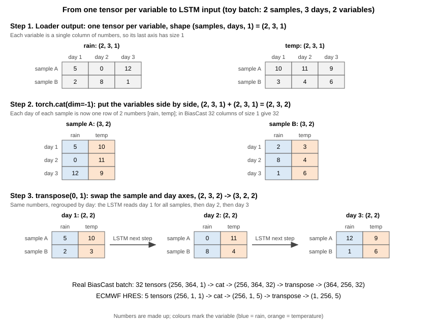
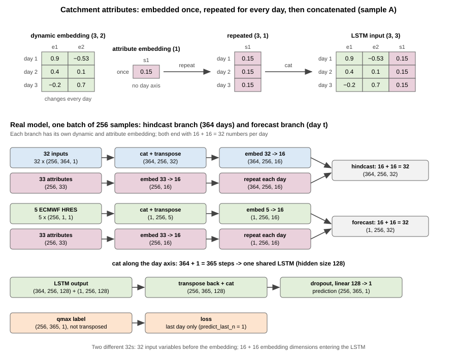

# BiasCast — Phần 4: Bên trong mô hình và cách huấn luyện

Phần 4 của ghi chú học BiasCast (Phần 1: `03_BiasCast1_Overview.md`, Phần 2: `04_BiasCast2_Metrics.md`, Phần 3: `05_BiasCast3_Data.md`). Phần 1–3 đã trả lời "mô hình nhận gì, trả gì, chấm thế nào, dữ liệu ra sao"; Phần 4 mở hộp mô hình: số liệu biến thành tensor thế nào, đi qua những lớp nào, hàm mất mát và vòng huấn luyện chạy ra sao, mô hình được chọn thế nào. Ví dụ số lấy từ mô hình tốt nhất của bài — Sequential Forecast LSTM có `qmean` (NSE trung vị 0,7053 khi tái lập ở bước A2, [LamaH] Mục 6.3); các khối ở Phần 4 là khối dùng chung của mọi mô hình trong bài, khác nhau giữa các kiến trúc để Phần 5.

Ký hiệu nguồn:

- **[Bài]**: bản chữ `PaperResearch/PaperResearchPDF/BasePaper/Konold2026_HESS_BiasCast_FullText.md`, kèm số dòng.
- **[Mã]**: mã NeuralHydrology trong bản fork của tác giả, thư mục `PaperResearch/PaperResearchCode/BiasCast_NH/neuralhydrology/`, ghi tên tệp và số dòng.
- **[Cơ sở]**: `01_Plan/01_BasePaper.md`, kèm mục.
- **[LamaH]**: `03_Data/01_LamaHCE.md`, kèm mục.
- **[Kratzert]**: Kratzert và cs., *Towards learning universal, regional, and local hydrological behaviors via machine learning applied to large-sample datasets*, HESS 23, 5089–5110, 2019, DOI `10.5194/hess-23-5089-2019`; PDF ở `PaperResearch/PaperResearchPDF/Evidence/Kratzert2019_HESS_NSEStarLoss.pdf`, kèm trang tạp chí.
- **[Lý thuyết]**: `06_Theory/01_ArchitectureTheory.md` (công thức LSTM có ví dụ số), kèm mục.

Thuật ngữ tiếng Anh dùng trong Phần 4 (tên trong mã để trong ngoặc):

| Tiếng Việt | Tiếng Anh |
|---|---|
| mẫu | sample |
| lô | batch (`batch_size`) |
| nhãn | target, label (`target_variables`) |
| bộ nạp dữ liệu | dataset, data loader (`BaseDataset`) |
| ngày khởi động | warm-up period |
| khung 365 ngày | input sequence, look-back window (`seq_length`) |
| pha quá khứ, pha dự báo | hindcast, forecast |
| chuẩn hóa | normalization, z-score scaling (`scaler`) |
| ô trống | missing value, NaN |
| trục | axis, dimension |
| ghép | concatenate (`torch.cat`) |
| đổi trục | transpose |
| lớp nhúng | embedding layer, embedding network (`dynamics_embedding`, `statics_embedding`) |
| lớp tuyến tính | linear layer, fully connected layer (`nn.Linear`, `FC`) |
| hàm kích hoạt | activation function |
| học chuyển giao | transfer learning |
| hàm mất mát | loss function |
| sai số bình phương trung bình | mean squared error, MSE |
| độ lệch chuẩn theo lưu vực | per-basin standard deviation (`per_basin_target_stds`) |
| lớp đầu ra | output layer, head (`head: regression`) |
| dropout (xóa ngẫu nhiên) | dropout (`output_dropout`) |
| dừng sớm | early stopping |
| so sánh cùng tham số | parameter-matched comparison |
| ngưỡng cải thiện tối thiểu, số epoch chờ | minimum delta (`min_delta`), patience |
| siêu tham số, tối ưu Bayes | hyperparameter, Bayesian optimization |
| epoch, lần cập nhật | epoch, update step |
| lan truyền thuận, lan truyền ngược | forward pass, backpropagation |
| cắt gradient | gradient clipping (`clip_gradient_norm`) |
| lịch learning rate | learning rate scheduler (CosineAnnealing) |
| hạt giống ngẫu nhiên | random seed (`seed`) |
| trạng thái ẩn, trạng thái ô | hidden state (`h_n`), cell state (`c_n`) |
| cổng quên, cổng nạp, cổng ra | forget gate, input gate, output gate |
| số chiều ẩn | hidden size (`hidden_size`) |

Nội dung Phần 4: (4.1) từ bảng số tới tensor; (4.2) lớp nhúng; (4.3) lõi LSTM; (4.4) lớp đầu ra và dropout; (4.5) hàm mất mát NSE*; (4.6) vòng huấn luyện; (4.7) validation, dừng sớm và chọn siêu tham số; (4.8) đếm tham số và so sánh cùng tham số; (4.9) tóm tắt và câu hỏi ôn.

---

### 4.1. Từ bảng số tới tensor

Phần 1 (Mục 1.4, 1.9) đã nêu hai ý: mọi biến được chuẩn hóa z-score, và một mẫu gồm 364 ngày quá khứ × 32 biến, 1 ngày dự báo × 5 biến, 33 thuộc tính. Mục này đi theo đúng thứ tự mã chạy, từ tệp số liệu tới tensor vào mạng rồi ngược lại ra m³/s.

| Bước | Làm gì | Ở đâu trong mã |
|---|---|---|
| 1 | Cắt chuỗi theo kỳ, lùi thêm 364 ngày khởi động; nhãn `qmax` trong các ngày khởi động bị xóa thành NaN | [Mã] `datasetzoo/basedataset.py` 437–449 |
| 2 | Tính thống kê chuẩn hóa (chỉ kỳ train), chuẩn hóa | 753–765 |
| 3 | Loại mẫu không hợp lệ | `_validate_samples`, 861–919 |
| 4 | Gom mẫu thành lô, chuyển trục, đưa vào mạng | `modelzoo/inputlayer.py` 215–245 |
| 5 | Đổi kết quả về đơn vị thật khi đánh giá | `evaluation/tester.py` 250–256 |

#### Ý chính

*Nhãn `qmax` và đầu vào `qmean`:* **nhãn** là đáp án mô hình phải dự báo; trong bài, nhãn duy nhất là `qmax` (lưu lượng lớn nhất ngày, mm/ngày). `qmean` (lưu lượng trung bình ngày, m³/s) là **đầu vào**, không phải nhãn, nên mọi chỗ "xóa nhãn" dưới đây chỉ áp dụng cho `qmax`, không đụng tới `qmean`.

*Ô trống được lưu bằng NaN:* "ô trống" là khái niệm (ngày đó không có số liệu); NaN ("Not a Number") là một giá trị số thực đặc biệt theo chuẩn IEEE 754 mà mã dùng để đánh dấu ô trống. NaN khác `null`/`None` (không có đối tượng nào): cột số của NumPy chỉ chứa được số thực, nên ô trống phải là NaN. Trong dữ liệu của bài, ngày thiếu `qmax`, `qmean` là ô để trống hoặc thiếu cả dòng; trong kỳ 2003–2017 của 451 lưu vực không có ô −999 (Phần 3, Mục 3.4; các năm khác chưa kiểm): pandas đọc ô trống thành NaN, ngày thiếu dòng thành NaN khi mã điền đủ trục ngày (bước 1). Bộ nạp còn đổi mọi giá trị âm của nhãn `qmax` thành NaN ([Mã] `datasetzoo/lamah.py` 228–229) — quy ước −999 của bộ LamaH-CE gốc. Mục này gọi chung là ô trống.

**Bước 1 — Ngày khởi động.** Mỗi mẫu cần khung 365 ngày: 364 ngày quá khứ cộng ngày t. Mẫu đầu tiên của kỳ train là ngày 1/1/2003, nên cần quá khứ từ 2/1/2002 tới 31/12/2002 — đoạn này nằm **trước** kỳ train và **không thuộc** kỳ train. Mã tự lấy thêm 364 ngày như vậy trước ngày bắt đầu của **mỗi** kỳ, gọi là ngày khởi động; số ngày = độ dài khung 365 − `predict_last_n` 1 = 364 ([Mã] `basedataset.py` 427–428, 437–441):

| Kỳ | Ngày khởi động (chỉ làm đầu vào) | Kỳ chính (có nhãn `qmax`: được học hoặc được chấm) |
|---|---|---|
| Train | 2/1/2002 → 31/12/2002 | 1/1/2003 → 31/12/2009 |
| Validation | 2/1/2009 → 31/12/2009 | 1/1/2010 → 31/12/2013 |
| Test | 2/1/2013 → 31/12/2013 | 1/1/2014 → 31/12/2017 |

(2002, 2009, 2013 đều có 365 ngày, nên lùi 364 ngày từ 1/1 năm sau là tới 2/1.)

Dữ liệu trước 2/1/2002 có sẵn nhưng mô hình của bài không dùng tới: khí tượng tái phân tích và lưu lượng có từ 1981, riêng các ô ECMWF HRES để trống trước 01/01/2002 ([LamaH] Mục 6.1). Tức là trước 2003 dữ liệu **không** phải toàn ô trống; chỉ nhãn `qmax` trong ngày khởi động bị mã xóa, và chỉ cột ECMWF HRES trống trước 2002.

Trong 364 ngày khởi động:

- **Đầu vào** (khí tượng, `qmean`, ECMWF HRES) giữ **số thật**, đưa vào mạng làm quá khứ cho các mẫu đầu kỳ.
- **Nhãn** `qmax` bị **xóa thành NaN** (dòng 448–449: mã chỉ xóa các cột trong `target_variables`, tức `qmax`), để không ngày nào ngoài kỳ chính được dùng làm đáp án. `qmean` trong ngày khởi động **không** bị xóa, vì nó là đầu vào.

Hai chỗ dễ nhầm:

- Ngày khởi động của validation là năm 2009, trùng năm cuối kỳ train; ngày khởi động của test là năm 2013, trùng năm cuối kỳ validation. Không phải rò rỉ: kỳ sau chỉ dùng **thời tiết và lưu lượng quá khứ** của năm đó làm đầu vào — khi vận hành quá khứ luôn có sẵn — chứ không lấy **nhãn `qmax`** của năm đó làm đáp án.
- Thống kê chuẩn hóa của biến đầu vào có tính cả ngày khởi động của kỳ train (2/1/2002–31/12/2009), còn của nhãn `qmax` thì không (1/1/2003–31/12/2009), vì nhãn `qmax` ngày khởi động đã bị xóa (bước 2).

Mã cũng điền đủ mọi ngày trong khoảng (dòng 446–447): ngày nào tệp không có dòng thì thành ô trống chứ không bị nhảy cóc, nên "364 dòng" luôn đúng là "364 ngày liền nhau". Như vậy ô trống sau bước này đến từ hai nguồn khác nhau:

- **Nhãn `qmax` bị cố ý xóa** trong 364 ngày khởi động — không làm mất mẫu nào. Mẫu train chỉ có ngày t trong 2003–2009, nên không mẫu nào lấy một ngày năm 2002 làm ngày t; năm 2002 chỉ nằm trong **phần quá khứ** của khung, mà ở phần quá khứ mô hình chỉ đọc đầu vào, không đọc nhãn `qmax` (chỉ nhãn `qmax` ngày t được kiểm và được tính sai số — bước 3, Mục 4.5). VD mẫu 1/1/2003 có khung 2/1/2002 → 1/1/2003: trong khung có 364 nhãn `qmax` trống (năm 2002) và 1 nhãn `qmax` thật (1/1/2003); mẫu vẫn được học vì chỉ nhãn `qmax` 1/1/2003 được dùng.
- **Ngày thật sự không có số liệu** trong tệp (VD trạm chưa đo) — trạm không đo thì thiếu cả `qmean` lẫn `qmax` ngày đó (hai cột luôn thiếu cùng ngày, Phần 3, Mục 3.4); khí tượng gần như không thiếu. Ở mô hình có `qmean` đầu vào, ngày đó là một ô đầu vào trống nên ở kỳ train mọi mẫu có ngày đó trong khung (365 mẫu) bị loại (bước 3); ở mô hình không có `qmean`, chỉ mẫu lấy đúng ngày đó làm ngày t bị loại, vì thiếu nhãn `qmax`.

**Bước 2 — Chuẩn hóa.** Với mỗi biến động (31 biến tái phân tích, `qmean`, 5 biến ECMWF HRES, nhãn `qmax`): một trung bình và một độ lệch chuẩn chung cho **mọi lưu vực, mọi ngày** của kỳ train, bỏ qua ô trống (dòng 764–765); rồi z = (x − trung bình) / độ lệch chuẩn (dòng 758). Với biến đầu vào, thống kê tính trên đoạn kỳ train **kể cả** 364 ngày khởi động, tức 2/1/2002–31/12/2009 ([LamaH] Mục 6.3); với nhãn `qmax`, các ngày khởi động đã bị xóa ở bước 1 nên thống kê chỉ gồm 1/1/2003–31/12/2009. Với 33 thuộc tính tĩnh: trung bình và độ lệch chuẩn tính **qua 451 lưu vực** (mỗi lưu vực một giá trị, dòng 725–736).

Thống kê được lưu vào tệp `train_data_scaler.yml` trong thư mục của run (`_dump_scaler`, dòng 254). Khi chạy validation và test, mã **đọc lại** tệp này chứ không tính lại (cờ `_compute_scaler` chỉ bật ở kỳ train, dòng 105–107). Lý do: nếu tính thống kê trên kỳ test thì thông tin kỳ test (VD kỳ test ướt hơn nên trung bình cao hơn) lọt vào đầu vào — một dạng rò rỉ.

Ví dụ số với ba biến của một lưu vực, một ngày (số chuẩn hóa của `qmean` là số thật của tác giả, [LamaH] Mục 6.3; hai biến còn lại là số giả định để minh họa):

| Biến | Giá trị thật | Trung bình kỳ train | Độ lệch chuẩn kỳ train | z |
|---|---|---|---|---|
| Mưa (giả định) | 12 mm | 3 | 6 | (12 − 3) / 6 = 1,5 |
| Nhiệt độ (giả định) | −2 °C | 8 | 8 | (−2 − 8) / 8 = −1,25 |
| `qmean` | 20 m³/s | 4,5778 | 16,1461 | (20 − 4,5778) / 16,1461 ≈ 0,96 |

Sau bước này mọi biến xoay quanh 0, phần lớn nằm trong khoảng −3 tới 3, dù gốc là mm, °C hay m³/s. Mạng không phải tự học "mưa 12 và nhiệt độ −2 cái nào lớn hơn" theo đơn vị.

**Bước 3 — Loại mẫu (chỉ ở kỳ train).** Hàm `_validate_samples` đánh dấu một mẫu (một lưu vực, một ngày t) là **không hợp lệ** nếu ([Mã] `basedataset.py` 893–917):

- chưa đủ 365 ngày lịch sử;
- **có bất kỳ ô trống nào** ở bất kỳ cột đầu vào động nào trong cả 365 ngày — hàm kiểm mọi cột (31 biến tái phân tích, `qmean`, 5 biến ECMWF HRES) trên đủ 365 ngày, kể cả những ô mô hình không dùng: ECMWF HRES của 364 ngày quá khứ, tái phân tích và `qmean` của ngày t (`basedataset.py` 577, 588, 622; [Cơ sở] Mục 11.4);
- nhãn `qmax` ngày t trống;
- có thuộc tính tĩnh trống.

Chỉ nhãn `qmax` **ngày t** được kiểm; nhãn `qmax` của 364 ngày trước đó không được xem, nên nhãn `qmax` bị xóa trong ngày khởi động (bước 1) không làm mất mẫu nào. Mẫu không hợp lệ bị bỏ khỏi danh sách mẫu huấn luyện. Hệ quả: lưu vực thiếu `qmean` một ngày thì mọi mẫu có ngày đó trong cửa sổ — tức 365 mẫu liên tiếp — bị bỏ (ví dụ đầy đủ ở Phần 3, Mục 3.4).

Ở validation và test, việc lọc này **tắt** (`basedataset.py` 617–630, chỉ gọi kiểm NaN khi `is_train`): mọi mẫu đủ 365 ngày lịch sử đều được chạy; mẫu có đầu vào trống cho ra dự báo trống, rồi khi tính chỉ số chỉ giữ ngày có cả quan trắc lẫn dự báo (`evaluation/metrics.py` 38–45). Lưu vực 55 thiếu `qmean` nên ở run có `qmean` mọi dự báo của nó đều trống, không có ngày nào được chấm ([LamaH] Mục 6.3). Cách thay thế (điền theo nhóm nguồn, che có chủ đích) là việc của bước B2, B3 (`02_Pipeline.md` Mục 7).

**Bước 4 — Lô và trục.** Kích thước tensor đọc theo thứ tự các trục: (256, 364, 1) nghĩa là 256 mẫu × 364 ngày × 1 biến. Bộ nạp gom B = 256 mẫu thành một lô.

*Vì sao trục cuối bằng 1.* Bộ nạp giữ **mỗi biến thành một tensor riêng** (một từ điển theo tên biến); mỗi tensor là một cột số, nên trục biến chỉ có 1 ([Mã] `basedataset.py` 588: `df_resampled[[col]].values`, hai ngoặc vuông giữ dạng cột (ngày, 1)). 32 biến quá khứ là 32 tensor (256, 364, 1) đứng riêng.

*Vì sao thành 32.* Lớp đầu vào **ghép** 32 tensor đó cạnh nhau theo trục cuối (`torch.cat(..., dim=-1)` trong `inputlayer.py`): 1 + 1 + … + 1 = 32. Ví dụ thu nhỏ — 1 mẫu, 3 ngày, 2 biến: mưa (1, 3, 1) = [[5], [0], [12]], nhiệt độ (1, 3, 1) = [[10], [11], [9]] → ghép thành (1, 3, 2) = [[5, 10], [0, 11], [12, 9]]: mỗi ngày một hàng gồm 2 số.

*Vì sao đổi trục.* `.transpose(0, 1)` đổi (256, 364, 32) thành (364, 256, 32): số liệu giữ nguyên, chỉ đổi thứ tự đọc thành "ngày trước, mẫu sau". LSTM của PyTorch mặc định nhận dạng (ngày, lô, biến) (lớp `nn.LSTM` trong `sequential_forecast_lstm.py` 49–52 không đặt `batch_first`): nó đi lần lượt từng ngày, mỗi ngày xử lý cả 256 mẫu cùng lúc.

*Hình: lô thu nhỏ 2 mẫu (A, B) × 3 ngày × 2 biến (mưa xanh, nhiệt độ cam), số tự đặt. Bước 1: bộ nạp đưa ra mỗi biến một bảng (mẫu × ngày), trục biến bằng 1. Bước 2: ghép theo trục cuối, mỗi ngày của mỗi mẫu thành một hàng [mưa, nhiệt độ]. Bước 3: đổi trục, cùng các số đó nhưng xếp theo ngày; LSTM đọc ngày 1 của mọi mẫu, rồi ngày 2, ngày 3. Hai dòng dưới là kích thước thật của một lô BiasCast.*

*Lưu ý hai con số 32.* 32 ở trên là **32 biến đầu vào** (31 tái phân tích + `qmean`). Sau lớp nhúng (Mục 4.2), mỗi ngày lại có 32 chiều nhưng là **16 chiều nhúng động + 16 chiều nhúng thuộc tính** — trùng số, khác nghĩa.

Đường đi đầy đủ của một lô:

| Thứ | Bộ nạp đưa ra | Trong lớp đầu vào và mô hình | Vào LSTM / so với nhãn |
|---|---|---|---|
| 32 biến quá khứ | 32 tensor (256, 364, 1) | ghép → (256, 364, 32) → đổi trục → (364, 256, 32) → nhúng 32 → 16: (364, 256, 16) | nối nhúng thuộc tính → (364, 256, 32) |
| 5 biến ECMWF HRES | 5 tensor (256, 1, 1) | ghép → (256, 1, 5) → đổi trục → (1, 256, 5) → nhúng 5 → 16: (1, 256, 16) | nối nhúng thuộc tính → (1, 256, 32) |
| 33 thuộc tính | (256, 33) — **không** đổi trục vì không có trục ngày | nhúng 33 → 16: (256, 16) → thêm trục ngày và lặp lại cho mọi ngày: (364, 256, 16) và (1, 256, 16) (`unsqueeze(0).repeat(...)`) | được nối vào cạnh nhúng động ở hai dòng trên |
| Đầu ra LSTM | | (364, 256, 128) và (1, 256, 128) → **đổi trục ngược lại** → (256, 364, 128), (256, 1, 128) → nối → (256, 365, 128) → dropout, lớp 128 → 1: dự báo (256, 365, 1) (`sequential_forecast_lstm.py` 91, 95, 98–99) | |
| Nhãn `qmax` | (256, 365, 1) — **không** đổi trục | | so với dự báo (256, 365, 1), cùng thứ tự trục (lô, ngày, 1); hàm mất mát chỉ lấy ngày cuối (`predict_last_n` = 1, Mục 4.4–4.5) |

*Hình: hàng trên — mẫu A, dùng số của ví dụ Mục 4.2: nhúng động 2 chiều đổi theo ngày; nhúng thuộc tính chỉ có một số (0,15) vì thuộc tính không có trục ngày, được lặp cho mọi ngày rồi nối vào cạnh nhúng động. Phần dưới — kích thước thật của một lô 256 mẫu ở hai nhánh: nhánh quá khứ (32 biến, 364 ngày, lớp nhúng động 32 → 16) và nhánh ngày t (5 biến ECMWF HRES, 1 ngày, lớp nhúng động riêng 5 → 16); mỗi nhánh có lớp nhúng thuộc tính riêng, đều ra 16 + 16 = 32 số mỗi ngày, rồi nối theo trục ngày thành 365 bước đi qua cùng một LSTM; 33 thuộc tính không đổi trục; nhãn `qmax` giữ dạng (mẫu, ngày, 1), chính đầu ra LSTM được đổi trục ngược lại để so khớp với nhãn.*

**Bước 5 — Đổi ngược.** Mạng xuất ŷ ở thang chuẩn hóa. Khi đánh giá, mã đổi cả quan trắc lẫn dự báo về đơn vị nhãn `qmax` bằng ŷ × độ lệch chuẩn + trung bình (`tester.py` 250–256), rồi mới tính NSE. Đơn vị nhãn `qmax` là mm/ngày (Phần 1, Mục 1.4); muốn ra m³/s thì nhân diện tích: Q = q × A / 86,4.

Ví dụ (thống kê của `qmax` ở đây là số giả định; số thật đọc từ `train_data_scaler.yml` ở bước A1): trung bình 2,5 mm/ngày, độ lệch chuẩn 4,0; mạng xuất ŷ = 1,2 → 1,2 × 4,0 + 2,5 = 7,3 mm/ngày → lưu vực 200 km²: 7,3 × 200 / 86,4 ≈ 16,9 m³/s.

**Tóm tắt ý chính:** lấy thêm 364 ngày khởi động (xóa nhãn `qmax`) → chuẩn hóa bằng thống kê kỳ train, lưu ra tệp, kỳ sau đọc lại → kỳ train bỏ mọi mẫu có ô trống trong cửa sổ, kỳ test vẫn chạy nhưng ra dự báo trống → gom lô, đổi trục thành (ngày, lô, biến) → đầu ra đổi ngược về mm/ngày rồi mới chấm.

#### Chi tiết kỹ thuật

*(a) Một bộ thống kê chung cho mọi lưu vực.* Chuẩn hóa không theo từng lưu vực: lưu vực lớn vẫn có z lớn, lưu vực nhỏ vẫn có z nhỏ. Thông tin "lưu vực này to hay nhỏ, ướt hay khô" nhờ vậy còn nằm trong số liệu, và mô hình chung cho 451 lưu vực cần nó. Mặt trái là biến có thang lệch giữa các lưu vực như `qmean` theo m³/s bị dồn về một khoảng hẹp ở đa số lưu vực nhỏ (Phần 3, Mục 3.3, bảng hai lưu vực).

*(b) Nhãn `qmax` cũng được chuẩn hóa.* Hàm mất mát so ŷ với nhãn `qmax` **đã chuẩn hóa**; vì sao điều này không làm sai NSE* là việc của Mục 4.5.

*(c) Ô trống không bị điền.* Mã không điền ô trống bằng 0 hay trung bình; mẫu chứa ô trống bị bỏ cả mẫu (bước 3). Thư viện có tham số `nan_handling_method` để lớp đầu vào xử lý ô trống (VD trung bình có che), nhưng chỉ lớp đầu vào đọc tham số này (`modelzoo/inputlayer.py`), còn bộ nạp `basedataset.py` không đọc, nên mẫu có ô trống vẫn bị bỏ trước khi tới lớp đầu vào. Bài BiasCast giữ nguyên cách bỏ mẫu này và chỉ nêu ở phần thảo luận rằng khi vận hành cần tính tới trạm hỏng và nên áp dụng cách huấn luyện của Gauch và cs. (HESS 29, 6221–6235, 2025) ([Bài] dòng 350). Đề tài làm việc đó ở bước B2 (chia đầu vào quá khứ thành nhóm theo nguồn, mỗi nhóm một lớp nhúng, gộp bằng trung bình có che ô trống; sửa bộ lọc để chỉ yêu cầu nhãn `qmax` ngày t và thuộc tính hợp lệ) và B3 (cố ý che ngẫu nhiên từng nguồn khi huấn luyện) (`02_Pipeline.md` Mục 3.2–3.4). Sau khi sửa: mẫu có đầu vào thiếu vẫn được học và vẫn cho ra dự báo, dựa trên các nguồn còn lại; mẫu thiếu nhãn `qmax` ngày t vẫn bị bỏ khỏi huấn luyện vì không có đáp án để tính sai số; thiếu nguồn thì dự báo kém hơn, mức kém đi đo bằng kịch bản mất Q S1 (mất 1, 3, 7 ngày cuối) và S2 (mất cả cửa sổ) (`02_Pipeline.md` Mục 6.3); nếu mọi nhóm cùng trống ở một ngày, trung bình có che của thư viện điền một giá trị cố định cho ngày đó.

**Câu hỏi tự kiểm tra (Mục 4.1):**

1. Vì sao thống kê chuẩn hóa chỉ tính trên kỳ train rồi lưu ra tệp, mà không tính lại trên kỳ test?
2. Một ngày `qmean` = 50 m³/s. Dùng thống kê của tác giả (trung bình 4,5778, độ lệch chuẩn 16,1461), tính z. Một suối nhỏ có `qmean` = 1 m³/s thì z bằng bao nhiêu? Hai số z này nói gì về cách mô hình "thấy" suối nhỏ?
3. Một lưu vực thiếu `qmean` đúng một ngày, 10/3/2005. Những mẫu nào của lưu vực này bị loại? Khoảng bao nhiêu mẫu?
4. Mạng xuất ŷ = −0,3; thống kê `qmax` (giả định) trung bình 2,5, độ lệch chuẩn 4,0; lưu vực 500 km². Tính qmax theo mm/ngày và m³/s.
5. Vì sao lớp đầu vào phải đổi trục (256, 364, 32) thành (364, 256, 32)?

**Đáp án (Mục 4.1):** (1) Tính trên kỳ test là rò rỉ dữ liệu: dùng thông tin của kỳ mà khi vận hành thật chưa có; ngoài ra mô hình đã học trên thang chuẩn hóa của kỳ train, đổi thang ở kỳ test thì cùng một con số mang nghĩa khác. (2) z = (50 − 4,5778) / 16,1461 ≈ 2,813; z = (1 − 4,5778) / 16,1461 ≈ −0,222; mọi suối nhỏ dồn vào khoảng hẹp quanh −0,28…−0,2 (`qmean` = 0 cho z ≈ −0,284), nên khác biệt giữa các suối nhỏ rất nhỏ so với sông lớn — một thang chung cho cả 451 lưu vực làm mô hình khó phân biệt suối nhỏ (lý do bước B1a đưa Q về mm/ngày theo diện tích). (3) Mọi mẫu có cửa sổ 365 ngày chứa 10/3/2005, tức ngày t từ 10/3/2005 đến 9/3/2006: 365 mẫu (không phải 364, vì bộ lọc kiểm cả ô `qmean` của chính ngày t dù mô hình không dùng); chỉ ở kỳ train. (4) qmax = −0,3 × 4,0 + 2,5 = 1,3 mm/ngày; Q = 1,3 × 500 / 86,4 ≈ 7,52 m³/s. (5) `nn.LSTM` của PyTorch mặc định `batch_first=False`, nhận (ngày, mẫu, biến) và đi lần lượt theo trục đầu; NeuralHydrology giữ mặc định này nên đổi trục trước khi đưa vào.

---

### 4.2. Lớp nhúng

Lớp nhúng (embedding) là bước đầu tiên bên trong mạng: nó biến các biến đầu vào đã chuẩn hóa thành một vector có số chiều cố định, rồi mới đưa vào LSTM. Trong Sequential Forecast LSTM có **bốn** lớp nhúng ([Mã] `modelzoo/sequential_forecast_lstm.py` 43–47; [Cơ sở] Mục 11.2):

| Lớp nhúng | Vào | Ra | Tham số |
|---|---|---|---|
| Biến động quá khứ (hindcast) | 32 biến | 16 | 32 × 16 + 16 = 528 |
| Biến động ngày t (forecast) | 5 biến ECMWF HRES | 16 | 5 × 16 + 16 = 96 |
| Thuộc tính, nhánh hindcast | 33 thuộc tính | 16 | 33 × 16 + 16 = 544 |
| Thuộc tính, nhánh forecast | 33 thuộc tính | 16 | 544 |

Mỗi ngày, vector động 16 chiều được **nối** với vector thuộc tính 16 chiều thành 32 chiều; vector thuộc tính giống nhau ở mọi ngày vì thuộc tính không đổi theo thời gian (`inputlayer.py`, đoạn `unsqueeze(0).repeat(...)` rồi `torch.cat`). Kết quả: pha quá khứ (364, 256, 32), pha ngày t (1, 256, 32) — **cùng 32 chiều**, nên cùng một LSTM chạy được qua cả hai pha. Mã bắt buộc điều này: hai lớp nhúng hindcast và forecast phải ra cùng kích thước, nếu không sẽ báo lỗi (dòng 46–47).

#### Ý chính

**Bước 1 — Lớp nhúng làm phép tính gì.** Lớp nhúng "đơn giản" của bài là **một lớp tuyến tính**: y = W·x + b. Ví dụ thu nhỏ với 3 biến động → 2 chiều và 2 thuộc tính → 1 chiều (số giả định):

- Biến động một ngày (đã chuẩn hóa): x = (mưa 1,2; nhiệt độ −0,5; `qmean` 0,3).
- W = [[0,5; 0,2; 1,0], [−0,3; 0,4; 0,1]], b = (0,1; 0).
- Chiều 1: 0,5 × 1,2 + 0,2 × (−0,5) + 1,0 × 0,3 + 0,1 = 0,6 − 0,1 + 0,3 + 0,1 = **0,9**.
- Chiều 2: −0,3 × 1,2 + 0,4 × (−0,5) + 0,1 × 0,3 + 0 = −0,36 − 0,2 + 0,03 = **−0,53**.
- Thuộc tính s = (0,8; −1,0), W_s = [0,5; 0,25], b_s = 0: 0,4 − 0,25 = **0,15**.
- Vector vào LSTM ngày này: (0,9; −0,53; 0,15). Ngày hôm sau hai số đầu đổi theo thời tiết, số cuối vẫn 0,15.

Mỗi chiều đầu ra là một **tổ hợp có trọng số** của mọi biến: chiều 1 ở ví dụ chủ yếu "đọc" mưa và lưu lượng, chiều 2 đọc mưa với dấu ngược. Các trọng số này được học cùng lúc với LSTM.

**Bước 2 — Vì sao cần lớp nhúng.** Lớp đầu tiên của LSTM tự nó đã là phép nhân ma trận với đầu vào, nên đặt thêm một lớp tuyến tính phía trước **không** làm mô hình biểu diễn được nhiều hơn (hai phép tuyến tính liên tiếp vẫn là một phép tuyến tính). Lý do nằm ở cấu trúc nhiều nguồn ([Bài] dòng 98; ý thứ hai là suy luận của ghi chú này từ cấu trúc mã):

- Pha quá khứ có 32 biến, pha ngày t chỉ có 5 biến ECMWF HRES. Một LSTM không nhận được hai kích thước khác nhau; hai lớp nhúng **riêng** đưa cả hai về cùng 16 chiều.
- Hai lớp nhúng riêng nghĩa là mỗi nguồn có bộ trọng số riêng: mưa ERA5-Land và mưa ECMWF HRES đi qua hai W khác nhau, nên mạng có chỗ để học rằng "mưa ECMWF HRES 10 mm" không hoàn toàn giống "mưa tái phân tích 10 mm" — đúng cái lệch miền bài muốn bù (Phần 1, Mục 1.11).
- Bài nêu học chuyển giao là một động cơ chính (*"a primary motivation"*): chiếu các nguồn có số biến khác nhau vào một không gian chung, nên có thể huấn luyện trước trên tái phân tích rồi chỉ tinh chỉnh lớp nhúng cho dự báo ([Bài] dòng 98; thí nghiệm học chuyển giao để Phần 5).

**Bước 3 — Nhúng đơn giản và nhúng phức tạp.** Bài so hai loại ([Bài] dòng 172):

| Loại | Cấu trúc theo bài | Cấu trúc theo mã | Dropout trong lớp nhúng |
|---|---|---|---|
| Đơn giản | một lớp 16 chiều, có tanh | một lớp tuyến tính 16 chiều, **không** tanh | 0 |
| Phức tạp | ba lớp 30, 20, 64, có tanh | tuyến tính 30 → tanh → tuyến tính 20 → tanh → tuyến tính 64 | 0 |

Lớp `FC` của thư viện chỉ chèn hàm kích hoạt **giữa** các lớp, không chèn sau lớp cuối ([Mã] `modelzoo/fc.py`: nhánh một lớp chỉ có `nn.Linear`, nhánh nhiều lớp thêm kích hoạt và dropout sau từng lớp ẩn rồi kết thúc bằng `nn.Linear`). Vì vậy nhúng "đơn giản" trong mã là tuyến tính thuần, khác câu "tanh activation" ở Mục 2.2.6 của bài; chính bài ở chỗ khác lại gọi nó là "simple (linear)" ([Bài] dòng 280 và chú thích Hình 8). Dropout trong lớp nhúng bằng 0 ở mọi thí nghiệm ([Bài] dòng 290).

Nếu thêm tanh vào ví dụ ở bước 1: tanh(0,9) ≈ 0,72, tanh(−0,53) ≈ −0,49 — số bị nén về khoảng (−1, 1), và phép biến đổi thành phi tuyến.

**Bước 4 — Kết quả của bài.** Ở baseline, Encoder–Decoder và Sequential Forecast LSTM, nhúng đơn giản cho NSE **nhỉnh hơn** nhúng phức tạp; riêng học chuyển giao thì ngược lại ([Bài] dòng 280, 288). Bài giải thích: nhúng phức tạp có nhiều tham số so với lượng dữ liệu nên dễ học thuộc nhiễu của kỳ train, lại không có dropout; còn khi học chuyển giao chỉ tinh chỉnh lớp nhúng, lớp nhúng phải gánh toàn bộ việc thích nghi miền nên cần phi tuyến ([Bài] dòng 290). Đây là giải thích của tác giả, chưa có thí nghiệm riêng kiểm chứng; với một hạt giống, chênh lệch "nhỉnh hơn" cũng chưa biết có vượt mức nhiễu giữa các lần huấn luyện hay không (bước A4 đo mức nhiễu này).

**Tóm tắt ý chính:** lớp nhúng = tổ hợp có trọng số của các biến → mỗi nguồn một lớp nhúng riêng, đưa 32 biến và 5 biến về cùng 16 chiều, nối thêm 16 chiều thuộc tính → cùng một LSTM chạy qua cả hai pha → trong bài, nhúng đơn giản (tuyến tính) cho NSE nhỉnh hơn nhúng phức tạp, trừ học chuyển giao.

#### Chi tiết kỹ thuật

*(a) Khởi tạo trọng số.* Lớp `FC` khởi tạo W theo phân phối đều trong khoảng (−√(3/n), √(3/n)) với n là số đầu vào, b = 0 ([Mã] `modelzoo/fc.py`, hàm `_reset_parameters`). Với lớp nhúng hindcast n = 32: khoảng (−0,31; 0,31).

*(b) Ý nghĩa cho đề tài.* Ở bước B2, lớp nhúng được tách theo **nguồn** (mỗi nguồn khí tượng một lớp nhúng, gộp bằng trung bình có che ô trống) để mẫu thiếu một nguồn vẫn dùng được; ở bước C, mọi lõi (LSTM, Mamba, S4D…) nhận cùng đầu ra lớp nhúng nên chênh lệch kết quả chỉ đến từ lõi (`02_Pipeline.md` Mục 3, 4).

**Câu hỏi tự kiểm tra (Mục 4.2):**

1. Tính lại ví dụ ở bước 1 với x = (mưa 0; nhiệt độ 1,0; `qmean` −0,2), cùng W, b. Vector vào LSTM ngày đó là gì (thuộc tính giữ nguyên)?
2. Vì sao Sequential Forecast LSTM cần hai lớp nhúng động riêng, không dùng chung một lớp cho cả pha quá khứ và pha ngày t?
3. Đếm tham số của lớp nhúng phức tạp cho 32 biến động (32 → 30 → 20 → 64). So với 528 của nhúng đơn giản thì gấp bao nhiêu lần?
4. Bài viết "simple embedding … 16 hidden units and tanh", mã lại không có tanh. Khi viết báo cáo, đề tài nên ghi theo bên nào, và vì sao?
5. "Nhúng đơn giản cho NSE nhỉnh hơn nhúng phức tạp" — cần thêm gì để kết luận này chắc chắn?

**Đáp án (Mục 4.2):** (1) Chiều 1: 0,5 × 0 + 0,2 × 1,0 + 1,0 × (−0,2) + 0,1 = 0,1; chiều 2: −0,3 × 0 + 0,4 × 1,0 + 0,1 × (−0,2) + 0 = 0,38; vector vào LSTM là (0,1; 0,38; 0,15) — không phải chính x, vì lớp nhúng đã trộn các biến qua W, b. (2) Pha quá khứ có 32 biến, pha ngày t có 5 biến; hai lớp riêng đưa cả hai về cùng 16 chiều để nối với 16 chiều nhúng thuộc tính thành 32 chiều cho cùng một LSTM; đồng thời mỗi nguồn có trọng số riêng, nên mạng học được mưa ECMWF HRES khác mưa tái phân tích (lệch miền). (3) 32 × 30 + 30 = 990; 30 × 20 + 20 = 620; 20 × 64 + 64 = 1344; tổng 2954 tham số, gấp khoảng 5,6 lần 528. (4) Ghi theo mã (bản thực sự đã chạy ra số liệu): một lớp tuyến tính, không tanh; kèm một câu nêu rằng Mục 2.2.6 của bài viết có tanh nhưng mã và chỗ khác của bài gọi là tuyến tính, dẫn [Mã] `modelzoo/fc.py`. (5) Cần nhiều hạt giống để biết chênh lệch có vượt mức nhiễu giữa các lần huấn luyện không (bước A4), kiểm định thống kê theo lưu vực (Wilcoxon), và điều kiện so sánh công bằng (cùng tinh chỉnh siêu tham số, thử thêm dropout cho nhúng phức tạp); học thuộc nhiễu (overfit) chỉ là giải thích của tác giả, chưa có thí nghiệm kiểm chứng.

---

### 4.3. Lõi LSTM

Lõi của mô hình là **một tầng** `nn.LSTM` của PyTorch, nhận 32 số mỗi ngày (16 nhúng động + 16 nhúng thuộc tính, Mục 4.2) và trả 128 số mỗi ngày ([Mã] `modelzoo/sequential_forecast_lstm.py` 49–52). Số 128 là `hidden_size` trong cấu hình; tác giả chọn nó bằng tối ưu Bayes trong các mức 64/128/256 ([Cơ sở] Mục 5, 11.2). Công thức bốn cổng và ví dụ số đầy đủ đã có ở [Lý thuyết] Mục 1.3–1.4; mục này chỉ nêu những gì riêng của BiasCast.

#### Ý chính

**Bước 1 — Hai trạng thái, mỗi trạng thái 128 số.** Ở mỗi ngày, LSTM giữ hai vector:

| Trạng thái | Tiếng Anh (tên trong mã) | Vai trò |
|---|---|---|
| Trạng thái ẩn h | hidden state (`h_n`) | Đầu ra của ngày đó; đi tiếp vào ngày sau và, ở ngày t, vào lớp đầu ra |
| Trạng thái ô c | cell state (`c_n`) | "Bộ nhớ dài hạn"; chỉ đi tiếp sang ngày sau, không ra ngoài |

"Ẩn" nghĩa là các số này không được gán sẵn ý nghĩa: không số nào được định trước là "độ ẩm đất" hay "lượng tuyết"; mô hình tự học cách dùng chúng. Dò xem chúng có tương quan với các đại lượng thủy văn không là việc của bước G (dò trạng thái ẩn).

**Bước 2 — Mỗi ngày làm gì.** Với vector đầu vào x_t (32 số) và h_(t−1) (128 số) của ngày trước, LSTM tính bốn vector 128 số ([Lý thuyết] Mục 1.3):

- cổng quên f (forget gate) = σ(W_f · x_t + U_f · h_(t−1) + b_f) — giữ bao nhiêu phần bộ nhớ cũ;
- cổng nạp i (input gate) = σ(W_i · x_t + U_i · h_(t−1) + b_i) — nhận bao nhiêu thông tin mới;
- thông tin mới g (candidate) = tanh(W_g · x_t + U_g · h_(t−1) + b_g);
- cổng ra o (output gate) = σ(W_o · x_t + U_o · h_(t−1) + b_o);
- rồi c_t = f × c_(t−1) + i × g và h_t = o × tanh(c_t) (nhân từng phần tử).

Mỗi W có dạng (128, 32), mỗi U có dạng (128, 128). PyTorch gộp bốn W thành một ma trận (512, 32) (`weight_ih_l0`) và bốn U thành (512, 128) (`weight_hh_l0`), theo thứ tự cổng i, f, g, o; số 512 = 4 × 128 (bốn cổng, mỗi cổng 128 số). Cùng một bộ trọng số dùng cho mọi ngày — đây là lý do LSTM chạy được với chuỗi dài bao nhiêu cũng được.

**Bước 3 — Hai pha nối liền qua trạng thái.** Mã gọi **cùng một** LSTM hai lần ([Mã] `sequential_forecast_lstm.py` 89–94):

1. Pha quá khứ: chạy 364 bước trên (364, 256, 32), bắt đầu từ h = c = 0, ra 364 vector h và trạng thái cuối (h, c) của ngày t − 1.
2. Pha ngày t: chạy 1 bước trên (1, 256, 32) của ECMWF HRES, **bắt đầu từ (h, c) của ngày t − 1**.

Như vậy bộ nhớ tích lũy từ 364 ngày tái phân tích và `qmean` được chuyển sang ngày t; ở ngày t, đầu vào đổi sang dự báo ECMWF HRES (qua lớp nhúng riêng) nhưng trọng số LSTM vẫn là một. Đó là ý "sequential" trong tên mô hình: một chuỗi LSTM duy nhất chạy qua cả hai pha. Hai nửa đầu ra được đổi trục và nối thành (256, 365, 128) (dòng 91, 95, 98) trước lớp đầu ra (Mục 4.4).

**Bước 4 — Khởi tạo cổng quên bằng 3.** Mã đặt bias của cổng quên trong `bias_hh_l0` (đoạn [128:256], tức cổng f theo thứ tự i, f, g, o) bằng `initial_forget_bias` = 3 ([Mã] dòng 60–63; [Cơ sở] Mục 11.2). Các trọng số khác giữ khởi tạo mặc định của PyTorch: phân phối đều trong (−1/√128, 1/√128) ≈ (−0,088; 0,088), kể cả `bias_ih_l0`. Ví dụ thu nhỏ, 1 chiều, mọi tổng W·x + U·h + b (chưa kể bias quên) bằng 0,25, bộ nhớ cũ c = 2,0:

| | Bias quên = 3 | Bias quên = 0 |
|---|---|---|
| f = σ(0,25 + bias) | σ(3,25) ≈ 0,963 | σ(0,25) ≈ 0,562 |
| i = σ(0,25), g = tanh(0,25) | 0,562; 0,245 | 0,562; 0,245 |
| c mới = f × 2,0 + i × g | 1,925 + 0,138 = **2,063** | 1,124 + 0,138 = **1,262** |
| Còn lại sau 30 ngày (chỉ tính f^30) | 0,963^30 ≈ 0,32 | 0,562^30 ≈ 3 × 10⁻⁸ |

Bias 3 làm cổng quên gần 1 ngay từ đầu, nên lúc mới huấn luyện bộ nhớ đã giữ được lâu (khoảng một phần ba sau 30 ngày thay vì gần như mất hết); gradient nhờ đó đi được xa về quá khứ. Với thủy văn điều này quan trọng: tuyết tích từ mùa đông, độ ẩm đất từ nhiều tuần trước ảnh hưởng tới lưu lượng hôm nay. Đây là giá trị khởi tạo; trong lúc huấn luyện, mô hình vẫn học lại bias này.

**Bước 5 — Đếm tham số.** Với nhúng đơn giản (đầu vào 32):

| Phần | Kích thước | Tham số |
|---|---|---|
| `weight_ih_l0` | (512, 32) | 16.384 |
| `weight_hh_l0` | (512, 128) | 65.536 |
| `bias_ih_l0`, `bias_hh_l0` | 512 + 512 | 1.024 |
| **Tổng LSTM** | | **82.944** |

Khớp con số 82.944 ở [Cơ sở] Mục 11.2. LSTM chiếm khoảng 97% tổng 85 nghìn tham số; lớp nhúng chỉ 528 + 96 + 544 + 544 = 1.712. Với nhúng phức tạp, đầu vào là 128 nên `weight_ih_l0` thành (512, 128) = 65.536 và tổng LSTM là 132.096. PyTorch có **hai** vector bias cho mỗi cổng (`bias_ih`, `bias_hh`) dù về toán học chúng cộng lại thành một; khi so sánh "cùng số tham số" với lõi khác (bước C), cần đếm đúng theo mã như vậy.

**Tóm tắt ý chính:** một tầng LSTM 128 chiều → mỗi ngày bốn cổng cập nhật bộ nhớ c và đầu ra h → cùng một LSTM chạy 364 ngày quá khứ rồi chuyển (h, c) sang 1 ngày ECMWF HRES → cổng quên khởi tạo bias 3 để nhớ lâu ngay từ đầu → 82.944 tham số, gần như toàn bộ mô hình.

**Câu hỏi tự kiểm tra (Mục 4.3):**

1. Trạng thái ẩn h và trạng thái ô c khác nhau thế nào? Cái nào đi vào lớp đầu ra?
2. Nếu pha ngày t khởi động LSTM từ h = c = 0 thay vì (h, c) của ngày t − 1 thì mô hình mất gì?
3. Tính lại ví dụ ở bước 4 với c cũ = 5,0 (một lưu vực đang có nhiều tuyết), bias quên = 3. c mới bằng bao nhiêu?
4. Nếu `hidden_size` = 64 thì LSTM có bao nhiêu tham số (đầu vào vẫn 32)?
5. Vì sao bài toán lưu lượng cần cổng quên gần 1 hơn bài toán chỉ phụ thuộc vài ngày gần nhất?

**Đáp án (Mục 4.3):** (1) h là đầu ra của từng ngày, đi tiếp sang ngày sau và (sau dropout) vào lớp đầu ra; c là bộ nhớ dài hạn, chỉ đi sang ngày sau, không ra ngoài. Lớp đầu ra nhận h. (2) Mất toàn bộ bộ nhớ của 364 ngày quá khứ (tuyết, độ ẩm đất, `qmean` gần nhất): dự báo ngày t chỉ còn dựa vào 1 ngày ECMWF HRES và thuộc tính, gần với tình huống baseline chỉ dùng dự báo 𝒟FC (NSE trung vị khoảng 0,39 so với 0,71, [LamaH] Mục 6.3) — suy luận, chưa chạy thử. (3) f ≈ 0,963; c mới = 0,963 × 5,0 + 0,562 × 0,245 ≈ 4,81 + 0,14 = 4,95 — bộ nhớ tuyết gần như được giữ nguyên. (4) 4 × 64 × 32 + 4 × 64 × 64 + 2 × 4 × 64 = 8.192 + 16.384 + 512 = 25.088. (5) Lưu lượng hôm nay phụ thuộc các kho chứa tích lũy qua nhiều tuần, nhiều tháng (tuyết, nước ngầm, độ ẩm đất); cổng quên gần 1 giữ được thông tin đó qua nhiều bước và cho gradient đi xa về quá khứ; bài toán chỉ phụ thuộc vài ngày gần nhất thì quên nhanh cũng không mất gì.

---

### 4.4. Lớp đầu ra và dropout

Sau LSTM, đầu ra hai pha đã nối thành (256, 365, 128) (Mục 4.3, bước 3). Mã đưa nó qua **dropout** rồi **một lớp tuyến tính** 128 → 1 ([Mã] `modelzoo/sequential_forecast_lstm.py` 54–56, 99; `modelzoo/head.py` 29–30, 60–72).

#### Ý chính

**Bước 1 — Dropout khi huấn luyện.** Dropout (`nn.Dropout`, p = `output_dropout` = 0,3 ở mọi Sequential Forecast LSTM, [Cơ sở] Mục 11.3) xóa ngẫu nhiên mỗi số trong 128 số của h với xác suất 0,3, các số còn lại nhân 1 / (1 − 0,3) ≈ 1,43 để giữ nguyên giá trị trung bình. Ví dụ thu nhỏ 4 chiều: h = (0,5; −0,2; 0,8; 0,1), lần rút ngẫu nhiên giữ (có; không; có; có) → (0,714; 0; 1,143; 0,143). Mỗi lô, mỗi mẫu, mỗi ngày rút lại một mặt nạ mới. Tác dụng: lớp đầu ra không được dựa vào một vài số cố định trong h, nên mô hình khó học thuộc nhiễu của kỳ train. Dropout chỉ đặt ở đây; trong lớp nhúng bằng 0 (Mục 4.2) và bên trong LSTM không có.

**Bước 2 — Dropout tắt khi đánh giá.** Khi chạy validation/test, mã gọi `model.eval()` nên dropout không xóa gì và không nhân hệ số ([Mã] `evaluation/tester.py` 203–207). Ngoại lệ là `mc_dropout` (giữ dropout bật lúc đánh giá để ước lượng độ bất định), mặc định tắt ([Mã] `utils/config.py` 599–600); bài không dùng dự báo xác suất nên không cần.

**Bước 3 — Lớp đầu ra.** Head "regression" là đúng một `nn.Linear(128, 1)`: ŷ = w · h + b, 128 + 1 = **129** tham số. Hàm kích hoạt sau lớp này lấy từ `output_activation`, mặc định "linear" tức không có ([Mã] `utils/config.py` 690–691); cấu hình của tác giả có đặt khóa này hay không chưa kiểm trong `config.yml`. Với đầu ra tuyến tính, ŷ là số thực bất kỳ, nên sau khi bỏ chuẩn hóa (Mục 4.1, bước 5) `qmax` dự báo **có thể âm** — điều vô lý về vật lý; số lần xảy ra chưa đếm (việc cho bước A3, khi tính lại chỉ số từ dự báo của tác giả).

**Bước 4 — Chỉ ngày t được chấm.** Lớp đầu ra chạy cho cả 365 ngày, ra (256, 365, 1), nhưng hàm mất mát chỉ cắt `predict_last_n` = 1 ngày cuối của cả dự báo lẫn nhãn `qmax` ([Mã] `training/loss.py` 138–140). 364 dự báo của các ngày quá khứ được tính rồi bỏ; chi phí nhỏ vì head chỉ là một phép nhân 128 số. Như vậy chỉ h của ngày t (ngày chạy trên ECMWF HRES) nhận gradient trực tiếp từ hàm mất mát; các ngày quá khứ học gián tiếp qua chuỗi trạng thái (h, c).

**Bước 5 — Tổng tham số của mô hình tốt nhất.**

| Phần | Tham số |
|---|---|
| Bốn lớp nhúng (Mục 4.2) | 528 + 96 + 544 + 544 = 1.712 |
| LSTM (Mục 4.3) | 82.944 |
| Lớp đầu ra | 129 |
| Dropout | 0 |
| **Tổng** | **84.785** |

Khớp "khoảng 85 nghìn" ở [Cơ sở] Mục 11.2. Bước C so các lõi thay thế (Mamba, GRU, Transformer, S4D) ở mức tổng tham số lệch không quá 1% so với mốc; mốc là LSTM cải tiến sau bước B, có tổng tham số gần con số này nhưng phải đếm lại (Mục 4.8; `02_Pipeline.md` Mục 5.2).

**Tóm tắt ý chính:** (256, 365, 128) → dropout 0,3 (chỉ khi huấn luyện) → tuyến tính 128 → 1 → chỉ ngày t vào hàm mất mát → tổng 84.785 tham số; đầu ra tuyến tính nên có thể ra `qmax` âm.

**Câu hỏi tự kiểm tra (Mục 4.4):**

1. Với h = (1,0; 0,4; −0,6) và lần rút giữ (không; có; có), p = 0,3, đầu ra dropout là gì? Khi đánh giá thì là gì?
2. Vì sao phải nhân 1 / (1 − p) cho các số được giữ?
3. Nếu đặt `output_activation: softplus` thì dự báo đã chuẩn hóa có âm được không? Sau khi bỏ chuẩn hóa thì `qmax` có âm được không? (gợi ý: z = 0 ứng với trung bình, không phải với 0 mm/ngày)
4. Nếu `predict_last_n` = 7 thì hàm mất mát chấm những ngày nào, và còn đúng bài toán của BiasCast không?
5. Đổi lõi LSTM sang Mamba ở bước C: phần nào trong bảng tham số đổi, phần nào giữ nguyên?

**Đáp án (Mục 4.4):** (1) Khi huấn luyện: (0; 0,4 / 0,7; −0,6 / 0,7) ≈ (0; 0,571; −0,857); khi đánh giá dropout tắt nên giữ nguyên (1,0; 0,4; −0,6). (2) Để giá trị trung bình của mỗi số như nhau giữa lúc huấn luyện và lúc đánh giá: kỳ vọng = 0,7 × (x / 0,7) + 0,3 × 0 = x; không nhân thì lúc đánh giá lớp đầu ra nhận số lớn hơn trung bình 1 / 0,7 lần so với lúc học. (3) softplus luôn dương nên ŷ đã chuẩn hóa > 0; sau khi bỏ chuẩn hóa `qmax` = ŷ × σ + μ > μ, tức không âm nhưng **luôn lớn hơn trung bình** — mô hình không thể dự báo ngày lưu lượng thấp, sai còn nặng hơn; muốn chặn âm phải áp ràng buộc trên thang thật (sau khi bỏ chuẩn hóa), không phải trên z. (4) Chấm 7 ngày cuối, từ t − 6 tới t; sáu ngày t − 6…t − 1 nằm trong pha quá khứ, dùng tái phân tích và `qmean` đã quan trắc, nên mô hình được chấm cả việc "dựng lại" quá khứ — không còn đúng bài toán dự báo ngày t của BiasCast, và kết quả trộn lẫn hai việc. (5) Chỉ phần LSTM (82.944) đổi thành tham số của lõi Mamba; bốn lớp nhúng (1.712) và lớp đầu ra (129, nếu lõi vẫn ra 128 chiều) giữ nguyên; tổng phải nằm trong 84.785 ± 1%.

---

### 4.5. Hàm mất mát NSE*

Hàm mất mát là con số mô hình cố làm nhỏ nhất khi huấn luyện. BiasCast dùng **NSE\*** của Kratzert và cs. ([Bài] dòng 98 và Phụ lục C, dòng 378; [Kratzert] tr. 5093), cài trong `MaskedNSELoss` ([Mã] `training/loss.py` 217–257). NSE\* là hàm mất mát, khác NSE là chỉ số báo cáo kết quả (Phần 2).

#### Ý chính

**Bước 1 — Công thức.** Theo bài (công thức C2):

NSE\* = (1/B) Σ_b Σ_n (ŷ_n − y_n)² / (s(b) + ε)²

- B: số lưu vực; n chạy qua các mẫu của lưu vực b;
- ŷ_n, y_n: dự báo và nhãn `qmax` của mẫu n;
- s(b): độ lệch chuẩn của nhãn `qmax` của lưu vực b trong kỳ train;
- ε = 0,1: hằng số tránh chia cho số quá nhỏ.

Mã làm như sau cho mỗi lô ([Mã] `loss.py` 246–257): bỏ các mẫu có nhãn `qmax` là NaN (`mask`), tính sai số bình phương, nhân trọng số 1 / (s(b) + 0,1)² của lưu vực chứa mẫu đó, rồi **lấy trung bình** trên mọi mẫu hợp lệ trong lô (chia cho tổng số mẫu M). Công thức C2 cộng mọi mẫu rồi chia cho số lưu vực B, không chia cho số mẫu của từng lưu vực; trong một lô, M và B đều là hằng số, nên hai cách chỉ khác một hệ số tỉ lệ và cho cùng hướng tối ưu. Ở cả hai cách, mỗi **mẫu** có cùng sức nặng (trước trọng số 1 / (s + ε)²), nên lưu vực có nhiều mẫu trong lô ảnh hưởng nhiều hơn.

**Bước 2 — Vì sao chia cho s(b).** Một sai số 1 mm/ngày nặng nhẹ khác nhau tùy lưu vực. Ví dụ hai lưu vực (số giả định):

| Lưu vực | s(b) (mm/ngày) | Trọng số 1 / (s + 0,1)² | Cùng sai số bình phương 1 → đóng góp |
|---|---|---|---|
| A — núi, lũ nhanh | 4,0 | 1 / 4,1² ≈ 0,059 | 0,059 |
| B — đồng bằng, êm | 0,5 | 1 / 0,6² ≈ 2,78 | 2,78 |

Không chia, hàm mất mát MSE thông thường sẽ bị các lưu vực dao động mạnh chi phối: chúng có sai số tuyệt đối lớn nhất nên mô hình dồn sức vào đó. Chia cho phương sai của từng lưu vực đưa mọi lưu vực về cùng thước "sai so với độ dao động của chính nó" — đúng tinh thần NSE của từng lưu vực: Σ(ŷ − y)² / s(b)² xấp xỉ N × (1 − NSE_b), nên làm nhỏ NSE\* gần như là làm lớn NSE trung bình qua các lưu vực ([Kratzert] tr. 5093; đẳng thức gần đúng là suy luận từ định nghĩa NSE, đúng khi s(b) của kỳ train gần với độ lệch chuẩn của các mẫu đang chấm).

**Bước 3 — Vai trò của ε = 0,1.** Lưu vực có `qmax` gần như hằng số làm s(b) gần 0 và trọng số bùng nổ. Bước A2 ghi nhận hai lưu vực như vậy, 742 và 758, phương sai `qmax` quan trắc **kỳ test** 0,0002–0,0003 (mm/ngày)² ([LamaH] Mục 6.3), tức độ lệch chuẩn khoảng 0,015 mm/ngày. s(b) của kỳ train chưa tính; ví dụ dưới giả định kỳ train cũng tương tự, s ≈ 0,015:

- không có ε: trọng số 1 / 0,015² ≈ 4.400;
- có ε: 1 / 0,115² ≈ 76.

ε giới hạn ảnh hưởng của các lưu vực này, nhưng trọng số 76 vẫn gấp khoảng 1.300 lần lưu vực A ở bảng trên — một mẫu của 742 hay 758 vẫn nặng như hàng nghìn mẫu của lưu vực lũ lớn. Việc này cần xem ở bước A1 (phân phối s(b) của 451 lưu vực).

**Bước 4 — s(b) tính trên thang nào.** Mã tính s(b) bằng `np.nanstd` **trước** khi chuẩn hóa ([Mã] `datasetzoo/basedataset.py` 749–758, hàm `_calculate_per_basin_std` 532–547), tức theo mm/ngày, trên kỳ train; nhãn `qmax` trong 364 ngày khởi động đã bị xóa (Mục 4.1, bước 1) nên s(b) chỉ tính trên 2003–2009. Trong khi đó ŷ và y trong hàm mất mát đã chuẩn hóa z-score bằng một σ chung của `qmax`. Vì σ chung là hằng số cho mọi lưu vực, cách trộn hai thang này chỉ nhân cả hàm mất mát với một hệ số, không đổi trọng số tương đối giữa các lưu vực; nhưng ε = 0,1 được hiểu theo mm/ngày. Lưu vực có ít hơn 2 nhãn hợp lệ trong kỳ train thì s(b) = NaN (dòng 540–545) — liên quan tới 3 trạm không có Q cả kỳ train ([LamaH] Mục 6); với các trạm này mọi mẫu train đều không có nhãn nên không vào hàm mất mát.

**Bước 5 — Chỉ ngày t, chỉ khi huấn luyện.** Hàm mất mát nhận phần đã cắt `predict_last_n` = 1 (Mục 4.4, bước 4), nên mỗi mẫu đóng góp đúng một sai số: ngày t. NSE\* cũng là mục tiêu khi tìm siêu tham số bằng tối ưu Bayes ([Bài] dòng 98). Khi báo cáo kết quả, bài dùng NSE, KGE theo từng lưu vực (Phần 2), không dùng NSE\*.

**Tóm tắt ý chính:** NSE\* = sai số bình phương chia cho (độ lệch chuẩn kỳ train của lưu vực + 0,1)², trung bình trên mẫu → mọi lưu vực được chấm theo thước của chính nó, gần với tối đa hóa NSE trung bình → ε chặn lưu vực gần hằng số nhưng chúng vẫn nặng gấp hàng nghìn lần → s(b) tính theo mm/ngày trên 2003–2009.

**Câu hỏi tự kiểm tra (Mục 4.5):**

1. Lưu vực C có s(b) = 1,9 mm/ngày, mẫu có sai số (đã chuẩn hóa) ŷ − y = 0,5. Đóng góp của mẫu này vào NSE\* (trước khi lấy trung bình) là bao nhiêu?
2. Nếu dùng MSE thường thay cho NSE\*, mô hình sẽ ưu tiên lưu vực loại nào, và NSE trung vị của 451 lưu vực có thể thay đổi ra sao?
3. Vì sao s(b) phải tính trên kỳ train, không tính trên kỳ test?
4. Đặt ε = 0 thì điều gì xảy ra với lưu vực 742 và 758 khi huấn luyện?
5. Một lô có 200 mẫu của lưu vực A và 56 mẫu của lưu vực B (cùng s(b), cùng sai số mỗi mẫu). Theo cách mã lấy trung bình, lưu vực A chiếm bao nhiêu phần hàm mất mát của lô? Theo công thức C2 thì sao?

**Đáp án (Mục 4.5):** (1) 0,5² / (1,9 + 0,1)² = 0,25 / 4 = 0,0625. (2) MSE thường cho mọi sai số tuyệt đối cùng trọng số, nên mô hình ưu tiên lưu vực dao động mạnh (lũ lớn, sai số tuyệt đối lớn), hy sinh lưu vực êm, nhỏ; NSE của các lưu vực êm giảm, kéo NSE trung vị xuống ([Kratzert] so sánh hai hàm mất mát này; số liệu cụ thể chưa kiểm lại). (3) Kỳ test là tương lai khi vận hành, dùng nó là rò rỉ dữ liệu; s(b) là hằng số cố định, không phải tham số được học, nên lý do không nằm ở gradient. (4) Trọng số 1 / s² lên khoảng 4.400 (s = 0 thì chia cho 0, hàm mất mát thành vô cùng hoặc NaN): gradient của hai lưu vực này lấn át cả lô, huấn luyện mất ổn định và mô hình bị kéo về phục vụ hai lưu vực gần hằng số. (5) Ở cả hai cách, A chiếm 200 / 256 ≈ 78% vì mỗi mẫu nặng như nhau; mã chia cho 256 mẫu, C2 chia cho 2 lưu vực — chỉ khác hệ số tỉ lệ, không cân bằng 50/50 giữa hai lưu vực.

---

### 4.6. Vòng huấn luyện

Mục 4.1–4.5 mô tả một lần mô hình "nhìn" một lô. Mục này ghép lại thành vòng huấn luyện: lặp qua các epoch, mỗi epoch lặp qua mọi lô ([Mã] `training/basetrainer.py`, hàm `train_and_validate` 222–… và `_train_epoch` 359–417). Siêu tham số của mô hình tốt nhất: Adam, learning rate 10⁻³, CosineAnnealing (T_max 30, nhỏ nhất 10⁻⁵), cắt gradient 1, tối đa 30 epoch, batch 256, hạt giống 111 ([Cơ sở] Mục 5, 11.1, 11.3).

#### Ý chính

**Bước 1 — Epoch và lô.** Một **epoch** là một lần đi qua toàn bộ mẫu huấn luyện. `DataLoader` xáo trộn thứ tự mẫu mỗi epoch (`shuffle=True`, dòng 103–108) rồi cắt thành lô 256 mẫu; vì xáo trộn, một lô trộn mẫu của nhiều lưu vực và nhiều ngày khác nhau. Số mẫu tối đa của kỳ train là 451 lưu vực × 2.557 ngày (2003–2009) = 1.153.207, tức khoảng 4.500 lô (lần cập nhật trọng số) mỗi epoch; số thật nhỏ hơn vì bộ lọc mẫu (Mục 4.1, bước 3) — số mẫu sau lọc chưa đếm (việc của A1).

**Bước 2 — Một bước cập nhật.** Với mỗi lô ([Mã] dòng 370–415):

| Thứ tự | Việc | Mã |
|---|---|---|
| 1 | Chuyển lô lên GPU | `data[key].to(self.device)` |
| 2 | Lan truyền thuận: nhúng → LSTM → dropout → lớp đầu ra (Mục 4.2–4.4) | `self.model(data)` |
| 3 | (Nếu cấu hình có) cộng nhiễu vào nhãn `qmax` | `noise_sampler_y` — Sequential Forecast LSTM không dùng ([Cơ sở] Mục 11.3) |
| 4 | Tính NSE\* (Mục 4.5) | `self.loss_obj(...)` |
| 5 | Nếu hàm mất mát là NaN: bỏ qua bước này; NaN nhiều lần liên tiếp thì dừng với lỗi | `nan_count` |
| 6 | Xóa gradient cũ, lan truyền ngược | `zero_grad()`, `loss.backward()` |
| 7 | Cắt gradient theo chuẩn 1 | `clip_grad_norm_` |
| 8 | Adam cập nhật trọng số | `optimizer.step()` |

**Bước 3 — Lan truyền ngược và Adam.** `loss.backward()` tính gradient của NSE\* theo từng tham số trong 84.785 tham số (Mục 4.4): tham số đó tăng một chút thì hàm mất mát đổi bao nhiêu. Gradient đi ngược qua lớp đầu ra, rồi qua 365 bước LSTM (ngày t về ngày đầu), rồi vào lớp nhúng. Cách đơn giản nhất là lấy tham số trừ learning rate × gradient (gradient descent). Adam ([Mã] `training/__init__.py` 32) làm thông minh hơn: giữ trung bình trượt của gradient và của bình phương gradient cho từng tham số, rồi chia cái trước cho căn cái sau, nên mỗi tham số có bước đi riêng — tham số có gradient luôn nhỏ vẫn được đi đủ xa, tham số có gradient dao động mạnh thì đi thận trọng.

**Bước 4 — Cắt gradient.** Nếu chuẩn (độ dài) của vector gradient gộp mọi tham số lớn hơn 1, mã thu nhỏ cả vector cho chuẩn bằng đúng 1, giữ nguyên hướng. Ví dụ gradient 2 tham số (3; 4): chuẩn √(9 + 16) = 5 > 1 → nhân 1/5 → (0,6; 0,8). Với LSTM chạy 365 bước, gradient đôi khi vọt rất lớn (một khả năng là lô gặp lưu vực có trọng số NSE\* rất lớn như 742, 758 ở Mục 4.5 — suy luận, chưa đo); cắt gradient giữ một lô xấu không làm hỏng trọng số đã học.

**Bước 5 — Learning rate giảm theo cosine.** Sau mỗi epoch, mã gọi `lr_scheduler.step()` một lần ([Mã] `basetrainer.py` 228–238). Với CosineAnnealing, learning rate dùng ở epoch e + 1 là

lr = 10⁻⁵ + (10⁻³ − 10⁻⁵) × (1 + cos(π × e / 30)) / 2

| Epoch | Learning rate dùng |
|---|---|
| 1 | 1,0 × 10⁻³ |
| 16 (sau e = 15) | 10⁻⁵ + 0,99 × 10⁻³ × 0,5 ≈ 5,05 × 10⁻⁴ |
| 30 (sau e = 29) | 10⁻⁵ + 0,99 × 10⁻³ × 0,0027 ≈ 1,27 × 10⁻⁵ |

Đầu quá trình bước lớn để đi nhanh tới vùng tốt; cuối quá trình bước nhỏ để tinh chỉnh, không nhảy qua lại quanh điểm tốt.

**Bước 6 — Sau mỗi epoch.** Mã ghi hàm mất mát trung bình của epoch, lưu trọng số theo `save_weights_every`, rồi chạy validation và kiểm tra dừng sớm (Mục 4.7). Toàn bộ vòng lặp chạy tối đa 30 epoch.

**Bước 7 — Hạt giống và tính lặp lại.** `_set_random_seeds` đặt cùng hạt giống 111 cho `random`, NumPy và PyTorch (dòng 419–428), nên khởi tạo trọng số, thứ tự xáo trộn và mặt nạ dropout lặp lại được. Kết quả vẫn không trùng tuyệt đối giữa các máy vì phép tính GPU (cuDNN) không xác định hoàn toàn; khi đánh giá lại trọng số của tác giả ở bước A2, dự báo lệch dưới 0,03 mm/ngày ở 99,9% số điểm ([LamaH] Mục 6.3). Bài chỉ chạy một hạt giống; mức nhiễu giữa các hạt giống do bước A4 đo.

**Tóm tắt ý chính:** mỗi epoch xáo trộn khoảng 1,15 triệu mẫu thành khoảng 4.500 lô → mỗi lô: lan truyền thuận, NSE\*, lan truyền ngược qua 365 bước, cắt gradient ở chuẩn 1, Adam cập nhật → learning rate giảm theo cosine từ 10⁻³ xuống khoảng 10⁻⁵ qua 30 epoch → sau mỗi epoch chạy validation.

**Câu hỏi tự kiểm tra (Mục 4.6):**

1. Vì sao phải xáo trộn mẫu mỗi epoch? Nếu đưa lần lượt hết lưu vực 1 rồi tới lưu vực 2… thì điều gì có thể xảy ra?
2. Gradient gộp là (0,3; −0,4). Sau khi cắt gradient ở chuẩn 1 thì bằng bao nhiêu?
3. Tính learning rate dùng ở epoch 11 (tức sau e = 10). Gợi ý: cos(π/3) = 0,5.
4. Vì sao bỏ qua bước cập nhật khi hàm mất mát là NaN, thay vì cập nhật như bình thường?
5. Cùng hạt giống 111 nhưng chạy trên T4 của Kaggle và trên GPU của tác giả có ra kết quả giống hệt không? Điều này ảnh hưởng gì tới cách đề tài so sánh Mamba với LSTM?

**Đáp án (Mục 4.6):** (1) Xáo trộn để mỗi lô là một mẫu đại diện của cả 451 lưu vực và mọi mùa, nên gradient của mỗi lô chỉ về hướng tốt cho tất cả. Không xáo trộn, hàng trăm lô liên tiếp chỉ có một lưu vực: trọng số bị kéo về phục vụ lưu vực đó, rồi lại bị kéo sang lưu vực kế tiếp, mô hình "quên" các lưu vực đã học trước (catastrophic forgetting) và những lưu vực ở cuối epoch chi phối kết quả. (2) Chuẩn √(0,09 + 0,16) = 0,5 ≤ 1 nên **không cắt**, giữ nguyên (0,3; −0,4) — cắt gradient chỉ thu nhỏ khi chuẩn vượt 1, không bao giờ phóng to. (3) lr = 10⁻⁵ + 0,99 × 10⁻³ × (1 + 0,5) / 2 = 10⁻⁵ + 7,425 × 10⁻⁴ ≈ 7,53 × 10⁻⁴. (4) Không chỉ vì NaN không mang thông tin: NaN lan qua lan truyền ngược thành gradient NaN cho **mọi** tham số, Adam cập nhật thì mọi trọng số thành NaN và mô hình hỏng vĩnh viễn; bỏ qua một lô thì chỉ mất một bước. (5) Không giống hệt: hạt giống cố định phần ngẫu nhiên do mã sinh ra, nhưng phép tính trên GPU (cuDNN) không xác định hoàn toàn, và GPU khác nhau cho kết quả làm tròn khác nhau. Cùng hạt giống cũng không làm so sánh hai kiến trúc công bằng hơn, vì Mamba và LSTM có số tham số, thứ tự khởi tạo khác nhau nên dùng dãy số ngẫu nhiên khác nhau dù cùng hạt giống. Cách đúng là chạy mỗi mô hình nhiều hạt giống (đề tài: 3), so chênh lệch giữa mô hình với mức nhiễu giữa các hạt giống (bước A4) và kiểm định theo lưu vực (Wilcoxon).

---

### 4.7. Validation, dừng sớm và chọn siêu tham số

Mục 4.6 chạy tối đa 30 epoch; mục này trả lời ba câu: sau mỗi epoch mô hình được chấm thế nào, khi nào dừng, và lấy epoch nào làm mô hình cuối. Dừng sớm và lưu mô hình tốt nhất là phần tác giả viết thêm trong fork ([Cơ sở] Mục 11.5: `training/early_stopping.py` mới, `training/basetrainer.py`, `evaluation/tester.py`).

#### Ý chính

**Bước 1 — Validation sau mỗi epoch.** Sau mỗi epoch (`validate_every` = 1), mã chạy mô hình ở chế độ đánh giá (dropout tắt, Mục 4.4) trên kỳ validation 1/1/2010–31/12/2013 cho 451 lưu vực, tính NSE (không phải NSE\*) từng lưu vực rồi lấy **trung vị** làm chỉ số theo dõi ([Mã] `training/basetrainer.py` 252–262; [Cơ sở] Mục 11.1 bước 9). Kỳ validation cũng có 364 ngày khởi động (2/1/2009–31/12/2009, Mục 4.1) và không lọc mẫu (Mục 4.1, bước 3). Kỳ test 2014–2017 **không** được nhìn tới trong suốt quá trình này.

*NSE\* và NSE — hai con số khác nhau, dùng ở hai chỗ khác nhau.* Ở validation, mã tính **cả hai**: NSE\* (hàm mất mát, Mục 4.5, ghi là `avg_total_loss`) và NSE từng lưu vực (Phần 2). Chỉ một trong hai dùng để ra quyết định, tùy việc:

| | NSE\* (hàm mất mát) | NSE (chỉ số) |
|---|---|---|
| Là gì | Sai số bình phương chia (s(b) + 0,1)², trung bình theo mẫu (Mục 4.5) | 1 − Σ(sai số)² / Σ(lệch so với trung bình)², tính riêng từng lưu vực (Phần 2) |
| Hướng tốt | Càng **nhỏ** càng tốt | Càng **lớn** càng tốt, tối đa 1 |
| Kỳ train | Dùng để tính gradient, cập nhật trọng số (Mục 4.6) | Không tính |
| Kỳ validation | Có tính, chỉ ghi nhật ký | **Trung vị NSE của 451 lưu vực**: dùng để dừng sớm và lưu `best_model.pt` ([Mã] `basetrainer.py` 276–284: lấy `valid_metrics[early_stopping_metric]`, cấu hình đặt là NSE) |
| Chọn siêu tham số (tối ưu Bayes) | **Mục tiêu** ([Bài] dòng 98) | Không |
| Kỳ test, báo cáo | Không | NSE, KGE từng lưu vực, gộp bằng trung vị (Phần 2) |

Vì sao không dùng một con số cho mọi việc: hàm mất mát phải tính được trên **từng lô** 256 mẫu trộn nhiều lưu vực để lấy gradient — NSE\* làm được; NSE của một lưu vực cần **cả chuỗi** ngày của lưu vực đó mới tính được, nên không làm hàm mất mát theo lô được. Ngược lại, khi chọn mô hình thì nên chọn theo đúng thước sẽ báo cáo, tức NSE trung vị. NSE\* gần với NSE **trung bình** qua lưu vực (Mục 4.5), không phải trung vị, và còn có ε, nên epoch có NSE\* validation nhỏ nhất chưa chắc là epoch có NSE trung vị lớn nhất. Trong bài có một chỗ lệch: tối ưu Bayes chọn siêu tham số theo NSE\*, còn dừng sớm chọn epoch theo NSE.

NSE validation **chỉ đo**, không điều khiển learning rate: learning rate giảm theo lịch cosine định sẵn từ đầu (Mục 4.6, bước 5), bất kể NSE validation tăng hay giảm. Thư viện có lịch giảm learning rate theo validation (`ReduceLROnPlateau`, [Mã] `basetrainer.py` 234–270) nhưng bài không dùng.

**Bước 2 — Dừng sớm.** Lớp `EarlyStopping` ([Mã] `training/early_stopping.py` 24–79) giữ giá trị tốt nhất và một bộ đếm. Với cấu hình của bài: patience 5, `min_delta` 0,005 ([Cơ sở] Mục 5), chế độ "max" vì NSE càng lớn càng tốt:

- NSE (không phải NSE\*) validation trung vị > tốt nhất + 0,005 → coi là cải thiện: cập nhật giá trị tốt nhất, bộ đếm về 0;
- ngược lại → bộ đếm cộng 1; bộ đếm chạm 5 → dừng huấn luyện.

Mục đích: khi mô hình bắt đầu học thuộc kỳ train (NSE\* train còn giảm nhưng NSE validation đứng yên hoặc giảm), không chạy thêm vô ích. Kết hợp với lịch cosine (Mục 4.6), huấn luyện dừng ở epoch nào là tùy run.

Nếu **không** dừng sớm, mô hình chạy đủ 30 epoch: tốn thêm GPU cho các epoch không cải thiện, và có nguy cơ học thuộc nhiễu (overfit) — NSE\* train vẫn giảm trong khi NSE validation đứng yên hoặc tụt. Mức hại cụ thể chưa biết: các epoch cuối có learning rate khoảng 10⁻⁵ nên trọng số đổi ít, lại có dropout 0,3; bài không chạy so sánh có và không dừng sớm. Thứ bảo vệ chính là **chọn epoch theo NSE validation** (lưu `best_model.pt`), không phải việc dừng; nếu chạy đủ 30 epoch mà vẫn lấy epoch có NSE validation trung vị lớn nhất thì kết quả gần tương đương, chỉ tốn thời gian hơn. Lưu ý trong fork của tác giả, `best_model.pt` chỉ được lưu bên trong khối dừng sớm ([Mã] `basetrainer.py` 276), nên tắt dừng sớm thì phải sửa mã để vẫn lưu mô hình tốt nhất.

**Bước 3 — Lưu mô hình tốt nhất, và một lỗi.** Sau mỗi lần validation, mã gọi `_is_best_model` trước rồi mới gọi dừng sớm ([Mã] `basetrainer.py` 276–297, 336–343). `_is_best_model` so NSE mới với giá trị tốt nhất của `EarlyStopping` **không** cộng `min_delta`; nếu lớn hơn thì ghi đè `best_model.pt`. Hai bên dùng hai ngưỡng khác nhau ([Cơ sở] Mục 11.5). Ví dụ:

| Epoch | NSE validation | Tốt nhất trong `EarlyStopping` (trước khi xét) | `_is_best_model` | `best_model.pt` là epoch | Cải thiện > 0,005? |
|---|---|---|---|---|---|
| 5 | 0,700 | 0,690 | có | 5 | có → tốt nhất = 0,700 |
| 6 | 0,703 | 0,700 | có (0,703 > 0,700) | 6 | không → tốt nhất vẫn 0,700 |
| 7 | 0,701 | 0,700 | có (0,701 > 0,700) | **7** | không |

Epoch 7 (0,701) ghi đè epoch 6 (0,703) dù kém hơn: `best_model.pt` có thể là một epoch kém hơn epoch tốt nhất thật tối đa 0,005 NSE validation. Ảnh hưởng nhỏ nhưng có hệ thống; đề tài sửa từ bước B0 (so cùng một giá trị tốt nhất thật cho cả hai việc).

**Bước 4 — Test chỉ chạy một lần.** Sau khi huấn luyện xong, `eval_run(run_dir, "test")` nạp `best_model.pt` và dự báo 2014–2017 ([Mã] `evaluation/tester.py`; [Cơ sở] Mục 11.1 bước 10). Đây là con số báo cáo (Phần 2). Ba kỳ có ba vai trò tách bạch:

| Kỳ | Dùng để | Ảnh hưởng tới trọng số? |
|---|---|---|
| Train 2003–2009 | tính gradient, cập nhật trọng số | trực tiếp |
| Validation 2010–2013 | chọn epoch, dừng sớm, chọn siêu tham số | gián tiếp (qua lựa chọn) |
| Test 2014–2017 | báo cáo kết quả cuối | không |

Góp ý của GVHD (buổi họp 27/9/2026, `Meeting_2026-09-27.md`): sau mỗi epoch tính chỉ số trên **cả** kỳ validation và kỳ test, để phát hiện sớm khi kỳ validation không phản ánh phân phối của kỳ test và dừng kịp, tránh tốn thời gian. Đề tài ghi NSE trung vị của cả hai kỳ mỗi epoch nhưng vẫn chọn epoch theo validation như bài gốc; NSE test chỉ dùng để chẩn đoán (`02_Pipeline.md` Mục 5.1). Lý do: nếu NSE test được dùng để chọn epoch hay quyết định dừng, kỳ test biến thành validation thứ hai và con số báo cáo bị lạc quan. Khi hai đường NSE validation và NSE test tách xa nhau (validation tăng mà test giảm), đó là dấu hiệu lệch phân phối giữa hai kỳ cần ghi vào báo cáo và xem xét lại cách chia kỳ, không phải tín hiệu để chọn epoch.

**Bước 5 — Chọn siêu tham số.** Siêu tham số (số chiều ẩn, dropout, nhiễu nhãn, batch…) là những thứ gradient không học được, phải chọn từ bên ngoài. Tác giả dùng tối ưu Bayes 100 lần thử, mỗi lần huấn luyện một mô hình rồi chấm trên validation, mục tiêu NSE\* ([Bài] dòng 98 và Phụ lục D; [Cơ sở] Mục 5). Không gian tìm: số chiều ẩn 64/128/256, dropout 0,1–0,3, nhiễu nhãn, batch 64/128/256. Tối ưu Bayes khác thử ngẫu nhiên ở chỗ: sau mỗi lần thử, nó dựng một mô hình xấp xỉ "siêu tham số → điểm validation" và chọn lần thử kế tiếp ở chỗ vừa hứa hẹn vừa chưa thử nhiều. Kết quả cuối với Sequential Forecast LSTM: 128 chiều, dropout 0,3, batch 256, không nhiễu nhãn ([Cơ sở] Mục 11.3). Đề tài không có ngân sách 100 lần thử cho mỗi lõi; bước C tinh chỉnh 8 cấu hình mỗi lõi (`02_Pipeline.md` Mục 5).

**Tóm tắt ý chính:** mỗi epoch chấm NSE trung vị trên validation 2010–2013 → 5 epoch không tăng quá 0,005 thì dừng → `best_model.pt` lưu theo so sánh không có ngưỡng nên có thể là epoch kém hơn tối đa 0,005 (sửa từ B0) → test 2014–2017 chỉ chạy một lần với `best_model.pt` → siêu tham số chọn bằng tối ưu Bayes 100 lần thử trên validation.

**Câu hỏi tự kiểm tra (Mục 4.7):**

1. Dãy NSE validation trung vị theo epoch: 0,60; 0,65; 0,68; 0,682; 0,684; 0,683; 0,681; 0,684; 0,685. Huấn luyện dừng ở epoch nào? `best_model.pt` là epoch nào? Epoch tốt nhất thật là epoch nào?
2. Vì sao chọn epoch theo kỳ test làm con số báo cáo bị lạc quan, dù mô hình không bao giờ huấn luyện trên kỳ test?
3. Vì sao chỉ số theo dõi là NSE **trung vị** chứ không phải trung bình qua 451 lưu vực? (gợi ý: lưu vực 758 có NSE −78)
4. Tối ưu Bayes 100 lần thử dùng validation để chọn. Có rủi ro gì giống câu 2 không?
5. Bước C chỉ tinh chỉnh 8 cấu hình cho mỗi lõi, còn LSTM của tác giả có 100 lần thử. So sánh Mamba với LSTM như vậy có công bằng không? Cần làm gì?

**Đáp án (Mục 4.7):** (1) Lần theo từng epoch (tốt nhất trong `EarlyStopping` chỉ đổi khi tăng quá 0,005; `_is_best_model` so không ngưỡng): epoch 1–3 đều cải thiện, tốt nhất = 0,68, `best_model.pt` = epoch 3; epoch 4 (0,682): không quá 0,685 → bộ đếm 1, nhưng 0,682 > 0,68 → `best_model.pt` = epoch 4; epoch 5 (0,684): bộ đếm 2, `best_model.pt` = 5; epoch 6 (0,683): bộ đếm 3, 0,683 > 0,68 → `best_model.pt` = **6, kém hơn epoch 5**; epoch 7 (0,681): bộ đếm 4, `best_model.pt` = 7; epoch 8 (0,684): bộ đếm 5 → **dừng ở epoch 8**, `best_model.pt` = 8. Epoch 9 (0,685) không bao giờ chạy. Tốt nhất thật trong các epoch đã chạy là 0,684 (epoch 5 và 8) — lần này tình cờ trùng, nhưng ở epoch 6, 7 tệp đã bị ghi đè bằng epoch kém hơn; nếu epoch 8 là 0,6805 thì `best_model.pt` cuối cùng kém epoch 5. (2) NSE test của từng epoch gồm phần thật cộng phần may rủi của riêng bốn năm 2014–2017; chọn epoch có NSE test cao nhất là chọn đúng epoch gặp may nhiều nhất trên kỳ đó, nên con số báo cáo cao hơn kết quả mô hình đạt được trên dữ liệu mới (thiên lệch do chọn lựa), dù trọng số chưa từng học trên kỳ test. (3) Trung bình bị các lưu vực cực xấu kéo xuống (lưu vực 758 NSE −78 kéo trung bình của 451 lưu vực xuống khoảng 0,17 chỉ riêng nó), nên chỉ số dao động theo một vài lưu vực bất thường; trung vị không bị ảnh hưởng bởi vài giá trị cực trị, phản ánh lưu vực "điển hình". (4) Có, cùng loại thiên lệch nhưng nằm trên validation: 100 lần thử chọn đúng bộ siêu tham số hợp với 2010–2013 nhất, nên NSE validation của cấu hình được chọn là lạc quan. Kỳ test không bị ảnh hưởng vì không tham gia chọn, đó là lý do phải có kỳ test riêng. (5) Không công bằng nếu so Mamba (8 cấu hình) với LSTM của tác giả (100 lần thử): LSTM được tinh chỉnh nhiều hơn. Đề tài xử lý bằng cách cho **mọi lõi, kể cả LSTM**, cùng quy trình 8 cấu hình (2 dung lượng × 2 độ sâu × 2 learning rate), chọn theo validation, rồi chạy chính thức 3 hạt giống (`02_Pipeline.md` Mục 5); LSTM của tác giả chỉ là mốc tái lập, báo cáo kèm ghi chú ngân sách tinh chỉnh khác nhau.

---

### 4.8. Đếm tham số và so sánh cùng tham số

Mục 4.3–4.4 đã đếm được tổng 84.785 tham số của mô hình tốt nhất. Mục này giải thích vì sao con số đó quan trọng với đề tài: bước C thay lõi LSTM bằng lõi khác (Mamba, GRU, Transformer, S4D) và chỉ so sánh **cùng tham số** — tổng tham số mỗi lõi lệch không quá 1% so với LSTM (`02_Pipeline.md` Mục 5.2).

#### Ý chính

**Bước 1 — Vì sao phải cùng tham số.** Số tham số là "dung lượng" của mô hình: nhiều tham số thì nhớ được nhiều quy luật hơn (và cũng dễ học thuộc nhiễu hơn). Nếu Mamba có 300 nghìn tham số mà thắng LSTM 85 nghìn, không biết thắng nhờ kiến trúc hay nhờ to hơn. Giữ tổng tham số gần bằng nhau loại bớt yếu tố đó, để chênh lệch NSE phản ánh **kiến trúc**. Shahriar (SSRN 2026) giữ chênh lệch dưới 0,5%; đề tài chọn 1% vì số chiều chỉ chỉnh được theo bước nguyên (`02_Pipeline.md` Mục 1.3, 5.2).

**Bước 2 — Phần nào đổi, phần nào giữ.** Khi thay lõi, bốn lớp nhúng (1.712 tham số, Mục 4.2) giữ nguyên; lõi thay cho 82.944 tham số của LSTM; lớp đầu ra có 129 tham số khi lõi ra 128 chiều, nhưng nếu lõi ra H chiều thì lớp đầu ra có H + 1 tham số. Khoảng cho phép nếu lấy mốc là mô hình của tác giả: 84.785 ± 1% = 83.937 … 85.633. Trong pipeline, mốc thật là **LSTM cải tiến** sau bước B (`02_Pipeline.md` Mục 5.2); bước B2 đổi lớp nhúng (mỗi nguồn một nhúng) nên tổng tham số của mốc sẽ khác 84.785 một chút và phải đếm lại khi B xong. Ví dụ ở bước 3 dùng 84.785 để minh họa cách làm.

**Bước 3 — Ví dụ: chỉnh GRU cho cùng tham số.** GRU có 3 cổng thay vì 4 (Lý thuyết Mục 3.3), nên với cùng 128 chiều nó nhỏ hơn LSTM. Trong PyTorch, `nn.GRU` với đầu vào I và số chiều ẩn H có 3H × I + 3H × H + 2 × 3H tham số (cùng cách đếm hai vector bias như LSTM ở Mục 4.3, bước 5). Với I = 32:

| H | Lõi GRU | Lớp đầu ra (H + 1) | Tổng (cộng 1.712 nhúng) | Lệch so với 84.785 |
|---|---|---|---|---|
| 128 | 3 × 128 × 32 + 3 × 128² + 768 = 62.208 | 129 | 64.049 | −24,5% |
| 150 | 14.400 + 67.500 + 900 = 82.800 | 151 | 84.663 | −0,14% ✓ |
| 151 | 14.496 + 68.403 + 906 = 83.805 | 152 | 85.669 | +1,04% ✗ |

Như vậy GRU so sánh công bằng với LSTM phải dùng H = 150, không phải 128. Cách làm chung cho mọi lõi: tăng hoặc giảm số chiều theo bước nguyên, đếm lại, chọn giá trị đầu tiên lọt vào khoảng ±1%.

**Bước 4 — Lõi phức tạp: đếm bằng mã, không đếm tay.** Mamba, Transformer, S4D có nhiều nút chỉnh cùng lúc (số chiều mô hình, kích thước trạng thái, hệ số mở rộng, số lớp, số đầu attention…) và nhiều thành phần nhỏ (chuẩn hóa lớp, tích chập, chiếu đầu vào). Đếm tay dễ sót; đề tài đếm bằng cách cộng `numel()` của mọi tham số trong mô hình đã dựng, cùng cách cho mọi lõi, và đưa con số vào bảng báo cáo (`02_Pipeline.md` Mục 5.2, cột "số tham số"). Nhiều tổ hợp nút chỉnh có thể cùng ra khoảng 85 nghìn; nút nào được chỉnh cho từng lõi định ở bước C.

**Bước 5 — Cùng tham số chưa đủ để công bằng.** Ba thứ khác vẫn có thể khác nhau giữa các lõi:

| Yếu tố | Vì sao quan trọng | Đề tài xử lý |
|---|---|---|
| Ngân sách tinh chỉnh | Lõi được thử nhiều cấu hình hơn sẽ có lợi (Mục 4.7, câu 5) | Mọi lõi, kể cả LSTM, cùng 8 cấu hình |
| Hạt giống | Một lần chạy có thể gặp may (Mục 4.6, bước 7) | 3 hạt giống, so với mức nhiễu đo ở A4 |
| Chi phí tính toán | Cùng tham số nhưng thời gian, bộ nhớ có thể khác xa (Transformer tốn bộ nhớ theo bình phương độ dài chuỗi 365; Mamba quét tuyến tính) | Báo cáo thời gian mỗi epoch và bộ nhớ GPU |
| Chi phí khi dự báo trên CPU | Demo chạy CPU (VPS, laptop); một lõi chính xác tương đương mà nhanh, nhẹ hơn nhiều vẫn là kết quả có giá trị | Đo thời gian mỗi lần dự báo và bộ nhớ ở bước D2 (`02_Pipeline.md` Mục 9.6) |

Ngoài mức cùng tham số, mỗi lõi còn được thử ở mức dung lượng gấp khoảng 3 lần (`02_Pipeline.md` Mục 5.2): nếu một lõi chỉ vượt LSTM khi được to hơn, đó là kết luận về khả năng mở rộng, không phải về kiến trúc ở cùng dung lượng.

**Tóm tắt ý chính:** mô hình tốt nhất có 84.785 tham số → thay lõi thì giữ nhúng, chỉnh số chiều lõi cho tổng lệch ≤ 1% (GRU cần H = 150) → lõi phức tạp đếm bằng mã → cùng tham số cộng cùng ngân sách tinh chỉnh, 3 hạt giống và báo cáo chi phí mới là so sánh công bằng.

**Câu hỏi tự kiểm tra (Mục 4.8):**

1. Vì sao khi H đổi thì lớp đầu ra cũng đổi số tham số, còn bốn lớp nhúng thì không?
2. Tính tổng tham số của LSTM (đầu vào 32) với H = 127. Có còn trong khoảng ±1% không?
3. Một bài báo nói "Mamba 1 triệu tham số tốt hơn LSTM 85 nghìn tham số". Kết luận đó cho biết điều gì về kiến trúc?
4. Hai lõi cùng 85 nghìn tham số, một lõi chạy 2 phút mỗi epoch, lõi kia 20 phút. Với demo chạy CPU trên VPS (bước G), điều này quan trọng thế nào?
5. Vì sao ngưỡng 1% của đề tài là lựa chọn hợp lý dù Shahriar dùng 0,5%?

**Đáp án (Mục 4.8):** (1) Lớp nhúng nối vào **đầu vào** của lõi và luôn ra 16 + 16 = 32 chiều, không phụ thuộc H; lớp đầu ra nhận **đầu ra** của lõi, tức H số, nên có H × 1 trọng số + 1 bias = H + 1 tham số. (2) LSTM H = 127: 4 × 127 × 32 = 16.256; 4 × 127² = 64.516; bias 2 × 4 × 127 = 1.016; lõi 81.788; cộng lớp đầu ra 128 và nhúng 1.712 → 83.628, lệch −1,36% so với 84.785 → **ngoài** khoảng ±1%: bớt một chiều ẩn đã làm mất khoảng 1.160 tham số. (3) Kết luận đó không tách được hai nguyên nhân: Mamba tốt hơn có thể vì kiến trúc, cũng có thể chỉ vì to gấp khoảng 12 lần; nó chỉ cho biết "Mamba 1 triệu tốt hơn LSTM 85 nghìn". Muốn nói về kiến trúc phải so cùng tham số (Mamba 85 nghìn với LSTM 85 nghìn, hoặc cả hai cùng 1 triệu). (4) Rất quan trọng, nhưng cần đo đúng thứ: 2 phút hay 20 phút mỗi epoch là thời gian **huấn luyện trên GPU**; demo chỉ cần **một lượt chạy xuôi trên CPU** cho một lưu vực, một ngày, nên phải đo riêng thời gian và bộ nhớ khi dự báo trên CPU — bước D2 của demo làm đúng việc này (`02_Pipeline.md` Mục 9.6). Riêng Mamba trên CPU phải dùng `mambapy` thay `mamba-ssm`, có thể chậm hơn nhiều; nếu không đạt ở D2, phần chạy trực tiếp chỉ dùng LSTM cải tiến. Một lõi chính xác tương đương mà nhanh, nhẹ hơn nhiều vẫn là kết quả đáng báo cáo. (5) Chưa tìm thấy chuẩn chung nào quy định ngưỡng: các công trình thường chỉ ghi "xấp xỉ cùng số tham số" (ví dụ Narang và cs., ICLR 2017, *Exploring Sparsity in Recurrent Neural Networks*; Waleffe và cs., arXiv 2406.07887, 2024, so Mamba với Transformer "trong điều kiện có kiểm soát" cùng số tham số), nên 1% là lựa chọn của đề tài, không phải quy ước. Lý do hợp lý (suy luận): với lõi một lớp, mỗi lần tăng H một đơn vị thêm khoảng 1.000 tham số, tức khoảng 1,2% tổng (ví dụ GRU H 150 → 151 ở bước 3, LSTM H 128 → 127 ở câu 2), nên chỉ chỉnh một nút số nguyên thì không phải lúc nào cũng lọt được ±0,5%, còn ±1% thì gần như luôn có một giá trị H lọt; và chênh lệch 1% dung lượng nhỏ hơn rất nhiều so với mức nhiễu giữa các hạt giống mà bước A4 sẽ đo.

---

### 4.9. Tóm tắt Phần 4 và câu hỏi ôn

**Một mẫu đi qua mô hình tốt nhất (Sequential Forecast LSTM có `qmean`), từ tệp số liệu tới m³/s:**

| Bước | Hình dạng (một lô) | Mục |
|---|---|---|
| Cắt khung 365 ngày (364 ngày quá khứ + ngày t), xóa nhãn `qmax` trong 364 ngày khởi động | — | 4.1 |
| Chuẩn hóa z-score bằng thống kê kỳ train | — | 4.1 |
| Bộ lọc mẫu (chỉ khi huấn luyện) | — | 4.1 |
| Ghép biến, đổi trục | (364, 256, 32) và (1, 256, 5) | 4.1 |
| Bốn lớp nhúng, nối với nhúng thuộc tính | (364, 256, 32) và (1, 256, 32) | 4.2 |
| Một LSTM chạy 364 bước quá khứ rồi 1 bước ngày t, chuyển (h, c) | (365, 256, 128) | 4.3 |
| Đổi trục, dropout 0,3, tuyến tính 128 → 1 | (256, 365, 1) | 4.4 |
| Cắt ngày t, NSE\* với nhãn `qmax` (huấn luyện) | (256, 1) | 4.4, 4.5 |
| Bỏ chuẩn hóa → mm/ngày → × diện tích / 86,4 → m³/s (đánh giá) | — | 4.1 |

**Huấn luyện và chọn mô hình:** Adam, learning rate 10⁻³ giảm theo cosine tới khoảng 10⁻⁵, cắt gradient 1, tối đa 30 epoch, batch 256 (4.6) → sau mỗi epoch NSE trung vị validation, dừng sớm patience 5 / ngưỡng 0,005, `best_model.pt` có lỗi ghi đè (4.7) → test chạy một lần. Tổng 84.785 tham số, LSTM chiếm 82.944 (4.3–4.4) — mốc cho so sánh cùng tham số ở bước C (4.8).

**Những điểm đề tài sửa hoặc phải để ý, rút ra từ Phần 4:**

| Điểm | Mục | Bước xử lý |
|---|---|---|
| Bộ lọc mẫu kiểm cả ô không dùng; thiếu một ngày `qmean` mất 365 mẫu train | 4.1 | B2 |
| Một thang chuẩn hóa chung cho `qmean` làm suối nhỏ dồn quanh z ≈ −0,28 | 4.1 | B1a |
| Nhúng "đơn giản" trong mã không có tanh, khác câu trong bài | 4.2 | ghi theo mã khi viết báo cáo |
| Đầu ra tuyến tính có thể cho `qmax` âm | 4.4 | đếm ở A3 |
| Lưu vực gần hằng số (742, 758) có trọng số NSE\* rất lớn | 4.5 | xem phân phối s(b) ở A1 |
| `best_model.pt` có thể là epoch kém hơn tối đa 0,005 | 4.7 | B0 (fork `e794d7c`) |
| Một hạt giống; ngân sách tinh chỉnh LSTM 100 lần thử | 4.6, 4.7 | A4, C (mọi lõi 8 cấu hình, 3 hạt giống) |

**Câu hỏi ôn Phần 4** (mỗi câu cần ghép ít nhất hai mục):

1. Lưu vực X thiếu `qmean` ngày 1/6/2008. Theo dõi hậu quả qua bộ lọc (4.1), số lô mỗi epoch (4.6) và trọng số NSE\* (4.5): lưu vực X đóng góp vào huấn luyện ít hơn bao nhiêu, và có ảnh hưởng tới các lưu vực khác không?
2. Vẽ lại (bằng tay) hình dạng tensor từ 32 biến của một lô tới con số `qmax` m³/s của một mẫu; chỉ ra chỗ nào đổi trục, chỗ nào nối, chỗ nào cắt.
3. Vì sao pha ngày t vừa cần lớp nhúng riêng (4.2) vừa cần dùng chung LSTM với pha quá khứ (4.3)? Bỏ một trong hai thì mất gì?
4. Một bạn đề xuất "chọn epoch theo NSE\* validation cho nhanh, khỏi tính NSE từng lưu vực". Dùng 4.5 và 4.7 để trả lời đề xuất này có ổn không.
5. Thay LSTM bằng GRU cùng tham số (H = 150), giữ mọi thứ khác. Liệt kê mọi chỗ trong Phần 4 phải đổi theo (gợi ý: cổng quên bias 3 ở 4.3 còn áp dụng không?).
6. Nếu chỉ được sửa **một** điểm trong bảng "những điểm đề tài sửa" ở trên trước khi chạy bước C, bạn chọn điểm nào và vì sao?
