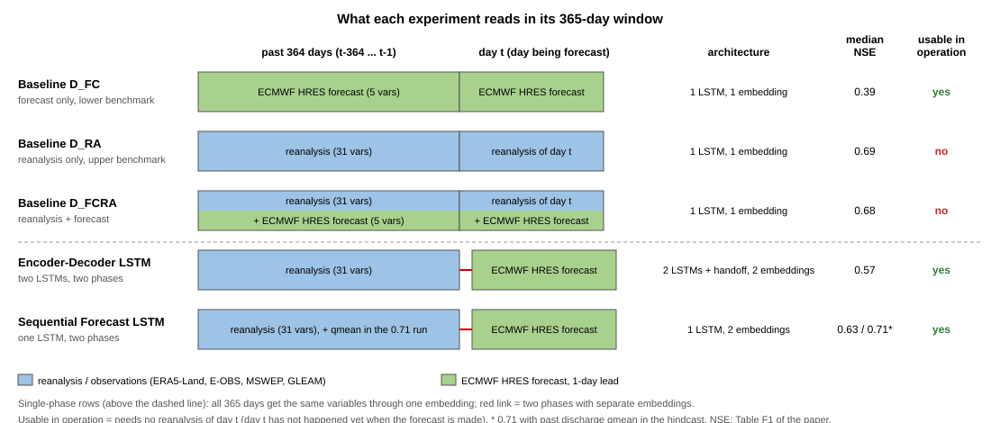
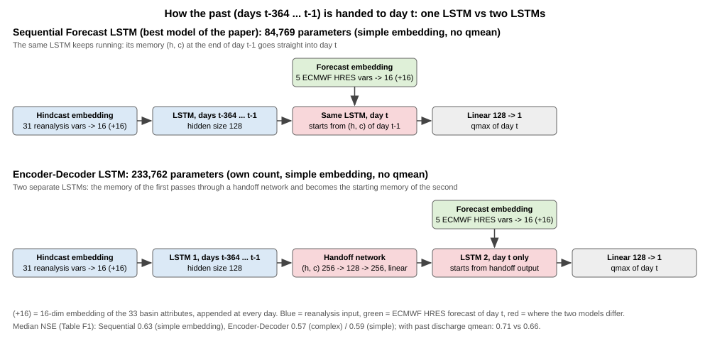

# BiasCast — Phần 5: Các thí nghiệm và kiến trúc của bài

Phần 5 của ghi chú học BiasCast (Phần 1: `03_BiasCast1_Overview.md`, Phần 2: `04_BiasCast2_Metrics.md`, Phần 3: `05_BiasCast3_Data.md`, Phần 4: `06_BiasCast4_Model.md`). Phần 4 đã mở hộp mô hình tốt nhất (Sequential Forecast LSTM có `qmean`); Phần 5 đi qua **mọi thí nghiệm** của bài theo đúng thứ tự mục 2.2 và 3.1–3.5: ba baseline, Cross-Domain, Encoder–Decoder LSTM, học chuyển giao, thêm 5 biến ECMWF HRES vào pha quá khứ, thêm lưu lượng quá khứ `qmean`. Phần 2 (Mục 2.3–2.5) đã đặt các thí nghiệm lên thước NSE ở mức ý chính; Phần 5 đi vào cách mỗi thí nghiệm được dựng (dữ liệu từng ngày, kiến trúc, số tham số, cấu hình) và đọc kết quả. Sáu run đã tái lập ở bước A2 ([LamaH] Mục 6.3) đều thuộc Phần 5.

Ký hiệu nguồn giữ như Phần 4:

- **[Bài]**: bản chữ `PaperResearch/PaperResearchPDF/BasePaper/Konold2026_HESS_BiasCast_FullText.md`, kèm số dòng.
- **[Mã]**: mã NeuralHydrology trong bản fork của tác giả, thư mục `PaperResearch/PaperResearchCode/BiasCast_NH/neuralhydrology/`, ghi tên tệp và số dòng.
- **[Mã tác giả]**: mã phân tích và chạy thí nghiệm của tác giả, thư mục `PaperResearch/PaperResearchCode/BiasCast/`.
- **[Cơ sở]**: `02_BasePaper.md`, kèm mục.
- **[LamaH]**: `01_LamaHCE.md`, kèm mục.

Thuật ngữ tiếng Anh dùng trong Phần 5 (tên trong mã để trong ngoặc):

| Tiếng Việt | Tiếng Anh |
|---|---|
| mốc so sánh, mốc dưới, mốc trên | benchmark, lower benchmark, upper benchmark |
| miền (phân phối dữ liệu) | domain |
| lệch miền | domain shift |
| đánh giá chéo miền | cross-domain evaluation |
| LSTM tiêu chuẩn | standard LSTM (`cudalstm`) |
| bộ mã hóa, bộ giải mã, mạng chuyển trạng thái | encoder, decoder, handoff network (`handoff_forecast_lstm`) |
| học chuyển giao, tinh chỉnh, đóng băng | transfer learning, fine-tuning, freezing (`finetune_modules`) |
| dự báo lưu trữ | archived forecast |
| tiền huấn luyện | pre-training |

Nội dung Phần 5: (5.1) ba baseline; (5.2) Cross-Domain; (5.3) Encoder–Decoder LSTM; (5.4) học chuyển giao; (5.5) thêm 5 biến ECMWF HRES (dự báo lưu trữ) vào pha quá khứ; (5.6) thêm lưu lượng quá khứ; (5.7) bảng tổng hợp và nối với A2; (5.8) câu hỏi ôn.

---

### 5.1. Ba baseline: 𝒟FC, 𝒟RA, 𝒟FCRA

Ba baseline là ba LSTM tiêu chuẩn, khác nhau **chỉ ở dữ liệu thời tiết** đưa vào ([Bài] dòng 100–112, mục 2.2.1). Bài dựng chúng theo lập luận của Seibert và cs. (2018): một con số kết quả chỉ có nghĩa khi so với mốc thể hiện "mức tối thiểu phải đạt" và "mức có thể đạt" ([Bài] dòng 104). Phần 2 (Mục 2.3) đã giải thích vai trò mốc dưới, mốc trên; mục này đi vào cách dựng.

#### Ý chính

**Bước 1 — LSTM tiêu chuẩn: một pha, một lớp nhúng.** Khác Sequential Forecast LSTM (Phần 4), baseline không chia quá khứ và ngày t: cả 365 ngày nhận **cùng một bộ biến**, qua **một** lớp nhúng động và một lớp nhúng thuộc tính, vào một LSTM 128 chiều, rồi lớp đầu ra 128 → 1 ([Cơ sở] Mục 11.2, "Baseline CUDA LSTM"). Mọi khối khác (chuẩn hóa, bộ lọc mẫu, NSE\*, vòng huấn luyện, dừng sớm) giống hệt Phần 4.

**Bước 2 — Mỗi ngày trong khung nhận gì.**

| Baseline | Ngày t − 364 … t − 1 | Ngày t | Số biến mỗi ngày | Vận hành được? |
|---|---|---|---|---|
| 𝒟FC (mốc dưới) | ECMWF HRES hạn 1 ngày của từng ngày | ECMWF HRES hạn 1 ngày | 5 | Có |
| 𝒟RA (mốc trên) | Tái phân tích, quan trắc (ERA5-Land, E-OBS, MSWEP, GLEAM) | Tái phân tích của **chính ngày t** | 31 | Không |
| 𝒟FCRA | Tái phân tích + ECMWF HRES | Tái phân tích + ECMWF HRES của ngày t | 36 | Không |

*Hình: mỗi hàng là một thí nghiệm; ô dài là 364 ngày quá khứ, ô ngắn là ngày t; xanh dương là tái phân tích và quan trắc, xanh lá là dự báo ECMWF HRES hạn 1 ngày (ô chia đôi là có cả hai). Ba baseline phía trên đường gạch là **một pha**: cả 365 ngày nhận cùng một bộ biến qua một lớp nhúng, ô quá khứ và ô ngày t liền nhau. Hai mô hình phía dưới là **hai pha** (vạch đỏ): quá khứ dùng tái phân tích, ngày t dùng ECMWF HRES, mỗi pha một lớp nhúng; Encoder–Decoder dùng hai LSTM nối bằng mạng chuyển trạng thái (Mục 5.3), Sequential dùng một LSTM (Phần 4). Cột cuối: dùng được khi vận hành hay không (không cần tái phân tích của ngày t). NSE trung vị theo Bảng F1 của bài; 0,71 là Sequential có thêm `qmean` trong pha quá khứ (Mục 5.6).*

Ba điểm cần đọc kỹ ([Bài] dòng 104–106):

- 𝒟FC dùng dự báo hạn 1 ngày cho **cả 365 ngày**, không chỉ ngày t: ngày nào trong khung cũng là "dự báo được phát ra hôm trước cho hôm đó". Mô hình này chưa bao giờ thấy thời tiết thật — đúng hoàn cảnh xấu nhất của vận hành.
- 𝒟RA dùng tái phân tích cho cả ngày t, tức biết thời tiết thật của ngày cần dự báo — điều không có được khi vận hành (ngày t chưa diễn ra; tái phân tích còn trễ, Phần 2, Mục 2.3). Vì vậy nó là mốc trên, không phải cấu hình vận hành.
- 𝒟FCRA thêm 5 biến ECMWF HRES vào 31 biến tái phân tích ở mọi ngày; bài gọi đây là kịch bản "dữ liệu đầy đủ nhất". Cũng không vận hành được vì vẫn dùng tái phân tích ngày t.

**Bước 3 — Số tham số, tự tính lại.** Cùng cách đếm Phần 4 (Mục 4.2–4.4), chỉ lớp nhúng động đổi theo số biến:

| Baseline | Nhúng động (n biến → 16) | Nhúng thuộc tính | LSTM 32 → 128 | Lớp đầu ra | Tổng | Số trong kết quả tác giả |
|---|---|---|---|---|---|---|
| 𝒟FC | 5 × 16 + 16 = 96 | 544 | 82.944 | 129 | 83.713 | 83.713 ([LamaH] Mục 6.3) |
| 𝒟RA | 31 × 16 + 16 = 512 | 544 | 82.944 | 129 | 84.129 | 84.129 ([LamaH] Mục 6.3) |
| 𝒟FCRA | 36 × 16 + 16 = 592 | 544 | 82.944 | 129 | 84.209 (nếu 128 chiều) | chưa đếm |

Hai số đầu khớp đúng số tham số đếm từ trọng số tác giả ở bước A2. 𝒟FCRA có cấu hình 128 hoặc 256 chiều ([Cơ sở] Mục 11.3); với 256 chiều, LSTM lớn gấp khoảng 3,6 lần nên so với 𝒟RA không còn cùng tham số.

**Bước 4 — Siêu tham số không giống nhau.** Mỗi baseline được tối ưu Bayes riêng (Phần 4, Mục 4.7), nên cấu hình cuối khác nhau ([Cơ sở] Mục 11.3):

| Baseline | Số chiều ẩn | Batch | Dropout | Nhiễu nhãn `qmax` |
|---|---|---|---|---|
| 𝒟FC | 128 | 256 | 0,3 | 0,1 |
| 𝒟RA | 128 | 128 hoặc 256 | 0,2–0,3 | 0,001–0,1 |
| 𝒟FCRA | 128 hoặc 256 | 256 | 0,2–0,4 | 0,001 |

(Khoảng giá trị vì mỗi baseline có biến thể nhúng đơn giản và phức tạp, mỗi biến thể một cấu hình.) Nhiễu nhãn: khi huấn luyện, mã cộng nhiễu ngẫu nhiên tỉ lệ với độ lớn vào nhãn `qmax` ([Mã] `training/basetrainer.py` 386–389; Phần 4, Mục 4.6 bước 2) — một cách chống học thuộc; Sequential Forecast LSTM không dùng. Hệ quả: chênh lệch giữa ba baseline gồm cả **dữ liệu** lẫn **siêu tham số**, không chỉ dữ liệu.

**Bước 5 — Kết quả và cách đọc.** NSE trung vị ([Bài] Bảng F1; Phần 2, Mục 2.3):

| Baseline | NSE trung vị (bài) | Tái lập ở A2 |
|---|---|---|
| 𝒟FC | 0,39 | 0,3864 (tác giả 0,3867) |
| 𝒟RA (nhúng đơn giản) | 0,69 | 0,6923 (khớp) |
| 𝒟FCRA | 0,68 | chưa chạy |

- Khoảng 𝒟FC → 𝒟RA (0,30 NSE) là **toàn bộ cái giá** của việc chỉ có dự báo thay vì thời tiết thật. Mọi thí nghiệm sau đo xem lấy lại được bao nhiêu phần khoảng này (tỷ lệ lấp, Phần 2, Mục 2.3).
- 𝒟FCRA (0,68) **không hơn** 𝒟RA (0,69) dù có thêm 5 biến: khi đã có thời tiết thật của ngày t, dự báo của cùng ngày không mang thêm thông tin. Chênh lệch 0,01 với một hạt giống chưa đủ để nói 𝒟FCRA kém hơn (mức nhiễu giữa các hạt giống do bước A4 đo).
- Ở A2, 𝒟RA được tái lập bằng biến thể nhúng đơn giản; các thí nghiệm học chuyển giao (Mục 5.4) lại xuất phát từ 𝒟RA nhúng **phức tạp** ([Bài] dòng 236) — hai run khác nhau.

**Tóm tắt ý chính:** ba LSTM tiêu chuẩn một pha, khác nhau ở dữ liệu → 𝒟FC chỉ dự báo (mốc dưới, vận hành được), 𝒟RA chỉ tái phân tích kể cả ngày t (mốc trên, không vận hành được), 𝒟FCRA cả hai → số tham số 83.713 / 84.129 tự tính khớp trọng số tác giả → siêu tham số mỗi baseline khác nhau → khoảng 0,39 → 0,69 là thước cho mọi thí nghiệm sau.

#### Chi tiết kỹ thuật

*(a) Vì sao gọi là "CUDA LSTM".* Tên mô hình trong NeuralHydrology là `cudalstm`, vì nó dùng `nn.LSTM` của PyTorch (chạy bằng thư viện cuDNN trên GPU, có bản CPU), khác `customlstm` viết tay từng cổng để đọc được trạng thái bên trong ([Mã] `modelzoo/cudalstm.py`, `modelzoo/customlstm.py`). Không liên quan tới việc "chỉ chạy được trên GPU".

*(b) Ý nghĩa cho đề tài.* Đề tài giữ 𝒟FC và 𝒟RA làm mốc dưới, mốc trên cho mọi lõi (A2 đã tái lập), thêm persistence và DLinear ở A3 làm mốc "không cần học sâu" (`03_Pipeline.md` Mục 7). Cách (c) "dự báo hoàn hảo" ở bước H (dự báo 1–7 ngày) chính là ý của 𝒟RA mở rộng ra nhiều ngày: thay dự báo bằng tái phân tích để biết cận trên.

**Câu hỏi tự kiểm tra (Mục 5.1):**

1. Ngày t − 100 trong khung của 𝒟FC nhận dữ liệu gì? Còn ở Sequential Forecast LSTM thì sao?
2. Vì sao 𝒟RA không dùng được khi vận hành, dù toàn bộ dữ liệu của nó là dữ liệu "tốt nhất"?
3. Tính lại số tham số của 𝒟FCRA nếu dùng 256 chiều ẩn (nhúng vẫn ra 16 + 16 = 32). So với 𝒟RA thì gấp bao nhiêu lần?
4. 𝒟FCRA 0,68 và 𝒟RA 0,69. Bạn có kết luận "thêm dự báo làm mô hình kém đi" không? Vì sao?
5. Ngoài dữ liệu đầu vào, ba baseline còn khác nhau ở điểm nào khiến so sánh giữa chúng không hoàn toàn "chỉ do dữ liệu"?

**Đáp án (Mục 5.1):** (1) Ở 𝒟FC, ngày t − 100 nhận 5 biến ECMWF HRES: dự báo hạn 1 ngày phát ra hôm trước cho chính ngày t − 100. Ở Sequential Forecast LSTM, ngày đó thuộc pha quá khứ nên nhận 31 biến tái phân tích (32 nếu có `qmean`). (2) Tái phân tích của ngày t chỉ có sau khi ngày t đã diễn ra và được đồng hóa số liệu quan trắc (còn trễ thêm vài ngày); lúc phát dự báo cho ngày t thì chưa có, nên 𝒟RA chỉ dùng được để làm mốc, không chạy được khi vận hành. (3) Nhúng 592 + 544 = 1.136; LSTM 4 × 256 × 32 + 4 × 256 × 256 + 2 × 4 × 256 = 32.768 + 262.144 + 2.048 = 296.960; lớp đầu ra 257; tổng 298.353, gấp khoảng 3,5 lần 84.129 của 𝒟RA. (4) Không: chênh 0,01 NSE trung vị từ **một** hạt giống có thể chỉ là nhiễu giữa các lần huấn luyện (chưa đo, bước A4); hai run còn khác siêu tham số; muốn kết luận cần nhiều hạt giống và kiểm định theo từng lưu vực (Wilcoxon), không chỉ so hai số trung vị. Cách đọc đúng: thêm dự báo **không giúp** khi đã có thời tiết thật. (5) Siêu tham số: mỗi baseline được tối ưu Bayes riêng nên số chiều ẩn, batch, dropout, nhiễu nhãn `qmax` khác nhau (bảng ở bước 4); ngoài ra mỗi baseline còn hai biến thể lớp nhúng (đơn giản, phức tạp).

### 5.2. Cross-Domain: học trên tái phân tích, chạy bằng ECMWF HRES

**Nhắc lại trong 3 câu** (chi tiết ở Phần 2, Mục 2.4):

- Tác giả huấn luyện một LSTM chỉ bằng 5 biến **tái phân tích** (thời tiết "đúng", dựng lại sau khi trời đã mưa). Mỗi biến có một biến cùng ý nghĩa trong ECMWF HRES nên đổi qua lại được ([Bài] dòng 200):

| Đại lượng | Biến tái phân tích (lúc học) | Biến ECMWF HRES (lúc *One Shot*) |
|---|---|---|
| nhiệt độ không khí ở 2 m | `ERA5L_2m_temp_mean` | `ECMWF_t2m` |
| nhiệt độ điểm sương ở 2 m (độ ẩm không khí) | `ERA5L_2m_dp_temp_mean` | `ECMWF_d2m` |
| bức xạ mặt trời | `ERA5L_surf_net_solar_rad_mean` | `ECMWF_ssrd` |
| lượng mưa | `MSWEP_RR` | `ECMWF_tp` |
| bốc thoát hơi thực tế (nước bay hơi từ đất và cây) | `GLEAM_ETA` | `ECMWF_e` |

- Học xong, đem **chính mô hình đó** chạy với 5 biến **ECMWF HRES** (thời tiết "dự báo") — không học thêm gì. Bài gọi lần này là *One Shot*.
- NSE trung vị (trên 451 lưu vực) rơi từ 0,58 xuống 0,33, tức **giảm 0,58 − 0,33 = 0,25**. Các chỗ sau trong mục này gọi tắt là "mức giảm 0,25". Tức là: đổi đầu vào từ "thời tiết đúng" sang "thời tiết dự báo" thì mô hình kém hẳn đi.

Mục này chỉ thêm ba điều Phần 2 chưa nói.

#### Điều 1 — Lần *One Shot* sai ở hai chỗ, không phải một

Để đoán `qmax` ngày t, mô hình cần biết hai thứ:

- **(a) Lưu vực đang ướt hay khô.** Mô hình đọc từ các biến của 364 ngày trước. Nguồn thông tin khác nhau tùy bộ biến:
  - Với 31 biến tái phân tích (𝒟RA, pha quá khứ của Sequential): có biến **đo thẳng** độ ướt — độ ẩm đất `ERA5L_volsw_123` (lớp 0–100 cm), `ERA5L_volsw_4` (lớp 100–289 cm), nước trong lớp tuyết `ERA5L_swe` (Phần 1, Mục 1.5); thêm `qmean` (lưu lượng đo các ngày trước) nếu có.
  - Với 5 biến của Cross-Domain (cũng như 5 biến ECMWF HRES): **không** có biến độ ẩm đất hay tuyết; mô hình phải tự cộng dồn trong bộ nhớ: mưa vào (`MSWEP_RR`), nước bay hơi đi (`GLEAM_ETA`), nhiệt độ (mưa thành tuyết hay tuyết tan). Tháng trước mưa nhiều, bay hơi ít thì đất đang ướt.
- **(b) Hôm nay mưa bao nhiêu.** Lấy từ ngày t.

Đất ướt thì mưa xuống chảy ra sông gần hết; đất khô thì đất hút bớt. Cùng 20 mm mưa hôm nay, đất ướt cho lưu lượng cao hơn đất khô.

Ở lần *One Shot*, **cả (a) và (b) đều lấy từ ECMWF HRES**. Ví dụ (số tự đặt để minh họa):

| | Mưa 30 ngày trước | Mô hình hiểu là | Mưa ngày t | `qmax` đoán ra |
|---|---|---|---|---|
| Thật | 100 mm | | 20 mm | (thật: 10) |
| Đưa vào tái phân tích (lúc học) | 100 mm | đất ướt | 20 mm | 10 — đúng |
| Đưa vào ECMWF HRES (báo thiếu 10%) | 90 mm | đất **khô hơn** thật | 18 mm | thấp hơn 10 |

Sai lệch của dự báo đi vào **hai lần**: một lần qua mưa hôm nay, một lần qua việc mô hình hiểu sai độ ướt của lưu vực. Nếu chỉ ngày t là ECMWF HRES (364 ngày trước vẫn là tái phân tích), mô hình ít nhất hiểu đúng (a), chỉ còn sai ở (b). Đây là cách Sequential Forecast LSTM bố trí đầu vào (hình ở Mục 5.1).

Lưu ý: bài không chạy thí nghiệm "chỉ ngày t là ECMWF HRES" với đúng 5 biến của Cross-Domain, nên ý "sai hai chỗ hại hơn sai một chỗ" là suy luận, không phải con số đo được.

#### Điều 2 — Con số 0,25 tin được tới đâu

- Bài chỉ huấn luyện **1 lần** (1 hạt giống). Nhưng 0,25 lớn gấp hơn chục lần các chênh lệch 0,01–0,02 giữa các run khác (Mục 5.1), nên khó là do may rủi (suy luận, chưa đo).
- 0,25 là **tổng** của mọi khác biệt giữa hai nguồn: dự báo sai, lưới thô hơn, và cặp bức xạ vốn không cùng đại lượng (Phần 2, Mục 2.4). Bài không tách ra phần nào bao nhiêu.

#### Điều 3 — Đề tài dùng lại ở đâu

Ở bước H (dự báo 1–7 ngày), cách (c) "dự báo hoàn hảo" dùng 5 biến tái phân tích này cho các ngày tương lai để làm cận trên, riêng cặp bức xạ đổi sang `EOBS_qq` (bức xạ tới mặt đất, cùng đại lượng với `ECMWF_ssrd`) (`03_Pipeline.md` Mục 4.4). Cross-Domain cho thấy trước: khoảng cách giữa "thời tiết đúng" và "thời tiết dự báo" có thể lớn cỡ 0,25 NSE.

Câu hỏi "lưu vực nào bị hại nhiều nhất và vì sao" (khoảng cách phân phối, địa hình) để ở Phần 6.

#### Chi tiết kỹ thuật (đọc sau, không bắt buộc)

- Hai run trong mã tác giả: `Experiments/CrossDomain/CrossDomain_Reanalysis` (lần học) và `CrossDomain_Forecast` (lần chạy thẳng), theo tệp vẽ Hình 3 ([Mã tác giả] `Inspect_Experiments/config/Propagation_Forecast_Uncertainty.yml`). Thư mục `CrossDomain` (2 nhóm con) có trong gói kết quả tác giả trên Zenodo, đã tải về Kaggle Dataset `lamah-ce-ext` ([LamaH] Mục 6); nội dung từng run chưa mở.
- Số tham số: nếu số chiều ẩn là 128 thì bằng đúng 𝒟FC = 83.713 (cùng 5 biến vào, chỉ khác dữ liệu học). Số chiều ẩn thật: chưa kiểm.
- Lần chạy thẳng chuẩn hóa ECMWF HRES bằng thống kê của tái phân tích hay tính lại: chưa kiểm.

**Câu hỏi tự kiểm tra (Mục 5.2):**

1. Lần học và lần *One Shot* có phải hai mô hình khác nhau không?
2. Vì sao Cross-Domain có cùng số tham số với 𝒟FC?
3. Ở lần *One Shot*, sai lệch của ECMWF HRES làm mô hình sai ở hai chỗ nào?
4. Mô hình học "mưa 20 mm" theo MSWEP. Nếu ECMWF HRES hay báo mưa ít hơn MSWEP, mô hình sẽ đoán `qmax` cao hơn hay thấp hơn thật?
5. Bài chỉ chạy 1 hạt giống. Muốn chắc chắn mức giảm 0,25 không phải may rủi thì cần làm thêm gì?

**Đáp án (Mục 5.2):** (1) Không: chỉ có **một** mô hình, một bộ trọng số. Lần *One Shot* lấy đúng trọng số đã học trên tái phân tích, không huấn luyện thêm bước nào, chỉ thay nguồn số liệu của 5 cột đầu vào. (2) Số tham số chỉ phụ thuộc kiến trúc (số biến vào, số chiều ẩn, số lớp), không phụ thuộc giá trị số liệu. Cross-Domain và 𝒟FC cùng là LSTM một pha, cùng nhận 5 biến, nên nếu cùng 128 chiều ẩn thì cùng 83.713 tham số; khác nhau chỉ ở chỗ học trên tái phân tích hay trên ECMWF HRES. (3) Hai chỗ: (a) qua 364 ngày quá khứ, mô hình hiểu sai lưu vực đang ướt hay khô; (b) qua ngày t, mô hình nhận sai lượng mưa hôm nay. (4) Thấp hơn thật: mô hình áp quy tắc học từ MSWEP lên con số mưa nhỏ hơn, lại tưởng đất khô hơn, nên đoán `qmax` thấp (cùng ý ví dụ "× 0,5" ở Phần 2, Mục 2.4). (5) Huấn luyện lại ít nhất 3 hạt giống; với mỗi hạt giống tính NSE lần học và lần *One Shot* trên từng lưu vực; kiểm định Wilcoxon ghép cặp theo lưu vực (Phần 2, Mục 2.6) và so mức giảm với độ dao động giữa các hạt giống. Nếu mức giảm 0,25 lớn hơn hẳn độ dao động đó thì không phải do may rủi.

### 5.3. Encoder–Decoder LSTM: hai LSTM nối bằng mạng chuyển trạng thái

**Nhắc lại trong 3 câu:**

- Đây là kiến trúc của hệ thống dự báo lũ của Google (Nearing và cs., Nature 2024), bài lấy nguyên về thử ([Bài] dòng 132).
- Mô hình có **hai LSTM riêng**: LSTM thứ nhất đọc 364 ngày quá khứ (31 biến tái phân tích, thêm `qmean` nếu có); LSTM thứ hai đọc ngày t (5 biến ECMWF HRES). Giữa hai LSTM có một mạng nhỏ chuyển "trí nhớ" từ LSTM thứ nhất sang LSTM thứ hai, gọi là mạng chuyển trạng thái (*handoff network*).
- NSE trung vị 0,57 (không `qmean`) và 0,66 (có `qmean`), **kém** Sequential Forecast LSTM (0,63 và 0,71), dù cùng nhận đúng một loại dữ liệu ([Bài] dòng 238, 270, 272).

#### Điều 1 — Khác Sequential Forecast LSTM ở đúng một chỗ

Cả hai mô hình đều chia hai pha: quá khứ dùng tái phân tích, ngày t dùng ECMWF HRES (hình ở Mục 5.1). Khác nhau ở cách đi từ pha quá khứ sang ngày t:

| | Sequential Forecast LSTM (Phần 4) | Encoder–Decoder LSTM |
|---|---|---|
| Số LSTM | **một**, dùng cho cả 365 ngày | **hai**: một cho 364 ngày quá khứ, một cho ngày t |
| Sang ngày t thế nào | trí nhớ (h, c) cuối ngày t − 1 đi **thẳng** vào ngày t | trí nhớ (h, c) cuối ngày t − 1 đi **qua mạng chuyển trạng thái** rồi mới vào LSTM thứ hai |
| LSTM xử lý ngày t | chính LSTM đã đọc 364 ngày | LSTM khác, chỉ thấy 1 ngày mỗi mẫu |

*Hình: hàng trên là Sequential Forecast LSTM — một LSTM đọc 364 ngày quá khứ rồi đọc tiếp ngày t, trí nhớ (h, c) đi thẳng. Hàng dưới là Encoder–Decoder LSTM — LSTM 1 đọc quá khứ, trí nhớ của nó qua mạng chuyển trạng thái (hai lớp tuyến tính 256 → 128 → 256) thành trí nhớ ban đầu của LSTM 2, LSTM 2 chỉ đọc ngày t. Ô đỏ là chỗ hai mô hình khác nhau; xanh dương là tái phân tích, xanh lá là 5 biến ECMWF HRES của ngày t. Số tham số của Encoder–Decoder là tự tính (Điều 3).*

Mạng chuyển trạng thái (đọc từ mã, [Mã] `handoff_forecast_lstm.py`; [Cơ sở] Mục 11.2):

1. Ghép h (128 số) và c (128 số) cuối ngày t − 1 thành 256 số.
2. Lớp tuyến tính 256 → 128.
3. Lớp tuyến tính 128 → 256.
4. Tách đôi: 128 số đầu làm h, 128 số sau làm c ban đầu cho LSTM thứ hai.

Hai lớp tuyến tính này không có hàm kích hoạt ở giữa, trong khi bài mô tả là mạng "phi tuyến" ([Cơ sở] Mục 11.4). Hai lớp tuyến tính liền nhau tương đương một phép tuyến tính.

#### Điều 2 — Vì sao kém hơn (cách bài giải thích)

Bài cho rằng mạng chuyển trạng thái là một bước "gãy": trí nhớ về lưu vực phải đi qua một phép biến đổi cố định, rồi được một LSTM **khác** đọc tiếp ([Bài] dòng 240, 308, 348). Ở Sequential, trí nhớ chảy liền mạch trong cùng một LSTM.

Bằng chứng bài đưa ra là số lưu vực bị **kém đi** so với mốc dưới 𝒟FC ([Bài] dòng 308):

| Mô hình | Không `qmean`: tốt hơn / kém hơn 𝒟FC | Có `qmean`: kém hơn 𝒟FC |
|---|---|---|
| Sequential Forecast LSTM | 435 / khoảng 16 lưu vực | 5 lưu vực |
| Encoder–Decoder LSTM | 361 / 90 lưu vực | 28 lưu vực |

Tức là Encoder–Decoder không chỉ có trung vị thấp hơn mà còn **thất thường** hơn: có nhiều lưu vực mà dùng nó còn tệ hơn mô hình đơn giản nhất. (Số 16 tự suy ra từ 451 − 435, giả định không có lưu vực nào bằng đúng 0; bài chỉ nói Encoder–Decoder kém ở "gần 5 lần" số lưu vực của Sequential.)

Giải thích "bước gãy" là lập luận của bài, chưa được tách riêng bằng thí nghiệm. Còn một khác biệt nữa có thể góp phần: LSTM thứ hai chỉ thấy 1 ngày mỗi mẫu nên ít dữ liệu để học hơn (suy luận, bài không kiểm).

#### Điều 3 — To gần gấp ba nhưng vẫn kém

Encoder–Decoder có hai LSTM và thêm mạng chuyển trạng thái nên nhiều tham số hơn hẳn. Tự tính cho bản nhúng đơn giản, không `qmean`, cùng 128 chiều ẩn (chưa đối chiếu với mô hình thật):

| Thành phần | Sequential Forecast LSTM | Encoder–Decoder LSTM |
|---|---|---|
| Lớp nhúng (4 lớp; nhúng quá khứ 31 × 16 + 16 = 512) | 1.696 | 1.696 |
| LSTM | 82.944 | 2 × 82.944 = 165.888 |
| Mạng chuyển trạng thái | 0 | 32.896 + 33.024 = 65.920 |
| Lớp đầu ra | 129 | 2 × 129 = 258 |
| **Tổng** | **84.769** | **233.762** (khoảng 2,8 lần) |

Có `qmean` (32 biến quá khứ, nhúng quá khứ 528) thì mỗi mô hình thêm 16 tham số: 84.785 (con số ở Phần 4) và 233.778. Cùng cách đếm cho bản Encoder–Decoder có `qmean`, nhúng phức tạp ra 341.436, khớp số đếm từ trọng số của run tái lập ở A2 ([LamaH] Mục 6.3). Mô hình to hơn mà vẫn kém cho thấy cái hơn của Sequential đến từ **cách nối hai pha**, không phải từ kích thước. Đây cũng là lý do đề tài so các lõi ở bước C với số tham số lệch không quá 1% (Phần 4, Mục 4.8): không cho mô hình nào thắng nhờ to hơn.

#### Chi tiết kỹ thuật (đọc sau, không bắt buộc)

- Bài chạy ba biến thể Encoder–Decoder ([Bài] dòng 134): (1) cơ bản; (2) thêm `qmean` vào pha quá khứ (Mục 5.6); (3) thêm dự báo lưu trữ vào pha quá khứ (Mục 5.5).
- Mọi cấu hình Sequential và Encoder–Decoder dùng chung một bộ siêu tham số: 128 chiều ẩn, lô 256, dropout 0,3 ([Cơ sở] Mục 11.3). Bài không nói tối ưu Bayes chạy riêng cho từng kiến trúc hay không.
- A2 tái lập hai run Encoder–Decoder (nhúng phức tạp): có `qmean` 0,6622, không `qmean` 0,569, khớp bài ([LamaH] Mục 6.3). Run không `qmean` có cảnh báo hệ số tương quan r của KGE không xác định ở ít nhất 1 lưu vực, sẽ xem ở bước A3.
- Đề tài **không** đưa Encoder–Decoder vào so sánh lõi ở bước C: khung chung của đề tài là Sequential Forecast nhận lõi bất kỳ (`03_Pipeline.md` Mục 4), vì Sequential là mô hình tốt nhất của bài.

**Câu hỏi tự kiểm tra (Mục 5.3):**

1. Encoder–Decoder và Sequential Forecast LSTM nhận cùng dữ liệu. Chúng khác nhau ở đâu?
2. Mạng chuyển trạng thái nhận vào bao nhiêu số và trả ra bao nhiêu số? Vì sao trả ra đúng số đó?
3. Hai lớp tuyến tính liền nhau không có hàm kích hoạt thì tương đương với gì?
4. Encoder–Decoder to gấp khoảng 2,8 lần mà vẫn kém. Điều đó nói gì về nguồn gốc cái hơn của Sequential?
5. Vì sao "số lưu vực kém hơn 𝒟FC" lại là bằng chứng mô hình thất thường, mà NSE trung vị không cho thấy?

**Đáp án (Mục 5.3):** (1) Sequential dùng **một** LSTM cho cả 365 ngày; trí nhớ (h, c) cuối ngày t − 1 đi thẳng vào ngày t. Encoder–Decoder dùng **hai** LSTM: LSTM thứ nhất đọc 364 ngày quá khứ; trí nhớ (h, c) của nó đi qua mạng chuyển trạng thái, thành trí nhớ **ban đầu** của LSTM thứ hai; LSTM thứ hai đọc 5 biến ECMWF HRES của ngày t rồi ra `qmax`. (2) Vào 256 số (h 128 + c 128 của LSTM thứ nhất), ra 256 số (h 128 + c 128 ban đầu cho LSTM thứ hai); ra đúng 256 vì LSTM thứ hai có 128 chiều ẩn, cần đủ một h và một c, mỗi cái 128 số. (3) Một phép tuyến tính duy nhất: y = W₂(W₁x + b₁) + b₂ = (W₂W₁)x + (W₂b₁ + b₂), vẫn có dạng Wx + b. Hai lớp không thêm được khả năng biểu diễn quan hệ cong nào. (4) Cái hơn đến từ **cách nối hai pha**: trí nhớ chảy liền mạch trong cùng một LSTM, không phải đi qua một phép biến đổi rồi giao cho LSTM khác; không đến từ kích thước, vì Sequential nhỏ hơn gần ba lần. (5) Trung vị chỉ là giá trị ở giữa: hai mô hình có thể cùng trung vị nhưng một mô hình có nhiều lưu vực tệ ở đuôi trái. Đếm số lưu vực kém hơn cả 𝒟FC (mô hình đơn giản nhất) cho thấy đuôi trái đó: dùng Encoder–Decoder không `qmean` thì 90 lưu vực còn tệ hơn không làm gì đặc biệt, nên mô hình kém tin cậy dù trung vị vẫn cao hơn 𝒟FC.

### 5.4. Học chuyển giao: học trên tái phân tích, học tiếp trên ECMWF HRES

**Nhắc lại trong 3 câu:**

- Lấy mô hình 𝒟RA đã học xong trên 31 biến tái phân tích, rồi **học tiếp** trên dữ liệu của 𝒟FC (5 biến ECMWF HRES cho cả 365 ngày) ([Bài] dòng 162).
- Khác Cross-Domain (Mục 5.2) ở chỗ: Cross-Domain chạy thẳng, không học thêm; học chuyển giao có học thêm trên dự báo.
- Kết quả gần như không hơn mốc dưới 𝒟FC (0,39): bản tốt nhất chỉ đạt 0,44 ([Bài] dòng 236).

#### Điều 1 — Hai cách học tiếp

Mô hình 𝒟RA có ba khối: lớp nhúng (biến đầu vào → 16 số), LSTM (đọc 365 ngày), lớp đầu ra (→ `qmax`). Bài thử hai cách ([Bài] dòng 162):

| Cách | Khối được học tiếp | Khối giữ nguyên |
|---|---|---|
| *TL AllWeights* (mọi trọng số) | lớp nhúng, LSTM, lớp đầu ra | không |
| *TL EmbeddingNet* (chỉ lớp nhúng) | chỉ lớp nhúng của biến động | LSTM, lớp đầu ra, lớp nhúng thuộc tính lưu vực |

Tên gọi:

- Cả thí nghiệm: **học chuyển giao** (*transfer learning*). Bài xếp vào loại **học chuyển giao khác không gian đặc trưng** (*heterogeneous transfer learning*), vì lúc học trước và lúc học tiếp, đầu vào là hai bộ biến khác nhau (31 biến tái phân tích, 5 biến ECMWF HRES) ([Bài] dòng 158).
- Bước "học tiếp": **tinh chỉnh** (*fine-tuning*). *TL AllWeights* là tinh chỉnh toàn bộ (*full fine-tuning*); *TL EmbeddingNet* là tinh chỉnh một phần, kèm **đóng băng** (*freezing*) các khối giữ nguyên.

Ý tưởng của cách thứ hai: LSTM đã học tốt quan hệ "thời tiết → dòng chảy" từ dữ liệu đúng, nên giữ nguyên; chỉ dạy lại **lớp nhúng** cách "dịch" 5 biến ECMWF HRES sang 16 số mà LSTM đã quen đọc. Lớp nhúng như người phiên dịch: đổi người nói (tái phân tích → ECMWF HRES), chỉ cần đổi phiên dịch, không cần đổi người nghe.

Thêm một lý do bắt buộc phải học lại lớp nhúng: lớp nhúng của 𝒟RA nhận 31 biến, còn dữ liệu mới chỉ có 5 biến, nên lớp nhúng cũ không dùng thẳng được (suy ra từ số biến; cách mã chép trọng số khi số biến khác nhau chưa kiểm).

Thủ tục ([Cơ sở] Mục 11.2): chạy mô hình mới 1 epoch để dựng cấu trúc, chép trọng số từ 𝒟RA vào, rồi học tiếp 20 epoch.

#### Điều 2 — Kết quả (Bảng F1 của bài)

| Mô hình | NSE trung vị | NSE trung bình | Độ lệch chuẩn | Phân vị 10 |
|---|---|---|---|---|
| Cross-Domain, chạy thẳng (Mục 5.2) | 0,33 | 0,19 | 1,10 | −0,13 |
| 𝒟FC — mốc dưới | 0,39 | 0,25 | 1,69 | 0,02 |
| Chỉ lớp nhúng, lớp nhúng đơn giản | 0,39 | 0,17 | 2,96 | 0,08 |
| Mọi trọng số | 0,41 | 0,35 | 0,41 | 0,05 |
| **Chỉ lớp nhúng, lớp nhúng phức tạp** | **0,44** | 0,35 | 1,12 | 0,15 |
| Encoder–Decoder LSTM (Mục 5.3) | 0,57 | 0,02 | 8,03 | 0,21 |
| Sequential Forecast LSTM | 0,63 | 0,57 | 0,52 | 0,35 |

Đọc bảng:

- Bản tốt nhất (0,44) chỉ lấp được (0,44 − 0,39) / 0,30 ≈ 17% khoảng cách giữa mốc dưới và mốc trên (Phần 2, Mục 2.3), trong khi Sequential lấp 80%.
- Chỉ cải thiện 275 (chỉ lớp nhúng) và 273 (mọi trọng số) trên 451 lưu vực so với 𝒟FC; khoảng 40% lưu vực còn kém đi ([Bài] dòng 310).
- Chỉ học lại lớp nhúng tốt hơn học lại mọi thứ (0,44 so với 0,41), nhất là ở lưu vực khó (phân vị 10: 0,15 so với 0,05) ([Bài] dòng 236).

Lưu ý về số: phần chữ của bài báo 0,44 là bản **lớp nhúng phức tạp** ([Bài] dòng 236: *Both experiments utilized the reanalysis baseline with a complex embedding layer*). Bảng F1 có thêm bản lớp nhúng đơn giản (0,39). Hai số không mâu thuẫn, chỉ là hai biến thể.

#### Điều 3 — Vì sao gần như không giúp (suy luận)

Bài không tách nguyên nhân bằng thí nghiệm. Hai lý do hợp lý, đều chưa kiểm:

- Học chuyển giao vẫn đưa ECMWF HRES vào **cả 365 ngày** như 𝒟FC, nên vẫn mắc lỗi "sai hai chỗ" của Mục 5.2: mô hình hiểu sai lưu vực ướt hay khô. Học tiếp chỉ giúp mô hình quen với sai lệch của dự báo, không thay được thông tin đúng về quá khứ.
- Encoder–Decoder và Sequential đạt 0,57–0,63 vì đổi **cách bố trí đầu vào** (quá khứ tái phân tích, ngày t dự báo), không phải vì cách huấn luyện. Học chuyển giao giữ nguyên bố trí của 𝒟FC nên không lấy được cái lợi này.

Ngoài ra, so sánh 0,44 với Cross-Domain 0,33 (bài nói "+0,11", [Bài] dòng 236) không cùng điểm xuất phát: học chuyển giao bắt đầu từ 𝒟RA 31 biến, còn Cross-Domain từ mô hình 5 biến (Phần 2, Mục 2.4).

#### Chi tiết kỹ thuật (đọc sau, không bắt buộc)

- Bài có thêm một biến thể chỉ lớp nhúng xuất phát từ 𝒟FCRA thay vì 𝒟RA: 0,41 ([Bài] dòng 252). Biến thể này thuộc thí nghiệm thêm dự báo lưu trữ, trình bày ở Mục 5.5.
- Lớp nhúng phức tạp tốt hơn đơn giản **chỉ** ở học chuyển giao; ở baseline, Encoder–Decoder và Sequential thì ngược lại, lớp nhúng đơn giản tốt hơn chút ([Bài] dòng 288). Một cách hiểu: khi LSTM bị giữ nguyên, lớp nhúng là chỗ duy nhất được học nên cần nhiều tham số hơn (suy luận).
- Ở bản chỉ lớp nhúng đơn giản, phần được học chỉ là lớp nhúng 5 biến → 16 số: 5 × 16 + 16 = 96 tham số (nếu đúng như mô tả; số tham số được học thật chưa kiểm). 96 tham số đạt ngang 𝒟FC (0,39) học đủ 83.713 tham số.
- Đề tài không dùng học chuyển giao trong pipeline: kết quả của bài cho thấy hướng này kém xa Sequential.

**Câu hỏi tự kiểm tra (Mục 5.4):**

1. Học chuyển giao khác Cross-Domain *One Shot* ở điểm nào?
2. Ở cách "chỉ lớp nhúng", khối nào được học tiếp, khối nào giữ nguyên? Ý tưởng là gì?
3. Vì sao lớp nhúng cũ của 𝒟RA không dùng thẳng được cho 5 biến ECMWF HRES?
4. Bản tốt nhất đạt 0,44. Nó lấp được bao nhiêu phần khoảng cách giữa 𝒟FC và 𝒟RA? So với Sequential thì sao?
5. Theo bạn, vì sao học tiếp trên dự báo vẫn không bằng đổi cách bố trí đầu vào như Sequential?

**Đáp án (Mục 5.4):** (1) Cross-Domain *One Shot* chạy thẳng mô hình 5 biến tái phân tích với ECMWF HRES, không học thêm; học chuyển giao xuất phát từ 𝒟RA (31 biến) và học tiếp 20 epoch trên ECMWF HRES. Cả hai đều đưa ECMWF HRES vào cả 365 ngày. (2) Chỉ lớp nhúng của biến động được học tiếp; LSTM, lớp đầu ra và lớp nhúng thuộc tính lưu vực bị đóng băng. Ý tưởng: LSTM đã học đúng quan hệ thời tiết → dòng chảy trên dữ liệu tốt, chỉ cần dạy lại lớp nhúng cách đổi 5 biến ECMWF HRES thành 16 số mà LSTM đã quen đọc. (3) Lý do chính là **số biến**: lớp nhúng của 𝒟RA nhận đúng 31 số mỗi ngày (ma trận trọng số 31 × 16), dữ liệu mới chỉ có 5 số, kích thước không khớp nên không nhân được. Kể cả khi cùng số biến, giá trị từ hai nguồn có phân phối khác nhau (Mục 5.2) nên vẫn nên học lại. (4) (0,44 − 0,39) / 0,30 ≈ 17%; Sequential lấp (0,63 − 0,39) / 0,30 = 80%, gần gấp năm lần. (5) Học tiếp chỉ giúp mô hình quen với sai lệch của dự báo, nhưng đầu vào vẫn là ECMWF HRES ở cả 365 ngày, nên mô hình vẫn không có thông tin đúng về lưu vực đang ướt hay khô. Sequential đổi cách bố trí: 364 ngày quá khứ dùng tái phân tích (thông tin đúng), chỉ ngày t dùng ECMWF HRES; nó được thông tin tốt hơn, không phải được học kỹ hơn (suy luận; bài không tách riêng).

### 5.5. Thêm 5 biến ECMWF HRES vào pha quá khứ

**Nhắc lại trong 3 câu:**

- Bình thường, pha quá khứ (364 ngày trước ngày t) chỉ nhận 31 biến tái phân tích.
- Thí nghiệm này **thêm 5 biến ECMWF HRES** vào pha quá khứ, thành 31 + 5 = 36 biến mỗi ngày. 5 biến ECMWF HRES ở đây là dự báo đã phát ra cho chính những ngày quá khứ đó; ECMWF lưu lại mọi bản dự báo cũ nên lấy được. Bài gọi chúng là **dự báo lưu trữ** (*archived forecasts*) ([Bài] dòng 134, 148).
- Kết quả: **không giúp**. NSE trung vị giữ nguyên hoặc giảm chút, còn số lưu vực rất tệ tăng lên ([Bài] dòng 244, 258).

#### Điều 1 — Thêm cái gì, để làm gì

5 biến ECMWF HRES được thêm vào pha quá khứ (cùng 5 biến dùng ở ngày t):

| Đại lượng | Biến ECMWF HRES |
|---|---|
| nhiệt độ không khí ở 2 m | `ECMWF_t2m` |
| nhiệt độ điểm sương ở 2 m (độ ẩm không khí) | `ECMWF_d2m` |
| bức xạ mặt trời | `ECMWF_ssrd` |
| lượng mưa | `ECMWF_tp` |
| bốc hơi | `ECMWF_e` |

Bố trí đầu vào:

| | Pha quá khứ (364 ngày) | Ngày t |
|---|---|---|
| Bản gốc | 31 biến tái phân tích | 5 biến ECMWF HRES |
| Bản thí nghiệm | 31 biến tái phân tích **+ 5 biến ECMWF HRES** | 5 biến ECMWF HRES |

**Để làm gì.** Ở mỗi ngày quá khứ, mô hình thấy cùng lúc "trời thật đã mưa bao nhiêu" (tái phân tích) và "hôm trước ECMWF HRES đã báo bao nhiêu". Ví dụ (số tự đặt): MSWEP ghi 20 mm, ECMWF HRES đã báo 14 mm. Nhìn đủ 364 ngày như vậy, mô hình có thể học được "ở lưu vực này ECMWF HRES hay báo thiếu khoảng 30%", rồi tự nâng mưa dự báo ngày t lên cho đúng. Đó là hy vọng của thí nghiệm.

Thí nghiệm chạy cho ba mô hình: Encoder–Decoder, Sequential, và học chuyển giao chỉ lớp nhúng (với học chuyển giao, "thêm dự báo" nghĩa là xuất phát từ 𝒟FCRA — học trên tái phân tích + ECMWF HRES — thay cho 𝒟RA; [Bài] dòng 252).

#### Điều 2 — Kết quả (Bảng F1 của bài)

| Mô hình | Trung vị: không thêm → có thêm 5 biến ECMWF HRES | Trung bình | Độ lệch chuẩn | Phân vị 10 |
|---|---|---|---|---|
| Học chuyển giao, chỉ lớp nhúng | 0,44 → 0,41 | 0,35 → 0,21 | 1,12 → 2,29 | 0,15 → 0,02 |
| Encoder–Decoder LSTM | 0,57 → 0,57 | 0,02 → −0,04 | 8,03 → 9,33 | 0,21 → 0,24 |
| Sequential Forecast LSTM | 0,63 → 0,62 | 0,57 → 0,19 | 0,52 → 6,28 | 0,35 → 0,31 |

Đọc bảng:

- Trung vị gần như không đổi ở cả ba mô hình.
- Ở Sequential, trung bình rơi từ 0,57 xuống 0,19 và độ lệch chuẩn tăng 12 lần trong khi trung vị gần như giữ nguyên. Điều đó nghĩa là phần lớn lưu vực không đổi, nhưng có **một số ít lưu vực bị hỏng rất nặng** (NSE âm rất lớn) kéo trung bình xuống (Phần 2, Mục 2.2).
- Bài chưa tìm ra nguyên nhân chung; xem riêng từng lưu vực thì thấy lưu vực 758 bị dự báo cao hơn thật suốt kỳ test, có thể do con người can thiệp (lấy nước, hồ chứa) mà bộ lọc lưu vực chưa loại hết ([Bài] dòng 256). Lưu vực 758 cũng là một trong hai lưu vực có `qmax` gần như hằng số ở kỳ test đã thấy ở A2 ([LamaH] Mục 6.3).

#### Điều 3 — Hai chỗ trong mã khác với chữ của bài

Đối chiếu tệp cấu hình vẽ Hình 6 ([Mã tác giả] `Inspect_Experiments/config/Role_of_integrating_archived_forecasts.yml`) với phần chữ:

1. **Có hay không `qmean`.** Phần chữ nói thí nghiệm thứ ba mở rộng từ thí nghiệm thứ hai (đã có `qmean`) ([Bài] dòng 134, 148). Nhưng cả hai run có dự báo lưu trữ trong Hình 6 nằm trong thư mục `..._without_q` (`Encoder_Decoder_LSTM_FCRA_without_q_Simple_Embedding`, `Sequential_Forecast_LSTM_FCRA_without_q_Simple_Embedding`), tức **không** có `qmean`; con số so sánh trong bài (0,57, 0,63) cũng là bản không `qmean`. Vậy kết quả bài báo cáo là thí nghiệm **không** `qmean`.
2. **Encoder–Decoder so hai lớp nhúng khác nhau.** Run "không dự báo lưu trữ" là bản lớp nhúng **phức tạp** (`..._RA_without_q_Complex_Embedding`, 0,57), còn run "có dự báo lưu trữ" là bản lớp nhúng **đơn giản** (`..._FCRA_without_q_Simple_Embedding`). Bảng F1 có Encoder–Decoder lớp nhúng đơn giản không dự báo lưu trữ là 0,59. So cùng lớp nhúng đơn giản thì thêm dự báo lưu trữ làm trung vị **giảm** 0,59 → 0,57, chứ không "giữ nguyên" như bài viết. Sequential không bị vấn đề này: cả hai run đều lớp nhúng đơn giản.

Hai điểm này không đổi kết luận chung của bài (dự báo lưu trữ không giúp), nhưng cần biết khi trích số.

#### Điều 4 — Vì sao không giúp (suy luận)

Bài không tách nguyên nhân. Một số lý do hợp lý, đều chưa kiểm:

- 31 biến tái phân tích đã mô tả thời tiết đúng; 5 biến dự báo thêm vào chủ yếu là **bản kém chính xác hơn** của cùng đại lượng, ít thông tin mới. Cùng hiện tượng với 𝒟FCRA (0,68) không hơn 𝒟RA (0,69) ở Mục 5.1.
- Để học "dự báo lệch bao nhiêu", mô hình phải tự so từng cặp cột qua 364 ngày; với một LSTM 128 chiều và dữ liệu 7 năm, việc này có thể khó học, dễ học nhầm nhiễu ở một số lưu vực (khớp với đuôi trái dài ra).
- Sequential vốn đã bù sai lệch khá tốt (lấp 80% khoảng cách), nên phần còn lại để cải thiện nhỏ.

#### Chi tiết kỹ thuật (đọc sau, không bắt buộc)

- Từ đây, Bảng F1 cùng các tệp cấu hình cho phép đọc ra quy ước tên run: "Encoder Decoder LSTM" không ghi gì là bản lớp nhúng phức tạp (0,57; A2 tái lập 0,569 cho run `..._Complex_Embedding`), còn "Sequential Forecast LSTM" không ghi gì là bản lớp nhúng đơn giản (0,63; tệp cấu hình trên trỏ `..._Simple_Embedding`). Hai mô hình chính của bài vì thế không cùng loại lớp nhúng.
- Đề tài không đưa dự báo lưu trữ vào pha quá khứ ở bước B–C. Pha quá khứ của đề tài được làm khác: nhúng theo nguồn và masked mean (bước B2, `03_Pipeline.md`).

**Câu hỏi tự kiểm tra (Mục 5.5):**

1. Thí nghiệm này thêm những biến nào vào pha quá khứ? Pha quá khứ lúc đó có bao nhiêu biến mỗi ngày?
2. Thêm 5 biến ECMWF HRES vào pha quá khứ, tác giả hy vọng mô hình học được gì?
3. Ở Sequential, trung vị gần như không đổi (0,63 → 0,62) nhưng trung bình rơi từ 0,57 xuống 0,19. Điều đó nói gì?
4. Vì sao so Encoder–Decoder 0,57 → 0,57 là so không công bằng? Nếu so đúng thì ra sao?
5. Vì sao thêm 5 biến dự báo vào 31 biến tái phân tích lại ít mang thông tin mới?

**Đáp án (Mục 5.5):** (1) Thêm 5 biến ECMWF HRES (`ECMWF_t2m`, `ECMWF_d2m`, `ECMWF_ssrd`, `ECMWF_tp`, `ECMWF_e`). Phần chữ của bài mô tả 32 + 5 = 37 biến (có `qmean`), nhưng các run được báo cáo ở Hình 6 là bản không `qmean`, tức 31 + 5 = 36 biến (Điều 3). (2) Học được **dự báo hay lệch so với thời tiết thật bao nhiêu ở từng lưu vực** (VD hay báo thiếu mưa 30%), bằng cách so từng cặp cột tái phân tích và ECMWF HRES trong 364 ngày; rồi dùng điều đó để sửa dự báo của ngày t. (3) Phần lớn lưu vực gần như không đổi (nên trung vị, giá trị ở giữa, giữ 0,62–0,63), nhưng có vài lưu vực bị hỏng rất nặng, NSE âm rất lớn; trung bình cộng hết mọi lưu vực nên bị vài giá trị âm rất lớn kéo xuống 0,19. (4) Hai run khác nhau ở **hai** chỗ cùng lúc: có thêm 5 biến ECMWF HRES hay không, **và** lớp nhúng phức tạp hay đơn giản; nên không biết chênh lệch đến từ chỗ nào. So đúng là giữ nguyên lớp nhúng đơn giản: 0,59 (không thêm) → 0,57 (có thêm), tức thêm vào làm **giảm** 0,02. (5) Vì 5 biến thêm vào là cùng đại lượng (nhiệt độ, độ ẩm không khí, bức xạ, mưa, bốc hơi) mà 31 biến tái phân tích đã có, chỉ là bản kém chính xác hơn; mô hình đã biết thời tiết thật của quá khứ thì bản dự báo của cùng ngày đó gần như không nói thêm gì mới.

### 5.6. Thêm lưu lượng quá khứ `qmean` vào pha quá khứ

**Nhắc lại trong 3 câu:**

- Thêm 1 biến vào pha quá khứ: `qmean`, **lưu lượng trung bình ngày đo tại trạm** (m³/s) của 364 ngày trước ngày t. Pha quá khứ thành 31 + 1 = 32 biến mỗi ngày; ngày t vẫn là 5 biến ECMWF HRES ([Bài] dòng 134, 148).
- Đây là thí nghiệm giúp nhiều nhất của bài: Sequential tăng 0,63 → 0,71, Encoder–Decoder tăng 0,57 → 0,66 ([Bài] dòng 270, 272).
- Sequential có `qmean` (0,71) là mô hình tốt nhất bài, **vượt cả** mốc trên 𝒟RA (0,69), mô hình được biết trước thời tiết thật của ngày t.

#### Điều 1 — `qmean` khác `qmax` thế nào

| | `qmean` | `qmax` |
|---|---|---|
| Là gì | lưu lượng **trung bình** trong ngày | lưu lượng **lớn nhất** trong ngày |
| Vai trò | **đầu vào**, chỉ ở 364 ngày quá khứ | **nhãn**: cái mô hình phải đoán cho ngày t |
| Đơn vị khi vào mô hình | m³/s, chuẩn hóa z-score (trung bình 4,5778, độ lệch chuẩn 16,1461; [LamaH] Mục 6.3) | mm/ngày theo diện tích lưu vực (Phần 1) |

Mô hình **không** thấy `qmean` hay `qmax` của ngày t, nên không rò rỉ đáp án: ngày t − 1 là ngày đo gần nhất được đưa vào.

#### Điều 2 — Vì sao giúp nhiều

Ở Mục 5.2 và 5.4 đã thấy: để đoán `qmax` ngày t, mô hình cần biết lưu vực đang ướt hay khô. Không có `qmean`, mô hình phải suy ra gián tiếp từ thời tiết (mưa, bốc hơi, độ ẩm đất, tuyết). Có `qmean`, mô hình **nhìn thẳng** vào kết quả: hôm qua sông chảy bao nhiêu.

Ví dụ (số tự đặt): hai lưu vực cùng nhận 20 mm mưa ngày t.

| | `qmean` ngày t − 1 | Nghĩa là | `qmax` ngày t |
|---|---|---|---|
| Lưu vực A | 50 m³/s, cao hơn thường lệ | lưu vực đang ướt, mưa xuống chảy ra sông gần hết | cao |
| Lưu vực B | 5 m³/s, thấp | lưu vực khô, đất hút bớt | thấp |

Bài giải thích: lưu lượng đo gần thời điểm dự báo "khóa" trạng thái thủy văn hiện tại, thông tin mà dữ liệu khí tượng không cho được ([Bài] dòng 270, dẫn Nearing và cs. 2022). Nên phần tăng này gồm **hai** thứ lẫn vào nhau: bù sai lệch dự báo, và biết trạng thái lưu vực chính xác hơn. Cái thứ hai giúp **bất kể** dự báo tốt hay kém.

Đây cũng là lý do vượt được 𝒟RA: 𝒟RA biết thời tiết thật ngày t nhưng **không có** lưu lượng đo; Sequential có `qmean` thì có (Phần 2, Mục 2.3: tỷ lệ lấp khoảng cách ≈ 107%).

#### Điều 3 — Kết quả (Bảng F1 của bài)

Hình 7 của bài so đúng cặp: cùng mô hình, cùng loại lớp nhúng, chỉ khác có hay không `qmean` ([Mã tác giả] `Inspect_Experiments/config/Role_of_integrating_discharge.yml`).

| Mô hình (lớp nhúng) | Trung vị | Trung bình | Độ lệch chuẩn | Phân vị 10 | Phân vị 90 |
|---|---|---|---|---|---|
| Encoder–Decoder (phức tạp): không → có `qmean` | 0,57 → 0,66 | 0,02 → 0,21 | 8,03 → 6,68 | 0,21 → 0,37 | 0,73 → 0,83 |
| Sequential (đơn giản): không → có `qmean` | 0,63 → 0,71 | 0,57 → 0,40 | 0,52 → 4,27 | 0,35 → 0,42 | 0,79 → 0,88 |
| 𝒟RA — mốc trên | 0,69 | 0,39 | 4,36 | 0,41 | 0,82 |

Đọc bảng:

- Mọi phân vị đều tăng: lưu vực khó (phân vị 10) lẫn dễ (phân vị 90) đều được lợi.
- So với mốc dưới 𝒟FC, Sequential có `qmean` tốt hơn ở 445/451 lưu vực, chỉ kém 5; Encoder–Decoder có `qmean` kém 28 ([Bài] dòng 308; Mục 5.3).
- Riêng Sequential lớp nhúng đơn giản: trung vị tăng nhưng **trung bình giảm** (0,57 → 0,40) và độ lệch chuẩn tăng (0,52 → 4,27), tức có vài lưu vực bị NSE âm rất lớn (cùng hiện tượng ở Mục 5.5, câu hỏi 3). Bản lớp nhúng phức tạp có `qmean` không bị: trung vị 0,70, trung bình 0,63, độ lệch chuẩn 0,73. Bài không bàn chỗ này. Lưu vực nào gây ra sẽ xem ở bước A1/A3 (lưu vực 742, 758 có NSE −4 tới −131 ở A2, [LamaH] Mục 6.3).

Tái lập ở A2 khớp bài: Sequential có `qmean` 0,7053, không `qmean` 0,6276; Encoder–Decoder có `qmean` 0,6622 ([LamaH] Mục 6.3).

#### Điều 4 — Dùng được khi vận hành không

- Cần lưu lượng đo **gần như tức thời**. Ở Áo, số đo trên cổng eHYD có độ trễ chỉ 2 giờ ([Bài] dòng 262), nên lúc dự báo cho ngày t đã có `qmean` ngày t − 1.
- Lưu vực **không có trạm đo** thì không dùng được cách này. Bài thử dùng học chuyển giao để "học trước với `qmean`, chạy không `qmean`", nhưng mọi cách đều kém đi ([Bài] dòng 274).
- `qmean` thiếu ngày thì để trống. Khi huấn luyện, mẫu nào có ô trống trong khung bị bỏ (Phần 4, Mục 4.1), nên 27 trạm bắt đầu đo muộn mất bớt mẫu; lưu vực 55 thiếu `qmean` nên không có dự báo ở run có `qmean` ([LamaH] Mục 6.3).

#### Chi tiết kỹ thuật (đọc sau, không bắt buộc)

- Bộ nạp đọc `qmean` thẳng từ tệp khí tượng của từng lưu vực, cột do tác giả dựng sẵn trong thư mục `LamaH_expanded_q_input` ([LamaH] Mục 6.3).
- Đề tài giữ `qmean` trong mọi mô hình chính và sửa thêm ở bước B (`03_Pipeline.md` Mục 7): B1 đưa Q về cùng đơn vị với nhãn và thêm `qmax` quá khứ; B2 xử lý ô trống bằng masked mean thay vì bỏ mẫu; B3 cố ý che ngẫu nhiên một phần Q khi huấn luyện, để mô hình chịu được lúc trạm mất số liệu. Kịch bản vận hành S0–S4 (`03_Pipeline.md` Mục 6.3) đo mô hình khi Q và tái phân tích đến trễ.

**Câu hỏi tự kiểm tra (Mục 5.6):**

1. `qmean` và `qmax` khác nhau thế nào? Cái nào là đầu vào, cái nào là nhãn?
2. Vì sao thêm `qmean` lại giúp đoán `qmax` ngày t?
3. Vì sao Sequential có `qmean` vượt được 𝒟RA, mô hình biết trước thời tiết thật ngày t?
4. Sequential lớp nhúng đơn giản: trung vị tăng 0,63 → 0,71 nhưng trung bình giảm 0,57 → 0,40. Điều đó nói gì?
5. Ở lưu vực không có trạm đo lưu lượng, cách thêm `qmean` có dùng được không? Bài đã thử gì?

**Đáp án (Mục 5.6):** (1) `qmean` là lưu lượng trung bình trong ngày, là **đầu vào** ở 364 ngày quá khứ; `qmax` là lưu lượng lớn nhất trong ngày, là **nhãn** của ngày t. Ngày nào cũng có `qmax`, không chỉ ngày lũ; lũ chỉ là những ngày `qmax` vượt ngưỡng (Phần 3). (2) `qmean` cho mô hình thấy thẳng trạng thái lưu vực: hôm qua sông chảy bao nhiêu cho biết lưu vực đang ướt hay khô, thay vì phải đoán gián tiếp qua thời tiết. (3) 𝒟RA biết thời tiết thật cả ngày t nhưng **không** có lưu lượng đo, nên vẫn phải đoán trạng thái lưu vực qua thời tiết; Sequential có `qmean` thì biết trạng thái đó trực tiếp. Thông tin về trạng thái lưu vực đáng giá hơn phần sai lệch của dự báo một ngày, nên mô hình vượt cả mốc trên. (4) Ngược lại: dự báo **dao động nhiều hơn** giữa các lưu vực. Trung vị tăng nghĩa là phần lớn lưu vực tốt lên; trung bình giảm và độ lệch chuẩn tăng (0,52 → 4,27) nghĩa là có vài lưu vực bị NSE âm rất lớn, kéo trung bình xuống (cùng kiểu ví dụ ở đáp án Mục 5.5, câu 3). (5) Không dùng được, vì không có `qmean`. Bài đã thử học chuyển giao: học trước với `qmean` rồi tinh chỉnh không có `qmean`, cả với Sequential; mọi cách đều kém đi, không bù được việc thiếu số đo ([Bài] dòng 274).

### 5.7. Bảng tổng hợp và nối với A2

#### Mọi thí nghiệm trên một bảng

NSE trung vị trên 451 lưu vực theo Bảng F1 của bài, xếp từ thấp lên cao. "Quá khứ" là 364 ngày trước ngày t; "ngày t" là ngày cần dự báo.

| Mô hình | Nói gọn để nhớ | Quá khứ nhận | Ngày t nhận | NSE trung vị | Mục |
|---|---|---|---|---|---|
| Cross-Domain, chạy thẳng | Học bằng thời tiết thật, đem chạy bằng dự báo, không học lại | 5 biến ECMWF HRES (mô hình học trên 5 biến tái phân tích) | 5 biến ECMWF HRES | 0,33 | 5.2 |
| 𝒟FC — mốc dưới | Chỉ có dự báo, học và chạy đều bằng dự báo | 5 biến ECMWF HRES | 5 biến ECMWF HRES | 0,39 | 5.1 |
| Học chuyển giao, mọi trọng số | Học bằng thời tiết thật, rồi học lại toàn bộ trên dự báo | 5 biến ECMWF HRES | 5 biến ECMWF HRES | 0,41 | 5.4 |
| Học chuyển giao, chỉ lớp nhúng (phức tạp) | Như trên nhưng giữ nguyên LSTM, chỉ dạy lại "người phiên dịch" đầu vào | 5 biến ECMWF HRES | 5 biến ECMWF HRES | 0,44 | 5.4 |
| Encoder–Decoder (phức tạp) | Hai LSTM: một đọc quá khứ, một đọc ngày t, chuyển trí nhớ qua mạng nối | 31 biến tái phân tích | 5 biến ECMWF HRES | 0,57 | 5.3 |
| Cross-Domain, lần học | Chỉ 5 biến thời tiết thật, học và chạy đều bằng thời tiết thật | 5 biến tái phân tích | 5 biến tái phân tích | 0,58 | 5.2 |
| Sequential (đơn giản) | Một LSTM đọc liền 365 ngày: quá khứ thời tiết thật, ngày t dự báo | 31 biến tái phân tích | 5 biến ECMWF HRES | 0,63 | Phần 4 |
| Encoder–Decoder có `qmean` (phức tạp) | Encoder–Decoder, thêm lưu lượng đo các ngày trước | 31 biến tái phân tích + `qmean` | 5 biến ECMWF HRES | 0,66 | 5.6 |
| 𝒟FCRA | Cả thời tiết thật lẫn dự báo, ở mọi ngày kể cả ngày t (không vận hành được) | 31 tái phân tích + 5 ECMWF HRES | 31 tái phân tích + 5 ECMWF HRES | 0,68 | 5.1 |
| 𝒟RA — mốc trên | Biết trước thời tiết thật cả ngày t (không vận hành được) | 31 biến tái phân tích | 31 biến tái phân tích | 0,69 | 5.1 |
| **Sequential có `qmean` (đơn giản)** | **Sequential, thêm lưu lượng đo các ngày trước — tốt nhất bài** | 31 biến tái phân tích + `qmean` | 5 biến ECMWF HRES | **0,71** | 5.6 |

Thêm 5 biến ECMWF HRES vào quá khứ (Mục 5.5) không có dòng riêng vì không giúp: Sequential 0,62, Encoder–Decoder 0,57.

#### Bốn bài học, đọc từ bảng

1. **Đưa dự báo vào cả 365 ngày thì kém** (0,33–0,44), dù chạy thẳng hay học thêm. Dự báo lệch làm mô hình hiểu sai lưu vực đang ướt hay khô (Mục 5.2).
2. **Chia hai pha thì tốt hẳn** (0,57–0,63): quá khứ dùng tái phân tích, chỉ ngày t dùng ECMWF HRES. Đây là ý chính của BiasCast.
3. **Trong hai cách chia pha, một LSTM chạy liền mạch (Sequential) hơn hai LSTM nối bằng mạng chuyển trạng thái (Encoder–Decoder)**, dù nhỏ hơn gần ba lần (Mục 5.3).
4. **Lưu lượng đo quá khứ (`qmean`) giúp nhiều nhất** (+0,08 đến +0,09), đủ để vượt mốc trên 𝒟RA (Mục 5.6). Thêm dự báo lưu trữ vào quá khứ thì không giúp (Mục 5.5).

#### Sáu run đã tái lập ở A2

A2 chạy lại trọng số của tác giả cho đúng 6 đường của Hình 7 (mục 3.4 của bài), tức thí nghiệm `qmean` ở Mục 5.6 kèm hai mốc ([LamaH] Mục 6.3):

| Run | Mục | Bài (Bảng F1) | A2 tự chạy |
|---|---|---|---|
| 𝒟FC | 5.1 | 0,39 | 0,3864 / 0,3867 |
| Encoder–Decoder không `qmean` (phức tạp) | 5.3 | 0,57 | 0,569 |
| Sequential không `qmean` (đơn giản) | Phần 4 | 0,63 | 0,6276 |
| Encoder–Decoder có `qmean` (phức tạp) | 5.6 | 0,66 | 0,6622 |
| 𝒟RA (đơn giản) | 5.1 | 0,69 | 0,6923 |
| Sequential có `qmean` (đơn giản) | 5.6 | 0,71 | 0,7053 |

Cả 6 run khớp bài. Sáu run này bao đủ ba kiến trúc (LSTM một pha, Encoder–Decoder, Sequential), có và không `qmean`, hai loại lớp nhúng, hai nguồn dữ liệu, nên đủ làm mốc cho đề tài. Các thí nghiệm khác (Cross-Domain, học chuyển giao, dự báo lưu trữ) không tái lập vì đề tài không đi theo các hướng đó.

#### Những điểm cần nhớ khi trích số của bài

- Mọi số là **một** hạt giống; nhiễu giữa các lần huấn luyện chưa đo (bước A4).
- Hai mô hình chính không cùng loại lớp nhúng: Encoder–Decoder 0,57 là bản phức tạp, Sequential 0,63 là bản đơn giản (Mục 5.5, Chi tiết kỹ thuật).
- Thí nghiệm thêm 5 biến ECMWF HRES vào quá khứ được báo cáo là bản **không** `qmean`, khác phần chữ; Encoder–Decoder ở thí nghiệm đó so hai loại lớp nhúng khác nhau (Mục 5.5, Điều 3).
- Học chuyển giao chỉ lớp nhúng: 0,44 là bản phức tạp, 0,39 là bản đơn giản (Mục 5.4).
- Một số run có trung bình thấp hơn nhiều so với trung vị do vài lưu vực NSE âm rất lớn (Mục 5.5, 5.6); trung vị không cho thấy điều này.

### 5.8. Câu hỏi ôn Phần 5

Các câu dưới đây nối nhiều mục với nhau; trả lời được hết là nắm được vì sao bài chọn Sequential Forecast LSTM có `qmean`.

1. Xếp ba nhóm sau theo NSE từ thấp lên cao và giải thích bằng một câu: (a) đưa ECMWF HRES vào cả 365 ngày; (b) quá khứ tái phân tích, ngày t ECMWF HRES; (c) như (b) và thêm `qmean`.
2. 𝒟RA (0,69) và 𝒟FCRA (0,68) không vận hành được. Vì sao? Vậy vì sao bài vẫn chạy chúng?
3. Cross-Domain chạy thẳng (0,33) và học chuyển giao (0,41–0,44): cả hai bắt đầu từ mô hình học trên tái phân tích. Vì sao học thêm trên dự báo chỉ nhích lên chút ít?
4. Sequential và Encoder–Decoder nhận cùng dữ liệu. Nêu khác biệt duy nhất về kiến trúc và kết quả mà bài dùng để kết luận Sequential ổn định hơn.
5. Thêm 5 biến ECMWF HRES vào quá khứ không giúp, thêm 1 biến `qmean` lại giúp nhiều. Hai biến thêm vào khác nhau ở điểm nào?
6. Khi trích "Encoder–Decoder 0,57 so với Sequential 0,63", cần nhớ hai điều gì về cách hai số này được tạo ra?
7. Đề tài tái lập 6 run nào ở A2? Vì sao không tái lập Cross-Domain và học chuyển giao?
8. Từ Phần 5, giải thích vì sao bước C của đề tài thay lõi LSTM ngay bên trong Sequential Forecast (thay vì Encoder–Decoder), và vì sao so các lõi với số tham số lệch không quá 1%.

**Đáp án (Mục 5.8):** (1) (a) 0,33–0,44 < (b) 0,57–0,63 < (c) 0,66–0,71. Dự báo ở cả 365 ngày làm mô hình hiểu sai lưu vực ướt hay khô; chia hai pha cho quá khứ dùng thời tiết thật; `qmean` cho thấy thẳng trạng thái lưu vực. (2) Cả hai cần tái phân tích của **chính ngày t**, chỉ có sau khi ngày t đã qua. Bài chạy chúng làm mốc trên: biết trước thời tiết thật thì đạt bao nhiêu, để đo các mô hình vận hành được lấp được bao nhiêu khoảng cách (Phần 2, Mục 2.3). (3) Cả hai vẫn đưa ECMWF HRES vào cả 365 ngày; học thêm chỉ giúp quen với sai lệch của dự báo, không thêm được thông tin đúng về quá khứ (Mục 5.4). (4) Sequential dùng một LSTM, trí nhớ đi thẳng sang ngày t; Encoder–Decoder dùng hai LSTM nối bằng mạng chuyển trạng thái. Không `qmean`, Encoder–Decoder kém hơn 𝒟FC ở 90 lưu vực, Sequential ở khoảng 16; có `qmean`: 28 so với 5 (Mục 5.3). (5) 5 biến ECMWF HRES là bản kém chính xác hơn của các đại lượng tái phân tích đã có, gần như không có thông tin mới; `qmean` là số đo lưu lượng, thông tin mà không biến thời tiết nào có (Mục 5.5, 5.6). (6) Một hạt giống, chưa biết nhiễu giữa các lần huấn luyện; hai số khác loại lớp nhúng (0,57 phức tạp, 0,63 đơn giản; bản Encoder–Decoder đơn giản là 0,59) (Mục 5.7). (7) 𝒟FC, 𝒟RA, Encoder–Decoder có và không `qmean`, Sequential có và không `qmean` — đúng 6 đường Hình 7. Cross-Domain và học chuyển giao kém xa Sequential nên đề tài không đi theo, không cần làm mốc (Mục 5.7). (8) Sequential là cách nối hai pha tốt nhất và ổn định nhất của bài, nên giữ cách nối đó, chỉ thay lõi để câu hỏi "lõi nào tốt hơn" không bị lẫn với "cách nối nào tốt hơn". Mục 5.3 cho thấy mô hình to hơn chưa chắc tốt hơn, và ngược lại mô hình to hơn có thể thắng chỉ nhờ to; giữ số tham số gần bằng nhau để cái thắng (nếu có) đến từ lõi (Phần 4, Mục 4.8).
