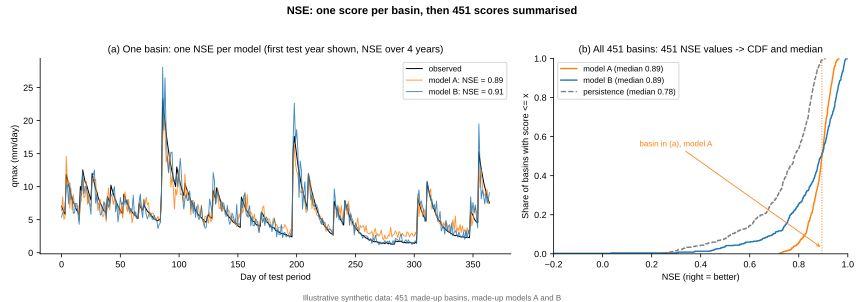
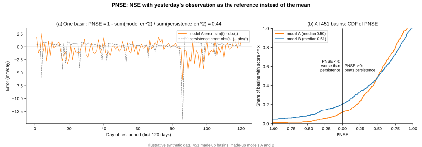
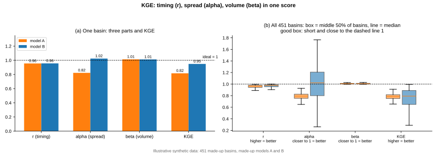
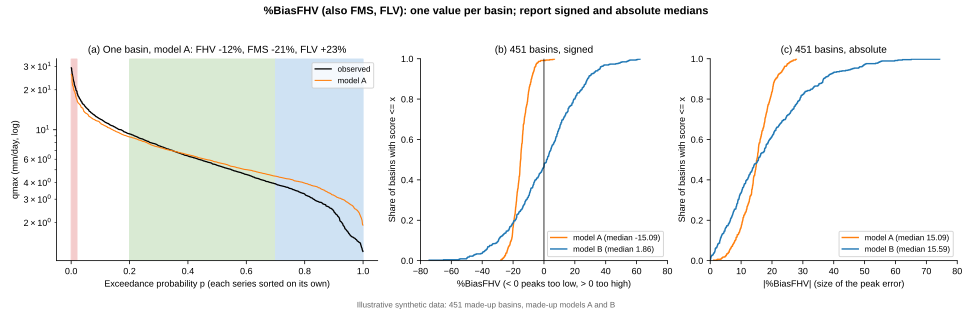
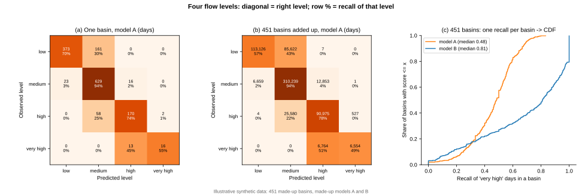
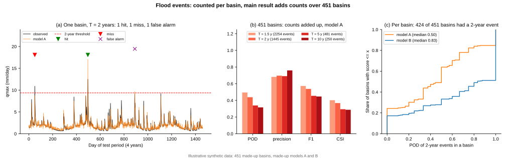
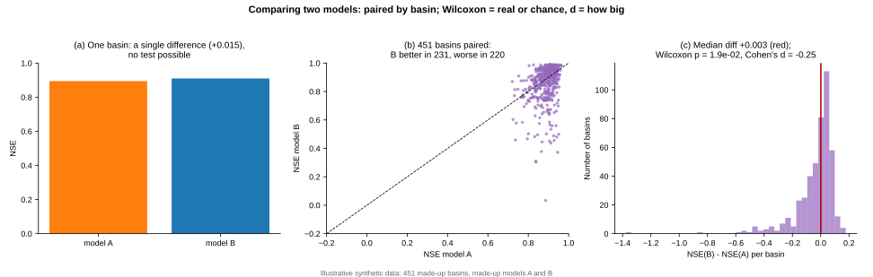
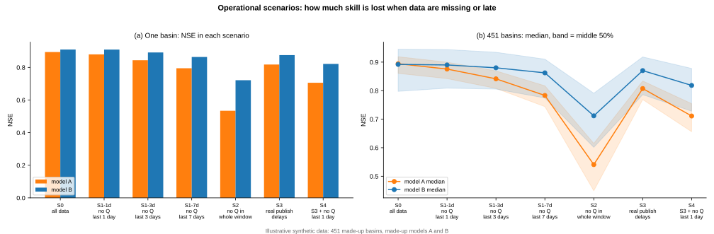
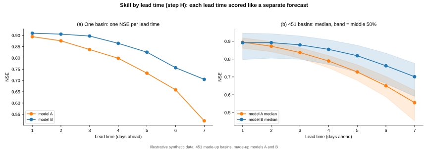
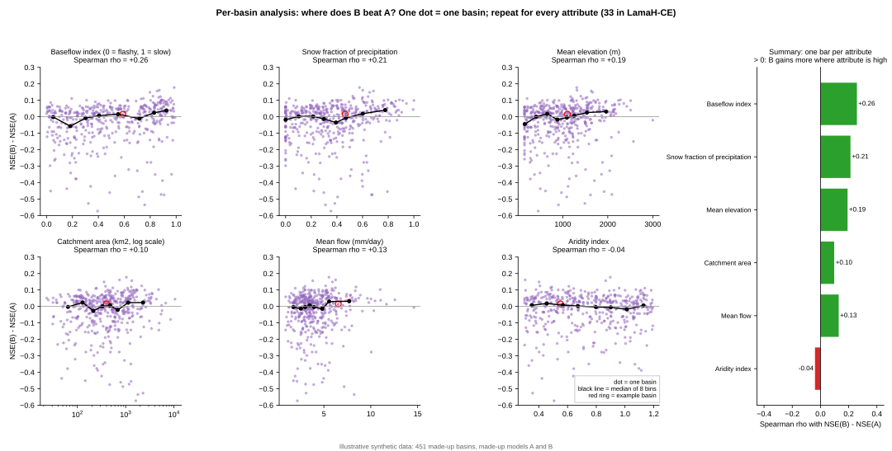

# Đánh giá mô hình: đọc hình các chỉ số

Ghi chú học cách đọc mọi chỉ số đánh giá của đề tài (`01_Plan/03_Pipeline.md` Mục 6) qua 10 hình minh họa. Khái niệm nền đã học ở BiasCast Phần 2 (`04_BiasCast2_Metrics.md`: NSE, CDF, KGE, persistence, PNSE, Wilcoxon) và Phần 3 (`05_BiasCast3_Data.md` Mục 3.5: bốn mức, %BiasFHV/FMS/FLV; Mục 3.6: lũ theo chu kỳ lặp lại); tệp này không nhắc lại công thức đã có ở đó, chỉ tập trung vào **cách đọc hình** và **cách gộp 451 lưu vực**.

## 0. Dữ liệu của các hình và quy ước chung

**Dữ liệu giả lập.** Mọi hình dùng 451 lưu vực tự sinh và hai mô hình tự đặt A, B (`Tools/Theory_Figures.py` Phần 6), không phải kết quả của đề tài. Mỗi lưu vực có 30 năm "lịch sử" (để tính ngưỡng) và 4 năm "test" (1461 ngày, như kỳ test 2014–2017). Hai mô hình được tạo có chủ đích để minh họa hai kiểu sai khác nhau:

| Mô hình | Cách tạo | Kiểu sai |
|---|---|---|
| A (màu cam) | Biên độ quanh trung bình co còn khoảng 0,75, nhiễu nhỏ | Ổn định nhưng **luôn hụt đỉnh** |
| B (màu xanh) | Biên độ trung bình đúng (khoảng 0,95) nhưng thay đổi mạnh giữa các lưu vực; nhiễu nhỏ hơn ở lưu vực chảy chậm | Trung bình đúng, nhưng **lệch hai chiều**, chỗ rất tốt chỗ rất dở |

Vì là dữ liệu tự sinh, một số con số khác xa thực tế: persistence ở đây có NSE trung vị 0,78, trong khi trên Extended LamaH-CE là 0,35–0,37 (`03_Data/01_LamaHCE.md` Mục 6.1). Các hình chỉ dùng để học **cách đọc**, không dùng số liệu của hình để kết luận.

**Hai hướng nhìn trong mỗi hình.** Hầu hết các hình chia ô (a) và ô (b):

- **(a) Một lưu vực:** mỗi chỉ số ra **một con số** cho một mô hình ở một lưu vực (VD NSE = 0,89).
- **(b) 451 lưu vực:** lặp lại phép tính đó ở mọi lưu vực được 451 con số, rồi tóm lại bằng trung vị, đường CDF hoặc boxplot (Phần 2 Mục 2.2).

Lưu vực mẫu ở ô (a) là lưu vực có NSE của A gần trung vị nhất (lưu vực "điển hình"); trên ô (b) có lúc được đánh dấu để thấy nó nằm ở đâu trong 451 lưu vực.

**Đọc đường CDF.** Trục ngang là giá trị chỉ số, trục dọc là tỉ lệ lưu vực có chỉ số ≤ giá trị đó. Với chỉ số càng lớn càng tốt (NSE, KGE, PNSE, recall): **đường càng nằm bên phải càng tốt**; nếu hai đường cắt nhau thì không mô hình nào hơn hẳn, phải so từng cặp lưu vực (Mục 7).

---

## 1. NSE

*Hình 1. NSE: (a) chuỗi qmax quan trắc và hai mô hình ở lưu vực mẫu, năm test đầu; (b) đường CDF NSE của 451 lưu vực cho A, B và persistence.*

| Ô | Đọc |
|---|---|
| (a) | Lưu vực mẫu: NSE của A 0,89, của B 0,91 — tính trên cả 4 năm test, hình chỉ vẽ năm đầu cho dễ nhìn. Đường cam (A) thấp hơn đường đen ở các đỉnh: hụt đỉnh |
| (b) | Ba đường CDF; trung vị A 0,89, B 0,89, gần như trùng nhau. Mũi tên chỉ vị trí lưu vực mẫu của A. Đường persistence (xám, nét đứt) nằm bên trái: hai mô hình đều hơn persistence ở phần lớn lưu vực |

**Rút ra:** NSE trung vị bằng nhau chưa nói hai mô hình giống nhau — các hình sau cho thấy A và B sai theo hai kiểu khác hẳn.

## 2. PNSE — so với persistence

*Hình 2. PNSE: (a) sai số từng ngày của mô hình A so với sai số của persistence ở lưu vực mẫu; (b) đường CDF PNSE của 451 lưu vực, vạch 0 là ngang persistence.*

PNSE = 1 − Σ(sai số mô hình)² / Σ(sai số persistence)², với sai số persistence ngày t là qmax(t−1) − qmax(t) (Phần 2 Mục 2.6). PNSE = 0: ngang chép số đo hôm qua; PNSE < 0: kém hơn chép số hôm qua; PNSE = 1: hoàn hảo.

| Ô | Đọc |
|---|---|
| (a) | Đường cam (sai số A) dao động hẹp hơn đường xám (sai số persistence) ở phần lớn các ngày, nên PNSE của A ở lưu vực này là 0,44 |
| (b) | Trung vị A 0,50, B 0,51. **Chiều cao đường tại x = 0** là tỉ lệ lưu vực mô hình thua persistence: A khoảng 12%, B khoảng 20%. B có đuôi trái dài (4,7% lưu vực PNSE < −1, A chỉ 0,9%), nhưng ở phía phải đường B nằm bên phải A (phân vị 90%: B 0,89, A 0,82) |

**Rút ra:** hai đường cắt nhau — A an toàn hơn (ít lưu vực hỏng), B giỏi hơn ở lưu vực dễ. Trung vị không phân biệt được hai kiểu này; phải nhìn cả đường.

## 3. KGE và ba thành phần

*Hình 3. KGE: (a) r, α, β và KGE của hai mô hình ở lưu vực mẫu; (b) boxplot bốn đại lượng qua 451 lưu vực, vạch đứt là giá trị lý tưởng 1.*

| Đại lượng | Đo gì | Tốt khi |
|---|---|---|
| r | tương quan: lên xuống có đúng nhịp không | càng lớn càng tốt, tối đa 1 |
| α | độ lệch chuẩn dự báo / quan trắc: biên độ dao động | **càng gần 1 càng tốt**; < 1 phẳng hơn thực tế (hụt đỉnh), > 1 dao động quá mạnh |
| β | trung bình dự báo / quan trắc: tổng lượng nước | **càng gần 1 càng tốt**; < 1 thiếu nước, > 1 thừa nước |
| KGE | 1 − khoảng cách từ (r, α, β) tới (1, 1, 1) | càng lớn càng tốt, tối đa 1 |

**Đọc boxplot.** Hộp là 50% lưu vực ở giữa (từ phân vị 25% tới 75%), vạch trong hộp là trung vị, râu là phần còn lại (không vẽ điểm ngoại lai). **Hộp tốt: ngắn** (các lưu vực giống nhau, mô hình ổn định) **và sát vạch 1** (đúng).

| Ô | Đọc |
|---|---|
| (a) | Lưu vực mẫu: r gần như bằng nhau (0,96); α của A 0,82 (hụt biên độ), của B 1,02; β cả hai khoảng 1,01; KGE A 0,82, B 0,95 |
| (b) | α là chỗ khác nhau: hộp A ngắn nhưng nằm quanh 0,79 (lưu vực nào cũng hụt biên độ, 50% giữa trong 0,75–0,83); hộp B ôm vạch 1 (trung vị 1,02) nhưng dài (0,80–1,21) — đúng trung bình, sai hai chiều. KGE trung vị gần bằng nhau (A 0,79, B 0,79) nhưng hộp B dài hơn |

**Rút ra:** KGE cho biết mô hình sai **kiểu gì** (nhịp, biên độ hay lượng nước) mà NSE không tách được.

## 4. %BiasFHV và trị tuyệt đối

*Hình 4. %BiasFHV: (a) đường duy trì lưu lượng của quan trắc và mô hình A ở lưu vực mẫu, ba vùng màu là khúc FHV, FMS, FLV; (b) CDF %BiasFHV có dấu qua 451 lưu vực; (c) CDF trị tuyệt đối |%BiasFHV|.*

Ở một lưu vực (Phần 3 Mục 3.5 bước 4): xếp riêng chuỗi quan trắc và chuỗi dự báo từ lớn tới nhỏ, lấy 2% ngày lớn nhất của mỗi chuỗi (khoảng 29 ngày trong 4 năm), %BiasFHV = (tổng dự báo − tổng quan trắc) / tổng quan trắc × 100. Âm: đỉnh thấp hơn thực tế; dương: đỉnh cao quá. %BiasFMS (khúc giữa, độ dốc đường duy trì) và %BiasFLV (30% ngày nhỏ nhất, nước kiệt) đọc theo cùng cách.

| Ô | Đọc |
|---|---|
| (a) | Ở vùng hồng bên trái (2% lớn nhất) đường cam nằm dưới đường đen: A hụt đỉnh, %BiasFHV = −12%; FMS −21%, FLV +23% |
| (b) | Trung vị có dấu: A −15%, B +1,9%. Đường A gần như nằm hẳn bên trái 0 (lưu vực nào cũng hụt); đường B vắt qua 0 |
| (c) | Trung vị trị tuyệt đối: A 15,1%, B 15,6% — **B sai đỉnh lớn không kém A** |

**Vì sao cần trị tuyệt đối.** Khi gộp nhiều lưu vực, lệch dương ở lưu vực này và lệch âm ở lưu vực kia triệt tiêu nhau: VD nửa số lưu vực +30%, nửa kia −30%, trung vị có dấu gần 0 trông như hoàn hảo, nhưng lưu vực nào cũng sai 30%. Trung vị có dấu cho biết **hướng lệch chung**, trung vị trị tuyệt đối cho biết **sai lớn cỡ nào**; đề tài báo cáo cả hai (`03_Pipeline.md` Mục 6.1).

## 5. Bốn mức lưu lượng

*Hình 5. Bốn mức: (a) ma trận nhầm lẫn của mô hình A ở lưu vực mẫu (số ngày); (b) ma trận cộng dồn 451 lưu vực; (c) CDF recall mức rất cao, mỗi lưu vực một giá trị.*

Mỗi ngày được xếp vào một trong bốn mức theo ngưỡng riêng của lưu vực (thấp, trung bình, cao, rất cao — Phần 3 Mục 3.5), cả cho quan trắc và cho dự báo; mô hình được chấm như bài toán phân loại.

**Đọc ma trận.** Hàng là mức quan trắc, cột là mức dự báo; ô đường chéo là đoán đúng mức. Số phần trăm trong ô là tỉ lệ theo **hàng**, nên ô đường chéo chính là **recall** của mức đó (trong các ngày thật sự ở mức này, mô hình bắt được bao nhiêu phần).

| Ô | Đọc |
|---|---|
| (a) | Lưu vực mẫu, mô hình A: 29 ngày rất cao thật, bắt đúng 16 (recall 55%), 13 ngày còn lại bị báo thành "cao" — hụt đỉnh |
| (b) | Cộng dồn 451 lưu vực: recall mức rất cao của A 49%, mức thấp 57%; của B lần lượt 69% và 75%. B bắt mức rất cao tốt hơn nhưng báo nhầm nhiều hơn (precision mức rất cao: A 93%, B 64%) |
| (c) | Recall mức rất cao tính riêng từng lưu vực: trung vị A 0,48, B 0,81; đường B nằm hẳn bên phải |

**Rút ra:** đây là đánh giá theo mức mà GVHD yêu cầu: đọc recall ở mức rất cao và mức thấp trước, chấp nhận báo động nhầm nhiều hơn (`03_Pipeline.md` Mục 6.2). Theo tiêu chí đó B tốt hơn A, dù NSE trung vị bằng nhau.

## 6. Sự kiện lũ

*Hình 6. Sự kiện lũ: (a) một lưu vực, ngưỡng chu kỳ 2 năm, đánh dấu trận bắt được, bỏ sót và báo nhầm; (b) POD, precision, F1, CSI của mô hình A khi cộng dồn số trận 451 lưu vực, theo bốn ngưỡng; (c) CDF POD theo lưu vực, chỉ tính lưu vực có trận.*

Một trận lũ bắt đầu ở ngày lưu lượng vượt ngưỡng từ dưới lên; trận quan trắc được tính **bắt được** nếu dự báo có trận bắt đầu trong ±1 ngày, ngược lại là **bỏ sót**; trận dự báo không khớp trận thật nào là **báo nhầm** (`03_Pipeline.md` Mục 6.2). Hình minh họa chưa áp tiêu chí gộp trận độc lập USWRC mà đề tài dùng khi làm thật.

| Chỉ số | Công thức (h bắt được, m bỏ sót, f báo nhầm) | Nghĩa |
|---|---|---|
| POD (recall) | h / (h + m) | trong các trận thật, bắt được bao nhiêu phần |
| FAR | f / (h + f) | trong các lần báo lũ, bao nhiêu phần là báo nhầm |
| precision | h / (h + f) = 1 − FAR | báo lũ thì tin được bao nhiêu |
| F1 | trung bình điều hòa của precision và POD | cân bằng hai mặt |
| CSI | h / (h + m + f) | tỉ lệ đúng trên mọi trận có liên quan |

| Ô | Đọc |
|---|---|
| (a) | Một lưu vực có đủ ba trường hợp: 1 bắt được (tam giác xanh), 1 bỏ sót (tam giác đỏ), 1 báo nhầm (dấu x) |
| (b) | Cộng dồn mọi lưu vực rồi mới tính chỉ số. Mô hình A, ngưỡng 2 năm: 1445 trận thật, bắt 633, sót 812, báo nhầm 276 — POD 0,44, precision 0,70. Ngưỡng càng cao (lũ càng hiếm) POD càng giảm (0,50 ở 1,5 năm, 0,32 ở 10 năm) |
| (c) | Chỉ 424/451 lưu vực có trận 2 năm trong 4 năm test, nên CDF chỉ có 424 điểm. Trung vị POD: A 0,50, B 0,83 |

**Vì sao cộng dồn.** Mỗi lưu vực chỉ có vài trận trong 4 năm, nên POD của một lưu vực rất thô (1 trên 2 trận là 0,5; lưu vực không có trận thì không tính được). Cộng số trận của cả 451 lưu vực cho một tỉ lệ ổn định; CDF theo lưu vực là hình phụ.

So B với A ở ngưỡng 2 năm: B bắt 954 trận (POD 0,66) nhưng báo nhầm 1172 lần (precision 0,45). Đây đúng là đánh đổi "báo động nhầm hay bỏ sót" mà GVHD nêu.

## 7. So hai mô hình: Wilcoxon và Cohen's d

*Hình 7. So A và B: (a) ở một lưu vực chỉ có một hiệu số, không kiểm định được; (b) mỗi chấm một lưu vực, trục ngang NSE của A, trục dọc NSE của B; (c) histogram hiệu NSE(B) − NSE(A), vạch đỏ là trung vị.*

| Ô | Đọc |
|---|---|
| (a) | Một lưu vực: B hơn A 0,015. Một con số không đủ để biết chênh lệch là thật hay ngẫu nhiên |
| (b) | Chấm trên đường chéo: B hơn A ở lưu vực đó. B hơn ở 231 lưu vực, kém ở 220 — gần chia đôi |
| (c) | Trung vị hiệu +0,003, nhưng đuôi trái dài: 42 lưu vực B kém hơn 0,2 NSE, chỉ 16 lưu vực B hơn quá 0,1 |

**Wilcoxon signed-rank** ghép cặp theo lưu vực: lấy 451 hiệu, xếp hạng theo độ lớn (bỏ dấu), cộng hạng của hiệu dương (W⁺) và hiệu âm (W⁻). Nếu hai mô hình ngang nhau thì W⁺ ≈ W⁻. Ở đây W⁺ = 44 452, W⁻ = 57 474: các lưu vực B thua có hạng lớn (thua đậm), nên kiểm định nghiêng về A, p = 0,019 < 0,05 — chênh lệch không phải ngẫu nhiên.

**Cohen's d** dạng ghép cặp = trung bình hiệu / độ lệch chuẩn của hiệu = −0,25: tính trung bình B kém A, mức nhỏ. Wilcoxon trả lời "thật hay ngẫu nhiên", d trả lời "lớn hay nhỏ"; với 451 lưu vực, chênh lệch rất nhỏ cũng có thể có p nhỏ, nên luôn báo kèm d. Khi so nhiều cặp mô hình (5 lõi cho 10 cặp), hiệu chỉnh Holm nâng ngưỡng để tránh "so nhiều lần kiểu gì cũng có một cặp p < 0,05".

**Rút ra:** trung vị dương chưa chắc B tốt hơn; phải nhìn cả đuôi và kết quả kiểm định.

## 8. Kịch bản vận hành S0–S4

*Hình 8. Kịch bản vận hành: (a) NSE của hai mô hình ở lưu vực mẫu trong từng kịch bản; (b) trung vị và dải 50% giữa của 451 lưu vực.*

Các kịch bản chỉ thay **đầu vào lúc dự báo** (không huấn luyện lại) để mô phỏng tình huống thực tế (`03_Pipeline.md` Mục 6.3):

| Kịch bản | Tình huống |
|---|---|
| S0 | Đủ dữ liệu, như bài BiasCast |
| S1-1d, S1-3d, S1-7d | Trạm đo Q mất số liệu 1, 3, 7 ngày gần nhất |
| S2 | Trạm đo Q hỏng lâu: không có Q cả cửa sổ 365 ngày |
| S3 | Độ trễ công bố thực của từng nguồn: ERA5-Land thiếu 5 ngày cuối; GLEAM thiếu cả cửa sổ (phát hành theo năm); E-OBS, MSWEP đủ tới ngày t−1 |
| S4 | S3 cộng mất Q 1 ngày cuối |

**Độ trễ thực là gì.** Dữ liệu lịch sử dùng khi huấn luyện đã đầy đủ tới hôm qua ở mọi nguồn. Khi chạy dự báo thật vào sáng ngày t, mỗi nguồn công bố trễ một khoảng khác nhau, nên một số ô gần ngày t đang trống. S3 đặt đúng các ô trống đó vào đầu vào để đo mô hình còn tốt bao nhiêu khi vận hành thật.

| Ô | Đọc |
|---|---|
| (a) | Lưu vực mẫu: mất Q càng nhiều ngày NSE càng giảm; S2 giảm mạnh nhất (A 0,53, B 0,72) |
| (b) | Ở S0 hai mô hình bằng nhau (0,89); A giảm nhanh hơn B: S1-7d A 0,78, B 0,86; S2 A 0,54, B 0,71; S4 A 0,71, B 0,82 |

**Rút ra:** đọc **mức giảm so với S0**, không chỉ giá trị. Mô hình giảm ít hơn là mô hình bền hơn khi thiếu dữ liệu. Trong hình, mức giảm được tạo bằng cách làm nhiễu dự báo theo mức độ đặt trước, không phải chạy mô hình thật với dữ liệu thiếu.

## 9. Theo hạn dự báo (bước H)

*Hình 9. Theo hạn: (a) NSE ở lưu vực mẫu cho từng hạn 1–7 ngày; (b) trung vị và dải 50% giữa của 451 lưu vực.*

Bước H dự báo 1–7 ngày tới (`03_Pipeline.md` Mục 4.4, 6.6). Mỗi hạn được chấm như một bộ dự báo riêng: hạn 3 ngày là chuỗi các dự báo làm trước 3 ngày, so với quan trắc, ra một NSE cho mỗi lưu vực.

| Ô | Đọc |
|---|---|
| (a) | Một lưu vực: hai đường đi xuống theo hạn |
| (b) | Trung vị: hạn 1 ngày A 0,89, B 0,89; hạn 7 ngày A 0,56, B 0,70. B giảm chậm hơn |

**Rút ra:** đọc độ dốc của đường (kỹ năng mất nhanh hay chậm theo hạn), và hạn xa nhất mà mô hình còn hơn mốc (VD còn hơn persistence). Mức giảm trong hình cũng là giả lập.

## 10. Theo thuộc tính lưu vực

*Hình 10. Theo lưu vực: sáu ô nhỏ, mỗi ô một thuộc tính lưu vực (trục ngang) với hiệu NSE(B) − NSE(A) (trục dọc), mỗi chấm một lưu vực, đường đen là trung vị theo 8 nhóm; cột phải tổng hợp hệ số Spearman của từng thuộc tính.*

Câu hỏi: **B hơn A ở loại lưu vực nào?** Với mỗi thuộc tính, xếp 451 lưu vực theo thuộc tính đó và xem hiệu NSE có tăng (giảm) theo không.

| Phần hình | Đọc |
|---|---|
| Chấm | một lưu vực; chấm trên vạch 0 là lưu vực B hơn A |
| Đường đen | chia lưu vực thành 8 nhóm theo thuộc tính, mỗi nhóm lấy trung vị — dễ thấy xu hướng hơn đám chấm |
| Spearman rho | tương quan hạng giữa thuộc tính và hiệu NSE: dương là thuộc tính càng cao B càng có lợi; gần 0 là không liên quan; độ lớn càng gần 1 xu hướng càng rõ |
| Cột tổng hợp | một thanh cho một thuộc tính; khi làm thật có 33 thanh cho 33 thuộc tính của LamaH-CE |

Trong hình: chỉ số dòng chảy nền +0,26, tỉ lệ tuyết +0,21, độ cao +0,19 (B có lợi ở lưu vực chảy chậm, nhiều tuyết, cao); diện tích +0,10, lưu lượng trung bình +0,13 (yếu); chỉ số khô hạn −0,04 (không liên quan). Các thuộc tính trong hình là giả lập; riêng chỉ số dòng chảy nền là yếu tố được dùng để tạo nhiễu của B nên tương quan với hiệu NSE.

**Khi làm thật** (`03_Pipeline.md` Mục 6.4): kiểm giả thuyết của các nghiên cứu trước rằng SSM có lợi ở lưu vực có tuyết, động lực chậm và bất lợi ở lũ nhanh. Tương quan yếu (rho khoảng 0,2) chỉ là xu hướng, không phải quy luật; một thuộc tính có thể tương quan vì đi kèm thuộc tính khác (độ cao đi kèm tuyết).

## 11. Ưu tiên chỉ số nào: ba tầng

Mọi chỉ số tính từ cùng một tệp dự báo nên tính thêm gần như không tốn; điều cần tránh là dùng nhiều chỉ số ngang hàng để chọn mô hình. Đề tài chia ba tầng (`03_Pipeline.md` Mục 6.1):

| Tầng | Chỉ số | Dùng để |
|---|---|---|
| 1. Chọn | NSE trung vị trên **validation** | Chọn checkpoint, cấu hình khi tinh chỉnh, B*, mô hình chạy trong demo — chỉ một tiêu chí |
| 2. Kết quả chính | Trên **test**: NSE, KGE, PNSE kèm Wilcoxon, Cohen's d, Holm; recall mức rất cao và mức thấp; POD, FAR lũ chu kỳ 2 năm | So các lõi với nhau, đáp yêu cầu đánh giá theo mức |
| 3. Phân tích | r, α, β; %BiasFHV/FMS/FLV có dấu và trị tuyệt đối; ma trận 4 mức đầy đủ; precision, F1, CSI; ngưỡng 1,5/5/10 năm; phân vị; theo thuộc tính | Giải thích chênh lệch ở tầng 2 đến từ đâu |

**Chọn khác so sánh.** "Chọn" là giữ lại một cấu hình trong nhiều cấu hình của **cùng một lõi**, chỉ dùng validation để không nhìn trước test. "So sánh" Mamba với LSTM là câu hỏi nghiên cứu, trả lời trên test bằng nhiều chỉ số, kết luận là một nhận định nhiều mặt chứ không phải một người thắng. VD từ các hình trên: "NSE trung vị ngang nhau, Wilcoxon nghiêng về A nhưng hiệu ứng nhỏ (d = −0,25); A ổn định hơn và ít thua persistence hơn, nhưng hụt đỉnh đều khoảng 15%; B bắt lũ và ngày rất cao tốt hơn hẳn với cái giá báo nhầm nhiều, bền hơn khi thiếu Q và ở hạn xa, có lợi ở lưu vực chảy chậm."

## 12. Tóm tắt

| Hình | Một lưu vực cho | 451 lưu vực gộp bằng | Đọc nhanh |
|---|---|---|---|
| 1 NSE | 1 số | CDF, trung vị | phải hơn = tốt |
| 2 PNSE | 1 số | CDF, vạch 0 | độ cao tại 0 = tỉ lệ lưu vực thua persistence |
| 3 KGE | r, α, β, KGE | boxplot | hộp ngắn, sát 1 |
| 4 %BiasFHV | 1 số có dấu | CDF có dấu và trị tuyệt đối | dấu = hướng, trị tuyệt đối = độ lớn |
| 5 Bốn mức | ma trận 4×4 | cộng dồn ma trận; CDF recall | đường chéo theo hàng = recall |
| 6 Sự kiện | số trận bắt, sót, báo nhầm | cộng dồn số trận; CDF POD | POD và FAR đi ngược nhau |
| 7 Kiểm định | 1 hiệu (không kiểm định được) | Wilcoxon, Cohen's d, Holm | p: thật hay ngẫu nhiên; d: lớn hay nhỏ |
| 8 Kịch bản | NSE mỗi kịch bản | trung vị, dải 50% | mức giảm so với S0 |
| 9 Theo hạn | NSE mỗi hạn | trung vị, dải 50% | độ dốc theo hạn |
| 10 Thuộc tính | 1 chấm | Spearman theo từng thuộc tính | rho dương = có lợi khi thuộc tính cao |

**Câu hỏi ôn:**

1. Hai mô hình có NSE trung vị bằng nhau. Nêu hai hình giúp phân biệt chúng và mỗi hình nhìn vào đâu.
2. Đường CDF PNSE của mô hình X cắt trục x = 0 ở độ cao 0,3. Nghĩa là gì?
3. Boxplot α của mô hình Y có trung vị 1,00, hộp từ 0,6 tới 1,4. Mô hình Y tốt về α không?
4. 451 lưu vực có %BiasFHV: 200 lưu vực +25%, 251 lưu vực −25%. Trung vị có dấu và trung vị trị tuyệt đối là bao nhiêu?
5. Ở mức rất cao, mô hình bắt 60 trên 100 ngày thật và báo thêm 40 ngày không phải rất cao. Tính recall và precision.
6. Cộng dồn: 300 trận thật, bắt 180, báo nhầm 120. Tính POD, FAR, CSI.
7. Vì sao không kiểm định Wilcoxon được ở một lưu vực?
8. Wilcoxon p = 0,001, Cohen's d = 0,05. Kết luận gì?
9. Mô hình P có NSE S0 0,90, S2 0,60; mô hình Q có S0 0,88, S2 0,80. Khi trạm đo hay hỏng nên dùng mô hình nào?
10. Vì sao chọn checkpoint theo validation mà không theo test?

Đáp án: (1) Hình 2 (độ cao tại 0, đuôi trái), hình 3 (α: vị trí và độ dài hộp), hình 4 (trị tuyệt đối), hình 5 (recall mức rất cao) — bất kỳ hai. (2) 30% lưu vực mô hình X kém hơn chép số đo hôm qua. (3) Không: trung bình đúng nhưng một nửa số lưu vực lệch 40% hoặc hơn về hai phía. (4) Trung vị có dấu −25% (lưu vực thứ 226 nằm trong nhóm −25%), trung vị trị tuyệt đối 25%; nếu hai nhóm bằng nhau thì trung vị có dấu gần 0 dù lưu vực nào cũng sai 25%. (5) Recall 60/100 = 0,6; precision 60/(60 + 40) = 0,6. (6) POD 180/300 = 0,6; FAR 120/(180 + 120) = 0,4; CSI 180/(180 + 120 + 120) = 0,43. (7) Một lưu vực chỉ có một hiệu số, không có phân bố để so với 0. (8) Chênh lệch là thật nhưng rất nhỏ, không đáng kể về thực tế. (9) Q: chỉ giảm 0,08 khi mất Q, P giảm 0,30. (10) Chọn theo test là dùng test để tinh chỉnh, kết quả test không còn là đánh giá khách quan trên dữ liệu chưa thấy.
