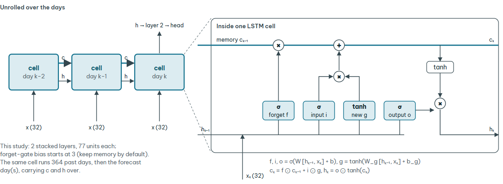
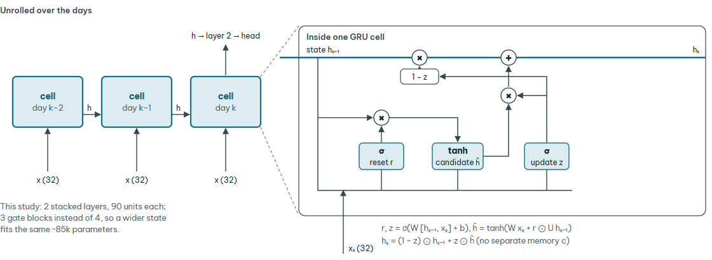
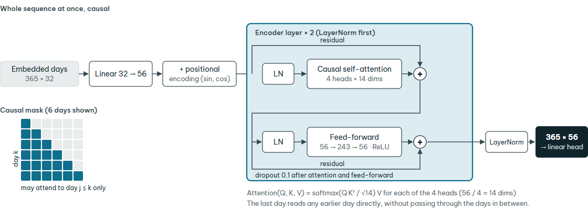
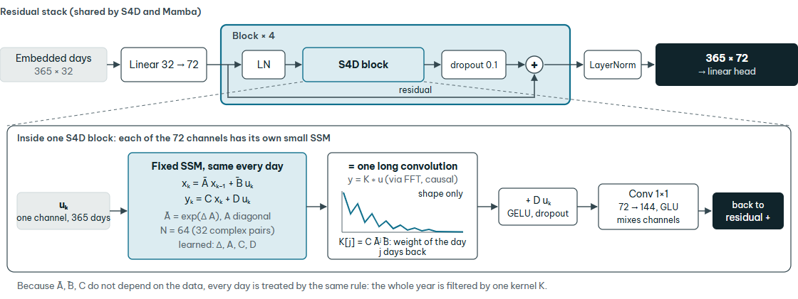
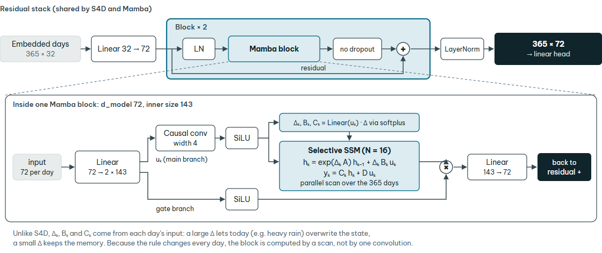

# Chương 2. Cơ sở lý thuyết

Chương này trình bày các khái niệm thủy văn cần cho bài toán (Mục 2.1), năm lõi thời gian được so sánh (Mục 2.2–2.5), phương pháp giải thích mô hình (Mục 2.6) và các chỉ số đánh giá (Mục 2.7). Cách đề tài ghép các lõi vào mô hình chung ở Chương 5; công thức tính chính xác của từng chỉ số trong bộ đánh giá ở Chương 6 Mục 6.2. Ghi chú học lý thuyết kèm ví dụ số tự tính ở `06_Theory/01_ArchitectureTheory.md` (kiến trúc) và `06_Theory/04_BiasCast2_Metrics.md`, `05_BiasCast3_Data.md` (chỉ số, mức, chu kỳ lặp lại).

## 2.1. Khái niệm thủy văn

- **Lưu vực (catchment)** của một trạm đo là toàn bộ vùng đất mà nước mưa rơi xuống sẽ chảy về trạm đó. Mỗi trạm có một lưu vực; lưu vực của trạm hạ lưu chứa lưu vực của các trạm thượng lưu (lưu vực lồng nhau).
- **Lưu lượng (discharge, Q)** là thể tích nước chảy qua mặt cắt sông tại trạm trong một giây, đơn vị m³/s. Chia cho diện tích lưu vực được đơn vị mm/ngày, tức độ dày lớp nước tương đương trải đều trên lưu vực, cùng thang đo với lượng mưa. Ví dụ 10 m³/s ở lưu vực 102 km² bằng 10 × 86.400 / (102 × 1.000) ≈ 8,5 mm/ngày.
- **qmax và qmean:** lưu lượng lớn nhất và trung bình trong một ngày. Đỉnh lũ ngắn ở lưu vực nhỏ có thể chỉ kéo dài vài giờ, nên qmax phản ánh nguy cơ lũ tốt hơn qmean.
- **Tái phân tích (reanalysis)** là dữ liệu khí tượng quá khứ dựng lại bằng mô hình thời tiết kết hợp mọi quan trắc có được, ví dụ ERA5-Land. Tái phân tích chính xác hơn dự báo nhưng chỉ có sau khi sự việc đã xảy ra, thường trễ vài ngày.
- **Dự báo thời tiết** như ECMWF HRES (mô hình độ phân giải cao của Trung tâm Dự báo Thời tiết Hạn vừa châu Âu) có ngay lúc phát hành nhưng sai số lớn hơn.
- **Hindcast và forecast:** trong bài toán này, pha quá khứ (hindcast) dùng dữ liệu đã quan trắc tới ngày t−1, pha dự báo (forecast) dùng dự báo thời tiết cho ngày t.
- **Chu kỳ lặp lại (return period) T năm** của một mức lưu lượng: mức có xác suất bị vượt 1/T mỗi năm. Mức 2 năm có xác suất vượt 50% mỗi năm, mức 10 năm 10% mỗi năm; không có nghĩa phải đúng 10 năm mới xảy ra một lần.

## 2.2. LSTM

Mạng hồi quy (RNN) đọc chuỗi từng bước, mang theo một trạng thái ẩn h_t tóm tắt những gì đã đọc. RNN thuần khó học phụ thuộc xa vì gradient nhân lặp qua nhiều bước sẽ tắt dần hoặc bùng nổ. LSTM (Hochreiter & Schmidhuber, Neural Computation 1997) thêm một **ô nhớ** c_t và ba cổng điều khiển luồng thông tin. Với x_t là đầu vào ngày t, σ là hàm sigmoid (ra giá trị 0–1), ⊙ là nhân từng phần tử:

- cổng quên f_t = σ(W_f [h_{t−1}, x_t] + b_f): giữ bao nhiêu phần ô nhớ cũ;
- cổng nạp i_t = σ(W_i [h_{t−1}, x_t] + b_i) và nội dung mới g_t = tanh(W_g [h_{t−1}, x_t] + b_g): nạp bao nhiêu thông tin mới;
- cập nhật ô nhớ c_t = f_t ⊙ c_{t−1} + i_t ⊙ g_t;
- cổng ra o_t = σ(W_o [h_{t−1}, x_t] + b_o) và h_t = o_t ⊙ tanh(c_t).

Ô nhớ được cập nhật bằng phép cộng, nên thông tin có thể đi qua nhiều bước mà không bị nhân dồn. Trong thủy văn, ô nhớ có thể giữ những trạng thái tích lũy chậm như lượng tuyết hay độ ẩm đất; Kratzert và cs. (HESS 22:6005, 2018) cho thấy một số ô nhớ của LSTM tương quan với lượng nước trong tuyết dù mô hình không được dạy điều đó. BiasCast đặt độ lệch (bias) của cổng quên ban đầu bằng 3 để σ(3) ≈ 0,95, tức mặc định gần như giữ nguyên trí nhớ. Một lớp LSTM có 4 khối cổng, mỗi khối một ma trận cho [h, x] và hai vectơ độ lệch (theo cách cài của PyTorch): 4 × (H × (H + X) + 2H) tham số, với H là số chiều ẩn, X số chiều đầu vào.

*Hình 2.1. Lõi LSTM của đề tài. Bên trái: cùng một ô chạy lần lượt qua các ngày, mang theo ô nhớ c và trạng thái h. Bên phải: bên trong một ô, gồm cổng quên f, cổng nạp i, nội dung mới g và cổng ra o theo các công thức ở trên. Kích thước theo cấu hình C2 `lstm_L2_x1_lr1e-3`: 2 lớp, mỗi lớp 77 chiều, độ lệch cổng quên khởi tạo bằng 3 (`config.yml` của run). Mã: `torch.nn.LSTM` trong `RNNCore`, `neuralhydrology/modelzoo/sf_cores.py` của fork. Chữ trong hình bằng tiếng Anh.*

## 2.3. GRU

GRU (Cho và cs., EMNLP 2014) rút LSTM còn hai cổng và bỏ ô nhớ riêng:

- cổng reset r_t = σ(W_r [h_{t−1}, x_t]) quyết định dùng bao nhiêu trạng thái cũ để tạo nội dung mới h̃_t = tanh(W_h [r_t ⊙ h_{t−1}, x_t]);
- cổng cập nhật z_t = σ(W_z [h_{t−1}, x_t]) trộn cũ và mới: h_t = (1 − z_t) ⊙ h_{t−1} + z_t ⊙ h̃_t.

GRU có 3 khối cổng so với 4 của LSTM, nên ở cùng số tham số GRU có số chiều ẩn lớn hơn (Chương 5 Mục 5.4: 150 so với 128 ở một lớp). Đề tài dùng GRU để tách lợi thế của cấu trúc cổng LSTM khỏi lợi thế chung của họ mạng hồi quy.

*Hình 2.2. Lõi GRU của đề tài: chỉ một trạng thái h, cổng reset r tạo nội dung mới h̃, cổng cập nhật z trộn cũ và mới. Hình vẽ theo `torch.nn.GRU`, nhân r sau phép chiếu U h; PyTorch đặt z ở vế giữ trạng thái cũ, hình dùng quy ước của công thức ở trên, hai cách tương đương khi đổi z thành 1 − z. Kích thước theo cấu hình C2 `gru_L2_x1_lr1e-3`: 2 lớp, mỗi lớp 90 chiều. Chữ trong hình bằng tiếng Anh.*

## 2.4. Transformer

Transformer (Vaswani và cs., NeurIPS 2017) bỏ hẳn cách đọc tuần tự. Mỗi bước của chuỗi được chiếu thành ba vectơ truy vấn q, khóa k và giá trị v. Đầu ra của bước i là trung bình có trọng số các giá trị của mọi bước, trọng số theo độ khớp giữa truy vấn của i và khóa của từng bước:

**Attention(Q, K, V) = softmax(QKᵀ / √d_k) V.**

Chia cho √d_k (d_k là số chiều của khóa) giữ tích vô hướng không quá lớn để softmax không bão hòa. Nhiều đầu chú ý (multi-head) chạy song song với các phép chiếu khác nhau, mỗi đầu học một kiểu quan hệ. Sau attention là một tầng truyền thẳng hai lớp áp riêng từng bước; mỗi tầng con có kết nối tắt và chuẩn hóa LayerNorm. Vì attention không biết thứ tự, vị trí được thêm vào bằng mã hóa vị trí hình sin.

Trong dự báo, **mặt nạ nhân quả** chặn bước i nhìn các bước sau nó. Ưu điểm của Transformer là bước cuối nhìn thẳng được bất kỳ ngày nào trong 365 ngày mà không phải truyền qua từng bước. Nhược điểm là chi phí tăng theo bình phương độ dài chuỗi, và không có thiên hướng sẵn về "gần thì quan trọng hơn" như mạng hồi quy.

*Hình 2.3. Lõi Transformer của đề tài: chiếu 32 → 56, cộng mã hóa vị trí sin, cos, rồi 2 lớp mã hóa, mỗi lớp LayerNorm → attention nhân quả 4 đầu → cộng nối tắt → LayerNorm → tầng truyền thẳng 56 → 243 → 56 → cộng nối tắt, cuối cùng một LayerNorm. Lưới ô vuông bên trái minh họa mặt nạ nhân quả cho 6 ngày: ngày k chỉ được nhìn các ngày j ≤ k. Kích thước theo cấu hình C2 `transformer_L2_x1_lr1e-3` (dropout 0,1). Mã: `TransformerCore`, dùng `torch.nn.TransformerEncoderLayer` với `norm_first=True`. Chữ trong hình bằng tiếng Anh.*

## 2.5. Mô hình không gian trạng thái: S4D và Mamba

**SSM liên tục.** Mô hình không gian trạng thái (state space model) mượn từ lý thuyết điều khiển: một trạng thái ẩn h(t) thay đổi theo h'(t) = A h(t) + B x(t), đầu ra y(t) = C h(t). Ví dụ trực giác là bồn nước: mực nước (trạng thái) tự rút dần (A âm) và tăng theo lượng bơm vào (B x). Trong mạng nơ-ron, h(t) không phải đại lượng vật lý đo được mà là vectơ mô hình tự học.

**Rời rạc hóa.** Với bước thời gian Δ, phương trình liên tục chuyển thành phép truy hồi h_t = Ā h_{t−1} + B̄ x_t, y_t = C h_t, với Ā = exp(ΔA) (cách giữ bậc không, zero-order hold). Ví dụ A = −0,1, Δ = 1 cho Ā ≈ 0,905: mỗi ngày trạng thái giữ lại khoảng 90% giá trị cũ, tương đương trí nhớ phân rã với "chu kỳ bán rã" khoảng 7 ngày. Δ lớn cho trí nhớ ngắn, Δ nhỏ cho trí nhớ dài.

**S4D.** S4 (Gu và cs., ICLR 2022) khởi tạo A theo lý thuyết HiPPO để trạng thái nén tốt lịch sử dài; S4D (Gu và cs., NeurIPS 2022) dùng A đường chéo, đơn giản hơn mà kết quả tương đương. Vì Ā, B̄, C không đổi theo thời gian, đầu ra là một tích chập của đầu vào với nhân K = (CB̄, CĀB̄, CĀ²B̄, …) dài bằng chuỗi, tính nhanh bằng biến đổi Fourier nhanh (FFT). Mỗi kênh có N trạng thái (đề tài dùng N = 64). Hạn chế: cùng một nhân áp cho mọi đầu vào. Mưa 1 mm hay 100 mm đều được "nhớ" theo cùng một cách.

*Hình 2.4. Lõi S4D của đề tài. Trên: khung nối tắt dùng chung cho S4D và Mamba (chiếu 32 → 72, mỗi khối LayerNorm → khối → dropout → cộng nối tắt, LayerNorm cuối). Dưới: bên trong một khối S4D, mỗi kênh trong 72 kênh có một SSM đường chéo riêng, trạng thái N = 64; vì Ā, B̄, C không đổi theo ngày, cả chuỗi được tính một lần như tích chập với nhân K bằng FFT, rồi qua GELU và tích chập 1×1 với GLU. Đường cong K chỉ minh họa dạng giảm dần, không phải nhân đã học. Kích thước theo cấu hình C2 `s4d_L4_x1_lr1e-3`: 4 khối, dropout 0,1. Mã: `ResidualCore` và `S4DBlock` (chỉnh từ `models/s4/s4d.py` của `state-spaces/s4`). Chữ trong hình bằng tiếng Anh.*

**Mamba.** Mamba (Gu & Dao, arXiv 2312.00752, 2023) làm B, C và Δ phụ thuộc đầu vào tại mỗi bước (cơ chế chọn lọc, selective SSM): B_t = Linear_B(x_t), C_t = Linear_C(x_t), Δ_t = softplus(Linear_Δ(x_t)). Khi một ngày quan trọng (ví dụ mưa lớn), mô hình có thể chọn Δ_t lớn để ghi mạnh thông tin đó vào trạng thái; ngày không quan trọng thì Δ_t nhỏ, trạng thái gần như giữ nguyên. Cơ chế này giống vai trò cổng của LSTM. Đổi lại, nhân tích chập không còn cố định nên không dùng FFT được. Mamba tính bằng thuật toán quét song song (parallel scan) cài thành nhân CUDA, chi phí tuyến tính theo độ dài chuỗi.

Một khối Mamba gồm: chiếu đầu vào lên kích thước trong d_inner (mặc định gấp 2 lần d_model) thành hai nhánh; nhánh chính qua tích chập một chiều nhân quả (độ rộng `d_conv` = 4), hàm SiLU rồi SSM chọn lọc (trạng thái `d_state` = 16); nhánh kia qua SiLU làm cổng nhân vào nhánh chính; cuối cùng chiếu về d_model. Đề tài bọc mỗi khối bằng kết nối tắt và LayerNorm, và xếp 2 hoặc 4 khối.

*Hình 2.5. Lõi Mamba của đề tài: cùng khung nối tắt với S4D, 2 khối. Bên trong một khối, đầu vào 72 chiều được chiếu thành hai nhánh 143 chiều; nhánh chính qua tích chập nhân quả rộng 4, SiLU rồi SSM chọn lọc (N = 16) với Δ, B, C tính từ dữ liệu từng ngày; nhánh cổng qua SiLU rồi nhân vào kết quả, cuối cùng chiếu 143 → 72. Kích thước theo cấu hình C2 `mamba_L2_x1_lr1e-3`. Mã: `ResidualCore` với `mamba_ssm.Mamba` 2.3.2.post1 khi huấn luyện trên GPU, `mambapy` 1.2.0 khi chạy trên CPU của demo. Chữ trong hình bằng tiếng Anh.*

**So sánh.** LSTM, GRU nén lịch sử vào trạng thái kích thước cố định qua từng bước, tính tuần tự. Transformer giữ toàn bộ lịch sử và nhìn thẳng mọi bước, chi phí bình phương. S4D và Mamba cũng nén vào trạng thái cố định nhưng huấn luyện song song được; Mamba thêm khả năng chọn lọc như cổng của LSTM. Cái giá của việc nén là khó truy xuất chi tiết đơn lẻ ở xa (Jelassi và cs., ICML 2024). Dự báo lưu lượng chủ yếu cần trạng thái tích lũy (tuyết, độ ẩm đất) hơn là một ngày cụ thể ở xa, nên câu hỏi kiến trúc nào hợp hơn là câu hỏi thực nghiệm của đề tài.

## 2.6. Giải thích mô hình bằng Integrated Gradients

Integrated Gradients (IG; Sundararajan và cs., ICML 2017) gán cho mỗi ô đầu vào x_i (một biến ở một ngày) một mức ảnh hưởng lên dự báo F(x), so với một đầu vào gốc x′ "không mang thông tin":

**IG_i = (x_i − x′_i) × ∫₀¹ ∂F(x′ + α(x − x′)) / ∂x_i dα.**

Tích phân lấy trung bình gradient dọc đường thẳng từ x′ tới x; trong thực tế tính xấp xỉ bằng tổng trên một số điểm chia. IG thỏa tính **completeness**: tổng ảnh hưởng mọi ô bằng F(x) − F(x′), tức toàn bộ chênh lệch dự báo được chia hết cho các ô. Đề tài dùng đầu vào gốc là trung bình kỳ train, nên ảnh hưởng của một ô đo mức dự báo thay đổi vì ô đó khác giá trị trung bình.

Từ ảnh hưởng theo từng ngày, đề tài tính **độ dài nhớ hiệu dụng** L90: số ngày gần nhất chứa 90% tổng trị tuyệt đối ảnh hưởng của pha quá khứ. Ví dụ L90 = 34 nghĩa là 90% ảnh hưởng nằm trong 34 ngày gần nhất. Độ tin cậy của ảnh hưởng được kiểm bằng **deletion test**: xóa dần các ô có ảnh hưởng lớn nhất, nếu dự báo đổi nhanh hơn khi xóa ngẫu nhiên thì ảnh hưởng phản ánh đúng điều mô hình dựa vào.

## 2.7. Chỉ số đánh giá

**NSE** (Nash–Sutcliffe efficiency; Nash & Sutcliffe, J. Hydrol. 1970) so sai số bình phương của mô hình với sai số của cách luôn đoán giá trị trung bình quan trắc: NSE = 1 − Σ(sᵢ − oᵢ)² / Σ(oᵢ − ō)², với s là dự báo, o là quan trắc. NSE = 1 là khớp hoàn toàn, 0 là chỉ tốt bằng đoán trung bình, âm là kém hơn. NSE tính riêng từng lưu vực rồi lấy trung vị qua 451 lưu vực; trung vị được dùng vì vài lưu vực có NSE âm rất lớn làm trung bình mất ý nghĩa.

**PNSE** thay mốc trung bình bằng **persistence** (lấy qmax hôm qua làm dự báo hôm nay): PNSE = 1 − Σ(sᵢ − oᵢ)² / Σ(pᵢ − oᵢ)². PNSE dương nghĩa là mô hình hơn việc chép số đo hôm qua. Mốc này quan trọng vì lưu lượng tự tương quan mạnh: chỉ chép hôm qua đã đạt NSE trung vị 0,35 trên dữ liệu của đề tài.

**KGE** (Kling–Gupta efficiency; Gupta và cs., J. Hydrol. 2009) tách sai số thành ba thành phần: KGE = 1 − √[(r − 1)² + (α − 1)² + (β − 1)²], với r là tương quan Pearson (đúng hình dạng), α là tỉ số độ lệch chuẩn dự báo/quan trắc (đúng biên độ dao động), β là tỉ số trung bình (đúng mức trung bình). Ví dụ dự báo luôn gấp đôi quan trắc có r = 1 nhưng α = β = 2, KGE ≈ −0,41.

**%BiasFHV** (Yilmaz và cs., WRR 2008) đo sai lệch tổng thể tích ở 2% ngày lưu lượng cao nhất của đường duy trì lưu lượng (flow duration curve, đường xếp các ngày từ lưu lượng cao xuống thấp). Giá trị âm nghĩa là mô hình hụt đỉnh.

**Bốn mức lưu lượng.** Theo góp ý của GVHD, dự báo được chấm như một bài toán phân loại. Mỗi ngày được xếp vào thấp, trung bình, cao hoặc rất cao theo các phân vị q30, q80, q98 của chính lưu vực đó, theo cách chia đường duy trì lưu lượng của Yilmaz và cs. (2008). Từ ma trận nhầm lẫn giữa mức quan trắc và mức dự báo, recall là tỉ lệ ngày rất cao thật được dự báo đúng mức, precision là tỉ lệ ngày dự báo rất cao đúng là rất cao (Chương 4 Mục 4.6.1).

**Sự kiện lũ.** Ngưỡng lũ của mỗi trạm là mức chu kỳ lặp lại T = 1,5; 2; 5; 10 năm, ước bằng phân phối Gumbel khớp theo L-moments trên đỉnh năm thủy văn (Chương 4 Mục 4.6.2). Các ngày vượt ngưỡng liên tiếp được gộp thành trận theo tiêu chí độc lập của USWRC (1976). Mỗi trận quan trắc được ghép một–một với trận dự báo cùng ngày khởi phát, cho ba số: bắt được h, bỏ sót m, báo nhầm f. Từ đó:

- POD (probability of detection) = h / (h + m): tỉ lệ trận thật bắt được;
- FAR (false alarm ratio) = f / (h + f): tỉ lệ cảnh báo sai trong các cảnh báo phát ra;
- CSI (critical success index) = h / (h + m + f): phạt cả bỏ sót lẫn báo nhầm.

Ví dụ 100 trận thật, mô hình bắt 20 và phát thêm 40 cảnh báo sai: POD 20%, FAR 40/60 ≈ 67%, CSI 20/140 ≈ 14%.

**Kiểm định.** Hai mô hình được so trên cùng các lưu vực bằng kiểm định Wilcoxon dấu–hạng (Wilcoxon, 1945), không giả định phân phối chuẩn. Cohen's d đo độ lớn hiệu theo đơn vị độ lệch chuẩn của hiệu. Hiệu chỉnh Holm (Holm, 1979) kiểm soát sai lầm khi thực hiện nhiều phép so cùng lúc. Với 451 lưu vực, p rất nhỏ có thể đến từ hiệu rất nhỏ, nên đề tài luôn đọc p cùng độ lớn hiệu và so với nhiễu seed (Chương 5 Mục 5.5).
