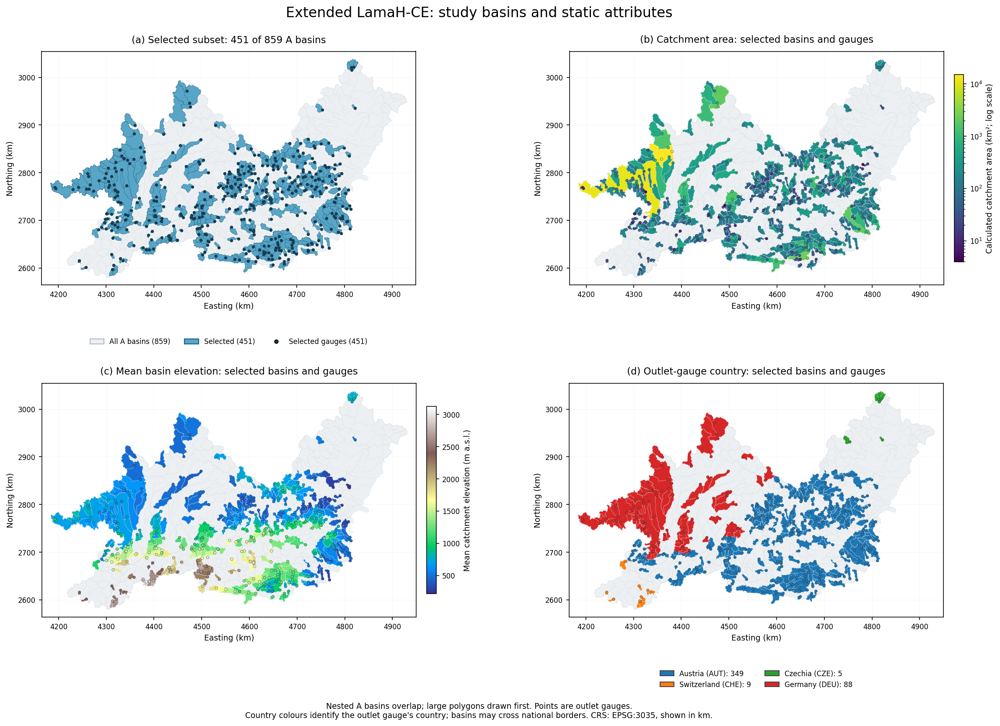
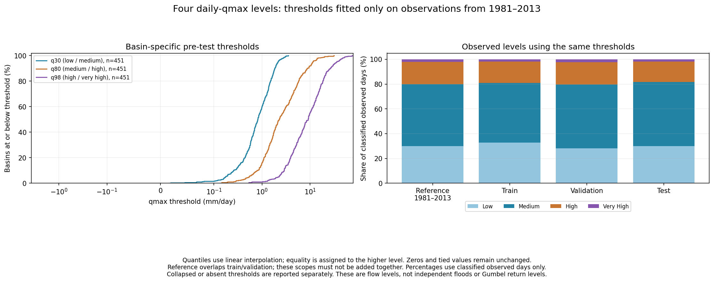

# Chương 4. Dữ liệu

Nghiên cứu sử dụng dữ liệu ngày của **Extended LamaH-CE** trên 451 lưu vực Trung Âu, kết hợp khí tượng, lưu lượng quan trắc và thuộc tính lưu vực. Khảo sát A1 cho thấy nhãn có độ phủ cao trên toàn tập nhưng thiếu tập trung ở một số trạm; chiều dài lịch sử, đơn vị và **mặt nạ đầu vào** — bảng chỉ rõ ô dữ liệu nào có giá trị, ô nào thiếu — là các yếu tố cần kiểm soát khi so sánh mô hình. Chương này trình bày dữ liệu, quy tắc tạo mẫu và các ngưỡng đánh giá được dùng cho những kết quả ở [Chương 6](06_ExperimentsAndResults.md).

## 4.1. Nguồn dữ liệu và phạm vi lựa chọn

Các nguồn được trình bày theo năm công bố để phân biệt bộ dữ liệu nền, bản mở rộng và kết quả thực nghiệm đi kèm.

| Năm | Nguồn | Thành phần chính và cách phát hành | Vai trò trong nghiên cứu |
|---|---|---|---|
| 2021 | LamaH-CE, Klingler và cộng sự | Dữ liệu thủy văn nhiều lưu vực ở Trung Âu, có chuỗi ngày/giờ, thuộc tính, ranh giới và quan hệ trạm; phát hành công khai qua Zenodo | Nền tảng dữ liệu và thông tin không gian |
| 2025 | Extended LamaH-CE, Konold và cộng sự, phiên bản 1.0 | Bản mở rộng LamaH-CE được phát hành tại DOI 10.5281/zenodo.17119635, bổ sung các nguồn khí tượng phục vụ dự báo | Bộ dữ liệu ngày sử dụng trực tiếp |
| 2025 | Cấu hình, trọng số và kết quả BiasCast | Phát hành trên Zenodo; gồm danh sách lưu vực, cấu hình, thông số chuẩn hóa và trọng số | Nguồn đối chiếu tái lập A2 |
| 2026 | Bài báo BiasCast, Konold và cộng sự | Công bố thiết kế và kết quả dự báo qmax với lịch sử khí tượng, Q và dự báo ECMWF HRES | Căn cứ lựa chọn bài toán và các mốc thực nghiệm |

Nguồn: [bài dữ liệu LamaH-CE](https://essd.copernicus.org/articles/13/4529/2021/), [dữ liệu Extended LamaH-CE](https://doi.org/10.5281/zenodo.17119635), [trọng số và kết quả BiasCast](https://doi.org/10.5281/zenodo.17292895), [mục Code and data availability của BiasCast](https://hess.copernicus.org/articles/30/5067/2026/index.html).

Trong gói đã kiểm ở A1, phần lưu vực toàn thượng nguồn có **859 tệp khí tượng ngày**, phần trạm có **882 tệp Q ngày**. Tập thực nghiệm giữ đúng **451 ID** trong danh sách `basins_filtered.txt` của tác giả. Những con số này có phạm vi khác nhau: số tệp toàn bộ gói không phải số lưu vực được huấn luyện. Các ID được giữ cố định qua những phép phân tích độ nhạy và đánh giá mô hình.

Một lưu vực là vùng có dòng chảy tập trung về một cửa ra. Một mô hình học chung từ nhiều lưu vực, còn thuộc tính tĩnh cung cấp thông tin về sự khác biệt giữa các lưu vực. Đầu vào khí tượng được tổng hợp theo lưu vực; nhãn Q là số đo tại trạm cửa ra. Các lưu vực có thể lồng nhau, nên diện tích đa giác không được cộng trực tiếp để suy ra tổng diện tích địa lý không trùng lặp.

## 4.2. Phân bố không gian và thuộc tính lưu vực

Tập 451 lưu vực gồm **349 trạm ở Áo, 88 ở Đức, 9 ở Thụy Sĩ và 5 ở Séc**, tính theo quốc gia đặt trạm. Tỷ trọng trạm Áo là 77,38%. Quốc gia của trạm không đồng nghĩa toàn bộ diện tích lưu vực nằm trong quốc gia đó. Phân bố này cho thấy phạm vi kết quả chủ yếu phản ánh các điều kiện thủy văn trong tập Trung Âu đang xét.

*Hình 4.1. Vị trí 451 lưu vực được chọn trong tập 859 lưu vực mức A; phân bố diện tích tính từ lưu vực, độ cao và quốc gia đặt trạm. Bản đồ dùng hệ tọa độ EPSG:3035 và biểu diễn tọa độ theo km. Diện tích trên ô bản đồ là diện tích lưu vực tính toán; phép quy đổi lưu lượng trong nghiên cứu sử dụng diện tích trạm area_gov.*

Các cấu hình sử dụng **33 thuộc tính tĩnh**, gồm thông tin địa hình, khí hậu và bề mặt lưu vực; A1 phân biệt 32 trường số và trường phân loại lớp phủ trội `lc_dom`. Diện tích trạm `area_gov` của 451 ID đều dương, nhỏ nhất **3,9 km²**, trung vị **101 km²**, lớn nhất **15.131 km²**. Chênh lệch diện tích lớn là một lý do để quy đổi Q theo diện tích khi huấn luyện và đánh giá chung.

Các thuộc tính có hai vai trò. Khi làm đầu vào, chúng giúp mô hình biểu diễn đáp ứng khác nhau giữa các lưu vực. Khi phân tích kết quả, chúng cho phép đặt câu hỏi liệu chênh lệch kỹ năng có liên hệ với diện tích, độ cao, tuyết hay mức khô hạn. Quan hệ quan sát giữa thuộc tính và chỉ số là bằng chứng mô tả; ảnh hưởng riêng của một nhóm đầu vào cần được kiểm bằng thiết kế so sánh thích hợp. Trường phân loại cũng cần được xử lý theo bản chất phân loại thay vì xem mã lớp là đại lượng liên tục.

## 4.3. Biến khí tượng và lưu lượng

### 4.3.1. Các nhóm nguồn

A1 kiểm kê 40 cột khí tượng trong tệp nguồn. Các cấu hình đang xét chọn 31 biến tái phân tích và 5 biến dự báo. Bảng 4.2 phân biệt số cột có trong dữ liệu với số biến thực sự đưa vào mô hình.

| Nguồn | Cột trong tệp khí tượng | Biến được chọn | Vai trò |
|---|---:|---:|---|
| ERA5-Land | 21 | 21 | Lịch sử khí tượng và các đại lượng trạng thái |
| E-OBS | 8 | 7 | Lịch sử khí tượng; cột EOBS_hu không thuộc đầu vào đang xét |
| MSWEP | 1 | 1 | Lịch sử lượng mưa |
| GLEAM | 2 | 2 | Lịch sử các đại lượng bốc hơi |
| ECMWF HRES | 8 | 5 | Dự báo khí tượng cho ngày đích |
| Tổng | 40 | 36 | 31 biến tái phân tích và 5 biến dự báo |

Tái phân tích tái dựng thời tiết đã xảy ra bằng quan trắc và mô hình; dự báo là thông tin cho thời điểm tương lai tại lúc phát hành. Sự khác nhau về nguồn, độ phân giải, phép tổng hợp và đại lượng vật lý có thể làm hai chuỗi cùng tên gần đúng khác nhau. Chẳng hạn, bức xạ thuần và bức xạ tới mặt đất không thể được xem là cùng đại lượng chỉ từ tương quan hoặc độ lớn trung bình.

Khảo sát A1 giữ các phép ghép theo cùng **ngày–ID**, tức một ngày tại một lưu vực cụ thể, khi so nguồn, kiểm độ phủ và phân phối thay vì tự hiệu chỉnh dữ liệu theo kết quả test. ECMWF HRES có từ **01/01/2002**; lịch dòng CSV và khoảng thời gian có giá trị hữu hạn của từng nguồn được kiểm riêng. Điều này đặc biệt quan trọng khi dùng lịch sử 730 ngày, vốn có thể đi vào thời gian trước khi nguồn dự báo bắt đầu.

### 4.3.2. Nhãn qmax và biến qmean

Lưu lượng Q, đơn vị m³/s, là thể tích nước qua mặt cắt trong một giây. Trong dữ liệu ngày, **qmean** là lưu lượng trung bình ngày và **qmax** là cực đại của các số đo giờ trong ngày. Nghiên cứu dự báo **qmax ngày t**; lịch sử qmean được dùng làm đầu vào ở các cấu hình có Q. B1 trong kế hoạch sẽ bổ sung qmax quá khứ và thống nhất quy trình Q cho những thí nghiệm tiếp theo.

Để quy đổi theo diện tích trạm:

**q (mm/ngày) = Q (m³/s) × 86,4 / area_gov (km²).**

Chiều ngược lại là Q = q × area_gov / 86,4. Hệ số 86,4 xuất phát từ số giây trong ngày và đổi m²/km², m/mm. Ví dụ minh họa, 3 m³/s trên diện tích 43,2 km² tương ứng 6 mm/ngày. Khi áp dụng cho qmax, kết quả vẫn là tốc độ dòng chảy cực đại tương đương theo diện tích, không phải tổng lượng nước thực tế trong cả ngày.

A2 giữ hợp đồng của trọng số tác giả: qmax nhãn ở mm/ngày, còn qmean đầu vào theo m³/s cùng thông số chuẩn hóa đã lưu. DLinear A3 dùng cả qmean và qmax ở mm/ngày. Hai thiết lập này được ghi riêng để tái lập đúng từng thí nghiệm; các so sánh chỉ số được thực hiện sau khi đưa đầu ra về cùng đơn vị vật lý.

## 4.4. Chia tập thời gian và tạo cửa sổ

| Phạm vi | Thời gian | Mục đích |
|---|---|---|
| Train | 01/01/2003–31/12/2009 | Học trọng số và fit thống kê huấn luyện |
| Validation | 01/01/2010–31/12/2013 | Chọn checkpoint, cấu hình và quy trình theo luật đã định |
| Test | 01/01/2014–31/12/2017 | Báo cáo kỹ năng sau khi cố định lựa chọn |
| Tham chiếu ngưỡng | 01/01/1981–31/12/2013 | Tính phân vị và ngưỡng lũ trước kỳ test |

Chia theo thời gian giúp đánh giá khả năng dự báo giai đoạn tiếp theo trên cùng tập lưu vực. Đây không phải phép kiểm tổng quát hóa sang một dataset khác hoặc sang toàn bộ lưu vực chưa xuất hiện khi huấn luyện. Một số ID thiếu nhãn train được theo dõi riêng để đọc đúng phạm vi học từ dữ liệu.

Ở Sequential Forecast LSTM của A2, tổng chuỗi 365 bước gồm **364 ngày lịch sử đến t−1 và một bước dự báo ngày t**. Ngữ cảnh trước đầu mỗi kỳ được nạp để đánh giá ngay từ ngày đầu kỳ. DLinear dùng **365 ngày qmean từ t−365 đến t−1**, nên số ngày lịch sử khác một ngày so với khung A2. Ví dụ, dự báo ngày 01/01/2014 chỉ được dùng Q đến 31/12/2013; không dùng qmean hay qmax quan trắc của chính ngày đích.

Phạm vi ngưỡng đánh giá và phạm vi fit scaler được tách rõ. Ngưỡng A1 dùng 1981–2013, có gồm validation theo giao thức trước test. Scaler DLinear chỉ fit từ các giá trị train hữu hạn, không dùng validation/test và không tính ngữ cảnh trước train vào fit. Mỗi giá trị ngày–ID train đóng góp một lần vào thống kê, không bị nhân lên theo số cửa sổ chứa ngày đó.

## 4.5. Độ phủ và số mẫu hợp lệ

### 4.5.1. Độ phủ nhãn qmax

| Kỳ | Ngày–ID theo lịch | Nhãn hữu hạn | Nhãn thiếu | Tỷ lệ thiếu |
|---|---:|---:|---:|---:|
| Train | 1.153.207 | 1.112.307 | 40.900 | 3,55% |
| Validation | 658.911 | 656.281 | 2.630 | 0,40% |
| Test | 658.911 | 657.366 | 1.545 | 0,23% |

Một ngày–ID là một ngày lịch ở một lưu vực. Các tỷ lệ trên sử dụng số ngày lịch làm mẫu số, không phải tỷ lệ trạm hoàn toàn không có dữ liệu. Độ thiếu thấp trên toàn tập vẫn có thể tạo trở ngại lớn cho cửa sổ lịch sử ở các trạm thiếu tập trung.

Ba lưu vực **324, 600, 623** không có nhãn trong train; lưu vực **800** chỉ có 38 ngày nhãn train. Lưu vực **55** có 1.292 nhãn train nhưng không có cửa sổ đủ lịch sử Q theo hợp đồng DLinear; ở test có 807 nhãn, còn hai A2 có Q không có dự báo hữu hạn. Các trường hợp này cho thấy cần phân biệt có nhãn, có lịch sử và có dự báo.

### 4.5.2. Điều kiện đầu vào ảnh hưởng số mẫu

Một cửa sổ có nhãn vẫn có thể bị bộ lọc loại do đầu vào thiếu. Nếu kiểm mọi cột trên toàn khung, mẫu có thể bị loại vì những ô mà mô hình không thực sự sử dụng ở một pha. A1 đối chiếu điều kiện toàn khung và điều kiện theo đúng pha sử dụng dữ liệu.

Với hợp đồng có Q và khung **730 ngày**, số mẫu train là **928.114** theo điều kiện toàn khung và **1.079.046** theo điều kiện theo pha, chênh **150.932 mẫu**. Đây là phép đếm trên dữ liệu để kiểm bộ nạp; cải thiện số mẫu không tự đồng nghĩa cải thiện NSE. Các thí nghiệm bước B sẽ kiểm ảnh hưởng khi áp dụng quy trình đã sửa vào huấn luyện.

DLinear A3 có **1.094.229 mẫu train ở 445 lưu vực** do cần đủ 365 ngày qmean và nhãn đích. Validation có 652.481 cặp quan trắc–dự báo và test có 652.628 cặp. Các ID không có mẫu train vẫn được giữ trong danh sách; suy luận dùng scaler chung nếu lịch sử đủ, không lấy thống kê test để thay cho thống kê train thiếu.

### 4.5.3. Quy tắc giá trị thiếu và hồ sơ chẩn đoán

Dữ liệu được ghép bằng ID/ngày; ô thiếu giữ trạng thái thiếu và không nội suy trong các mốc A3. Giá trị Q âm được chuyển thành thiếu trong bản loader tái hiện hợp đồng A2, còn dữ liệu số thô được giữ để kiểm nguồn. Đây là quy tắc của quy trình đang tái lập; các cờ chất lượng và nguyên nhân vật lý cần được xem xét riêng khi đánh giá quan trắc.

Hai lưu vực **742 và 758** có phương sai qmax test nhỏ. Khi đó, mẫu số NSE nhỏ có thể làm sai lệch trung bình của mô hình tạo ra điểm âm lớn. Các ID được giữ trong đánh giá và được phân tích qua thủy đồ, sai số và thành phần KGE ở Chương 6. Cách xử lý này giữ khả năng giải thích thay vì loại các ca bất lợi sau khi xem test.

## 4.6. Ngưỡng đánh giá riêng cho từng lưu vực

### 4.6.1. Bốn mức lưu lượng theo phân vị ngày

A1 tính ba phân vị **q30, q80, q98** từ qmax hữu hạn của từng lưu vực trên tham chiếu 1981–2013, dùng nội suy tuyến tính. Bốn mức phủ toàn bộ dải lưu lượng:

| Mức | Quy tắc |
|---|---|
| Thấp | q < q30 |
| Trung bình | q30 ≤ q < q80 |
| Cao | q80 ≤ q < q98 |
| Rất cao | q ≥ q98 |

Đúng ngưỡng được xếp vào mức cao hơn. Ví dụ minh họa, với q30 = 0,5, q80 = 2 và q98 = 5 mm/ngày, qmax = 6 thuộc mức rất cao. Dự báo 1,5 mm/ngày bị xếp vào mức trung bình, biểu hiện bỏ sót mức rất cao dù bài toán gốc là hồi quy liên tục. Ngưỡng riêng theo lưu vực giúp tránh dùng một trị số m³/s chung cho các sông có quy mô rất khác nhau.

*Hình 4.2. Phân phối ngưỡng riêng của 451 lưu vực và tỷ trọng mức quan trắc theo kỳ từ A1. Ngưỡng được giữ cố định theo tham chiếu trước test; tỷ trọng ở từng kỳ có thể khác tỷ trọng tham chiếu. Phạm vi tham chiếu bao gồm train/validation nên không cộng các kỳ này với nhau.*

### 4.6.2. Ngưỡng Gumbel từ đỉnh năm thủy văn

Đánh giá sự kiện sử dụng các mức chu kỳ lặp lại **T = 1,5; 2; 5; 10 năm**, khác với phân vị qmax ngày. Với mỗi lưu vực, A1 lấy cực đại theo năm thủy văn **01/10–30/09** trong tham chiếu 1981–2013. Một năm được dùng khi có ít nhất 50% số ngày của cả lịch năm; năm biên chỉ dùng phần quan trắc có trong tham chiếu và không được hoàn thiện bằng dữ liệu test.

Gumbel được fit bằng L-moments. Với L₁ và L₂ là hai L-moment mẫu, tham số tỷ lệ b = L₂/ln(2), vị trí a = L₁ − γb, trong đó γ ≈ 0,57721566 là hằng số Euler. Ngưỡng chu kỳ T là:

**qT = a − b × ln[−ln(1 − 1/T)].**

Theo mô hình đỉnh năm, mức T năm có xác suất vượt trong một năm là 1/T; mức 10 năm tương ứng khoảng 10% mỗi năm. Điều này không quy định phải cách đúng mười năm mới xảy ra một lần. Giả định phân phối và độ dài mẫu ảnh hưởng độ tin cậy của ngưỡng.

Cả 451 ID có fit xác định; **427 ID có ít nhất 10 năm đỉnh, 24 ID chỉ có 3–9 năm**. Nhóm mẫu ngắn được báo riêng khi đánh giá. A1 còn kiểm độ nhạy bỏ từng năm và phạm vi năm nằm trọn tham chiếu; những phân tích này hỗ trợ đọc bất định, không được dùng chọn lại ngưỡng theo kết quả test.

### 4.6.3. Từ ngày vượt ngưỡng tới cụm sự kiện

Số ngày vượt, số đoạn liên tiếp và số cụm sự kiện là các đại lượng khác nhau. Một đợt lưu lượng cao có thể vượt ngưỡng nhiều ngày và có những đoạn giảm tạm thời. A1 giữ ngày–ID gốc, trích đoạn có qmax lớn hơn ngưỡng và gộp theo quy tắc USWRC đã định trong pipeline.

Điều kiện tách xét khoảng cách đỉnh tối thiểu ceil[5 + ln(A dặm vuông)] và đáy giữa hai đỉnh thấp hơn 0,75 lần đỉnh nhỏ hơn. Cặp chưa thỏa điều kiện được gộp và kiểm lại với cụm kề; ngày thiếu ngăn việc nối qua khoảng trống. Cụm chạm biên hoặc có ngữ cảnh thiếu giữ cờ để bộ đánh giá xử lý. Khoảng cách theo diện tích được mô tả trong [tài liệu HEC-USACE](https://www.hec.usace.army.mil/confluence/sspdocs/sspum/latest/peaks-over-threshold-analysis/peaks-over-threshold-filtering); các quy tắc lịch/thiếu cụ thể của nghiên cứu nằm trong [thuyết minh A1](../../Workspace/02_Exploration/01_A1_LamaHCEExt_Explore.md#sec-24).

## 4.7. Ý nghĩa đối với thiết kế thí nghiệm

Khảo sát dữ liệu chỉ ra ba yêu cầu cho đánh giá mô hình. Thứ nhất, so sánh phải giữ thống nhất đơn vị, nhãn và ngày chấm; chỉ cùng danh sách lưu vực chưa bảo đảm cùng tập cặp quan trắc–dự báo. Thứ hai, độ phủ nhãn và điều kiện lịch sử phải được báo cùng kết quả, nhất là các trạm không có mẫu train và trường hợp dự báo thiếu. Thứ ba, một chỉ số tổng thể cần được bổ sung bằng phân mức và sự kiện để nhận biết mô hình hụt đỉnh hoặc bỏ sót các mức quan trọng.

Các đặc điểm diện tích, độ cao, tuyết, khí hậu và lớp phủ là cơ sở xây dựng giả thuyết về điều kiện mô hình hoạt động tốt. Kết quả hiện tại xác định được những khác biệt dữ liệu và độ phủ cần kiểm soát; phần liên hệ thuộc tính với chênh lệch giữa các lõi sẽ được thực hiện khi có kết quả so sánh cùng đầu vào. Phạm vi kết luận của chương là tập Extended LamaH-CE đang xét.

## 4.8. Nguồn số liệu và khả năng đối chiếu

| Nội dung | Tài liệu hoặc kết quả |
|---|---|
| Kiểm kê, thuộc tính, đơn vị, độ phủ, cửa sổ | [Thuyết minh A1](../../Workspace/02_Exploration/01_A1_LamaHCEExt_Explore.md#sec-25) |
| Phân vị, Gumbel và quy tắc cụm | [A1 Phần 10](../../Workspace/02_Exploration/01_A1_LamaHCEExt_Explore.md#sec-24) |
| Chuẩn bị DLinear và phạm vi scaler | [A3 Phần 7](../../Workspace/03_Baseline/02_A3_LamaHCEExt_Benchmarks.md#report-part-7) |
| Đơn vị và tái lập trọng số tác giả | [Ghi chú LamaH-CE, Mục 6.3](../03_Data/01_LamaHCE.md#63-tái-lập-bằng-trọng-số-tác-giả-bước-a2-kaggle-11102026) |
| Nguồn thực sự dùng cho đánh giá | [Manifest đầu vào](../../Workspace/06_Evaluation/Tables/Evaluation_input_manifest.csv) |

Các tệp ngưỡng và chuỗi dự báo được sử dụng từ Output Kaggle đã lưu; repo giữ mã, thuyết minh, hình và bảng tổng hợp để đối chiếu. Ngày thiếu và cờ mẫu ngắn được mang theo trong các kết quả đánh giá thay vì biến mất khỏi mẫu số mà không giải thích.
