# Chương 6. Thí nghiệm và kết quả

Các thí nghiệm đã thực hiện xác nhận việc chạy lại trọng số BiasCast, bổ sung mốc persistence và DLinear, đồng thời đánh giá theo mức lưu lượng và sự kiện lũ. Trên cùng giao ngày test, Sequential Forecast LSTM có Q đạt NSE trung vị **0,705259**, DLinear đạt **0,380152 ± 0,002415** giữa ba hạt giống, còn persistence qmax đạt **0,350031**. DLinear cải thiện theo NSE/PNSE nhưng thấp hơn persistence theo KGE; đánh giá theo mức còn cho thấy khả năng nhận diện ngày lưu lượng rất cao thấp hơn Sequential Forecast LSTM.

Ba lần huấn luyện lại Sequential Forecast LSTM ở A4 đạt NSE trung vị **0,695242 / 0,703778 / 0,705890**, tương đối sát mốc trọng số tác giả. Tổng cộng đề tài đã huấn luyện mới **120 lần**: A 6 (DLinear và LSTM A4, mỗi mô hình ba seed), B 18 (B0, B1a, B1b, B2 mỗi bước ba seed, B3 hai mức che × ba seed), C1 39, C2 24, H 24 và D 9. A4 đo biến thiên của mô hình nền; các thay đổi Q và nhúng theo nguồn ở B1/B2, che dữ liệu ở B3 và luật chọn B* được trình bày tại Mục 6.6.1–6.6.9; năm lõi ở C1/C2 tại Mục 6.6.10–6.6.12; dự báo 1–7 ngày (H) tại Mục 6.6.13; cửa sổ 730 ngày (D) tại Mục 6.6.14; giải thích mô hình (G) tại Mục 6.12.

Phạm vi thực nghiệm của chương bao phủ đầy đủ các bước từ tái lập và mốc nền (A2–A4), chuỗi cải tiến đầu vào và cơ chế che dữ liệu (B0–B3, chọn B\* = B3 P10S12), tinh chỉnh tám cấu hình mỗi lõi (C1) rồi so sánh năm lõi thời gian và bảy kịch bản vận hành S0–S4 (C2, Evaluation Version 10), dự báo nhiều hạn 1–7 ngày theo bốn cách cấp thời tiết (H, Evaluation Version 12), mở rộng độ dài chuỗi lên 730 bước (D, Evaluation Version 13), phân tích tương quan theo 31 thuộc tính lưu vực (ByBasin Version 3), kiểm chứng suy luận GPU/CPU và demo (D1–D3), cùng giải thích mô hình bằng Integrated Gradients và dò trạng thái ẩn (bước G Version 1). **S0** là không che thêm đầu vào theo kịch bản, dù dữ liệu gốc vẫn có thể thiếu; **hạn một ngày** là dự báo ngày kế tiếp sau ngày cuối của lịch sử quan trắc. Validation S0–S4 cho B1b/B2/hai mức B3 trình bày ở Mục 6.6.9. Dữ liệu, độ phủ và ngưỡng trước test được trình bày tại [Chương 4](04_Data.md).

## 6.1. Câu hỏi thực nghiệm và các cấu hình

Các kết quả hiện có trả lời ba câu hỏi: trọng số tác giả có cho kết quả tương đương khi chạy trong môi trường của đề tài hay không; mô hình hơn mốc chép số đo hôm qua bao nhiêu; và chỉ số liên tục có phản ánh đầy đủ chất lượng dự báo ở các mức cao hay không.

| Thí nghiệm | Cách thực hiện | Vai trò |
|---|---|---|
| A2 | Nạp trọng số tốt nhất của tác giả cho sáu cấu hình, chạy lại test | Kiểm quy trình suy luận, đơn vị và kết quả tái lập |
| Persistence qmax | Dự báo qmax(t) bằng qmax(t−1) | Mốc quan trắc chính cho PNSE |
| DLinear A3 | Huấn luyện ba hạt giống với cùng cấu hình từ qmean quá khứ | Mốc tuyến tính bổ sung |
| LSTM A4 | Huấn luyện mới ba hạt giống theo cấu hình SeqLSTM_Q của tác giả | Kiểm khả năng huấn luyện lại và biến thiên mô hình nền |
| LSTM B0 | Cùng kiến trúc, chạy đủ 30 epoch, checkpoint tốt nhất theo validation | Mốc bước B và nhiễu hạt giống dùng chọn B* |
| Đánh giá dùng chung | Đọc các dự báo đã lưu, áp cùng ngày chấm và ngưỡng A1 | So chỉ số liên tục, bốn mức, sự kiện và kiểm định |

Sáu A2 gồm Sequential Forecast LSTM có/không Q, Encoder–Decoder LSTM có/không Q, D_FC và D_RA. Sequential Forecast LSTM duy trì trạng thái khi chuyển từ lịch sử sang bước dự báo; Encoder–Decoder dùng hai mạng cho hai pha. D_FC là mốc theo nguồn dự báo khí tượng; D_RA dùng tái phân tích, kể cả ở ngày đích. Hai mốc này giúp đối chiếu nguồn thông tin. Cấu hình D_RA có thông tin ngày đích được tái dựng sau quan trắc nên cần được phân biệt với điều kiện vận hành.

A2 giữ trọng số, scaler và hợp đồng của tác giả; đây là tái lập suy luận. A4 đã huấn luyện lại LSTM với ba hạt giống để đo biến thiên của mô hình nền. Thiết kế bài cơ sở được công bố trong [BiasCast](https://hess.copernicus.org/articles/30/5067/2026/).

## 6.2. Giao thức đánh giá

### 6.2.1. Chọn mô hình bằng validation

Train là 2003–2009, validation là 2010–2013 và test là 2014–2017. DLinear chỉ fit scaler từ train; các checkpoint được chọn theo NSE trung vị validation. Điểm test được ghi nhận mỗi epoch theo yêu cầu theo dõi, nhưng không tham gia chọn checkpoint hoặc đặt lại quy tắc dừng.

Khi so các mô hình ở bước tiếp theo, cùng nguyên tắc được giữ: validation phục vụ lựa chọn theo giao thức định trước, test phục vụ báo cáo. Các chẩn đoán sau khi đọc test, như hồ sơ lưu vực 363, chỉ dùng giải thích kết quả hiện tại.

### 6.2.2. Đơn vị, ngày chấm và dự báo thiếu

Quan trắc chuẩn dùng qmax nguồn đổi sang mm/ngày theo diện tích trạm. Một **ngày–lưu vực**, cũng viết là ngày–ID, là một ngày tại một lưu vực cụ thể. A3 kiểm lịch và quan trắc của sáu A2 trước khi lập **mặt nạ**, tức bảng True/False chọn những cặp ngày–lưu vực được chấm. Điểm riêng của từng run dùng các ngày mà run có cặp hữu hạn; bảng so chính dùng **giao chung**, chỉ giữ những cặp có quan trắc, persistence và dự báo của mọi run cùng hữu hạn, để mọi mô hình được chấm trên cùng dữ liệu.

| Scope | Quy tắc | Mục đích |
|---|---|---|
| Native | Obs của run và sim hữu hạn; DLinear dùng obs nguồn | Đối chiếu kết quả riêng, theo dõi độ phủ |
| Paired source | Obs canonical, sim và persistence hữu hạn | So từng run với persistence trên cùng ngày |
| Common source all | Giao hữu hạn của toàn bộ các run trong lần chấm, gồm cả ba A4 khi được tích hợp | So sánh chính giữa các run |

Mốc qmean phụ cũng có đủ dữ liệu trên giao chung này. Sáu A2 và persistence tạo giao **652.636 ngày–ID**; thêm ba DLinear còn **652.628 ngày–ID**, giảm tám cặp. Bổ sung ba A4 giữ nguyên giao 652.628 ngày–ID. Có **450 lưu vực** có ngày chấm. ID 55 vẫn nằm trong danh sách 451 với số ngày chấm bằng 0 ở giao chung.

Các dự báo âm được xử lý theo cấu hình đã định: đổi ngược chuẩn hóa trước rồi chặn dưới ở 0 để chấm; bản trước chặn được giữ để chẩn đoán. Ngày thiếu giữ bằng NaN, không nội suy hoặc thay bằng ngày có số đo gần nhất. Trường hợp một chỉ số không xác định được giữ trạng thái giải thích và báo số ID hữu hạn.

### 6.2.3. NSE và PNSE

Với oᵢ là quan trắc, sᵢ là dự báo và ō là trung bình quan trắc trên các ngày chấm:

**NSE = 1 − Σ(sᵢ − oᵢ)² / Σ(oᵢ − ō)².**

NSE = 1 là hoàn hảo, NSE = 0 có sai số bình phương ngang hằng số ō, còn điểm âm có sai số lớn hơn mốc đó. Mốc trung bình thuộc kỳ chấm, dùng diễn giải chỉ số; nó không phải một dự báo vận hành được tạo trước toàn bộ kỳ.

Với pᵢ là persistence qmax, chỉ số so trực tiếp với số đo hôm qua là:

**PNSE = 1 − Σ(sᵢ − oᵢ)² / Σ(pᵢ − oᵢ)².**

PNSE dương là hơn persistence, bằng 0 là ngang và âm là kém hơn. Ví dụ minh họa, quan trắc [1; 2; 3; 4], dự báo [1; 2; 2; 4], persistence [1; 1; 2; 3] cho SSE mô hình bằng 1, SSE persistence bằng 3 và tổng bình phương độ lệch quan trắc bằng 5. Kết quả NSE = 0,8 và PNSE ≈ 0,667. Dãy persistence này tương ứng quan trắc trước chuỗi bằng 1 và luôn dịch đúng một ngày lịch.

NSE và PNSE có thể cho hai nhận xét khác nhau vì dùng hai mốc. Một mô hình có NSE hơi âm vẫn có thể có PNSE dương nếu persistence còn kém hơn. Khi phương sai quan trắc hoặc SSE persistence bằng 0, chỉ số liên quan trả NaN; hàm đánh giá không thêm epsilon để biến mẫu số suy biến thành một điểm hữu hạn.

### 6.2.4. KGE và các thành phần

Nghiên cứu dùng KGE dạng 2009:

**KGE = 1 − √[(r − 1)² + (α − 1)² + (β − 1)²].**

r là tương quan Pearson; α = std(sim)/std(obs) đo tỷ lệ dao động; β = mean(sim)/mean(obs) đo tỷ lệ trung bình. Cả ba có giá trị lý tưởng bằng 1. Độ lệch chuẩn dùng ddof=0; NSE, PNSE và các thành phần KGE dùng cùng một mặt nạ trong mỗi phép chấm. Công thức được đối chiếu với [mã metrics tại commit thư viện A2](https://github.com/Ticasslo/neuralhydrology/blob/dda45fcf19ee7ffd481b9d192778539df46fb074/neuralhydrology/evaluation/metrics.py).

Tương quan cao chưa bảo đảm dự báo chính xác. Ví dụ minh họa, nếu dự báo luôn bằng hai lần quan trắc thì r = 1 nhưng α = β = 2, KGE ≈ −0,4142. Với nhãn qmax, β diễn tả mức trung bình của cực đại ngày; không chuyển trực tiếp thành sai số tổng thể tích nước. Dự báo hằng làm r không xác định và do đó KGE không xác định.

### 6.2.5. Tổng hợp và kiểm định

Mỗi lưu vực có một bộ điểm; sau đó tổng hợp trung vị, trung bình và P10/P25/P75/P90 qua các lưu vực. Đường CDF biểu diễn tỷ lệ ID có điểm không vượt giá trị trên trục ngang. Các điểm âm được giữ đầy đủ, tránh che phần đuôi bất lợi chỉ bằng trung vị.

So sánh ghép cặp dùng hiệu chỉ số theo cùng ID, Wilcoxon signed-rank hai phía và Cohen's dz = mean(hiệu)/std mẫu(hiệu). Holm hiệu chỉnh các p-value hợp lệ của toàn bộ cặp run không thứ tự, riêng cho NSE, PNSE, KGE; p = NaN không được tính vào kích thước họ. Sáu A2, ba DLinear, ba LSTM A4 và persistence qmax tạo **78 cặp dự kiến cho mỗi chỉ số**, tổng **234 phép so**; mốc qmean phụ không thuộc họ kiểm định chính. `family_size` ghi số p hữu hạn, `planned_family_size` ghi số phép so dự kiến. Phương pháp tính p dùng [SciPy Wilcoxon](https://docs.scipy.org/doc/scipy/reference/generated/scipy.stats.wilcoxon.html).

Số cặp hữu hạn được báo theo từng chỉ số. Hiệu bằng 0, độ lệch chuẩn hiệu bằng 0 và chỉ số không xác định có quy ước riêng trong bộ đánh giá. Do có các lưu vực lồng nhau, các cặp điểm có thể phụ thuộc không gian; p được đọc cùng cỡ hiệu ứng, số lưu vực hơn/kém và phần đuôi chênh lệch.

## 6.3. Kết quả tái lập suy luận A2

A2 dùng NeuralHydrology ở commit `dda45fcf19ee7ffd481b9d192778539df46fb074`, nạp trọng số tốt nhất của tác giả và chạy test trên Kaggle T4. Các tiêu chí kiểm gồm quan trắc trùng tệp tác giả, lệch NSE trung vị không quá 0,005, sai khác dự báo ở phân vị 99,9% không quá 0,05 mm/ngày và kiểm riêng các lưu vực có sai khác NSE lớn.

| Run | NSE trung vị tác giả | NSE trung vị chạy lại | ID có NSE |
|---|---:|---:|---:|
| SeqLSTM_Q | 0,7053 | 0,7053 | 450 |
| SeqLSTM_noQ | 0,6276 | 0,6276 | 451 |
| EncDec_Q | 0,6622 | 0,6622 | 450 |
| EncDec_noQ | ≈0,569 | ≈0,569 | 451 |
| D_FC | 0,3867 | 0,3864 | 451 |
| D_RA | 0,6923 | 0,6923 | 451 |

Cả sáu cấu hình đạt tiêu chí tái lập. Sai khác nhỏ ở dự báo được đọc cùng sự khác nhau của môi trường số học. Hai lưu vực 742 và 758 có phương sai nhãn nhỏ, nên sai lệch dự báo nhỏ vẫn có thể tạo chênh NSE dễ thấy; các ca này được phân tích ở Mục 6.7.

Bảng A2 sử dụng độ phủ riêng của từng run. Vì thế, một số điểm thay đổi khi chuyển sang giao chung ở bảng A3, chẳng hạn SeqLSTM_noQ từ khoảng 0,6276 xuống 0,6229. Hai số này tương ứng hai phạm vi ngày và không được dùng như bằng chứng mô hình bị thay đổi giữa hai lần chấm.

## 6.4. Huấn luyện lại và nhiễu hạt giống A4

A2 chỉ kiểm suy luận trên trọng số có sẵn. A4 huấn luyện lại Sequential Forecast LSTM có Q từ đầu theo đúng cấu hình của tác giả (loss NSE*, Adam 10⁻³, cosine annealing, lô 256, tối đa 30 epoch, dừng sớm theo NSE validation), giữ nguyên cả lỗi lưu mô hình tốt nhất của bản fork, với ba hạt giống 111, 222, 333. Mỗi lần huấn luyện chạy trọn một phiên Kaggle T4 và không bật chế độ tất định, giống cách chạy của các bước sau. B0 chạy lại cùng ba hạt giống trên T4 cho trọng số trùng từng bit A4 ở mọi epoch chung, nên với LSTM này nhiễu giữa các lần chạy chỉ do hạt giống ([báo cáo B0](../../Workspace/05_Training/01_B0_LamaHCEExt_Train/01_B0_LamaHCEExt_Train.md#p3)). Bài cơ sở chỉ công bố một lần chạy nên không có khoảng dao động để so; điều kiện đạt được đặt trước khi chạy: NSE trung vị test của tác giả (0,7053) nằm trong khoảng nhỏ nhất–lớn nhất của ba hạt giống, hoặc cách trung bình không quá hai độ lệch chuẩn.

| Mô hình | Epoch được lưu | Số epoch | Giờ huấn luyện | NSE trung vị validation | NSE trung vị test | KGE trung vị test |
|---|---:|---:|---:|---:|---:|---:|
| Hạt giống 111 | 11 | 16 | 2,50 | 0,7411 | 0,6952 | 0,7581 |
| Hạt giống 222 | 15 | 20 | 3,17 | 0,7541 | 0,7038 | 0,7910 |
| Hạt giống 333 | 14 | 19 | 3,08 | 0,7574 | 0,7059 | 0,7860 |
| Tác giả | – | – | – | – | 0,7053 | 0,7671 |

Ba hạt giống cho NSE trung vị test 0,7016 ± 0,0056 (trung bình ± độ lệch chuẩn); giá trị của tác giả nằm trong khoảng [0,6952; 0,7059] nên A4 đạt. Độ lệch chuẩn NSE trung vị validation giữa ba hạt giống là **0,0086**, đo dưới giao thức dừng sớm của tác giả; luật chọn cấu hình B* dùng độ lệch chuẩn đo lại ở B0 theo giao thức 30 epoch (`02_Pipeline.md` Mục 5.3, 7). Cùng hạt giống 111 với tác giả nhưng không cho cùng mô hình, vì phiên bản thư viện khác (tác giả commit `91af6a0`, đề tài `dda45fc`) và phần cứng khác (tác giả RTX 4090, đề tài T4).

Theo lưu vực, trung vị độ lệch chuẩn NSE qua ba hạt giống là 0,021 và giảm dần khi lưu vực được dự báo tốt hơn: 0,034 ở nhóm NSE 0–0,5, 0,027 ở 0,5–0,7, 0,020 ở 0,7–0,85 và 0,009 ở nhóm từ 0,85 trở lên. Mô hình của tác giả nằm trong khoảng của ba hạt giống ở 52,2% lưu vực, gần mức 50% kỳ vọng nếu nó chỉ là một lần chạy nữa cùng phân phối. Hai lưu vực 742 và 758 có nhãn gần như hằng số nên NSE dao động rất lớn giữa các lần chạy (Mục 6.7).

Kiểm định Wilcoxon ghép cặp theo lưu vực cho thấy hạt giống 111 khác 222 và 333 có ý nghĩa thống kê (p Holm 0,008 và 0,013) dù trung vị hiệu chỉ khoảng −0,004 NSE và Cohen's dz dưới 0,1; ba hạt giống không khác tác giả có ý nghĩa (p Holm 0,14–0,19). Hai lần chạy chỉ khác hạt giống đã có thể cho p nhỏ, nên khi so các mô hình ở bước B và C, kết quả kiểm định được đọc cùng độ lớn hiệu và so với mức nhiễu hạt giống này, không dùng p một mình. Chi tiết: [báo cáo A4](../../Workspace/03_Baseline/03_A4_LamaHCEExt_Retrain/03_A4_LamaHCEExt_Retrain.md). Các p ở đây thuộc các họ kiểm riêng của báo cáo A4; Mục 6.10.1 trình bày p trong họ 78 cặp mỗi chỉ số, nên hai bộ p đã điều chỉnh không dùng thay nhau.

## 6.5. Persistence và DLinear

### 6.5.1. Dự báo persistence

Persistence qmax dự báo ngày t bằng số đo ngày t−1 theo lịch. Ngày đầu test sử dụng 31/12/2013. Trong toàn bộ test có 19 ngày–ID có quan trắc ngày đích nhưng thiếu qmax hôm trước; những ngày đó nằm ngoài phạm vi tính PNSE. Mốc qmean(t−1) dự báo qmax(t) được giữ làm đối chiếu phụ vì hai đại lượng không giống nhau.

Trên giao chung cuối, persistence qmax đạt NSE trung vị **0,350031**, KGE trung vị **0,674939** và PNSE = 0 theo định nghĩa. Mốc này cho biết mức kỹ năng đã có chỉ từ tính liên tục theo thời gian của lưu lượng.

### 6.5.2. Cấu hình DLinear

DLinear dùng trung bình trượt 25 ngày để tách xu hướng và dao động, hai nhánh tuyến tính 365 → 1 rồi cộng đầu ra. Cấu trúc giữ theo [mã DLinear gốc](https://github.com/cure-lab/LTSF-Linear/blob/7f7a25b6d32fa0df77ce4c20d4ffeb849b5a7e47/models/DLinear.py), từ công trình [Zeng và cộng sự, AAAI 2023](https://ojs.aaai.org/index.php/AAAI/article/view/26317).

Mô hình nhận một chuỗi qmean 365 ngày đến t−1, dự báo qmax(t), có **732 tham số**. qmean/qmax đều ở mm/ngày theo area_gov; hai scaler chung fit riêng từng biến từ train. Chỉ cửa sổ đủ lịch sử được dùng; tập train có 1.094.229 mẫu từ 445 ID.

Loss huấn luyện giữ quy ước NSE* của NH: mean[(pred_z − target_z)²/(σqmax,train + 0,1)²], với residual ở thang z và σ là độ lệch chuẩn qmax train trước chuẩn hóa của từng lưu vực. Đây là hàm tối ưu, khác NSE đánh giá. Epsilon 0,1 thuộc loss, không được đưa sang mẫu số NSE/PNSE/KGE.

Ba seed 111, 222, 333 dùng Adam, learning rate đầu 0,001, batch 256, lịch CosineAnnealing, tối đa 30 epoch, patience 5 và mức cải thiện đáng kể 0,005. Mỗi cải thiện nghiêm ngặt của validation vẫn được lưu checkpoint tốt nhất; quy tắc patience được kiểm riêng để tránh bỏ checkpoint có cải thiện nhỏ. Các kiểm kiến trúc, loss, gradient, chỉ mục ngày và nạp lại checkpoint đều đạt trước khi huấn luyện chính thức.

| Seed | Epoch đã chạy | Epoch được chọn | NSE trung vị validation | NSE trung vị test |
|---|---:|---:|---:|---:|
| 111 | 6 | 4 | 0,424701 | 0,382799 |
| 222 | 6 | 2 | 0,423997 | 0,378069 |
| 333 | 10 | 5 | 0,428187 | 0,379588 |

Trung bình ± std mẫu giữa ba NSE trung vị test là **0,380152 ± 0,002415**. Đây là độ phân tán của ba lần chạy, không phải khoảng tin cậy hoặc điểm của tổ hợp dự báo. DLinear chỉ dùng lưu lượng, trong khi A2 có các tổ hợp khí tượng và đầu vào khác; các chênh lệch hiện tại là so sánh mốc kỹ năng, chưa cô lập ảnh hưởng kiến trúc.

## 6.6. So sánh chỉ số liên tục trên giao chung

| Run | NSE trung vị | NSE trung bình | PNSE trung vị | KGE trung vị |
|---|---:|---:|---:|---:|
| SeqLSTM_Q | **0,705259** | 0,401554 | **0,495584** | **0,767074** |
| SeqLSTM_noQ | 0,622922 | 0,565503 | 0,375311 | 0,688235 |
| EncDec_Q | 0,662155 | 0,207468 | 0,435417 | 0,698093 |
| EncDec_noQ | 0,567347 | 0,013414 | 0,285036 | 0,640148 |
| D_FC | 0,385892 | 0,251283 | 0,076250 | 0,533138 |
| D_RA | 0,692511 | 0,387618 | 0,485222 | 0,737006 |
| DLinear 111 | 0,382799 | 0,391289 | 0,066592 | 0,519476 |
| DLinear 222 | 0,378069 | 0,424958 | 0,055647 | 0,520644 |
| DLinear 333 | 0,379588 | 0,423480 | 0,059714 | 0,513177 |
| LSTM A4 111 | 0,695242 | 0,628814 | 0,495352 | 0,758090 |
| LSTM A4 222 | 0,703778 | 0,655792 | 0,505573 | 0,790977 |
| LSTM A4 333 | 0,705890 | 0,658070 | 0,501788 | 0,785984 |
| Persistence qmax | 0,350031 | 0,356946 | 0 | 0,674939 |
| Persistence qmean, phụ | 0,366131 | 0,420600 | 0,034721 | 0,457145 |

Mỗi dòng có 450 NSE hữu hạn. Riêng KGE/r của EncDec_noQ có 448 ID hữu hạn do dự báo hằng ở 742 và 758. Nguồn: [bảng tổng hợp từ bộ đánh giá](../../Workspace/06_Evaluation/01_Evaluation_LamaHCEExt/Archive/Version4/Tables/Evaluation_summary.csv).

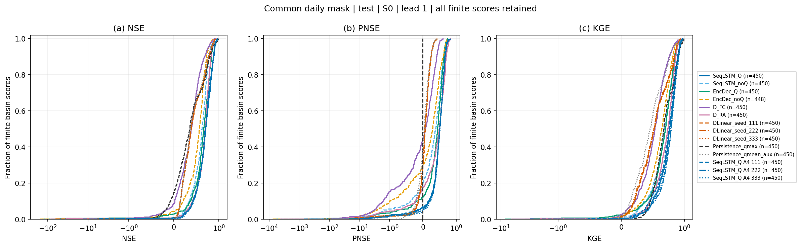

*Hình 6.1. Phân phối điểm từng lưu vực của 14 run trên cùng ngày chấm. Trục symlog giữ cả phần âm xa; riêng vùng [−1, 1] tuyến tính. Các nét xanh phân biệt trọng số tác giả và ba seed A4. CDF biểu diễn phân phối các điểm hữu hạn, với số ID của mỗi run/chỉ số được ghi ở chú giải. Điểm có giá trị lớn hơn là tốt hơn đối với NSE, PNSE và KGE.*

Trong bảng này, SeqLSTM_Q có NSE trung vị cao nhất và hơn persistence theo PNSE ở **420/450 ID**, tương ứng 93,33%. Tuy nhiên, NSE trung bình chỉ 0,401554 do ảnh hưởng phần đuôi âm. EncDec_noQ cũng có khoảng cách lớn giữa trung vị 0,567347 và trung bình 0,013414. Vì thế, kết luận về một run cần gồm cả phân phối và hồ sơ các ca xấu.

Ba DLinear hơn persistence theo PNSE ở **318/450, 309/450, 317/450 ID**, nhưng KGE trung vị chỉ khoảng 0,518, thấp hơn mốc 0,675. Trung vị α khoảng 0,70 và r khoảng 0,63 cho thấy sự co dao động và tương quan thấp hơn. Các median thành phần mô tả những phân phối riêng; KGE phải được tính từ r/α/β của từng ID trước khi tổng hợp, không thay bằng công thức trên các median.

### 6.6.1. Kết quả huấn luyện lại LSTM A4

A4 dùng cùng cấu hình Sequential Forecast LSTM có Q của tác giả, khởi tạo trọng số mới cho seed 111, 222 và 333. Các checkpoint được chọn bằng validation tại epoch 11, 15 và 14. Mỗi lần huấn luyện mất khoảng 2,5–3,2 giờ trên T4. [Thiết lập A4](../../Workspace/03_Baseline/03_A4_LamaHCEExt_Retrain/03_A4_LamaHCEExt_Retrain.md). Điểm trên giao chung của ba seed nằm trong bảng Mục 6.6.

Trung bình ± độ lệch chuẩn mẫu của ba NSE trung vị là **0,701636 ± 0,005638**. Mốc tác giả 0,705259 nằm trong khoảng ba lần chạy. Đây là độ phân tán giữa các lần huấn luyện, không phải khoảng tin cậy hoặc điểm của một tổ hợp dự báo. Cả ba seed được báo cáo, không chọn seed theo test. [Bảng tổng hợp](../../Workspace/06_Evaluation/01_Evaluation_LamaHCEExt/Archive/Version4/Tables/Evaluation_summary.csv).

PNSE trung vị của ba A4 đều dương nhưng trung bình lần lượt **−1,189; −0,508; −0,355**, cho thấy phần đuôi các lưu vực có persistence mạnh vẫn ảnh hưởng lớn. %BiasFHV trung vị là **−15,70%; −11,71%; −11,56%**: dải lưu lượng cao vẫn bị dự báo hụt theo định nghĩa FHV.

### 6.6.2. Mốc B0 dưới giao thức 30 epoch

B0 giữ Sequential Forecast LSTM có `qmean` quá khứ theo m³/s của A4, chạy đủ 30 epoch với hạt giống 111, 222, 333. Fork `f229e02` sửa cách lưu `best_model.pt` và dùng `data_on_gpu`; checkpoint được chọn bằng NSE trung vị validation cao nhất, test chỉ để báo cáo. Cả ba notebook huấn luyện và notebook so sánh B0 đều là Version 1. [Thiết lập và kết quả B0](../../Workspace/05_Training/01_B0_LamaHCEExt_Train/01_B0_LamaHCEExt_Train.md).

| Hạt giống | Epoch được chọn | NSE trung vị validation | NSE trung vị test |
|---|---:|---:|---:|
| 111 | 25 | 0,742328 | 0,707234 |
| 222 | 15 | 0,754138 | 0,703778 |
| 333 | 14 | 0,757406 | 0,705890 |

Các điểm trong bảng được đọc từ kết quả thư viện, với trung vị bỏ NaN theo thư viện. Danh sách đánh giá giữ 451 ID; test có 450 ID có NSE hợp lệ. Đây chưa phải bảng tính lại trên giao ngày chung của bộ đánh giá Version 5. Nguồn: bảng theo epoch của [seed 111](../../Workspace/05_Training/01_B0_LamaHCEExt_Train/Tables/B0_Curve_Seed111.csv), [seed 222](../../Workspace/05_Training/01_B0_LamaHCEExt_Train/Tables/B0_Curve_Seed222.csv), [seed 333](../../Workspace/05_Training/01_B0_LamaHCEExt_Train/Tables/B0_Curve_Seed333.csv).

Trung bình NSE trung vị test qua ba seed là **0,7056**, độ lệch chuẩn mẫu **0,0017**. Độ lệch chuẩn mẫu của ba NSE trung vị validation là **0,0079**, dùng làm ngưỡng của luật B*: giữ các ứng viên B1b–B3 có S0 validation trong khoảng này so với ứng viên tốt nhất, rồi so NSE trung vị trung bình qua S1–S4. A4 đo biến thiên dưới giao thức dừng sớm nên không thay thế ngưỡng B0 này.

Notebook Compare B0 xác nhận trọng số ở các epoch chung trùng từng bit A4 cùng seed. Seed 222 và 333 giữ checkpoint epoch 15 và 14; seed 111 chuyển từ epoch 11 của A4 sang epoch 25. Báo cáo Compare cho median hiệu NSE test theo lưu vực của seed 111 là **+0,0043**, nhỏ hơn nhiễu giữa seed; median hiệu ghép cặp khác hiệu hai median toàn tập. Evaluation **Version 7** đã chấm ba NPZ B0 cùng B1/B2 và các mốc thành 26 run, đạt 179 kiểm giao thức và 118 kiểm chéo trên 32 tệp output, với giao chung 652628 ngày–ID/450 ID có ngày hợp lệ. Kết quả chung ở Mục 6.6.6; các bảng lịch sử Version 4 được giữ riêng trong archive. [Kiểm output Version 7](../../Workspace/06_Evaluation/01_Evaluation_LamaHCEExt/01_Evaluation_LamaHCEExt.md#11-kết-quả-chấm-chung-version-7).

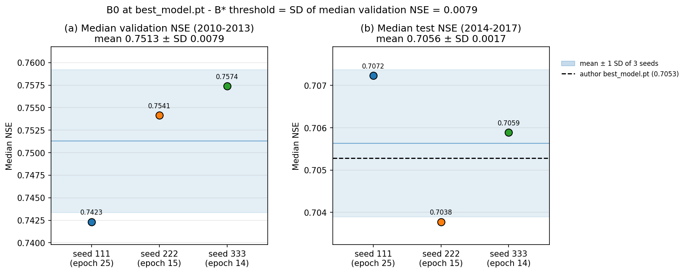

*Hình. Kết quả B0 từ notebook Compare Version 1; ngưỡng B* lấy từ validation, còn test dùng báo cáo.*

### 6.6.3. Thống nhất đơn vị Q và bổ sung qmax quá khứ ở B1

B1a thay `qmean` quá khứ theo m³/s của B0 bằng `qmean_mmd`, đổi sang mm/ngày theo `area_gov` như nhãn. B1b giữ thay đổi này và thêm `qmax_mmd` quá khứ; Q chỉ thuộc pha hindcast, kết thúc ở t−1, còn nhãn là qmax ngày t. Các bước giữ cùng Sequential Forecast LSTM, ba hạt giống 111/222/333, thư viện `f229e02` và giao thức đủ 30 epoch. Sáu notebook B1a/B1b và notebook `05_B1_LamaHCEExt_Compare` đều là Version 1. [Thiết lập B1a](../../Workspace/05_Training/03_B1a_LamaHCEExt_Train/03_B1a_LamaHCEExt_Train.md), [thiết lập B1b](../../Workspace/05_Training/04_B1b_LamaHCEExt_Train/04_B1b_LamaHCEExt_Train.md).

| Bước | Epoch được chọn của seed 111/222/333 | NSE validation, trung bình ± SD | NSE test, trung bình ± SD |
|---|---|---:|---:|
| B0 | 25 / 15 / 14 | 0,751291 ± 0,007932 | 0,705634 ± 0,001742 |
| B1a | 20 / 4 / 10 | 0,755765 ± 0,000826 | 0,707611 ± 0,006915 |
| B1b | 11 / 8 / 19 | 0,774544 ± 0,004107 | 0,718258 ± 0,008573 |

Mỗi điểm dùng để tổng hợp là **NSE trung vị của một seed trên các lưu vực có chỉ số hợp lệ**; bảng báo trung bình và độ lệch chuẩn mẫu (ddof=1) của ba điểm đó. Đây không phải NSE của một tổ hợp dự báo hoặc trung vị của chuỗi dự báo gộp ba seed. Từng seed giữ checkpoint riêng theo validation; không chọn seed hoặc epoch theo test. Các số trong [bảng seed](../../Workspace/05_Training/05_B1_LamaHCEExt_Compare/Tables/B1_seed_table.csv), [bảng thống kê](../../Workspace/05_Training/05_B1_LamaHCEExt_Compare/Tables/B1_seed_stats.csv) và [tóm tắt Compare](../../Workspace/05_Training/05_B1_LamaHCEExt_Compare/Tables/b1_summary.json) khớp các bảng theo epoch: cả sáu lần chạy đủ 30 epoch, epoch được chọn trùng cực đại NSE trung vị validation.

So với B0, B1a tăng trung bình NSE trung vị validation **0,004474**, bằng khoảng **0,56 lần** mốc nhiễu B0 0,007932. Thêm qmax quá khứ từ B1a sang B1b tăng **0,018779**, khoảng **2,37 lần** mốc này; B1b so với B0 tăng **0,023253**. Mốc nhiễu là tiêu chí thực dụng đã định trước để chọn B*, không phải ngưỡng kiểm định ý nghĩa thống kê. B1a cải thiện ít theo tiêu chí này; B1b cho mức tăng validation lớn hơn. Chưa chọn B*: còn cần B2/B3 và NSE trên các kịch bản validation S1–S4 theo luật cố định.

Các điểm test trên là kết quả chấm từng run của thư viện/Compare Version 1, với 450 lưu vực có NSE. [Bảng kiểm hợp đồng của Compare](../../Workspace/05_Training/05_B1_LamaHCEExt_Compare/Tables/B1_contracts.csv) ghi cả sáu NPZ B1 đạt, đã chặn dự báo âm, khớp ngữ cảnh A3 và có sai lệch NSE tính lại so với thư viện nhỏ hơn 10⁻⁵. Evaluation **Version 7** đã chấm cả chín NPZ B0/B1a/B1b, ba B2 và các mốc thành **26 run**, đạt **179 kiểm**, mọi kiểm hợp đồng đều khớp, giao chung **652628 ngày–ID trên 450 ID**. Đã nhận và kiểm đủ CSV chỉ số, mức, sự kiện, paired-tests cùng JSON và hình; kết quả được tổng hợp ở Mục 6.6.6. [Output chấm chung Version 7](../../Workspace/06_Evaluation/01_Evaluation_LamaHCEExt/01_Evaluation_LamaHCEExt.md#11-kết-quả-chấm-chung-version-7).

### 6.6.4. Kiểm độc lập bộ nạp và mô hình B2

B2 bổ sung nhúng theo nguồn và phép trung bình có mặt nạ (masked mean), đồng thời giữ các mẫu có nhãn nhưng thiếu một phần đầu vào. Năm nhóm hindcast gồm ERA5-Land, E-OBS, MSWEP, GLEAM và Q với lần lượt 21/7/1/2/2 biến; forecast gồm năm biến ECMWF HRES. Hai cột Q quá khứ `qmean_mmd`, `qmax_mmd` được tách khỏi nhãn `qmax`, chỉ dùng đến ngày t−1. Chuẩn hóa và giao thức 30 epoch giữ theo B1b trên nền `f229e02` để phép so không đồng thời thay scaler. [Mã và phạm vi kiểm B2](../../Workspace/04_Setup/01_B2_LamaHCEExt_DataLoader/01_B2_LamaHCEExt_DataLoader.md).

Output kiểm độc lập trên Kaggle có **48/48 kiểm đạt**, gồm probe CUDA, đếm dữ liệu raw của **451 ID** và đối chiếu 18 số đếm theo hợp đồng A1, tất cả chênh lệch bằng 0. Số mẫu train đủ điều kiện thay đổi như sau:

| Tổng số ngày trong khung | Bộ lọc gốc, đủ toàn khung | Đủ theo đúng pha đầu vào | B2 masked mean | Tăng so với bộ lọc gốc |
|---|---:|---:|---:|---:|
| 365 | 1094272 | 1094272 | 1112307 | 18035 |
| 730 | 928114 | 1079046 | 1112307 | 184193 |

Ở khung 730, phần tăng gồm 150932 mẫu khi chỉ kiểm các ô thực sự được dùng theo pha và 33261 mẫu khi chấp nhận đầu vào thiếu bằng masked mean. Đây là phép đếm điều kiện giữ mẫu, chưa phải kết quả huấn luyện cấu hình 730 ngày của bước D. [Output B2, Phần 6.2–6.4](../../Workspace/04_Setup/01_B2_LamaHCEExt_DataLoader/01_B2_LamaHCEExt_DataLoader.md#kết-quả-kaggle-bản-f229e02-theo-output-đã-nhận).

Lookup thực tế được kiểm trên **10 ID**, ở cả khung 365 và 730: mỗi khung khớp 11923 mục train, 14610 validation và 14610 test, bao gồm ngày và ranh giới hindcast/forecast. Các kiểm batch thường/vector hóa, forward/backward, sáu ca dự báo lai nhiều hạn và đọc lại YAML scaler đều đạt. Phần kiểm độc lập dùng **0 bước optimizer**, không thay thế huấn luyện ba seed trên toàn bộ dữ liệu. Cổng kiểm thư viện chạy trên **Tesla T4**, commit `2ccaa14`: **57 kiểm B2/mô hình chung và bốn kiểm huấn luyện/evaluation CUDA đều đạt**, không failure/error/skip; các bước optimizer trong fixture thư viện không phải huấn luyện B2 trên LamaH. [Phạm vi bằng chứng B2](../../Workspace/04_Setup/01_B2_LamaHCEExt_DataLoader/01_B2_LamaHCEExt_DataLoader.md).

Các kiểm này xác nhận tính nhất quán của bộ nạp và đường tính toán; riêng số mẫu tăng chưa chứng minh lợi ích dự báo. Thí nghiệm B2 ba seed trên cấu hình B1b Version 1 được báo cáo riêng dưới đây.

### 6.6.5. Huấn luyện B2 ba hạt giống

Ba notebook `06_B2_LamaHCEExt_Train_Seed111/222/333` đã hoàn tất đủ 30 epoch, Save Version 1. Notebook `07_B2_LamaHCEExt_Compare` cũng đã Save Version 1. Bảng dưới lấy từ CSV/JSON của Compare đã kiểm, thay độ chính xác làm tròn của log train; đây là chỉ số thư viện theo từng run, chưa phải kết quả trên giao ngày chung. [Báo cáo B2](../../Workspace/05_Training/06_B2_LamaHCEExt_Train/06_B2_LamaHCEExt_Train.md#8-compare-b2-version-1-và-bàn-giao-bộ-đánh-giá).

| Seed | Epoch theo validation | NSE trung vị validation | NSE trung vị test | KGE trung vị test |
|---:|---:|---:|---:|---:|
| 111 | 13 | 0,765732 | 0,719445 | 0,795010 |
| 222 | 12 | 0,773772 | 0,720144 | 0,792212 |
| 333 | 7 | 0,771892 | 0,721968 | 0,775336 |
| Trung bình ± SD mẫu | | 0,770465 ± 0,004205 | 0,720519 ± 0,001302 | 0,787519 ± 0,010644 |

Tổng 54 kiểm hiển thị của ba run đều đạt: đủ epoch, checkpoint trùng tensor với epoch có NSE trung vị validation cao nhất, metric tệp khớp log, test có/không cache trùng từng chỉ số NSE và mặt nạ NaN. Cả ba test giữ 451 ID có NSE, không bỏ ID. Ba ảnh khớp số byte và tiền tố hash 12 ký tự của manifest in trong log; kiểm này không thay việc băm toàn bộ artifact gốc. [Phạm vi kiểm train](../../Workspace/05_Training/06_B2_LamaHCEExt_Train/Tables/B2_received_train_review.json).

Output Compare có năm CSV, một JSON và một PNG đã kiểm 48 mục nhất quán, khớp kích thước/tiền tố hash trong log. Cả ba hợp đồng báo đạt, mỗi seed có 658911 dự báo hữu hạn trên 1461 ngày × 451 ID. Số dự báo thô âm trước chặn là 1789/2021/1681; sai lệch NSE tính lại lớn nhất so với thư viện khoảng 7,22×10⁻⁷, dưới ngưỡng 10⁻⁵. Obs canonical A3 và obs riêng của run có cùng mặt nạ, khác nhỏ do float32; hai loại NSE được ghi riêng. [Bảng seed Compare](../../Workspace/05_Training/07_B2_LamaHCEExt_Compare/Tables/B2_seed_table.csv), [kiểm hợp đồng](../../Workspace/05_Training/07_B2_LamaHCEExt_Compare/Tables/B2_contract_check.csv), [phạm vi kiểm Compare](../../Workspace/05_Training/07_B2_LamaHCEExt_Compare/Tables/B2_received_Compare_review.json).

Loss train tiếp tục giảm trong khi NSE validation đạt đỉnh ở epoch 7–13 rồi thấp hơn về cuối, phù hợp dấu hiệu quá khớp. Checkpoint giữ nguyên theo validation; không chọn lại theo cực đại test hay KGE. Trung bình NSE validation B2 thấp hơn số báo cáo B1b khoảng 0,004079, nhỏ hơn mốc nhiễu B0 0,007932. B2 có 451 ID có NSE test, còn B1b có 450; vì tập hợp lệ khác nhau, chưa quy chênh lệch giữa các median thành tác dụng của masked mean. Compare đã xuất ba NPZ; bộ đánh giá hiện có đã bổ sung B2 cho tổng 26 run và qua 179 kiểm/luồng dữ liệu giả, và đã có output Version 7 đạt, trình bày ở mục tiếp theo.

### 6.6.6. B0–B2 trên giao ngày chung, Evaluation Version 7

Version 7 đã chấm 26 run test/S0/hạn một ngày, 179 kiểm giao thức đạt và khớp A3/các hợp đồng. Giao chính là 652628 ngày–ID trên 450 ID; vẫn giữ 451 ID trong mọi bảng. Đã kiểm toàn bộ 32 tệp bằng 118 kiểm chéo, mọi phép tổng hợp và công thức đều khớp. Bảng nhỏ/hình Version 7 được lưu nguyên byte; các kết quả Version 4 được giữ riêng để không thay nguồn của các bảng tham chiếu trước. [Kiểm output Version 7](../../Workspace/06_Evaluation/01_Evaluation_LamaHCEExt/Tables/Evaluation_V7_output_review.json).

| Bước | NSE, TB ± SD ba median | PNSE, TB ± SD ba median | KGE, TB ± SD ba median |
|---|---:|---:|---:|
| B0 | 0,705634 ± 0,001742 | 0,505886 ± 0,004263 | 0,780034 ± 0,014840 |
| B1a | 0,707611 ± 0,006915 | 0,517773 ± 0,010138 | 0,781793 ± 0,005794 |
| B1b | 0,718258 ± 0,008573 | 0,537460 ± 0,015621 | 0,787520 ± 0,015485 |
| B2 | 0,722606 ± 0,000970 | 0,539170 ± 0,005086 | 0,787669 ± 0,010174 |

Trên cùng giao ngày, trung bình ba median NSE của B2 cao hơn B1b khoảng 0,004348; PNSE tăng khoảng 0,001710 và KGE gần như ngang nhau. Các số này dùng cùng 450 ID có ngày chấm, khác số theo độ phủ riêng của Compare B2. SD giữa ba median NSE B2 thấp hơn B1b trong ba lần chạy hiện có, chưa phải bằng chứng tổng quát về độ ổn định.

| Seed | B2 tốt hơn / 450 ID | Median ΔNSE B2 − B1b | Cohen dz | p Holm, họ 300 cặp |
|---:|---:|---:|---:|---:|
| 111 | 276 | 0,006241 | -0,040266 | 2,15293e-05 |
| 222 | 227 | 0,000191 | 0,066907 | 1 |
| 333 | 213 | -0,001590 | -0,053538 | 1 |

Hiệu trong bảng là B2 − B1b cùng seed; p Holm thuộc toàn họ 300 cặp mỗi chỉ số của Version 7. Seed 111 tăng median hiệu NSE và có p Holm < 0,05, còn seed 222/333 không phát hiện khác biệt trong họ này. dz âm ở seed 111 phản ánh trung bình hiệu bị các lưu vực đuôi âm chi phối, không mâu thuẫn median hiệu dương. KGE seed 333 giảm: median hiệu −0,018120, p Holm khoảng 1,35×10⁻¹⁵. Cải thiện không đồng đều qua hạt giống/chỉ số.

Ở bảng sự kiện chính (USWRC, ngưỡng hai năm, cùng ngày khởi phát), B2 hit 201/186/192 trong 1066 cụm theo seed 111/222/333, thấp hơn 203/198/208 của B1b. Không suy lợi ích bắt sự kiện từ NSE trung vị. Các kịch bản validation S1–S4 chưa được chấm; B3 đã chạy sáu run nhưng chưa chấm chung. Không dùng test chọn B*. [Summary V7](../../Workspace/06_Evaluation/01_Evaluation_LamaHCEExt/Archive/Version7/Tables/Evaluation_summary.csv), [kiểm định V7](../../Workspace/06_Evaluation/01_Evaluation_LamaHCEExt/Archive/Version7/Tables/Evaluation_paired_tests.csv), [sự kiện chính V7](../../Workspace/06_Evaluation/01_Evaluation_LamaHCEExt/Archive/Version7/Tables/Evaluation_events_pooled.csv).

### 6.6.7. B3 - che dữ liệu theo nguồn khi huấn luyện

B3 giữ nguyên mô hình, nhóm nguồn, chuẩn hóa và bộ lọc của B2, chỉ thay xác suất che từng bước/cả chuỗi: P10S12 (0,10/0,12) và P05S05 (0,05/0,05). Mỗi mức có ba seed 111/222/333, chạy đủ 30 epoch, Save Version 1; chọn checkpoint theo NSE trung vị validation. Các log Phần 5–8 có 108 kiểm đạt, gồm checkpoint và cache/test, được đối chiếu bằng 233 kiểm chéo trên sáu log và sáu PNG. Các tệp config/trọng số/CSV gốc chưa được băm lại tại máy. [Nguồn và phạm vi rà B3](../../Workspace/05_Training/08_B3_LamaHCEExt_Train/Tables/B3_received_train_review.json).

| Mức che | NSE validation, TB ± SD | NSE test, TB ± SD | KGE test, TB ± SD |
|---|---:|---:|---:|
| P10S12 | 0,76691 ± 0,00501 | 0,71719 ± 0,00307 | 0,76801 ± 0,01338 |
| P05S05 | 0,77052 ± 0,00673 | 0,71652 ± 0,00423 | 0,77502 ± 0,00987 |

Các số trong bảng là TB ± SD mẫu của ba median, trích log đã làm tròn năm chữ số thập phân, theo độ phủ riêng của từng run. Epoch chọn P10S12 là 23/19/14, P05S05 là 14/11/9; cả sáu run có 451 ID với NSE test. P05S05 có NSE validation trung bình xấp xỉ 0,77052, gần B2 0,770465; P10S12 xấp xỉ 0,766907. Các số này chưa xác nhận lợi ích trên cùng giao ngày hoặc trong kịch bản mất dữ liệu. Chưa dùng test chọn mức che, seed hoặc B*. [Báo cáo và sáu hình B3](../../Workspace/05_Training/08_B3_LamaHCEExt_Train/08_B3_LamaHCEExt_Train.md#7-kết-quả-sáu-run-b3-version-1).

Compare B3 **Version 1** đã kiểm manifest, nguồn B2/A3, preflight và NSE tính lại, xuất sáu NPZ đạt; 93 kiểm chéo trên năm CSV, một JSON và một PNG đều đạt. Sai lệch NSE tối đa so thư viện khoảng 8,99×10⁻⁷. Bảng dưới dùng CSV đầy đủ, theo độ phủ riêng từng run, tách khỏi bảng log làm tròn ở trên.

| Mức che | NSE validation, TB ± SD | NSE test, TB ± SD | KGE test, TB ± SD |
|---|---:|---:|---:|
| P10S12 | 0,766905 ± 0,005010 | 0,717190 ± 0,003067 | 0,768010 ± 0,013383 |
| P05S05 | 0,770519 ± 0,006731 | 0,716523 ± 0,004225 | 0,775022 ± 0,009868 |

Delta validation so B2 là khoảng −0,00356045 ở P10S12 và +0,00005362 ở P05S05. Bộ đánh giá đã chấm B3 thật trong Evaluation Version 8, đủ 32 run và 1395 phép so; kết quả tại Mục 6.6.8. Version 7 giữ riêng 26 run trong archive. Validation S0–S4 và luật chọn B* ở Mục 6.6.9. [Nguồn Compare B3](../../Workspace/05_Training/09_B3_LamaHCEExt_Compare/Tables/b3_summary.json), [audit](../../Workspace/05_Training/09_B3_LamaHCEExt_Compare/Tables/B3_contract_check.csv).

### 6.6.8. B3 trên giao chung - Evaluation Version 8

Version 8 chấm 32 run test/S0/hạn 1, cùng 652628 ngày–ID trên 450 ID có ngày chấm, vẫn giữ danh sách 451 ID. Toàn bộ 205 kiểm giao thức và 152 kiểm chéo trên 34 tệp đạt; A3 và 21 hợp đồng LSTM khớp. Các số dưới đây dùng cùng mặt nạ và khác điểm theo độ phủ riêng của Compare. [Biên bản kiểm Version 8](../../Workspace/06_Evaluation/01_Evaluation_LamaHCEExt/Tables/Evaluation_32run_output_review.json).

| Cấu hình | NSE, TB ± SD ba median | PNSE, TB ± SD ba median | KGE, TB ± SD ba median |
|---|---:|---:|---:|
| B0 | 0,705634 ± 0,001742 | 0,505886 ± 0,004263 | 0,780034 ± 0,014840 |
| B1a | 0,707611 ± 0,006915 | 0,517773 ± 0,010138 | 0,781793 ± 0,005794 |
| B1b | 0,718258 ± 0,008573 | 0,537460 ± 0,015621 | 0,787520 ± 0,015485 |
| B2 | 0,722606 ± 0,000970 | 0,539170 ± 0,005086 | 0,787669 ± 0,010174 |
| B3 P10S12 | 0,719340 ± 0,003997 | 0,532604 ± 0,006312 | 0,767693 ± 0,014228 |
| B3 P05S05 | 0,717636 ± 0,003227 | 0,526148 ± 0,008801 | 0,775517 ± 0,009770 |

Mỗi ô là TB ± SD mẫu của ba median theo lưu vực, không phải điểm ensemble. TB ba median NSE P10S12 thấp hơn B2 khoảng 0,003266, P05S05 thấp hơn khoảng 0,004971; PNSE/KGE tổng hợp cũng thấp hơn B2 trong phạm vi test/S0 này.

| B3 trừ B2 cùng seed | Seed | ID tốt hơn / 450 | Median ΔNSE | Cohen dz | p Holm, họ 465 cặp |
|---|---:|---:|---:|---:|---:|
| P10S12 | 111 | 208 | -0,003035 | 0,004837 | 1 |
| P10S12 | 222 | 152 | -0,008681 | -0,072082 | 1,667e-08 |
| P10S12 | 333 | 188 | -0,005903 | 0,005551 | 4,463e-04 |
| P05S05 | 111 | 193 | -0,005886 | -0,067237 | 0,206726 |
| P05S05 | 222 | 190 | -0,004716 | -0,067954 | 0,001141 |
| P05S05 | 333 | 180 | -0,004906 | 0,045485 | 3,019e-04 |

Hướng hiệu là B3 − B2 cùng seed trên 450 cặp; p Holm dùng toàn họ 465 cặp mỗi chỉ số của Version 8. Median ΔNSE âm ở sáu cặp; seed 222/333 của cả hai mức có p Holm < 0,05, seed 111 chưa phát hiện khác biệt. dz dùng trung bình hiệu nên có thể khác dấu median do phần đuôi. KGE giảm có ý nghĩa ở seed 111/222, chưa phát hiện ở seed 333. Các p điều chỉnh Version 7 thuộc họ 300 cặp nên được giữ nguồn riêng. [Kiểm định Version 8](../../Workspace/06_Evaluation/01_Evaluation_LamaHCEExt/Tables/Evaluation_paired_tests.csv).

| Cấu hình | Hit seed 111 / 222 / 333 | FAR (%) seed 111 / 222 / 333 |
|---|---:|---:|
| B1b | 203 / 198 / 208 | 68,18 / 68,72 / 67,65 |
| B2 | 201 / 186 / 192 | 69,68 / 70,98 / 68,16 |
| B3 P10S12 | 155 / 172 / 155 | 65,86 / 68,27 / 69,25 |
| B3 P05S05 | 172 / 182 / 173 | 67,05 / 67,15 / 66,98 |

Ở ngưỡng hai năm/USWRC, cùng ngày khởi phát có 1066 cụm thật. B3 bắt đúng ít cụm hơn B2 ở cả sáu cặp; P05S05 đồng thời giảm FAR ở cả ba seed. Cần đọc sự đánh đổi POD/FAR thay vì suy lợi ích sự kiện từ NSE. Đây chỉ là test/S0/hạn 1; validation S0–S4 và B* trình bày ở Mục 6.6.9. [Mức](../../Workspace/06_Evaluation/01_Evaluation_LamaHCEExt/Tables/Evaluation_levels_pooled.csv), [sự kiện chính](../../Workspace/06_Evaluation/01_Evaluation_LamaHCEExt/Tables/Evaluation_events_pooled.csv), [summary](../../Workspace/06_Evaluation/01_Evaluation_LamaHCEExt/Tables/Evaluation_summary.csv).

### 6.6.9. Validation S0–S4 cho bước B*

Notebook `03_B_LamaHCEExt_Validation` **Version 1** suy luận từ 12 checkpoint đã chọn theo validation của B1b/B2/B3. Bảy trường hợp gồm S0, mất Q 1/3/7 ngày (S1), mất Q toàn cửa sổ (S2), độ trễ ERA5-Land/GLEAM (S3) và S3 cộng mất Q một ngày (S4). Có 84 NPZ, 5412 đối chiếu NSE S0 từng ID khớp nguồn và 242 kiểm chéo bộ 17 tệp/ba log đạt. Không huấn luyện lại, không dùng test để chọn cấu hình. [Báo cáo và phạm vi kiểm](../../Workspace/06_Evaluation/03_B_LamaHCEExt_Validation/03_B_LamaHCEExt_Validation.md#9-kết-quả-validation-version-1).

Cổng S0 dùng trung bình ba median NSE nguồn và ngưỡng SD giữa seed của B0. Độ bền S1–S4 tính trên cùng **652489 ngày–ID/450 ID**, trung bình ba mức S1 trước rồi cân đều bốn họ S1/S2/S3/S4. Mỗi điểm trong bảng là trung bình ± SD mẫu qua ba seed; cột S0 và S1–S4 thuộc hai phạm vi đã nêu.

| Cấu hình | S0 nguồn, TB ± SD | Hụt S0 so với tốt nhất | S1–S4 theo họ, TB ± SD |
|---|---:|---:|---:|
| B1b | 0,77454 ± 0,00411 | 0,00000 | 0,52668 ± 0,01011 |
| B2 | 0,77047 ± 0,00421 | 0,00408 | 0,23501 ± 0,02669 |
| B3 P05S05 | 0,77052 ± 0,00673 | 0,00403 | 0,66941 ± 0,01114 |
| B3 P10S12 | 0,76690 ± 0,00501 | 0,00764 | 0,70230 ± 0,00567 |

Cả bốn cấu hình đạt điều kiện S0. B3 P10S12 hụt 0,0076391 so với S0 tốt nhất, trong ngưỡng B0 0,0079323, và đứng đầu điểm S1–S4 ở cả ba seed. Theo luật chọn ghi sẵn ([Pipeline Mục 6.3](../01_Plan/02_Pipeline.md)), **B* = B3 P10S12**; cấu hình này là nền của bước C (mốc thư viện `freeze-C`). B1b dùng mốc điền nhân quả cố định (giá trị quá khứ còn nhìn thấy, rồi khí hậu tháng-ngày train và trung bình feature train); do đó kết luận độ bền gắn với chính sách này. [Cổng S0](../../Workspace/06_Evaluation/03_B_LamaHCEExt_Validation/Tables/B_validation_S0_gate.csv), [điểm từng seed](../../Workspace/06_Evaluation/03_B_LamaHCEExt_Validation/Tables/B_validation_robustness_by_seed.csv), [đối chiếu số liệu](../../Workspace/06_Evaluation/03_B_LamaHCEExt_Validation/Tables/B_validation_V1_output_review.json).

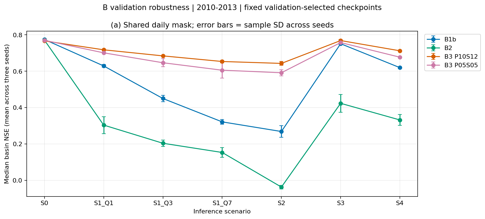

Hình: cùng mặt nạ ngày–ID cho cả 84 dự báo; các thanh là SD mẫu qua ba seed. B2 suy giảm mạnh khi mất Q, trong khi che nguồn lúc huấn luyện ở B3 cải thiện độ bền trong các kịch bản đã xét. Kết quả trên validation phục vụ chọn cấu hình; kết quả test/S0 ở Mục 6.6.8 vẫn được báo riêng. Chưa chấm sự kiện/mức lưu lượng trên validation bằng ngưỡng có dùng dữ liệu 2010–2013, kết quả test/S1–S4 của năm lõi C2 ở Mục 6.6.12.

Hồ sơ nguồn gồm [environment](../../Workspace/06_Evaluation/03_B_LamaHCEExt_Validation/Tables/environment.json) và [manifest SHA-256 đầy đủ](../../Workspace/06_Evaluation/03_B_LamaHCEExt_Validation/Tables/manifest.csv), đã đối chiếu đúng fingerprint của các kết quả khoa học. Bảng thời gian từ lần thực thi khác được lưu riêng, không dùng cho kết luận B*.

### 6.6.10. Năm lõi ở C1 và C2 trên validation

Bước C thay lõi LSTM của B* bằng một trong năm lõi (LSTM, GRU, Transformer, S4D, Mamba) trong cùng mô hình Sequential Forecast, giữ nguyên lớp nhúng, đầu ra, dữ liệu, che P10S12 và giao thức 30 epoch. Mỗi lõi có hai mức dung lượng: **x1** cùng số tham số với B* (khoảng 85 nghìn, lệch dưới 1%) và **x3** gấp khoảng ba lần.

**C1 (tinh chỉnh, hạt giống 111):** mỗi lõi 8 cấu hình = 2 mức × 2 độ sâu × 2 learning rate (10⁻³, 5 × 10⁻⁴); 39 notebook chạy tới epoch 15 rồi 23 cấu hình chạy tiếp tới epoch 30 theo luật loại sớm ghi sẵn; tổng 239,5 giờ GPU T4. C1 chỉ chấm validation. Cấu hình tốt nhất mỗi lõi: Mamba 0,7728 (4 khối x3), GRU 0,7707 (2 lớp x1), LSTM 0,7679 (2 lớp x1), S4D 0,7410 (4 khối x3), Transformer 0,7408 (2 lớp x3). Ba lõi đầu cách nhau 0,0049, dưới ngưỡng nhiễu hạt giống 0,0079 của B0, nên một hạt giống chưa phân biệt được chúng; S4D và Transformer thấp hơn khoảng 0,03. [Báo cáo C1](../../Workspace/05_Training/11_C1_LamaHCEExt_Compare/11_C1_LamaHCEExt_Compare.md).

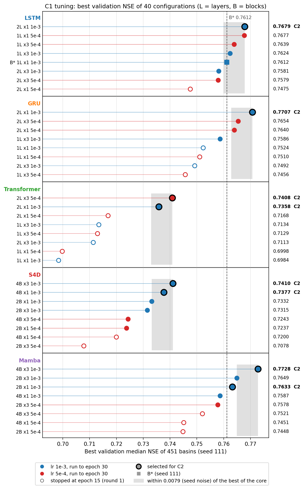

*Hình. NSE trung vị validation tốt nhất của các cấu hình C1, mỗi lõi một khối; dải xám là khoảng 0,0079 dưới cấu hình tốt nhất của lõi.*

**C2 (chạy chính thức):** 8 cấu hình (mỗi lõi cấu hình tốt nhất mức x1, cộng cấu hình tốt nhất cả 8 khi khác) × 3 hạt giống, 30 epoch, 178,4 giờ GPU. Bảng dưới là NSE trung vị validation, trung bình ± độ lệch chuẩn ba hạt giống; cột cuối là hiệu với B* (0,7669) chia cho ngưỡng nhiễu 0,0079.

| Cấu hình C2 | Tham số | NSE validation | Hiệu với B* / nhiễu |
|---|---:|---:|---:|
| GRU 2 lớp x1, lr 10⁻³ | 84.503 | 0,7686 ± 0,0031 | +0,22 |
| LSTM 2 lớp x1, lr 10⁻³ | 84.106 | 0,7677 ± 0,0005 | +0,10 |
| Mamba 4 khối x3, lr 10⁻³ | 254.677 | 0,7662 ± 0,0022 | −0,09 |
| Mamba 2 khối x1, lr 10⁻³ | 85.039 | 0,7630 ± 0,0042 | −0,49 |
| S4D 4 khối x3, lr 10⁻³ | 255.833 | 0,7415 ± 0,0008 | −3,20 |
| S4D 4 khối x1, lr 10⁻³ | 84.449 | 0,7401 ± 0,0038 | −3,38 |
| Transformer 2 lớp x3, lr 5 × 10⁻⁴ | 254.425 | 0,7395 ± 0,0087 | −3,45 |
| Transformer 2 lớp x1, lr 10⁻³ | 84.823 | 0,7394 ± 0,0074 | −3,47 |

Các lõi chia thành hai nhóm: GRU, LSTM và hai cấu hình Mamba nằm trong một lần nhiễu hạt giống của B*; S4D và Transformer thấp hơn khoảng 3,2–3,5 lần nhiễu, cùng chiều ở test (Mục 6.6.11). Trong nhóm đầu, thứ tự validation và test không trùng nhau, nên C2 không xếp hạng được bốn cấu hình này. Mức x3 không hơn mức x1 rõ ở lõi nào. Tổ hợp (trung bình dự báo của ba hạt giống) tăng NSE test 0,009–0,023 ở mọi cấu hình, lớn hơn khoảng cách giữa các cấu hình nhóm đầu. Chạy lại cùng hạt giống (C1 so với C2) cho trọng số trùng từng bit ở LSTM, GRU, S4D; Transformer và Mamba lệch vì phép tính GPU không tất định, NSE validation của epoch được chọn lệch tới 0,011. [Báo cáo C2](../../Workspace/05_Training/13_C2_LamaHCEExt_Compare/13_C2_LamaHCEExt_Compare.md), [bảng theo run](../../Workspace/05_Training/13_C2_LamaHCEExt_Compare/Tables/C2_seed_table.csv).

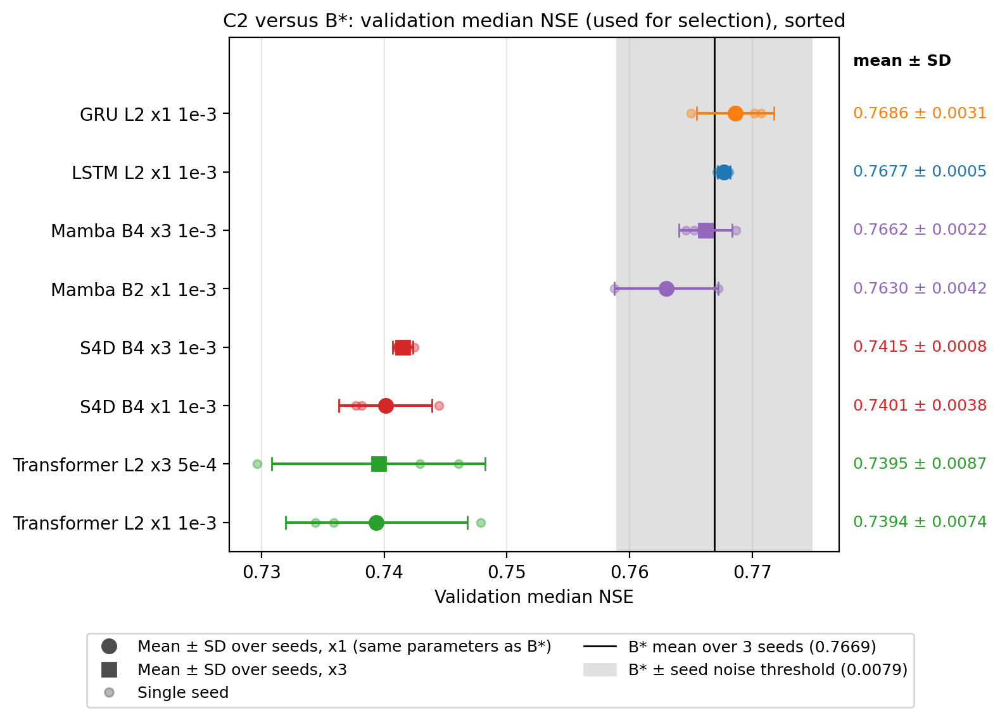

*Hình. NSE trung vị validation của 8 cấu hình C2; điểm đậm và thanh ngang là trung bình ± độ lệch chuẩn ba hạt giống, chấm mờ là từng hạt giống; vạch đen là B*, dải xám là B* ± 0,0079.*

### 6.6.11. Năm lõi C2 trên giao chung 56 run

Notebook `01_Evaluation_LamaHCEExt` **Version 9** chấm thêm 24 dự báo C2 từ `13_C2_LamaHCEExt_Compare` Version 1. Tám cấu hình của năm lõi được chấm với ba seed mỗi cấu hình, cùng 32 run A–B trên test 2014–2017, S0, hạn 1. Giao chung có **652.628 cặp ngày–lưu vực trên 450 lưu vực**. Cả 24 NPZ khớp ngữ cảnh A3 và danh tính checkpoint ghi trong bảng bàn giao. [Bảng giao chấm](../../Workspace/06_Evaluation/01_Evaluation_LamaHCEExt/Archive/Version9/Tables/Evaluation_coverage.csv), [kiểm hợp đồng C2](../../Workspace/06_Evaluation/01_Evaluation_LamaHCEExt/Archive/Version9/Tables/Evaluation_C2_contract_check.csv).

| Cấu hình C2 | NSE | PNSE | KGE |
|---|---:|---:|---:|
| LSTM L2 x1, lr 10⁻³ | 0,71841 ± 0,00135 | 0,53333 ± 0,00330 | 0,77124 ± 0,00904 |
| GRU L2 x1, lr 10⁻³ | 0,71190 ± 0,00587 | 0,53398 ± 0,00415 | 0,78170 ± 0,01246 |
| Transformer L2 x1, lr 10⁻³ | 0,70022 ± 0,00649 | 0,50852 ± 0,00814 | 0,77488 ± 0,00338 |
| Transformer L2 x3, lr 5 × 10⁻⁴ | 0,69599 ± 0,00348 | 0,49931 ± 0,00992 | 0,75402 ± 0,01956 |
| S4D L4 x1, lr 10⁻³ | 0,69311 ± 0,00557 | 0,48684 ± 0,00336 | 0,72887 ± 0,00309 |
| S4D L4 x3, lr 10⁻³ | 0,69771 ± 0,00636 | 0,49067 ± 0,00851 | 0,73643 ± 0,00973 |
| Mamba L2 x1, lr 10⁻³ | 0,72086 ± 0,00574 | 0,52627 ± 0,01045 | 0,76370 ± 0,01735 |
| Mamba L4 x3, lr 10⁻³ | 0,71246 ± 0,00620 | 0,52527 ± 0,00956 | 0,77294 ± 0,01179 |

Mỗi ô là trung bình ± độ lệch chuẩn mẫu của ba trung vị theo lưu vực. Trong các cấu hình C2, Mamba L2 x1 đứng đầu theo NSE, cao hơn LSTM L2 x1 khoảng **0,00246**. GRU L2 x1 có PNSE và KGE cao nhất. Mỗi họ Holm có **1.485 cặp**, nên dùng bảng Version 9 khi đối chiếu các cặp trong lần chấm này. Số liệu test phục vụ báo cáo. Checkpoint demo vẫn dựa trên kết quả validation. [Tổng hợp theo run và chỉ số](../../Workspace/06_Evaluation/01_Evaluation_LamaHCEExt/Archive/Version9/Tables/Evaluation_summary.csv), [kiểm định ghép cặp](../../Workspace/06_Evaluation/01_Evaluation_LamaHCEExt/Archive/Version9/Tables/Evaluation_paired_tests.csv).

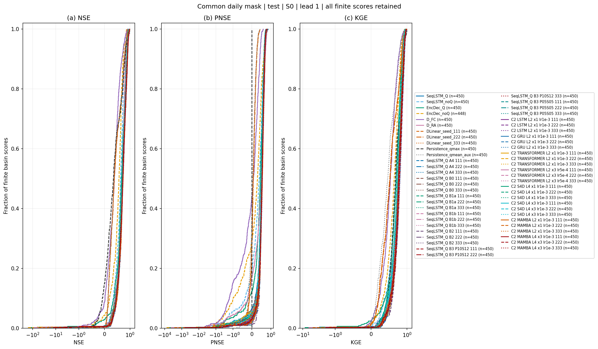

*Hình. Phân phối NSE, PNSE và KGE theo lưu vực. Mỗi đường biểu diễn một run và giữ toàn bộ điểm hữu hạn, gồm cả điểm âm.*

### 6.6.12. C2 dưới bảy kịch bản vận hành

Evaluation Version 10 giữ nguyên bảng S0 của 56 run và chấm riêng 24 C2 qua bảy kịch bản. Giao riêng có **657.347 ngày–lưu vực trên 451 ID**. Mỗi mức S1_Q1, S1_Q3 và S1_Q7 được báo cáo riêng. Cả 24 checkpoint và scaler giữ nguyên giữa các kịch bản. [Coverage kịch bản C2](../../Workspace/06_Evaluation/01_Evaluation_LamaHCEExt/Archive/Version10/C2_scenarios/Evaluation_C2_scenarios_coverage.csv), [bảng C2 theo seed](../../Workspace/06_Evaluation/04_C2_LamaHCEExt_Scenarios/Archive/Version1/C2_scenarios_seed_scores.csv).

Trên cùng giao C2, trung bình qua ba seed của NSE trung vị theo lưu vực cao nhất ở S0 là **0,72036** (Mamba L2 x1). Ở S2, LSTM L2 x1 đạt **0,60322**, giảm **0,11458** so với S0 của cùng cấu hình. Ở S4, Mamba L4 x3 đạt **0,66623**, giảm **0,04539** so với S0 của chính nó. Các giá trị này thuộc kỳ test và được dùng để báo cáo độ nhạy. [Bảng đầy đủ theo cấu hình và kịch bản](../../Workspace/06_Evaluation/04_C2_LamaHCEExt_Scenarios/Archive/Version1/C2_scenarios_stats.csv).

### 6.6.13. Dự báo nhiều hạn 1–7 ngày (bước H, Evaluation Version 12)

Bước H mở rộng dự báo sang bảy hạn (1–7 ngày) ở mức cùng ngân sách tham số (`lstm_L2_x1_lr1e-3` và `mamba_L2_x1_lr1e-3`, ba hạt giống mỗi cấu hình) dưới bốn cách cấp thông tin thời tiết: chỉ quá khứ (`past`), lai ECMWF HRES ngày đầu (`hybrid`), dự báo GEFSv12 7 ngày (`gefs`) và tái phân tích hoàn hảo (`perfect`). Evaluation **Version 12** chấm đủ **168 NPZ** từ `15_H_LamaHCEExt_Compare` Version 1 (24 run ở mỗi hạn) trên giao chung **651.841 cặp ngày–lưu vực và 451 lưu vực**, giữ nguyên SHA-256 bốn bảng S0 56 run. [Tóm tắt Version 12](../../Workspace/06_Evaluation/01_Evaluation_LamaHCEExt/Archive/Version12/Tables/Evaluation_summary.json), [báo cáo H Compare](../../Workspace/05_Training/15_H_LamaHCEExt_Compare/15_H_LamaHCEExt_Compare.md).

Trên cùng mặt nạ chung, trung bình qua ba hạt giống của NSE trung vị theo lưu vực từ hạn 1 đến hạn 7 giảm mạnh khi thiếu thông tin thời tiết tương lai: ở hạn 7, cách dùng **GEFS** đạt **0,240** (LSTM) và **0,225** (Mamba), vượt rõ cách lai ECMWF HRES ngày đầu (**0,082** và **0,062**), trong khi cận trên tái phân tích hoàn hảo đạt **0,644** và **0,646**. [Bảng chỉ số hạn 7](../../Workspace/06_Evaluation/01_Evaluation_LamaHCEExt/Archive/Version12/H/Evaluation_H_summary_lead7.csv).

### 6.6.14. Kéo dài cửa sổ quá khứ 730 so với 365 ngày (bước D, Compare Version 3 & Evaluation Version 13)

Bước D kiểm định câu hỏi RQ5 bằng cách kéo dài `seq_length` từ 365 lên 730 ngày (`729` bước quá khứ + `1` ngày ECMWF HRES) trên ba lõi ở mức cùng tham số (`lstm_L2_x1_lr1e-3` 84.106 tham số, `mamba_L2_x1_lr1e-3` 85.039 tham số, `s4d_L4_x1_lr1e-3` 84.449 tham số; ba hạt giống `111, 222, 333`, cùng `freeze-C`, 30 epoch, tắt `grad_guard`, 0 bước cập nhật bị bỏ). `17_D_LamaHCEExt_Compare` **Version 3** (20 Input, `34/34` manifest, giữ trùng từng byte 9 NPZ và 11 bảng cốt lõi của Version 1, bổ sung bộ 9 hình trực quan đa tiêu chí và `D_curves.csv`) cùng Evaluation **Version 13** (212/212 kiểm thử đạt, giữ nguyên SHA-256 bốn bảng S0 56 run) chấm đủ 19 chuỗi (9 D + 9 C2 + `Persistence_qmax`) trên giao chung **657.347 cặp ngày–lưu vực và 451 lưu vực**. [Tóm tắt D Compare](../../Workspace/05_Training/17_D_LamaHCEExt_Compare/Tables/d_summary.json), [tóm tắt Evaluation D](../../Workspace/06_Evaluation/01_Evaluation_LamaHCEExt/Archive/Version13/D/Evaluation_D_summary.json).

| Cấu hình (x1) | NSE val TB ± SD (365 / 730) | NSE test TB ± SD (365 / 730) | NSE tổ hợp 3 seed (365 / 730) | KGE tổ hợp 3 seed (365 / 730) | Tỷ số phút train/ep T4 (`730/365`) | Tỷ số p50 CPU Kaggle (`730/365`) |
|---|---|---|---|---|---:|---:|
| `lstm_L2_x1_lr1e-3` | 0,7677 ± 0,0005 / 0,7715 ± 0,0014 | 0,7178 ± 0,0011 / 0,7162 ± 0,0016 | 0,7351 / 0,7338 (−0,0012) | 0,7767 / 0,7799 (+0,0031) | 1,96× (VRAM 1,71×) | 1,50× (19,92 ms) |
| `mamba_L2_x1_lr1e-3` | 0,7630 ± 0,0042 / 0,7641 ± 0,0037 | 0,7204 ± 0,0055 / 0,7180 ± 0,0053 | 0,7330 / 0,7327 (−0,0003) | 0,7766 / 0,7586 (−0,0180) | 1,95× (VRAM 1,69×) | 2,42× (61,72 ms) |
| `s4d_L4_x1_lr1e-3` | 0,7401 ± 0,0038 / 0,7428 ± 0,0051 | 0,6933 ± 0,0053 / 0,6986 ± 0,0095 | 0,7127 / 0,7162 (+0,0036) | 0,7320 / 0,7333 (+0,0013) | 1,96× (VRAM 1,75×) | 1,83× (127,96 ms) |

Nguồn: [D_score_stats.csv](../../Workspace/05_Training/17_D_LamaHCEExt_Compare/Tables/D_score_stats.csv), [D_ensemble_scores.csv](../../Workspace/05_Training/17_D_LamaHCEExt_Compare/Tables/D_ensemble_scores.csv), [D_cost_ratios.csv](../../Workspace/05_Training/17_D_LamaHCEExt_Compare/Tables/D_cost_ratios.csv), [D2_D_CPU_benchmark.csv](../../Workspace/07_Demo/02_D2_LamaHCEExt_CPU/Archive/Version2/D2_D_CPU_benchmark.csv).

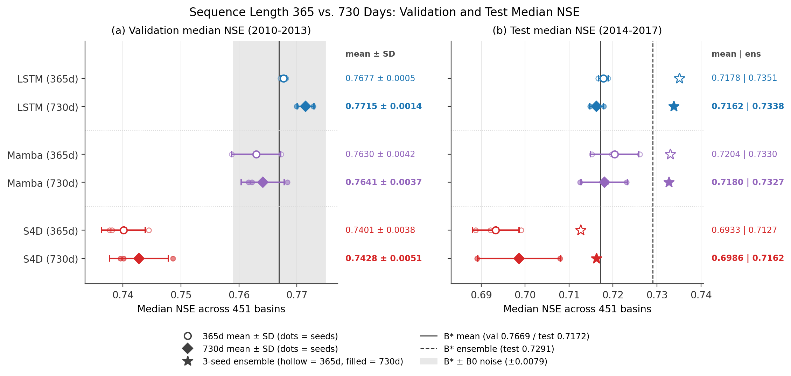

*Hình. Tổng quan NSE trung vị trên kỳ validation 2010–2013 (a) và test 2014–2017 (b, giao chung 451 lưu vực) cho cửa sổ 365 ngày (ký hiệu rỗng) so với 730 ngày (ký hiệu đặc), đặt cạnh mốc `B*` và dải nhiễu hạt giống `B0` (`±0,0079`).*

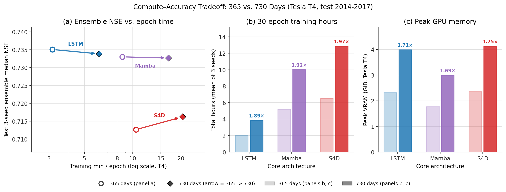

*Hình. Đánh đổi hiệu năng – chi phí trên Tesla T4 khi tăng độ dài chuỗi từ 365 lên 730 ngày: (a) quỹ đạo NSE tổ hợp test theo phút huấn luyện mỗi epoch (thang log), (b) tổng giờ huấn luyện 30 epoch (`1,89–1,97×`) và (c) đỉnh VRAM (`1,69–1,75×`).*

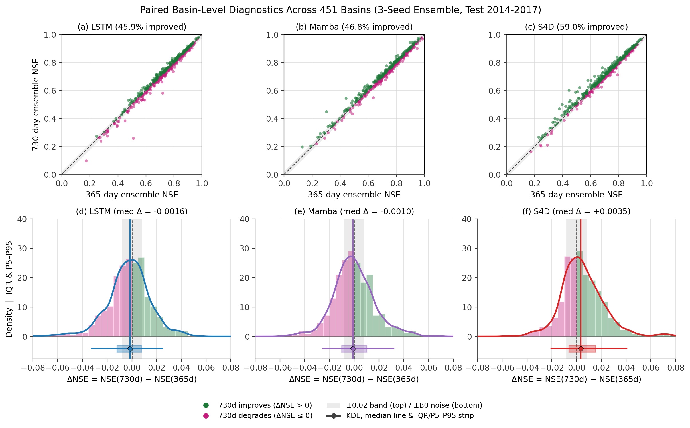

*Hình. Chẩn đoán ghép cặp từng lưu vực trên tổ hợp 3 hạt giống (451 lưu vực, test 2014–2017): scatter `1:1` (hàng trên) và phân phối hiệu `ΔNSE = NSE(730) − NSE(365)` kèm thanh hộp `IQR` & `P5–P95` (hàng dưới). S4D cải thiện 59,0% lưu vực (trung vị `+0,0035`), còn LSTM (45,9%, `−0,0016`) và Mamba (46,8%, `−0,0010`) phân bố cân bằng quanh 0.*

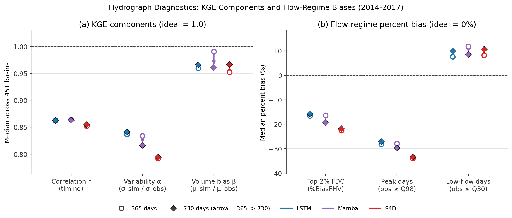

*Hình. Dịch chuyển từ 365 sang 730 ngày của (a) ba thành phần KGE (`r`, `α`, `β`, mốc `1,0`) và (b) thiên lệch theo chế độ dòng chảy (`%BiasFHV` top 2%, ngày đỉnh `≥ Q98`, ngày kiệt `≤ Q30`, mốc `0%`). Trọn bộ 9 hình trực quan bước D (thêm `D_Length_Comparison`, `D_MultiMetric_Ensemble`, `D_Curves_365_vs_730`, `D_Basin_CDF_And_Thresholds`, `D_Basin_Stratification`) lưu tại [báo cáo D Compare](../../Workspace/05_Training/17_D_LamaHCEExt_Compare/17_D_LamaHCEExt_Compare.md).*

Trên toàn miền 451 lưu vực, tăng gấp đôi cửa sổ quá khứ không nâng trung vị NSE của hai lõi dẫn đầu (tổ hợp 3 seed LSTM `−0,0012` và Mamba `−0,0003`, đều nhỏ hơn `0,16×` ngưỡng nhiễu B0 `0,0079`), trong khi S4D cải thiện có ý nghĩa thống kê ở hai trên ba hạt giống (`Seed111`: `+0,0088`, `p_Holm = 7,36 × 10⁻⁸`; `Seed333`: `+0,0068`, `p_Holm = 1,03 × 10⁻¹⁰`; tổ hợp `+0,0036`, cải thiện `266/451` lưu vực và tập trung mạnh ở lưu vực diện tích lớn `Q4 +0,0055` cùng nhóm khó nhất `Q1 +0,0109`). Ở dải cực trị (`Evaluation_D_length_pairs.csv`, `Evaluation_D_levels_pooled.csv`, `Evaluation_D_events_pooled.csv`), LSTM 730 nâng recall nhóm rất cao (`> Q98`) ở cả ba seed (`0,4471–0,4743 → 0,4562–0,4797`), giảm thiếu hụt đỉnh tổ hợp (`FHV: −16,6% → −15,8%`) và giảm sai số định thời đỉnh lũ 2 năm USWRC (`0,37–0,57 → 0,24–0,39` ngày), còn Mamba 730 bị co cả tỷ số độ biến thiên `α` (`0,834 → 0,816`), tỷ số lượng `β` (`0,990 → 0,961`) lẫn thiên lệch đỉnh `BiasFHV` (`−16,3% → −19,4%`, có ý nghĩa trên cả ba seed `p_Holm ≤ 6,4 × 10⁻⁷`), kéo theo POD lũ 2 năm giảm (`12,0–15,4% → 9,8–12,2%`) dù precision `> Q98` tăng (`64,9–71,1% → 70,0–72,6%`). Về chi phí, thời gian huấn luyện mỗi epoch trên Tesla T4 tăng đồng đều gần gấp đôi ở cả ba lõi (`1,95–1,96×`, VRAM `1,69–1,75×`); trên CPU Kaggle 4 luồng (`D2` Version 2, `108/108` phép kiểm đạt), p50 của LSTM tăng `1,50×`, S4D tăng `1,83×` và Mamba (`mambapy`) tăng `2,42×`. Kết luận chi phí gắn với cài đặt cụ thể ở quy mô ~85 nghìn tham số trên Tesla T4 và CPU 4 luồng.

## 6.7. Lưu vực có NSE âm lớn

Hai lưu vực 742/758 có biến thiên nhãn nhỏ; khi mẫu số NSE nhỏ, sai lệch nền có thể tạo giá trị âm lớn. Tại **758**, DLinear seed 111 có r ≈ **0,9837** nhưng NSE ≈ **−11,5639**, với β ≈ **3,9076**. Chuỗi khá đồng nhịp nhưng mức trung bình quá cao. EncDec_noQ cho đầu ra hằng ở cả hai ID, làm tương quan và KGE không xác định.

Phân rã MSE = bình phương sai số trung bình + phương sai sai số, cùng ddof=0, cho phép đọc hai phần đóng góp vào 1 − NSE sau khi chia phương sai quan trắc. Đây là đồng nhất thức mô tả sai số, không gán cơ chế vật lý hoặc nguyên nhân bên trong mạng.

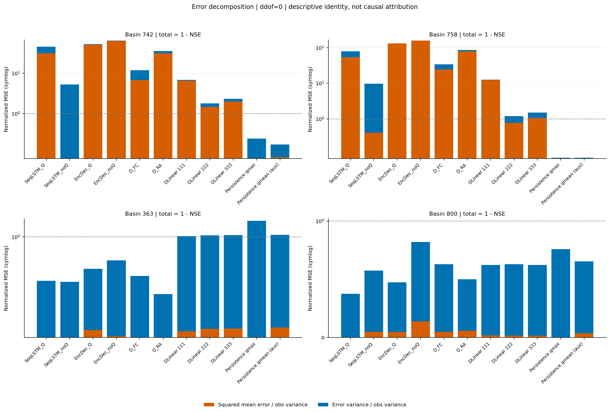

*Hình 6.2. Phân rã sai số chuẩn hóa tại 742, 758, 363 và 800. Tổng hai phần bằng 1 − NSE. Ở 742/758, sai lệch trung bình đóng góp lớn đối với nhiều run; ở các hồ sơ khác, phương sai sai số có thể chiếm ưu thế.*

Lưu vực 363 minh họa một trường hợp khác: DLinear có NSE hơi âm nhưng PNSE dương vì persistence còn kém hơn. Đây là ca được bổ sung để giải thích sau khi xem test. Danh sách ID và cấu hình được giữ cố định; các hồ sơ không được dùng để loại trạm hoặc chọn lại mô hình theo test.

## 6.8. Đánh giá theo bốn mức lưu lượng

Ngưỡng q30/q80/q98 A1 được áp giống nhau cho quan trắc và dự báo. Trên giao chung có **194.703 ngày–ID mức thấp** và **11.759 ngày–ID mức rất cao**. Các tỷ lệ dưới đây là tỷ lệ cộng dồn ô đếm, không phải trung vị recall hoặc precision theo lưu vực.

| Run | Recall thấp (%) | Recall rất cao (%) | Precision rất cao (%) |
|---|---:|---:|---:|
| SeqLSTM_Q | 66,93 | 47,58 | 67,58 |
| SeqLSTM_noQ | 65,79 | 36,17 | 63,73 |
| EncDec_Q | 53,67 | 41,31 | 62,22 |
| EncDec_noQ | 54,95 | 38,50 | 51,30 |
| D_FC | 47,23 | 21,49 | 41,75 |
| D_RA | 65,06 | 47,27 | 63,78 |
| DLinear 111 | 61,83 | 22,18 | 53,33 |
| DLinear 222 | 67,61 | 22,30 | 53,72 |
| DLinear 333 | 69,52 | 21,80 | 54,86 |
| LSTM A4 111 | 71,53 | 43,84 | 69,63 |
| LSTM A4 222 | 76,29 | 48,39 | 66,53 |
| LSTM A4 333 | 73,17 | 47,79 | 65,68 |
| Persistence qmax | 88,07 | 40,11 | 40,28 |
| Persistence qmean, phụ | 96,27 | 18,40 | 61,53 |

Nguồn: [bảng bốn mức cộng dồn](../../Workspace/06_Evaluation/01_Evaluation_LamaHCEExt/Archive/Version4/Tables/Evaluation_levels_pooled.csv). Recall mức rất cao là số ngày được báo đúng rất cao chia số ngày rất cao thật; precision là số báo đúng chia số lần báo rất cao. Mức không có mẫu thật hoặc không có lần báo được giữ chỉ số không xác định theo mẫu số tương ứng.

SeqLSTM_Q bắt đúng **5.595/11.759 ngày rất cao**, cao hơn persistence **4.716 ngày**; precision cũng cao hơn. Ba A4 bắt đúng **5.155/5.690/5.620** ngày, quanh mức trọng số tác giả. DLinear chỉ bắt khoảng 22%, nhất quán với biên độ dự báo co. Accuracy tổng thể của persistence qmax là **82,90%**, còn SeqLSTM_Q **77,62%**. Chỉ số đúng chung chịu ảnh hưởng các mức phổ biến nên cần đọc riêng recall rất cao và thấp theo yêu cầu bài toán.

Các chữ ký đường duy trì bổ sung bằng chứng về dải lưu lượng. %BiasFHV trung vị của SeqLSTM_Q là **−13,01%**, của DLinear 111/222/333 là **−31,35/−30,78/−31,91%**, cho thấy hụt tổng của dải cao theo định nghĩa FHV. Bộ đánh giá dùng ceil(0,02n) ngày cao nhất và báo kèm trung vị trị tuyệt đối để giữ thông tin khi các lưu vực lệch hai chiều.

%BiasFLV dùng log ở 30% ngày thấp nhất; các giá trị không dương sau chính sách chặn được dùng sàn log 10⁻⁶ mm/ngày riêng cho phép tính này. Ba DLinear có trị tuyệt đối FLV trung vị khoảng **597–754%**, với **9.197/12.134/13.218** ngày sim dưới sàn trên giao chấm. Giá trị này nhạy với hình dạng đuôi log và số lần chặn về 0; không được diễn giải như phần trăm sai tổng thể tích nước. Quy tắc FDC được cố định trong [protocol đánh giá](../../Workspace/06_Evaluation/01_Evaluation_LamaHCEExt/Archive/Version4/Tables/Evaluation_protocol.json).

### 6.8.1. Bốn mức ở các bước B và năm lõi C2 (Evaluation Version 9)

Bảng dưới dùng cùng ngưỡng q30/q80/q98 và cùng giao 56 run của Evaluation Version 9 (11.759 ngày–ID mức rất cao). Mỗi ô là trung bình ± độ lệch chuẩn mẫu qua ba hạt giống của tỷ lệ cộng dồn (%); run một hạt giống chỉ có một giá trị. F1 rất cao là trung bình điều hòa của recall và precision mức rất cao.

| Run | Recall thấp (%) | Recall rất cao (%) | Precision rất cao (%) | F1 rất cao (%) |
|---|---:|---:|---:|---:|
| SeqLSTM_Q (trọng số tác giả) | 66,93 | 47,58 | 67,58 | 55,84 |
| LSTM A4 | 73,66 ± 2,42 | 46,67 ± 2,47 | 67,28 ± 2,08 | 55,05 ± 1,14 |
| B0 | 74,85 ± 1,57 | 47,39 ± 1,25 | 67,13 ± 1,83 | 55,54 ± 0,43 |
| B1a | 77,82 ± 3,89 | 47,45 ± 0,16 | 68,84 ± 0,56 | 56,17 ± 0,22 |
| B1b | 80,63 ± 5,22 | 48,64 ± 2,38 | 70,91 ± 1,92 | 57,65 ± 1,22 |
| B2 | 79,90 ± 0,92 | 48,64 ± 0,86 | 70,26 ± 1,30 | 57,47 ± 0,22 |
| B3 P10S12 (B*) | 75,05 ± 0,11 | 46,35 ± 1,19 | 70,17 ± 1,54 | 55,81 ± 0,50 |
| B3 P05S05 | 75,22 ± 2,45 | 46,90 ± 1,55 | 69,81 ± 0,68 | 56,09 ± 0,90 |
| C2 LSTM L2 x1 | 79,17 ± 3,84 | 45,94 ± 1,38 | 69,96 ± 1,11 | 55,45 ± 0,66 |
| C2 GRU L2 x1 | 76,47 ± 3,01 | 48,39 ± 2,62 | 68,18 ± 1,62 | 56,55 ± 1,38 |
| C2 Transformer L2 x1 | 80,36 ± 1,13 | 48,41 ± 1,36 | 64,44 ± 1,01 | 55,27 ± 0,56 |
| C2 Transformer L2 x3 | 81,66 ± 3,23 | 45,38 ± 2,22 | 67,06 ± 1,81 | 54,08 ± 1,02 |
| C2 S4D L4 x1 | 76,76 ± 2,19 | 41,06 ± 1,09 | 69,99 ± 1,74 | 51,73 ± 0,46 |
| C2 S4D L4 x3 | 77,53 ± 3,18 | 43,27 ± 1,84 | 68,31 ± 2,93 | 52,92 ± 0,45 |
| C2 Mamba L2 x1 | 73,11 ± 6,92 | 47,12 ± 4,24 | 69,01 ± 3,52 | 55,83 ± 1,80 |
| C2 Mamba L4 x3 | 73,83 ± 4,06 | 47,47 ± 2,69 | 68,15 ± 1,23 | 55,92 ± 1,60 |
| Persistence qmax | 88,07 | 40,11 | 40,28 | 40,19 |

Nguồn: [bảng bốn mức cộng dồn Version 9](../../Workspace/06_Evaluation/01_Evaluation_LamaHCEExt/Archive/Version9/Tables/Evaluation_levels_pooled.csv).

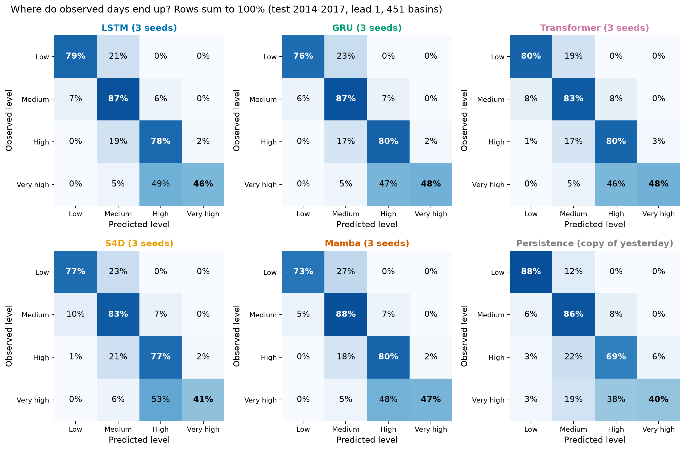

*Hình. Ma trận nhầm lẫn bốn mức (test 2014–2017, hạn một ngày, cộng dồn 451 lưu vực và ba hạt giống) của năm lõi C2 mức cùng tham số và persistence qmax. Mỗi hàng là mức quan trắc, cộng lại 100%; ô đậm trên đường chéo là tỷ lệ ngày dự báo đúng mức (recall). Ở hàng "Very high", các mô hình học sâu xếp 41–48% số ngày rất cao đúng mức và gần một nửa (47–53%) xuống mức cao, chỉ khoảng 5–6% xuống mức trung bình; persistence chỉ đúng 40% và đẩy 19% xuống mức trung bình. Lỗi của mô hình học sâu vì vậy chủ yếu là hụt đỉnh một bậc chứ không bỏ lỡ hẳn ngày lũ. Bảng gộp: [Classification_confusion_pooled.csv](../../Workspace/06_Evaluation/01_Evaluation_LamaHCEExt/Tables/Classification_confusion_pooled.csv).*

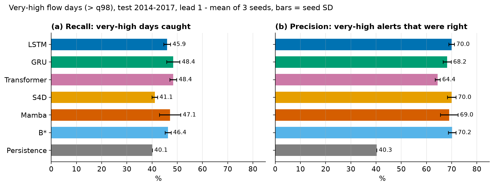

*Hình. Recall (a) và precision (b) mức rất cao (trên q98 từng lưu vực) của năm lõi C2 mức cùng tham số, B* và persistence; thanh là trung bình ba hạt giống, vạch là độ lệch chuẩn hạt giống. Các mô hình học sâu chênh nhau ít ở cả hai chỉ số (trừ recall thấp hơn của S4D và precision thấp hơn của Transformer), còn khoảng cách với persistence lớn nhất ở precision (khoảng 30 điểm phần trăm).*

Ở mức rất cao, các mô hình học sâu có precision 64,4–70,9%, cao xa persistence qmax (40,3%): khi mô hình báo một ngày rất cao thì khoảng hai phần ba trường hợp đúng là rất cao. Recall rất cao chỉ 41,1–48,6%, nghĩa là hơn một nửa số ngày rất cao thật bị dự báo xuống mức thấp hơn, phù hợp với %BiasFHV trung vị âm ở mọi run C2 (−11,7 đến −22,2%, mô hình hụt đỉnh). Trong các bước B, B1b có F1 rất cao lớn nhất (57,65%). Trong C2, GRU, hai cấu hình Mamba, LSTM và Transformer x1 có F1 rất cao 55,3–56,6%, chênh nhau nhỏ hơn độ lệch chuẩn ba hạt giống của Mamba L2 x1 (1,80 điểm phần trăm); S4D thấp nhất (51,7–52,9%) do recall rất cao thấp. Recall thấp của persistence cao nhất (88,07%) vì dòng chảy kiệt thay đổi chậm, chép mức hôm qua hầu như luôn đúng.

## 6.9. Đánh giá sự kiện lũ

### 6.9.1. Ngưỡng, gộp cụm và ghép một–một

Ngưỡng Gumbel A1 cho T = 1,5; 2; 5; 10 năm được giữ cố định trước test, dùng giống nhau cho obs/sim. Sự kiện được trích trên lịch ngày, xuất cả đoạn liên tiếp và cụm USWRC. Cụm có onset/ending không quan sát được hoặc thiếu ngày trong cửa sổ ghép được đánh dấu kiểm duyệt và báo số lượng riêng.

**Bảng chính dùng tolerance = 0: hai trận phải bắt đầu cùng ngày. Bảng phụ dùng ±1 ngày**, xuất riêng để đánh giá độ nhạy với dung sai thời gian. Thuật toán tối đa hóa số cặp trước rồi tối thiểu hóa tổng lệch ngày bắt đầu (onset), không tái sử dụng một sự kiện trong nhiều cặp. Cửa sổ kiểm duyệt theo dung sai của mỗi bảng, vì vậy mẫu số được báo riêng. Điểm thời gian đỉnh được tính sau khi cặp đã được xác định; cùng ngày bắt đầu không bắt buộc cùng ngày đỉnh. [Căn cứ NOAA và phân biệt với cửa sổ ±2 ngày của Nearing 2024](../../Workspace/06_Evaluation/01_Evaluation_LamaHCEExt/01_Evaluation_LamaHCEExt.md#5-sự-kiện-lũ-và-cờ-kiểm-duyệt).

Gọi h là số bắt được, m là bỏ sót và f là báo nhầm. POD = h/(h+m), FAR = f/(h+f), precision = h/(h+f), F1 = 2h/(2h+m+f), CSI = h/(h+m+f). Mẫu số 0 cho NaN. Kết quả chính cộng số trận toàn tập trước khi chia; ngưỡng 1,5/2/5/10 năm và hai cách gộp được báo riêng.

### 6.9.2. Kết quả chính ở chu kỳ hai năm

Theo quy tắc USWRC, có **1.066 cụm quan trắc đủ điều kiện trên 366 lưu vực** ở T = 2 năm. Bảng chính yêu cầu cùng ngày bắt đầu. Nhóm dưới 10 năm mẫu fit được giữ và có bảng tách riêng trong CSV.

| Run | Bắt được | Bỏ sót | Báo nhầm | POD (%) | FAR (%) |
|---|---:|---:|---:|---:|---:|
| SeqLSTM_Q | 208 | 858 | 431 | 19,51 | 67,45 |
| SeqLSTM_noQ | 188 | 878 | 304 | 17,64 | 61,79 |
| EncDec_Q | 126 | 940 | 289 | 11,82 | 69,64 |
| EncDec_noQ | 174 | 892 | 445 | 16,32 | 71,89 |
| D_FC | 63 | 1.003 | 286 | 5,91 | 81,95 |
| D_RA | 219 | 847 | 377 | 20,54 | 63,26 |
| DLinear 111 | 2 | 1.064 | 327 | 0,19 | 99,39 |
| DLinear 222 | 2 | 1.064 | 340 | 0,19 | 99,42 |
| DLinear 333 | 2 | 1.064 | 322 | 0,19 | 99,38 |
| Persistence qmax | 0 | 1.066 | 1.066 | 0,00 | 100,00 |
| Persistence qmean, phụ | 0 | 1.066 | 201 | 0,00 | 100,00 |

Nguồn: [bảng sự kiện chính](../../Workspace/06_Evaluation/01_Evaluation_LamaHCEExt/Archive/Version4/Tables/Evaluation_events_pooled.csv). SeqLSTM_Q bắt đúng ngày nhiều trận hơn DLinear, dù vẫn bỏ sót 858/1.066 trận. D_RA có 219 cặp đúng ngày, nhưng đây là mốc có tái phân tích ở ngày đích, cần đọc cùng điều kiện nguồn thông tin. Ba seed DLinear chỉ có hai cặp đúng ngày; NSE trung vị nhỉnh hơn persistence chưa phản ánh khả năng bắt đúng ngày khởi phát lũ. Sai số thời điểm đỉnh vẫn được báo riêng vì cùng ngày bắt đầu không bắt buộc cùng ngày đỉnh.

### 6.9.3. Bảng phụ ±1 ngày và độ nhạy thời gian

Cho phép lệch ngày bắt đầu tối đa một ngày làm thay đổi kết quả như sau; bảng phụ đầy đủ được giữ trong CSV.

| Run | POD chính (%) | FAR chính (%) | POD phụ ±1 (%) | FAR phụ ±1 (%) |
|---|---:|---:|---:|---:|
| SeqLSTM_Q | 19,51 | 67,45 | 32,65 | 45,54 |
| D_RA | 20,54 | 63,26 | 30,49 | 45,47 |
| DLinear 111 | 0,19 | 99,39 | 20,83 | 32,52 |
| DLinear 222 | 0,19 | 99,42 | 22,23 | 30,70 |
| DLinear 333 | 0,19 | 99,38 | 20,83 | 31,48 |
| Persistence qmax | 0,00 | 100,00 | 100,00 | 0,00 |

Nguồn: [bảng phụ](../../Workspace/06_Evaluation/01_Evaluation_LamaHCEExt/Archive/Version4/Tables/Evaluation_events_pooled_tolerance1.csv). **POD = 1 của persistence trong bảng phụ là hệ quả của dung sai ±1 ngày.** Chuỗi chép qmax hôm qua dịch trận sang ngày hôm sau; sai số tuyệt đối thời điểm đỉnh trung bình là **một ngày**. Bảng chính không có cặp persistence đúng ngày tại cả bốn ngưỡng và cả hai cách gộp.

Bảng phân mức đúng ngày cho recall rất cao của persistence là **40,11%**, thấp hơn SeqLSTM_Q **47,58%**. Phân mức ngày và ghép trận đo hai khía cạnh khác nhau, nên cả hai được báo cáo. Trong bảng phụ ±1, persistence cũng đạt POD = 1 ở T = 5 và 10 năm; ở T = 1,5 năm là 1.849/1.850, khoảng 99,95%.

### 6.9.4. Khả năng bắt lũ của LSTM huấn luyện lại

Trên cùng 1.066 cụm USWRC tại ngưỡng hai năm, A4 đạt kết quả sau với yêu cầu bắt đầu đúng ngày:

| A4 | Bắt được | Bỏ sót | Báo nhầm | POD (%) | FAR (%) |
|---|---:|---:|---:|---:|---:|
| Seed 111 | 180 | 886 | 372 | 16,89 | 67,39 |
| Seed 222 | 216 | 850 | 446 | 20,26 | 67,37 |
| Seed 333 | 191 | 875 | 446 | 17,92 | 70,02 |

Seed 333 có NSE trung vị cao nhất, còn seed 222 có POD cao nhất. Mức NSE gần mốc tác giả chưa đồng nghĩa bắt tốt ngày khởi phát lũ: cả ba seed vẫn bỏ sót 850–886 trận và có FAR khoảng 67–70%. Ở bảng phụ ±1 ngày, POD tăng lên **28,71/34,05/31,24%**. [Bảng chính](../../Workspace/06_Evaluation/01_Evaluation_LamaHCEExt/Archive/Version4/Tables/Evaluation_events_pooled.csv), [bảng phụ](../../Workspace/06_Evaluation/01_Evaluation_LamaHCEExt/Archive/Version4/Tables/Evaluation_events_pooled_tolerance1.csv).

### 6.9.5. Bắt lũ ở các bước B và năm lõi C2

Cùng 1.066 cụm USWRC ở ngưỡng hai năm như Mục 6.9.2 (Evaluation Version 9). Số trận là trung bình qua ba hạt giống; POD, FAR, CSI tính trên từng hạt giống rồi lấy trung bình ± độ lệch chuẩn. CSI = h/(h+m+f) phạt cả bỏ sót lẫn báo nhầm.

| Run | Bắt được | Báo nhầm | POD (%) | FAR (%) | CSI (%) | POD ±1 (%) | FAR ±1 (%) |
|---|---:|---:|---:|---:|---:|---:|---:|
| LSTM A4 | 195,7 | 421,3 | 18,4 ± 1,7 | 68,3 ± 1,5 | 13,1 ± 1,0 | 31,3 | 45,8 |
| B0 | 193,0 | 418,7 | 18,1 ± 2,1 | 68,4 ± 1,4 | 13,0 ± 1,2 | 31,3 | 45,3 |
| B1a | 193,3 | 428,3 | 18,1 ± 0,8 | 68,9 ± 1,7 | 12,9 ± 0,6 | 32,1 | 45,0 |
| B1b | 203,0 | 435,0 | 19,0 ± 0,5 | 68,2 ± 0,5 | 13,5 ± 0,3 | 35,8 | 40,2 |
| B2 | 193,0 | 442,7 | 18,1 ± 0,7 | 69,6 ± 1,4 | 12,8 ± 0,5 | 36,0 | 39,6 |
| B3 P10S12 (B*) | 160,7 | 339,3 | 15,1 ± 0,9 | 67,8 ± 1,7 | 11,4 ± 0,5 | 29,9 | 36,1 |
| B3 P05S05 | 175,7 | 357,7 | 16,5 ± 0,5 | 67,1 ± 0,1 | 12,3 ± 0,3 | 30,7 | 38,7 |
| C2 LSTM L2 x1 | 163,7 | 319,0 | 15,4 ± 1,4 | 66,1 ± 1,6 | 11,8 ± 1,0 | 29,8 | 34,2 |
| C2 GRU L2 x1 | 161,7 | 331,0 | 15,2 ± 1,7 | 67,1 ± 1,1 | 11,6 ± 0,9 | 28,8 | 37,5 |
| C2 Transformer L2 x1 | 155,3 | 344,0 | 14,6 ± 1,2 | 68,9 ± 1,9 | 11,0 ± 0,8 | 26,6 | 43,1 |
| C2 Transformer L2 x3 | 116,7 | 267,3 | 10,9 ± 0,8 | 69,5 ± 2,4 | 8,7 ± 0,6 | 21,5 | 40,4 |
| C2 S4D L4 x1 | 101,3 | 196,3 | 9,5 ± 1,6 | 66,0 ± 5,0 | 8,0 ± 1,4 | 19,3 | 30,8 |
| C2 S4D L4 x3 | 121,7 | 251,7 | 11,4 ± 2,4 | 67,4 ± 1,8 | 9,2 ± 1,6 | 23,0 | 33,7 |
| C2 Mamba L2 x1 | 144,3 | 303,3 | 13,5 ± 1,7 | 67,6 ± 2,1 | 10,5 ± 0,9 | 27,8 | 33,5 |
| C2 Mamba L4 x3 | 136,7 | 301,7 | 12,8 ± 1,9 | 68,9 ± 2,0 | 10,0 ± 1,3 | 26,9 | 34,7 |
| Persistence qmax | 0,0 | 1.066,0 | 0,0 | 100,0 | 0,0 | 100,0 | 0,0 |

Nguồn: [bảng sự kiện chính](../../Workspace/06_Evaluation/01_Evaluation_LamaHCEExt/Archive/Version9/Tables/Evaluation_events_pooled.csv), [bảng phụ ±1](../../Workspace/06_Evaluation/01_Evaluation_LamaHCEExt/Archive/Version9/Tables/Evaluation_events_pooled_tolerance1.csv).

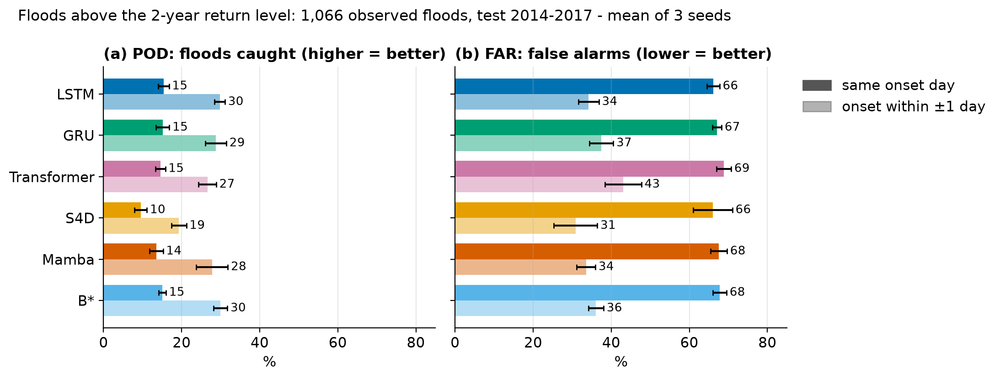

*Hình. POD (a, cao hơn là tốt) và FAR (b, thấp hơn là tốt) của 1.066 trận lũ vượt ngưỡng hai năm trên kỳ test, cho năm lõi C2 mức cùng tham số và B*; thanh đậm là ghép cùng ngày khởi phát (kết quả chính), thanh nhạt là cho lệch ±1 ngày. Nới dung sai một ngày làm POD gần gấp đôi và FAR giảm từ 66–69% xuống 31–43% ở mọi mô hình, nên phần lớn trận bỏ sót là lệch ngày khởi phát chứ không phải không thấy lũ.*

Khi bắt buộc cùng ngày bắt đầu, mọi mô hình chỉ bắt được 9,5–19,0% số trận. B1b có POD cao nhất (19,0%). B* (B3 P10S12) bắt ít hơn B1b khoảng 42 trận và báo nhầm ít hơn khoảng 96 trận: che dữ liệu khi huấn luyện làm mô hình thận trọng hơn ở đỉnh. Năm lõi C2 dùng cấu hình dữ liệu của B* nên có POD cùng tầm với B* (LSTM 15,4%, GRU 15,2%, Mamba L2 x1 13,5%, S4D L4 x1 9,5%) dù NSE trung vị test cao hơn (Mục 6.6.11): NSE thưởng việc khớp cả chuỗi, không thưởng riêng việc vượt ngưỡng đúng ngày khởi phát. Trong C2, LSTM và GRU bắt nhiều trận nhất; Mamba L2 x1 bắt ít hơn LSTM khoảng 19 trận, S4D L4 x1 ít hơn khoảng 62 trận; FAR các lõi gần nhau (66–70%). Với dung sai ±1 ngày, POD tăng lên 19,3–36,0% và FAR giảm còn 30,8–45,8%: một phần lớn trận bỏ sót là lệch ngày khởi phát một ngày chứ không phải không thấy lũ. Bài toán ưu tiên tránh bỏ sót hơn tránh báo nhầm (Mục 6.2), nên POD là chỉ số đọc trước; không mô hình nào trong tiểu luận đạt POD cùng ngày trên 20%.

### 6.9.6. Bốn mức và bắt lũ theo hạn (bước H, Evaluation Version 12)

Bảng dưới lấy trung bình ba hạt giống trên giao chung 651.841 ngày–ID (11.763 ngày–ID rất cao, 1.068 cụm USWRC ở ngưỡng hai năm). Dung sai ghép trận ở hạn h là ±⌊h/3⌋ ngày: hạn 1–2 phải cùng ngày, hạn 3–5 cho lệch một ngày, hạn 6–7 cho lệch hai ngày.

| Cách | Recall rất cao hạn 1 / 3 / 7 (%) | Precision rất cao hạn 1 / 3 / 7 (%) | POD hạn 1 / 3 / 7 (%) | FAR hạn 1 / 3 / 7 (%) |
|---|---|---|---|---|
| LSTM chỉ quá khứ | 20,0 / 2,4 / 0,7 | 62,9 / 47,5 / 40,6 | 2,3 / 0,1 / 0,0 | 83,9 / 85,9 / 100,0 |
| Mamba chỉ quá khứ | 22,5 / 3,1 / 1,3 | 61,1 / 37,9 / 30,0 | 2,7 / 0,2 / 0,0 | 86,4 / 94,7 / 100,0 |
| LSTM lai | 30,4 / 4,1 / 1,2 | 64,3 / 44,0 / 39,8 | 6,8 / 0,2 / 0,0 | 74,1 / 90,7 / 95,8 |
| Mamba lai | 31,0 / 5,1 / 1,6 | 62,0 / 34,4 / 26,4 | 8,1 / 0,4 / 0,0 | 77,7 / 94,2 / 99,3 |
| LSTM GEFS | 32,5 / 16,8 / 6,0 | 66,4 / 47,9 / 38,5 | 8,3 / 3,2 / 2,1 | 67,1 / 71,6 / 61,4 |
| Mamba GEFS | 36,0 / 18,8 / 5,3 | 64,8 / 47,3 / 35,9 | 10,8 / 5,2 / 2,1 | 66,0 / 69,0 / 68,8 |
| LSTM hoàn hảo | 49,0 / 43,8 / 42,0 | 64,3 / 58,4 / 57,6 | 18,4 / 23,0 / 22,8 | 63,2 / 54,5 / 54,4 |
| Mamba hoàn hảo | 50,3 / 45,2 / 44,4 | 65,8 / 58,6 / 56,7 | 19,7 / 23,1 / 24,4 | 63,6 / 55,4 / 53,5 |
| Persistence qmax | 40,2 / 12,8 / 7,6 | 40,1 / 12,8 / 7,6 | 0,0 / 0,0 / 1,1 | 100,0 / 100,0 / 98,9 |

Nguồn: [bảng bốn mức hạn 7](../../Workspace/06_Evaluation/01_Evaluation_LamaHCEExt/Archive/Version12/H/Evaluation_H_levels_pooled_lead7.csv) và [bảng sự kiện hạn 7](../../Workspace/06_Evaluation/01_Evaluation_LamaHCEExt/Archive/Version12/H/Evaluation_H_events_pooled_lead7.csv); các hạn khác ở tệp `_lead1` … `_lead6` cùng thư mục.

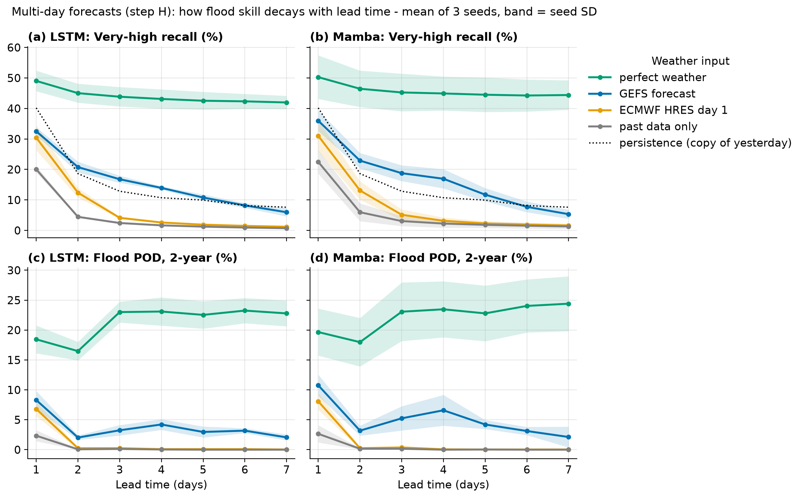

*Hình. Recall mức rất cao (a, b) và POD lũ chu kỳ hai năm (c, d) theo hạn 1–7 ngày cho LSTM và Mamba ở bốn cách dùng thông tin thời tiết; đường là trung bình ba hạt giống, dải mờ là độ lệch chuẩn hạt giống, đường chấm là persistence. Cách chỉ quá khứ và cách lai (chỉ có ECMWF HRES ngày đầu) gần như mất khả năng bắt lũ từ hạn 2; GEFS giữ được một phần tới hạn 5–6; tái phân tích hoàn hảo là cận trên gần như không đổi theo hạn. POD hạn 1–2 của mọi cách dùng ghép cùng ngày, từ hạn 3 cho lệch ±⌊h/3⌋ ngày nên đường POD cách hoàn hảo nhảy lên ở hạn 3.*

Khả năng cảnh báo lũ giảm nhanh hơn NSE khi thiếu thông tin thời tiết tương lai. Cách chỉ quá khứ và cách lai gần như không bắt được trận nào từ hạn 3 (POD tối đa 0,4%), dù precision rất cao vẫn 26–48%: mô hình hiếm khi báo mức rất cao, nên báo ít mà vẫn trượt gần hết. Cách GEFS giữ recall rất cao 16,8–18,8% và POD 3,2–5,2% ở hạn 3, rõ hơn hai cách trên nhưng xa cận trên tái phân tích hoàn hảo (recall rất cao 42–50%, POD 18–24% ở mọi hạn). Ở hạn 1, POD của các cách vận hành được (2,3–10,8%) thấp hơn C2 (13,5–15,4%), cùng chiều với NSE hạn 1 của bước H thấp hơn C2 ([báo cáo H Compare](../../Workspace/05_Training/15_H_LamaHCEExt_Compare/15_H_LamaHCEExt_Compare.md)). Với GEFS, Mamba bắt nhiều trận hơn LSTM ở hạn 1 và 3 (10,8 so với 8,3%; 5,2 so với 3,2%) nhưng bằng LSTM ở hạn 7 (2,1%). Persistence có precision bằng recall theo cấu trúc (chép mức hôm qua) và POD gần 0 ở mọi hạn.

### 6.9.7. Bốn mức và bắt lũ khi kéo dài cửa sổ 730 ngày (bước D, Evaluation Version 13)

Mỗi cấu hình 730 ngày so với chính nó ở 365 ngày (run C2 cùng hạt giống) trên giao riêng của bước D (657.347 ngày–ID, 11.871 ngày–ID rất cao, 1.073 cụm USWRC ở ngưỡng hai năm, ghép cùng ngày). Mỗi ô là trung bình ± độ lệch chuẩn ba hạt giống.

| Cấu hình | Cửa sổ (ngày) | Recall rất cao (%) | Precision rất cao (%) | Bắt được | Báo nhầm | POD (%) | FAR (%) |
|---|---:|---:|---:|---:|---:|---:|---:|
| LSTM L2 x1 | 365 | 45,9 ± 1,4 | 70,0 ± 1,1 | 165,0 | 320,7 | 15,4 ± 1,4 | 66,1 ± 1,6 |
| LSTM L2 x1 | 730 | 46,8 ± 1,2 | 69,2 ± 0,6 | 173,3 | 359,7 | 16,2 ± 1,6 | 67,4 ± 1,5 |
| Mamba L2 x1 | 365 | 47,1 ± 4,2 | 69,0 ± 3,5 | 145,0 | 304,3 | 13,5 ± 1,7 | 67,5 ± 2,1 |
| Mamba L2 x1 | 730 | 44,3 ± 1,6 | 71,6 ± 1,4 | 116,3 | 236,3 | 10,8 ± 1,2 | 66,9 ± 1,0 |
| S4D L4 x1 | 365 | 40,9 ± 1,1 | 70,0 ± 1,7 | 101,3 | 197,3 | 9,4 ± 1,6 | 66,1 ± 4,9 |
| S4D L4 x1 | 730 | 40,7 ± 1,5 | 70,5 ± 0,3 | 112,0 | 200,7 | 10,4 ± 1,8 | 64,3 ± 2,2 |

Nguồn: [bảng bốn mức D](../../Workspace/06_Evaluation/01_Evaluation_LamaHCEExt/Archive/Version13/D/Evaluation_D_levels_pooled.csv), [bảng sự kiện D](../../Workspace/06_Evaluation/01_Evaluation_LamaHCEExt/Archive/Version13/D/Evaluation_D_events_pooled.csv), [bảng phụ ±1](../../Workspace/06_Evaluation/01_Evaluation_LamaHCEExt/Archive/Version13/D/Evaluation_D_events_pooled_tolerance1.csv).

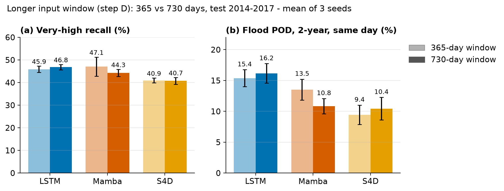

*Hình. Recall mức rất cao (a) và POD lũ chu kỳ hai năm ghép cùng ngày (b) của ba cấu hình bước D với cửa sổ 365 ngày (nhạt) và 730 ngày (đậm), trung bình ba hạt giống, vạch là độ lệch chuẩn hạt giống. Mọi chênh lệch giữa hai cửa sổ nằm trong khoảng một tới hai độ lệch chuẩn hạt giống; Mamba giảm nhẹ ở cả hai chỉ số, LSTM và S4D gần như không đổi.*

Cửa sổ 730 ngày làm LSTM bắt thêm khoảng 8 trận và báo nhầm thêm khoảng 39 trận; Mamba bắt ít hơn khoảng 29 trận và báo nhầm ít hơn khoảng 68 trận (recall rất cao giảm, precision rất cao tăng: thận trọng hơn); S4D bắt thêm khoảng 11 trận, báo nhầm gần như không đổi. Mọi thay đổi POD dưới 3 điểm phần trăm, cùng tầm độ lệch chuẩn ba hạt giống, phù hợp kết luận của Mục 6.6.14 rằng kéo dài cửa sổ không cải thiện rõ hai lõi dẫn đầu.

## 6.10. Kết quả kiểm định ghép cặp

| So với persistence qmax | ID có ΔNSE > 0 | Median ΔNSE | Mean ΔNSE | Cohen's dz | p sau Holm |
|---|---:|---:|---:|---:|---:|
| SeqLSTM_Q | 420/450 | 0,340926 | 0,044608 | 0,0103 | 5,69×10⁻⁶⁵ |
| DLinear 111 | 318/450 | 0,035019 | 0,034343 | 0,0506 | 8,85×10⁻²⁹ |
| DLinear 222 | 309/450 | 0,031839 | 0,068012 | 0,4480 | 4,27×10⁻²⁶ |
| DLinear 333 | 317/450 | 0,031465 | 0,066534 | 0,3933 | 3,22×10⁻²⁷ |

ΔNSE ở bảng là hiệu **mô hình trừ persistence** theo từng ID. Trong CSV, thứ tự trái/phải được xếp theo tên; dấu các hiệu và dz được đổi khi trình bày theo chiều trên, còn p hai phía giữ nguyên. Nguồn: [234 phép kiểm ghép cặp](../../Workspace/06_Evaluation/01_Evaluation_LamaHCEExt/Archive/Version4/Tables/Evaluation_paired_tests.csv).

Toàn bộ 234 p-value đều hữu hạn, nên mỗi họ Holm có đủ 78 phép so.

Median hiệu ghép cặp khác hiệu của hai median. Ví dụ, DLinear 111 có median ΔNSE **0,035019**, trong khi 0,382799 − 0,350031 = **0,032768**. Đại lượng thứ nhất mới mô tả chênh lệch tại lưu vực ở giữa phân phối hiệu.

Wilcoxon phản ánh phân phối hạng của các hiệu, còn dz phụ thuộc trung bình và độ lệch chuẩn hiệu. SeqLSTM_Q có đa số ID tốt lên và p rất nhỏ nhưng dz khoảng 0,0103 vì phần đuôi bất lợi ảnh hưởng mạnh đến trung bình/độ phân tán. Trên KGE, mỗi seed DLinear thấp hơn persistence ở **449/450 ID**. Trên PNSE, median DLinear dương nhưng mean âm do một số lưu vực có persistence rất mạnh. Các chỉ số này cần được đọc cùng nhau để tránh diễn giải p nhỏ như lợi ích đồng đều ở mọi lưu vực.

### 6.10.1. Kiểm định sau khi thêm A4

Ba A4 nằm trong cùng họ 78 cặp mỗi chỉ số với các run ở Mục 6.10.

| A4 trừ SeqLSTM_Q tác giả, trên NSE | ID tốt hơn / 450 | Median hiệu | p sau Holm |
|---|---:|---:|---:|
| Seed 111 | 209 | −0,002327 | 0,481862 |
| Seed 222 | 249 | 0,003656 | 0,288877 |
| Seed 333 | 254 | 0,004786 | 0,530678 |

Không phát hiện khác biệt NSE ở mức 0,05 trong họ này; đây không phải phép thử tương đương. So với persistence, ba A4 có NSE tốt hơn ở **418/424/428 trên 450 ID**, median hiệu **0,327901/0,339101/0,329561**. [Bảng kiểm định](../../Workspace/06_Evaluation/01_Evaluation_LamaHCEExt/Archive/Version4/Tables/Evaluation_paired_tests.csv).

Giữa các seed, p Holm của NSE 111 so 222 là **0,025099**, còn 111 so 333 là **0,051454**. Các giá trị này thuộc họ 78 cặp mỗi chỉ số, khác họ ba cặp seed trong báo cáo A4. Không dùng hoán đổi p đã điều chỉnh giữa hai họ; độ lớn hiệu và biến thiên giữa seed cần được đọc cùng kết quả kiểm định.

## 6.11. Quan hệ giữa đặc điểm lưu vực và mức cải thiện

Phân tích theo lưu vực dùng cùng phạm vi test/S0/hạn một ngày và giao chung đã chấm, giữ mọi chênh lệch âm. Có **18 phép so trên 14 run**, 31 thuộc tính dạng số và ba đại lượng kết quả: ΔNSE, ΔPNSE, ΔPOD lũ hai năm; 12 phép so gốc được giữ và bổ sung ba A4 so persistence, ba A4 so trọng số tác giả. Mã lớp phủ và góc hướng được mô tả theo nhóm riêng. Mỗi hệ số ΔNSE/ΔPNSE dùng 450 ID; ΔPOD dùng 366 ID có trận thật đủ điều kiện. Spearman đo xu hướng theo thứ hạng, nên hệ số dương biểu thị thuộc tính lớn hơn thường đi cùng mức cải thiện lớn hơn. [Giao thức và kết quả đầy đủ](../../Workspace/06_Evaluation/02_Evaluation_LamaHCEExt_ByBasin/02_Evaluation_LamaHCEExt_ByBasin.md#11-kết-quả-thực-nghiệm-và-kiểm-chứng).

### 6.11.1. Hướng liên hệ phụ thuộc mốc so sánh

| Phép so, outcome ΔNSE | Diện tích | Độ cao trung bình | Tỷ phần tuyết | Chỉ số khô hạn |
|---|---:|---:|---:|---:|
| SeqLSTM_Q − persistence qmax | −0,075 | −0,422 | −0,263 | 0,211 |
| EncDec_Q − persistence qmax | −0,092 | −0,331 | −0,209 | 0,111 |
| DLinear 111 − persistence qmax | −0,297 | −0,246 | −0,133 | 0,226 |
| LSTM A4 111 − persistence qmax | −0,092 | −0,415 | −0,261 | 0,183 |
| LSTM A4 222 − persistence qmax | −0,101 | −0,423 | −0,273 | 0,201 |
| LSTM A4 333 − persistence qmax | −0,105 | −0,417 | −0,267 | 0,212 |
| SeqLSTM_Q − SeqLSTM_noQ | 0,274 | 0,096 | 0,008 | 0,105 |
| EncDec_Q − EncDec_noQ | 0,194 | 0,170 | 0,053 | −0,058 |

SeqLSTM_Q cải thiện so persistence ít hơn ở các lưu vực cao hơn hoặc có tỷ phần tuyết lớn hơn. Median ΔNSE ở nhóm độ cao thấp nhất [221; 591,5) m là **0,4420** trên 113 ID, còn nhóm cao nhất [1.294; 3.122] m là **0,1302** trên 112 ID. Quan hệ qua các nhóm trung gian không hoàn toàn đơn điệu. Với chỉ số khô hạn, median ΔNSE ở nhóm [0,37; 0,49) là **0,2392**, tăng lên **0,3977** ở nhóm [0,81; 1,51]. Đây là chênh lệch điểm so persistence, không phải mức NSE tuyệt đối hoặc phần trăm cải thiện.

Diện tích có liên hệ yếu với SeqLSTM_Q − persistence, nhưng liên hệ dương với SeqLSTM có Q − không Q. Median ΔNSE của cặp có/không Q theo bốn nhóm diện tích là **0,0417; 0,0533; 0,0912; 0,0876**. Trong 31 thuộc tính, `ndvi_max` có |ρ| lớn nhất với ΔNSE SeqLSTM_Q − persistence (**0,500**); đây là liên hệ đơn biến, chưa tách khỏi các đặc điểm khí hậu và địa hình đi kèm. [Các hệ số](../../Workspace/06_Evaluation/02_Evaluation_LamaHCEExt_ByBasin/Tables/BasinAnalysis_static_associations.csv), [biên nhóm](../../Workspace/06_Evaluation/02_Evaluation_LamaHCEExt_ByBasin/Tables/BasinAnalysis_quartile_definitions.csv), [bảng nhóm](../../Workspace/06_Evaluation/02_Evaluation_LamaHCEExt_ByBasin/Tables/BasinAnalysis_grouped_skill.csv).

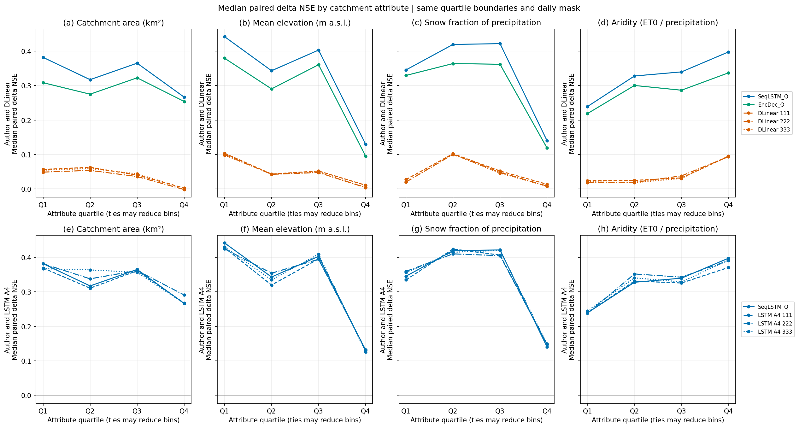

*Hình. Median hiệu NSE theo cùng biên nhóm thuộc tính, với DLinear ở hàng trên và LSTM A4 ở hàng dưới. Ba seed LSTM giữ mức cải thiện thấp hơn ở nhóm độ cao/tuyết cao nhất; quan hệ ở các nhóm giữa có thể không đơn điệu.*

### 6.11.2. Phân mức kỹ năng chuỗi và kỹ năng bắt lũ

POD cộng dồn ở ngưỡng hai năm, cụm USWRC, cùng ngày bắt đầu của SeqLSTM_Q theo bốn nhóm diện tích là **14,23%; 18,15%; 18,93%; 28,70%**, tương ứng 38/267, 55/303, 53/280 và 62/216 trận. Trong khi median ΔNSE so persistence thấp hơn ở nhóm diện tích Q4 so Q1, POD lại cao hơn ở Q4. Mỗi seed DLinear chỉ bắt đúng ngày hai trận trong toàn bộ 1.066 trận; những khác biệt NSE giữa nhóm chưa cung cấp bằng chứng về khả năng cảnh báo khởi phát lũ bằng DLinear.

Ba A4 cũng cho POD ở nhóm diện tích lớn nhất **25,46 / 29,63 / 26,85%**, cao hơn nhóm nhỏ nhất **13,11 / 15,73 / 14,98%**. Mẫu số tương ứng là 216 và 267 trận. Mức cải thiện NSE so persistence và tỷ lệ bắt trận có đại lượng, trọng số khác nhau; chúng không nhất thiết xếp các nhóm theo cùng thứ tự. [Bảng nhóm](../../Workspace/06_Evaluation/02_Evaluation_LamaHCEExt_ByBasin/Tables/BasinAnalysis_grouped_skill.csv).

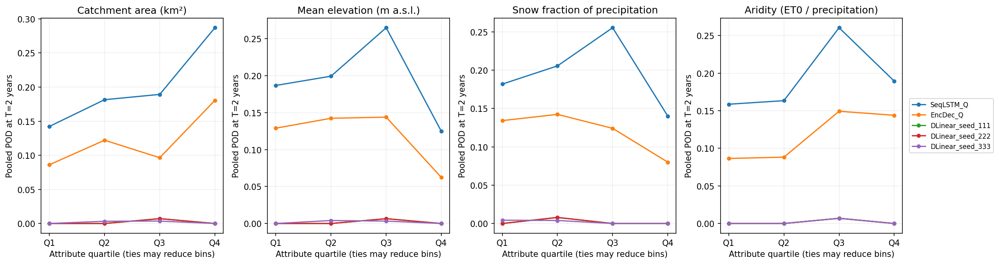

### 6.11.3. Độ ổn định và ý nghĩa của bằng chứng

Nhóm không có lưu vực được chọn khác ở thượng lưu có 322 ID, trong đó 321 ID có ΔNSE. Với SeqLSTM_Q − persistence, hệ số độ cao, tuyết và khô hạn lần lượt **−0,437; −0,313; 0,266**, giữ cùng hướng với toàn bộ tập. Với SeqLSTM_Q − SeqLSTM_noQ, hệ số diện tích là **0,325**. Việc giảm lồng nhau chưa loại hết phụ thuộc khí hậu và không gian. [Kiểm độ nhạy](../../Workspace/06_Evaluation/02_Evaluation_LamaHCEExt_ByBasin/Tables/BasinAnalysis_topology_sensitivity.csv).

Ba seed DLinear giữ cùng hướng liên hệ với bốn thuộc tính ưu tiên. Median độ lệch chuẩn mẫu của ΔNSE qua ba seed theo ID là **0,00383**, nhưng tại 742 và 758 đạt **2,753 và 6,477**, cho thấy tính ổn định ở cấp nhóm không bảo đảm ổn định ở từng lưu vực. [Độ phân tán seed](../../Workspace/06_Evaluation/02_Evaluation_LamaHCEExt_ByBasin/Tables/BasinAnalysis_DLinear_seed_spread.csv).

Tương quan xác định các nhóm lưu vực mà mô hình cải thiện nhiều hoặc ít, giúp đặt giả thuyết về vai trò dữ liệu. p từ 9.999 hoán vị được điều chỉnh Holm riêng trong từng phép so–đại lượng kết quả gồm 31 thuộc tính; kết luận thống kê còn phụ thuộc giả định trao đổi ID. Tách đóng góp của từng nguồn cần thí nghiệm che nguồn và giải thích mô hình. Đánh giá chuyển sang dataset khác cần kết quả trên dataset tương ứng.

### 6.11.4. Kiểm liên hệ qua ba seed LSTM

Ba seed A4 giữ liên hệ âm của ΔNSE so persistence với độ cao và tuyết, dương với độ khô hạn như trọng số tác giả. **31/31 thuộc tính giữ dấu của hệ số ΔNSE qua ba seed**; với ΔPNSE là 29/31, với ΔPOD là 27/31. Cùng dấu chỉ mô tả độ nhất quán, không bảo đảm liên hệ mạnh. Ở nhóm độ cao thấp nhất, median ΔNSE A4 là **0,425–0,430**, còn nhóm cao nhất là **0,126–0,132**. [Hệ số và độ ổn định](../../Workspace/06_Evaluation/02_Evaluation_LamaHCEExt_ByBasin/Tables/BasinAnalysis_seed_association_stability.csv).

Median std mẫu của ΔNSE qua seed tại từng ID là **0,02065** với LSTM A4 và **0,00383** với DLinear; tại 742/758, A4 đạt **1,818 / 3,912**. Hai cấu hình dùng đầu vào khác nhau nên chênh độ phân tán chưa cô lập tác động kiến trúc. Hướng liên hệ ổn định ở cấp tập không có nghĩa mọi lưu vực ít nhạy với seed.

POD A4 khác nhau giữa seed tại **123/366 ID có trận thật**, còn DLinear là 2/366 ID. Độ phân tán POD nhỏ của DLinear chủ yếu đi cùng việc gần như không bắt được trận đúng ngày; đó không phải lợi thế về chất lượng. Các thống kê ba seed không tạo thêm lưu vực độc lập hoặc một dự báo ensemble.

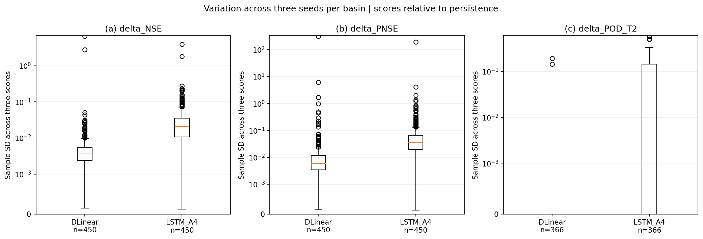

*Hình. Phân phối std mẫu của ba hiệu chỉ số tại từng lưu vực; giữ các ngoại lệ và giá trị 0. Ba số trung vị toàn tập ở Mục 6.6.1 và phân phối std theo ID ở đây là hai cách tổng hợp khác nhau.*

### 6.11.5. Phân tích thuộc tính cho năm lõi C2 và bước D (ByBasin Version 3)

Notebook `02_Evaluation_LamaHCEExt_ByBasin` **Version 3** (giao thức 4, `84/84` tự kiểm đạt, đọc Evaluation Version 13) mở rộng phân tích thuộc tính lên trọn bộ **56 run S0** (`105` phép so trên `652.628` ngày–ID / `450` ID, `9.765` dòng tương quan 31 thuộc tính với `9.999` hoán vị, `16` hình) và phân vùng con **`D/`** (`9` cặp 730 trừ 365 bước trên `657.347` ngày–ID / `451` ID, `837` dòng tương quan, `4` hình). [Tóm tắt V3](../../Workspace/06_Evaluation/02_Evaluation_LamaHCEExt_ByBasin/Archive/Version3/Tables/BasinAnalysis_summary.json), [tóm tắt D V3](../../Workspace/06_Evaluation/02_Evaluation_LamaHCEExt_ByBasin/Archive/Version3/D/Tables/BasinAnalysis_D_summary.json).

- **Năm lõi C2 so với LSTM C2 cùng seed (`ΔNSE`):** `Transformer` x1/x3, `S4D` x1/x3 và `Mamba` x3 đều giữ dấu dương đồng nhất trên cả ba hạt giống với tỷ phần tuyết `frac_snow` (`ρ` trung bình 3 seed lần lượt `+0,248; +0,273; +0,197; +0,129; +0,066`) và dấu âm đồng nhất với chỉ số khô hạn `arid_1` (`−0,208; −0,185; −0,185; −0,076; −0,174`), còn `Mamba` x1 và `GRU` x1 phân tán dấu qua các hạt giống.
- **Bước D (`730 − 365` cùng seed, `ΔNSE`):** khi tăng độ dài cửa sổ lên hai năm, ba lõi tách thành hai hướng khác nhau theo đặc trưng lưu vực. **S4D** giữ dấu đồng nhất tuyệt đối trên cả ba hạt giống: cải thiện mạnh hơn ở lưu vực khô hạn, bốc thoát hơi cao và diện tích lớn (`arid_1 ρ_mean = +0,208`, `et0_mean +0,197`, `area_calc +0,100`) và giảm tương đối ở lưu vực tuyết/núi cao (`frac_snow −0,167`, `elev_mean −0,166`). **Mamba** nghiêng nhẹ cùng chiều với S4D trên cả ba seed (`arid_1 +0,091`, `frac_snow −0,079`), còn **LSTM** giữ dấu âm đồng nhất ở `et0_mean` (`−0,115`) và cải thiện ở lưu vực tuyết/băng hà (khi gộp trung bình 3 seed: `glac_fra ρ = +0,1405`, `frac_snow +0,1394`, `p ≤ 0,0035`).

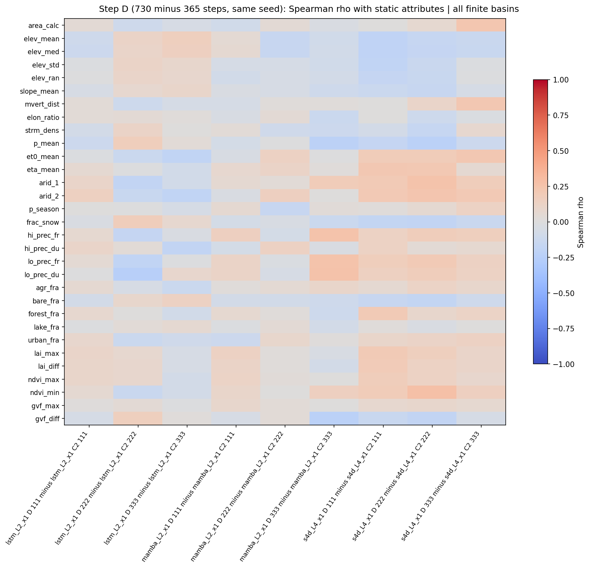

*Hình. Bản đồ nhiệt hệ số tương quan Spearman giữa hiệu NSE (`730 − 365` bước, cùng hạt giống) của ba lõi LSTM, Mamba, S4D với 31 thuộc tính tĩnh trên 451 lưu vực.*

## 6.12. Giải thích mô hình bằng Integrated Gradients và dò trạng thái ẩn (bước G)

Hai notebook chính thức bước G (**Version 1**, dùng fork `freeze-H2` tại `840450f`, Captum 0.9.0 với cầu phương Gauss–Legendre) không huấn luyện lại mà thực hiện suy luận, tính đạo hàm Integrated Gradients (IG) và kiểm chứng trên đúng các checkpoint đã bàn giao: `01_G_C2_XAI` (15 run C2 mức cùng tham số × 3 hạt giống; 1,47 giờ GPU T4, đỉnh bộ nhớ 5,38 GB; `38/38` tệp khớp manifest) và `02_G_H_XAI` (24 run H: LSTM, Mamba × 4 cách × 3 hạt giống, tính IG riêng cho từng hạn 1–7; 4,45 giờ T4, đỉnh 4,31 GB; `44/44` tệp khớp manifest). [Báo cáo chung bước G](../../Workspace/08_XAI/01_G_C2_XAI/01_G_C2_XAI.md), [tóm tắt C2 XAI](../../Workspace/08_XAI/01_G_C2_XAI/Tables/g_summary.json), [tóm tắt H XAI](../../Workspace/08_XAI/02_G_H_XAI/Tables/gh_summary.json).

### 6.12.1. Kiểm tra tính toàn vẹn, completeness và deletion test

- **Khớp dự báo gốc:** toàn bộ dự báo của 15 run C2 và 24 run H × 7 hạn trên GPU tái lập đúng NPZ đã bàn giao trong dung sai `2 × 10⁻⁵ + 10⁻⁶ × |giá trị NPZ|`.
- **Lấy mẫu phân tầng và completeness:** kỳ test 2014–2017 trên 451 lưu vực được rút phân tầng theo 4 mức lưu lượng (ngưỡng riêng từng lưu vực 1981–2013) để bảo đảm đủ ca lũ. Đường gốc của IG là `0` trong không gian chuẩn hóa (trung bình kỳ train); ô trống (NaN) giữ IG bằng 0 đúng theo mặt nạ masked mean. C2 giữ **10.511/10.696 mẫu** đạt completeness trên cả 15 run (bỏ 185 mẫu chưa hội tụ sau 1.024 bước ở LSTM 111/222 và GRU 222/333; Mamba và S4D đạt hết ngay ở 64 bước). H giữ **36.905/37.653 lượt mẫu–hạn** (5.379 lần phát; Mamba đạt hết, 793 lượt chưa đạt sau 2.048 bước đều ở LSTM). Kiểm tra độ nhạy khi bỏ mẫu cho thấy các chỉ số lệch tối đa khoảng **0,22 × độ lệch chuẩn 3 hạt giống**, không thay đổi kết luận ([C2](../../Workspace/08_XAI/01_G_C2_XAI/Tables/G_drop_sensitivity.csv), [H](../../Workspace/08_XAI/02_G_H_XAI/Tables/GH_drop_sensitivity.csv)).
- **Deletion test đạt 100% trường hợp:** thay 0,1% ô (12 ô) bằng đường gốc ở C2 (2.000 mẫu), chọn theo `|IG|` lớn nhất làm mất **0,708–0,828** tín hiệu `|f(x) − f(gốc)|`, cao hơn rõ rệt so với chọn ngẫu nhiên cùng ngày trễ (**0,163–0,250**) và chọn ngẫu nhiên toàn cửa sổ (**≈ 0,001**). Ở H (hạn 1, 4, 7; 0,1% ô), xóa theo `|IG|` làm mất **0,21–0,55** so với **0,04–0,21** (ngẫu nhiên cùng ngày) và **≈ 0,001** (ngẫu nhiên), thắng cả hai đối chứng ở **360/360 trường hợp** ([C2](../../Workspace/08_XAI/01_G_C2_XAI/Tables/G_deletion.csv), [H](../../Workspace/08_XAI/02_G_H_XAI/Tables/GH_deletion.csv)). Điều này xác nhận IG xác định đúng cả thời điểm lẫn nhóm biến nhạy cảm.

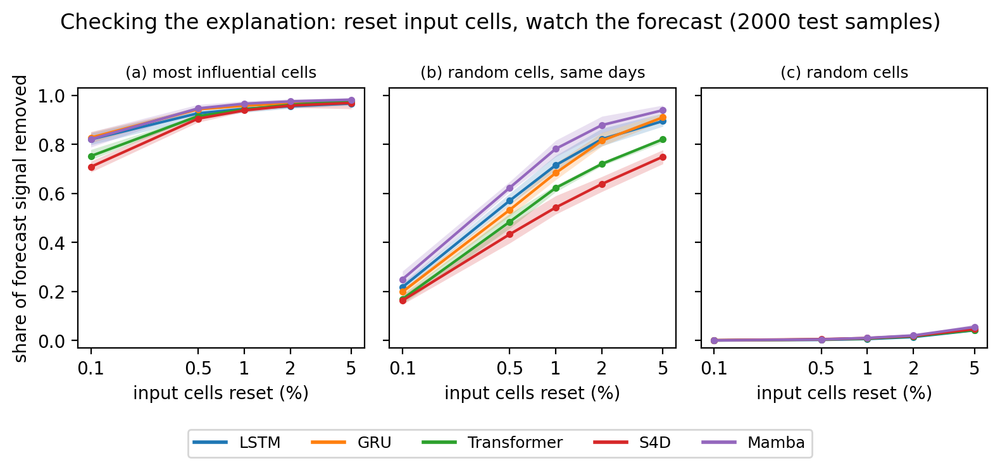

*Hình. Deletion test trên 5 lõi C2: phần tín hiệu `|f(x) − f(gốc)|` mất đi khi thay một tỉ lệ ô đầu vào bằng đường gốc theo ba cách chọn ô; dải thể hiện 3 hạt giống.*

### 6.12.2. Độ dài nhớ, đóng góp nhóm nguồn và dò trạng thái ẩn ở C2

Bảng dưới tóm tắt độ dài nhớ hiệu dụng (`L50`, `L90`: số ngày quá khứ tích lũy 50% và 90% `|IG|` của pha quá khứ) và tỉ phần `|IG|` theo 7 nhóm nguồn (trung bình ± độ lệch chuẩn 3 hạt giống trên 10.511 mẫu; [G_run_metrics.csv](../../Workspace/08_XAI/01_G_C2_XAI/Tables/G_run_metrics.csv), [G_core_diffs.csv](../../Workspace/08_XAI/01_G_C2_XAI/Tables/G_core_diffs.csv)):

| Lõi (C2 x1) | Tỉ phần trễ 0–1 | L50 (ngày) | L90 (ngày) | L90 so LSTM | ERA5L | EOBS | MSWEP | GLEAM | Q | ECMWF | Tĩnh |
|---|---:|---:|---:|---:|---:|---:|---:|---:|---:|---:|---:|
| LSTM | 0,563 | 1,7 ± 0,6 | 34,0 ± 8,2 | — | 0,192 | 0,145 | 0,020 | 0,039 | 0,278 | 0,097 | 0,229 |
| GRU | 0,485 | 2,0 ± 0,0 | 44,7 ± 7,4 | +1,30 × nhiễu | 0,226 | 0,147 | 0,021 | 0,035 | 0,291 | 0,078 | 0,204 |
| Mamba | 0,547 | 1,3 ± 0,6 | 65,3 ± 36,7 | +0,86 × nhiễu | 0,239 | 0,154 | 0,018 | 0,037 | 0,299 | 0,065 | 0,189 |
| S4D | 0,245 | 27,3 ± 3,5 | 200,3 ± 1,2 | +20,3 × nhiễu | 0,303 | 0,177 | 0,027 | 0,061 | 0,228 | 0,040 | 0,166 |
| Transformer | 0,366 | 6,3 ± 0,6 | 265,7 ± 23,5 | +9,9 × nhiễu | 0,305 | 0,172 | 0,020 | 0,040 | 0,247 | 0,050 | 0,166 |

- **Hai nhóm hành vi nhớ rõ rệt:** ba lõi hồi quy có cổng hoặc chọn lọc (LSTM, GRU, Mamba) dồn khoảng một nửa ảnh hưởng vào ngày `t` và `t−1` (ECMWF HRES ngày `t` và Q quan trắc hôm qua) và giữ 90% pha quá khứ trong 1–2 tháng; trong khi S4D và Transformer trải ảnh hưởng ra gần cả cửa sổ (`L90 = 200–266` ngày, vượt LSTM 9,9–20,3 × nhiễu), dựa nhiều hơn vào ERA5L (`+10,6` và `+10,8 ×` nhiễu) và ít hơn vào ECMWF HRES (`−4,7` và `−3,9 ×` nhiễu). Khác biệt `L90` giữa Mamba và LSTM (+31,3 ngày) chỉ bằng **0,86 × nhiễu** do độ lệch chuẩn 3 hạt giống của Mamba lớn (36,7 ngày), nên **không phân biệt được độ dài nhớ của Mamba với LSTM**. Ngược lại, đối chứng SSM không chọn lọc S4D nhớ dài hơn hẳn, nhất quán với giả thuyết cơ chế chọn lọc đưa Mamba hành xử gần với LSTM hơn S4D (IG không cô lập nhân quả cơ chế này).
- **Nhóm nguồn và phân tầng theo mức lưu lượng:** Q quan trắc là nhóm lớn nhất ở LSTM, GRU và Mamba (`0,278–0,299`), khớp trực tiếp phát hiện bước ablation B1b. Mamba dựa vào ERA5L nhiều hơn LSTM (`+4,5 ×` nhiễu) và vào thuộc tính tĩnh (`−4,7 ×`), ECMWF HRES (`−2,7 ×`) ít hơn. MSWEP chỉ chiếm ~2% ở mọi lõi do thông tin mưa trùng lặp với E-OBS và ERA5L. Khi chuyển từ dòng chảy thấp sang lũ (mức rất cao; [G_strata.csv](../../Workspace/08_XAI/01_G_C2_XAI/Tables/G_strata.csv)), mọi lõi đều kéo dài bộ nhớ (`L90`: LSTM `28,3 → 41,3`, GRU `34,3 → 62,7`, Mamba `54,0 → 80,7` ngày) và giảm phụ thuộc vào Q hôm qua (LSTM `0,36 → 0,20`, GRU `0,37 → 0,22`, Mamba `0,36 → 0,25`). Tương quan Spearman giữa `L90` theo lưu vực và lượng mưa trung bình `p_mean` dương ở GRU (`0,53`), Transformer (`0,59`), S4D (`0,55`), Mamba (`0,39`) và gần 0 ở LSTM (`−0,01`), trong khi với diện tích `area_calc` lại mang dấu âm (`−0,12` đến `−0,43`; [G_spearman_L90.csv](../../Workspace/08_XAI/01_G_C2_XAI/Tables/G_spearman_L90.csv)).
- **Dò trạng thái ẩn (ý tưởng Y4):** hồi quy ridge từ đầu ra lõi ngày `t−1` (riêng LSTM thêm ô nhớ `c`, huấn luyện trên 9.020 mẫu train 2003–2009 và chấm R² trên 10.511 mẫu test) được so với hai đối chứng: đầu vào thô ngày `t−1` và cùng kiến trúc khởi tạo ngẫu nhiên ([G_probe_gain.csv](../../Workspace/08_XAI/01_G_C2_XAI/Tables/G_probe_gain.csv)). Với tuyết `ERA5L_swe` và ẩm đất `ERA5L_volsw_123/4`, đầu vào thô vốn đã đạt `R² = 1` nên phép dò không bổ sung bằng chứng; riêng GRU khởi tạo ngẫu nhiên vẫn đạt `R² = 0,82–0,88`, khẳng định tính bắt buộc của đối chứng ngẫu nhiên. Với mưa MSWEP cộng dồn 30/90/180 ngày (đầu vào thô đạt `0,53 / 0,53 / 0,48`), **chỉ ô nhớ `c` của LSTM** vượt đồng thời cả hai đối chứng với mức vượt nhỏ (`+0,023 ± 0,022`, `+0,056 ± 0,032`, `+0,045 ± 0,034`); đầu ra các lõi khác (kể cả Mamba) không vượt.

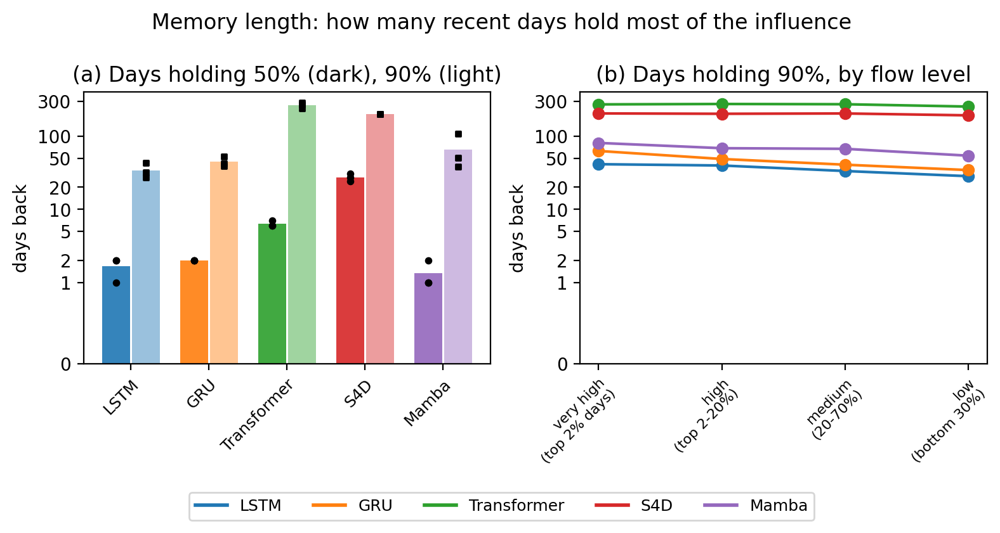

*Hình. Độ dài nhớ hiệu dụng L50 và L90 của năm lõi C2 theo bốn mức lưu lượng; mỗi điểm biểu diễn một hạt giống.*

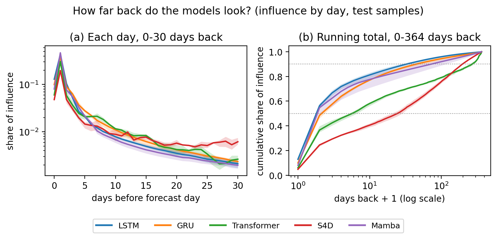

*Hình. Tỉ phần |IG| theo ngày trễ (trục log) của năm lõi C2; dải là ba hạt giống. LSTM, GRU và Mamba dồn ảnh hưởng vào vài ngày gần nhất, S4D và Transformer trải ảnh hưởng gần cả cửa sổ 365 ngày.*

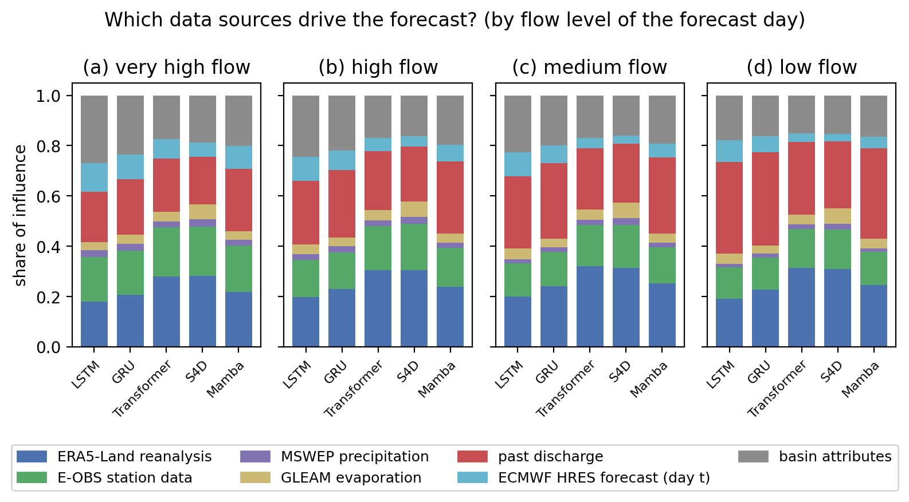

*Hình. Tỉ phần `|IG|` theo bảy nhóm đầu vào và bốn mức lưu lượng của năm lõi C2.*

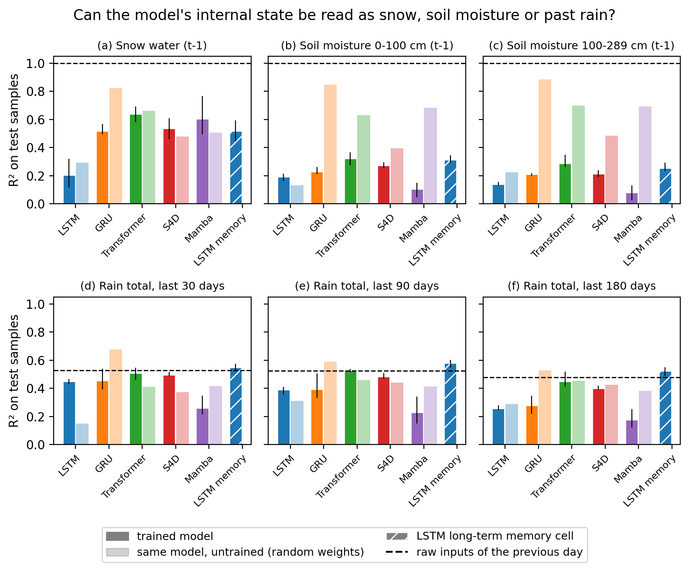

*Hình. R² dò trạng thái ẩn của năm lõi (thêm ô nhớ `c` của LSTM) so với hai đối chứng đầu vào thô ngày `t−1` và mô hình khởi tạo ngẫu nhiên trên sáu đích thủy văn.*

### 6.12.3. Vai trò thông tin tương lai ở bước H (hạn 1–7) và so sánh Mamba với LSTM

Phân tích `|IG|` riêng cho từng hạn 1–7 ở bốn cách cấp thông tin thời tiết (`GH_lead_summary.csv`, `GH_core_diffs.csv`, `GH_strata_level.csv`) lý giải trực tiếp diễn biến sai số của bước H (Mục 6.9):

| Cách cấp thời tiết (H) | Tỉ phần pha dự báo LSTM (hạn 1 → 7) | Tỉ phần pha dự báo Mamba (hạn 1 → 7) | L90 LSTM hạn 1 → 7 (ngày) | L90 Mamba hạn 1 → 7 (ngày) |
|---|---:|---:|---:|---:|
| Chỉ quá khứ (`past`) | 0% | 0% | 61,7 → 77,0 | 89,7 → 121,7 |
| Lai (`hybrid`) | 9,6% → đỉnh 14,5% (hạn 2) → 9,9% | 5,5% → 8,1% → 4,9% | 57,7 → 74,7 | 66,3 → 92,7 |
| GEFS (`gefs`) | 8,7% → 30,1% | 5,1% → 19,3% | 99,3 → 125,3 | 106,3 → 148,3 |
| Hoàn hảo (`perfect`) | 7,8% → 24,6% | 6,2% → 22,7% | 107,0 → 133,0 | 104,7 → 157,3 |

- **Cách lai vs. GEFS vs. hoàn hảo:** ở cách lai, tỉ phần pha dự báo đạt đỉnh ở hạn 2 rồi quay về mức hạn 1, khớp trực tiếp việc ECMWF HRES ngày đầu chỉ hỗ trợ hạn 1–2. Ở cách GEFS, tỉ phần pha dự báo tăng đều theo hạn tới **30,1%** ở LSTM (nhóm GEFS tăng `4,5% → 27,9%`, còn ECMWF ngày đầu giảm `4,3% → 2,2%`) và **19,3%** ở Mamba, tiệm cận cách hoàn hảo (`24,6%` và `22,7%`). Tỉ phần dựa vào thông tin tương lai tương đương nhưng NSE hạn 7 của GEFS chỉ còn `0,24` so với `0,64` ở cách hoàn hảo cho thấy **nút thắt nằm ở chất lượng dự báo thời tiết ở hạn xa**, không phải do mạng bỏ qua GEFS. Khảo sát từng ngày trong pha dự báo ([GH_Forecast_Days.png](../../Workspace/08_XAI/02_G_H_XAI/Figures/GH_Forecast_Days.png)) củng cố điều này: tại hạn 7, cách hoàn hảo dồn trọng số vào ngày dự báo thứ 7 gấp `2,1×` (LSTM: `5,7%` so với `2,7%`) và `2,6×` (Mamba) ngày thứ 1, còn GEFS phân bố gần đều (`1,2×` và `0,9×`).
- **Phân tầng theo mức lưu lượng ở hạn 7:** chỉ cách hoàn hảo tăng rõ tỉ phần pha dự báo vào ngày lũ so với ngày dòng chảy thấp (LSTM `33%` so với `20%`, `+13,0` điểm %; Mamba `30%` so với `18%`), trong khi cách lai (`10%` vs `10%`; `5%` vs `5%`) và GEFS (LSTM `30%` vs `31%`; Mamba `21%` vs `18%`) gần như không đổi. Điều này gợi ý dự báo GEFS ở hạn xa ít phân biệt được mưa cực đoan hơn tái phân tích (cần đánh giá riêng sai số mưa GEFS ở hướng khóa luận).
- **Độ dài nhớ theo hạn và Mamba so với LSTM:** ở cả 8/8 tổ hợp lõi × cách, `L90` tăng đều theo hạn trong khi tỉ phần Q quá khứ giảm đều (ví dụ GEFS LSTM `15,7% → 9,4%`, hoàn hảo Mamba `21,2% → 15,0%`). Đáng chú ý, **Mamba dựa vào pha dự báo ít hơn LSTM** rõ rệt ở cách lai (`−3,0` tới `−19,6 ×` nhiễu) và GEFS (`−1,6` tới `−2,8 ×` nhiễu) đồng thời dồn nhiều hơn sang pha quá khứ (tới `+3,7 ×` nhiễu ở `past` hạn 7); riêng cách hoàn hảo chênh lệch dưới `1 ×` nhiễu. Khác biệt này khớp chiều với việc Mamba kém LSTM `2,9–4,2 ×` nhiễu tại hạn 7 ở ba cách vận hành được (Mục 6.9), dù IG chỉ cho biết độ nhạy của dự báo chứ không chứng minh quan hệ nhân quả.

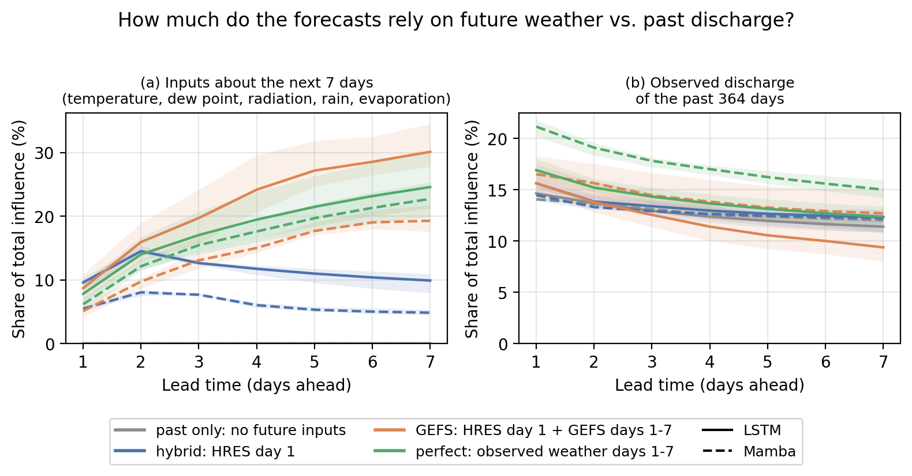

*Hình. Tỉ phần `|IG|` của pha dự báo theo hạn 1–7 ở bốn cách cấp thông tin thời tiết của LSTM và Mamba; dải thể hiện 3 hạt giống.*

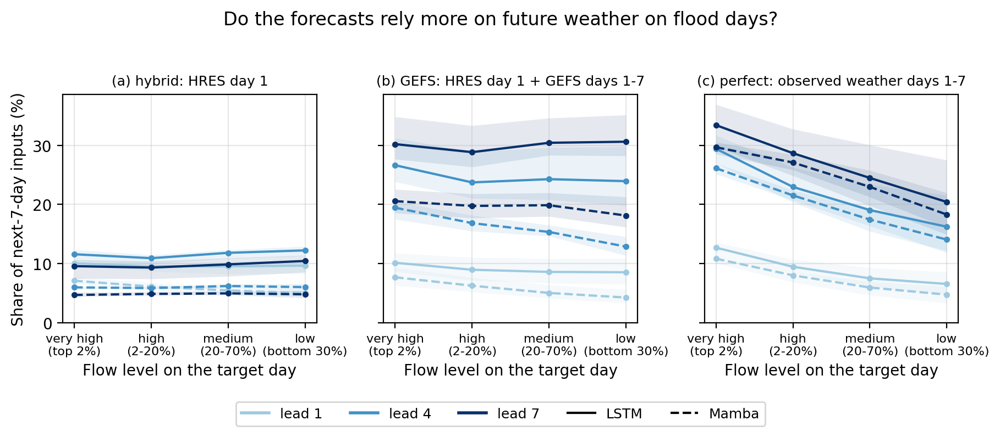

*Hình. Tỉ phần pha dự báo và độ dài nhớ L90 theo hạn 1–7 tách theo bốn mức lưu lượng của ngày đích.*

**Giới hạn diễn giải của bước G:** tập mẫu phân tầng 4 mức cố ý tăng tỉ trọng ngày lũ nên tỉ phần trung bình toàn tập không đại diện cho phân phối ngày tự nhiên; IG phụ thuộc vào đường gốc (trung bình kỳ train, nên tỉ phần thuộc tính tĩnh chỉ dùng để so sánh giữa các lõi chứ không đọc như tầm quan trọng tuyệt đối); IG đo độ nhạy đầu vào (không chứng minh quan hệ nhân quả) và chia đều hay lệch thông tin trùng lặp giữa các biến tương quan (như mưa MSWEP, E-OBS, ERA5L) tùy cấu trúc mạng; hồi quy ridge trong phép dò Y4 chỉ bắt quan hệ tuyến tính.

## 6.13. Khả năng đối chiếu và giới hạn của kết quả hiện tại

Bộ đánh giá `01_Evaluation_LamaHCEExt` đã hoàn tất tới **Version 13** (giao thức 3, Python 3.13.15, NumPy 2.1.3, pandas 2.3.3, SciPy 1.16.3) với **212/212 kiểm thử đạt**, giữ nguyên 100% SHA-256 bốn bảng S0 56 run qua các bản Version 10, 12 và 13, đồng thời bao phủ đủ kịch bản vận hành S0–S4 (144 NPZ C2), dự báo nhiều hạn 1–7 ngày (168 NPZ H) và độ dài chuỗi 730 bước (9 NPZ D). Phân tích thuộc tính `02_Evaluation_LamaHCEExt_ByBasin` **Version 3** đạt **84/84 kiểm thử** cho cả 56 run C2 lẫn 9 cặp D. Bước giải thích `01_G_C2_XAI` và `02_G_H_XAI` (**Version 1**) hoàn tất `38/38` và `44/44` mục manifest với deletion test đạt `100%` các trường hợp. Ở khâu kiểm chứng triển khai, `01_D1_LamaHCEExt_Inference` **Version 2** tái lập chính xác tuyệt đối (`0` mm/ngày trên Tesla T4) cả `24` run C2 (`10.824` cặp lưu vực) lẫn `3` run đại diện D (`1.353` cặp lưu vực); `02_D2_LamaHCEExt_CPU` **Version 2** xác nhận suy luận CPU 4 luồng đạt `288/288` lượt C2 và `108/108` lượt D (`mambapy==1.2.0` và FFT); gói demo laptop `D3_CHDG_CPU_V13` hợp nhất đủ 21 đường dự báo (C2, H, D, mốc), 7 mô hình chạy trực tiếp “Nếu… thì…” trên CPU và trang Giải thích (XAI) nối trực tiếp kết quả bước G trên cả 451 lưu vực.

Ảnh hưởng của một thuộc tính lưu vực hoặc một nhóm đầu vào cần được phân biệt với ảnh hưởng kiến trúc. Các kết quả tương quan thuộc tính và Integrated Gradients cung cấp bằng chứng mô tả theo thứ hạng và độ nhạy đầu vào, không thay thế kiểm định nhân quả có can thiệp. Các kết luận trong chương áp dụng cho Extended LamaH-CE, cấu hình ở quy mô ~85 nghìn (và ~255 nghìn) tham số cùng phần cứng đã đo.

## 6.14. Nguồn kết quả

| Nội dung | Nguồn đối chiếu |
|---|---|
| Tái lập từ trọng số tác giả | [LamaH-CE, Mục 6.3](../03_Data/01_LamaHCE.md#63-tái-lập-bằng-trọng-số-tác-giả-bước-a2-kaggle-11102026) |
| Persistence, huấn luyện DLinear, chẩn đoán | [Thuyết minh A3](../../Workspace/03_Baseline/02_A3_LamaHCEExt_Benchmarks/02_A3_LamaHCEExt_Benchmarks.md#report-part-10) |
| Huấn luyện lại LSTM và kết quả 14 run | [Thiết lập A4](../../Workspace/03_Baseline/03_A4_LamaHCEExt_Retrain/03_A4_LamaHCEExt_Retrain.md), [đánh giá A4 trên giao chung](../../Workspace/06_Evaluation/01_Evaluation_LamaHCEExt/01_Evaluation_LamaHCEExt.md#10-kết-quả-tham-chiếu-version-4) |
| B0–B3 và chọn B* | [B0](../../Workspace/05_Training/01_B0_LamaHCEExt_Train/01_B0_LamaHCEExt_Train.md), [B2](../../Workspace/05_Training/06_B2_LamaHCEExt_Train/06_B2_LamaHCEExt_Train.md), [B3](../../Workspace/05_Training/08_B3_LamaHCEExt_Train/08_B3_LamaHCEExt_Train.md), [Validation bước B V1](../../Workspace/06_Evaluation/03_B_LamaHCEExt_Validation/03_B_LamaHCEExt_Validation.md#9-kết-quả-validation-version-1) |
| Tinh chỉnh C1 | [C1 Compare V6](../../Workspace/05_Training/11_C1_LamaHCEExt_Compare/11_C1_LamaHCEExt_Compare.md) |
| Năm lõi C2 và kịch bản S0–S4 | [C2 Compare V1](../../Workspace/05_Training/13_C2_LamaHCEExt_Compare/13_C2_LamaHCEExt_Compare.md), [C2 Scenarios V1](../../Workspace/06_Evaluation/04_C2_LamaHCEExt_Scenarios/04_C2_LamaHCEExt_Scenarios.md), [Evaluation V10](../../Workspace/06_Evaluation/01_Evaluation_LamaHCEExt/01_Evaluation_LamaHCEExt.md#132-kịch-bản-c2) |
| Dự báo nhiều hạn 1–7 ngày (bước H) | [H Compare V1](../../Workspace/05_Training/15_H_LamaHCEExt_Compare/15_H_LamaHCEExt_Compare.md), [Evaluation V12](../../Workspace/06_Evaluation/01_Evaluation_LamaHCEExt/01_Evaluation_LamaHCEExt.md#kết-quả-kaggle-version-12) |
| Cửa sổ 730 so với 365 ngày (bước D) | [D Compare V3](../../Workspace/05_Training/17_D_LamaHCEExt_Compare/17_D_LamaHCEExt_Compare.md), [Evaluation V13](../../Workspace/06_Evaluation/01_Evaluation_LamaHCEExt/01_Evaluation_LamaHCEExt.md#kết-quả-kaggle-version-13) |
| Bốn mức và sự kiện lũ (B, C2, H, D) | [Evaluation V9](../../Workspace/06_Evaluation/01_Evaluation_LamaHCEExt/Archive/Version9/Tables/), [Evaluation V12 H](../../Workspace/06_Evaluation/01_Evaluation_LamaHCEExt/Archive/Version12/H/), [Evaluation V13 D](../../Workspace/06_Evaluation/01_Evaluation_LamaHCEExt/Archive/Version13/D/) |
| Đặc điểm lưu vực (C2 56 run & bước D) | [ByBasin V3](../../Workspace/06_Evaluation/02_Evaluation_LamaHCEExt_ByBasin/02_Evaluation_LamaHCEExt_ByBasin.md#133-kết-quả-kaggle-version-3-56-run-c2-và-phân-vùng-d) |
| Giải thích mô hình (Integrated Gradients & dò Y4, bước G) | [Báo cáo chung bước G (C2 & H V1)](../../Workspace/08_XAI/01_G_C2_XAI/01_G_C2_XAI.md), [02_G_H_XAI V1](../../Workspace/08_XAI/02_G_H_XAI/02_G_H_XAI.md) |
| Kiểm chứng suy luận và Demo D1–D3 | [Bàn giao Demo](../../Workspace/07_Demo/README.md), [D1 V2](../../Workspace/07_Demo/01_D1_LamaHCEExt_Inference/01_D1_LamaHCEExt_Inference.md), [D2 V2](../../Workspace/07_Demo/02_D2_LamaHCEExt_CPU/02_D2_LamaHCEExt_CPU.md), [D3](../../Workspace/07_Demo/03_D3_LamaHCEExt_Demo/03_D3_LamaHCEExt_Demo.md) |

Repo giữ nguyên byte các bảng tổng hợp, JSON và hình từ Output chính thức của các notebook đã đối chiếu; chuỗi dự báo và CSV chi tiết theo từng ID nằm trong Output Kaggle. Giá trị băm của đầu vào gốc là thông tin do phiên Kaggle ghi lại. Những dãy số ghi “ví dụ minh họa” chỉ dùng giải thích công thức và không được tính vào kết quả thực nghiệm.
