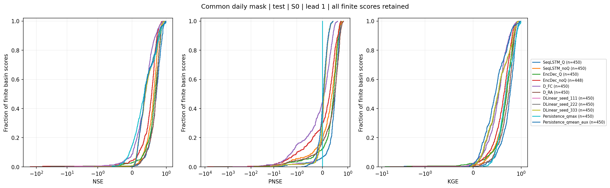

# Chương 6. Thí nghiệm và kết quả

Các thí nghiệm đã thực hiện xác nhận việc chạy lại trọng số BiasCast, bổ sung mốc persistence và DLinear, đồng thời đánh giá theo mức lưu lượng và sự kiện lũ. Trên cùng giao ngày test, Sequential Forecast LSTM có Q đạt NSE trung vị **0,705259**, DLinear đạt **0,380152 ± 0,002415** giữa ba hạt giống, còn persistence qmax đạt **0,350031**. DLinear cải thiện theo NSE/PNSE nhưng thấp hơn persistence theo KGE; đánh giá theo mức còn cho thấy khả năng nhận diện ngày lưu lượng rất cao thấp hơn Sequential Forecast LSTM.

Phạm vi thực nghiệm của chương là A2, A3 và bộ đánh giá trên **test 2014–2017, kịch bản S0, hạn một ngày**. **S0** là không che thêm đầu vào theo kịch bản, dù dữ liệu gốc vẫn có thể thiếu; **hạn một ngày** là dự báo ngày kế tiếp sau ngày cuối của lịch sử quan trắc. Các kết quả so sánh năm lõi thời gian, kịch bản mất dữ liệu và nhiều hạn sẽ được bổ sung khi các thí nghiệm tương ứng hoàn thành. Dữ liệu, độ phủ và ngưỡng trước test được trình bày tại [Chương 4](04_Data.md).

## 6.1. Câu hỏi thực nghiệm và các cấu hình

Các kết quả hiện có trả lời ba câu hỏi: trọng số tác giả có cho kết quả tương đương khi chạy trong môi trường của đề tài hay không; mô hình hơn mốc chép số đo hôm qua bao nhiêu; và chỉ số liên tục có phản ánh đầy đủ chất lượng dự báo ở các mức cao hay không.

| Thí nghiệm | Cách thực hiện | Vai trò |
|---|---|---|
| A2 | Nạp trọng số tốt nhất của tác giả cho sáu cấu hình, chạy lại test | Kiểm quy trình suy luận, đơn vị và kết quả tái lập |
| Persistence qmax | Dự báo qmax(t) bằng qmax(t−1) | Mốc quan trắc chính cho PNSE |
| DLinear A3 | Huấn luyện ba hạt giống với cùng cấu hình từ qmean quá khứ | Mốc tuyến tính bổ sung |
| Đánh giá dùng chung | Đọc các dự báo đã lưu, áp cùng ngày chấm và ngưỡng A1 | So chỉ số liên tục, bốn mức, sự kiện và kiểm định |

Sáu A2 gồm Sequential Forecast LSTM có/không Q, Encoder–Decoder LSTM có/không Q, D_FC và D_RA. Sequential Forecast LSTM duy trì trạng thái khi chuyển từ lịch sử sang bước dự báo; Encoder–Decoder dùng hai mạng cho hai pha. D_FC là mốc theo nguồn dự báo khí tượng; D_RA dùng tái phân tích, kể cả ở ngày đích. Hai mốc này giúp đối chiếu nguồn thông tin. Cấu hình D_RA có thông tin ngày đích được tái dựng sau quan trắc nên cần được phân biệt với điều kiện vận hành.

A2 giữ trọng số, scaler và hợp đồng của tác giả; đây là tái lập suy luận. A4 trong kế hoạch mới là phép huấn luyện lại LSTM với ba hạt giống để đo nhiễu của mô hình nền. Thiết kế bài cơ sở được công bố trong [BiasCast](https://hess.copernicus.org/articles/30/5067/2026/).

## 6.2. Giao thức đánh giá

### 6.2.1. Chọn mô hình bằng validation

Train là 2003–2009, validation là 2010–2013 và test là 2014–2017. DLinear chỉ fit scaler từ train; các checkpoint được chọn theo NSE trung vị validation. Điểm test được ghi nhận mỗi epoch theo yêu cầu theo dõi, nhưng không tham gia chọn checkpoint hoặc đặt lại quy tắc dừng.

Khi so các mô hình ở bước tiếp theo, cùng nguyên tắc được giữ: validation phục vụ lựa chọn theo giao thức định trước, test phục vụ báo cáo. Các chẩn đoán sau khi đọc test, như hồ sơ lưu vực 363, chỉ dùng giải thích kết quả hiện tại.

### 6.2.2. Đơn vị, ngày chấm và dự báo thiếu

Quan trắc chuẩn dùng qmax nguồn đổi sang mm/ngày theo diện tích trạm. Một **ngày–lưu vực**, cũng viết là ngày–ID, là một ngày tại một lưu vực cụ thể. A3 kiểm lịch và quan trắc của sáu A2 trước khi lập **mặt nạ**, tức bảng True/False chọn những cặp ngày–lưu vực được chấm. Điểm riêng của từng run dùng các ngày mà run có cặp hữu hạn; bảng so chính dùng **giao chung**, chỉ giữ những cặp có quan trắc, persistence và dự báo của mọi run cùng hữu hạn, để mọi mô hình được chấm trên cùng dữ liệu.

| Scope | Quy tắc | Mục đích |
|---|---|---|
| Native | Obs của run và sim hữu hạn; DLinear dùng obs nguồn | Đối chiếu kết quả riêng, theo dõi độ phủ |
| Paired source | Obs canonical, sim và persistence hữu hạn | So từng run với persistence trên cùng ngày |
| Common source all | Giao hữu hạn của toàn bộ sáu A2, ba DLinear và persistence | So sánh chính giữa các run |

Mốc qmean phụ cũng có đủ dữ liệu trên giao chung này. Sáu A2 và persistence tạo giao **652.636 ngày–ID**; thêm ba DLinear còn **652.628 ngày–ID**, giảm tám cặp. Có **450 lưu vực** có ngày chấm. ID 55 vẫn nằm trong danh sách 451 với số ngày chấm bằng 0 ở giao chung.

Các dự báo âm được xử lý theo cấu hình đã định: đổi ngược chuẩn hóa trước rồi chặn dưới ở 0 để chấm; bản trước chặn được giữ để chẩn đoán. Ngày thiếu giữ bằng NaN, không nội suy hoặc thay bằng ngày có số đo gần nhất. Trường hợp một chỉ số không xác định được giữ trạng thái giải thích và báo số ID hữu hạn.

### 6.2.3. NSE và PNSE

Với oᵢ là quan trắc, sᵢ là dự báo và ō là trung bình quan trắc trên các ngày chấm:

**NSE = 1 − Σ(sᵢ − oᵢ)² / Σ(oᵢ − ō)².**

NSE = 1 là hoàn hảo, NSE = 0 có sai số bình phương ngang hằng số ō, còn điểm âm có sai số lớn hơn mốc đó. Mốc trung bình thuộc kỳ chấm, dùng diễn giải chỉ số; nó không phải một dự báo vận hành được tạo trước toàn bộ kỳ.

Với pᵢ là persistence qmax, chỉ số so trực tiếp với số đo hôm qua là:

**PNSE = 1 − Σ(sᵢ − oᵢ)² / Σ(pᵢ − oᵢ)².**

PNSE dương là hơn persistence, bằng 0 là ngang và âm là kém hơn. Ví dụ minh họa, quan trắc [1; 2; 3; 4], dự báo [1; 2; 2; 4], persistence [1; 1; 2; 3] cho SSE mô hình bằng 1, SSE persistence bằng 3 và tổng bình phương độ lệch quan trắc bằng 5. Kết quả NSE = 0,8 và PNSE ≈ 0,667. Dãy persistence này tương ứng quan trắc trước chuỗi bằng 1 và luôn dịch đúng một ngày lịch.

NSE và PNSE có thể cho hai nhận xét khác nhau vì dùng hai mốc. Một mô hình có NSE hơi âm vẫn có thể có PNSE dương nếu persistence còn kém hơn. Khi phương sai quan trắc hoặc SSE persistence bằng 0, chỉ số liên quan trả NaN; hàm đánh giá không thêm epsilon để biến mẫu số suy biến thành một điểm hữu hạn.

### 6.2.4. KGE và các thành phần

Nghiên cứu dùng KGE dạng 2009:

**KGE = 1 − √[(r − 1)² + (α − 1)² + (β − 1)²].**

r là tương quan Pearson; α = std(sim)/std(obs) đo tỷ lệ dao động; β = mean(sim)/mean(obs) đo tỷ lệ trung bình. Cả ba có giá trị lý tưởng bằng 1. Độ lệch chuẩn dùng ddof=0; NSE, PNSE và các thành phần KGE dùng cùng một mặt nạ trong mỗi phép chấm. Công thức được đối chiếu với [mã metrics tại commit thư viện A2](https://github.com/Ticasslo/neuralhydrology/blob/dda45fcf19ee7ffd481b9d192778539df46fb074/neuralhydrology/evaluation/metrics.py).

Tương quan cao chưa bảo đảm dự báo chính xác. Ví dụ minh họa, nếu dự báo luôn bằng hai lần quan trắc thì r = 1 nhưng α = β = 2, KGE ≈ −0,4142. Với nhãn qmax, β diễn tả mức trung bình của cực đại ngày; không chuyển trực tiếp thành sai số tổng thể tích nước. Dự báo hằng làm r không xác định và do đó KGE không xác định.

### 6.2.5. Tổng hợp và kiểm định

Mỗi lưu vực có một bộ điểm; sau đó tổng hợp trung vị, trung bình và P10/P25/P75/P90 qua các lưu vực. Đường CDF biểu diễn tỷ lệ ID có điểm không vượt giá trị trên trục ngang. Các điểm âm được giữ đầy đủ, tránh che phần đuôi bất lợi chỉ bằng trung vị.

So sánh ghép cặp dùng hiệu chỉ số theo cùng ID, Wilcoxon signed-rank hai phía và Cohen's dz = mean(hiệu)/std mẫu(hiệu). Holm hiệu chỉnh các p-value hợp lệ của toàn bộ cặp run không thứ tự, riêng cho NSE, PNSE, KGE; p = NaN không được tính vào kích thước họ. Sáu A2, ba DLinear và persistence qmax tạo **45 cặp dự kiến cho mỗi chỉ số**, tổng **135 phép so**; mốc qmean phụ không thuộc họ kiểm định chính. `family_size` ghi số p hữu hạn, `planned_family_size` ghi số phép so dự kiến. Phương pháp tính p dùng [SciPy Wilcoxon](https://docs.scipy.org/doc/scipy/reference/generated/scipy.stats.wilcoxon.html).

Số cặp hữu hạn được báo theo từng chỉ số. Hiệu bằng 0, độ lệch chuẩn hiệu bằng 0 và chỉ số không xác định có quy ước riêng trong bộ đánh giá. Do có các lưu vực lồng nhau, các cặp điểm có thể phụ thuộc không gian; p được đọc cùng cỡ hiệu ứng, số lưu vực hơn/kém và phần đuôi chênh lệch.

## 6.3. Kết quả tái lập suy luận A2

A2 dùng NeuralHydrology ở commit `dda45fcf19ee7ffd481b9d192778539df46fb074`, nạp trọng số tốt nhất của tác giả và chạy test trên Kaggle T4. Các tiêu chí kiểm gồm quan trắc trùng tệp tác giả, lệch NSE trung vị không quá 0,005, sai khác dự báo ở phân vị 99,9% không quá 0,05 mm/ngày và kiểm riêng các lưu vực có sai khác NSE lớn.

| Run | NSE trung vị tác giả | NSE trung vị chạy lại | ID có NSE |
|---|---:|---:|---:|
| SeqLSTM_Q | 0,7053 | 0,7053 | 450 |
| SeqLSTM_noQ | 0,6276 | 0,6276 | 451 |
| EncDec_Q | 0,6622 | 0,6622 | 450 |
| EncDec_noQ | ≈0,569 | ≈0,569 | 451 |
| D_FC | 0,3867 | 0,3864 | 451 |
| D_RA | 0,6923 | 0,6923 | 451 |

Cả sáu cấu hình đạt tiêu chí tái lập. Sai khác nhỏ ở dự báo được đọc cùng sự khác nhau của môi trường số học. Hai lưu vực 742 và 758 có phương sai nhãn nhỏ, nên sai lệch dự báo nhỏ vẫn có thể tạo chênh NSE dễ thấy; các ca này được phân tích ở Mục 6.6.

Bảng A2 sử dụng độ phủ riêng của từng run. Vì thế, một số điểm thay đổi khi chuyển sang giao chung ở bảng A3, chẳng hạn SeqLSTM_noQ từ khoảng 0,6276 xuống 0,6229. Hai số này tương ứng hai phạm vi ngày và không được dùng như bằng chứng mô hình bị thay đổi giữa hai lần chấm.

## 6.4. Persistence và DLinear

### 6.4.1. Dự báo persistence

Persistence qmax dự báo ngày t bằng số đo ngày t−1 theo lịch. Ngày đầu test sử dụng 31/12/2013. Trong toàn bộ test có 19 ngày–ID có quan trắc ngày đích nhưng thiếu qmax hôm trước; những ngày đó nằm ngoài phạm vi tính PNSE. Mốc qmean(t−1) dự báo qmax(t) được giữ làm đối chiếu phụ vì hai đại lượng không giống nhau.

Trên giao chung cuối, persistence qmax đạt NSE trung vị **0,350031**, KGE trung vị **0,674939** và PNSE = 0 theo định nghĩa. Mốc này cho biết mức kỹ năng đã có chỉ từ tính liên tục theo thời gian của lưu lượng.

### 6.4.2. Cấu hình DLinear

DLinear dùng trung bình trượt 25 ngày để tách xu hướng và dao động, hai nhánh tuyến tính 365 → 1 rồi cộng đầu ra. Cấu trúc giữ theo [mã DLinear gốc](https://github.com/cure-lab/LTSF-Linear/blob/7f7a25b6d32fa0df77ce4c20d4ffeb849b5a7e47/models/DLinear.py), từ công trình [Zeng và cộng sự, AAAI 2023](https://ojs.aaai.org/index.php/AAAI/article/view/26317).

Mô hình nhận một chuỗi qmean 365 ngày đến t−1, dự báo qmax(t), có **732 tham số**. qmean/qmax đều ở mm/ngày theo area_gov; hai scaler chung fit riêng từng biến từ train. Chỉ cửa sổ đủ lịch sử được dùng; tập train có 1.094.229 mẫu từ 445 ID.

Loss huấn luyện giữ quy ước NSE* của NH: mean[(pred_z − target_z)²/(σqmax,train + 0,1)²], với residual ở thang z và σ là độ lệch chuẩn qmax train trước chuẩn hóa của từng lưu vực. Đây là hàm tối ưu, khác NSE đánh giá. Epsilon 0,1 thuộc loss, không được đưa sang mẫu số NSE/PNSE/KGE.

Ba seed 111, 222, 333 dùng Adam, learning rate đầu 0,001, batch 256, lịch CosineAnnealing, tối đa 30 epoch, patience 5 và mức cải thiện đáng kể 0,005. Mỗi cải thiện nghiêm ngặt của validation vẫn được lưu checkpoint tốt nhất; quy tắc patience được kiểm riêng để tránh bỏ checkpoint có cải thiện nhỏ. Các kiểm kiến trúc, loss, gradient, chỉ mục ngày và nạp lại checkpoint đều đạt trước khi huấn luyện chính thức.

| Seed | Epoch đã chạy | Epoch được chọn | NSE trung vị validation | NSE trung vị test |
|---|---:|---:|---:|---:|
| 111 | 6 | 4 | 0,424701 | 0,382799 |
| 222 | 6 | 2 | 0,423997 | 0,378069 |
| 333 | 10 | 5 | 0,428187 | 0,379588 |

Trung bình ± std mẫu giữa ba NSE trung vị test là **0,380152 ± 0,002415**. Đây là độ phân tán của ba lần chạy, không phải khoảng tin cậy hoặc điểm của tổ hợp dự báo. DLinear chỉ dùng lưu lượng, trong khi A2 có các tổ hợp khí tượng và đầu vào khác; các chênh lệch hiện tại là so sánh mốc kỹ năng, chưa cô lập ảnh hưởng kiến trúc.

## 6.5. So sánh chỉ số liên tục trên giao chung

| Run | NSE trung vị | NSE trung bình | PNSE trung vị | KGE trung vị |
|---|---:|---:|---:|---:|
| SeqLSTM_Q | **0,705259** | 0,401554 | **0,495584** | **0,767074** |
| SeqLSTM_noQ | 0,622922 | 0,565503 | 0,375311 | 0,688235 |
| EncDec_Q | 0,662155 | 0,207468 | 0,435417 | 0,698093 |
| EncDec_noQ | 0,567347 | 0,013414 | 0,285036 | 0,640148 |
| D_FC | 0,385892 | 0,251283 | 0,076250 | 0,533138 |
| D_RA | 0,692511 | 0,387618 | 0,485222 | 0,737006 |
| DLinear 111 | 0,382799 | 0,391289 | 0,066592 | 0,519476 |
| DLinear 222 | 0,378069 | 0,424958 | 0,055647 | 0,520644 |
| DLinear 333 | 0,379588 | 0,423480 | 0,059714 | 0,513177 |
| Persistence qmax | 0,350031 | 0,356946 | 0 | 0,674939 |
| Persistence qmean, phụ | 0,366131 | 0,420600 | 0,034721 | 0,457145 |

Mỗi dòng có 450 NSE hữu hạn. Riêng KGE/r của EncDec_noQ có 448 ID hữu hạn do dự báo hằng ở 742 và 758. Nguồn: [bảng tổng hợp từ bộ đánh giá](../../Workspace/06_Evaluation/Tables/Evaluation_summary.csv).

*Hình 6.1. Phân phối điểm từng lưu vực trên cùng ngày chấm. Trục symlog giữ cả phần âm xa; riêng vùng [−1, 1] tuyến tính. CDF biểu diễn phân phối các điểm hữu hạn, với số ID của mỗi run/chỉ số được ghi ở chú giải. Điểm có giá trị lớn hơn là tốt hơn đối với NSE, PNSE và KGE.*

SeqLSTM_Q có NSE trung vị cao nhất và hơn persistence theo PNSE ở **420/450 ID**, tương ứng 93,33%. Tuy nhiên, NSE trung bình chỉ 0,401554 do ảnh hưởng phần đuôi âm. EncDec_noQ cũng có khoảng cách lớn giữa trung vị 0,567347 và trung bình 0,013414. Vì thế, kết luận về một run cần gồm cả phân phối và hồ sơ các ca xấu.

Ba DLinear hơn persistence theo PNSE ở **318/450, 309/450, 317/450 ID**, nhưng KGE trung vị chỉ khoảng 0,518, thấp hơn mốc 0,675. Trung vị α khoảng 0,70 và r khoảng 0,63 cho thấy sự co dao động và tương quan thấp hơn. Các median thành phần mô tả những phân phối riêng; KGE phải được tính từ r/α/β của từng ID trước khi tổng hợp, không thay bằng công thức trên các median.

## 6.6. Lưu vực có NSE âm lớn

Hai lưu vực 742/758 có biến thiên nhãn nhỏ; khi mẫu số NSE nhỏ, sai lệch nền có thể tạo giá trị âm lớn. Tại **758**, DLinear seed 111 có r ≈ **0,9837** nhưng NSE ≈ **−11,5639**, với β ≈ **3,9076**. Chuỗi khá đồng nhịp nhưng mức trung bình quá cao. EncDec_noQ cho đầu ra hằng ở cả hai ID, làm tương quan và KGE không xác định.

Phân rã MSE = bình phương sai số trung bình + phương sai sai số, cùng ddof=0, cho phép đọc hai phần đóng góp vào 1 − NSE sau khi chia phương sai quan trắc. Đây là đồng nhất thức mô tả sai số, không gán cơ chế vật lý hoặc nguyên nhân bên trong mạng.

*Hình 6.2. Phân rã sai số chuẩn hóa tại 742, 758, 363 và 800. Tổng hai phần bằng 1 − NSE. Ở 742/758, sai lệch trung bình đóng góp lớn đối với nhiều run; ở các hồ sơ khác, phương sai sai số có thể chiếm ưu thế.*

Lưu vực 363 minh họa một trường hợp khác: DLinear có NSE hơi âm nhưng PNSE dương vì persistence còn kém hơn. Đây là ca được bổ sung để giải thích sau khi xem test. Danh sách ID và cấu hình được giữ cố định; các hồ sơ không được dùng để loại trạm hoặc chọn lại mô hình theo test.

## 6.7. Đánh giá theo bốn mức lưu lượng

Ngưỡng q30/q80/q98 A1 được áp giống nhau cho quan trắc và dự báo. Trên giao chung có **194.703 ngày–ID mức thấp** và **11.759 ngày–ID mức rất cao**. Các tỷ lệ dưới đây là tỷ lệ cộng dồn ô đếm, không phải trung vị recall hoặc precision theo lưu vực.

| Run | Recall thấp (%) | Recall rất cao (%) | Precision rất cao (%) |
|---|---:|---:|---:|
| SeqLSTM_Q | 66,93 | 47,58 | 67,58 |
| SeqLSTM_noQ | 65,79 | 36,17 | 63,73 |
| EncDec_Q | 53,67 | 41,31 | 62,22 |
| EncDec_noQ | 54,95 | 38,50 | 51,30 |
| D_FC | 47,23 | 21,49 | 41,75 |
| D_RA | 65,06 | 47,27 | 63,78 |
| DLinear 111 | 61,83 | 22,18 | 53,33 |
| DLinear 222 | 67,61 | 22,30 | 53,72 |
| DLinear 333 | 69,52 | 21,80 | 54,86 |
| Persistence qmax | 88,07 | 40,11 | 40,28 |
| Persistence qmean, phụ | 96,27 | 18,40 | 61,53 |

Nguồn: [bảng bốn mức cộng dồn](../../Workspace/06_Evaluation/Tables/Evaluation_levels_pooled.csv). Recall mức rất cao là số ngày được báo đúng rất cao chia số ngày rất cao thật; precision là số báo đúng chia số lần báo rất cao. Mức không có mẫu thật hoặc không có lần báo được giữ chỉ số không xác định theo mẫu số tương ứng.

SeqLSTM_Q bắt đúng **5.595/11.759 ngày rất cao**, cao hơn persistence **4.716 ngày**; precision cũng cao hơn. DLinear chỉ bắt khoảng 22%, nhất quán với biên độ dự báo co. Accuracy tổng thể của persistence qmax là **82,90%**, còn SeqLSTM_Q **77,62%**. Chỉ số đúng chung chịu ảnh hưởng các mức phổ biến nên cần đọc riêng recall rất cao và thấp theo yêu cầu bài toán.

Các chữ ký đường duy trì bổ sung bằng chứng về dải lưu lượng. %BiasFHV trung vị của SeqLSTM_Q là **−13,01%**, của DLinear 111/222/333 là **−31,35/−30,78/−31,91%**, cho thấy hụt tổng của dải cao theo định nghĩa FHV. Bộ đánh giá dùng ceil(0,02n) ngày cao nhất và báo kèm trung vị trị tuyệt đối để giữ thông tin khi các lưu vực lệch hai chiều.

%BiasFLV dùng log ở 30% ngày thấp nhất; các giá trị không dương sau chính sách chặn được dùng sàn log 10⁻⁶ mm/ngày riêng cho phép tính này. Ba DLinear có trị tuyệt đối FLV trung vị khoảng **597–754%**, với **9.197/12.134/13.218** ngày sim dưới sàn trên giao chấm. Giá trị này nhạy với hình dạng đuôi log và số lần chặn về 0; không được diễn giải như phần trăm sai tổng thể tích nước. Quy tắc FDC được cố định trong [protocol đánh giá](../../Workspace/06_Evaluation/Tables/Evaluation_protocol.json).

## 6.8. Đánh giá sự kiện lũ

### 6.8.1. Ngưỡng, gộp cụm và ghép một–một

Ngưỡng Gumbel A1 cho T = 1,5; 2; 5; 10 năm được giữ cố định trước test, dùng giống nhau cho obs/sim. Sự kiện được trích trên lịch ngày, xuất cả đoạn liên tiếp và cụm USWRC. Cụm có onset/ending không quan sát được hoặc thiếu ngày trong cửa sổ ghép được đánh dấu kiểm duyệt và báo số lượng riêng.

**Bảng chính dùng tolerance = 0: hai trận phải bắt đầu cùng ngày. Bảng phụ dùng ±1 ngày**, xuất riêng để đánh giá độ nhạy với dung sai thời gian. Thuật toán tối đa hóa số cặp trước rồi tối thiểu hóa tổng lệch ngày bắt đầu (onset), không tái sử dụng một sự kiện trong nhiều cặp. Cửa sổ kiểm duyệt theo dung sai của mỗi bảng, vì vậy mẫu số được báo riêng. Điểm thời gian đỉnh được tính sau khi cặp đã được xác định; cùng ngày bắt đầu không bắt buộc cùng ngày đỉnh. [Căn cứ NOAA và phân biệt với cửa sổ ±2 ngày của Nearing 2024](../../Workspace/06_Evaluation/01_Evaluation_LamaHCEExt.md#5-sự-kiện-lũ-và-cờ-kiểm-duyệt).

Gọi h là số bắt được, m là bỏ sót và f là báo nhầm. POD = h/(h+m), FAR = f/(h+f), precision = h/(h+f), F1 = 2h/(2h+m+f), CSI = h/(h+m+f). Mẫu số 0 cho NaN. Kết quả chính cộng số trận toàn tập trước khi chia; ngưỡng 1,5/2/5/10 năm và hai cách gộp được báo riêng.

### 6.8.2. Kết quả chính ở chu kỳ hai năm

Theo quy tắc USWRC, có **1.066 cụm quan trắc đủ điều kiện trên 366 lưu vực** ở T = 2 năm. Bảng chính yêu cầu cùng ngày bắt đầu. Nhóm dưới 10 năm mẫu fit được giữ và có bảng tách riêng trong CSV.

| Run | Bắt được | Bỏ sót | Báo nhầm | POD (%) | FAR (%) |
|---|---:|---:|---:|---:|---:|
| SeqLSTM_Q | 208 | 858 | 431 | 19,51 | 67,45 |
| SeqLSTM_noQ | 188 | 878 | 304 | 17,64 | 61,79 |
| EncDec_Q | 126 | 940 | 289 | 11,82 | 69,64 |
| EncDec_noQ | 174 | 892 | 445 | 16,32 | 71,89 |
| D_FC | 63 | 1.003 | 286 | 5,91 | 81,95 |
| D_RA | 219 | 847 | 377 | 20,54 | 63,25 |
| DLinear 111 | 2 | 1.064 | 327 | 0,19 | 99,39 |
| DLinear 222 | 2 | 1.064 | 340 | 0,19 | 99,42 |
| DLinear 333 | 2 | 1.064 | 322 | 0,19 | 99,38 |
| Persistence qmax | 0 | 1.066 | 1.066 | 0,00 | 100,00 |
| Persistence qmean, phụ | 0 | 1.066 | 201 | 0,00 | 100,00 |

Nguồn: [bảng sự kiện chính](../../Workspace/06_Evaluation/Tables/Evaluation_events_pooled.csv). SeqLSTM_Q bắt đúng ngày nhiều trận hơn DLinear, dù vẫn bỏ sót 858/1.066 trận. D_RA có 219 cặp đúng ngày, nhưng đây là mốc có tái phân tích ở ngày đích, cần đọc cùng điều kiện nguồn thông tin. Ba seed DLinear chỉ có hai cặp đúng ngày; NSE trung vị nhỉnh hơn persistence chưa phản ánh khả năng bắt đúng ngày khởi phát lũ. Sai số thời điểm đỉnh vẫn được báo riêng vì cùng ngày bắt đầu không bắt buộc cùng ngày đỉnh.

### 6.8.3. Bảng phụ ±1 ngày và độ nhạy thời gian

Cho phép lệch ngày bắt đầu tối đa một ngày làm thay đổi kết quả như sau; bảng phụ đầy đủ được giữ trong CSV.

| Run | POD chính (%) | FAR chính (%) | POD phụ ±1 (%) | FAR phụ ±1 (%) |
|---|---:|---:|---:|---:|
| SeqLSTM_Q | 19,51 | 67,45 | 32,65 | 45,54 |
| D_RA | 20,54 | 63,25 | 30,49 | 45,47 |
| DLinear 111 | 0,19 | 99,39 | 20,83 | 32,52 |
| DLinear 222 | 0,19 | 99,42 | 22,23 | 30,70 |
| DLinear 333 | 0,19 | 99,38 | 20,83 | 31,48 |
| Persistence qmax | 0,00 | 100,00 | 100,00 | 0,00 |

Nguồn: [bảng phụ](../../Workspace/06_Evaluation/Tables/Evaluation_events_pooled_tolerance1.csv). **POD = 1 của persistence trong bảng phụ là hệ quả của dung sai ±1 ngày.** Chuỗi chép qmax hôm qua dịch trận sang ngày hôm sau; sai số tuyệt đối thời điểm đỉnh trung bình là **một ngày**. Bảng chính không có cặp persistence đúng ngày tại cả bốn ngưỡng và cả hai cách gộp.

Bảng phân mức đúng ngày cho recall rất cao của persistence là **40,11%**, thấp hơn SeqLSTM_Q **47,58%**. Phân mức ngày và ghép trận đo hai khía cạnh khác nhau, nên cả hai được báo cáo. Trong bảng phụ ±1, persistence cũng đạt POD = 1 ở T = 5 và 10 năm; ở T = 1,5 năm là 1.849/1.850, khoảng 99,95%.

## 6.9. Kết quả kiểm định ghép cặp

| So với persistence qmax | ID có ΔNSE > 0 | Median ΔNSE | Mean ΔNSE | Cohen's dz | p sau Holm |
|---|---:|---:|---:|---:|---:|
| SeqLSTM_Q | 420/450 | 0,340926 | 0,044608 | 0,0103 | 3,93×10⁻⁶⁵ |
| DLinear 111 | 318/450 | 0,035019 | 0,034343 | 0,0506 | 5,79×10⁻²⁹ |
| DLinear 222 | 309/450 | 0,031839 | 0,068012 | 0,4480 | 2,67×10⁻²⁶ |
| DLinear 333 | 317/450 | 0,031465 | 0,066534 | 0,3933 | 2,06×10⁻²⁷ |

ΔNSE ở bảng là hiệu **mô hình trừ persistence** theo từng ID. Trong CSV, thứ tự trái/phải được xếp theo tên; dấu các hiệu và dz được đổi khi trình bày theo chiều trên, còn p hai phía giữ nguyên. Nguồn: [135 phép kiểm ghép cặp](../../Workspace/06_Evaluation/Tables/Evaluation_paired_tests.csv).

Toàn bộ p-value của lần chạy này đều hữu hạn; bỏ NaN khỏi kích thước họ Holm không làm đổi các p đã báo trong bảng.

Median hiệu ghép cặp khác hiệu của hai median. Ví dụ, DLinear 111 có median ΔNSE **0,035019**, trong khi 0,382799 − 0,350031 = **0,032768**. Đại lượng thứ nhất mới mô tả chênh lệch tại lưu vực ở giữa phân phối hiệu.

Wilcoxon phản ánh phân phối hạng của các hiệu, còn dz phụ thuộc trung bình và độ lệch chuẩn hiệu. SeqLSTM_Q có đa số ID tốt lên và p rất nhỏ nhưng dz khoảng 0,0103 vì phần đuôi bất lợi ảnh hưởng mạnh đến trung bình/độ phân tán. Trên KGE, mỗi seed DLinear thấp hơn persistence ở **449/450 ID**. Trên PNSE, median DLinear dương nhưng mean âm do một số lưu vực có persistence rất mạnh. Các chỉ số này cần được đọc cùng nhau để tránh diễn giải p nhỏ như lợi ích đồng đều ở mọi lưu vực.

## 6.10. Khả năng đối chiếu và giới hạn của kết quả hiện tại

Bộ đánh giá giao thức 2 đã chạy trên Kaggle với Python 3.13.15, NumPy 2.1.3, pandas 2.3.3 và SciPy 1.16.3. Có **60 kiểm thử** trước khi chấm; **7 kiểm đối chiếu A3**, mỗi kiểm trên 4.961 cặp run–ID cho sáu chỉ số và số ngày. Từ 21 tệp được cung cấp, **57 kiểm CSV cục bộ** xác nhận công thức SSE/KGE, bảng tổng hợp, số đếm ma trận, bảo toàn số sự kiện, ghép một–một đúng dung sai, sai số thời gian, kiểm định, Holm và CDF. Bảng tổng hợp ±1 được tính lại từ bảng sự kiện chi tiết đã cung cấp. [Biên nhận kiểm tra](../../Workspace/06_Evaluation/Tables/Evaluation_output_verification.json).

Những kết quả này xác lập một bộ mốc và bộ đánh giá cho **S0, hạn một ngày trên test**. S0 biểu diễn việc không che thêm đầu vào theo kịch bản; dữ liệu nguồn vẫn có thể thiếu và các phạm vi chấm đã xử lý điều đó. Kết quả validation, S1–S4 và nhiều hạn sẽ được chấm khi luồng mô hình cung cấp dự báo tương ứng. Độ biến thiên ba seed DLinear không thay cho phép đo nhiễu LSTM ở A4.

Ảnh hưởng của một thuộc tính lưu vực hoặc một nhóm đầu vào cần được phân biệt với ảnh hưởng kiến trúc. A1/A3 hiện chứng minh độ phủ, cách tạo cửa sổ, độ biến thiên nhãn và giá trị của mốc persistence đều ảnh hưởng việc đọc kết quả. Phân tích chênh lệch theo thuộc tính và giải thích mô hình trong kế hoạch sẽ bổ sung bằng chứng sau các thí nghiệm có kiểm soát. Các kết luận trong chương áp dụng cho Extended LamaH-CE và những cấu hình đã chạy.

## 6.11. Nguồn kết quả

| Nội dung | Nguồn đối chiếu |
|---|---|
| Tái lập từ trọng số tác giả | [LamaH-CE, Mục 6.3](../03_Data/01_LamaHCE.md#63-tái-lập-bằng-trọng-số-tác-giả-bước-a2-kaggle-11102026) |
| Persistence, huấn luyện DLinear, chẩn đoán | [Thuyết minh A3](../../Workspace/03_Baseline/02_A3_LamaHCEExt_Benchmarks.md#report-part-10) |
| Giao thức, số liệu bốn mức và sự kiện | [Thuyết minh bộ đánh giá](../../Workspace/06_Evaluation/01_Evaluation_LamaHCEExt.md#10-kết-quả-thực-nghiệm-trên-kaggle) |
| Kiểm CSV đã nhận | [Bảng kiểm](../../Workspace/06_Evaluation/Tables/Evaluation_output_audit.csv), [manifest tệp nhận](../../Workspace/06_Evaluation/Tables/Evaluation_received_manifest.csv) |
| Hợp đồng và mã đánh giá | [Nguồn Python](../../Workspace/06_Evaluation/01_Evaluation_LamaHCEExt.py), [notebook Kaggle](../../Workspace/06_Evaluation/01_Evaluation_LamaHCEExt.ipynb) |

Repo giữ các bảng tổng hợp và hình được cung cấp; chuỗi dự báo và CSV chi tiết tiếp tục nằm trong Output Kaggle. Các phép tính lại cục bộ sử dụng CSV kết quả, còn giá trị băm của đầu vào gốc là thông tin do phiên Kaggle ghi lại. Những dãy số ghi “ví dụ minh họa” chỉ dùng giải thích công thức và không được tính vào kết quả thực nghiệm.
