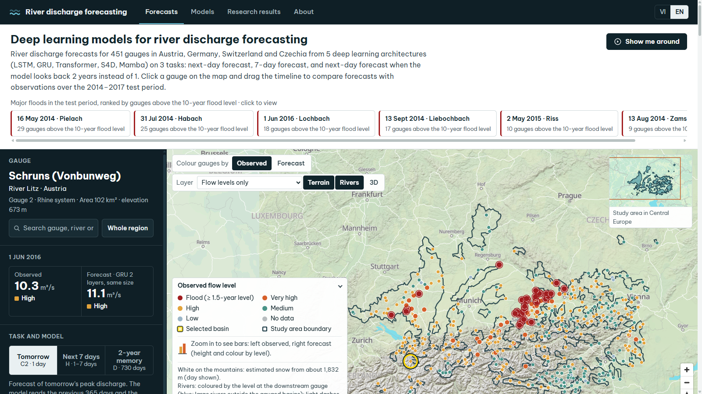
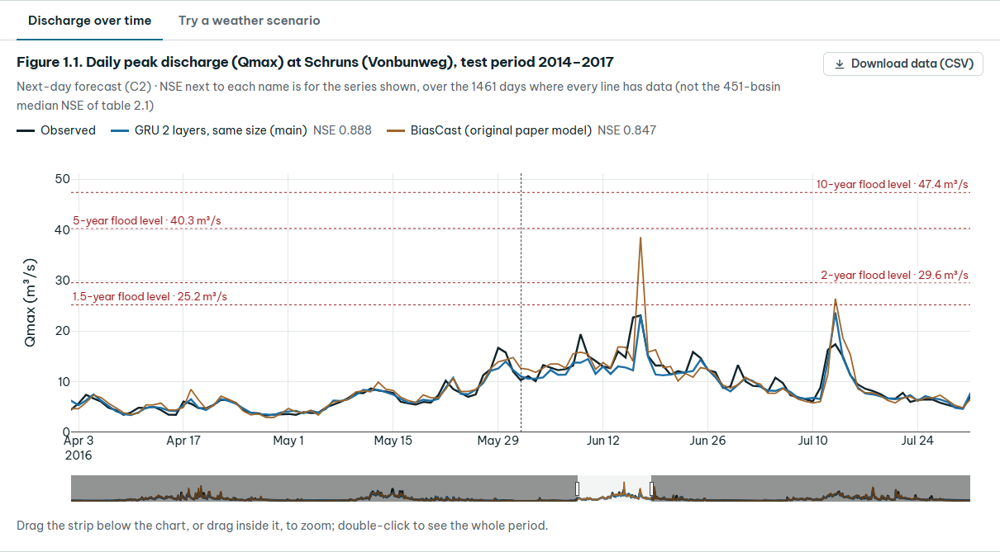
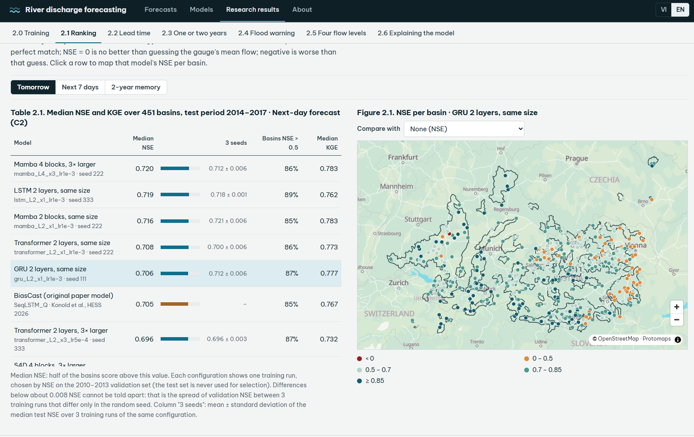

# Chương 7. Demo

Demo là một trang web công khai tại `https://ticasslo.dev`, chạy liên tục trên máy ảo miễn phí. Trang cho người xem chọn một trạm đo trên bản đồ, kéo thanh thời gian qua kỳ kiểm tra 2014–2017 và so dự báo của các mô hình đã huấn luyện với lưu lượng đo thật. Ngoài phần phát lại dự báo đã lưu, trang có ô "nếu… thì…": người xem đổi lượng mưa hoặc nhiệt độ của dự báo thời tiết ngày tới, và mô hình chạy lại ngay trên CPU của máy chủ để cho kết quả mới.

Chương này trình bày mục tiêu của demo (7.1), cách tổ chức bốn bước từ GPU tới máy chủ (7.2), giao diện (7.3), các phép kiểm bảo đảm demo cho đúng số liệu của Chương 6 (7.4), cách triển khai (7.5) và hạn chế (7.6).

## 7.1. Mục tiêu và phạm vi

Demo phục vụ hai việc. Thứ nhất, cho người không chuyên thấy bài toán cụ thể: với một trạm, lưu lượng đỉnh ngày mai (qmax) được dự báo ra sao, sai ở đâu, có báo được lũ không. Thứ hai, cho hội đồng kiểm tra trực quan các kết luận của Chương 6 trên từng lưu vực thay vì chỉ xem con số trung vị.

Phạm vi mô hình là toàn bộ các mô hình chính đã huấn luyện, không chỉ một mô hình tốt nhất (`02_Pipeline.md` Mục 9.6):

| Nhóm | Số đường dự báo | Nội dung |
|---|---:|---|
| C2, dự báo ngày tới | 8 | 8 cấu hình của 5 lõi LSTM, GRU, Transformer, S4D, Mamba; mỗi cấu hình một lần huấn luyện, chọn theo NSE trung vị validation trong 3 seed |
| H, dự báo 1–7 ngày | 8 | LSTM và Mamba × 4 cách dùng thông tin thời tiết tương lai (chỉ quá khứ, lai, GEFS, thời tiết hoàn hảo) |
| D, nhìn lại 730 ngày | 3 | LSTM, Mamba, S4D |
| Mốc | 2 | Mô hình gốc của BiasCast (trọng số tác giả, A2) và persistence (lấy qmax hôm nay làm dự báo ngày mai) |

Tổng cộng 21 đường dự báo cho 451 lưu vực (`Workspace/07_Demo/03_D3_LamaHCEExt_Demo/03_D3_LamaHCEExt_Demo.md`). Mô hình bật sẵn khi mở trang là GRU 2 lớp cùng số tham số, seed 111. Ô "nếu… thì…" chạy trực tiếp 7 mô hình: một cấu hình đại diện cho mỗi lõi C2 (cấu hình và seed có NSE validation cao nhất của lõi trong số đã kiểm trên CPU) và hai mô hình H cách lai (LSTM seed 333, Mamba seed 222).

## 7.2. Kiến trúc: bốn bước từ GPU tới máy chủ

Mô hình được huấn luyện trên GPU T4 của Kaggle, còn demo chạy trên CPU. Để bảo đảm số trên trang đúng bằng số đã chấm ở Chương 6, demo đi qua bốn bước, mỗi bước kiểm lại bước trước:

| Bước | Nơi chạy | Việc làm | Kết quả kiểm |
|---|---|---|---|
| D1 | Kaggle, GPU T4 | Viết một hàm dự báo dùng chung cho mọi run (`DemoRuntime/forecast.py`), chạy lại toàn kỳ test và so với dự báo đã lưu | 24 run C2 × 451 lưu vực × 1.461 ngày (10.824 phép kiểm) và 3 run D (1.353 phép kiểm) lệch tuyệt đối lớn nhất 0 mm/ngày (`01_D1_LamaHCEExt_Inference.md`, Version 2) |
| D2 | Kaggle, CPU | Chạy cùng hàm trên CPU (Mamba dùng thư viện `mambapy` thay nhân CUDA), đo thời gian | 8/8 cấu hình C2 và 3/3 cấu hình D đạt 36/36 phép so, sai số lớn nhất 3,1 × 10⁻⁵ mm/ngày; một dự báo mất 16–180 ms tùy lõi (p95) (`02_D2_LamaHCEExt_CPU.md`, Version 2) |
| D3 | Laptop | Đóng gói dữ liệu demo (169 tệp, 852 MB) và máy chủ Flask; kiểm phát lại và "nếu… thì…" | 3.297 yêu cầu phát lại khớp dữ liệu gói (2.015.928 giá trị); 336 giá trị theo hạn của hai mô hình H chạy trên CPU khớp tệp đã lưu (`03_D3_LamaHCEExt_Demo.md`) |
| D4 | Máy ảo Oracle Cloud, CPU ARM64 | Chạy đúng mã D3 trong Docker, đưa ra Internet | 7/7 mô hình "nếu… thì…" trả kết quả khớp tệp phát lại trên CPU ARM; các API chỉ đọc trùng bản laptop (`Workspace/07_Demo/04_D4_Website/deploy/check_site.py`) |

Demo có hai phần chạy khác nhau:

- **Phát lại.** Dự báo của cả 21 đường cho toàn kỳ test đã tính sẵn và lưu thành tệp NPZ (mảng số NumPy nén). Khi người xem chọn trạm và ngày, máy chủ chỉ đọc mảng và trả về, không chạy mô hình. Phần này nhanh và cho đúng con số của Chương 6.
- **Chạy trực tiếp.** Ô "nếu… thì…" nhận hệ số nhân lượng mưa và mức cộng nhiệt độ của dự báo ECMWF HRES ngày tới, ghép vào cửa sổ dữ liệu 365 ngày của lưu vực và chạy mô hình trên CPU. Trước khi trả kết quả, máy chủ chạy mô hình một lần với dữ liệu gốc và so với chuỗi phát lại; lệch quá dung sai thì trả lỗi thay vì trả số sai (`Workspace/07_Demo/03_D3_LamaHCEExt_Demo/app.py`, hàm `what_if`).

Mọi run dùng chung một lớp dự báo vì cả năm lõi nằm trong cùng mô hình Sequential Forecast của đề tài (Chương 5). Mô hình C2 và D chạy bằng thư viện NeuralHydrology ở mốc `freeze-C`, mô hình H ở mốc `freeze-H`; hai mốc đặt trong hai môi trường Python riêng để không lẫn mã.

## 7.3. Giao diện

Trang gồm ba phần nối tiếp: xem dự báo, kết quả nghiên cứu và giới thiệu dự án. Cuối phần xem dự báo là mục "Mô hình dự báo thế nào?": sơ đồ so sánh kiến trúc BiasCast với kiến trúc của đề tài (cùng hình với Hình 5.1), cách chia dữ liệu theo thời gian và mô tả năm lõi. Trang có hai ngôn ngữ, tiếng Việt và tiếng Anh. Thanh trên cùng có bốn mục (Xem dự báo, Mô hình, Kết quả nghiên cứu, Về dự án) để chuyển nhanh giữa các phần, và nút "Hướng dẫn" dẫn người mới xem qua từng thành phần.

*Hình 7.1. Phần xem dự báo (giao diện tiếng Anh). Bên trái là trạm đang chọn, giá trị đo và dự báo trong ngày, ô chọn bài toán (ngày tới, 7 ngày, nhìn lại 2 năm). Bên phải là bản đồ 451 trạm tô theo mức lưu lượng trong ngày; vòng vàng là lưu vực đang chọn. Hàng thẻ phía trên liệt kê các trận lũ lớn của kỳ test, bấm vào để nhảy tới ngày đó.*

**Bản đồ.** Mỗi trạm là một chấm, màu theo bốn mức lưu lượng của Chương 6 (thấp, trung bình, cao, rất cao) cộng mức lũ (vượt ngưỡng chu kỳ lặp lại 1,5 năm). Người xem tô theo giá trị đo hoặc theo dự báo của mô hình đang chọn; hai màu khác nhau ở trạm nào thì mô hình sai mức ở trạm đó. Bản đồ có thêm:

- **Lớp dữ liệu đầu vào:** 8 lớp theo ngày (mưa, nhiệt độ, tuyết, độ ẩm đất, bốc thoát hơi thực tế và tiềm năng, chỉ số lá, gió) và 5 lớp tĩnh (độ cao, độ dốc, tỉ lệ rừng, tỉ lệ băng hà, tỉ lệ mưa dạng tuyết). Mỗi lớp là giá trị trung bình cả lưu vực, lấy từ chính tệp đầu vào của mô hình trong Extended LamaH-CE (Chương 4), nên người xem thấy được mô hình "nhìn" gì trước một trận lũ.
- **Địa hình:** bóng núi và chế độ 3D từ mô hình độ cao Mapterhorn, cắt theo vùng nghiên cứu tới mức phóng 11 (347 MB). Đường tuyết theo ngày được ước từ lượng nước trong tuyết của 451 lưu vực.
- **Sông:** 7.753 đoạn sông từ HydroRIVERS, tô theo mức lưu lượng của trạm hạ lưu; nét chạy cho thấy chiều dòng chảy.

**Biểu đồ.** Dưới bản đồ là đường qmax theo ngày của trạm đang chọn: đường đo và các đường dự báo bật lên để so, kèm bốn đường ngưỡng lũ chu kỳ 1,5; 2; 5 và 10 năm của trạm. Cạnh tên mỗi mô hình ghi NSE của đường đó, tính trên những ngày mọi đường đang bật đều có số liệu. Người xem kéo thanh dưới biểu đồ để phóng to một khoảng thời gian và tải số liệu ra tệp CSV.

*Hình 7.2. Biểu đồ lưu lượng đỉnh ngày tại trạm Schruns (Vonbunweg), lưu vực 102 km² ở dãy Alps. Đường đen là giá trị đo, xanh là GRU (mô hình bật sẵn), nâu là mô hình gốc BiasCast; các đường đỏ đứt là ngưỡng lũ của trạm. Trong khoảng ngày này, BiasCast đẩy đỉnh giữa tháng 6/2016 lên gần 39 m³/s trong khi giá trị đo khoảng 23 m³/s; GRU bám sát hơn. Tính trên 1.461 ngày của kỳ test, NSE tại trạm này là 0,888 với GRU và 0,847 với BiasCast.*

**Ô "nếu… thì…".** Thẻ thứ hai của biểu đồ cho chọn ngày phát hành dự báo, hệ số nhân mưa (0 tới 3 lần) và mức cộng nhiệt độ (−5 tới +5 °C). Trang hiện hai cột: dự báo gốc và dự báo sau thay đổi, cho từng mô hình chạy trực tiếp. Ví dụ ở lưu vực 6, ngày 15/06/2016, nhân mưa 1,5 lần và cộng 2 °C làm dự báo hạn 1 của LSTM cách lai đổi từ 19,89 lên 21,55 m³/s (`03_D3_LamaHCEExt_Demo.md`). Đây là kịch bản minh họa độ nhạy của mô hình, không phải dự báo thật.

**Kết quả nghiên cứu.** Phần thứ hai trình bày lại Chương 6 bằng hình tương tác:

| Mục | Nội dung |
|---|---|
| 2.0 Quá trình huấn luyện | Hình gốc của các notebook so sánh: đường học B0–B3, C2 năm lõi × 3 seed so với B*, bước H theo epoch và theo hạn, so 365 với 730 ngày |
| 2.1 Xếp hạng mô hình | Bảng NSE, KGE trung vị trên 451 lưu vực, kỳ test; bấm một dòng để xem NSE từng lưu vực trên bản đồ hoặc chênh NSE với mô hình khác |
| 2.2 Theo số ngày dự báo trước | NSE theo hạn 1–7 của bốn cách ở bước H |
| 2.3 Nhìn lại 1 hay 2 năm | Cặp 365 và 730 ngày của bước D |
| 2.4 Cảnh báo lũ | Tỉ lệ bắt được trận lũ, báo nhầm theo từng ngưỡng chu kỳ lặp lại; danh sách trận của lưu vực đang chọn |
| 2.5 Bốn mức lưu lượng | Ma trận nhầm lẫn bốn mức và tỉ lệ nhận đúng từng mức |
| 2.6 Giải thích mô hình | Kết quả Integrated Gradients của bước G: mô hình dựa vào nhóm dữ liệu nào, nhìn lại bao xa, theo từng lưu vực |

*Hình 7.3. Mục 2.1: bảng xếp hạng bài toán ngày tới và bản đồ NSE từng lưu vực của GRU. Cột "3 seeds" ghi trung bình ± độ lệch chuẩn NSE trung vị test qua ba lần huấn luyện cùng cấu hình; chênh lệch giữa các mô hình nhỏ hơn mức dao động này thì chưa phân biệt được (Chương 6). Trên bản đồ, các lưu vực NSE thấp (cam, đỏ) tập trung ở phía đông vùng nghiên cứu, quanh Vienna.*

Mỗi mục có lời giải thích ngắn cho người không chuyên: NSE bằng 1 là khớp hoàn toàn, bằng 0 nghĩa là chỉ tốt bằng việc luôn đoán lưu lượng trung bình của trạm, âm là kém hơn cách đoán đó.

## 7.4. Kiểm đúng số liệu

Demo chỉ có giá trị khi số trên trang đúng bằng số đã chấm. Ngoài các phép kiểm D1–D3 ở Mục 7.2, phiên bản trên máy chủ được kiểm lại sau mỗi lần cập nhật bằng `check_site.py`:

- Gọi `/api/health` để xác nhận máy chủ đã nạp đủ 21 đường dự báo, 7 mô hình chạy trực tiếp và dữ liệu giải thích mô hình.
- Gọi ô "nếu… thì…" của cả 7 mô hình ở 3 lưu vực (nhỏ, vừa, lớn) × 2 kịch bản. Mọi lượt trả mã 200, nghĩa là dự báo gốc chạy trên CPU ARM của máy chủ khớp tệp phát lại trong dung sai. Mỗi lượt mất 0,5–1,8 giây tính cả đường truyền từ máy kiểm tới máy chủ.
- So 20 truy vấn API chỉ đọc (đường dự báo, bản đồ NSE, cảnh báo lũ, lớp bản đồ) giữa máy chủ và bản chạy trên laptop; tất cả trùng.

## 7.5. Triển khai

Máy chủ là máy ảo Oracle Cloud Always Free loại `VM.Standard.A1.Flex` (CPU ARM64, 2 lõi, 12 GB bộ nhớ), miễn phí không thời hạn theo chính sách Always Free của Oracle (docs.oracle.com, *Always Free Resources*). Ứng dụng đóng gói bằng Docker Compose gồm ba dịch vụ (`Workspace/07_Demo/04_D4_Website/deploy/`):

| Dịch vụ | Vai trò |
|---|---|
| `app` | Máy chủ Flask chạy bằng gunicorn: phục vụ trang tĩnh (HTML, JavaScript với thư viện bản đồ MapLibre và biểu đồ Plotly), các API phát lại và "nếu… thì…". Ảnh Python 3.12 có hai môi trường: một cho ứng dụng và 5 lõi C2 (NeuralHydrology `freeze-C`), một cho tiến trình dự báo H (`freeze-H`); PyTorch 2.11 bản CPU |
| `caddy` | Máy chủ trung gian: nén dữ liệu, giới hạn kích thước yêu cầu 16 KB, gắn các header bảo mật |
| `tunnel` | Cloudflare Tunnel (`cloudflared`): tự mở kết nối từ máy ảo ra mạng Cloudflare, nên người xem vào trang qua tên miền `ticasslo.dev` mà máy ảo không cần mở cổng nào ra Internet |

Các biện pháp bảo vệ máy chủ:

- **Không mở cổng vào.** Mọi truy cập đi qua Cloudflare, nên địa chỉ IP thật của máy ảo được giấu và tấn công từ chối dịch vụ bị Cloudflare lọc trước. Gọi thẳng địa chỉ IP của máy bị từ chối.
- **Giới hạn phần chạy mô hình.** Mô hình trên CPU là phần tốn tài nguyên nhất: máy chủ chỉ chạy một yêu cầu "nếu… thì…" cùng lúc, và mỗi địa chỉ IP tối đa 12 lần mỗi phút; vượt mức thì trả lỗi "thử lại sau" kèm số giây phải chờ (`server.py`, `guarded_what_if`).
- **Ứng dụng chạy quyền thấp.** Dịch vụ `app` chạy bằng người dùng không phải quản trị, ổ hệ thống chỉ đọc, dữ liệu gắn chỉ đọc.
- **Chính sách nội dung (CSP).** Trình duyệt chỉ được tải mã và dữ liệu từ chính tên miền của trang; mọi thư viện, phông chữ, nền bản đồ và mô hình độ cao đều lưu trên máy chủ, không gọi máy chủ ngoài.
- **Khóa bí mật ngoài mã nguồn.** Token của tunnel chỉ nằm trong tệp `.env` trên máy ảo (quyền đọc riêng chủ tệp), không có trong repo.

Dữ liệu trên máy chủ gồm gói dữ liệu demo, nền bản đồ (OpenStreetMap qua Protomaps), mô hình độ cao và dữ liệu khí tượng của 451 lưu vực, tổng khoảng 2,9 GB. Mọi tệp có tổng kiểm SHA-256 và được kiểm lại sau mỗi lần chép lên máy.

## 7.6. Hạn chế

- **Không phải hệ thống vận hành thật.** Demo phát lại kỳ test 2014–2017 và chạy mô hình trên dữ liệu quá khứ; không nhận dự báo thời tiết mới mỗi ngày. Ô "nếu… thì…" chỉ minh họa độ nhạy của mô hình với lượng mưa và nhiệt độ của ngày tới.
- **Máy ảo miễn phí có thể bị thu hồi.** Theo chính sách Always Free, Oracle có thể thu hồi máy rảnh kéo dài (dưới 20% CPU, mạng và bộ nhớ trong 7 ngày). Bản chạy trên laptop (D3) dùng cùng dữ liệu và được mang theo ngày bảo vệ để dự phòng.
- **Hiệu năng trên điện thoại.** Trang có hai bản đồ WebGL, bảy biểu đồ và hoạt ảnh sông; trên máy tính cuộn mượt, nhưng trên điện thoại tầm trung còn giật khi lướt. Đề tài đã giảm tải (dừng hoạt ảnh khi cuộn, giảm độ phân giải bản đồ, chỉ dựng phần kết quả khi người xem ngừng cuộn) nhưng chưa đo được trên thiết bị thật.
- **Chỉ một lần huấn luyện mỗi cấu hình trên trang.** Đường dự báo của mỗi cấu hình là lần huấn luyện có NSE validation cao nhất trong ba seed, không phải tổ hợp ba seed; bảng xếp hạng ghi kèm trung bình ± độ lệch chuẩn ba seed để người xem thấy mức dao động.
