# Khảo sát Extended LamaH-CE cho dự báo lưu lượng lớn nhất ngày

Tài liệu thuyết minh bước A1: cấu trúc và độ phủ dữ liệu, thuộc tính, phân phối, hợp đồng cửa sổ, hồ sơ chẩn đoán và ngưỡng đánh giá qmax. Khảo sát thực thi đã hoàn thành đến cell 10.9; Phần 11 tại Mục 25 tổng hợp kết quả và bàn giao A3/B2. Những giới hạn về nguồn, đơn vị và mẫu ngắn được giữ riêng; hoàn thành khảo sát không có nghĩa mọi nguyên nhân hoặc dữ liệu lịch sử đã được xác nhận.

[Notebook thực hiện](01_A1_LamaHCEExt_Explore.ipynb) · [Mã các cell](01_A1_LamaHCEExt_Explore.py) · [Ghi chú dữ liệu tổng thể](../../../Document/03_Data/01_LamaHCE.md)

**Cách đọc bằng chứng.** Bảng ghi “đã đo” dựa vào output thật trên Kaggle với input hiện tại. Giải thích từ bài/tài liệu được gắn nguồn tương ứng. Câu có “giả thuyết”, “chưa xác nhận” hoặc “nếu” không phải kết luận đo được. Các ví dụ tự đặt được ghi rõ là minh họa; các ca trạm có ID/ngày cụ thể được lấy từ output đã kiểm.

Khảo sát chạy Kaggle CPU với input `lamah-ce-ext`; bản chính thức là Version 2 của notebook `01_A1_LamaHCEExt_Explore` (Save & Run All, tệp `.ipynb` có output cạnh tệp này), đọc dữ liệu gốc và lưu bảng/hình vào `WORK_DIR`; không sửa input. LAMAH_DIR chỉ tới `LamaH_extended`, EXP_DIR chỉ tới `Experiments`. Cell 2.5 tự chuẩn bị Q giờ khi thiếu; bật Internet cho lần cần tải từ Zenodo. Đường dẫn trên máy khác có thể đổi qua LAMAH_ROOT. Phần 1 đã kiểm môi trường Python 3.13.15, NumPy 2.1.3, pandas 2.3.3, matplotlib 3.10.0, geopandas 1.1.4, shapely 2.1.2, pyogrio 0.13.0, scipy 1.16.3, torch 2.11.0+cpu và xarray 2025.12.0; đây là môi trường đã chạy, không phải yêu cầu mọi máy phải có đúng các phiên bản này.

## Mục lục

- [1. Mục tiêu và phạm vi kết quả](#sec-1)
- [2. Tệp dữ liệu được tổ chức như thế nào? — 2.1–2.5](#sec-2)
- [3. Tập 859, 882 và 451 liên hệ thế nào? — 2.3, 2.16–2.17](#sec-3)
- [4. Phân biệt ba khái niệm trước khi đọc các bảng phủ ngày](#sec-4)
- [5. Độ phủ khí tượng đã xác nhận đến đâu? — 2.8–2.9](#sec-5)
- [6. Độ phủ và mã thiếu của Q trên toàn chuỗi — 2.10–2.11](#sec-6)
- [7. Quan hệ qmin ≤ qmean ≤ qmax — 2.12](#sec-7)
- [8. Q bằng 0 có thật trong tệp và phân bố ra sao? — 2.12–2.13](#sec-8)
- [9. Thiếu qmax trong từng kỳ của 451 — 2.14](#sec-9)
- [10. Danh sách 451 có được giải thích đầy đủ bằng u/l không? — 2.17–2.19](#sec-10)
- [11. Các năm bắt đầu ngày/giờ khác nhau và ngoại lệ 94 — 2.20–2.21](#sec-11)
- [12. Đã hiểu gì về gaps, và còn thiếu phép kiểm nào? — 2.6–2.7](#sec-12)
- [13. Đơn vị, ngữ nghĩa và những điều chưa được xác nhận từ vài dòng mẫu](#sec-13)
- [14. Hình mốc thời gian biểu diễn điều gì?](#sec-14)
- [15. Bảng nào cần dùng lại thay vì tính từ ảnh hoặc dòng in?](#sec-15)
- [16. Các kết luận sử dụng được và câu hỏi còn mở](#sec-16)
- [17. Thuộc tính lưu vực và lớp bản đồ: Phần 3](#sec-17)
- [18. Dữ liệu thiếu: khí tượng, qmax và độ dài đoạn thiếu](#sec-18)
- [19. Phân phối Q và khí tượng: Phần 5](#sec-19)
- [20. Năm cặp khí tượng: Phần 6](#sec-20)
- [21. Hợp đồng cửa sổ và số mẫu: Phần 7](#sec-21)
- [22. Phân phối nhãn giữa các kỳ: Phần 8](#sec-22)
- [23. Hồ sơ quan trắc và dự báo: Phần 9](#sec-23)
- [24. Ngưỡng phân mức và lũ: Phần 10](#sec-24)
- [25. Phần 11 — tổng hợp kết quả và bàn giao A3/B2](#sec-25)
- [26. Nguồn và cách đối chiếu](#sec-26)

## 1. Mục tiêu và phạm vi kết quả

A1 kiểm cấu trúc, tập ID, độ phủ, mã thiếu và các thuộc tính cần cho bộ nạp; mô tả Q/khí tượng, cửa sổ mẫu và các hồ sơ bất thường; dựng ngưỡng đánh giá và đếm cụm vượt trên quan trắc. Phần 1–10 cung cấp phép đo và bằng chứng; Phần 11 tổng hợp những kết quả có thể dùng tiếp, các giới hạn và hợp đồng bàn giao.

Phạm vi dừng ở khảo sát dữ liệu và chẩn đoán các kết quả tác giả đã đóng gói. A1 không huấn luyện mô hình mới, thay bộ lọc/nguồn dữ liệu hoặc lựa chọn mô hình theo test. Ghép và chấm dự báo sự kiện thuộc bước đánh giá tiếp theo.

## 2. Tệp dữ liệu được tổ chức như thế nào? — 2.1–2.5

| Vị trí trong LamaH_extended | Thành phần đo được | Cách hiểu |
|---|---:|---|
| A_basins_total_upstrm/2_timeseries/daily | 859 CSV, khoảng 2,50 GB | Mỗi ID là khí tượng trung bình trên toàn lưu vực thượng nguồn ở mức A |
| D_gauges/2_timeseries/daily | 882 CSV, khoảng 276,7 MB | Mỗi ID là chuỗi Q ngày của một trạm |
| D_gauges/2_timeseries/gaps | 230 CSV, khoảng 12,2 MB | Danh sách mốc giờ thiếu trước xử lý, không phải 230 trạm bổ sung |
| A và D, mỗi thư mục 1_attributes | Mỗi bên 3 CSV | Thuộc tính/chỉ số phụ trợ, không phải chuỗi ngày |
| A và D, mỗi thư mục 3_shapefiles | Mỗi bên 7 tệp | Gói bản đồ gồm hình học và các tệp đi kèm, không phải 7 lớp độc lập |

Dung lượng ở đây dùng GB/MB thập phân. A có tổng 869 tệp; D có 1122 tệp.
**1112 tệp dưới D/2_timeseries = 882 daily + 230 gaps**, không phải 1112 trạm đo.
Thư mục Experiments chứa các nhóm kết quả thí nghiệm và basins_filtered.txt; tệp danh sách có
**451 ID duy nhất**. Phần 2 kiểm danh sách ID, chưa kiểm đầy đủ từng run hoặc từng checkpoint.

Đã đọc header của **mọi CSV ngày**, không chỉ một tệp mẫu:

| Nhóm | Số tệp | Số cột/tệp | Cấu trúc thống nhất |
|---|---:|---:|---|
| A | 859 | 44 | YYYY, MM, DD, DOY và 40 biến khí tượng |
| D | 882 | 6 | YYYY, MM, DD, qmin, qmean, qmax |

Mỗi nhóm chỉ có một kiểu header; không có tệp trong daily bị loại vì không đúng dạng `ID_<số>.csv`.
CSV dùng dấu chấm phẩy. Kiểu suy ra từ 5 dòng đầu của ID 2 chỉ là kiểu của mẫu, không phải kiểm
kiểu toàn chuỗi. DOY xuất hiện dạng float trong mẫu; chưa kiểm riêng NaN của cột này.

### 2.5. Chuẩn bị nguồn Q giờ cho phép đối chiếu

Q giờ cần cho mục tiêu đối chiếu qmax, các ngày có gaps và đoạn hằng trong A1; các phép thứ tự hoặc so qmax/qmean cùng nguồn ngày chưa thay thế được phép kiểm này. Q giờ không được thêm vào đầu vào huấn luyện theo ngày của đề tài.

Cell 2.5 bảo đảm có tệp cho toàn bộ danh sách basins_filtered.txt và ca 410 (452 ID với danh sách hiện tại). Thứ tự nguồn là thư mục D_gauges/2_timeseries/hourly sẵn có trong SEARCH_ROOT/WORK_DIR, cache riêng đã đối chiếu SHA-256/kích thước/header, các ZIP đã gắn, sau cùng tải từ [LamaH-CE v1.0 trên Zenodo](https://zenodo.org/records/5153305). Không yêu cầu chạy lại notebook tải toàn bộ core. ZIP được đọc theo thành viên và kiểm CRC khi đọc tệp cần dùng, không giải nén mọi dữ liệu.

Nguồn tải là 1_LamaH-CE_daily_hourly.tar.gz, khoảng 14,8 GB nén, MD5 công bố 121b2292b288ef1c2ef4d96250be77ac. Bật Internet Kaggle khi chưa có nguồn. Mã đọc HTTP/TAR.GZ theo luồng, vẫn phải truyền gói nguồn để kiểm MD5 toàn gói nhưng chỉ lưu Q giờ cần dùng cùng Info; không giữ TAR.GZ hoặc khí tượng giờ trên ổ đĩa. Không coi dung lượng gói nén là dung lượng cache thực tế. Mỗi tệp được kiểm đủ byte và ghi qua tệp tạm; chỉ ghi manifest hoàn chỉnh sau khi các kiểm tra đạt và đủ ID. Mạng lỗi không được bỏ qua như nguồn đã sẵn sàng; chạy lại cell, nhánh tải chưa có manifest hợp lệ cần đọc lại luồng từ đầu, không hỗ trợ tiếp tục HTTP giữa gói.

Cache nằm dưới WORK_DIR/Sources/LamaH_CE_v1; A1_HOURLY_FILES ánh xạ ID sang tệp thật, A1_HOURLY_DIRS cung cấp các thư mục cho 5.9. Không đổi SEARCH_ROOT hoặc LAMAH_DIR của Extended. Bảng nguồn A1_P2_hourly_sources.csv và header được in; có tệp với cột ngày/giờ chưa xác nhận tên cột Q, múi giờ hoặc cách tổng hợp. Dừng xem output 2.5 trước khi đối chiếu ở Phần 5.

**Kết quả chuẩn bị nguồn giờ:** 2.5 đã tải theo luồng và trả method **download_verified_md5**, added_ids=**452**; có **451/451 ID mô hình** và ca **410**. Mốc log cuối được gửi là 14,80 GB nén ở **122,8 phút**; đây là mốc tiến độ, không phải đo riêng thời gian tải Q. Chưa nhận manifest/số byte cache để ghi dung lượng cache thực tế. Các ID Q bắt đầu xuất hiện gần cuối luồng, từ mốc 13,72 GB, nên số ID giữ bằng 0 ở đoạn đầu không có nghĩa tải bị dừng.

Header ở 10/55/94/410/742/758/800 đều là YYYY;MM;DD;hh;mm;qobs;ckhs;qceq;qcol. Nguồn nằm ở /kaggle/working/Sources/LamaH_CE_v1/D_gauges/2_timeseries/hourly. 5.9 xác nhận **csv_found, 452 CSV, 451 ID được chọn**, preview ID 10 có ba mốc 01/01/1981 00:00/01:00/02:00, qobs đều **1,02**, ckhs=1, qceq=qcol=0. Chưa giải nghĩa cờ hoặc suy chuỗi giờ hằng từ ba dòng đầu.

Output đầy đủ 5.9 giữ các tổng E-OBS, bộ ba mưa và SWE như bảng đã đo; thời gian lần chạy có nguồn giờ **54,1 giây**. Chưa có tổng hợp Q giờ ở 2.5/5.9; có nguồn và header không phải xác nhận các đỉnh ngày. Log nguyên văn 2.5 và 5.9 được giữ trong Tables/A1_P2_hourly_prepare_output.txt và Tables/A1_P5_forcing_followup_output.txt; không có CSV chi tiết nguồn giờ nào được nhận thêm.

## 3. Tập 859, 882 và 451 liên hệ thế nào? — 2.3, 2.16–2.17

Mọi ID có khí tượng A đều có chuỗi Q trong D. Có **23 ID có D nhưng không có A**:
31, 146, 353, 362, 365, 369, 400, 417, 418, 419, 420, 421, 424, 425, 427,
502, 522, 727, 745, 765, 775, 781, 794. Không ID nào trong số này thuộc danh sách 451.
Mọi ID được chọn đều có cả tệp A, tệp D và thuộc tính trạm.

| Bảng thuộc tính D | Dòng × cột | Tập ID thực tế |
|---|---:|---|
| Gauge_attributes.csv | 882 × 23 | Đúng tập 882 của D |
| Hydro_indices_1981_2017.csv | 859 × 15 | Đúng tập 859 của A |
| Hydro_indices_1989_2009.csv | 859 × 15 | Đúng tập 859 của A |

Cả ba bảng có khóa ID duy nhất, không rỗng và chứa đủ 451 ID. So tập ID trực tiếp quan trọng hơn
chỉ so số dòng: hai bảng cùng 859 dòng vẫn có thể chứa các ID khác nhau, nhưng ở đây đã kiểm đúng tập.

Toàn bộ 23 trạm không có A mang degimpact=x. Theo [Bảng 2 LamaH-CE](https://essd.copernicus.org/articles/13/4529/2021/essd-13-4529-2021-t02.xlsx),
x là nhóm không được xét trong phân định lưu vực; **không đồng nghĩa với mức tác động mạnh**.
Hồ sơ có 12 trạm mang typimpact=H (kênh nhân tạo), 5 trạm M (suối karst), 6 trạm mang mã khác.
Ý nghĩa H/M lấy từ [Bảng 1 LamaH-CE](https://essd.copernicus.org/articles/13/4529/2021/essd-13-4529-2021-t01.xlsx).
Các nhóm này mô tả đặc điểm, chưa xác nhận lý do riêng khiến từng trạm thiếu A.

## 4. Phân biệt ba khái niệm trước khi đọc các bảng phủ ngày

**Có dòng** nghĩa là ngày xuất hiện trong tệp. **Có giá trị hợp lệ** nghĩa là ô vượt qua quy ước
kiểm của cell. **Có đủ đầu vào mô hình** còn đòi hỏi các biến và ngày trong cửa sổ cần dùng đều phù hợp.
Ba khái niệm này không thay thế cho nhau.

- Với khí tượng, phép quét mốc dùng số hữu hạn và khác -999; không tự loại mọi số âm vì nhiệt độ
  và một số biến khác có thể âm.
- Với Q, phép đếm hợp lệ dùng số hữu hạn không âm. Đây là quy ước kiểm kê chất lượng, không phải
  kết luận mọi Q âm đều có cùng nguyên nhân hoặc phải loại toàn bộ ngày đó.
- Dòng không có và ô rỗng trong một dòng có sẵn là hai loại khác nhau. Số 0 được đếm là có dữ liệu.

**Không có khoảng trống trong lịch dòng ngày không có nghĩa là không có ô thiếu.**
Ngày đầu/cuối có giá trị cũng không cho biết các ô giữa chuỗi có đầy đủ hay không.

### Ví dụ đọc ba trạng thái dữ liệu

Ba ví dụ dưới đây lấy từ output đã kiểm, không phải dữ liệu mô phỏng:

| Trường hợp | Dòng có tồn tại không? | Giá trị | Ý nghĩa khi thống kê |
|---|---|---|---|
| ID 94, ngày 01/01/1981 | Có | qmin/qmean/qmax đều rỗng | Ba ô thiếu trong một dòng có sẵn |
| ID 319, một ngày bất kỳ trong train 2003–2009 | Không | Không có ô tương ứng trong tệp | Thiếu dòng khi đối chiếu với lịch kỳ; cả kỳ này thiếu 2557 dòng |
| ID 138, ngày 26/08/2003 | Có | qmin=qmean=qmax=0 | Có số liệu bằng 0, chưa có bằng chứng để gọi là ô thiếu |

Nếu chỉ lấy số dòng tệp làm mẫu số, trường hợp ID 319 bị bỏ khỏi tỷ lệ thiếu của train. Nếu thay mọi ô rỗng bằng 0, trường hợp ID 94 bị biến thành số đo giả. Vì vậy các phép đếm cần dựng lịch kỳ và giữ riêng cờ có dòng, ô rỗng và giá trị bằng 0.

## 5. Độ phủ khí tượng đã xác nhận đến đâu? — 2.8–2.9

Cả 859 tệp A đều có lịch dòng ngày liên tục từ **01/01/1981 đến 31/12/2019**.
Không phát hiện ô -999 trong 40 biến khí tượng và không có cặp (ID, biến) rỗng hoàn toàn theo
quy ước quét. Tuy nhiên, hai kết quả này **không loại trừ ô trống ở giữa chuỗi**.

| Nguồn/nhóm biến | Số biến | Ngày đầu có giá trị | Ngày cuối có giá trị |
|---|---:|---|---|
| ERA5-Land (ERA5L) | 21 | 01/01/1981 | 31/12/2019 |
| E-OBS (EOBS) | 8 | 01/01/1981 | 31/12/2019 |
| MSWEP | 1 | 01/01/1981 | 31/12/2019 |
| GLEAM | 2 | 01/01/1981 | 31/12/2019 |
| ECMWF: cp, e, lsp, ssrd, tp | 5 | 01/01/2002 | 31/12/2017 |
| ECMWF: d2m, msl, t2m | 3 | 01/01/2002 | 31/12/2019 |

Các mốc trên đồng nhất giữa các lưu vực trong từng biến. Sự khác nhau về ngày cuối ECMWF
là **theo biến**, không phải nhóm lưu vực. Kết quả giống nhau trong tập 859 và tập 451.

Năm biến forecast dùng trong cấu hình đang xét là ECMWF_t2m, ECMWF_d2m, ECMWF_ssrd,
ECMWF_tp và ECMWF_e. Chỉ t2m và d2m có đến 2019; ba biến còn lại dừng ở 2017.
Vì vậy, input hiện tại **chưa đủ cho cấu hình năm biến đó trong 2018–2019**. Không thể kết luận
có thể chạy demo giai đoạn này chỉ vì một vài cột có số tới 2019. Chưa đo thiếu khí tượng theo kỳ
trong Phần 2; các tỷ lệ khí tượng ở ghi chú cũ cần được dựng lại tại Phần 4.

## 6. Độ phủ và mã thiếu của Q trên toàn chuỗi — 2.10–2.11

Đã quét toàn bộ 882 tệp D. Không tệp nào thiếu dòng ngày ở giữa khoảng đầu–cuối của chính nó,
nhưng các trạm bắt đầu/kết thúc khác nhau và có ô trống trong dòng.

| Phạm vi | Ngày đầu tệp sớm nhất → muộn nhất | Ngày cuối tệp sớm nhất → muộn nhất |
|---|---|---|
| Toàn bộ 882 trạm | 01/01/1981 → 20/10/2016 | 31/12/2010 → 31/12/2017 |

Trong 451 lưu vực, ngày Q hợp lệ đầu tiên muộn nhất là **07/09/2010**, ngày Q hợp lệ cuối cùng
sớm nhất là **26/11/2017**. Đây là các cực trị giữa nhiều trạm, không phải mốc bắt đầu/kết thúc chung.

| Phạm vi | Biến | Ngày/ô Q hợp lệ | Ô rỗng | Ô âm |
|---|---|---:|---:|---:|
| 882 | qmin | 10265175 | 31696 | 62 |
| 882 | qmean | 10265233 | 31696 | 4 |
| 882 | qmax | 10265236 | 31696 | 1 |
| 451 | qmin | 5478507 | 14571 | 43 |
| 451 | qmean | 5478550 | 14571 | 0 |
| 451 | qmax | 5478550 | 14571 | 0 |

Tổng số dòng Q là **10296933** ở 882 trạm và **5493121** ở 451 lưu vực. Trong toàn bộ Q ngày,
không phát hiện -999, nội dung không phải số trong ô không rỗng, hoặc vô hạn. Các số ô của bảng
được đếm trên dòng có trong tệp, chưa tính những ngày nằm trước/sau thời gian tệp của từng trạm.

Có 10 ID ghi nhận Q âm: 631, 633, 640, 644, 645, 672, 676, 699, 710, 720.
Trong 451, chỉ qmin có 43 ô âm ở **6 ID: 631, 644, 645, 672, 699, 720**. Có 39 ô trước 2003;
4 ô trong train đều thuộc ID 699, từ 20/07/2003 đến 29/08/2004. Không có qmean/qmax âm trong 451.
Chưa sửa số âm, chưa loại cả ngày vì riêng qmin âm và chưa xác định nguyên nhân vật lý/đo đạc.

## 7. Quan hệ qmin ≤ qmean ≤ qmax — 2.12

Không phát hiện vi phạm thứ tự ở cả 882 và 451 khi so từng cặp có số hữu hạn, kể cả số âm.
Số ngày đủ cả ba giá trị không âm là 10265175 và 5478507 tương ứng.
**Thứ tự đúng chỉ xác nhận tính nhất quán nội bộ**, chưa chứng minh Q chính xác hoặc qmax
thực sự khớp cực đại của chuỗi giờ gốc.

Mặt nạ hợp lệ qmean/qmax khác nhau ở 3 ngày trong 882, bằng 0 ngày trong 451. Ở phép kiểm này,
Q âm được xem là không hợp lệ. Số đếm phù hợp với chênh lệch Q âm đã quét, nhưng chưa đối chiếu
riêng từng ngày trong ba ca để khẳng định nguyên nhân của từng ca.

## 8. Q bằng 0 có thật trong tệp và phân bố ra sao? — 2.12–2.13

| Phạm vi | Ngày qmin=0 | Ngày qmean=0 | Ngày qmax=0 |
|---|---:|---:|---:|
| 882 | 31514 | 27601 | 27350 |
| 451 | 3355 | 2392 | 2270 |

Trong 451, qmean và qmax có cùng mặt nạ hợp lệ và không âm, kết hợp thứ tự không vi phạm:
có đúng **122 ngày qmean=0 nhưng qmax>0**. Làm tròn là một giả thuyết, chưa kiểm nguyên nhân.

| Kỳ trong 451 | Ngày qmax hợp lệ | Ngày qmax=0 | % trên ngày hợp lệ | ID có số 0 | Đoạn 0 dài nhất |
|---|---:|---:|---:|---:|---:|
| Toàn chuỗi | 5478550 | 2270 | 0,041434 | 11 | 260 ngày |
| Trước 2003 | 3052596 | 1733 | 0,056771 | 8 | 260 ngày |
| Train 2003–2009 | 1112307 | 148 | 0,013306 | 7 | 22 ngày |
| Validation 2010–2013 | 656281 | 133 | 0,020266 | 4 | 42 ngày |
| Test 2014–2017 | 657366 | 256 | 0,038943 | 4 | 33 ngày |

Hàng toàn chuỗi đã bao gồm các kỳ còn lại, không cộng lặp. Đoạn liên tiếp được tính theo lịch,
gặp thiếu dữ liệu thì ngắt và không nối vượt ranh giới kỳ.

| ID có qmax=0 | Số ngày toàn chuỗi | Đoạn liên tiếp dài nhất |
|---|---:|---:|
| 758 | 839 | 260 |
| 416 | 460 | 132 |
| 756 | 339 | 42 |
| 265 | 189 | 56 |
| 352 | 137 | 25 |
| 158 | 127 | 21 |
| 157 | 121 | 21 |
| 363 | 43 | 9 |
| 839 | 9 | 4 |
| 411 | 4 | 2 |
| 138 | 2 | 2 |

ID 758 có 6,208376% ngày hợp lệ bằng 0, cao nhất trong bảng toàn chuỗi này; chưa phải tỷ lệ
riêng từng kỳ. Số ngày 0 tháng 1→12 lần lượt là **109, 162, 137, 66, 98, 114, 214, 347,
313, 369, 211, 130**. Đây là số đếm chưa hiệu chỉnh theo thời gian quan trắc mỗi tháng;
không dùng để khẳng định mùa cạn. Chưa phân biệt cạn thật, vận hành công trình hay lỗi đo.
**Không đổi số 0 thành thiếu và không thêm epsilon vào dữ liệu đầu vào chỉ từ phát hiện này.**

## 9. Thiếu qmax trong từng kỳ của 451 — 2.14

| Kỳ | Ngày kỳ × 451 | Có dòng | Q hợp lệ | Thiếu dòng | Ô rỗng | Tổng thiếu | % thiếu |
|---|---:|---:|---:|---:|---:|---:|---:|
| Train 2003–2009 | 1153207 | 1115347 | 1112307 | 37860 | 3040 | 40900 | 3,546631 |
| Validation 2010–2013 | 658911 | 658581 | 656281 | 330 | 2300 | 2630 | 0,399143 |
| Test 2014–2017 | 658911 | 658911 | 657366 | 0 | 1545 | 1545 | 0,234478 |

Mỗi kỳ có lần lượt 2557, 1461, 1461 ngày. Mẫu số là toàn bộ lịch kỳ của 451, không chỉ các
dòng đã có. Thiếu dòng và ô rỗng không chồng lấp; với qmax của 451 không có số âm/mã khác,
tổng thiếu bằng tổng hai loại này. Các số đo khớp ghi chú Mục 6.1, nhưng đã được dựng lại từ dữ liệu.

Train thiếu nhiều vì thời gian quan trắc của một số trạm bắt đầu muộn; test không thiếu dòng
nhưng vẫn thiếu 1545 ô. Vì thế, chỉ kiểm có đủ dòng ngày sẽ bỏ sót dữ liệu thiếu.

Có **27 lưu vực có qmax hợp lệ đầu tiên sau 01/01/2003**:

| Năm bắt đầu Q | Các ID |
|---|---|
| 2003 | 104 |
| 2004 | 839, 876, 110, 341, 822, 823, 824 |
| 2005 | 329, 327, 298 |
| 2006 | 92 |
| 2007 | 485, 622, 590, 577, 608, 309 |
| 2008 | 561, 391, 791, 296 |
| 2009 | 295, 800 |
| 2010 | 623, 600, 324 |

ID 800 chỉ có 38 ngày qmax hợp lệ trong train. Ba ID 324, 600, 623 không có qmax hợp lệ
trong cả train nhưng vẫn thuộc tập 451. Số ngày có nhãn chưa phải số mẫu huấn luyện:
kiểm cửa sổ quá khứ và mặt nạ đầu vào thuộc Phần 7.

## 10. Danh sách 451 có được giải thích đầy đủ bằng u/l không? — 2.17–2.19

Trong tập A có **454 ID thuộc degimpact=u hoặc l**. Danh sách BiasCast gồm 451 ID đều thuộc
nhóm đó; ba ID còn lại là 319, 410, 592. Không có ID được chọn nằm ngoài u/l của A.

| ID ngoài danh sách | Tên trạm | obsbeg_day | Ngày Q đầu tiên | Q hợp lệ validation / 1461 | Q hợp lệ test / 1461 |
|---|---|---:|---|---:|---:|
| 319 | Loich | 2012 | 20/11/2012 | 407 | 1461 |
| 410 | Petersbaumgarten | 2013 | 01/01/2013 | 224 | 1461 |
| 592 | Klagenfurt_OWF | 2012 | 01/01/2012 | 731 | 1461 |

Cả ba ở Áo, degimpact=l, typimpact='-', không có dòng trong train. Riêng 410 có 141 ô Q
trống trong năm 2013; hai trạm còn lại không có ô Q trống trong phần chuỗi của chúng.
Không thể dùng yêu cầu có nhãn train để giải thích việc loại, vì 324/600/623 vẫn được chọn.

Điều kiện **u/l ở mức A và obsbeg_day ≤2010 tái hiện đúng tập 451**, không thiếu, không thừa.
Nhóm được chọn có năm bắt đầu muộn nhất 2010, nhóm ngoài danh sách bắt đầu 2012–2013;
không có trạm u/l bắt đầu năm 2011. Do đó ≤2011 cũng cho cùng danh sách: ranh giới không duy nhất.

Cách viết cho báo cáo: **Danh sách 451 trùng với tập lưu vực u hoặc l ở mức A có obsbeg_day
không muộn hơn 2010; đây là mô tả tái hiện, chưa phải tiêu chí lọc do tác giả xác nhận.**
Không dùng quy tắc hậu nghiệm này thay basins_filtered.txt. Giả thuyết yêu cầu có dữ liệu ngay
01/01/2010 không phù hợp với 600 và 324, bắt đầu lần lượt 23/03/2010 và 07/09/2010.
[BiasCast Mục 2.1](https://hess.copernicus.org/articles/30/5067/2026/index.html#section2) mô tả nhóm 451 theo mức tác động/cấp A,
chưa xác nhận ngưỡng năm vừa tìm được từ dữ liệu.

## 11. Các năm bắt đầu ngày/giờ khác nhau và ngoại lệ 94 — 2.20–2.21

Bảy ca sau là toàn bộ ID lệch năm obsbeg_day/qmax tìm được **trong nhóm u/l của A**,
chưa phải kiểm kê mọi trường hợp trong 882 trạm:

| ID | Quốc gia | obsbeg_day | obsbeg_hr | Q hợp lệ đầu tiên | Khớp năm obsbeg_hr? |
|---|---|---:|---:|---|---|
| 32 | Áo | 1981 | 1990 | 01/01/1990 | Có |
| 94 | Áo | 1981 | 1976 | 01/01/1982 | Không |
| 822 | Séc | 1981 | 2004 | 01/11/2004 | Có |
| 823 | Séc | 1981 | 2004 | 01/11/2004 | Có |
| 824 | Séc | 1981 | 2004 | 01/11/2004 | Có |
| 839 | Séc | 1993 | 2004 | 01/01/2004 | Có |
| 876 | Séc | 1981 | 2004 | 01/01/2004 | Có |

Cả qmin/qmean/qmax bắt đầu cùng một ngày tại từng trạm trong bảng. Sáu ca khớp năm bắt đầu
chuỗi giờ hỗ trợ giả thuyết về độ phủ nguồn giờ, chưa chứng minh cách ghép/cắt/tổng hợp Q trong Extended.
Trong 27 lưu vực muộn, 22 khớp năm obsbeg_day; 5 trạm Séc trên khớp năm obsbeg_hr.
Các thuộc tính giải thích được sự trùng năm, chưa xác nhận nguyên nhân và mốc chính xác từng ngày.

[LamaH-CE Mục 4.1](https://essd.copernicus.org/articles/13/4529/2021/#section4) mô tả chuỗi giờ Séc bắt đầu sau 2005;
năm trạm vừa kiểm cho 2004. Chênh lệch giữa mô tả và dữ liệu chưa được giải thích, không tự sửa mốc đo.

**Trạm 94 đã kiểm trực tiếp:** năm 1981 có đủ 365 dòng; mỗi biến Q có **365 ô rỗng, 0 ô hợp lệ,
0 số âm, 0 mã -999, 0 nội dung không phải số, 0 vô hạn**. Không còn là suy đoán kiểu ô.
Ngày 01/01/1982 có qmin=3,39; qmean=3,844; qmax=4,36. Đã xác nhận thiếu số đo trong dòng
năm 1981, chưa xác định nguyên nhân thiếu hoặc lỗi phát sinh ở bước nào.

## 12. Đã hiểu gì về gaps, và còn thiếu phép kiểm nào? — 2.6–2.7

Tệp mẫu ID_102.csv trong gaps có cột YYYY, MM, DD, hh, mm và một mốc **30/09/2012 23:00**.
Cùng ngày đó, Q ngày vẫn có dòng và qmin=0,776; qmean=0,914; qmax=1,06; hai ngày kề cũng có số.
Một mốc thiếu giờ do đó **không tự làm toàn bộ ngày thành ô trống**. Chỉ ví dụ này chưa phân biệt
giờ được nội suy với phép tổng hợp bỏ qua giờ thiếu, và chưa xác minh múi giờ của tệp đã đọc.

Theo [LamaH-CE Mục 4.1](https://essd.copernicus.org/articles/13/4529/2021/#section4), gaps lưu vị trí thiếu trước xử lý;
lỗ liên tiếp không quá 6 giờ được nội suy tuyến tính, phần thiếu còn lại mang -999 trong dữ liệu gốc.
Đây là mô tả quy trình nguồn, không phải kết quả đã đối chiếu từng giờ với Extended.

Với 410, nếu mẫu số là 43824 giờ giai đoạn 2013–2017, gaps_pre=78,085‰ và gaps_post=78,062‰
tương ứng khoảng 3422 và 3421 giờ. Phần 4.5 đã đếm toàn bộ tệp gaps: riêng 410 có 3421 mốc,
gồm 3384 mốc ở 141 ngày Q rỗng và 37 mốc ở ba ngày Q hợp lệ (12/16/9 mốc).
Mẫu số tác giả dùng chưa được xác nhận; chênh gần một giờ với gaps_pre không thể giải thích chỉ bằng
làm tròn đến 0,001‰ nếu giữ 43824 giờ. Chi tiết toàn bộ 230 tệp và giới hạn đối chiếu ở Mục 18.5.
Đối chiếu trực tiếp chuỗi Q giờ sau xử lý được trình bày ở Mục 19.11–19.12: phép tổng hợp trên giờ có số khớp dữ liệu ngày trong dung sai đã định; hai đoạn nội suy ngắn giữ sai khác và giả định làm tròn riêng.

## 13. Đơn vị, ngữ nghĩa và những điều chưa được xác nhận từ vài dòng mẫu

Theo [LamaH-CE Mục 4.1](https://essd.copernicus.org/articles/13/4529/2021/#section4), Q gốc dùng m³/s.
[BiasCast Mục 2.1](https://hess.copernicus.org/articles/30/5067/2026/index.html#section2) cho biết qmin/qmax trích từ chuỗi giờ.
Theo [Bảng A1 LamaH-CE](https://essd.copernicus.org/articles/13/4529/2021/essd-13-4529-2021-t03.xlsx), area_gov dùng km²;
gaps_pre/post dùng **‰**, không phải %; obsbeg_day/obsbeg_hr là năm. obsend=0 là cờ còn hoạt động
tại thời điểm lập bộ dữ liệu, không xác nhận trạm còn hoạt động hiện nay.

Phần 5.8 đã đo phân vị toàn chuỗi của 40 cột trong 451 ID. ECMWF trống năm 1981 phù hợp mốc
bắt đầu 2002. GLEAM_ETA/ETP bằng nhau ở 27,509167% cặp, chưa phải hai cột trùng toàn chuỗi.
LAI/độ ẩm đất có tỷ lệ tháng-năm hằng khác nhau; các đoạn lặp không tự xác định độ phân giải nguồn.
Bảng đơn vị tham chiếu đã có cho 36 cột theo Bảng A1; đơn vị và phép chuyển đổi của CSV, nhất là
bức xạ/áp suất/mưa thành phần, vẫn cần phân biệt với tài liệu sản phẩm gốc.
Không tự đảo dấu, đổi đơn vị hoặc coi hai đại lượng cùng tên gần giống là tương đương.

Mục lục Phần 6 dùng “ECMWF HRES / nguồn đối chiếu”: năm cặp trong mã tác giả không phải đều
so với ERA5-Land. Hai cặp nhiệt độ dùng ERA5L; bức xạ dùng ERA5L; mưa dùng MSWEP_RR;
bốc hơi dùng GLEAM_ETA. Ngữ nghĩa, phạm vi ghép và khác biệt của từng cặp được trình bày ở Phần 6 (Mục 20).
Căn cứ cặp biến: [VARIABLE_PAIRS trong mã phân tích của tác giả](../../../PaperResearch/PaperResearchCode/BiasCast/Inspect_Experiments/code/wasserstein_distance_static_attributes.py#L53). Tên cặp không tự xác nhận cùng bản chất vật lý/đơn vị.

### Ví dụ tính toán về diện tích và đơn vị

**Ví dụ minh họa, không phải số đo của một lưu vực cụ thể:** giả sử lưu lượng trung bình ngày Q=10 m³/s và diện tích A=100 km². Đổi đơn vị bằng:

q (mm/ngày) = Q (m³/s) × 86,4 / A (km²).

Khi đó q=8,64 mm/ngày. Với cùng Q=10 m³/s nhưng A=1000 km², q chỉ còn 0,864 mm/ngày. Hệ số 86,4 xuất phát từ 86400 giây/ngày, 1000000 m²/km² và 1000 mm/m; đây là phép đổi đơn vị, không phải tham số mô hình.

Với **qmax**, nhân tốc độ cực đại ngày với hệ số trên tạo đại lượng cực đại đã chuẩn hóa diện tích có đơn vị mm/ngày. Nó **không phải tổng lượng nước thực chảy trong cả ngày**, vì cực đại không nhất thiết duy trì 24 giờ. Cân bằng nước ngày cần lưu lượng trung bình hoặc tích phân theo thời gian.

Căn cứ triển khai: [hàm chuẩn hóa Q trong lamah.py](../../../NeuralHydrology/neuralhydrology/datasetzoo/lamah.py#L303). Bộ nạp đang xét lấy diện tích `area_gov` khi chuẩn hóa ([đoạn lấy diện tích](../../../NeuralHydrology/neuralhydrology/datasetzoo/lamah.py#L230)). Vì vậy, kiểm `area_calc` so với `area_gov` ở Phần 3 có ý nghĩa trực tiếp; không tự thay loại diện tích chỉ vì tên cột dễ tìm hơn.

## 14. Hình mốc thời gian biểu diễn điều gì?

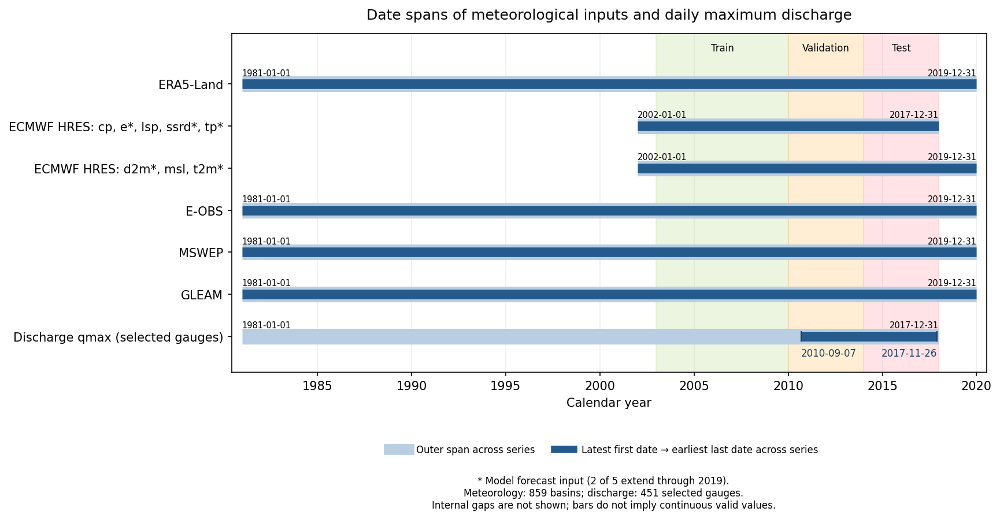

*Hình dùng các mốc tổng hợp đã đo trong Phần 2; không nội suy hay tạo thêm quan trắc. Bản hình được kiểm chữ và khoảng cách trước khi đưa vào tài liệu.* — 2.15

Hình Figures/A1_P2_source_date_spans.png dùng thanh nhạt cho khoảng ngoài cùng giữa các chuỗi,
thanh đậm từ **ngày đầu muộn nhất đến ngày cuối sớm nhất**. Với qmax của 451, thanh nhạt là
01/01/1981–31/12/2017, thanh đậm là 07/09/2010–26/11/2017. Không có nghĩa mọi trạm thiếu trước 2010.
Hình không biểu diễn ô thiếu ở giữa và thanh đậm không bảo đảm mỗi ngày đều có đủ số ở mọi trạm.
Hai nhóm ECMWF được tách theo ngày cuối; dấu * đánh dấu 5 biến forecast dùng trong mô hình.

## 15. Bảng nào cần dùng lại thay vì tính từ ảnh hoặc dòng in?

Các bảng nằm trong WORK_DIR/Tables; hình nằm trong WORK_DIR/Figures. Một số tệp chính:

| Nhóm kết quả | Tệp/bộ tệp chính |
|---|---|
| Cấu trúc và ID | A1_P2_file_inventory.csv; A1_P2_daily_headers.csv; A1_P2_id_links.csv |
| Mốc khí tượng | A1_P2_forcing_coverage.csv; A1_P2_forcing_file_spans.csv |
| Mốc/chất lượng Q | A1_P2_Q_coverage.csv; A1_P2_Q_file_spans.csv; A1_P2_negative_Q_rows.csv |
| Thứ tự và mặt nạ | A1_P2_Q_quality_per_basin.csv; A1_P2_Q_quality_diagnostics.csv |
| Số 0 | A1_P2_qmax_zero_by_basin_period.csv; A1_P2_qmax_zero_period_summary.csv |
| Thiếu theo kỳ | A1_P2_Q_missing_by_basin.csv; A1_P2_Q_missing_by_period.csv; A1_P2_late_gauges.csv |
| Thuộc tính/tập chọn | A1_P2_attribute_ID_sets.csv; A1_P2_23_gauge_profiles.csv; A1_P2_u_l_cohort_check.csv |
| Kiểm bổ sung | Các tệp extra_low_impact_*, low_impact_start_*, start_year_probe_*, Q94_* có tiền tố A1_P2_ |

Bảng diagnostics chỉ giữ mẫu qmax=0 giới hạn cho từng ID, không phải toàn bộ ngày 0.
Muốn đếm số 0 phải dùng bảng profile hoặc quét gốc, không đếm các ví dụ được in ra.

## 16. Các kết luận sử dụng được và câu hỏi còn mở

Có thể dùng tập ID 451 đã kiểm để nối khí tượng, Q và thuộc tính bằng khóa ID; không nối theo số thứ tự dòng.
Giữ nguyên dữ liệu gốc, số 0 và danh sách basins_filtered.txt. Chưa có căn cứ loại thêm lưu vực,
loại cả ngày chỉ vì qmin âm, hoặc điền toàn bộ ô rỗng bằng 0. Mốc đầu/cuối chỉ dùng mô tả độ phủ,
chưa thay thế bộ lọc mẫu huấn luyện. Không dùng quan sát test để đặt tiêu chí lựa chọn mô hình.

| Nội dung đã khảo sát | Vị trí kết quả và giới hạn |
|---|---|
| Thuộc tính, diện tích, scaler và bản đồ | Mục 17; giữ riêng sai khác so bài và scaler thiếu |
| Thiếu theo kỳ/năm/đoạn, gaps và ca 410 | Mục 18; tổng hợp giờ–ngày tại 19.11–19.12 |
| Phân phối Q/khí tượng, SWE và giá trị lặp | Mục 19; chưa xác nhận nguyên nhân vật lý hoặc mọi phép đổi đơn vị CSV |
| Năm cặp khí tượng, mùa và tương quan | Mục 20; bức xạ net/downward chưa tương đương |
| Cửa sổ 365/730 ngày và nguồn từng config | Mục 21; cache train chưa có nội dung để xác nhận |
| Phân phối nhãn, NSE tác giả và bốn hồ sơ | Mục 22–23; phân biệt tác giả với export A2 |
| Ngưỡng bốn mức, Gumbel và cụm vượt | Mục 24; mẫu ngắn, thiếu quan trắc và ranh giới chưa xác định được giữ riêng |
| Tổng hợp và bàn giao | Phần 11 tại Mục 25 |

Nguồn Q giờ có đủ 452 tệp cho 451 ID mô hình và ca 410. Cell 2.5 dùng nguồn sẵn có/cache trước, tải khi thiếu; nguồn này phục vụ phép đối chiếu, không thêm vào đầu vào mô hình ngày. Các câu hỏi chưa xác nhận được tập trung tại Phần 11, không coi chúng là những phép đo đã thực hiện.

## 17. Thuộc tính lưu vực và lớp bản đồ: Phần 3

### 17.1. Vì sao có 63 cột nhưng nói 62 thuộc tính?

| Tệp A/1_attributes | Số dòng | Tổng cột | Cột ngoài ID | Khớp tập A/451 |
|---|---:|---:|---:|---|
| Catchment_attributes.csv | 859 | 63 | 62 | Đúng tập 859, đủ 451 |
| Stream_dist.csv | 859 | 2 | 1 | Đúng tập 859, đủ 451 |
| Water_balance.csv | 859 | 10 | 9 | Đúng tập 859, đủ 451 |

Nguồn số đo: output cell 3.1, bảng kiểm kê và danh sách cột; bảng xuất ra là `A1_P3_A_attribute_inventory.csv` và `A1_P3_A_attribute_schema.csv`. Cả ba bảng không có ID rỗng, ID sai định dạng hoặc ID trùng sau chuẩn hóa. Đây là xác nhận khóa và tập ID, **chưa xác nhận các giá trị thuộc tính đều đầy đủ hoặc hợp lý**.

`ID` dùng để biết hàng thuộc lưu vực nào, không tính là một thuộc tính vật lý. Do đó 63 cột = 1 cột khóa + 62 thuộc tính. Tương tự, không cộng các cột ID của ba tệp để tuyên bố có thêm biến mô hình.

### 17.2. Các nhóm cột trong Catchment_attributes.csv

Bảng dưới phân nhóm 62 **tên cột đã đọc thật** để thuận tiện học và kiểm. Phân nhóm không thay thế từ điển đơn vị, định nghĩa hay kỳ tính của từng trường. Không dùng tên gần giống để tự coi hai biến là tương đương.

| Nhóm đọc schema | Số cột | Các trường |
|---|---:|---|
| Địa hình, hình dạng và mạng sông | 10 | `area_calc`, `elev_mean`, `elev_med`, `elev_std`, `elev_ran`, `slope_mean`, `mvert_dist`, `mvert_ang`, `elon_ratio`, `strm_dens` |
| Chỉ số khí hậu | 13 | `p_mean`, `et0_mean`, `eta_mean`, `arid_1`, `arid_2`, `p_season`, `frac_snow`, `hi_prec_fr`, `hi_prec_du`, `hi_prec_ti`, `lo_prec_fr`, `lo_prec_du`, `lo_prec_ti` |
| Lớp phủ | 7 | `lc_dom`, `agr_fra`, `bare_fra`, `forest_fra`, `glac_fra`, `lake_fra`, `urban_fra` |
| Thực vật | 6 | `lai_max`, `lai_diff`, `ndvi_max`, `ndvi_min`, `gvf_max`, `gvf_diff` |
| Đất | 10 | `bedrk_dep`, `root_dep`, `soil_poros`, `soil_condu`, `soil_tawc`, `sand_fra`, `silt_fra`, `clay_fra`, `grav_fra`, `oc_fra` |
| Địa chất | 16 | `gc_dom`, `gc_ig_fra`, `gc_mt_fra`, `gc_pa_fra`, `gc_pb_fra`, `gc_pi_fra`, `gc_py_fra`, `gc_sc_fra`, `gc_sm_fra`, `gc_ss_fra`, `gc_su_fra`, `gc_va_fra`, `gc_vb_fra`, `gc_wb_fra`, `geol_perme`, `geol_poros` |

Ví dụ, `elev_mean`, `elev_med`, `elev_std` và `elev_ran` mô tả các mặt khác nhau của địa hình, không phải bốn bản sao của một độ cao. `lc_dom` và `gc_dom` cần được kiểm như mã lớp; kể cả khi mã chuyển được thành số cũng không tự có nghĩa là đại lượng liên tục. Căn cứ định nghĩa và đơn vị phải tra [LamaH-CE, Mục 5 và các bảng Phụ lục A](https://essd.copernicus.org/articles/13/4529/2021/#section5). Các số 10/13/7/6/10/16 ở bảng này là phép nhóm schema Extended đã đọc, không gán lại số trường của từng bảng trong bài gốc.

### 17.3. Các bảng khác có tự trở thành đầu vào mô hình không?

Không. `Stream_dist.csv` có ID và `dist_hup`. `Water_balance.csv` có ID và P, PCRPS, PERA5, PMSW, PET, ET0, ETA, Q1, Q2. Tên, đơn vị, kỳ tính và cách dùng những trường này cần đối chiếu metadata; chưa đủ căn cứ suy toàn bộ ý nghĩa chỉ từ các chữ viết tắt.

[Hàm load_lamah_attributes hiện dùng](../../../NeuralHydrology/neuralhydrology/datasetzoo/lamah.py#L265) đọc `Catchment_attributes.csv` của mức lưu vực và `Gauge_attributes.csv` của trạm, rồi ghép theo ID. Hàm này không tự đọc mọi CSV trong thư mục thuộc tính. Vì vậy:

- Bảng có mặt trong dataset không đồng nghĩa bảng được bộ nạp đưa vào mô hình.
- Cột có trong bảng bộ nạp đọc không đồng nghĩa cấu hình yêu cầu cột đó.
- Khớp tập ID không cho phép ghép theo vị trí dòng. Các tệp có thể sắp hàng khác nhau.

**Ví dụ minh họa về ghép bảng:** hai bảng có cùng hai ID 2 và 6, nhưng một bảng sắp 2–6, bảng kia sắp 6–2. Ghép theo số thứ tự sẽ gắn thuộc tính của 6 sang dữ liệu của 2; ghép theo khóa ID vẫn đúng. Đây là ví dụ logic, không phải phát hiện hai tệp hiện tại sắp khác nhau.

Ngoài ra cần phân biệt `qmean` trong chuỗi D theo ngày với `q_mean` trong bảng Hydro_indices. Chúng nằm ở hai loại bảng khác nhau; không lấy chỉ số cố định theo nhiều năm làm bản thay thế cho chuỗi qmean ngày. Muốn dùng một chỉ số tổng hợp làm đặc trưng còn phải kiểm đơn vị, kỳ tính và thông tin mà nó sử dụng.

### 17.4. Xác nhận 33 thuộc tính từ 24 cấu hình

[Bảng A2 BiasCast](https://hess.copernicus.org/articles/30/5067/2026/index.html#appendixA) và [STATIC_ATTR_COLS trong mã phân tích của tác giả](../../../PaperResearch/PaperResearchCode/BiasCast/Inspect_Experiments/code/wasserstein_distance_static_attributes.py#L62) là căn cứ về danh sách thuộc tính. Phép đọc trực tiếp tại cell 3.2 xác nhận **24/24 tệp cấu hình có cùng 33 tên, cùng thứ tự khai báo**, một tập S1 và một mẫu thứ tự O1. Cả 33 trường đều có trong Catchment_attributes.csv; không có tên thiếu, trùng nguồn A/D hoặc thuộc tính Gauge được yêu cầu trong các cấu hình này.

Nguồn số đo: bảng nhóm cấu hình và ánh xạ tên của cell 3.2; bảng đầy đủ lưu thành `A1_P3_static_configs.csv`, `A1_P3_static_config_summary.csv` và `A1_P3_static_attribute_sources.csv`. Đây là số tệp cấu hình, không tự xác nhận 24 run đều hoàn tất huấn luyện. Mỗi thuộc tính có mặt trong cả 24 cấu hình.

| Nhóm | Số trường dùng | Tên trường |
|---|---:|---|
| Địa hình và hình dạng | 10 | area_calc, elev_mean, elev_med, elev_std, elev_ran, slope_mean, mvert_dist, mvert_ang, elon_ratio, strm_dens |
| Chỉ số khí hậu | 11 | p_mean, et0_mean, eta_mean, arid_1, arid_2, p_season, frac_snow, hi_prec_fr, hi_prec_du, lo_prec_fr, lo_prec_du |
| Lớp phủ | 6 | lc_dom, agr_fra, bare_fra, forest_fra, lake_fra, urban_fra |
| Thực vật | 6 | lai_max, lai_diff, ndvi_max, ndvi_min, gvf_max, gvf_diff |

**62−33=29 trường không được cấu hình nào yêu cầu**: hai trường thời điểm mùa `hi_prec_ti`, `lo_prec_ti`; `glac_fra`; toàn bộ 10 trường đất; toàn bộ 16 trường địa chất của bảng schema ở 17.2. Không dùng một trường không có nghĩa đặc tính vật lý tương ứng không quan trọng; ở đây chỉ xác nhận hợp đồng đầu vào của các cấu hình đã đọc.

### 17.5. Đơn vị và cách đọc những giá trị mẫu

Các bảng metadata nguồn dưới đây giải thích đơn vị; số mẫu là các chuỗi giá trị đã in ở cell 3.2, chưa phải min/max toàn bộ dữ liệu.

**Địa hình — [Bảng A3 LamaH-CE](https://essd.copernicus.org/articles/13/4529/2021/essd-13-4529-2021-t05.xlsx):**

| Trường | Cách đọc và đơn vị |
|---|---|
| area_calc | Diện tích tính từ lưu vực, km² |
| elev_mean, elev_med | Độ cao trung bình, trung vị, m so với mực nước biển |
| elev_std, elev_ran | Độ lệch chuẩn và khoảng chênh cao, m |
| slope_mean | Độ dốc trung bình, **m/km** |
| mvert_dist | Khoảng cách ngang từ điểm xa nhất của lưu vực tới trạm, km |
| mvert_ang | Hướng trục nối điểm xa nhất với trạm so với Bắc, độ |
| elon_ratio | Chỉ số kéo dài, không thứ nguyên |
| strm_dens | Mật độ chiều dài mạng sông trên diện tích, km/km² |

Ví dụ đã thấy `slope_mean=368`: đọc là 368 m/km, tương đương tỷ số dốc 0,368 hay 36,8%, **không phải 368°**. `elev_mean=1775` là độ cao trung bình lưu vực; không tự dùng độ cao của mốc trạm trong Gauge_attributes để thay thế đại lượng này.

**Khí hậu — [Bảng A4 LamaH-CE](https://essd.copernicus.org/articles/13/4529/2021/essd-13-4529-2021-t06.xlsx):**

| Trường | Cách đọc và đơn vị |
|---|---|
| p_mean | Mưa trung bình ngày nhiều năm, mm/ngày |
| et0_mean | Bốc thoát hơi tham chiếu trung bình ngày, mm/ngày |
| eta_mean | Tổng bốc thoát hơi trung bình ngày, mm/ngày |
| arid_1 | Tỷ số ET0 trung bình/mưa trung bình của hai nguồn quy định, không thứ nguyên |
| arid_2 | Nghịch đảo chỉ số khô hạn từ Climate Database v2, không thứ nguyên |
| p_season | Chỉ số mùa mưa, không thứ nguyên; dấu có ý nghĩa mùa |
| frac_snow | Tỷ phần mưa rơi dưới dạng tuyết theo cách xác định của nguồn, không thứ nguyên |
| hi_prec_fr, lo_prec_fr | Tần số ngày mưa lớn/ngày khô, ngày/năm |
| hi_prec_du, lo_prec_du | Thời lượng trung bình các đợt tương ứng, ngày |

Ví dụ `hi_prec_fr=9.25` là tần số trung bình khoảng 9,25 ngày/năm theo ngưỡng của nguồn, không phải 9,25% và cũng không bắt buộc là số nguyên. Đây là thuộc tính khí hậu cố định theo lưu vực trong bảng, khác với lượng mưa của một ngày cụ thể. Các kỳ tính khác nhau cần đọc cùng chú thích a/b của Bảng A4, không tự coi mọi chỉ số đều được tính trên kỳ train.

**Lớp phủ — [Bảng A6 LamaH-CE](https://essd.copernicus.org/articles/13/4529/2021/essd-13-4529-2021-t08.xlsx):** `lc_dom` là mã lớp CORINE ba chữ số; `agr_fra`, `bare_fra`, `forest_fra`, `lake_fra`, `urban_fra` là tỷ phần, không phải phần trăm. Ví dụ `forest_fra=0.322` tương ứng 32,2% diện tích. Không diễn giải mã 321 là diện tích 321, hoặc lớp 321 “lớn hơn về vật lý” lớp 112.

**Thực vật — [Bảng A7 LamaH-CE](https://essd.copernicus.org/articles/13/4529/2021/essd-13-4529-2021-t09.xlsx):** các chỉ số không thứ nguyên, lấy từ các trung bình tháng dài hạn. `max` là cực đại giữa các tháng; `diff` là cực đại trừ cực tiểu, không phải biến động ngày kế tiếp. `gvf_diff=1.02` chưa phải lỗi: [Mục 5.5](https://essd.copernicus.org/articles/13/4529/2021/#section5) nêu GVF có thể ngoài 0–1 và không bị cắt ngưỡng trong bộ nguồn. Tương tự, không loại `ndvi_min=-0.01` chỉ vì dấu âm.

Những giải thích này xác định cách đọc theo metadata nguồn. Phép kiểm tại 3.3 xác nhận tính đầy đủ và các khoảng giá trị ở 17.7; điều đó chưa xác nhận mọi giá trị đều đúng về vật lý hoặc mọi định nghĩa đều đã được đối chiếu.

### 17.6. Thuộc tính phân loại được bộ nạp xử lý thế nào?

`lc_dom` là biến phân loại về mặt ý nghĩa, dù CSV ghi mã bằng số. Luồng mã đang dùng chọn các trường được cấu hình yêu cầu, rồi sắp cột theo alphabet, tính trung bình/độ lệch chuẩn và chuẩn hóa dạng số trước khi tạo tensor. Do vậy, thứ tự O1 kiểm ở 3.2 là thứ tự khai báo YAML, **chưa phải thứ tự cuối cùng trong tensor**. Xem [chọn cột](../../../NeuralHydrology/neuralhydrology/datasetzoo/basedataset.py#L693), [sắp thứ tự và chuẩn hóa](../../../NeuralHydrology/neuralhydrology/datasetzoo/basedataset.py#L722).

Luồng này không tự tách mã `lc_dom` thành các cột chỉ báo 0/1 theo lớp. Đây là hành vi mã để tái lập, không phải bằng chứng mã CORINE có thứ tự vật lý. Tài liệu chưa quyết định thay cách mã hóa, thay danh sách biến hoặc thay công thức chuẩn hóa. [Kiểm thuộc tính của thư viện](../../../NeuralHydrology/neuralhydrology/datautils/utils.py#L145) cũng kiểm giá trị thiếu và độ lệch chuẩn bằng 0/NaN; vì vậy sự hiện diện của đủ 33 tên chưa bảo đảm bảng dùng được cho huấn luyện.

### 17.7. Kết quả chất lượng và khoảng giá trị của thuộc tính — 3.3

| Phạm vi | Số trường | Ô rỗng | Ô -999 | Vô hạn | Nội dung không chuyển số ngoài các trường chữ đã xác định | Cột có độ lệch chuẩn số bằng 0 |
|---|---:|---:|---:|---:|---:|---:|
| 859, toàn bộ Catchment | 62 | 1 | 0 | 0 | 0 | 0 |
| 859, trường mô hình dùng | 33 | 0 | 0 | 0 | 0 | 0 |
| 451, toàn bộ Catchment | 62 | 1 | 0 | 0 | 0 | 0 |
| 451, trường mô hình dùng | 33 | 0 | 0 | 0 | 0 | 0 |

Nguồn: output cell 3.3; các bảng `A1_P3_static_attribute_quality.csv`, `A1_P3_static_quality_summary.csv`, `A1_P3_static_model_ranges.csv`, `A1_P3_static_quality_issues.csv`, `A1_P3_lc_dom_counts.csv`. Ba cột chữ gc_dom, hi_prec_ti, lo_prec_ti được nhận diện là phân loại, không gán mọi chuỗi chữ của chúng thành lỗi. Danh mục từng mã chữ chưa được kiểm hết.

**33 trường đầu vào hiện tại không cần điền khuyết**, không có -999/vô hạn/nội dung không phải số, và không có cột hằng trong cả 859 lẫn 451. Đây là xác nhận các điều kiện vừa kiểm, không phải chứng nhận toàn bộ giá trị đều chính xác. Ô rỗng duy nhất nằm ở `geol_perme`, được định vị tại **ID 651** trong tập 451 khi kiểm 3.4; cột này không được các cấu hình yêu cầu. Chỉ cần thiết kế xử lý ô đó nếu mở rộng đầu vào sang trường này.

Các khoảng sau thuộc **451 lưu vực**, không phải min/max chung của 859. Phân vị được tính trên các giá trị số hữu hạn khác -999; trong 33 trường không có giá trị phải bỏ theo quy tắc này. lc_dom được trình bày riêng vì là mã lớp.

| Thuộc tính | Min | Trung vị | p99 | Max |
|---|---:|---:|---:|---:|
| area_calc | 3,972 | 101,465 | 1760,4945 | 15025,609 |
| elev_mean | 221 | 794 | 2726 | 3122 |
| elev_med | 219 | 776 | 2742,5 | 3129 |
| elev_std | 16 | 194 | 508 | 548 |
| elev_ran | 101 | 1020 | 2428,5 | 2745 |
| slope_mean | 42 | 184 | 458,5 | 490 |
| mvert_dist | 2,3 | 15,8 | 76,4 | 209,3 |
| mvert_ang | 1 | 129 | 355,5 | 359 |
| elon_ratio | 0,381 | 0,719 | 1,0985 | 1,208 |
| strm_dens | 0,03 | 0,58 | 1,09 | 1,41 |
| p_mean | 1,80 | 3,36 | 5,325 | 5,47 |
| et0_mean | 1,55 | 2,24 | 2,695 | 2,83 |
| eta_mean | 0,25 | 1,60 | 1,93 | 2,04 |
| arid_1 | 0,37 | 0,67 | 1,35 | 1,51 |
| arid_2 | 0,32 | 0,71 | 1,665 | 1,80 |
| p_season | 0,07 | 0,37 | 0,555 | 0,60 |
| frac_snow | 0,05 | 0,13 | 0,52 | 0,61 |
| hi_prec_fr | 7,45 | 11,70 | 19,275 | 20,05 |
| hi_prec_du | 1,05 | 1,18 | 1,27 | 1,30 |
| lo_prec_fr | 149,20 | 185,35 | 243,70 | 247,70 |
| lo_prec_du | 2,68 | 3,13 | 3,975 | 4,24 |
| agr_fra | 0 | 0,287 | 0,848 | 0,927 |
| bare_fra | 0 | 0 | 0,6415 | 0,758 |
| forest_fra | 0 | 0,441 | 0,897 | 0,999 |
| lake_fra | 0 | 0 | 0,068 | 0,184 |
| urban_fra | 0 | 0,028 | 0,168 | 0,510 |
| lai_max | 0,01 | 3,66 | 5,03 | 5,56 |
| lai_diff | 0,01 | 3,33 | 4,69 | 5,09 |
| ndvi_max | -0,02 | 0,74 | 0,83 | 0,86 |
| ndvi_min | -0,11 | 0,21 | 0,365 | 0,40 |
| gvf_max | -0,03 | 0,87 | 1,105 | 1,17 |
| gvf_diff | 0,03 | 0,70 | 1,08 | 1,21 |

**Góc không phải trục số thông thường.** mvert_ang từ 1° đến 359°. Chênh lệch số thông thường giữa hai giá trị biên là 358°, nhưng khoảng cách hướng ngắn nhất trên vòng là 2°. Chuẩn hóa dạng số của mã gốc không tự sửa tính tuần hoàn này. Chưa đổi sang biểu diễn sin/cos trong tái lập.

**Diện tích có đuôi phải dài.** Max 15025,609 km² lớn hơn nhiều trung vị 101,465 km² và p99 1760,4945 km²; độ lệch chuẩn mẫu là 915,194586 km². Đây là căn cứ cần xem phân phối trên thang log khi trực quan hóa. Mức vài lưu vực lớn chi phối trung bình/độ lệch chuẩn hoặc huấn luyện chưa được định lượng chỉ từ bảng này; chưa tự log-transform đầu vào hoặc loại lưu vực lớn.

**elon_ratio cần đọc cùng công thức và chiều dài được định nghĩa.** [Bảng A3 LamaH-CE](https://essd.copernicus.org/articles/13/4529/2021/essd-13-4529-2021-t05.xlsx) dùng Re = 2√(A/π)/L, với A=area_calc và L=mvert_dist, khoảng cách ngang từ điểm xa nhất tới trạm. L này không tự đồng nhất với đường kính lớn nhất của hình lưu vực. Ví dụ hình học minh họa: lưu vực là nửa hình tròn bán kính R, trạm ở trung điểm cạnh đường kính, thì A=πR²/2, L=R và Re=√2>1. Ví dụ không phải hình lưu vực đã đo; nó chỉ cho thấy định nghĩa trên không tự áp giới hạn Re≤1. Kết quả đối chiếu số thực tế tại 3.4 nằm ở 17.10.

### 17.8. Mã lớp phủ và số lưu vực

Tên lớp dưới đây đã đối chiếu [hướng dẫn phân loại chính thức của Copernicus](https://land.copernicus.eu/content/corine-land-cover-nomenclature-guidelines/html/index.html), không chỉ dựa vào trí nhớ. Bảng đếm lấy từ output 3.3.

| Mã lc_dom | Diễn giải tên lớp | Số lưu vực A | Số lưu vực được chọn |
|---|---|---:|---:|
| 112 | Đô thị không liên tục | 4 | 3 |
| 211 | Đất canh tác không tưới | 177 | 82 |
| 231 | Đồng cỏ chăn nuôi | 79 | 49 |
| 242 | Khu canh tác hỗn hợp | 6 | 4 |
| 311 | Rừng lá rộng | 21 | 10 |
| 312 | Rừng lá kim | 358 | 182 |
| 313 | Rừng hỗn giao | 84 | 51 |
| 321 | Đồng cỏ tự nhiên | 75 | 33 |
| 322 | Truông và thảm cây bụi thấp | 1 | 1 |
| 332 | Đá trơ | 46 | 30 |
| 333 | Thảm thực vật thưa | 6 | 4 |
| 335 | Sông băng và tuyết vĩnh cửu | 2 | 2 |
| Tổng | | 859 | 451 |

Đây là **số lưu vực có lớp chiếm ưu thế**, không phải diện tích cộng dồn của từng lớp. Ví dụ 182/451 trạm có lc_dom=312 không có nghĩa 182 lưu vực đều phủ 100% rừng lá kim hoặc 40,35% tổng diện tích là rừng lá kim. Mã hiếm 322/335/112 có 1/2/3 lưu vực trong tập chọn; mọi kết luận so mô hình theo từng mã đó cần đọc cùng cỡ nhóm nhỏ. Sự giống nhau tương đối của tần số lớp cũng chưa chứng minh tập chọn giống toàn bộ A ở mọi đặc điểm.

### 17.9. Diện tích tính từ lưu vực và diện tích trạm — 3.4

Ghép Catchment_attributes và Gauge_attributes theo ID xác nhận toàn bộ 859, gồm cả 451 được chọn, có area_calc và area_gov dương, hữu hạn. Không có mẫu số 0/rỗng trong tập A đã kiểm. Tỷ số metadata area_ratio cũng hữu hạn ở mọi ID. Không suy kết quả này sang 23 trạm D không có A.

Định nghĩa dùng trong phép đo: chênh tương đối = 100 × (area_calc/area_gov − 1); các thống kê dưới đây lấy trị tuyệt đối của chênh đó.

| Phạm vi | Số cặp diện tích hợp lệ | Trung vị chênh tuyệt đối (%) | p99 (%) | Max (%) | Max sai khác tỷ số với metadata |
|---|---:|---:|---:|---:|---:|
| 859 | 859 | 0,554803 | 9,452876 | 33,971246 | 0,0005 |
| 451 | 451 | 0,684452 | 8,685852 | 33,971246 | 0,0005 |

Sai khác tỷ số không vượt 0,0005 phù hợp mức làm tròn ba chữ số thập phân của area_ratio. [LamaH-CE Mục 3](https://essd.copernicus.org/articles/13/4529/2021/#section3) nêu dải 0,89–1,34; trường hợp lớn nhất được in ở đây cũng làm tròn thành 1,340. Sự khớp này không chứng minh hai diện tích bằng nhau hoặc diện tích nào đúng hơn tại một trạm.

| ID | Tên trạm | Quốc gia | area_calc (km²) | area_gov (km²) | Chênh (%) |
|---|---|---|---:|---:|---:|
| 205 | Waldbachstrub | Áo | 41,933 | 31,3 | +33,971246 |
| 265 | Polsterlucke | Áo | 17,423 | 15,6 | +11,685897 |
| 110 | Koessen-Waidach | Áo | 109,769 | 100,0 | +9,769000 |
| 112 | Kees | Áo | 20,971 | 19,2 | +9,223958 |
| 217 | Weissenbach am Attersee | Áo | 33,914 | 31,2 | +8,698718 |
| 600 | St. Stefan OWF | Áo | 22,930 | 21,1 | +8,672986 |
| 743 | Gammertingen | Đức | 154,410 | 168,9 | −8,579041 |
| 561 | Feldkirchen (Tiebel) | Áo | 64,761 | 60,2 | +7,576412 |
| 593 | Reifnitz | Áo | 35,585 | 33,2 | +7,183735 |
| 200 | Archkogl | Áo | 122,615 | 114,4 | +7,180944 |

Đây là 10 trường hợp lớn nhất theo chênh tuyệt đối trong 451, không phải một ngưỡng loại được xác nhận. Chín trạm ở Áo và một trạm ở Đức; không đủ căn cứ suy quốc gia là nguyên nhân. Trạm 205 chênh nhiều nhất nhưng chưa có bằng chứng để tự thay mẫu số hoặc loại khỏi thí nghiệm.

**Ví dụ từ số đo 205:** với cùng Q, q tính bằng area_calc chia cho q tính bằng area_gov là 31,3/41,933 ≈ 0,746429. Vì vậy, đổi mẫu số từ area_gov sang area_calc làm giá trị mm/ngày giảm khoảng **25,3571%**, không phải giảm 33,9712%. Hai tỷ lệ khác mẫu số. Hệ số đổi Q→mm/ngày lần lượt là 2,760383 với area_gov và 2,060430 với area_calc; đây là các hệ số, không phải số đo Q mới.

### 17.10. Đối chiếu công thức elon_ratio — 3.4

| Phạm vi | L không dương/không hữu hạn | Số ID có Re lưu trữ >1 | Trung vị sai khác tuyệt đối | Max sai khác tuyệt đối |
|---|---:|---:|---:|---:|
| 859 | 0 | 31 | 0,000700 | 0,012241 |
| 451 | 0 | 21 | 0,000932 | 0,012241 |

Trong tập 451, trung vị sai khác là **0,000932**; 0,000700 là kết quả của toàn bộ 859. Công thức dùng A theo km² và L theo km tái hiện gần giá trị lưu trữ, không có dấu hiệu sai một hệ số đơn vị lớn từ phép kiểm này. Chưa chứng minh nguồn tạo thuộc tính hoặc mọi hình lưu vực đều chính xác.

Ví dụ ID 43 có area_calc=86,967 km² và mvert_dist=8,7 km. Đường kính tròn tương đương khoảng 10,523 km, nên tỷ số tính lại là 1,209520 so với giá trị lưu 1,208. Nó lớn hơn 1 vì tử số lớn hơn L; không cần giả định sai đơn vị để có kết quả đó. Sai khác tối đa 0,012241 có thể liên quan làm tròn chiều dài, nhưng nguyên nhân này chưa được kiểm; không ghi như kết luận đã xác nhận.

Nguồn số đo 3.4: `A1_P3_area_shape_by_basin.csv`, `A1_P3_area_audit_summary.csv`, `A1_P3_shape_audit_summary.csv`. Chưa sửa thuộc tính, hình học, mẫu số chuẩn hóa hoặc danh sách lưu vực từ các chênh lệch trên.

### 17.11. Mã có thực sự đổi nhãn Q sang mm/ngày không?

Cần đọc đủ hai tầng gọi hàm, không chỉ xem giá trị tham số ở hàm đọc. Trong [LamaH._load_basin_data](../../../NeuralHydrology/neuralhydrology/datasetzoo/lamah.py#L125), dữ liệu Q được đọc với normalize_discharge=False, rồi ngay sau đó được đưa qua _normalize_discharge với diện tích self._basin_area. [Diện tích này lấy từ area_gov](../../../NeuralHydrology/neuralhydrology/datasetzoo/lamah.py#L78). [Hàm đổi đơn vị](../../../NeuralHydrology/neuralhydrology/datasetzoo/lamah.py#L303) dùng Q×86,4/area_gov cho dữ liệu ngày.

Do đó, **False ở hàm đọc không có nghĩa nhãn đầu ra của luồng LamaH giữ nguyên m³/s**. Cờ đó tránh đổi ngay trong hàm đọc; phép đổi vẫn được gọi rõ ràng ở tầng trên. Không có bước chờ một cờ normalize_discharge của từng YAML để kích hoạt lệnh gọi này. Đoạn tương ứng cũng có trong [bản mã tác giả lưu trong repo](../../../PaperResearch/PaperResearchCode/BiasCast_NH/neuralhydrology/datasetzoo/lamah.py#L125).

Phát biểu này áp dụng khi qmax là nhãn được xử lý qua lớp LamaH hiện tại. Nó xác nhận hành vi mã, không thay phép kiểm phiên bản bộ nạp và dữ liệu của mọi run bất kỳ. Đối chứng A2 đã so thống kê qmax từ D theo mm/ngày với tệp chuẩn hóa của tác giả và ghi nhận khớp, xem [Mục 6.3 của ghi chú dữ liệu](../../../Document/03_Data/01_LamaHCE.md). Phép kiểm 3.4 tập trung vào thuộc tính diện tích/hình dạng, không đọc đầu ra của cả 24 run.

Đổi Q theo diện tích là bước đổi **đơn vị vật lý trước chuẩn hóa thống kê**; chuẩn hóa trung bình/độ lệch chuẩn để huấn luyện là bước khác. Giữ hai bước riêng khi giải thích nhãn và dự báo.

### 17.12. Kiểm kê lớp bản đồ, hệ tọa độ và khóa ghép — 3.5

Hai lớp đã được đọc từ input Kaggle và đối chiếu với tập ID của CSV. Cột hình học được tính trong số cột dưới đây.

| Lớp | Đối tượng | Số cột | Hình học | CRS | Đơn vị trục |
|---|---:|---:|---|---|---|
| A/Basins_A.shp | 859 | 64 | 859 Polygon | EPSG:3035 | mét |
| D/Gauges.shp | 882 | 30 | 882 Point | EPSG:3035 | mét |

Cả hai lớp có **0 hình học thiếu, 0 hình học rỗng và 0 hình học không hợp lệ trong tập không rỗng**; các cận tọa độ đều hữu hạn. Đây là ba phép kiểm khác nhau: thiếu nghĩa là không có giá trị hình học; rỗng nghĩa là có đối tượng hình học nhưng không có phần không gian; không hợp lệ là vi phạm điều kiện hình học được thư viện kiểm. Không gộp các nhóm này thành một loại lỗi.

| Lớp | ID duy nhất | ID không hợp lệ | Dòng thuộc ID trùng | Thiếu so CSV tương ứng | Thừa so CSV tương ứng | Thiếu trong 451 |
|---|---:|---:|---:|---:|---:|---:|
| A/Basins_A.shp | 859 | 0 | 0 | 0 | 0 | 0 |
| D/Gauges.shp | 882 | 0 | 0 | 0 | 0 | 0 |

Tập ID của đa giác khớp chính xác tập A khí tượng; tập ID của điểm trạm khớp chính xác tập D lưu lượng ngày. Vì vậy, có thể ghép các thuộc tính CSV và hình học **bằng ID**, với kiểm tra quan hệ một–một. Không ghép theo vị trí dòng: dòng đầu của hai tệp không mặc nhiên là cùng một lưu vực. A có ID, 62 thuộc tính Catchment và geometry; lớp D có thêm các trường khoảng cách, độ dốc và mạng sông so với bảng Gauge_attributes, nhưng phép kiểm này chưa xác nhận nội dung các trường mạng đó.

Phạm vi tọa độ đo được trong CRS gốc:

| Lớp | xmin (m) | ymin (m) | xmax (m) | ymax (m) |
|---|---:|---:|---:|---:|
| A | 4183467,384 | 2580301,968 | 4930898,940 | 3038515,419 |
| D | 4192433 | 2596838 | 4917967 | 3021806 |

Các số này là tọa độ phẳng, không phải kinh/vĩ độ tính bằng độ. Chẳng hạn x khoảng 4,18 triệu không thể đọc như kinh độ 4,18 triệu độ. Theo [tài liệu hệ tọa độ GeoPandas](https://geopandas.org/en/stable/docs/user_guide/projections.html), CRS cho biết cách diễn giải tọa độ hình học; hình học được lưu theo thứ tự x/y. Cell bản đồ dùng trực tiếp geometry.x và geometry.y trong EPSG:3035. Hai cột thuộc tính lon/lat đọc thành int32 không được tự xem là tọa độ độ hoặc dùng thay hình học chỉ vì tên cột. Kiểu int32 chỉ là kiểu số nguyên, không xác định đơn vị.

**Phạm vi riêng của phép kiểm 3.5:** hình học hợp lệ theo thư viện chưa chứng minh trạm nằm trong/trên biên đa giác cùng ID hoặc diện tích hình học khớp area_calc. Hai quan hệ này được kiểm bổ sung tại 3.9 và có kết quả ở 17.17. Chưa kiểm toàn bộ giao nhau giữa các cặp đa giác. Lưu vực tổng thượng lưu mức A có thể lồng nhau; vì vậy, chồng lấp không tự là lỗi và không cộng diện tích 859 đa giác để suy ra diện tích vùng nghiên cứu không trùng.

Nguồn số đo: output 3.5 và ba bảng `A1_P3_geo_inventory.csv`, `A1_P3_geo_ID_checks.csv`, `A1_P3_geo_schema.csv`. Không sửa hình học, gán lại CRS hoặc dịch tọa độ từ các phép kiểm này.

### 17.13. Bộ bản đồ và số lưu vực theo quốc gia — 3.6

Cell 3.6 ghép hình học với area_calc và elev_mean từ Catchment_attributes, tên và quốc gia trạm từ Gauge_attributes. Các thuộc tính được ghép theo ID; chưa mặc định mọi bản sao thuộc tính trong shapefile đều giống CSV. Một hình gồm bốn ô để đọc cùng phạm vi không gian:

| Ô | Nội dung | Cách đọc |
|---|---|---|
| (a) | Toàn bộ 859 đa giác A, tô riêng 451 được chọn và điểm trạm tương ứng | Nền xám là tập A; màu xanh và điểm chỉ tập chọn |
| (b) | 451 lưu vực và trạm theo area_calc | Thanh màu theo thang log, đơn vị km²; không đổi thuộc tính dùng huấn luyện |
| (c) | 451 lưu vực và trạm theo elev_mean | Độ cao trung bình lưu vực, đơn vị m; không phải elev tại điểm trạm |
| (d) | 451 lưu vực và trạm theo country | Màu chỉ quốc gia đặt trạm; không phải ranh giới quốc gia hoặc toàn bộ lãnh thổ của lưu vực |

Vì diện tích trải từ 3,972 đến 15025,609 km², thang log giúp đọc cả lưu vực nhỏ lẫn lớn. Ví dụ 10→100 km² và 100→1000 km² có cùng khoảng cách trên thang log vì cùng tăng 10 lần. Độ cao dùng thang tuyến tính. Hai thanh màu thể hiện hai đại lượng khác nhau, không so màu giữa hai ô như cùng một thang đo.

Các đa giác lớn được vẽ trước, đa giác nhỏ sau và điểm trạm ở trên cùng để giảm việc che khuất trong các lưu vực lồng nhau. Cách vẽ vẫn không thể hiện độc lập mọi phần đa giác bị chồng; màu tại một vị trí có thể là màu của đa giác vẽ sau. Điểm trạm giúp nhận diện giá trị gắn với từng ID. Bản đồ quốc gia không dùng đường biên hành chính và không chứng minh một lưu vực nằm trọn trong quốc gia của trạm.

Trục hình hiển thị kilomet bằng cách chia nhãn tọa độ cho 1000; hình học vẫn giữ EPSG:3035 theo mét. Ví dụ x=4200000 m hiển thị nhãn 4200 km. Đây là đổi cách ghi nhãn, không phải chuyển hệ tọa độ.

Kết quả ghép theo ID xác nhận **859 đa giác, 859 trạm tương ứng tập A và 451 ID được chọn**. Con số 859 trạm trên bản đồ là phần D ghép được với A, không thay tổng 882 trạm của D. Bảng quốc gia từ output Kaggle:

| Quốc gia đặt trạm | Mã | Toàn bộ D | Thuộc tập A | Được chọn | Tỷ trọng trong 451 (%) | Được chọn / A của quốc gia (%) |
|---|---|---:|---:|---:|---:|---:|
| Áo | AUT | 609 | 592 | 349 | 77,38 | 58,95 |
| Thụy Sĩ | CHE | 24 | 24 | 9 | 2,00 | 37,50 |
| Séc | CZE | 61 | 61 | 5 | 1,11 | 8,20 |
| Đức | DEU | 187 | 181 | 88 | 19,51 | 48,62 |
| Liechtenstein | LIE | 1 | 1 | 0 | 0,00 | 0,00 |
| Tổng | | 882 | 859 | 451 | 100,00 | 52,50 |

Hai cột tỷ lệ được tính từ số đếm, có mẫu số khác nhau. Ví dụ Áo chiếm 349/451≈77,38% tập chọn; còn 349/592≈58,95% lưu vực A có trạm ở Áo được chọn. Tập A có trạm ở năm quốc gia, tập chọn có trạm ở bốn quốc gia. Chênh D–A gồm 17 trạm Áo và 6 trạm Đức, khớp tổng 23 ID không có A đã kiểm ở Phần 2. Các đếm không tự giải thích nguyên nhân từng trạm bị loại.

Số lưu vực theo quốc gia không cân bằng, đặc biệt chỉ có 5 trạm Séc và 9 trạm Thụy Sĩ trong tập chọn. Đây là cỡ nhóm cần ghi khi đọc thống kê theo quốc gia; chưa đủ để kết luận khác biệt chất lượng mô hình hoặc nguồn gốc sai số. Tỷ trọng số lưu vực cũng không phải tỷ trọng diện tích lãnh thổ, bởi các đa giác có thể xuyên biên giới và lồng nhau.

**Đọc hình thực tế:** tiêu đề bốn ô, trục, chú giải và hai thanh màu đều hiển thị đầy đủ, không thấy chữ chồng hoặc bị cắt trong ảnh đã nhận. Ô (b) cho thấy các giá trị diện tích trải qua nhiều bậc trên thang log. Ô (c) thể hiện các vùng màu độ cao khác nhau theo không gian; chưa định lượng quan hệ độ cao với vị trí hoặc hiệu năng mô hình. Ô (d) dùng màu quốc gia trạm đúng với bốn nhóm có số được chọn lớn hơn 0; Liechtenstein không có mục trong chú giải tập chọn vì số đếm bằng 0. Hình không thể dùng để xác nhận từng điểm nằm trong đa giác cùng ID.

Nguồn: hình PNG và bảng đếm từ output 3.6; hình được lưu nguyên bản trong thư mục Figures của repo. Các đầu ra Kaggle gồm `Figures/A1_P3_basin_maps.png`, `Tables/A1_P3_map_country_counts.csv` và `Tables/A1_P3_map_attributes.csv`. Hai bảng CSV chưa được coi là đã tải về repo chỉ vì số đếm đã được ghi trong tài liệu.

### 17.14. Phân phối diện tích và đối chiếu hai nguồn — 3.7

Cell 3.7 dùng lại các cặp diện tích đã ghép và kiểm ở 3.4, không quét lại toàn bộ chuỗi thời gian. Hình gồm histogram area_calc trên trục tuyến tính, histogram trên trục log, scatter area_gov–area_calc và histogram tỷ số area_calc/area_gov tính từ số lưu trữ. Tỷ số tính lại tránh phụ thuộc ba chữ số thập phân của metadata area_ratio.

Histogram dùng cùng biên lớp cho 859 và 451 trong mỗi ô, mỗi tập tự chuẩn hóa tổng chiều cao các bin thành 100%. Vì vậy, trục đứng là phần trăm số lưu vực của từng tập trong bin, không phải số lưu vực tuyệt đối hoặc mật độ trên một km². Ví dụ một bin có 10% trong hai tập nghĩa là khoảng 86/859 và 45/451, không phải cùng số lưu vực. Hai tập lồng nhau; hình không được đọc như so hai mẫu độc lập.

Ô tuyến tính và ô log dùng hai hệ biên lớp khác nhau: 30 bin đều theo diện tích và 30 bin đều theo log diện tích. Bin 10–100 và 100–1000 có cùng độ rộng trên trục log; không so chiều cao giữa hai ô như cùng độ rộng km². Cả hai ô giữ toàn bộ miền giá trị. Không cắt diện tích lớn ở p99 hoặc đổi đầu vào mô hình.

Scatter dùng trục log cho cả hai chiều và đường y=x. Điểm phía trên đường có area_calc lớn hơn area_gov; phía dưới có area_calc nhỏ hơn. ID 205 được chú thích dựa trên trường hợp chênh lớn đã xác nhận ở 3.4. Đường 1:1 là mốc tham chiếu, không phải mô hình hồi quy. Histogram tỷ số có mốc 1, tương ứng hai diện tích bằng nhau.

**Thống kê từ output Kaggle:** các diện tích đều tính bằng km², tỷ số không có đơn vị. p99 là phân vị, không phải ngưỡng đã dùng để cắt dữ liệu.

| Đại lượng | Phạm vi | Min | Trung vị | p99 | Max |
|---|---|---:|---:|---:|---:|
| area_calc | 859 A | 3,972 | 178,421 | 36289,86232 | 131247,215 |
| area_calc | 451 chọn | 3,972 | 101,465 | 1760,49450 | 15025,609 |
| area_gov | 859 A | 3,9 | 181,7 | 36441,454 | 131384 |
| area_gov | 451 chọn | 3,9 | 101,0 | 1762,900 | 15131 |
| area_calc/area_gov | 859 A | 0,889723 | 1,000133 | 1,090204 | 1,339712 |
| area_calc/area_gov | 451 chọn | 0,914210 | 0,999859 | 1,086859 | 1,339712 |

**Tập chọn có phân phối diện tích khác toàn bộ A.** Trung vị area_calc giảm từ 178,421 xuống 101,465 km², thấp hơn khoảng 43,13%; max của A lớn gấp khoảng 8,73 lần max tập chọn. p99 của toàn bộ A cũng lớn hơn rõ rệt. Đây là các đặc trưng quan sát được của hai tập, chưa chứng minh diện tích là tiêu chí lọc hoặc tác động con người là nguyên nhân của khác biệt. Không dùng chúng để tự tạo danh sách chọn mới.

**Scatter trả lời một câu hỏi khác:** hai diện tích của cùng một ID có gần nhau không. Các điểm sát đường 1:1 cho thấy chúng thường gần nhau trên miền nhiều bậc diện tích. Điều đó không chứng minh tập 451 có phân phối đại diện cho toàn bộ A. Cũng không chứng minh hai diện tích có thể thay thế nhau cho từng trạm: ID 205 vẫn có chênh +33,971246% theo area_gov đã đo ở 3.4, dù khi nhìn cả trục log, điểm chỉ lệch một khoảng nhỏ khỏi đường.

Trung vị tỷ số gần 1 mô tả **chênh có dấu** giữa hai diện tích. Nó không thay cho trung vị chênh tuyệt đối: trong 451, trung vị area_calc/area_gov là 0,999859, còn trung vị |100×(area_calc/area_gov−1)| là 0,684452% theo 3.4. Các chênh âm và dương có thể ở hai phía của 1; không suy tất cả ID đều có chênh gần 0 chỉ từ một trung vị tỷ số.

**Kiểm CSV số đếm đính kèm:** 180 dòng = 3 cách nhìn × 2 phạm vi × 30 bin. Mỗi phạm vi ở mỗi cách nhìn cộng đúng 859 hoặc 451, phần trăm cộng 100% trong sai số số thực; biên lớp giữa hai tập khớp nhau, các cạnh kế tiếp liên tục và phần trăm từng bin khớp số đếm/mẫu số. Đây là kiểm tính nhất quán của bảng tổng hợp, không phải đọc lại từng diện tích gốc.

| Cách nhìn và khoảng bin | 859 A: số đếm (%) | 451 chọn: số đếm (%) |
|---|---:|---:|
| Bin tuyến tính đầu [3,972; 4378,7467667) km² | 807 (93,94645%) | 449 (99,55654%) |
| Bin tỷ số chứa 1: [0,9947204317; 1,0097200851) | 490 (57,04307%) | 232 (51,44124%) |

Bin tuyến tính đầu quá rộng so với kích thước điển hình nên gom phần lớn lưu vực vào một cột, làm khó thấy cấu trúc nội bộ. Vì vậy, ô (a) hữu ích để thấy đuôi rất dài, còn ô log (b) phù hợp hơn để đọc phân bố ở miền nhỏ/trung bình. Với cách chia log hiện tại, bin cao nhất của tập chọn là [63,69385; 90,10181) km², có 62/451=13,74723%; của A là [127,45871; 180,30408) km², có 88/859=10,24447%. Đây là các bin cao nhất theo đúng cách chia này, chưa phải ước lượng một mode không phụ thuộc biên lớp.

Bin tỷ số chứa 1 không phải một dải đối xứng chính xác quanh 1 và không phải ngưỡng ±1% được thiết kế trước. Các cạnh số dài trong bảng được làm tròn để đọc; CSV giữ độ chính xác xuất ra. Không chuyển số đếm của bin thành kết luận về ngưỡng khác.

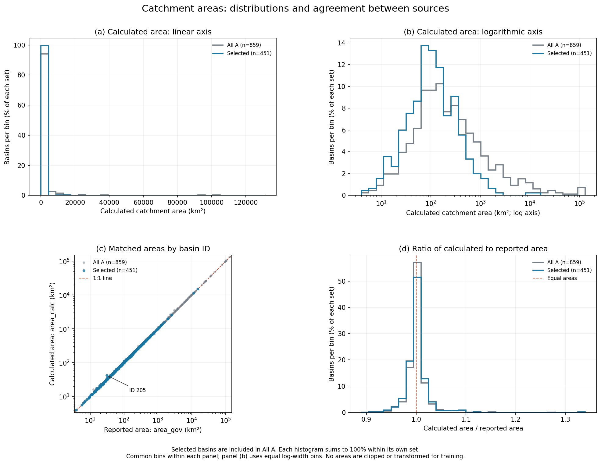

Hình đính kèm hiển thị đủ tiêu đề, trục log, chú giải, ghi chú dưới hình và mũi tên ID 205; không thấy chữ chồng/cắt. Không cần thay bố cục chỉ vì ô tuyến tính tập trung vào bin đầu: đó là hệ quả của miền giá trị và cách chia bin đã ghi rõ, được bổ sung bởi ô log.

Nguồn: bảng thống kê được gửi từ output 3.7, ảnh PNG đính kèm và [CSV số đếm thực tế](Tables/A1_P3_area_histogram_bins.csv). Ảnh và CSV được sao chép nguyên bản vào repo. `Tables/A1_P3_area_plot_summary.csv` là đầu ra notebook, chưa được coi đã tải về chỉ từ bảng dán trong hội thoại. Chưa thay mẫu số đổi đơn vị Q hoặc biến đổi thuộc tính huấn luyện.

### 17.15. Phân phối 33 thuộc tính theo nhóm — 3.8

Cell 3.8 dùng đúng 33 tên static_attributes đã đọc từ các cấu hình ở 3.2, kiểm danh sách nhóm không thiếu/thừa/trùng tên rồi vẽ bốn hình riêng: địa hình–hình dạng (10 trường), khí hậu dài hạn (11), lớp phủ (6), thực vật (6). Mỗi ô so tập 859 với tập 451, dùng biên lớp chung và phần trăm trên số ID của từng tập. Hai tập vẫn lồng nhau, không được đọc như mẫu độc lập.

32 trường số dùng histogram. area_calc dùng 20 bin đều theo log và trục log; mvert_ang dùng 18 bin từ 0 đến 360°, có ghi chú 0 và 360° là cùng hướng. Những trường số còn lại dùng 20 bin đều từ min tới max của A. Như vậy, các giá trị hợp lệ ở hai đầu đều được giữ, gồm NDVI/GVF âm và GVF lớn hơn 1. Trục đứng là phần trăm mỗi bin, không phải mật độ; không so chiều cao cột giữa hai thuộc tính khác đơn vị như cùng một đại lượng.

lc_dom dùng biểu đồ cột ghép theo mã CORINE với khoảng cách lớp bằng nhau. Mã số là nhãn; không tính trung vị hoặc p05/p95 của mã để diễn giải lớp phủ. Các phân vị chỉ được tính cho 32 thuộc tính số; tần số từng lớp được xuất riêng. Biểu diễn này phục vụ khám phá, không đổi cách mã hóa lc_dom, góc hoặc diện tích trong bộ nạp tái lập.

Các nhãn đơn vị dựa trên định nghĩa thuộc tính đã đối chiếu ở Mục 17.5. Ví dụ slope_mean là m/km, elev_mean là độ cao trung bình lưu vực theo mét, hi_prec_fr là số ngày/năm, hi_prec_du là độ dài đợt theo ngày. Các thuộc tính khí hậu dài hạn khác với các giá trị chuỗi ngày đầu vào mô hình.

Output đã xác nhận **10 địa hình + 11 khí hậu + 5 tỷ phần lớp phủ + 6 thực vật = 32 trường số**, cộng một trường phân loại lc_dom thành 33. Các trung vị trùng kết quả 3.3; đếm 12 mã lớp trùng bảng 17.8, tổng 859 và 451. Sai khác tỷ trọng lớp lớn nhất là mã 211: 20,605355% ở A và 18,181818% ở tập chọn, chênh khoảng 2,423537 **điểm phần trăm**. Điều đó không chứng minh hai tập tương đương về mọi đặc điểm.

#### Phân vị trong 451 lưu vực

Các phân vị sau mô tả giá trị thuộc tính lưu trữ, không phải khoảng tin cậy. Đơn vị và định nghĩa ở 17.5.

| Nhóm | Thuộc tính | p05 | Trung vị | p95 |
|---|---|---:|---:|---:|
| Địa hình | area_calc (km²) | 14,0580 | 101,465 | 714,0100 |
| Địa hình | elev_mean (m) | 404 | 794 | 2359,5 |
| Địa hình | elev_med (m) | 384 | 776 | 2374,5 |
| Địa hình | elev_std (m) | 35 | 194 | 438,5 |
| Địa hình | elev_ran (m) | 189 | 1020 | 2180 |
| Địa hình | slope_mean (m/km) | 53 | 184 | 409,5 |
| Địa hình | mvert_dist (km) | 6 | 15,8 | 49,55 |
| Địa hình | mvert_ang (độ, biến vòng) | 11,5 | 129 | 349 |
| Địa hình | elon_ratio | 0,4955 | 0,719 | 0,9930 |
| Địa hình | strm_dens (km/km²) | 0,32 | 0,58 | 0,95 |
| Khí hậu | p_mean (mm/ngày) | 2,21 | 3,36 | 5,145 |
| Khí hậu | et0_mean (mm/ngày) | 1,86 | 2,24 | 2,58 |
| Khí hậu | eta_mean (mm/ngày) | 0,79 | 1,60 | 1,83 |
| Khí hậu | arid_1 | 0,415 | 0,67 | 1,155 |
| Khí hậu | arid_2 | 0,45 | 0,71 | 1,355 |
| Khí hậu | p_season | 0,21 | 0,37 | 0,53 |
| Khí hậu | frac_snow | 0,06 | 0,13 | 0,45 |
| Khí hậu | hi_prec_fr (ngày/năm) | 8,20 | 11,70 | 18,00 |
| Khí hậu | hi_prec_du (ngày) | 1,10 | 1,18 | 1,24 |
| Khí hậu | lo_prec_fr (ngày/năm) | 155,80 | 185,35 | 228,15 |
| Khí hậu | lo_prec_du (ngày) | 2,725 | 3,130 | 3,675 |
| Lớp phủ | agr_fra | 0,0020 | 0,287 | 0,7815 |
| Lớp phủ | bare_fra | 0 | 0 | 0,514 |
| Lớp phủ | forest_fra | 0,06 | 0,441 | 0,8175 |
| Lớp phủ | lake_fra | 0 | 0 | 0,010 |
| Lớp phủ | urban_fra | 0 | 0,028 | 0,0935 |
| Thực vật | lai_max | 1,190 | 3,660 | 4,685 |
| Thực vật | lai_diff | 1,125 | 3,330 | 4,285 |
| Thực vật | ndvi_max | 0,415 | 0,740 | 0,800 |
| Thực vật | ndvi_min | −0,040 | 0,210 | 0,335 |
| Thực vật | gvf_max | 0,535 | 0,870 | 0,980 |
| Thực vật | gvf_diff | 0,530 | 0,700 | 0,990 |

**Số 0 và bin đầu là hai phép đo khác nhau.** Với 451 số không âm, trung vị bare_fra/lake_fra bằng 0 bảo đảm ít nhất 226 giá trị lưu trữ bằng 0. Chưa biết số chính xác nếu chỉ đọc trung vị. Phần trăm bin đầu trên hình còn gồm các giá trị dương nhỏ, nên không được dùng làm tỷ lệ số 0. Giá trị lưu trữ 0 cũng chưa chứng minh không có một mét vuông hồ hoặc đất trống trong thực tế: nó còn phụ thuộc cách tổng hợp, phân loại và độ chính xác lưu của nguồn.

**Phân vị gần nhau không chứng minh hai cột gần trùng theo ID.** elev_mean/elev_med, lai_max/lai_diff, gvf_max/gvf_diff và arid_1/arid_2 cần đo tương quan trên các cặp cùng lưu vực. Đặc biệt, arid_1 và arid_2 có nguồn/cách tính khác nhau theo Bảng A4; hình phân phối gần nhau không biến chúng thành cùng một biến. [LamaH-CE Mục 5.5](https://essd.copernicus.org/articles/13/4529/2021/#section5) định nghĩa lai_diff là max−min và nêu quan hệ giữa các chỉ số thực vật; quan hệ định nghĩa và tương quan quan sát cần được tách riêng.

**Dải hẹp không tự là độ quan trọng lớn.** hi_prec_du có p05–p95 là 1,10–1,24 ngày. Nếu dùng độ lệch chuẩn 0,042067 đã đo trong 451 làm mẫu số minh họa, tăng 0,01 ngày tương ứng khoảng 0,238 đơn vị chuẩn hóa; đây chưa phải scaler tác giả đã đọc. Chuẩn hóa thay thang số, không tự kết luận tầm quan trọng trong mô hình. Tương tự, chưa khẳng định lake_fra/urban_fra/area_calc có z-score bao nhiêu chỉ từ max và std mà bỏ qua trung bình hoặc tập dùng để tính scaler.

**Góc cần đọc trên vòng.** p05=11,5° và p95=349° chỉ là phân vị của mã góc trên trục 0–360°. Chúng không định nghĩa một cung ngắn chứa 90% hướng; hai đầu cùng gần Bắc nhưng các lưu vực còn lại vẫn có thể phân bố rộng. Giữ quy ước nguồn về hướng trục nối điểm xa nhất với trạm; chưa suy hướng dòng chảy, hướng gió hay hướng mưa từ histogram này.

#### Bốn hình thực tế và giới hạn của histogram

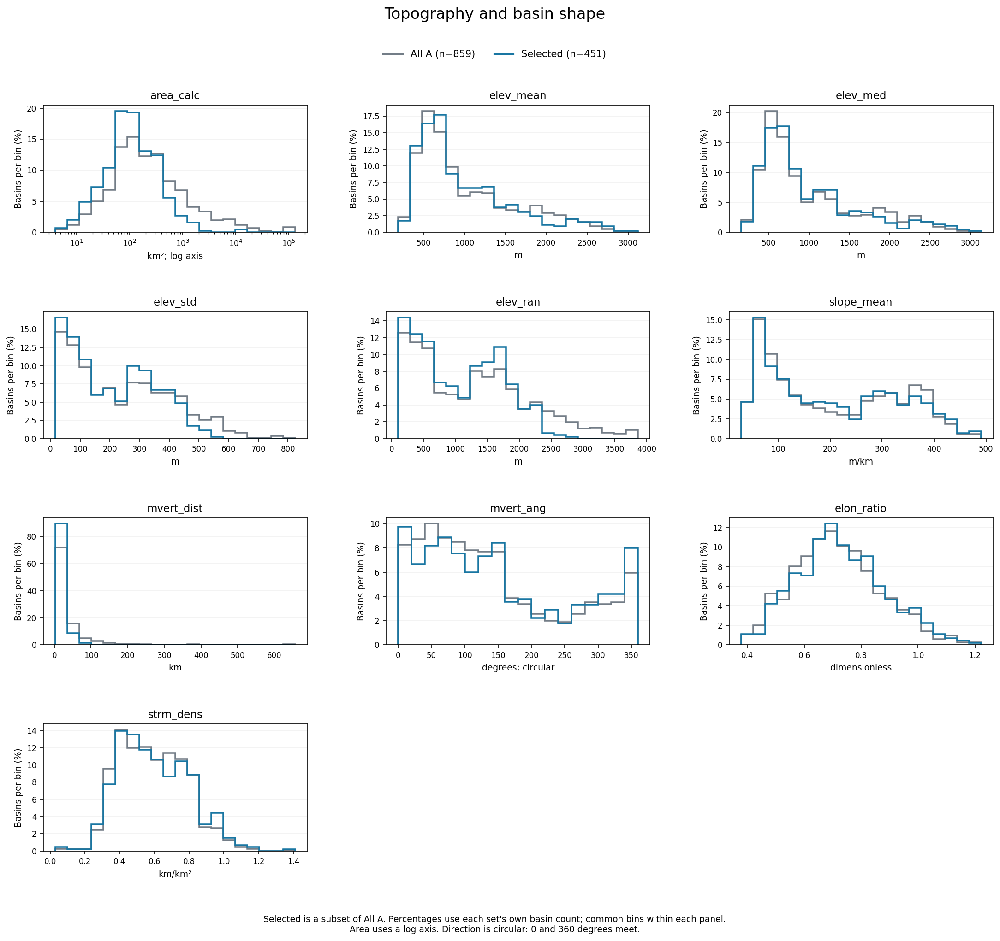

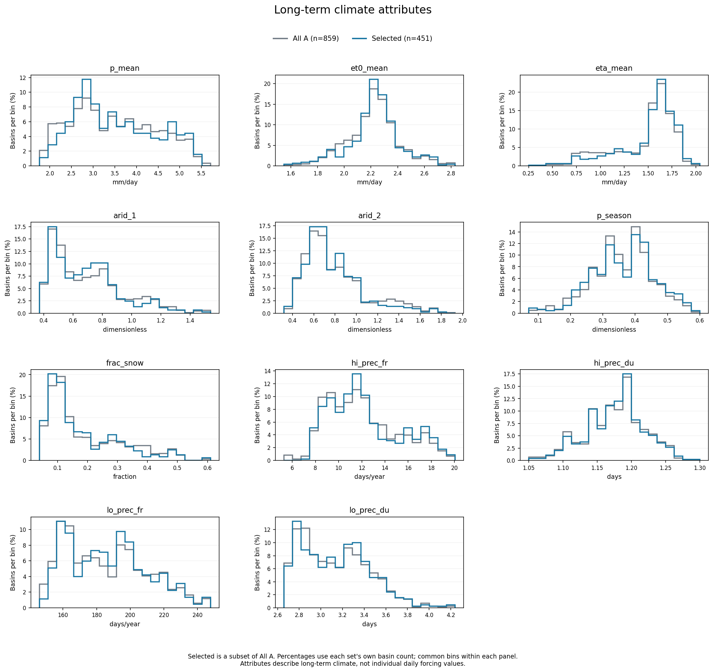

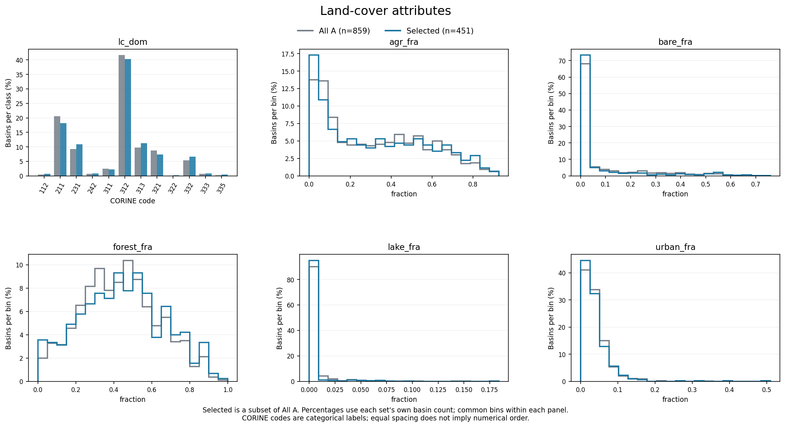

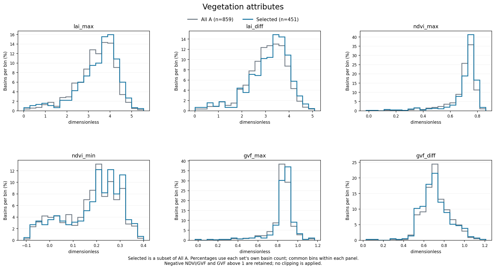

Các ảnh có đủ số panel 10/11/6/6, tiêu đề và đơn vị đọc được, không thấy chữ bị cắt. Hình hai hàng có khoảng cách giữa chú giải và tiêu đề panel, giữa nhãn trục cuối và ghi chú khá sát; chưa thấy chồng chữ trong ảnh nhận được. Bốn ảnh được lưu nguyên bản, không sửa nội dung hoặc làm mượt.

Histogram mvert_dist có trục tuyến tính dài nên phần lớn dữ liệu bị dồn vào bin đầu. Một số panel như ndvi_min, p_season và hi_prec_du có các cột cao/thấp xen kẽ. Giả thuyết các mức thập phân không khớp biên lớp là hợp lý để kiểm, chưa đủ để quy mọi đỉnh phụ cho làm tròn. Với các biến có nhiều mức hơn như lai_max, tác động của việc mỗi bin chứa lệch một mức có thể nhỏ hơn; cần nhìn số mức lưới và số quan trắc thực tế. Không đọc các răng cưa này thành nhiều chế độ vật lý chỉ bằng mắt.

Nguồn số đo: output 3.8 và bốn PNG đính kèm. Các bảng `A1_P3_static_plot_summary.csv`, `A1_P3_static_histogram_bins.csv`, `A1_P3_static_class_counts.csv` được notebook xuất ra; chưa được coi là đã tải vào repo nếu chưa có tệp thực tế.

### 17.16. Lượt kiểm chốt 3.9: đo gì và đọc kết quả ra sao?

Cell 3.9 dùng các bảng thuộc tính và hình học đã nạp, không đọc lại hàng nghìn tệp chuỗi ngày. Sáu nhóm phép kiểm có mục đích cụ thể:

| Mục | Phép đo | Câu hỏi được trả lời |
|---|---|---|
| A | Số 0 thật; lưới thập phân quan sát; ECDF | Bin đầu gồm bao nhiêu số 0? Các mức lưu trữ có tương thích biên bin cũ không? |
| B | Quan hệ trong từng dòng | Có NDVI min>max, lai_diff<0 hoặc >lai_max, tỷ phần ngoài 0–1, thời lượng <1 ngày không? |
| C | Pearson và Spearman theo ID | Những cặp nào có quan hệ tuyến tính/đơn điệu mạnh trong A và trong tập chọn? |
| D | Mean/std trong scaler của từng cấu hình | Thực tế mã tác giả chuẩn hóa ra z-score nào trên 451 hiện tại? Có khớp tham chiếu tính lại không? |
| E | Điểm trạm so với đa giác cùng ID và diện tích hình học | Ghép đúng ID đã đi kèm quan hệ không gian hợp lý chưa? |
| F | Lưu bằng chứng và bảng chốt | Những phát hiện nào đủ căn cứ kết luận, điểm nào cần ghi như giới hạn? |

**A — đường phân phối tích lũy (ECDF).** Trục đứng là phần trăm lưu vực có giá trị ≤x. Hình tập trung tám trường mvert_dist, hi_prec_du, p_season, frac_snow, lai_max, ndvi_min, lake_fra, urban_fra. ECDF giữ tất cả mức số thực tế, không cần bin hoặc làm mượt, nên loại phụ thuộc biên histogram mà không giả định dữ liệu phải có dạng trơn. Riêng mvert_dist dùng trục log để đọc cả khoảng ngắn và dài, không cắt đuôi. Đây là hình bổ sung cho 3.8, không xóa bằng chứng histogram ban đầu.

Lưới thập phân được đo bằng cách tìm bước 1, 0,1, 0,01… phù hợp với mọi giá trị lưu trữ, trong dung sai số thực ghi trong mã. Đó là **lưới quan sát phù hợp**, chưa chứng minh độ phân giải phép đo hoặc thao tác làm tròn của tác giả. Nếu lưới không quá lớn, đếm bao nhiêu mức lưới rơi vào từng bin tuyến tính cũ. Bin chứa xen kẽ một/hai mức là bằng chứng về cách gom mức; nó chưa chứng minh toàn bộ dao động số đếm là giả tạo.

**B — quan hệ trong dòng.** Các điều kiện dùng theo từng đại lượng. GVF không bị ép về 0–1; gvf_diff không bắt buộc ≤gvf_max vì giá trị GVF cực tiểu có thể âm. Không đòi năm tỷ phần lớp phủ mô hình dùng cộng thành 1, vì chúng không bao quát mọi lớp. Bảng ghi ID và số bị gắn cờ để đọc lại; không tự sửa số hoặc loại lưu vực. Các quan hệ trên kiểm tính nhất quán nội bộ, chưa xác nhận chính xác ngoài thực địa.

**C — tương quan.** Theo tài liệu chính thức [SciPy về Pearson](https://docs.scipy.org/doc/scipy/reference/generated/scipy.stats.pearsonr.html), hệ số này đo quan hệ tuyến tính; [Spearman](https://docs.scipy.org/doc/scipy/reference/generated/scipy.stats.spearmanr.html) đo quan hệ đơn điệu theo thứ hạng. Cell tính cả hai trên 31 trường: loại lc_dom vì mã lớp không có thứ tự vật lý và mvert_ang vì góc thô có điểm nối vòng. Không thêm sin/cos vào đầu vào huấn luyện từ phân tích này. Hai ma trận A được xuất CSV; hình hiển thị hai ma trận của 451 để đọc rõ nhãn. Các cặp được lưu đầy đủ và in riêng bốn cặp đã nêu ở 3.8.

Hệ số tương quan không tự là nhân quả, không chứng minh hai cột thay thế được cho nhau và không tự là lý do loại biến. Không báo p-value: các lưu vực mức A có thể lồng nhau/phụ thuộc không gian, và đây là bước mô tả đặc điểm, không phải kiểm định mẫu độc lập.

**D — scaler.** [LamaH._load_attributes](../../../NeuralHydrology/neuralhydrology/datasetzoo/lamah.py#L137) truyền danh sách lưu vực của kỳ vào hàm đọc. [BaseDataset](../../../NeuralHydrology/neuralhydrology/datasetzoo/basedataset.py#L725) tính mean và std của bảng thuộc tính, với std mặc định mẫu (ddof=1); sau đó áp dụng (x−mean)/std. Một lưu vực đóng góp một hàng thuộc tính, không được cân trọng số bằng số ngày Q hợp lệ. Cần phân biệt bước này với thống kê chuỗi ngày gộp theo ngày–lưu vực.

Cell đọc train_data/train_data_scaler.yml tương ứng từng config đã tìm ở 3.2, hỗ trợ tên khóa hiện tại và khóa cũ camels_attr_*. Không yêu cầu cài NeuralHydrology hay nạp checkpoint chỉ để đọc mapping số. Mean/std được so với 451 hiện tại bằng rtol=10⁻⁶, atol=10⁻⁸; std tính lại dùng ddof=1. Nếu khác, chỉ ghi không khớp tham chiếu 451, chưa gọi scaler sai: cần đọc phạm vi huấn luyện hoặc phiên bản thuộc tính tương ứng. Tệp thiếu/không hỗ trợ được ghi trạng thái, không thay bằng số tự ước tính.

z-score được tính bằng chính mean/std đã đọc. Bảng giữ min/max, max trị tuyệt đối và ID tương ứng của mỗi thuộc tính, mỗi run. lc_dom và góc được giữ trong bảng tái lập đúng hành vi mã, nhưng đánh dấu coded_category/raw_angle và không trộn vào bảng diễn giải cực trị số thông thường. Không tự cắt z-score lớn hoặc viết lại scaler.

**E — hình học.** covers tính cả trong đa giác và trên biên. Khoảng cách điểm–đa giác bằng 0 khi điểm trong/trên biên; nó không phải khoảng cách đến đường biên của một điểm đang ở trong. Diện tích được tính trong EPSG:3035 theo mét vuông rồi chia 10⁶ thành km², so với area_calc bằng chênh phần trăm. Điểm nằm ngoài hoặc diện tích khác chỉ là phát hiện để đọc cùng độ chính xác tọa độ, ranh giới và thuộc tính; không tự buffer, snap hay sửa đa giác để làm phép kiểm khớp.

Đầu ra gồm hai hình `A1_P3_static_ecdf.png`, `A1_P3_static_correlations.png`; các bảng A1_P3_static_grid_diagnostics, static_exact_zeros, static_row_checks, static_pearson_*, static_spearman_*, static_correlation_pairs, static_scaler_runs, static_scaler_values, static_geometry_by_basin và static_geometry_summary, đều ở định dạng CSV. Kết quả output thực tế được trình bày dưới đây; hai hình đã được nhận và lưu nguyên bản, các CSV chưa được coi là đã tải về chỉ từ bảng hiển thị.

### 17.17. Kết quả kiểm chốt thuộc tính — 3.9

#### A. Số 0 chính xác và ảnh hưởng của biên histogram

| Thuộc tính trong 451 | Số giá trị lưu trữ bằng 0 | Tỷ lệ (%) |
|---|---:|---:|
| frac_snow | 0 | 0,000000 |
| agr_fra | 18 | 3,991131 |
| bare_fra | 270 | 59,866962 |
| forest_fra | 5 | 1,108647 |
| lake_fra | 382 | 84,700665 |
| urban_fra | 63 | 13,968958 |

Đây là đếm điều kiện bằng 0 trên giá trị số, không phải chiều cao bin đầu. Chẳng hạn khoảng 44% ở bin đầu urban_fra của hình 3.8 không được diễn giải thành 44% lưu vực có urban_fra=0: số đếm chính xác là 63/451≈13,97%. Tương tự, lake_fra có 84,70% số 0 thật, không phải khoảng 95% đọc ở bin đầu. Các tỷ lệ vẫn mô tả thuộc tính lưu trữ, chưa xác nhận độ phủ thực tế ngoài hiện trường bằng 0 tuyệt đối.

| Thuộc tính | Số giá trị số khác nhau A / chọn | Bước lưới quan sát | Bề rộng bin tuyến tính cũ | Mức lưới/bin: min–max |
|---|---:|---:|---:|---:|
| mvert_dist | 474 / 265 | 0,1 | 32,7400 | 327–328 |
| p_season | 52 / 51 | 0,01 | 0,0265 | 2–3 |
| frac_snow | 51 / 48 | 0,01 | 0,0285 | 2–3 |
| hi_prec_du | 25 / 25 | 0,01 | 0,0125 | 1–2 |
| lake_fra | 54 / 29 | 0,001 | 0,0092 | 9–10 |
| urban_fra | 129 / 109 | 0,001 | 0,0255 | 25–26 |
| lai_max | 322 / 259 | 0,01 | 0,2775 | 27–28 |
| ndvi_min | 51 / 51 | 0,01 | 0,0255 | 2–3 |

Kết quả cho bằng chứng cụ thể rằng biên lớp cũ gom số mức không đều, đặc biệt ở hi_prec_du (1 hoặc 2 mức/bin), p_season, frac_snow và ndvi_min (2 hoặc 3). Do đó có cơ sở tránh diễn giải răng cưa của các panel này thành nhiều đỉnh vật lý. Với lai_max, 27–28 mức/bin chỉ chênh tương đối nhỏ hơn; không đủ căn cứ quy hình phân phối của nó cho cùng một hiệu ứng mạnh. Không kết luận mọi dao động quan sát đều do biên bin.

Số khác nhau ở bảng này đếm **giá trị số**; cột unique_nonblank_raw tại 3.3 đếm chuỗi thô. Ví dụ 51 giá trị số của ndvi_min không tự mâu thuẫn với số chuỗi thô khác nhau lớn hơn. Chưa xác định riêng các chuỗi nào quy về cùng số từ bảng tổng hợp này.

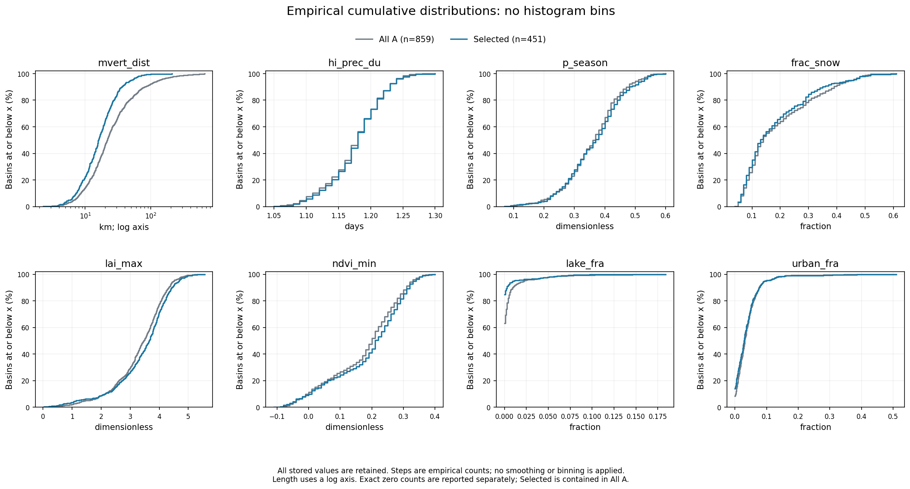

Hình hiển thị đủ tiêu đề, trục và chú giải, không thấy chữ chồng hoặc bị cắt. mvert_dist trên trục log đọc được cả miền ngắn và đuôi dài. Đường tại x=0 của lake_fra/urban_fra nhất quán số đếm ở bảng; bước hi_prec_du phù hợp với lưới 0,01. ECDF không có bin histogram nên hỗ trợ đọc phân phối mà không phụ thuộc cách chia lớp cũ.

#### B. Sáu quan hệ trong dòng

Cả sáu điều kiện đều có **0 hàng bị gắn cờ** ở cả tập 859 và tập 451: các tỷ phần đã kiểm ngoài 0–1; ndvi_min>ndvi_max; lai_diff âm hoặc lớn hơn lai_max; gvf_diff âm; góc ngoài 0–360°; thời lượng mưa lớn/ngày khô nhỏ hơn 1 ngày. Đây là đếm theo lưu vực cho từng điều kiện, không cộng thành một số ô độc lập. Chưa kiểm tổng năm tỷ phần tại 3.9; phép đó nằm ở 3.10.

#### C. Tương quan: phân biệt Pearson và Spearman

| Cặp thuộc tính trong 451 | Pearson | Spearman |
|---|---:|---:|
| elev_mean – elev_med | 0,998055 | 0,995125 |
| lai_max – lai_diff | 0,990917 | 0,984007 |
| elev_std – elev_ran | 0,966457 | 0,970870 |
| p_mean – arid_1 | −0,898106 | −0,965643 |
| hi_prec_fr – lo_prec_fr | 0,918839 | 0,935066 |
| arid_1 – lo_prec_fr | 0,922718 | 0,930519 |
| area_calc – mvert_dist | 0,819450 | 0,929053 |
| lo_prec_fr – lo_prec_du | 0,926778 | 0,919866 |
| p_mean – lo_prec_fr | −0,892522 | −0,916548 |
| lai_max – ndvi_max | 0,899094 | 0,915011 |
| slope_mean – agr_fra | −0,877735 | −0,907554 |
| elev_mean – frac_snow | 0,953860 | 0,905358 |
| arid_1 – arid_2 | 0,883739 | 0,820372 |
| gvf_max – gvf_diff | 0,402956 | 0,282500 |

12 cặp đầu là các cặp đứng đầu theo |Spearman| đã được in; ít nhất 12 cặp đạt 0,9 trong trị tuyệt đối. Các số 0,998/0,991/0,966 ở ba cặp đầu thuộc **Pearson**, không phải Spearman. Bốn cặp cần kiểm từ 3.8 nay có số đo: hai cặp độ cao và LAI rất mạnh theo cả hai hệ số; arid_1/arid_2 có quan hệ dương nhưng không gần đồng nhất; gvf_max/gvf_diff yếu hơn rõ rệt. Phân vị gần nhau của hai cột không thay cho phép đo cặp theo ID.

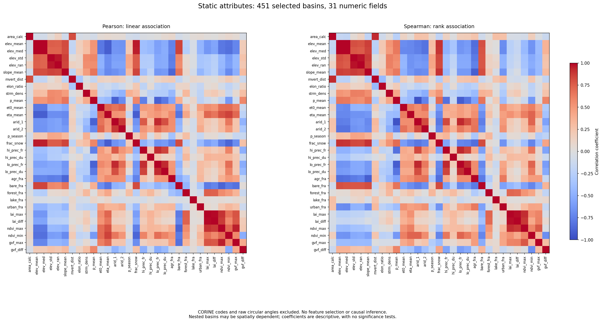

Hình đủ 31 nhãn theo thứ tự đã cấu hình cho phép đo, hai ma trận dùng cùng thang −1 đến 1 và có ghi chú loại mã lớp/góc thô; không thấy nhãn bị cắt. Các nhóm màu hỗ trợ đọc cấu trúc đồng biến/nghịch biến, nhưng không được thay bảng cặp để gán hệ số cụ thể. Chưa suy nhân quả hoặc tự bỏ cột: các cặp có quan hệ rất mạnh vẫn giữ nguyên trong 33 đầu vào tái lập.

#### D. Scaler thuộc tính và cực trị chuẩn hóa

Đọc được YAML ở **23/24 run**. Trong mỗi run đọc được, đủ 33 mean và std khớp tham chiếu tính lại trên 451 hàng bằng rtol=10⁻⁶, atol=10⁻⁸; std tham chiếu dùng ddof=1. Run dưới TL_AllWeights báo thiếu YAML tại đường dẫn dự kiến, chưa kiểm được scaler riêng của run đó. Chưa biết từ output 3.9 là thiếu thật trong toàn thư mục, có định dạng khác hay có run nguồn được cấu hình tham chiếu.

Kết quả cùng luồng mã ở 17.16 cho phép dùng 451 hàng thuộc tính để tái dựng thống kê tĩnh đã đọc, mỗi lưu vực một hàng. Ba ID không có nhãn Q trong train vẫn có thuộc tính trong tập này. Không suy rằng thống kê động qmean/qmax cũng được tính giống cách đó; chúng có phạm vi ngày và quy tắc nhãn riêng. lc_dom và góc thô nằm trong 33 trường nên vẫn được mã gốc chuẩn hóa dạng số, dù bị loại khỏi ma trận tương quan thông thường.

| Thuộc tính | Mean đã đọc | Std đã đọc | z cực trị có dấu | ID |
|---|---:|---:|---:|---:|
| area_calc | 252,087441 | 915,194586 | +16,142492 | 612 |
| lake_fra | 0,002916 | 0,013796 | +13,125663 | 697 |
| urban_fra | 0,036854 | 0,045161 | +10,476958 | 363 |
| mvert_dist | 20,410421 | 18,056554 | +10,460998 | 612 |
| gvf_max | 0,838404 | 0,149252 | −5,818377 | 55 |
| ndvi_max | 0,700621 | 0,125192 | −5,756142 | 55 |
| gvf_diff | 0,712971 | 0,146145 | −4,673254 | 55 |

Các số trong bảng hiển thị đã làm tròn; phép tính notebook dùng đầy đủ số từ YAML. Ví dụ ID 612 có area_calc=15025,609 km²; (15025,609−252,087441)/915,194586≈16,142492. z-score cao xác nhận vị trí xa trung bình trên thang chuẩn hóa này, không tự chứng minh lỗi dữ liệu hoặc quy định phải cắt ngưỡng. Các hàng được in từ những run khác nhau; việc 23 scaler cùng khớp tham chiếu trong dung sai không phải khẳng định đồng nhất từng bit.

ID 55 xuất hiện ở cực tiểu thực vật: gvf_max=−0,03 và ndvi_max=−0,02 phù hợp các min đã đo tại 3.3; gvf_diff cũng thấp trên thang chuẩn hóa. Chuyển phát hiện này sang hồ sơ Phần 9 cùng vấn đề dự báo NaN ở run có Q đã biết. Chưa có bằng chứng cực trị thuộc tính gây ra dự báo NaN; không thay thuộc tính hoặc loại ID 55 từ sự trùng ID này.

#### E. Trạm nằm trong/trên biên và diện tích hình học

| Phạm vi | Số cặp cùng ID | Trạm không được đa giác covers | Max khoảng cách (m) | Trung vị chênh diện tích tuyệt đối (%) | Max chênh diện tích tuyệt đối (%) |
|---|---:|---:|---:|---:|---:|
| A | 859 | 0 | 0 | 0,000106 | 0,007759 |
| Tập chọn | 451 | 0 | 0 | 0,000202 | 0,007299 |

Cả 859 trạm tương ứng A, gồm toàn bộ 451, nằm trong hoặc trên biên đa giác cùng ID theo phép covers. Chưa tách bao nhiêu trạm ở đúng trên biên. Sai khác diện tích hình học–area_calc nhỏ hơn 0,008% ở cả hai tập, trong khi chênh area_calc–area_gov tại ID 205 khoảng 33,97%: không có bất nhất lớn giữa cột area_calc và diện tích tính từ hình học hiện có để giải thích chênh đó. Điều này **không** chứng minh ranh giới lưu vực ngoài thực địa hoàn toàn đúng hoặc area_gov sai, vì hình học và thuộc tính có thể cùng quy trình nguồn.

### 17.18. Bốn đối chiếu cuối — 3.10

**Tọa độ thuộc tính.** [Bảng A1 LamaH-CE](https://essd.copernicus.org/articles/13/4529/2021/essd-13-4529-2021-t03.xlsx) ghi lon/lat trong lưới LAEA Europe, EPSG:3035, đơn vị mét. Cell so lon với geometry.x và lat với geometry.y, cho cả Gauge_attributes.csv và thuộc tính trong Gauges.shp, trên toàn D và tập chọn. Báo số cặp không hữu hạn và sai khác tối đa mỗi trục; không tự đổi sang độ, hoán đổi trục hoặc dịch điểm để làm khớp.

**Đầu nguồn trong đúng tập được chọn.** [BiasCast Mục 2.1](https://hess.copernicus.org/articles/30/5067/2026/index.html#section2) nêu 72,5% đầu nguồn và 27,5% lồng nhau, trong đó lồng nhau nghĩa là có ít nhất một lưu vực **từ tập chọn** ở thượng lưu. Đây không tự là số HIERARCHY=1 của mạng đầy đủ. [LamaH-CE Mục 3 và Hình 2](https://essd.copernicus.org/articles/13/4529/2021/#section3) cho thấy thứ bậc thay đổi khi bỏ bớt trạm khỏi mạng. Vì vậy, cell in cả số HIERARCHY=1 gốc và số không có trạm được chọn ở thượng lưu.

Mã lần NEXTDOWNID từ mỗi trạm được chọn, đi xuyên qua các trạm không được chọn, ghi trạm được chọn gần nhất ở hạ lưu và tiếp tục kiểm đường đi tới cửa ra. Theo Bảng A1, NEXTDOWNID=0 là không có trạm hạ lưu. Các trạm nhận một cạnh từ trạm được chọn phía trên là nhóm lồng nhau. Đường đi thiếu đích/không hợp lệ hoặc có chu trình được ghi cảnh báo; nếu còn đường chưa xác nhận, không báo tỷ lệ đầu nguồn như kết quả đã kiểm. So 72,5% ở một chữ số thập phân, không ép số lượng để khớp bài.

**Tổng năm tỷ phần.** Cộng agr_fra, bare_fra, forest_fra, lake_fra, urban_fra theo ID; in min/trung vị/max và số tổng >1 ở A/451. Không đòi tổng bằng 1, vì nhóm này chưa gồm mọi loại lớp phủ. Có cả số đếm so trực tiếp và số vượt 1+10⁻¹² để tách sai số cộng số thực rất nhỏ; đây không phải dung sai cho độ chính xác đo lớp phủ. Nếu còn vượt ngưỡng thì in ID để đọc lại, không tự chuẩn hóa tổng về 1.

**Run thiếu scaler.** Chỉ với run thiếu YAML ở vị trí dự kiến, mã liệt kê tệp train_data_scaler* trong thư mục run và đọc base_run_dir đã khai báo. Đường dẫn nguồn cũ được đối chiếu với các run thực có dưới EXP_DIR; chỉ đọc nguồn khi xác định được duy nhất một run, không đoán giữa các tên trùng. Nếu có YAML nguồn thì so thống kê tĩnh với 451 hiện tại; không chép tệp đó thay cho scaler riêng hoặc nạp pickle.

[BaseTrainer.initialize_training](../../../NeuralHydrology/neuralhydrology/training/basetrainer.py#L149) có nhánh fine-tune nạp scaler từ base_run_dir; hành vi này cũng có trong bản mã tác giả. Tuy nhiên, [BaseDataset](../../../NeuralHydrology/neuralhydrology/datasetzoo/basedataset.py#L144) còn gọi ghi scaler khi tạo dataset train. Vì vậy, việc có một run nguồn không tự chứng minh nguyên nhân YAML cục bộ vắng mặt trong gói đang xét. Kết quả có thể xác nhận đường dẫn/nguồn đọc được, còn lý do thiếu trong gói chỉ được kết luận nếu có bằng chứng riêng.

Đầu ra là sáu bảng CSV có tiền tố A1_P3_final_: coordinate_checks, coordinate_by_gauge, selected_topology, headwater_comparison, land_fraction_sum, missing_scaler_probe. Kết quả thực tế như sau.

**Tọa độ:** cả Gauge_attributes.csv và các trường trong Gauges.shp đều có 0 cặp không hữu hạn, max |lon−x|=0 m và max |lat−y|=0 m, trên cả 882 và 451 trạm. Như vậy, các giá trị lon/lat của input hiện tại bằng đúng tọa độ x/y hình học trong EPSG:3035 theo mét. Chưa chuyển các trường này sang kinh/vĩ độ tính bằng độ.

| Cách đếm trong 451 | Số lưu vực | Tỷ lệ (%) |
|---|---:|---:|
| HIERARCHY gốc bằng 1 | 316 | 70,066519 |
| Không có trạm được chọn ở thượng lưu, lần theo NEXTDOWNID | 322 | 71,396896 |
| Có trạm được chọn ở thượng lưu | 129 | 28,603104 |

Mọi đường đi được giải tới NEXTDOWNID=0; không có HIERARCHY thiếu trong 451. Số đếm theo mạng chọn lớn hơn số HIERARCHY=1 gốc sáu lưu vực. **71,4% khác 72,5% trong BiasCast.** Muốn tỷ lệ làm tròn thành 72,5% trên mẫu số 451 cần 327 đầu nguồn, nhiều hơn kết quả hiện tại năm lưu vực. Chưa xác định tác giả đếm trên tập/mạng nào hoặc bằng quan hệ hình học nào; không thay số đo bằng số trong bài. Đếm trên 454 hoặc theo đa giác là giả thuyết kiểm thêm khi cần đối chiếu phương pháp, chưa phải kết quả và không phải điều kiện để tiếp tục các phân tích chuỗi ngày.

| Tổng năm tỷ phần | A: 859 | Tập chọn: 451 |
|---|---:|---:|
| Min | 0,264 | 0,264 |
| Trung vị | 0,959 | 0,972 |
| Max | 1,001 | 1,001 |
| Số tổng >1, so trực tiếp | 16 | 10 |
| Số tổng >1+10⁻¹² | 16 | 10 |

10 ID được chọn có tổng >1 là 148, 170, 171, 235, 312, 346, 348, 450, 469, 506; mức vượt tối đa 0,001, tương đương 0,1 điểm phần trăm diện tích. Mức này lớn hơn sai số số thực 10⁻¹², nên không gọi là nhiễu cộng máy tính. Nếu mỗi trong năm tỷ phần đã được làm tròn gần nhất tới 0,001, sai khác tổng do làm tròn có thể tới 5×0,0005=0,0025; mức quan sát 0,001 phù hợp về độ lớn với giả thuyết đó. Tuy nhiên, chưa xác nhận thao tác làm tròn hoặc nguyên nhân từng ID. Không có mức vượt lớn trong phép kiểm này, nhưng vẫn ghi nhận 16/10 tổng vượt 1; không ép tổng về 1. Tổng nhỏ hơn 1 không phải lỗi vì năm lớp chưa bao quát mọi lớp phủ.

**Scaler còn thiếu:** run TransferLearning/TL_AllWeights/TL_AllWeights_RA_Complex_Embedding không có tệp train_data_scaler* tìm được trong thư mục run, base_run_dir đọc được là rỗng và không xác định được run nguồn tương ứng. Vì vậy, chưa kiểm scaler riêng của run này; không có bằng chứng cho phép dùng scaler của một run khác thay thế. Kết luận scaler vẫn là **23/24 run đã đối chiếu khớp**, không phải 24/24.

### 17.19. Chốt Phần 3 — thuộc tính tĩnh và không gian

Phần 3 hoàn tất phạm vi khám phá thuộc tính tĩnh và không gian theo output thật từ 3.1 đến 3.10. Bản tổng kết này ghi kết quả và giới hạn của bộ input đã kiểm; không phải một lần quét mới. Những điểm mở được giữ cùng phạm vi và bằng chứng, không được tự biến thành tiêu chí sửa dữ liệu hoặc chọn mô hình.

#### 1. Phần 3 đã trả lời điều gì?

Đã xác định tệp thuộc tính nào phục vụ bộ nạp, vì sao có 62 trường nhưng cấu hình chỉ dùng 33, chất lượng các trường đó, đơn vị/cách đọc, diện tích nào được dùng đổi Q, tập lưu vực/trạm trên bản đồ và phân phối không gian–thuộc tính. Đã kiểm thêm quan hệ trong dòng, tương quan, thống kê chuẩn hóa và vị trí trạm so với đa giác. Các kiểm tra mô tả không thay thế xác nhận quan trắc ngoài thực địa.

#### 2. Ba tệp thuộc tính A và hợp đồng 33 đầu vào

Catchment_attributes.csv có 859 dòng, 63 cột: ID và 62 thuộc tính. Stream_dist.csv có ID/dist_hup; Water_balance.csv có ID và chín trường. Cả ba có ID duy nhất, hợp lệ, đúng tập A và đủ 451 được chọn. Không tự coi mọi cột của ba tệp là đầu vào mô hình.

Cả 24 cấu hình có cùng 33 tên static_attributes và cùng thứ tự khai báo. Các tên đều lấy từ Catchment_attributes: 10 địa hình/hình dạng, 11 khí hậu, 6 lớp phủ và 6 thực vật. Có 32 trường số thông thường và lc_dom là mã phân loại. 29 trường không được cấu hình yêu cầu gồm hai trường mùa, glac_fra, 10 trường đất, 16 trường địa chất. Danh sách và ý nghĩa chi tiết nằm ở 17.4–17.5.

Thứ tự YAML không đồng nghĩa thứ tự tensor: mã bộ nạp sắp tên thuộc tính theo alphabet trước chuẩn hóa. lc_dom được mã gốc xử lý dạng số; không tự đổi sang one-hot trong tái lập.

#### 3. Chất lượng: đủ đầu vào nhưng chưa chứng nhận mọi giá trị đúng vật lý

Trong cả 859 và 451, 33 trường mô hình dùng có 0 ô rỗng, 0 giá trị −999/vô hạn/nội dung không chuyển được thành số, và 0 cột có độ lệch chuẩn bằng 0. Không cần điền khuyết thuộc tính cho các cấu hình hiện tại.

Trong toàn bộ 62 trường, một ô geol_perme rỗng ở ID 651, thuộc 451 nhưng không thuộc 33 đầu vào. Ba trường phân loại chữ gc_dom, hi_prec_ti, lo_prec_ti được nhận diện là chữ có chủ đích, không gọi các mã chữ đó là lỗi chuyển số.

Sáu quan hệ trong dòng đã kiểm đều có 0 hàng bị gắn cờ ở A/451: tỷ phần ngoài 0–1, NDVI min>max, LAI diff âm hoặc >max, GVF diff âm, góc ngoài 0–360°, thời lượng đợt mưa lớn/khô <1 ngày. Tổng tỷ phần là phép kiểm riêng ở mục 9 dưới đây.

#### 4. Diện tích, hình dạng và đổi đơn vị Q

859 cặp area_calc/area_gov đều dương, hữu hạn. Tỷ số metadata khớp area_calc/area_gov trong sai khác tối đa 0,0005. Trong 451, trung vị và p99 của chênh tuyệt đối theo area_gov là 0,684452% và 8,685852%. ID 205 lớn nhất: area_calc=41,933 km², area_gov=31,3 km², chênh +33,971246%.

Luồng LamaH dùng **area_gov** để đổi nhãn ngày: q(mm/ngày)=Q(m³/s)×86,4/area_gov(km²), rồi mới chuẩn hóa thống kê. Cờ normalize_discharge=False ở hàm đọc không bỏ bước đổi đơn vị được gọi ngay ở tầng lớp dữ liệu. Nếu thay mẫu số bằng area_calc ở ID 205, cùng Q sẽ cho q nhỏ hơn khoảng 25,3571%, không phải 33,9712%; hai tỷ lệ có mẫu số khác nhau. Chưa thay mẫu số chuẩn hóa.

elon_ratio theo 2√(area_calc/π)/mvert_dist có sai khác trung vị 0,000932 và max 0,012241 trong 451. Có 21/451 giá trị lưu trữ >1; L là khoảng cách từ điểm xa nhất tới trạm nên công thức không tự buộc Re≤1. Chưa chứng minh nguyên nhân sai khác là làm tròn chiều dài và không tự gán các giá trị >1 thành lỗi.

#### 5. Bản đồ, tọa độ và kiểm hình học

Basins_A.shp có 859 Polygon, Gauges.shp có 882 Point; cùng EPSG:3035 theo mét. Không có hình học thiếu/rỗng/không hợp lệ trong các phép đã kiểm. Khóa đa giác khớp A, khóa điểm khớp D, chứa đủ 451; các phép ghép dùng ID chứ không theo thứ tự dòng.

lon/lat trong CSV và shapefile bằng đúng geometry.x/y, sai khác tối đa 0 m trên cả D và tập chọn. Tên cột không có nghĩa chúng là kinh/vĩ độ tính bằng độ. Cả 859 trạm ghép được với A đều được đa giác cùng ID covers, gồm cả trạm trên biên. Max chênh diện tích hình học–area_calc là 0,007759% ở A và 0,007299% ở 451. Sự khớp nội bộ này chưa chứng minh ranh giới ngoài thực địa hoặc diện tích cơ quan là sai.

Theo quốc gia đặt trạm, 451 gồm Áo 349, Đức 88, Thụy Sĩ 9, Séc 5; Liechtenstein có một trạm trong A nhưng không được chọn. Màu quốc gia trên bản đồ chỉ quốc gia trạm, không phải toàn bộ lãnh thổ của lưu vực. Lưu vực mức A có thể lồng nhau; không cộng diện tích đa giác để suy tổng diện tích vùng không trùng.

#### 6. Phân phối và cách đọc hình

area_calc của 859 có trung vị 178,421 km², p99 36289,86232 km² và max 131247,215 km²; của 451 lần lượt 101,465, 1760,49450 và 15025,609 km². Trung vị tập chọn thấp hơn khoảng 43,13%. Đây là khác biệt quan sát, không chứng minh diện tích là tiêu chí tác giả lọc. Scatter hai diện tích sát 1:1 không đồng nghĩa hai tập có cùng phân phối diện tích.

Histogram so 859 với 451 dùng cùng biên lớp trong từng ô và phần trăm theo số lưu vực của mỗi tập. Hai tập lồng nhau. area_calc được vẽ trên log; mvert_dist có ECDF trên log để thấy cả miền ngắn/đuôi dài. Các bin cũ gom 1–2 mức lưới ở hi_prec_du và 2–3 ở p_season, frac_snow, ndvi_min, nên không đọc mọi răng cưa như nhiều chế độ vật lý. lai_max có 27–28 mức/bin, chưa đủ bằng chứng cho cùng một tác động mạnh. ECDF bổ sung cách đọc không phụ thuộc bin.

Số 0 thật trong 451: bare_fra 270 (59,866962%), lake_fra 382 (84,700665%), urban_fra 63 (13,968958%), agr_fra 18, forest_fra 5, frac_snow 0. Bin đầu gồm cả các số dương nhỏ, không phải số đếm bằng 0.

NDVI/GVF âm và GVF ngoài 0–1 được giữ theo định nghĩa nguồn. mvert_ang là góc vòng; p05/p95 của mã số không định nghĩa một cung ngắn chứa 90% hướng. lc_dom có 12 mã; mã 312 chiếm 182/451≈40,35%, nhưng đó là số lưu vực có lớp chiếm ưu thế, không phải tỷ trọng tổng diện tích rừng. Các lớp hiếm cần đọc cùng cỡ nhóm nhỏ.

#### 7. Tương quan không tự dẫn đến bỏ biến

Trên 31 trường, sau khi loại lc_dom và góc thô khỏi phép đo thông thường, Pearson/Spearman của elev_mean–elev_med là 0,998055/0,995125; lai_max–lai_diff 0,990917/0,984007; arid_1–arid_2 0,883739/0,820372; gvf_max–gvf_diff 0,402956/0,282500. Phân vị gần nhau không bảo đảm tương quan mạnh theo cùng ID.

Ít nhất 12 cặp được in có |Spearman|≥0,9. Đây là mô tả quan hệ tuyến tính/đơn điệu, không phải nhân quả hoặc chứng minh hai cột thay thế được cho nhau. Không tính p-value với giả định các lưu vực lồng nhau là mẫu độc lập. Chưa chọn/bỏ biến hoặc thực hiện PCA trong bước tái lập.

#### 8. Scaler đã xác nhận 23/24 run

23 scaler YAML đọc được đều có đủ 33 mean/std khớp 451 hàng hiện tại trong rtol=10⁻⁶, atol=10⁻⁸; std tham chiếu dùng ddof=1. Mỗi lưu vực góp một hàng thuộc tính, kể cả ba ID không có nhãn train. Điều này khác thống kê động có phạm vi ngày và quy tắc nhãn riêng. lc_dom/góc vẫn được chuẩn hóa dạng số trong mã tái lập, dù không đưa vào ma trận tương quan thông thường.

Các z cực trị thực tế gồm area_calc +16,142492 tại ID 612, lake_fra +13,125663 tại 697, urban_fra +10,476958 tại 363 và mvert_dist +10,460998 tại 612. z-score xa trung bình chưa chứng minh lỗi và chưa phải ngưỡng cắt. ID 55 ở cực tiểu NDVI/GVF, chuyển hồ sơ Phần 9; chưa gán chúng là nguyên nhân dự báo NaN ở run có Q.

Run TransferLearning/TL_AllWeights/TL_AllWeights_RA_Complex_Embedding không tìm thấy scaler cục bộ hoặc run nguồn được khai báo/đối chiếu. Chưa xác nhận nguyên nhân thiếu hoặc thống kê riêng của run này. Không chép scaler của run khác thay thế và không viết kết luận 24/24.

#### 9. Hai đối chiếu cần giữ rõ giới hạn

Đầu nguồn trong mạng chọn có **322/451=71,396896%**, lồng nhau 129/451=28,603104%; mọi đường NEXTDOWNID được giải. HIERARCHY gốc bằng 1 cho 316, khác số đếm theo tập chọn. Kết quả không khớp 72,5% đầu nguồn trong BiasCast (tương ứng 327/451 khi làm tròn một chữ số). Chưa biết nguyên nhân; báo đúng phương pháp và số 322, không sửa danh sách để khớp bài.

Tổng năm tỷ phần có min 0,264; trung vị A/451 là 0,959/0,972; max đều 1,001. Có 16 ID ở A, gồm 10 ID được chọn, vượt 1 tối đa 0,001. Đó không phải sai số cộng số thực 10⁻¹². Nếu các thành phần được làm tròn gần nhất tới 0,001 thì sai số tổng tối đa có thể tới 0,0025; mức quan sát phù hợp giả thuyết nhưng chưa chứng minh nguyên nhân. Giữ nguyên các giá trị và ghi nhận mức vượt nhỏ; không chia lại các tỷ phần cho tổng để ép bằng 1.

#### 10. Kết luận sử dụng được và bàn giao

Phần 3 hoàn thành khám phá thuộc tính tĩnh và không gian theo kế hoạch. Không có kết quả buộc thay tập 451, danh sách 33 đầu vào, diện tích đổi Q, mã hóa hoặc scaler của các run tái lập đã kiểm. Điều này không đồng nghĩa mọi giá trị đã được chứng nhận đúng ngoài thực địa.

Ba giới hạn còn ghi trong báo cáo: tỷ lệ đầu nguồn khác bài; nguyên nhân tổng lớp phủ vượt nhỏ chưa được xác nhận; một run thiếu scaler. Chúng không bị bỏ quên, nhưng không giữ Phần 3 mở vô hạn hoặc trở thành lý do suy diễn thêm tiêu chí lọc. Hồ sơ ID 55 tiếp tục ở Phần 9 cùng bằng chứng chuỗi ngày và dự báo, không tự kết luận nhân quả từ thuộc tính.

Phần 4 chuyển sang ngày/biến thiếu: tách không có dòng, ô rỗng và giá trị không hợp lệ; đo theo kỳ/năm, độ dài đoạn, trạm đo muộn và gaps. Phần 7 mới mô phỏng số mẫu mất theo cửa sổ 365/730 ngày và bộ lọc; không lấy phần trăm ô thiếu làm phần trăm mẫu huấn luyện bị loại.

#### 11. Bằng chứng để đọc lại

Mã đo nằm tại các cell 3.1–3.10. Tám hình đã nhận gồm bản đồ bốn ô, phân phối diện tích, bốn hình nhóm thuộc tính, ECDF và ma trận tương quan; đã kiểm bố cục trên ảnh thực tế và lưu nguyên bản. Các bảng A1_P3_* được lưu trong Tables khi chạy Kaggle; chỉ những tệp CSV thực sự đã tải về mới được coi là hiện vật trong repo. Phần chi tiết 17.1–17.18 ghi nguồn metadata, mã bộ nạp, phạm vi từng phép đo và các ví dụ số.

## 18. Dữ liệu thiếu: khí tượng, qmax và độ dài đoạn thiếu

### 18.1. Thiếu khí tượng theo biến và kỳ — 4.1

Phần 2 đã kiểm mốc đầu/cuối và không phát hiện −999 trong toàn bộ A, nhưng mốc đầu/cuối không loại trừ ô thiếu ở giữa. Cell 4.1 đọc lại tệp A của **451 ID được chọn**, dùng tất cả biến khí tượng đã kiểm kê (40 biến), không tính DOY hoặc cột ngày là biến khí tượng. Phạm vi là train 2003–2009, validation 2010–2013, test 2014–2017; chưa tính các ngày khởi động trước kỳ hoặc số mẫu cửa sổ.

Với một (ID, biến, kỳ), mẫu số là mọi ngày lịch của kỳ: 2557 ở train, 1461 ở validation, 1461 ở test. Ví dụ một biến trong test của toàn bộ tập chọn có mẫu số 451×1461=658911 ô ngày–biến. Khi gộp nguồn, mẫu số còn nhân số biến của nguồn; đây không phải số ngày thiếu ít nhất một biến.

Các loại thiếu được tách không chồng lấp:

| Loại | Cách đo |
|---|---|
| missing_rows | Không có dòng cho ngày lịch đó trong tệp gốc |
| blank_cells | Có dòng nhưng ô rỗng hoặc chỉ chứa khoảng trắng |
| minus999_cells | Ô chuyển thành số −999 |
| non_numeric_nonblank | Có dòng, ô không rỗng nhưng không chuyển được thành số; gồm ký hiệu chữ NaN nếu có |
| infinite_cells | Ô chuyển thành +∞ hoặc −∞ |

Hợp lệ cho phép đo thiếu này là số hữu hạn khác −999; nhiệt độ âm hoặc bốc hơi âm vẫn được giữ. Không áp quy tắc Q không âm sang các biến khí tượng, và chưa kiểm đúng đơn vị vật lý ở cell này. Ngày không có dòng không được đếm lặp thành ô rỗng.

Bảng chi tiết có một dòng cho mỗi (ID, biến, kỳ). Tổng hợp theo biến và theo nguồn tính phần trăm từ tổng số ô thiếu/tổng số ô kỳ vọng, không cộng các phần trăm. Danh sách thưa ngày–biến thiếu lưu ID, ngày, biến, nguồn, kỳ, nguyên nhân và token gốc nếu có dòng. Bảng này phục vụ phân tích theo năm/đoạn tiếp theo, không thay thế hay ghi đè dữ liệu gốc.

Hình có ba cột train/validation/test, mỗi biến một hàng; trục phần trăm thiếu dùng log. Chỉ các tỷ lệ dương có thanh; giá trị 0 được ghi chữ 0, không thêm epsilon giả. Bảng số vẫn giữ đúng tỷ lệ gốc, không dùng cách hiển thị log để biến 0 thành số dương.

**Kết quả thực tế:** trong 451 lưu vực, 2003–2017, chỉ EOBS_hu có thiếu. 39 biến còn lại có tỷ lệ thiếu bằng 0 trong cả ba kỳ theo định nghĩa trên. Toàn bộ 8939 ô thiếu là ô rỗng có dòng; không có ngày thiếu dòng A, −999, nội dung không chuyển số hoặc vô hạn trong phạm vi này. Đây là phép kiểm đầy đủ bên trong chuỗi theo kỳ, mạnh hơn việc chỉ quan sát ngày đầu/cuối ở Phần 2.

| Kỳ | Ngày–lưu vực kỳ vọng cho một biến | Ô EOBS_hu rỗng | EOBS_hu thiếu (%) | Ô kỳ vọng của tám biến E-OBS | E-OBS thiếu (%) |
|---|---:|---:|---:|---:|---:|
| Train 2003–2009 | 1153207 | 1980 | 0,171695 | 9225656 | 0,021462 |
| Validation 2010–2013 | 658911 | 3049 | 0,462733 | 5271288 | 0,057842 |
| Test 2014–2017 | 658911 | 3910 | 0,593403 | 5271288 | 0,074175 |
| Tổng 2003–2017 | 2471029 | 8939 | 0,361752 | 19768232 | 0,045219 |

Các tỷ lệ tính từ số đếm; dòng tổng dùng tổng tử/mẫu, không lấy trung bình ba tỷ lệ kỳ. Khi gộp cả tám biến E-OBS, tử số vẫn là số ô trống EOBS_hu, còn mẫu số lớn gấp tám, nên tỷ lệ nhỏ đi tám lần. Không dùng tỷ lệ nguồn 0,074175% để mô tả riêng biến EOBS_hu ở test: biến đó thiếu 0,593403%.

Vì chỉ một biến thiếu và ngày mỗi ID đã được kiểm duy nhất, 8939 ô cũng tương ứng 8939 cặp (ID, ngày) thiếu ít nhất một biến trong phạm vi này. Nó không phải 8939 ngày lịch khác nhau trên toàn miền. Tỷ lệ theo các kỳ tăng từ train tới test, nhưng chưa suy rằng mọi lưu vực đều tăng, có xu thế đơn điệu từng năm hoặc biết nguyên nhân. Chưa kiểm các ngày khởi động trước kỳ ở cell này.

| Ví dụ được in trong bảng tỷ lệ thiếu cao | Ô thiếu / số ngày kỳ | Tỷ lệ (%) |
|---|---:|---:|
| ID 551, test, EOBS_hu | 73 / 1461 | 4,996578 |
| ID 112, validation, EOBS_hu | 72 / 1461 | 4,928131 |
| ID 839, train, EOBS_hu | 100 / 2557 | 3,910833 |

ID 551 ở test đứng đầu bảng các trường hợp được sắp theo tỷ lệ. Những ví dụ này cho thấy tỷ lệ gộp thấp có thể đi kèm lưu vực thiếu nhiều hơn mức chung. Chưa có số đếm số lưu vực bị ảnh hưởng từ các dòng hiển thị giới hạn; bảng đầy đủ theo ID vẫn nằm ở đầu ra Kaggle. 8939 ô thiếu không đồng nghĩa 8939 mẫu huấn luyện bị loại: một ô có thể xuất hiện trong nhiều cửa sổ, các cửa sổ lại chồng nhau và còn tùy bộ lọc. Phép tính mẫu thuộc Phần 7.

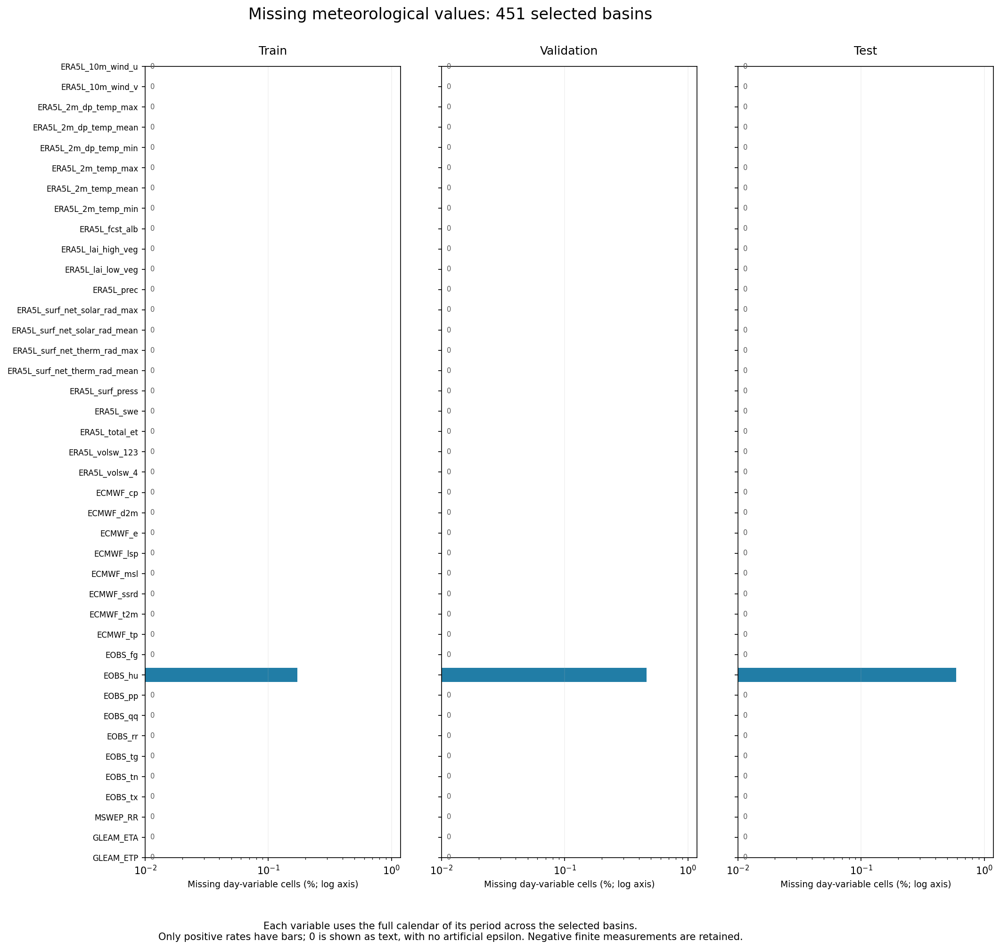

Hình có đủ 40 tên biến và ba kỳ; đọc được tiêu đề, nhãn và ghi chú, không thấy chữ bị cắt. Chỉ EOBS_hu có thanh dương, còn 39 biến ghi 0, nhất quán bảng số. Các giá trị 0 không nằm trên trục log như một số dương giả. Không diễn giải phần lớn vùng trống của hình là chưa đo: các hàng đó có kết quả thiếu bằng 0.

Thời gian quét thực tế là **189,8 giây**. Hình được sao chép nguyên bản từ ảnh đính kèm vào repo. Bốn bảng A1_P4_forcing_missing_by_basin.csv, forcing_missing_by_variable.csv, forcing_missing_by_source.csv, forcing_missing_cells.csv được lưu trên Kaggle; chưa coi là đã tải về repo chỉ từ bảng dán. Các số mốc khí tượng ở Phần 2 và số thiếu Q theo kỳ vẫn là bằng chứng riêng; kết quả ở đây không xác nhận mọi giá trị khí tượng đúng đơn vị hoặc đúng về vật lý.

### 18.2. Thiếu qmax theo năm, kỳ và số lưu vực có dữ liệu — 4.2

Cell đọc tệp D của 451 ID, chỉ lấy ngày và qmax. Lịch kiểm gồm **toàn bộ năm lịch**, từ năm sớm nhất tới năm muộn nhất của bản ghi trong tập chọn; với input đã kiểm ở Phần 2 là 1981–2017. Mỗi (ID, năm) có mẫu số 365 hoặc 366 ngày, gồm cả ngày trước/sau bản ghi của trạm. Vì vậy, năm trước khi trạm bắt đầu có thể thiếu 100%; không chỉ tính tỷ lệ trong khoảng tệp đang tồn tại.

Q hợp lệ là hữu hạn và không âm; Q=0 vẫn hợp lệ. Mã thiếu tách riêng: không có dòng, ô rỗng, số âm hữu hạn khác −999, −999, nội dung không chuyển số và vô hạn. −999 không bị cộng lặp vào nhóm âm; −∞ được đếm ở vô hạn, không đếm như số âm hữu hạn. Mặt nạ hợp lệ được so lại với định nghĩa số để phát hiện trường hợp phân loại chưa đầy đủ.

Hình tổng quan có ba ô:

| Ô | Nội dung | Mẫu số hoặc cách sắp |
|---|---|---|
| (a) | Bản đồ nhiệt % ngày thiếu qmax, lưu vực × năm | Từng năm lịch đầy đủ; sắp tăng theo ngày qmax hợp lệ đầu tiên, hòa ngày thì theo ID số |
| (b) | Cột chồng thiếu theo train/validation/test | Toàn bộ ngày–lưu vực kỳ vọng của kỳ; tách không có dòng, ô rỗng, không hợp lệ khác |
| (c) | Số lưu vực có Q từng năm | Hai đường: ít nhất một ngày hợp lệ và mọi ngày lịch trong năm đều hợp lệ |

Thang màu bản đồ nhiệt là 0–100% tuyến tính; mức thiếu nhỏ có thể nhạt hơn nhiều so với năm thiếu toàn bộ, nên cần đọc cùng bảng số và ô (b). Một số nhãn hàng hiển thị thứ hạng và ID để hình đọc được; bảng qmax_heatmap_order giữ đủ 451 hàng để truy đúng vị trí. Ngày đầu qmax hợp lệ là mốc đo từ chuỗi, không thay cho obsbeg_day trong metadata. Trường hợp ID 94 có dòng nhưng toàn bộ Q năm 1981 trống đã kiểm ở Phần 2 cho thấy thiếu trước ngày hợp lệ đầu tiên không luôn là thiếu dòng.

Hai đường số lưu vực có ý nghĩa khác nhau: có một ngày không bảo đảm đủ cả năm. Tỷ lệ theo kỳ được tính lại từ mã ngày thiếu rồi đối chiếu sáu số đếm với 2.14: ngày kỳ vọng, có dòng, hợp lệ, thiếu dòng, ô rỗng, tổng thiếu. Nếu khác thì giữ số mới để kiểm và in cảnh báo, không ép kết quả theo ghi chú cũ. Số lưu vực bắt đầu muộn và ID không có nhãn train được in lại từ lần đo này.

**Kết quả thực tế:** cả ba kỳ khớp các số đếm ở Phần 2. Toàn bộ thiếu qmax trong ba kỳ là không có dòng hoặc ô rỗng; không có qmax âm, −999, nội dung không chuyển số hay vô hạn. Số 0 vẫn là nhãn hợp lệ.

| Kỳ | Ngày–lưu vực kỳ vọng | Có dòng | Q hợp lệ | Không có dòng | Ô rỗng | Tổng thiếu | Thiếu (%) | Khớp Phần 2 |
|---|---:|---:|---:|---:|---:|---:|---:|---|
| Train | 1153207 | 1115347 | 1112307 | 37860 | 3040 | 40900 | 3,546631 | Có |
| Validation | 658911 | 658581 | 656281 | 330 | 2300 | 2630 | 0,399143 | Có |
| Test | 658911 | 658911 | 657366 | 0 | 1545 | 1545 | 0,234478 | Có |

Ví dụ train: 37860+3040=40900 ngày–lưu vực thiếu. Phần không có dòng chiếm khoảng 92,57% số thiếu train, nhưng chưa đồng nhất tất cả với ngày trước khi bắt đầu đo: cần phân loại theo vị trí trong chuỗi. Trong test, mọi ngày lịch của 451 lưu vực đều có dòng; 1545 ngày thiếu là các ô rỗng. Đủ dòng không bảo đảm đủ nhãn.

| Năm | Q hợp lệ (ngày–lưu vực) | Tổng thiếu | Thiếu (%) | Lưu vực có ít nhất một ngày hợp lệ | Lưu vực đủ mọi ngày trong năm |
|---|---:|---:|---:|---:|---:|
| 1981 | 113377 | 51238 | 31,125961 | 312 | 310 |
| 1982 | 119624 | 44991 | 27,331045 | 329 | 326 |
| 1983 | 121615 | 43000 | 26,121556 | 334 | 331 |
| 1984 | 124798 | 40268 | 24,395090 | 343 | 339 |
| 1985 | 126254 | 38361 | 23,303466 | 347 | 339 |
| 1986 | 127349 | 37266 | 22,638277 | 350 | 347 |
| 1987 | 130060 | 34555 | 20,991404 | 358 | 355 |
| 1988 | 132822 | 32244 | 19,534005 | 365 | 358 |
| 1989 | 134900 | 29715 | 18,051210 | 371 | 367 |
| 1990 | 137179 | 27436 | 16,666768 | 378 | 371 |
| 1991 | 140616 | 23999 | 14,578866 | 386 | 381 |
| 1992 | 141778 | 23288 | 14,108296 | 388 | 384 |
| 1993 | 144298 | 20317 | 12,342132 | 398 | 390 |
| 1994 | 145863 | 18752 | 11,391428 | 402 | 397 |
| 1995 | 147135 | 17480 | 10,618716 | 405 | 399 |
| 1996 | 148580 | 16486 | 9,987520 | 408 | 397 |
| 1997 | 149979 | 14636 | 8,891049 | 413 | 405 |
| 1998 | 151553 | 13062 | 7,934878 | 417 | 409 |
| 1999 | 152608 | 12007 | 7,293989 | 420 | 414 |
| 2000 | 154158 | 10908 | 6,608266 | 422 | 419 |
| 2001 | 153856 | 10759 | 6,535856 | 422 | 416 |
| 2002 | 154194 | 10421 | 6,330529 | 423 | 418 |
| 2003 | 154499 | 10116 | 6,145248 | 425 | 418 |
| 2004 | 156460 | 8606 | 5,213672 | 432 | 424 |
| 2005 | 157457 | 7158 | 4,348328 | 435 | 424 |
| 2006 | 158538 | 6077 | 3,691644 | 436 | 425 |
| 2007 | 160083 | 4532 | 2,753091 | 442 | 436 |
| 2008 | 162622 | 2444 | 1,480620 | 446 | 442 |
| 2009 | 162648 | 1967 | 1,194909 | 448 | 444 |
| 2010 | 163551 | 1064 | 0,646357 | 450 | 445 |
| 2011 | 164110 | 505 | 0,306776 | 451 | 448 |
| 2012 | 164589 | 477 | 0,288975 | 451 | 449 |
| 2013 | 164031 | 584 | 0,354767 | 451 | 447 |
| 2014 | 164105 | 510 | 0,309814 | 450 | 448 |
| 2015 | 164004 | 611 | 0,371169 | 451 | 444 |
| 2016 | 164812 | 254 | 0,153878 | 451 | 449 |
| 2017 | 164445 | 170 | 0,103271 | 451 | 447 |

Mẫu số từng năm là 451×365=164615, hoặc 451×366=165066 khi nhuận. Từ 1981 đến 2017, số lưu vực có ít nhất một ngày hợp lệ tăng từ 312 lên 451, nhưng không tăng đơn điệu: năm 2014 chỉ có 450. Năm 2010 cũng chỉ có 450, dù ngày Q hợp lệ đầu tiên muộn nhất của tập chọn là 07/09/2010. Do đó, không thể mô tả số lưu vực có Q bằng một đường chỉ cộng dồn ngày bắt đầu. Bảng chi tiết 4.3 xác định hai năm thiếu toàn bộ thuộc hai ID khác nhau: 675 năm 2010 và 683 năm 2014; không suy ID chỉ từ vị trí gần nhau trên hình.

Năm 2017 có 451 lưu vực có ít nhất một ngày, nhưng chỉ 447 đủ toàn bộ 365 ngày; 170 ngày–lưu vực thiếu nằm ở bốn lưu vực còn lại. Năm 2014 có 510 ngày thiếu, trong đó một lưu vực thiếu trọn năm tương ứng 365 ngày; 145 ngày còn lại thuộc những lưu vực khác. Các suy ra này là số học từ bảng, chưa phân loại được nguyên nhân thiếu.

Danh sách bắt đầu sau 01/01/2003 vẫn gồm **27 ID**. Ba ID 623, 600, 324 lần lượt có ngày Q đầu tiên 01/01/2010, 23/03/2010, 07/09/2010 và đều có 0 nhãn train. ID 800 bắt đầu 24/11/2009, chỉ có 38 nhãn train hợp lệ. Đây là số nhãn, chưa phải số cửa sổ có thể huấn luyện.

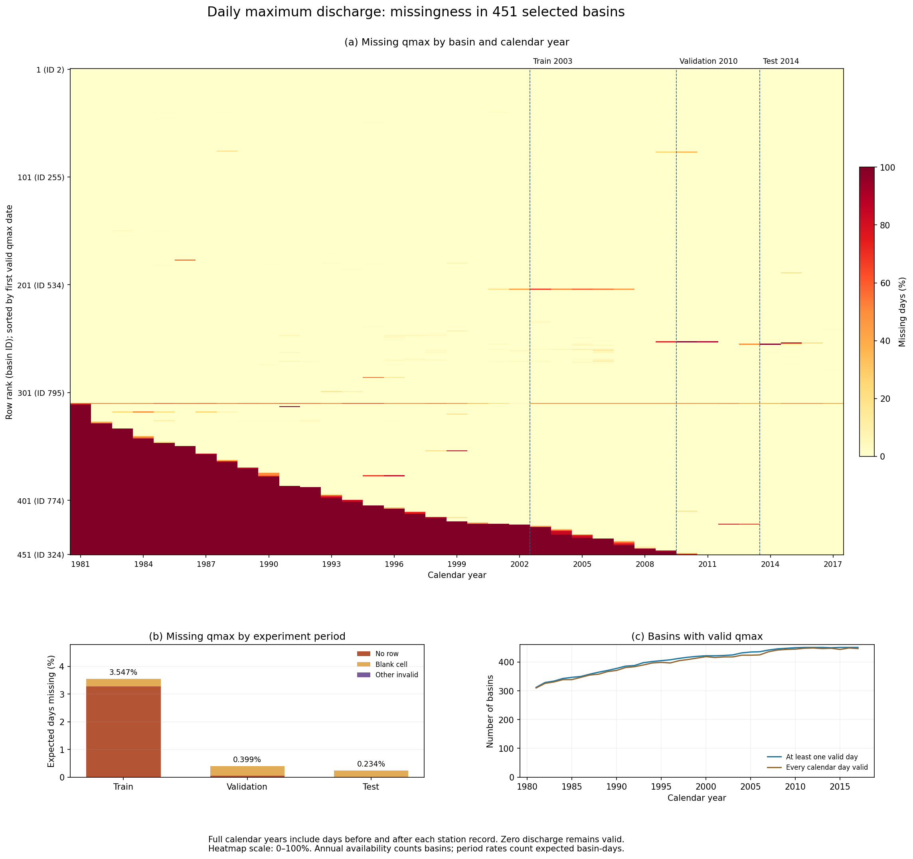

Ảnh thực tế đọc rõ tiêu đề, trục, colorbar và chú giải, không thấy chữ bị cắt hoặc chồng. Vùng đỏ dạng bậc ở các hàng cuối thể hiện thiếu trước ngày Q đầu tiên của những chuỗi bắt đầu muộn. Các vệt bên trong phần còn lại cần đọc cùng số đếm; thang 0–100% khiến mức thiếu nhỏ khó thấy. Không gán ID cho một vệt chỉ bằng các nhãn hàng thưa.

Thời gian quét thực tế **26,8 giây**. Hình đã được sao chép nguyên bản vào repo, kiểm SHA-256 khớp ảnh đính kèm. Sáu CSV qmax_missing_by_year, qmax_missing_by_period_basin, qmax_missing_by_period, qmax_year_summary, qmax_heatmap_order, qmax_codebook với tiền tố A1_P4_ và cache A1_P4_qmax_missing_codes.npz được lưu trên Kaggle; chưa nhận các tệp này về repo. Cache chứa ID theo thứ tự hàng, ngày và ma trận mã, không ghi đè chuỗi Q gốc.

### 18.3. Đoạn thiếu và dòng thời gian trạm bắt đầu muộn — 4.3

Cell dùng lại ma trận mã thiếu 4.2, không đọc lại CSV. Mỗi hàng được kiểm với ngày Q hợp lệ đầu/cuối đã lưu để tránh ghép nhầm thứ tự ID. Một đoạn thiếu là tập các **ngày lịch liên tiếp** có qmax không hợp lệ theo định nghĩa 4.2. Độ dài bằng ngày cuối trừ ngày đầu cộng một. Khi mã đổi từ không có dòng sang ô rỗng mà không có ngày Q hợp lệ xen giữa, đó vẫn là một đoạn.

Các vị trí được phân biệt: trước ngày Q hợp lệ đầu tiên, giữa hai mốc Q hợp lệ đầu/cuối, sau ngày Q hợp lệ cuối cùng; nếu một chuỗi không có Q hợp lệ thì ghi riêng. Đây là phân loại theo vị trí, chưa phải nguyên nhân. Ví dụ ID 94 có ô rỗng trong năm 1981 trước mốc Q đầu tiên năm 1982; không gọi mọi đoạn trước Q đầu tiên là thời gian chưa có dòng hoặc chưa đo. Các đoạn chạm biên lịch 1981–2017 có thể còn kéo dài ngoài lịch kiểm; độ dài quan sát không chứng minh độ dài đầy đủ ngoài phạm vi đó.

Đoạn không bị cắt ở ranh giới năm hoặc train/validation/test. Bảng giao với kỳ lưu riêng độ dài toàn đoạn, số ngày nằm trong kỳ và cờ tiếp tục qua ranh giới kỳ. Ví dụ một đoạn kéo từ cuối train sang validation vẫn là một đoạn gốc; ngày giao mỗi kỳ được cộng đúng một lần trong kỳ tương ứng. Tổng ngày giao phải bằng 40900, 2630, 1545 theo kết quả 4.2, nếu không cell dừng báo lỗi. Tổng ngày tất cả đoạn cũng phải khớp số mã thiếu trong ma trận.

Hình histogram phân biệt ba vị trí. Hai ô có nhiều đoạn dùng trục độ dài log và trục đứng đếm số đoạn, không phải phần trăm ngày thiếu; ô chỉ có một đoạn ghi trực tiếp ID, ngày và độ dài. Biên bin và giới hạn có thể khác giữa các ô để đọc được đoạn bên trong lẫn các khoảng đầu chuỗi rất dài; không so chiều cao cột như mật độ chung. Phân vị độ dài được tính trên các đoạn, mỗi đoạn một quan sát, chưa trọng số theo số ngày.

Dòng thời gian thể hiện 27 lưu vực có ngày Q đầu tiên sau đầu train. Nhãn ghi ngày đầu và số nhãn train hợp lệ. Thanh xanh kéo từ Q đầu tới cuối, các ngày thiếu ở giữa tô đỏ. Các đoạn dưới 7 ngày được bổ sung dấu đứng để thấy được trên hình; bề rộng dấu là ký hiệu, không phải độ dài đoạn. Đây chỉ là quy tắc hiển thị theo ngày, không liên quan ngưỡng nội suy 6 giờ của LamaH-CE. Nền màu chỉ ba kỳ thí nghiệm. Thanh không phải cam kết quan trắc liên tục, và 38 nhãn train của ID 800 không được đổi thành 38 mẫu huấn luyện.

Bảng truy bổ sung in các ID có 0 ngày Q hợp lệ trong cả năm 2010 hoặc 2014, kèm loại thiếu và mốc Q đầu/cuối. Toàn bộ trường hợp không có Q cả năm được lưu CSV, có cờ năm nằm trọn giữa hai mốc hợp lệ. Chưa gán nguyên nhân gián đoạn, chưa áp ngưỡng nội suy 6 giờ của dữ liệu gốc cho đoạn thiếu theo ngày.

**Kết quả thực tế:** có 362 đoạn thiếu với tổng 616264 ngày–lưu vực trong lịch 1981–2017. Không có chuỗi hoàn toàn không có Q hợp lệ. Các loại vị trí cộng đúng tổng, nhưng số lưu vực giữa các vị trí có thể chồng nhau.

| Vị trí | Số đoạn | Lưu vực | Ngày thiếu | Trung vị độ dài | p95 độ dài | Dài nhất | Thiếu dòng | Ô rỗng |
|---|---:|---:|---:|---:|---:|---:|---:|---:|
| Trước Q hợp lệ đầu tiên | 141 | 141 | 602184 | 3652 | 9882 | 10841 | 601693 | 491 |
| Giữa hai mốc hợp lệ | 220 | 56 | 14045 | 11 | 216,05 | 963 | 0 | 14045 |
| Sau Q hợp lệ cuối | 1 | 1 | 35 | 35 | 35 | 35 | 0 | 35 |

Độ dài dùng ngày. Phần trước Q đầu tiên chiếm 97,715265% tổng thiếu, phần giữa 2,279056%, phần cuối 0,005679%. Không diễn giải tỷ trọng 97,7% là tỷ lệ thiếu trong train: mẫu số ở đây là toàn bộ ngày thiếu trên 1981–2017. Khoảng đầu dài nhất thuộc ID 324, từ 01/01/1981 đến 06/09/2010, gồm 10841 ngày.

Các tổng tự đối chiếu: 601693+14571=616264; 491+14045+35=14571 ô rỗng; 451×13514−5493121=601693 ngày không có dòng. Không có giá trị không hợp lệ khác trong các đoạn. Tất cả 220 đoạn bên trong là ô rỗng có dòng, không có đoạn thiếu dòng bên trong. Đây là mô tả trạng thái dữ liệu, chưa biết lý do mất quan trắc.

| Kỳ | Trước Q đầu tiên | Giữa mốc hợp lệ | Sau Q cuối cùng | Tổng ngày giao | Khớp 4.2 |
|---|---:|---:|---:|---:|---|
| Train | 37860 | 3040 | 0 | 40900 | Có |
| Validation | 330 | 2300 | 0 | 2630 | Có |
| Test | 0 | 1510 | 35 | 1545 | Có |

Phân loại theo vị trí giải thích được cấu thành: thiếu dòng ở train/validation đều nằm trước Q đầu tiên; 35 ô thiếu cuối test là đuôi của ID 55 từ 27/11/2017 đến 31/12/2017. Trong toàn lịch, 491 ô rỗng trước Q đầu tiên không được đổi thành thiếu dòng hoặc coi là ngày chưa bắt đầu đo chỉ từ vị trí.

#### 18.3.1. Các khoảng dài và năm thiếu trọn vẹn

| ID | Bắt đầu | Kết thúc | Số ngày | Nhận xét theo lịch |
|---|---|---|---:|---|
| 675 | 04/04/2009 | 22/11/2011 | 963 | Qua ranh giới train/validation; toàn bộ 2010 trống |
| 683 | 02/07/2013 | 27/02/2015 | 606 | Qua ranh giới validation/test; toàn bộ 2014 trống |
| 789 | 01/05/1995 | 30/10/1996 | 549 | Trước giai đoạn thí nghiệm |
| 573 | 18/03/2012 | 09/09/2013 | 541 | Nằm trong validation |
| 453 | 01/10/1998 | 16/11/1999 | 412 | Trước giai đoạn thí nghiệm |
| 682 | 10/03/2015 | 13/03/2016 | 370 | Nằm trong test |
| 94 | 01/01/1991 | 31/12/1991 | 365 | Một năm trống giữa chuỗi; khác năm 1981 trống ở đầu |

Toàn bộ CSV qmax_no_valid_year có 1626 hàng (ID, năm) không có Q hợp lệ. Chỉ ba hàng có cả năm nằm trọn giữa Q đầu/cuối: ID 94 năm 1991, ID 675 năm 2010, ID 683 năm 2014. Không nhầm số hàng này với số trạm; phần lớn hàng khác là năm trước khi có Q đầu tiên.

Các đoạn ở 683 và 682 đóng góp 423+370=793 ngày vào test, tương ứng 51,326861% của 1545 ô thiếu test. Ba đoạn ở 675, 573, 683 đóng góp 691+541+183=1415 ngày vào validation, tương ứng 61,521739% của **2300 ô rỗng**; nếu dùng tổng thiếu validation 2630 làm mẫu số thì tỷ lệ khác. Đây là số ngày giao tính từ CSV đầy đủ, không cộng nguyên độ dài đoạn đi qua nhiều kỳ.

#### 18.3.2. Cụm đoạn 140–250 ngày và giới hạn giả thuyết về ID 55

Trong 220 đoạn bên trong, đúng **41 đoạn** có độ dài từ 140 đến 250 ngày, kể cả hai cận. Chúng thuộc bốn ID:

| ID | Đoạn trong dải 140–250 ngày | Tổng ngày của các đoạn đó |
|---|---:|---:|
| 55 | 33 | 6191 |
| 551 | 6 | 1230 |
| 203 | 1 | 221 |
| 450 | 1 | 194 |
| Tổng | 41 | 7836 |

ID 55 đóng góp 33/41 đoạn và 79,007147% số ngày của cụm này. Do đó, cụm dài không đại diện đồng đều cho toàn bộ 451 lưu vực. Các khoảng lặp ở ID 55 thường nối mùa thu năm trước tới mùa xuân năm sau; ví dụ 01/11/2003–29/04/2004 và 02/11/2016–29/04/2017. Tuy nhiên, ID 551 chỉ có sáu đoạn, nằm trong 2001–2007; ID 203 chỉ có một đoạn 2009–2010. Không suy cả ba đều thiếu mùa đông gần như mọi năm. Dạng hai cụm trên histogram cũng chưa tự xác nhận phân phối hai đỉnh về mặt thống kê.

CSV đầy đủ cho ID 55 có 41 đoạn: một đoạn đầu 126 ngày, 39 đoạn bên trong tổng 6445 ngày và một đoạn cuối 35 ngày; tổng ô rỗng 6606. Ngoài những khoảng dài còn có lỗ ngắn mùa hè, ví dụ 27/08–15/09/1987. Chưa xác nhận nguyên nhân là chế độ đo, băng tuyết, xử lý hay một nguyên nhân khác.

Độ dài đoạn **Q hợp lệ** được tính bổ sung bằng phần bù của toàn bộ đoạn thiếu trên lịch 1981–2017: bắt đầu sau cuối đoạn thiếu trước, kết thúc trước đầu đoạn thiếu sau. Khi xét riêng một kỳ, lấy phần giao của từng đoạn hợp lệ với kỳ rồi chọn độ dài lớn nhất. Đây là phép tính trực tiếp từ CSV thật đã nhận, không phải output của cell 4.4.

| ID | Dài nhất toàn lịch | Dài nhất trong train | Dài nhất trong validation | Dài nhất trong test |
|---|---:|---:|---:|---:|
| 55 | 537 | 185 | 218 | 225 |
| 551 | 7606 | 933 | 1461 | 1461 |
| 203 | 10500 | 2465 | 1332 | 1461 |
| 94 | 9497 | 2557 | 1461 | 1461 |

ID 55 có đoạn 537 ngày từ **01/05/2000 đến 19/10/2001**, nên phát biểu “không có đoạn Q hợp lệ đủ 365 ngày trong toàn lịch sử” không đúng. Trên giai đoạn 2003–2017, đoạn dài nhất chỉ 225 ngày; ba kỳ riêng lần lượt 185/218/225. Kết quả củng cố việc cần kiểm các cửa sổ có Q, nhưng chưa xác nhận nguyên nhân dự báo NaN: tính mẫu phải xét qmean thực sự làm đầu vào, vị trí ngày cần Q trong cửa sổ, khởi động trước kỳ và bộ lọc gốc/sửa. Phần 7 kiểm số mẫu; Phần 9 tổng hợp hồ sơ ID 55. Không thay số NaN bằng một kết luận nhân quả từ biểu đồ.

#### 18.3.3. Timeline, hình và bằng chứng đã nhận

Trong 27 lưu vực bắt đầu muộn, chỉ có **một đoạn thiếu bên trong**, thuộc ID 623, từ 23/11 đến 24/11/2013, dài hai ngày. Vì vậy, việc không nhìn thấy đoạn đỏ trên hình gốc không có nghĩa tất cả 27 chuỗi liên tục. Timeline bổ sung dấu đứng tại đoạn này; nhãn ngày đầu ID 104 có khoảng trống bên trái. Histogram đưa thống kê ra ngoài vùng cột và dùng ô chữ cho đoạn cuối duy nhất để tránh chữ đè dữ liệu.

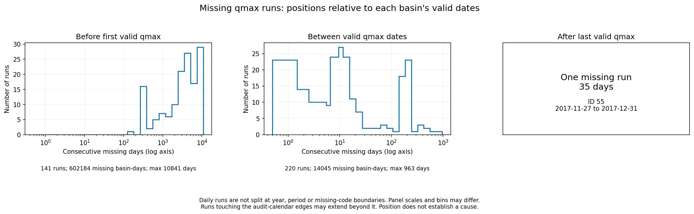

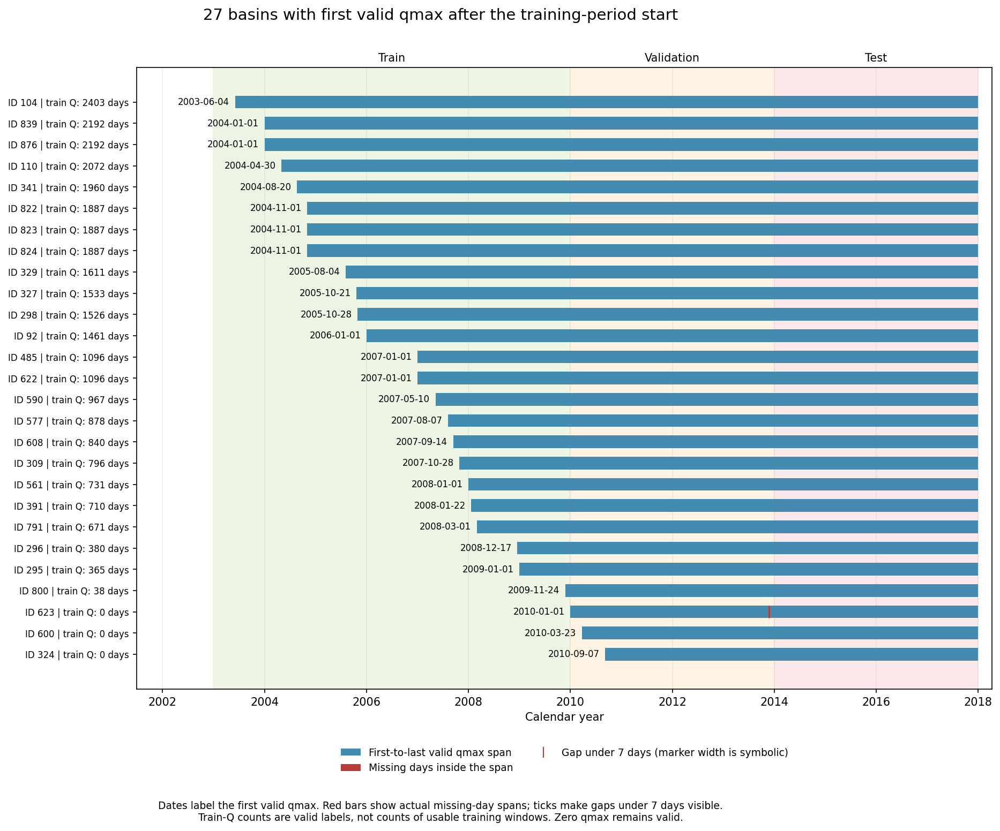

Hai hình trong repo được vẽ lại bằng cùng số liệu CSV thật; đã xem ảnh để kiểm chữ và chú thích, không thay số đo. Sáu CSV nguồn được sao chép nguyên bản, kiểm SHA-256 khớp tệp đính kèm: [đoạn thiếu](Tables/A1_P4_qmax_missing_runs.csv), [tổng hợp](Tables/A1_P4_qmax_run_summary.csv), [giao với kỳ](Tables/A1_P4_qmax_run_period_overlaps.csv), [đối chiếu kỳ](Tables/A1_P4_qmax_run_period_check.csv), [năm không có Q hợp lệ](Tables/A1_P4_qmax_no_valid_year.csv), [27 lưu vực bắt đầu muộn](Tables/A1_P4_late_gauges_timeline.csv). Các kiểm bổ sung xác nhận ngày đầu/cuối khớp độ dài, các đoạn cùng ID không chồng hoặc kề nhau, tổng và phân vị khớp bảng tổng hợp. Thời gian chạy 4.3 trên Kaggle là **2,9 giây**; chưa có cảnh báo trong output nhận được.

### 18.4. EOBS_hu theo năm, tháng và độ dài đoạn — 4.4

4.1 đã xác nhận EOBS_hu là biến khí tượng duy nhất thiếu trong 451 lưu vực trên 2003–2017. Cell 4.4 dùng danh sách thưa 8939 ô thiếu, không đọc lại toàn bộ tệp A. Kiểm ID, ngày, trùng (ID, ngày), nhãn kỳ và tổng theo kỳ trước khi thống kê; không coi một danh sách thiếu rỗng là kết quả hợp lệ nếu tổng 4.1 không khớp.

Tỷ lệ năm có mẫu số số ngày thật của năm nhân 451. Tỷ lệ tháng gộp các năm có mẫu số số ngày thật mang tháng đó trong toàn lịch kiểm nhân 451; nhờ vậy, tháng 2 không bị so với tháng 31 ngày chỉ bằng số đếm. Bảng in cả tử/mẫu, số ID có ít nhất một ngày thiếu và tỷ lệ; các tháng/năm không thiếu vẫn được giữ với giá trị 0.

Đoạn thiếu là các ngày liên tiếp của cùng ID, giữ nguyên qua năm và ranh giới kỳ. Độ dài được tính trên lịch ghép liên tục từ đầu train tới cuối test; cờ chạm hai biên lịch nhắc rằng chưa khảo sát ngày ngoài 2003–2017. Không suy độ dài đầy đủ ngoài lịch, không nối qua khoảng thời gian chưa kiểm. Bảng giao với kỳ phải khớp 1980/3049/3910 ô thiếu đã đo ở 4.1.

Hình có ba ô: tỷ lệ theo năm, tỷ lệ theo tháng đã hiệu chỉnh mẫu số, histogram độ dài đoạn với trục log. Bảng hồ sơ lưu đủ 451 ID, kể cả ID không thiếu, và thống kê đoạn không dùng số lượng đoạn thay cho số ngày.

**Kết quả thực tế:** 8939 ô EOBS_hu thiếu được chia thành **7288 đoạn**, xuất hiện ở **412/451 lưu vực (91,352550%)**. Có 39 lưu vực không thiếu EOBS_hu trong toàn lịch 2003–2017. Tỷ lệ ô thiếu thấp không đồng nghĩa chỉ một nhóm nhỏ lưu vực bị ảnh hưởng.

| Đại lượng của đoạn thiếu | Kết quả | Cách đọc |
|---|---:|---|
| Số đoạn | 7288 | Mỗi đoạn là một chuỗi ngày liên tiếp của cùng ID |
| Trung vị độ dài | 1 ngày | Phân vị tính theo đoạn, không theo số ô thiếu |
| p95 độ dài | 2 ngày | Phần lớn đoạn ngắn; chưa có bảng số đếm chính xác từng độ dài từ output dán |
| Độ dài tối đa | 10 ngày | ID 839, 18–27/01/2003 |
| Đoạn chạm biên lịch kiểm | 5 | Có thể còn kéo dài ngoài 2003–2017; chưa xác nhận độ dài đầy đủ ngoài lịch |

8939/7288≈1,226537 ngày là độ dài trung bình tính từ tổng ô/tổng đoạn. Nó không phải trung bình theo lưu vực hoặc thời gian thiếu trong một cửa sổ đầu vào. Các đoạn chạm biên vẫn được tính vào thống kê độ dài quan sát, không tự loại bỏ.

| Năm | Ô kỳ vọng | Ô thiếu | ID có thiếu | Thiếu (%) |
|---|---:|---:|---:|---:|
| 2003 | 164615 | 175 | 75 | 0,106309 |
| 2004 | 165066 | 120 | 59 | 0,072698 |
| 2005 | 164615 | 202 | 66 | 0,122711 |
| 2006 | 164615 | 223 | 75 | 0,135468 |
| 2007 | 164615 | 349 | 117 | 0,212010 |
| 2008 | 165066 | 453 | 110 | 0,274436 |
| 2009 | 164615 | 458 | 120 | 0,278225 |
| 2010 | 164615 | 624 | 91 | 0,379066 |
| 2011 | 164615 | 595 | 144 | 0,361449 |
| 2012 | 165066 | 623 | 177 | 0,377425 |
| 2013 | 164615 | 1207 | 307 | 0,733226 |
| 2014 | 164615 | 1852 | 330 | 1,125049 |
| 2015 | 164615 | 843 | 227 | 0,512104 |
| 2016 | 165066 | 756 | 219 | 0,457999 |
| 2017 | 164615 | 459 | 172 | 0,278832 |

Năm 2014 có tỷ lệ thiếu cao nhất, 1852/164615=1,125049%, với 330 lưu vực có ít nhất một ô thiếu. Diễn biến không tăng đơn điệu: sau 2014, số thiếu giảm tới 2017. Không dùng ba tỷ lệ gộp train/validation/test để kết luận thiếu tăng đều từng năm. Số ID có thiếu cũng không nhất thiết đồng biến với số ô: năm 2010 thiếu 624 ô ở 91 ID, năm 2011 thiếu 595 ô ở 144 ID.

| Tháng | Ô kỳ vọng trong 15 năm | Ô thiếu | ID có thiếu ít nhất một lần | Thiếu (%) |
|---|---:|---:|---:|---:|
| 1 | 209715 | 1117 | 267 | 0,532628 |
| 2 | 191224 | 708 | 247 | 0,370246 |
| 3 | 209715 | 382 | 151 | 0,182152 |
| 4 | 202950 | 258 | 81 | 0,127125 |
| 5 | 209715 | 458 | 112 | 0,218392 |
| 6 | 202950 | 265 | 65 | 0,130574 |
| 7 | 209715 | 242 | 73 | 0,115395 |
| 8 | 209715 | 395 | 112 | 0,188351 |
| 9 | 202950 | 665 | 171 | 0,327667 |
| 10 | 209715 | 830 | 245 | 0,395775 |
| 11 | 202950 | 1857 | 322 | 0,915004 |
| 12 | 209715 | 1762 | 271 | 0,840188 |

Tháng 11 và 12 có tỷ lệ gộp cao nhất. Chúng đóng góp 3619/8939=40,485513% tổng ô thiếu. Đây là phân bố theo tháng trên toàn bộ 15 năm; chưa chứng minh từng năm hoặc từng lưu vực đều có cùng hình thái mùa, và chưa xác định nguyên nhân. Mẫu số tháng 2 là 451×(15×28+4)=191224, tính bốn ngày nhuận 2004/2008/2012/2016. Không so mùa chỉ bằng số đếm chưa hiệu chỉnh độ dài tháng.

Ngoài đoạn 10 ngày của ID 839, các ví dụ dài được in gồm ID 791 từ 25/11–03/12/2014 (9 ngày), ID 756 từ 26/11–03/12/2014 (8 ngày), các ID 770 và 786 từ 26/11–02/12/2014 (7 ngày). Chúng có ngày chồng nhau, nhưng bảng 15 ví dụ chưa xác nhận mức đồng thời của toàn bộ tập hoặc nguyên nhân vùng. Không gọi đó là lỗi cảm biến cụ thể chỉ từ EOBS_hu thiếu ở nhiều lưu vực.

| Kỳ | Tổng ngày giao các đoạn | Ô thiếu ở 4.1 | Khớp |
|---|---:|---:|---|
| Train | 1980 | 1980 | Có |
| Validation | 3049 | 3049 | Có |
| Test | 3910 | 3910 | Có |

Tổng số thiếu theo năm, theo tháng và theo kỳ đều bằng 8939, không cộng ba cách nhóm này vào nhau. Chưa quy đổi ô thiếu hoặc đoạn thiếu thành số mẫu mất. Ví dụ một ngày EOBS_hu trống có thể nằm trong nhiều cửa sổ 365/730 ngày, tùy biến mô hình dùng và bộ lọc; việc này thuộc Phần 7.

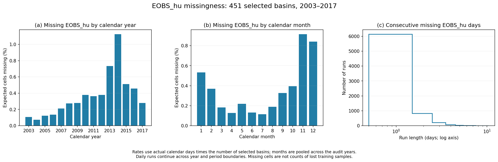

Ảnh đọc rõ cả ba ô, không thấy nhãn hoặc chú thích bị cắt/chồng. Đỉnh năm 2014 và tháng 11–12 khớp bảng số; ô độ dài tập trung ở các đoạn ngắn. Không suy số đoạn 1 ngày chính xác chỉ từ độ cao cột khi chưa nhận bảng đầy đủ. Hình đã được sao chép nguyên bản, SHA-256 khớp ảnh đính kèm. Thời gian thực tế **1,7 giây**. Bảy CSV A1_P4_EOBS_hu_* được lưu trên Kaggle, chưa nhận tệp về repo; số liệu ở đây lấy từ output dán, không tạo lại các bản ghi ngày–ID chưa được cung cấp.

### 18.5. Toàn bộ gaps và đối chiếu Q ngày — 4.5

Cell đọc toàn bộ CSV trong D_gauges/2_timeseries/gaps, kiểm tên ID, header, ngày hợp lệ và lưới giờ. Nếu phút không bằng 0 hoặc thời gian không nguyên thì dừng để kiểm cách phân đoạn, không tự làm tròn. Dòng trùng và thứ tự gốc được ghi nhận; số giờ và đoạn dùng các mốc duy nhất đã sắp, không đếm dòng trùng như một giờ mất thêm.

Theo [LamaH-CE Mục 4.1](https://essd.copernicus.org/articles/13/4529/2021/#section4), tệp gaps lưu các mốc thiếu **trước xử lý**; lỗ liên tiếp không quá 6 giờ được nội suy tuyến tính, phần còn lại ghi −999 trong dữ liệu giờ gốc. Cell chia đoạn trên chênh lệch đúng một giờ giữa các mốc; giữ toàn đoạn qua nửa đêm, năm hoặc kỳ. Đoạn có 7 giờ vẫn được xếp dài dù chỉ một giờ rơi trong kỳ đang xét; không lấy độ dài bị cắt theo kỳ để áp ngưỡng 6 giờ. Đây là phân loại theo quy tắc nguồn, chưa xác nhận nội suy thực tế trong bản Extended hoặc tác động tới qmax.

Bảng kiểm kê có một hàng mỗi tệp, bảng đoạn có một hàng mỗi đoạn giờ; bảng ngày cộng số mốc của các đoạn ngắn/dài chạm ngày đó. Tổng giờ của ba cách biểu diễn phải khớp và mỗi ngày có tối đa 24 mốc duy nhất trên lịch ghi trong tệp. Mốc không có múi giờ được giữ nguyên; ghép bằng ngày lịch viết trong dữ liệu, không tự dịch giờ. Bài gốc mô tả tổng hợp theo ngày GMT, nhưng phép ghép ở đây chưa phải kiểm chuỗi giờ nguồn và quy trình tổng hợp của bản Extended.

Đối với 451 ID, dùng cache Q 4.2 để phân loại ngày Q hợp lệ/thiếu. Ba nhóm ngày gồm không có mốc gaps được liệt kê, chỉ có mốc thuộc đoạn không quá 6 giờ, có ít nhất một mốc thuộc đoạn dài hơn 6 giờ. Hai nhóm có mốc không chồng nhau; một ngày có cả mốc đoạn ngắn và dài được xếp nhóm có đoạn dài. Bảng theo kỳ phải cộng đúng toàn bộ ngày–lưu vực kỳ vọng 4.2. Ngày Q=0 vẫn hợp lệ. Không có tệp hoặc mốc gaps không được diễn giải như chứng nhận toàn bộ giờ quan trắc đều đủ.

Hình ghép histogram độ dài đoạn giờ với phân bố ba nhóm ngày trong từng trạng thái Q ở mỗi kỳ. Các trạng thái Q hợp lệ, không có dòng, ô rỗng được tách riêng; trạng thái không hợp lệ khác chỉ bổ sung nếu có. Mẫu số phần trăm là số ngày–lưu vực của riêng trạng thái đó, không phải toàn bộ lịch kỳ. Nhãn trên cột ghi tổng ngày, ngày chỉ thuộc đoạn ngắn, ngày có đoạn dài để các lát nhỏ không bị hiểu là bằng 0. Nhóm không có ngày ghi rõ n=0, không vẽ thanh 100% giả.

ID 410 không thuộc 451 nhưng được kiểm riêng để đối chiếu giả thuyết 3422 giờ trước/3421 giờ sau xử lý và 141 ngày Q trống. Cell đọc lại Q ngày của đúng ID này; bảng ngày lưu số mốc gaps, số mốc thuộc đoạn ngắn/dài, trạng thái có dòng, token qmax và hợp lệ/thiếu. Tổng hợp tách số giờ thuộc đoạn dài nằm trên ngày Q hợp lệ và ngày Q thiếu. Từ đó có thể so phần giờ còn nằm ở ngày Q vẫn có số với cách tính 141×24; chưa tự đồng nhất số mốc thuộc đoạn dài với giá trị −999 đã kiểm trong chuỗi giờ sau xử lý.

Mẫu số giả thuyết cho metadata là mọi ngày trong khoảng tệp Q của 410 nhân 24. Các tích gaps_pre/post (‰) với mẫu số này được in cạnh số mốc thực đo, không thay cho độ phủ chuỗi giờ đã xác nhận. Mốc gaps ngoài khoảng Q hoặc ngoài lịch cache được báo riêng. Tỷ lệ ‰ làm tròn chỉ cho phép đối chiếu gần đúng, chưa xác định chính xác mẫu số hoặc chứng minh cơ chế xử lý.

**Kết quả thực tế:** 230 tệp gaps có **780671 mốc giờ duy nhất**, không có dòng trùng; thứ tự thời gian gốc của mọi tệp đều tăng. Có 1198 đoạn, trong đó 215 đoạn không quá 6 giờ và 983 đoạn dài hơn 6 giờ. Các bảng theo tệp, đoạn và ngày cộng khớp số giờ.

| Phạm vi | Tệp | Mốc giờ | Đoạn ≤6 giờ | Giờ thuộc đoạn ≤6 giờ | Đoạn >6 giờ | Giờ thuộc đoạn >6 giờ | Đoạn dài nhất (giờ) |
|---|---:|---:|---:|---:|---:|---:|---:|
| Toàn bộ gaps | 230 | 780671 | 215 | 542 | 983 | 780129 | 43824 |
| Gaps của ID thuộc 451 | 97 | 356866 | 77 | 191 | 364 | 356675 | 23137 |

780129/780671=99,930573% số mốc thuộc đoạn dài. 542 giờ thuộc đoạn ngắn phù hợp nhóm có thể được nội suy theo quy tắc bài gốc; chưa xác nhận bằng giá trị chuỗi giờ rằng đúng 542 giờ trong input hiện tại đã được nội suy. ID 781 không được chọn chiếm 207625 giờ, ID 55 được chọn chiếm 159364 giờ; số giờ không phân bố đều giữa các trạm. Số 97 là số ID được chọn có tệp gaps, không phải số ID còn thiếu sau xử lý.

#### 18.5.1. Ô rỗng Q, thiếu dòng và các ngày Q vẫn hợp lệ

| Kỳ | Không có dòng Q | Ô qmax rỗng | Ô rỗng nằm trên ngày có đoạn >6 giờ | Q hợp lệ có mốc đoạn dài | Q hợp lệ chỉ có mốc đoạn ngắn |
|---|---:|---:|---:|---:|---:|
| Train | 37860 | 3040 | 3040 | 87 | 7 |
| Validation | 330 | 2300 | 2300 | 22 | 9 |
| Test | 0 | 1545 | 1545 | 159 | 25 |

Trong đúng 451 ID và 2003–2017, **mọi ô qmax rỗng** nằm trên ngày có ít nhất một mốc thuộc đoạn giờ dài hơn 6 giờ. Các ngày không có dòng Q đều không có mốc gaps được liệt kê; 4.3 đã xác định chúng nằm trước Q hợp lệ đầu tiên. Thiếu dòng được phân biệt với ô rỗng, không gộp hai trạng thái để mô tả cơ chế.

Đối chiếu trực tiếp toàn bộ CSV gaps_daily cho phạm vi này cho kết quả mạnh hơn: cả **6885 ngày qmax rỗng đều có đủ 24 mốc gaps duy nhất trong ngày**. Không có ngày qmax hợp lệ nào có đủ 24 mốc; các ngày hợp lệ có mốc gaps chỉ có 1–23 mốc. Đây là quan hệ trong bản dữ liệu theo lịch ghép đang dùng, chưa phải kiểm giá trị Q giờ, thuật toán tổng hợp hoặc quy tắc áp dụng cho mọi trạm/ngoài 2003–2017.

Có 309 ngày–lưu vực Q hợp lệ đồng thời có mốc gaps: 94 train, 31 validation, 184 test; gồm 268 ngày có mốc thuộc đoạn dài và 41 ngày chỉ thuộc đoạn ngắn. 309/2471029=0,012505% nếu mẫu số là toàn lịch kỳ vọng 2003–2017; 309/2425954=0,012737% nếu mẫu số chỉ là ngày Q hợp lệ. Riêng test có 184/658911=0,027925% ngày–lưu vực kỳ vọng. Đây là mức đồng xuất hiện, không phải tỷ lệ ngày có qmax sai hoặc đỉnh bị hụt. Một ngày có nhiều mốc giờ vẫn chỉ được đếm một lần.

#### 18.5.2. ID 410: 37 giờ nằm trên ba ngày Q hợp lệ

ID 410 có đúng 3421 mốc giờ trong hai đoạn: 01/08/2013 12:00–30/09/2013 23:00 (1452 giờ) và 09/10/2013 08:00–30/12/2013 08:00 (1969 giờ). Không có đoạn ≤6 giờ và không có mốc nằm ngoài khoảng tệp Q 2013–2017.

141 ngày qmax rỗng có tổng 3384 mốc; bảng ngày xác nhận **mỗi ngày có đúng 24 mốc**, không chỉ suy từ số trung bình. Còn 37 mốc nằm trên ba ngày sau:

| Ngày | Mốc gaps thuộc đoạn dài | qmax m³/s | Trạng thái |
|---|---:|---:|---|
| 01/08/2013 | 12 | 1,76 | Hợp lệ |
| 09/10/2013 | 16 | 2,26 | Hợp lệ |
| 30/12/2013 | 9 | 3,00 | Hợp lệ |
| Tổng | 37 | — | Cả ba ngày chỉ thiếu một phần giờ theo danh sách |

Như vậy, tại ID 410 không có trường hợp 24 mốc gaps trong một ngày mà qmax vẫn hợp lệ. Kết quả phù hợp khả năng tổng hợp từ các giờ còn lại, nhưng chưa phân biệt được với những cách xử lý khác; chỉ danh sách gaps và Q ngày không xác nhận thuật toán. Không tự gọi qmax của ba ngày này là chính xác hoặc bị đánh giá thấp.

Lịch Q 1826 ngày tương ứng 43824 giờ nếu mỗi ngày có 24 giờ. Metadata gaps_pre=78,085‰ và gaps_post=78,062‰ nhân mẫu số này cho 3421,99704 và 3420,989088 giờ. Danh sách thực tế 3421 mốc gần số suy từ gaps_post, nhưng không tái hiện số suy từ gaps_pre. Mẫu số 43824 phù hợp phép đối chiếu gaps_post; chưa được chứng minh là mẫu số tác giả dùng cho cả hai tỷ lệ.

Nếu tỷ lệ làm tròn gần nhất đến 0,001‰, sai số tối đa của một tích với 43824 giờ là **0,021912 giờ**. Chênh lệch 3421,99704−3421=0,99704 giờ lớn hơn mức đó, nên không thể giải thích toàn bộ chênh một giờ chỉ bằng làm tròn khi giữ nguyên mẫu số. Chưa xác nhận có một mốc bị thiếu khỏi danh sách, khác phiên bản, khác phạm vi hoặc một khác biệt xử lý nào khác. Không bổ sung một giờ giả vào dữ liệu để ép khớp metadata.

#### 18.5.3. Các đoạn giờ dài và đoạn Q ngày tương ứng

| ID | Đoạn giờ được liệt kê | Độ dài giờ | Liên hệ quan sát với Q ngày |
|---|---|---:|---|
| 94 | 01/01/1981 00:00–31/12/1981 23:00 | 8760 | Đúng năm 1981 có 365 ô Q rỗng |
| 94 | 31/12/1990 23:00–31/12/1991 23:00 | 8761 | Năm 1991 trống; thêm một giờ của ngày biên năm 1990 |
| 675 | 03/04/2009 10:00–23/11/2011 10:00 | 23137 | 14+963×24+11; giữa hai ngày biên là 963 ngày qmax rỗng |
| 683 | 01/07/2013 23:00–28/02/2015 21:00 | 14567 | 1+606×24+22; 606 ngày qmax rỗng ở giữa |
| 789 | 30/04/1995 23:00–31/10/1996 22:00 | 13200 | 1+549×24+23; 549 ngày qmax rỗng ở giữa |

Đoạn 8761 giờ của ID 94 thuộc năm 1991 và ngày biên 31/12/1990, không phải năm 1981 tràn sang 01/01/1982. Các mốc giờ trong gaps hỗ trợ đối chiếu các năm Q trống, nhưng chưa phải đọc trực tiếp chuỗi giờ, chưa giải thích tại sao dữ liệu ban đầu thiếu hoặc vì sao obsbeg_hr của 94 là 1976.

ID 55 có 41 đoạn, tất cả >6 giờ, dài nhất 5222 giờ; ID 551 có sáu đoạn, tất cả >6 giờ, dài nhất 5401 giờ. Chúng phù hợp các khoảng Q ngày dài đã khảo sát, nhưng không lấy số giờ chia 24 rồi làm tròn để thay số ngày Q rỗng: các đoạn giờ có thể bao gồm hai ngày biên chỉ thiếu một phần. Nguyên nhân gốc của các khoảng lặp mùa vẫn chưa biết.

#### 18.5.4. Hình, mã và nguồn CSV đã nhận

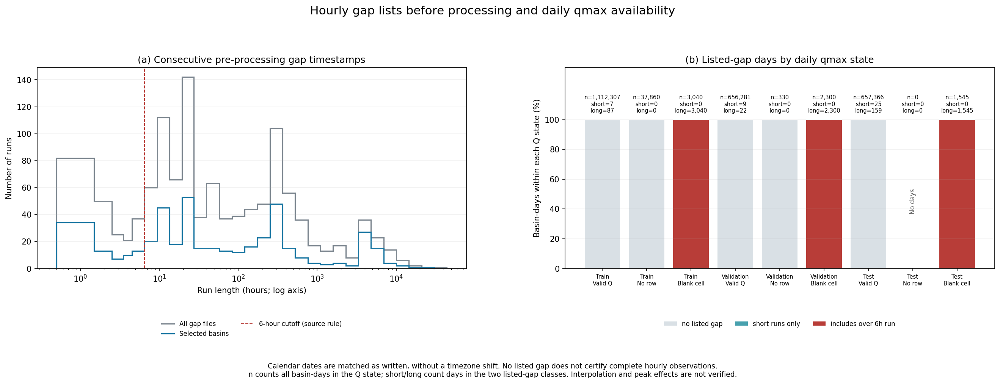

Hình được vẽ lại từ CSV thật bằng mã cell 4.5 đã cập nhật; panel (b) tách Q hợp lệ, không có dòng và ô rỗng. Cột ô rỗng là 100% nhóm có đoạn dài trong cả ba kỳ; cột không có dòng Q ở test ghi n=0. Các nhãn short/long là số ngày theo hai lớp gaps, không phải số giờ hoặc số đoạn. Đã xem ảnh sau khi vẽ để kiểm chữ, số đếm và chú giải. Thời gian chạy bản đo 4.5 trên Kaggle là **25,5 giây**.

Tám CSV nguồn được sao chép nguyên bản vào Tables, đối chiếu SHA-256: [tệp gaps](Tables/A1_P4_gaps_file_profile.csv), [đoạn giờ](Tables/A1_P4_gaps_hourly_runs.csv), [gaps theo ngày](Tables/A1_P4_gaps_daily.csv), [tổng hợp](Tables/A1_P4_gaps_summary.csv), [giao Q theo kỳ](Tables/A1_P4_gaps_qmax_period_cross.csv), [410 theo ngày](Tables/A1_P4_gaps_ID410_daily.csv), [410 tổng hợp](Tables/A1_P4_gaps_ID410_summary.csv), [410 bảng giao](Tables/A1_P4_gaps_ID410_cross.csv). Bản gaps_file_profile (1).csv đính kèm có cùng hash với bản không hậu tố, không phải một bộ số đo khác.

[Bảng giao chi tiết](Tables/A1_P4_gaps_qmax_period_cross_detail.csv) được tính bổ sung từ CSV gaps_daily và các tổng kỳ 4.2 để tách thiếu dòng/ô rỗng; không thay tám tệp nguồn. Cell 4.5 đồng bộ cách tính này và xuất thêm bảng thứ chín khi chạy lại. Không sửa Q, nội suy hoặc loại ngày.

### 18.6. Tổng kết Phần 4

#### 1. Phần này giải quyết câu hỏi gì?

Phần 4 đo dữ liệu thiếu theo biến, lưu vực, ngày, năm và kỳ; phân biệt thiếu vì không có dòng với ô rỗng trong dòng đã có; xác định các đoạn liên tiếp và đối chiếu danh sách giờ thiếu. Phần 4 không huấn luyện mô hình, điền khuyết, loại lưu vực hoặc thay đổi dữ liệu gốc. Một ô thiếu chưa phải một mẫu huấn luyện mất.

#### 2. Khí tượng đầy đủ đến đâu?

Trong 451 lưu vực, 2003–2017, 39/40 biến khí tượng có 0 ô thiếu theo phép kiểm hữu hạn khác −999. Chỉ EOBS_hu có 8939 ô rỗng, phân bố 1980/3049/3910 ở train/validation/test; tỷ lệ riêng biến là 0,171695%/0,462733%/0,593403%. Các số âm hữu hạn khác −999 được giữ; nhiệt độ âm không bị coi là thiếu. Không có dòng ngày A thiếu, −999, nội dung không chuyển số hoặc vô hạn trong phạm vi đã kiểm.

EOBS_hu thiếu ở 412/451 ID, thành 7288 đoạn, trung vị/p95/tối đa 1/2/10 ngày. Năm 2014 có tỷ lệ thiếu cao nhất 1,125049%; tỷ lệ gộp theo tháng cao nhất ở tháng 11 và 12. Các tỷ lệ tháng dùng đúng số ngày lịch, gồm năm nhuận. Những kết quả này chưa xác định nguyên nhân hoặc chứng minh mọi lưu vực có cùng mùa thiếu.

#### 3. Thiếu Q theo kỳ gồm những gì?

Q hợp lệ là hữu hạn và không âm; Q=0 là hợp lệ. Train thiếu 40900/1153207 ngày–lưu vực (3,546631%), gồm 37860 ngày không có dòng và 3040 ô rỗng. Validation thiếu 2630/658911 (0,399143%), gồm 330 không có dòng và 2300 ô rỗng. Test thiếu 1545/658911 (0,234478%), toàn bộ là ô rỗng. Các số đếm khớp Phần 2; không có qmax âm hoặc −999 trong 451 ID được kiểm.

27 ID có Q hợp lệ đầu tiên sau đầu train; ba ID 324, 600, 623 không có nhãn train, ID 800 chỉ có 38 nhãn. Timeline phân biệt ngày Q đầu/cuối với tính liên tục bên trong. ID 623 vẫn có một lỗ hai ngày 23–24/11/2013; không kết luận chuỗi liên tục chỉ vì không nhìn thấy vạch đỏ ở độ phân giải nhỏ.

#### 4. Đoạn thiếu dài nằm ở đâu?

Trên 1981–2017, có 616264 ngày–lưu vực thiếu: 602184 trước Q hợp lệ đầu tiên, 14045 ở giữa và 35 sau Q cuối. Có 141 đoạn đầu, 220 đoạn giữa ở 56 ID và một đoạn cuối thuộc ID 55. Mọi đoạn giữa là ô rỗng có dòng. Vị trí không tự chứng minh lý do chưa đo hoặc mất quan trắc.

ID 675 có đoạn Q trống 963 ngày, gồm toàn bộ 2010; ID 683 có đoạn 606 ngày, gồm toàn bộ 2014. Vì vậy, số lưu vực có Q từng năm không chỉ là cộng dồn các trạm bắt đầu đo. Các đoạn đi qua ranh giới kỳ được giữ nguyên, còn số ngày giao từng kỳ được đếm riêng và khớp tổng thiếu.

#### 5. Danh sách gaps xác nhận quan hệ nào?

230 tệp có 780671 mốc giờ, trong đó 780129 mốc thuộc đoạn >6 giờ và 542 mốc thuộc đoạn ≤6 giờ. Trong 451 ID, 97 có tệp gaps. Theo bài gốc, đây là danh sách thiếu trước xử lý; việc phân loại theo ngưỡng không phải kiểm rằng mỗi giờ ngắn đã được nội suy trong bản hiện tại.

Trong 451×2003–2017, cả 6885 ô qmax rỗng đều nằm trên ngày có đủ 24 mốc gaps. Ngày Q hợp lệ có mốc gaps chỉ có 1–23 mốc; có tổng 309 ngày–lưu vực như vậy. Chưa xác nhận thuật toán tổng hợp hoặc mức sai lệch đỉnh. Không có mốc gaps không phải chứng nhận quan trắc giờ đầy đủ. Ghép dùng ngày ghi trong tệp, không tự dịch múi giờ.

#### 6. ID 410 giải thích phần chênh 37 giờ ra sao?

141 ngày Q rỗng có đúng 3384 mốc, mỗi ngày 24 mốc. 37 mốc còn lại ở ba ngày hợp lệ: 01/08/2013 có 12 mốc, 09/10/2013 có 16, 30/12/2013 có 9. Không có ngày 24 mốc mà Q vẫn hợp lệ ở ca này. Hai đoạn giờ đều dài, không có đoạn ≤6 giờ.

3421 mốc thực tế gần số suy từ gaps_post×43824/1000, còn gaps_pre suy gần 3422. Chênh một giờ không thể giải thích riêng bằng làm tròn 0,001‰ nếu giữ mẫu số 43824; mẫu số tác giả dùng cho cả hai tỷ lệ chưa được xác nhận. Cũng chưa giải thích nguyên nhân sai khác danh sách/metadata hoặc cách tổng hợp Q. Đoạn 8761 giờ của ID 94 thuộc 1991 cộng giờ biên 1990, còn 1981 có đúng 8760 giờ.

#### 7. Những gì chuyển tiếp và những gì chưa quyết định

ID 55 có các khoảng thiếu mùa dài nhưng không thiếu liên tục cả lịch sử: đoạn hợp lệ dài nhất là 537 ngày trong 2000–2001; trên 2003–2017 dài nhất chỉ 225 ngày. Điều này cần được kiểm với qmean thực sự dùng, các cửa sổ và bộ lọc ở Phần 7, rồi đối chiếu dự báo NaN trong hồ sơ Phần 9. Chưa gán nguyên nhân NaN từ một biểu đồ hoặc một thuộc tính tĩnh.

Phần 4 hoàn thành các mục khảo sát thiếu theo kế hoạch. Phần 5 chuyển sang giá trị, phân phối, mùa, đoạn hằng số và ngoại lai; đối chiếu qmax từ giờ và kiểm nội suy cần lamah-ce-core. Phần 7 mới tính số mẫu mất. Không lấy 0,36% ô EOBS_hu thiếu làm tỷ lệ mẫu mất hoặc tự điền chúng trước khi xem bộ nạp và các biến mô hình thực sự dùng.

#### 8. Bằng chứng lưu lại

Các hình Phần 4 gồm thiếu khí tượng theo biến/kỳ, tổng quan Q theo năm/kỳ, histogram đoạn thiếu Q, timeline 27 ID, hình EOBS_hu theo năm/tháng/đoạn và hình gaps theo giờ/Q ngày. Các CSV thực nhận được giữ nguyên, bảng dẫn xuất được ghi riêng. Cache Q 4.2 giữ mã thiếu để dùng lại; nó không thay dữ liệu gốc. Các số thực đo và các giới hạn về giờ, metadata, cửa sổ được ghi cùng nhau để báo cáo không vượt quá bằng chứng.

## 19. Phân phối Q và khí tượng: Phần 5

### 19.1. Phân phối qmax theo m³/s và mm/ngày — 5.1

Cell đọc lại qmax của 451 ID trên toàn bộ bản ghi trong lịch Q đã kiểm ở 4.2, không chỉ 2003–2017. Mặt nạ hợp lệ của từng ID phải khớp cache 4.2, kể cả khi thứ tự ID trong ma trận khác. Chỉ Q hữu hạn không âm tham gia thống kê; số 0 vẫn tham gia mọi phân vị. Các ngày thiếu được giữ NaN trong cache phân tích, không điền thành 0 hoặc sửa tệp input.

Đổi đơn vị dùng qmax (m³/s)×86,4/area_gov (km²), theo diện tích mà bộ nạp dùng. Hệ số xuất phát từ 86400 giây/ngày, 10⁶ m²/km² và 1000 mm/m. area_calc chỉ xuất để đối chiếu, không tự thay mẫu số. Với qmax, mm/ngày là cường độ dòng chảy tương đương trên diện tích; không phải tổng chiều sâu dòng chảy thực tế trong ngày, vì qmax không phải qmean.

Thống kê mỗi lưu vực và thống kê gộp gồm số ngày hợp lệ/0/dương, phân vị, trung bình, độ lệch chuẩn mẫu và độ lệch phân phối. Thống kê gộp coi mỗi ngày–lưu vực là một quan sát; lưu vực có bản ghi dài góp nhiều ngày hơn. Không diễn giải trung vị gộp như trung vị của 451 trung vị lưu vực, hoặc dùng thống kê toàn lịch này để khớp scaler train.

Hai histogram dùng trục Q log, chỉ vẽ giá trị dương và ghi rõ số 0 bên ngoài. Mẫu số cột là toàn bộ ngày Q dương của đơn vị tương ứng, các bin phủ mọi giá trị dương; không thêm epsilon cho số 0 hoặc cắt đuôi ở p99. Bảng phân vị vẫn giữ số 0. Phân phối mm/ngày có thể đổi thứ hạng giữa các lưu vực vì hệ số khác nhau, không chỉ là nhân toàn bộ tập với một hằng số chung.

Bảng các cực đại in ID, diện tích, ngày đầu đạt max và các phân vị để chọn phép kiểm tiếp theo; chưa gán nhãn lỗi hoặc loại ngoại lai. Cache lưu Q hợp lệ theo m³/s, ID, ngày và hệ số; ma trận mm/ngày được suy từ cùng giá trị khi chạy.

**Kết quả thực tế:** hai đơn vị cùng có 5478550 ngày qmax hợp lệ, gồm 2270 ngày bằng 0 (0,041434%) và 5476280 ngày dương, khớp các số đếm trước đó. Chuyển đơn vị không đổi mặt nạ hợp lệ hoặc số 0. Ngày được gộp từ toàn bộ bản ghi của 451 ID, không chỉ train hoặc test.

| Thống kê | m³/s | mm/ngày theo area_gov |
|---|---:|---:|
| Min | 0 | 0 |
| p01 | 0,042000 | 0,070791 |
| p05 | 0,123000 | 0,194025 |
| Trung vị | 1,620000 | 1,179497 |
| p95 | 20,200000 | 9,886205 |
| p99 | 64,750000 | 24,106667 |
| Max | 1335,000000 | 644,119760 |
| Trung bình | 5,656345 | 2,647375 |
| Độ lệch chuẩn mẫu, ddof=1 | 19,416207 | 5,193747 |
| Skew mẫu | 15,360516 | 9,688783 |

Trung bình lớn hơn trung vị và skew dương lớn mô tả phân phối lệch phải mạnh. Cực đại mm/ngày gấp khoảng 546,10 lần trung vị và 26,72 lần p99. Chưa khớp mô hình đuôi hoặc kiểm tính chất tiệm cận, nên chưa phân loại thống kê là heavy-tailed chỉ từ các số này. Histogram log không biến dữ liệu thành phân phối chuẩn; không chọn phép biến đổi nhãn chỉ bằng nhìn hình.

Nếu dùng mean/std của toàn lịch gộp làm thước mô tả, cực đại mm/ngày cách trung bình khoảng (644,119760−2,647375)/5,193747=123,51 std mẫu. Đây **không phải z-score đã xác nhận của mô hình**. Scaler nhãn có phạm vi train và quy tắc riêng; cần đọc giá trị lưu rồi so lại. Không dùng mức 123,51 làm ngưỡng loại dữ liệu hoặc thay bằng một giá trị bị cắt.

| ID | area_gov (km²) | Trung vị mm/ngày | p99 mm/ngày | Max mm/ngày | Ngày đầu đạt max |
|---|---:|---:|---:|---:|---|
| 10 | 33,4 | 3,673293 | 53,513677 | 644,119760 | 22/08/2005 |
| 25 | 13,7 | 3,793401 | 88,481168 | 413,710949 | 22/08/2005 |
| 23 | 14,1 | 2,561362 | 47,060426 | 387,268085 | 23/08/2005 |
| 101 | 3,9 | 2,636308 | 38,911015 | 376,615385 | 01/06/2013 |
| 30 | 6,8 | 1,931294 | 56,016424 | 362,117647 | 29/09/1981 |
| 20 | 41,7 | 3,791655 | 48,276259 | 317,007194 | 22/08/2005 |
| 261 | 24,6 | 1,513756 | 49,827512 | 316,800000 | 12/08/2002 |
| 797 | 21,8 | 2,750532 | 52,601311 | 314,983486 | 18/07/1987 |
| 102 | 37,6 | 1,810723 | 25,046809 | 305,617021 | 02/06/2013 |
| 24 | 31,1 | 3,639357 | 69,695074 | 302,816720 | 23/08/2005 |

Cả mười ID có diện tích 3,9–41,7 km². Hệ số đổi của toàn tập trải từ 86,4/15131≈0,005710 đến 86,4/3,9≈22,153846, chênh 3879,74 lần. Bảng xác nhận các cực đại theo lưu vực trong top 10 thuộc lưu vực nhỏ; chưa chứng minh toàn bộ đuôi p99 do nhóm nhỏ chi phối. Cần đếm mọi ngày vượt một ngưỡng rõ ràng theo nhóm diện tích, cùng số ngày quan trắc của từng nhóm, trước khi kết luận về toàn đuôi phân phối.

Ví dụ ID 10: 644,119760×33,4/86,4≈249 m³/s. Đây là phép đổi ngược một tốc độ dòng chảy. Không so trực tiếp 644 mm/ngày của qmax với lượng mưa tích lũy ngày rồi kết luận vi phạm cân bằng nước: qmax không phải lưu lượng trung bình cả ngày, và lượng nước có thể có nguồn từ lưu trữ/lưu vực ngoài thời đoạn mưa đang xét.

Năm ID có ngày đầu đạt max ở 22–23/08/2005, hai ID ở 01–02/06/2013, ba ID còn lại ở 1981/1987/2002. Năm mốc đầu thuộc train, hai thuộc validation, ba trước train; không có **ngày đầu đạt max** nào trong bảng thuộc test. Tuy nhiên, chỉ lưu lần đầu không loại trừ cực đại bằng nhau lặp lại ở test, hoặc những ID khác có đỉnh lớn trong test. Phần 8 so các kỳ bằng toàn bộ dữ liệu, không lấy mười dòng này thay cho phép so đó.

Về bối cảnh sự kiện, [BAFU liệt kê các báo cáo phân tích lũ 2005](https://www.bafu.admin.ch/de/ereignisanalysen), [BfG ghi nhận các đợt tháng 8/2002 và 8/2005 trong hệ Danube/phụ lưu](https://undine.bafg.de/donau/extremereignisse/donau_extremereignisse.html), và [BfG mô tả đợt mưa/lũ cuối tháng 5–đầu tháng 6/2013](https://undine.bafg.de/donau/extremereignisse/donau_hw2013.html). Các nguồn hỗ trợ bối cảnh thời gian, chưa xác nhận quan trắc của từng ID hoặc chứng minh một giá trị cực đại đúng. Tỉ lệ qmax/qmean cùng ngày, thủy đồ và chuỗi giờ là các phép kiểm tiếp; ngưỡng lũ ở Phần 10 cũng không tự là ngưỡng xác định lỗi.

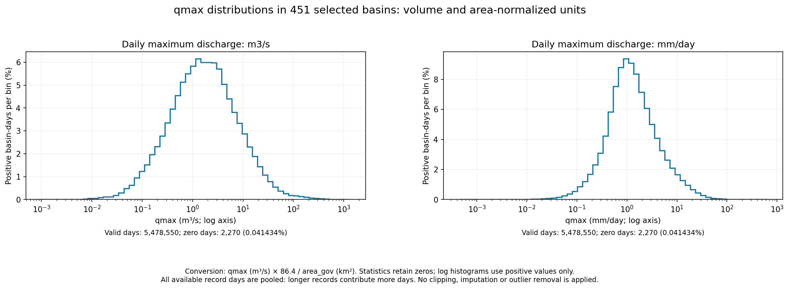

Hình đọc rõ hai trục log, chú thích số 0 và công thức, không thấy chữ chồng hoặc cắt. Hai panel là phần trăm theo bin của ngày Q dương, không phải mật độ trên đơn vị độ rộng Q và không chứa số 0 trên trục log. Mốc trục tới 10³ không có nghĩa max mm/ngày bằng 1000; max đo được là 644,119760. Khi mô tả dải vài bậc độ lớn cần phân biệt vùng chính của histogram với toàn dải dương, chưa in min dương ở bảng này.

Thời gian thực tế **30,1 giây**. Hình đã được sao chép nguyên bản, SHA-256 khớp ảnh đính kèm. Bốn CSV A1_P5_qmax_distribution_by_basin, qmax_distribution_pooled, qmax_distribution_bins, qmax_area_conversion và cache Q được lưu trên Kaggle; chưa nhận các tệp này về repo. Không dựng lại bản ghi ngày–ID hoặc CSV đầy đủ chỉ từ bảng top 10.

### 19.2. Đơn vị nhãn, phạm vi train và scaler từng run — 5.2

Đối chiếu scaler nhãn phù hợp Phần 5 vì nó kiểm đơn vị thực sự đi vào mô hình. Ghi chú A2 Mục 6.3 đã có phép đối chiếu một run có Q: qmax khớp mm/ngày, qmean đầu vào khớp m³/s. Phép kiểm A1 ở đây mở rộng sang tất cả config.yml hiện có; không tự xem kết quả một run là kết quả của cả 24 run hoặc xem thiếu scaler là đã kiểm được.

**Hai loại chuẩn hóa khác nhau.** [Lớp LamaH](../../../PaperResearch/PaperResearchCode/BiasCast_NH/neuralhydrology/datasetzoo/lamah.py#L125) gọi hàm đọc Q với normalize_discharge=False rồi gọi _normalize_discharge ngay sau đó bằng area_gov. False ở hàm đọc tránh chuyển đơn vị tại bước đó, không vô hiệu bước đổi đơn vị của lớp dữ liệu. [_normalize_discharge](../../../PaperResearch/PaperResearchCode/BiasCast_NH/neuralhydrology/datasetzoo/lamah.py#L303) thực hiện đổi tốc độ dòng chảy sang mm/ngày ở độ phân giải ngày. Vì vậy, tìm cờ normalize_discharge=True trong YAML không phải điều kiện đủ/cần để kết luận nhãn đã đổi; cell vẫn ghi nhận có khóa và giá trị khai báo để không suy đoán.

Sau bước đơn vị, [BaseDataset đặt nhãn trước đầu train thành NaN](../../../PaperResearch/PaperResearchCode/BiasCast_NH/neuralhydrology/datasetzoo/basedataset.py#L450), [chuyển dữ liệu sang float32](../../../PaperResearch/PaperResearchCode/BiasCast_NH/neuralhydrology/datasetzoo/basedataset.py#L495), rồi [tính mean/std theo các ô hữu hạn trước _create_lookup_table](../../../PaperResearch/PaperResearchCode/BiasCast_NH/neuralhydrology/datasetzoo/basedataset.py#L743). Nhãn chỉ tính trên ngày train có Q, không cần mọi cửa sổ khí tượng/qmean hợp lệ trước khi đóng góp cho scaler. Độ lệch chuẩn động dùng ddof=0; điều này khác std ddof=1 của thuộc tính tĩnh ở Phần 3 và std mẫu mô tả ở 5.1.

Cell dùng cache Q 5.1, đọc cấu hình và train_data/train_data_scaler.yml của từng run, không đọc lại toàn bộ CSV Q. Tệp ID train được giải bằng đường dẫn hiện có hoặc tên tệp duy nhất trong input; kiểm trùng, ID ngoài cache và sắp theo chuỗi như thư viện. Không mặc định mỗi run dùng 451 nếu tệp ID không giải được. Ngày đầu/cuối, seq_length và predict_last_n phải có giá trị hợp lệ; thời gian khởi động là seq_length−predict_last_n ở cấu hình ngày đơn tần. Có nhiều khoảng train thì nhãn hợp lệ theo hợp các khoảng, nhãn ngoài chúng giữ NaN.

Ba ứng viên so đơn vị gồm Q thô m³/s, mm/ngày theo area_gov và mm/ngày theo area_calc. Mỗi ứng viên tính bằng float32 để bám mã, kèm float64_control để đọc sai số số học; đều bỏ NaN, giữ số 0 và dùng ddof=0. Kết quả không được tính bằng trung bình của các trung bình lưu vực. Giữ các ID không có nhãn train dưới dạng hàng NaN như dữ liệu gốc, không lấy chúng làm số 0.

Mean/std được lấy an toàn từ cấu trúc xarray trong YAML; không nạp pickle, không sửa scaler. Cần cả mean lẫn std khớp trong rtol=10⁻⁵, atol=10⁻⁷. Bảng CSV giữ độ lệch tuyệt đối để kết luận không chỉ dựa vào nhãn True/False. Nếu nhiều ứng viên cùng khớp thì ghi ambiguous_match, không ép nhận diện mẫu số diện tích từ hai con số chưa đủ phân biệt. Dung sai có xét float32; không thể dùng nó để phân biệt ddof=0/1 khi số mẫu rất lớn, nên quy ước ddof lấy từ mã đã đọc.

Phạm vi không tái dựng được được ghi rõ: train_data_file, tệp periods riêng theo lưu vực, dữ liệu khác ngày đơn tần, custom_normalization của qmax khác mean/std, qmax bị random holdout, ID ngoài cache hoặc thiếu YAML. Run học chuyển giao có thể dùng scaler kế thừa; không khớp thống kê train hiện tại chưa chứng minh scaler sai. Một run thiếu YAML từng thấy ở 3.9–3.10 vẫn là giới hạn cần giữ, không chép scaler run khác vào thay.

Nếu ứng viên area_gov khớp, cell tính thêm z của max toàn lịch theo mean/std đã lưu của chính run, ghi rõ chỉ là chẩn đoán theo scaler đó. Không xem đây là thước sai số quan trắc, không cắt ngưỡng hoặc sửa các đỉnh. Phép kiểm này chỉ xét qmax nhãn; không tự đổi đơn vị qmean hoặc áp scaler mới cho mô hình.

Đầu ra gồm bốn CSV A1_P5_target_scaler_runs, target_scaler_comparisons, target_config_audit, target_scaler_reference_summary; cell này phục vụ đối chiếu bảng nên không tạo thêm hình.

**Kết quả thực tế:** cả 24 cấu hình đều khai báo dataset=lamah_a, target_variables=['qmax'], không có khóa normalize_discharge và không có custom_normalization riêng cho qmax. Việc không có khóa này không vô hiệu bước đổi đơn vị của lớp LamaH đã dẫn ở trên.

Đọc được qmax center/scale của 23 run. Trong đó 22 run giải được cùng một phạm vi: 451 ID, train 01/01/2003–31/12/2009, khởi động 364 ngày và **1112307 nhãn hợp lệ**. Số nhãn khớp 4.2. Các run này đều báo no_candidate_match với phép tính float32 hiện tại; chưa có run nào đạt matched_gov. Không được ghi nhận chúng như 22 run đã khớp scaler.

| Tham chiếu float32 ở 5.2 | Mean | Std ddof=0 | Run được so | Run khớp cả hai |
|---|---:|---:|---:|---:|
| Q thô, m³/s | 5,213147 | 17,525707 | 22 | 0 |
| mm/ngày theo area_calc | 2,554646 | 5,171471 | 22 | 0 |
| mm/ngày theo area_gov | 2,572048 | 5,260822 | 22 | 0 |
| Scaler đã lưu, số hiển thị | 2,572082 | 5,262434 | 23 tệp đã đọc | Chưa tái hiện chính xác |

Theo số hiển thị, ứng viên area_gov lệch khoảng **0,0013% ở mean và 0,0306% ở std** so với scaler. Sai khác nhỏ hơn nhiều so với hai cách chọn đơn vị/diện tích còn lại, nhưng vượt dung sai 5.2; không làm tròn hoặc nới ngưỡng để đổi nhãn kết quả. Các cặp saved_mean/saved_std nhìn giống nhau ở sáu chữ số thập phân; cần bảng đầy đủ để khẳng định chúng giống nhau đến hết độ chính xác lưu trữ.

Hai trường hợp còn mở được giữ riêng:

- Encoder_Decoder_LSTM/Encoder_Decoder_LSTM_without_q/Encoder_Decoder_LSTM_RA_without_q_Simple_Embedding: đọc được scaler, nhưng có khai báo train_data_file hoặc per_basin_train_periods_file ngoài phạm vi tái dựng của 5.2. Output chưa in giá trị khai báo nên chưa phân biệt hai trường hợp này. Không mặc định phạm vi scaler bằng phạm vi 22 run còn lại.
- TransferLearning/TL_AllWeights/TL_AllWeights_RA_Complex_Embedding: vẫn thiếu YAML scaler. Không gán kết quả của run khác cho nó.

**Giới hạn của phép khớp trước đây:** A2 Phần 3 so một run bằng NumPy, dùng MATCH_TOL=0.01 (1%) và bảng hiển thị bốn chữ số thập phân. Kết quả đó ủng hộ đơn vị qmax là mm/ngày, chưa xác nhận bằng nhau ở dung sai 10⁻⁵. Mã 5.2 đã tính cả float64_control nhưng bảng tổng hợp (3) chỉ in float32; output vừa nhận chưa chứa số float64_control. Vì vậy chưa biết sai khác này xuất hiện từ số lưu trữ, cách tích lũy hoặc dữ liệu/phạm vi.

Thời gian thực tế **9,9 giây**, một phạm vi được tính và tái dùng cho 22 run. Output văn bản đã nhận được giữ nguyên ở [A1_P5_target_scaler_output.txt](Tables/A1_P5_target_scaler_output.txt). Bốn CSV do Kaggle xuất chưa được nhận cục bộ; không dựng CSV chi tiết từ bảng đã rút gọn. Không có hình mới ở cell này. Trạng thái chưa khớp của 5.2 được giữ làm dấu vết phép đo; kết quả chẩn đoán 5.3 bên dưới đã phân biệt sai số số học với sai đơn vị, nên không đọc riêng 5.2 như kết luận cuối cùng.

### 19.3. Độ chính xác tích lũy và backend — 5.3

Đây là một phép kiểm tập trung cho sai khác mới phát hiện ở 5.2. Giữ nguyên cả rtol=10⁻⁵ lẫn atol=10⁻⁷; không đổi input, diện tích, scaler hoặc danh sách ID để làm cho phép so khớp. Cell sử dụng cache 5.1 và bảng 5.2, không đọc lại CSV Q hay nạp tệp pickle train lưu sẵn.

[Tài liệu NumPy nanstd](https://numpy.org/doc/stable/reference/generated/numpy.nanstd.html) nêu rằng dữ liệu float mặc định dùng chính độ chính xác đầu vào để tính, và tích lũy ở độ chính xác cao hơn có thể giảm sai số float32. [Báo cáo lỗi Bottleneck #462](https://github.com/pydata/bottleneck/issues/462) đưa ví dụ nanmean/nanstd float32 khác NumPy trên mảng lớn. Đây là cơ sở để thiết kế phép kiểm, **chưa chứng minh Bottleneck gây ra sai khác của 5.2 hoặc tác giả đã dùng backend này**. Môi trường huấn luyện gốc cũng chưa được xác nhận từ output vừa nhận.

Để phân biệt độ chính xác lưu trữ với độ chính xác tích lũy, cell tính trên cùng ma trận nhãn train, cùng mặt nạ NaN, cùng thứ tự ID/ngày, cùng ddof=0:

| Cách tính | Số được lưu trong ma trận | Bộ tích lũy/cách giảm | Câu hỏi được kiểm |
|---|---|---|---|
| numpy64_storage64_acc64 | float64 | NumPy, dtype=float64 | Tham chiếu số học với dữ liệu chưa ép float32 |
| numpy64_storage32_acc64 | float32 | NumPy, dtype=float64 | Riêng việc ép số lưu trữ sang float32 có tạo sai khác không? |
| numpy32_storage32_acc32 | float32 | NumPy mặc định | Tác động của tích lũy ở float32 |
| xarray32_default | float32 | xarray với tùy chọn hiện tại | Tái kiểm cách giảm hiện tại trên cùng dữ liệu |
| xarray32_acceleration_disabled | float32 | xarray tạm tắt use_bottleneck/use_numbagg nếu hỗ trợ | Kết quả có thay đổi khi tắt tăng tốc không? |

Mỗi cách được áp cho cả ba ứng viên đơn vị/diện tích. Phép đổi mm/ngày trong 5.3 dùng đúng thứ tự các phép chia/nhân của _normalize_discharge; các cách giảm bên trong cell dùng chung các giá trị đã đổi này. Cell in phiên bản gói và tùy chọn hiện tại; có cài một gói không đồng nghĩa phép giảm đã gọi gói đó. Các [tùy chọn xarray](https://docs.xarray.dev/en/stable/generated/xarray.set_options.html) chỉ đổi trong khối context và được kiểm đã khôi phục sau cell.

Bảng (2) in lại cả float32 lẫn float64_control đã có trong 5.2. Bảng (3) so năm cách tính, giữ mean/std, sai lệch tương đối và số run khớp. Bảng (4) ghi kết quả theo tham chiếu NumPy float64 từng run, giữ nguyên status_5_2 để có thể kiểm tra sự thay đổi cách tính; một tham chiếu khớp chưa xác nhận lịch sử backend của tác giả. Nếu nhiều ứng viên cùng khớp thì kết quả vẫn là ambiguous_numpy64. Chỉ khi riêng ứng viên area_gov khớp mới tính z của max toàn lịch theo scaler đã lưu.

Bảng (5) in nguyên khai báo train_data_file và per_basin_train_periods_file của run chưa hỗ trợ, nhưng không nạp chúng hoặc gán kết quả từ run khác. Run thiếu YAML giữ not_evaluated. Năm CSV mới mang tiền tố A1_P5_target_numeric_* và A1_P5_target_initial_precision; không ghi đè bốn CSV 5.2.

**Kết quả thực tế:** **22/22 run tái dựng được phạm vi train đều đạt gov_stats_match_numpy64**. Trong ba ứng viên, chỉ mm/ngày theo area_gov khớp cả mean lẫn std ở dung sai cũ rtol=10⁻⁵, atol=10⁻⁷. Kết quả giữ nguyên khi dữ liệu được lưu float32 nhưng tích lũy bằng NumPy float64. Không nới dung sai hoặc thay dữ liệu để đạt kết quả này.

Môi trường có Python 3.13.15, NumPy 2.1.3, pandas 2.3.3, xarray 2025.12.0 và Bottleneck 1.4.2; numbagg không được cài. Cả hai tùy chọn use_bottleneck/use_numbagg đều True trước phép kiểm. Kết quả trên cùng nhãn mm/ngày theo area_gov như sau:

| Cách tính | Mean | Std ddof=0 | Run khớp trong 22 run |
|---|---:|---:|---:|
| NumPy, lưu float64 và tích lũy float64 | 2,572081505851 | 5,262434050208 | 22 |
| NumPy, lưu float32 và tích lũy float64 | 2,572081506154 | 5,262434048741 | 22 |
| NumPy float32 mặc định | 2,572082281113 | 5,262434482574 | 22 |
| xarray float32, tắt tăng tốc | 2,572082281113 | 5,262434482574 | 22 |
| xarray float32, tùy chọn mặc định hiện tại | 2,572047948837 | 5,260821819305 | 0 |

Thay đường tính xarray mặc định bằng đường không tăng tốc đã loại sai khác trên cùng dữ liệu. Việc chỉ ép dữ liệu lưu sang float32 không gây ra độ lệch lớn ở 5.2, vì tích lũy float64 trên các số float32 vẫn khớp. Đây là bằng chứng thực nghiệm về đường tính số học trong **môi trường kiểm hiện tại**, phù hợp vai trò tăng tốc Bottleneck; không suy ngược phiên bản hoặc backend huấn luyện gốc chỉ từ hai scalar. Phân phối 5.1 dùng các thống kê NumPy trên số float64, không cần sửa số đo 5.1 theo kết quả chẩn đoán này.

Hai ứng viên đối chứng tiếp tục không khớp. Theo NumPy float64, Q thô cho mean/std 5,214678053811/17,522222780922, còn mm/ngày theo area_calc cho 2,554759646838/5,173095437856. Sai lệch của area_calc khoảng 0,6735% ở mean và 1,6977% ở std, khác rõ mức sai khác số học giữa các tham chiếu area_gov.

**Scaler đã đọc có hai cặp số khác nhau**, không phải một cặp giống hệt như cách in sáu chữ số thập phân ở 5.2 dễ gợi ý:

| Cặp | Saved mean | Saved std | Run đã so thành công | Scaler đã đọc |
|---|---:|---:|---:|---:|
| 1 | 2,572081506154 | 5,262434054634 | 5 | 5 |
| 2 | 2,572082281113 | 5,262434482574 | 17 | 18 |

Cặp 2 trùng các số NumPy float32 in tới 12 chữ số thập phân. Cặp 1 rất gần tham chiếu tích lũy float64. Cả hai cùng khớp ứng viên area_gov theo dung sai đã đặt; chưa dùng sự trùng gần này để xác nhận lịch sử môi trường từng run. Cột 18 scaler của cặp 2 bao gồm run EncDec chưa tái dựng được nguồn dữ liệu train; chỉ có 17 run cặp này thực sự được kiểm phạm vi.

Hai giới hạn được chốt và chuyển tiếp, không giữ toàn bộ khảo sát Phần 5 ở bước scaler:

- EncDec RA không Q Simple khai báo train_data_file=/home/ok2907/Documents/BiasCast/Experiments/Encoder_Decoder_LSTM/Encoder_Decoder_LSTM_without_q/Encoder_Decoder_LSTM_RA_without_q_Simple_Embedding/train_data, trong khi per_basin_train_periods_file=None. Như vậy vướng mắc là dữ liệu train lưu sẵn, không phải khai báo periods riêng; chưa đọc hoặc xác nhận nội dung đường dẫn gốc này. Run vẫn not_evaluated về phạm vi scaler.
- TL_AllWeights vẫn thiếu YAML, cũng not_evaluated. Không sao chép scaler của run khác vào thay.

Max qmax toàn lịch có z khoảng **121,9108** theo hai cặp scaler train đã xác nhận ở 22 run. Đây là khoảng cách trên thang chuẩn hóa của nhãn train, khác z≈123,5 từ mean/std toàn lịch ở 5.1; không phải tiêu chí xác định lỗi hay lý do cắt đỉnh.

Thời gian thực tế **8,9 giây**, một phạm vi chẩn đoán; tùy chọn xarray đã trở lại trạng thái trước cell. Bảng (1)–(2) được gửi trực tiếp trong trao đổi, còn văn bản gốc bảng (3)–(5) và các dòng tổng kết được giữ nguyên ở [A1_P5_target_numeric_output_tables_3_5.txt](Tables/A1_P5_target_numeric_output_tables_3_5.txt). Chưa nhận năm CSV 5.3; không dựng bảng CSV toàn bộ từng run từ output trình bày. Không thay scaler, đơn vị qmean hoặc bộ lọc mẫu.

### 19.4. Phân phối từng lưu vực và đóng góp đuôi theo diện tích — 5.4

Cell này trở lại câu hỏi giá trị dữ liệu: phân phối mỗi lưu vực thay đổi thế nào theo diện tích, và nhận xét từ top 10 cực đại ở 5.1 có còn đúng khi đếm toàn bộ ngày ở đuôi hay không? Dùng cache Q 5.1 trên toàn lịch 1981–2017; không coi đây là phân phối riêng train hoặc test.

**Hình thứ nhất** sắp các lưu vực theo area_gov tăng dần, diện tích bằng nhau thì sắp ID số tăng dần. Trục ngang là thứ hạng lưu vực, không phải khoảng cách diện tích. Mỗi lưu vực có hộp q25–q75, đường trung vị, râu p05–p95 và chấm max, vẽ riêng m³/s và mm/ngày. Phân vị giữ số 0; hộp chỉ tóm tắt phân phối, không biểu diễn mọi ngày quan trắc. Trục symlog tuyến tính từ 0 tới 0,1 và log ở phía trên để giữ được số 0 mà không thêm epsilon. Đây chỉ là cách hiển thị, không đổi nhãn hoặc giả định chuẩn hóa cho mô hình.

**Đuôi phân phối** được định nghĩa riêng cho mỗi đơn vị: Q lớn hơn p99 của tất cả ngày–lưu vực hợp lệ trong cache. Giá trị đúng bằng p99 được đếm riêng và không tính vào đuôi; vì có trùng số, tỷ lệ vượt không bắt buộc đúng 1%. Ngưỡng này khác p99 của từng lưu vực, khác ngưỡng lũ theo chu kỳ lặp lại và không phải nhãn lỗi. Tất cả ngày hợp lệ, kể cả số 0, tham gia tính ngưỡng.

Chia tối đa bốn nhóm theo tứ phân vị area_gov bằng qcut; không tách hai lưu vực cùng diện tích sang hai nhóm để ép bằng số lượng. Nếu cạnh tứ phân vị trùng thì loại cạnh trùng và ghi lại nhóm thực tế. Mỗi nhóm báo số lưu vực, cạnh và quy ước đóng/mở bin, dải diện tích thực, số ngày hợp lệ và số ngày vượt p99. Không giả định các nhóm có cùng số ngày quan trắc.

| Đại lượng | Tử số / mẫu số | Cách đọc |
|---|---|---|
| Tỷ phần đuôi của nhóm | Ngày vượt p99 của nhóm / tất cả ngày vượt p99 cùng đơn vị | Nhóm đóng góp bao nhiêu phần trăm vào đuôi gộp? |
| Tỷ lệ vượt trong nhóm | Ngày vượt p99 của nhóm / ngày Q hợp lệ của nhóm | Bao nhiêu phần trăm ngày nhóm này thuộc đuôi? |
| Tỷ phần ngày hợp lệ | Ngày Q hợp lệ của nhóm / tất cả ngày Q hợp lệ | Mức đóng góp số quan sát làm mẫu đối chiếu |
| Tỷ số hai tỷ phần | Tỷ phần đuôi / tỷ phần ngày hợp lệ | So đóng góp đuôi với mức góp ngày quan trắc |

Ví dụ minh họa, không phải kết quả 5.4: một nhóm góp 20% ngày hợp lệ nhưng 40% ngày đuôi có tỷ số 2. Đó là mức đóng góp đuôi gấp hai so với tỷ phần quan sát, chưa là quan hệ nhân quả giữa diện tích và lưu lượng. Các lưu vực có thể lồng nhau, các ngày có thể cùng một sự kiện, nên không coi các đếm này là quan sát độc lập để suy p-value.

**Hình thứ hai** đặt tỷ phần đuôi của hai đơn vị cạnh tỷ phần ngày hợp lệ, rồi vẽ tỷ lệ vượt trong từng nhóm ở panel riêng. Bảng top 12 xếp theo số ngày vượt p99 mm/ngày, không xếp theo max như 5.1. Cell kiểm tổng ngày hợp lệ, số 0 và p99 khớp 5.1; các nhóm cộng đúng tổng ngày và tổng đuôi. Xuất hai PNG A1_P5_qmax_by_area_rank và A1_P5_qmax_tail_by_area_group, cùng bốn CSV qmax_area_rank, qmax_area_quantiles, qmax_area_thresholds, qmax_area_tail_groups.

Mã đã kiểm bằng dữ liệu giả lập có ID đảo thứ tự, diện tích trùng, số 0 và chiều dài bản ghi khác nhau. Hình giả lập chỉ kiểm bố cục và không được lưu vào thư mục kết quả thật.

**Kết quả thực tế:** cả hai đơn vị cùng có 5478550 ngày Q hợp lệ và 2270 ngày bằng 0, khớp 5.1. Ngưỡng được tính bằng giá trị đầy đủ trong cache, không dùng ngưỡng in đã làm tròn để đếm.

| Đơn vị | p99 gộp, số hiển thị | Ngày đúng bằng p99 | Ngày lớn hơn p99 | Tỷ lệ vượt trên ngày hợp lệ |
|---|---:|---:|---:|---:|
| m³/s | 64,750000 | 15 | 54775 | 0,999808% |
| mm/ngày theo area_gov | 24,106667 | 32 | 54775 | 0,999808% |

Hai số ngày vượt bằng nhau không có nghĩa hai tập ngày–lưu vực vượt là cùng một tập. Đổi theo diện tích khác nhau ở từng lưu vực làm thay đổi thứ tự các quan sát khi gộp, dù giữ nguyên thứ tự theo thời gian trong một lưu vực.

#### 19.4.1. Đuôi thuộc nhóm diện tích nào?

| Nhóm | area_gov thực tế (km²) | Lưu vực | Ngày hợp lệ | Tỷ phần ngày hợp lệ | Tỷ phần đuôi m³/s | Tỷ phần đuôi mm/ngày |
|---|---:|---:|---:|---:|---:|---:|
| Q1 | 3,9–51,4 | 113 | 1297376 | 23,681010% | 0,131447% | 61,845733% |
| Q2 | 51,5–101,0 | 113 | 1360230 | 24,828285% | 0,690096% | 21,688727% |
| Q3 | 101,6–220,1 | 112 | 1370618 | 25,017897% | 2,995892% | 10,121406% |
| Q4 | 221,5–15131,0 | 113 | 1450326 | 26,472808% | 96,182565% | 6,344135% |

Theo m³/s, nhóm lớn nhất Q4 góp **52684/54775 ngày đuôi (96,18%)**, với tỷ lệ vượt trong nhóm 3,632563%. Theo mm/ngày, nhóm nhỏ nhất Q1 góp **33876/54775 ngày đuôi (61,85%)**, với tỷ lệ vượt trong nhóm 2,611117%. Q1 chỉ góp 23,68% ngày quan trắc hợp lệ, nên tỷ phần đuôi gấp khoảng **2,61 lần** tỷ phần ngày hợp lệ. Đây là bằng chứng đếm toàn bộ ngày đuôi trong phạm vi này, mạnh hơn nhận xét chỉ từ mười cực đại ở 5.1.

Hai nhóm nhỏ hơn Q1+Q2 góp **45756 ngày, tức 83,534459% đuôi mm/ngày**, so với 48,509295% ngày hợp lệ. Nhóm Q4 chỉ góp 6,344135% đuôi mm/ngày dù góp 26,472808% ngày hợp lệ. Vì đã đối chiếu số ngày quan trắc, khác biệt không chỉ là nhóm có nhiều ngày ghi nhận hơn. Kết quả vẫn là mô tả phụ thuộc đơn vị, phạm vi lịch và ngưỡng gộp; chưa xác lập quan hệ nhân quả giữa diện tích với cực trị hoặc tính đại diện của các lưu vực này.

Các cạnh chia nhóm là 3,90/51,45/101,00/220,80/15131,00 km²; nhóm đầu đóng cả hai đầu, các nhóm sau mở trái/đóng phải. Dải thực trong bảng là min/max lưu vực có mặt trong nhóm, không phải cạnh bin. Ví dụ cạnh giữa Q2 và Q3 là 101,00 nhưng giá trị nhỏ nhất có mặt ở Q3 là 101,6 km².

#### 19.4.2. Nhiều ngày đuôi khác với cực đại lớn nhất

| ID | Trạm | area_gov (km²) | Ngày vượt p99 mm/ngày gộp | % ngày hợp lệ của trạm | % tổng đuôi |
|---|---|---:|---:|---:|---:|
| 265 | Polsterlucke | 15,6 | 3618 | 26,772236 | 6,605203 |
| 205 | Waldbachstrub | 31,3 | 2554 | 18,898920 | 4,662711 |
| 531 | Innergschloess | 39,3 | 2184 | 16,161018 | 3,987220 |
| 55 | Vernagt | 11,4 | 1912 | 27,678054 | 3,490644 |
| 112 | Kees | 19,2 | 1576 | 14,879154 | 2,877225 |
| 132 | Abtenau Au | 26,9 | 1551 | 14,154043 | 2,831584 |
| 532 | Matreier Tauernhaus | 59,9 | 1383 | 10,233832 | 2,524874 |
| 24 | Schoenenbach (Hengstig) | 31,1 | 1267 | 9,375462 | 2,313099 |
| 797 | Sumvitg Encardens | 21,8 | 1114 | 8,243303 | 2,033775 |
| 551 | Ochsenhuette-Hochalm | 9,3 | 1034 | 8,417454 | 1,887723 |
| 529 | Hinterbichl (Muehle, mit UW-Kanal) | 35,0 | 1022 | 7,562528 | 1,865815 |
| 210 | Mitterweissenbach | 35,1 | 932 | 7,087991 | 1,701506 |

Mười hai ID này góp **20147 ngày, tức 36,781378% đuôi**. Riêng 265 và 205 góp 6172 ngày (11,267914%). ID 10 đứng đầu max ở 5.1 không có trong bảng top 12 đếm ngày đuôi này. Vì vậy một đỉnh rất lớn và nhiều ngày ở mức cao là hai đặc điểm khác nhau.

Ví dụ, 265 có 3618/13514 ngày vượt ngưỡng gộp, khoảng 26,77%, dù ngưỡng mang tên p99. Không có mâu thuẫn: p99 này thuộc toàn bộ 5478550 ngày–lưu vực, còn p99 riêng của 265 là 84,184615 mm/ngày, cao hơn ngưỡng gộp 24,106667. Trạm cũng có 189 ngày bằng 0, đã giữ trong mẫu số/phân vị.

Với ID 55, 27,678054% có mẫu số **6908 ngày Q hợp lệ**, không phải mọi ngày lịch 1981–2017. Phần 4 đã thấy thiếu kéo dài và lặp theo mùa ở 55/551; các quan sát có mặt có thể không đại diện đủ các mùa. Do đó không suy tỷ lệ ngày cao của cả lịch từ tỷ lệ trên ngày đã quan trắc. Đây là một lý do để khảo sát mùa kèm độ phủ ở 5.5, chưa phải lý do gán lỗi hoặc loại trạm.

#### 19.4.3. Hình và phạm vi bằng chứng

Hai hình nhận được đọc rõ tiêu đề, nhãn trục, chú giải và ghi chú; không thấy chữ chồng hay bị cắt. Hộp 451 lưu vực phù hợp đọc xu hướng chung, còn phân vị chính xác từng ID phải dùng CSV. Trục m³/s có mức phân phối tăng theo thứ hạng diện tích nhìn thấy rõ; mm/ngày giảm khác biệt theo diện tích ở phần thân phân phối, trong khi các max ở nhóm nhỏ vẫn nổi bật. Các mô tả này không phải hệ số tương quan đã đo hoặc phép kiểm độc lập.

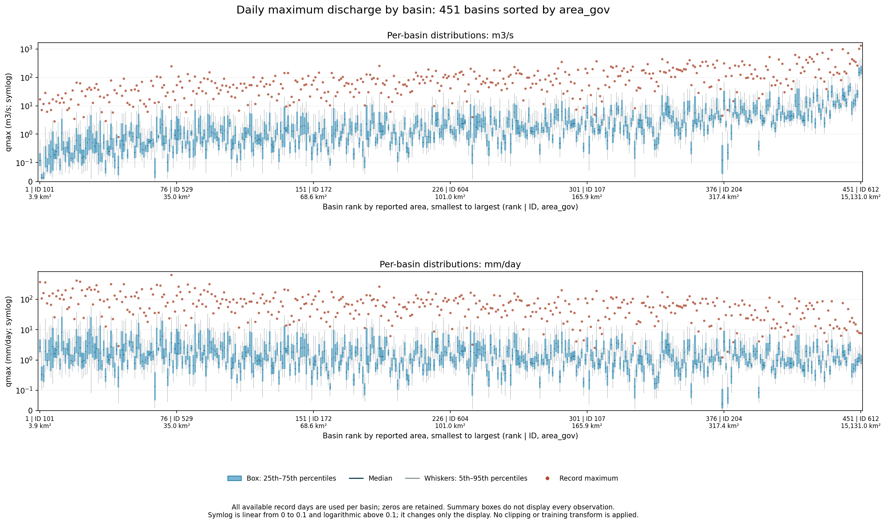

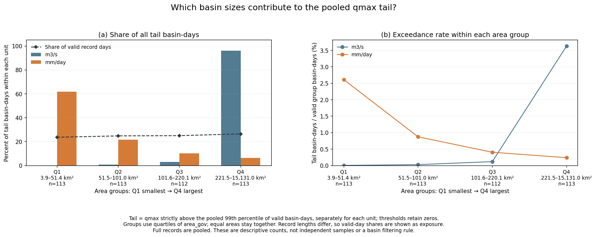

Thời gian thực tế **6,7 giây**; số ngày, số 0 và p99 khớp 5.1, các nhóm cộng khớp. Hai ảnh nguồn được sao chép nguyên bản, kiểm SHA-256 trùng tệp nhận. Bốn CSV qmax_area_rank, qmax_area_quantiles, qmax_area_thresholds, qmax_area_tail_groups vẫn chỉ có trên Kaggle; chưa nhận chúng về repo. Không dựng CSV đủ 902 hàng từ bảng top 12, không điền thiếu hoặc cắt đỉnh.

### 19.5. Mùa theo độ cao, năm thủy văn và độ phủ — 5.5

Mục tiêu là mô tả mùa của qmax đồng thời thấy mức thiếu quan trắc theo tháng. Tất cả phép tính dùng qmax quy đổi mm/ngày theo area_gov trong cache 5.1, và elev_mean của lưu vực trong Catchment_attributes, không dùng elev của trạm. Nhóm độ cao là các tứ phân vị trên toàn 451 ID, giữ độ cao bằng nhau cùng nhóm và ghi cạnh bin; không tự gán nhóm này thành chế độ thủy văn hoặc cơ chế băng/tuyết.

**Chọn khoảng lịch chung:** lấy ngày Q hợp lệ đầu tiên muộn nhất và ngày Q hợp lệ cuối cùng sớm nhất trong 451 ID. Bên trong khoảng đó, chọn các năm thủy văn 01/10–30/09 trọn vẹn. Cell tính lại mốc từ cache thay vì gán cứng, và in rõ khoảng thật dùng. Khoảng chung theo đầu/cuối giúp bỏ phần thiếu do trạm bắt đầu muộn hoặc kết thúc sớm; nó không bảo đảm hết lỗ bên trong, như Phần 4 đã đo.

Năm thủy văn được ghi theo năm kết thúc: ví dụ minh họa, nhãn 2011 tương ứng 01/10/2010–30/09/2011. Đây là quy ước Oct–Sep dùng cho khảo sát này. Một khoảng 7 năm hoàn chỉnh chứa 12 nhóm tháng, không đồng nghĩa mỗi trạm quan trắc đủ mọi ngày. Số ngày mẫu số tính trực tiếp từ lịch, giữ đúng 29/02 trong các năm nhuận. Khảo sát gộp mô tả trên khoảng được in; không dùng số đo này để khớp lại scaler train.

**Trung bình trong lưu vực, rồi tóm tắt ngang lưu vực:** với từng ID và từng tháng lịch, tính mean của tất cả qmax ngày có quan trắc trong tháng đó qua các năm có mặt trong khoảng. Giữ số 0. Sau đó lấy trung vị và p25–p75 của các mean tháng ngang lưu vực trong cùng nhóm độ cao, mỗi ID góp một số nếu có dữ liệu tháng. Đây không phải trung vị của toàn bộ ngày gộp, và không để một ID nhiều ngày quan trắc đóng nhiều phiếu hơn ở bước tóm tắt ngang lưu vực. Bên trong mean của một ID, các ngày hợp lệ vẫn có trọng số bằng nhau.

Tháng không có quan trắc giữ NaN và không đóng góp cho trung vị; số ID có dữ liệu được lưu trong bảng summary, không coi tháng đó có Q=0. Đại lượng là **trung bình của lưu lượng cực đại ngày**, không phải lưu lượng trung bình thực của tháng hoặc tổng thể tích dòng chảy. Không suy tổng dòng chảy tháng bằng cách nhân số này với số ngày.

**Đối chiếu với tập đủ dữ liệu cả khoảng:** lấy những ID có qmax hữu hạn trên mọi ngày trong khoảng chung, cố định thành viên đó qua cả 12 tháng. Tính lại trung vị ngang lưu vực cho tập này và vẽ cùng đường từ mọi quan trắc sẵn có. Không đổi các nhóm độ cao theo tập con, không áp điều kiện này vào chọn 451 trạm cho mô hình. Nếu một nhóm không có ID đủ cả khoảng thì đường đối chiếu giữ NaN. Hai đường khác nhau có thể do thành phần lưu vực và quan hệ giữa thiếu dữ liệu với mùa; đây là đối chiếu độ nhạy, không phải phép điền khuyết hoặc phép xác định nhân quả của thiếu dữ liệu.

**Hai hình:** A1_P5_qmax_seasonality_by_elevation có panel theo nhóm độ cao, đường trung vị từ mọi mean tháng hiện có, dải p25–p75 ngang lưu vực và đường đối chiếu tập đủ dữ liệu. Cả bốn nhóm dùng cùng thang y, được đặt sau khi tính đủ dải giá trị của tất cả nhóm. A1_P5_qmax_seasonality_coverage biểu diễn phần trăm ngày thiếu từng tháng của từng ID, xếp theo elev_mean, và tỷ lệ thiếu theo nhóm ở panel riêng. Mẫu số luôn là lịch đầy đủ nhân số lưu vực; cùng khoảng đầu/cuối không được gán thành quan trắc đủ.

**Bảng và kiểm tra:** (1) mốc lịch, năm thủy văn và tổng số ngày; (2) nhóm độ cao cùng số ID đủ khoảng; (3) trung vị mean tháng của hai tập theo tháng Oct–Sep; (4) tỷ lệ thiếu theo nhóm/tháng; (5) 12 ID thiếu nhiều nhất trong khoảng. Xuất năm CSV qmax_season_scope, qmax_season_elevation_groups, qmax_season_basin_monthly, qmax_season_monthly_summary, qmax_season_basin_coverage. Cell kiểm số đếm theo tháng/nhóm cộng khớp và không biến tháng không có quan trắc thành số 0.

Đã kiểm mã bằng dữ liệu giả lập có ngày nhuận, chuỗi toàn 0, tháng hoàn toàn thiếu, độ cao bằng nhau và nhóm không có thành viên đủ cả khoảng. Hình giả lập chỉ kiểm bố cục, không lưu vào kết quả thật.

**Kết quả thực tế:** khoảng chung giữa latest first và earliest last là **07/09/2010–26/11/2017**. Bên trong đó có bảy năm thủy văn trọn vẹn, nhãn 2011–2017, tương ứng **01/10/2010–30/09/2017**, 2557 ngày lịch. Tập 451 ID có 1153207 ngày–lưu vực kỳ vọng, 1149918 ngày hợp lệ và 3289 ngày thiếu, tức khoảng **0,285205%**. Đây là khoảng lịch khảo sát mùa, khác kỳ train 2003–2009 dù hai khoảng tình cờ cùng có 2557 ngày.

#### 19.5.1. Độ phủ và tập đủ cả khoảng

Có **436/451 ID (96,674058%)** đủ qmax trên mọi ngày của khoảng khảo sát; 15 ID còn lại vẫn được giữ trong tập có quan trắc, không bị loại khỏi danh sách mô hình.

| Nhóm | elev_mean thực tế (m) | ID | ID đủ cả khoảng | Ngày thiếu | Thiếu trên lịch nhóm |
|---|---:|---:|---:|---:|---:|
| E1 | 221–590 | 113 | 110 | 13 | 0,004499% |
| E2 | 593–794 | 113 | 112 | 7 | 0,002423% |
| E3 | 798–1292 | 112 | 107 | 620 | 0,216493% |
| E4 | 1296–3122 | 113 | 107 | 2649 | 0,916796% |

Cạnh tứ phân vị là 221/591,5/794/1294/3122 m, khác min/max ID thực trong mỗi nhóm. Thiếu dữ liệu nhiều hơn ở E4 trong khoảng này; không suy độ cao là nguyên nhân gây thiếu. Theo tháng, E4 thiếu nhiều nhất tháng 12 (1,500754%), tiếp theo tháng 11/1/2 khoảng 1,39–1,40%; tháng 5–6 khoảng 0,379267%. E3 thiếu cao nhất tháng 8 (0,357966%). E1/E2 có tỷ lệ thiếu rất nhỏ ở mọi tháng.

Năm ID thiếu nhiều nhất góp **3128/3289 ngày thiếu (95,104895%)**:

| ID | Trạm | Nhóm | Ngày hợp lệ / 2557 | Ngày thiếu | Tỷ lệ thiếu |
|---|---|---|---:|---:|---:|
| 55 | Vernagt | E4 | 1364 | 1193 | 46,656238% |
| 683 | Garmisch uh Partnach | E4 | 1951 | 606 | 23,699648% |
| 573 | Bad Eisenkappel | E3 | 2016 | 541 | 21,157607% |
| 675 | Mittenwald_Isar | E4 | 2139 | 418 | 16,347282% |
| 682 | Garmisch oh Partnach | E4 | 2187 | 370 | 14,470082% |

Các ID tiếp theo trong bảng top 12 là 498 (63 ngày thiếu), 585 (60), 700 (8), 726 (8), 641 (7), 695 (7), 720 (4). Các số này là thiếu trong khoảng chung đang xét. Ví dụ 675 có đoạn thiếu 963 ngày ở 4.3, nhưng chỉ 418 ngày giao với khoảng 5.5; không có mâu thuẫn giữa hai số đếm vì khác phạm vi. Không suy nguyên nhân thiếu chỉ từ bảng xếp hạng.

#### 19.5.2. Mùa quan sát được theo nhóm độ cao

Bảng dưới là trung vị ngang lưu vực của **mean qmax ngày theo tháng**, đơn vị mm/ngày; dùng mọi quan trắc có mặt trong khoảng. Không gọi đây là qmean tháng hoặc tổng dòng chảy tháng.

| Tháng | E1 | E2 | E3 | E4 |
|---|---:|---:|---:|---:|
| 10 | 0,738221 | 1,008365 | 2,418821 | 2,968245 |
| 11 | 0,782644 | 1,176463 | 2,004505 | 2,218166 |
| 12 | 0,853400 | 1,273215 | 1,821109 | 1,331071 |
| 1 | 1,256506 | 1,763132 | 2,462564 | 1,209291 |
| 2 | 1,121122 | 1,542707 | 2,107254 | 1,020396 |
| 3 | 0,893525 | 1,453171 | 2,733917 | 1,397935 |
| 4 | 0,719018 | 1,208634 | 3,039275 | 3,223526 |
| 5 | 1,123965 | 1,585917 | 3,286734 | 6,358073 |
| 6 | 1,114434 | 1,800817 | 3,538713 | 8,654398 |
| 7 | 0,747604 | 1,341483 | 2,903210 | 6,265488 |
| 8 | 0,704376 | 1,171784 | 2,618923 | 5,357490 |
| 9 | 0,737765 | 1,175726 | 2,957931 | 4,453893 |

E4 có chênh mùa rõ nhất: trung vị cao nhất tháng 6 (8,654398), thấp nhất tháng 2 (1,020396), tỷ số khoảng **8,48**. E3 cũng cao nhất tháng 6 (3,538713), trong khi E1 cao nhất tháng 1 (1,256506). E2 có hai mức gần nhau ở tháng 6 (1,800817) và tháng 1 (1,763132); chưa nên mô tả như chỉ một đỉnh áp đảo. Độ cao cao hơn không đồng nghĩa giá trị này cao hơn ở mọi tháng: tháng 2, E4 thấp hơn E3. Đây là mô tả liên hệ giữa nhóm độ cao và mùa trong bảy năm được xét; chưa xác nhận cơ chế tuyết/băng tan hoặc quan hệ nhân quả.

Đường từ tập đủ cả khoảng gần đường từ mọi quan trắc ở cả bốn nhóm. Theo các số được in, sai khác tuyệt đối lớn nhất của 48 cặp trung vị là **0,223203 mm/ngày** ở E4 tháng 9 (4,453893 so với 4,677096). Sai khác tương đối lớn nhất khoảng 5,46% ở E1 tháng 4; dùng đường mọi quan trắc làm mẫu số. Các tháng đạt mức lớn nhất theo nhóm vẫn như nhau sau phép đối chiếu này. Ví dụ E4 tháng 6 là 8,737736 trong tập đủ dữ liệu, gần 8,654398 ở tập có quan trắc.

Phép đối chiếu cho thấy hình dạng trung vị theo nhóm ít thay đổi khi chuyển sang 436 ID đủ khoảng trong phép đo này. Nó **không** xác nhận từng ID thiếu dữ liệu đều không bị thiên lệch theo mùa, không khôi phục phần Q không quan trắc và không chứng minh các ngày thiếu có tính ngẫu nhiên. Với ID 55, gần nửa lịch đang xét vẫn thiếu; cần giữ giới hạn đó khi đọc đường phân phối hoặc số ngày đuôi của riêng trạm.

#### 19.5.3. Hình và bằng chứng lưu trữ

Hai ảnh đọc rõ trục, chú giải và ghi chú; không thấy chữ bị cắt/chồng. Các nhóm dùng cùng thang y nên E1/E2 thấp hơn rõ về quy mô, còn bảng cho phép đọc chi tiết các dao động nhỏ. Dải xanh là p25–p75 **ngang các mean tháng lưu vực**, không phải khoảng tin cậy hoặc p25–p75 của mọi ngày Q gộp. Hình độ phủ cần đọc cùng đường mùa để không biến thiếu Q thành mùa Q thấp.

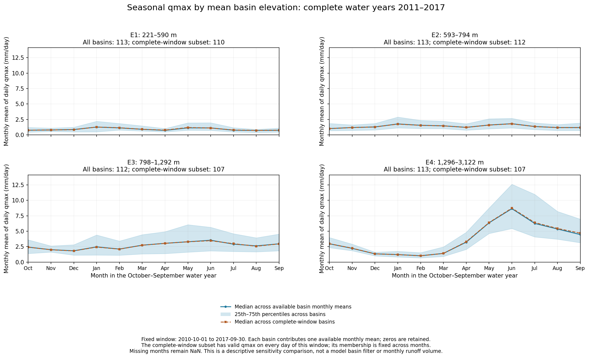

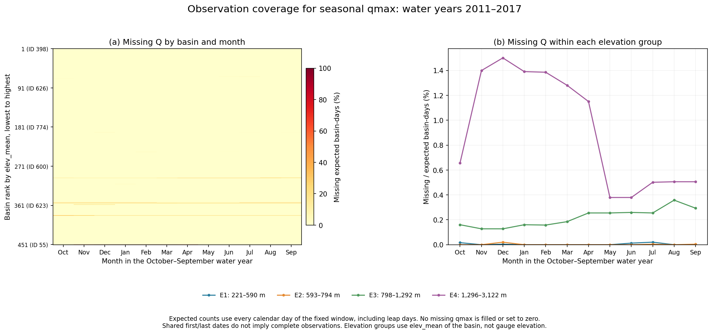

Thời gian thực tế **2,4 giây**; tổng số đếm theo tháng/nhóm khớp lịch, các tháng không có quan trắc giữ NaN. Hai ảnh nguồn được sao chép nguyên bản, SHA-256 khớp tệp nhận. Năm CSV qmax_season_* đã lưu trên Kaggle nhưng chưa nhận về repo. Không tạo lại bảng 5412 hàng từng ID–tháng từ các bảng tổng hợp được gửi.

### 19.6. Cell 5.6 — đường duy trì qmax và đoạn giá trị hằng

Cell này khảo sát hai đặc điểm khác nhau: phân bố giá trị khi bỏ thứ tự thời gian, và tính lặp giá trị khi giữ thứ tự ngày lịch. [USGS, Flow-duration curves](https://www.usgs.gov/publications/flow-duration-curves) mô tả đường duy trì theo tỷ lệ quan trắc đạt/vượt mức lưu lượng, không giữ trình tự xuất hiện. Ở đây áp dụng cho **qmax ngày**, không thay thế đường của lưu lượng trung bình ngày hoặc dữ liệu thể tích dòng chảy.

**Đường phân vị/duy trì:** giữ khoảng chung đã đo ở 5.5 (01/10/2010–30/09/2017) và đơn vị mm/ngày theo area_gov. Với mỗi ID, tính Q(p)=phân vị mẫu tại 1−p/100 bằng nội suy tuyến tính. Lưới 105 mức gồm các số nguyên 0–100 và 0,1/0,5/99,5/99,9%. Hai đầu 0/100 là max/min mẫu. Khi dữ liệu có số trùng, mức p dùng để nội suy không đồng nghĩa luôn có đúng p% ngày vượt nghiêm ngặt giá trị trả về. Giữ số 0; không có dữ liệu thì đường giữ NaN.

Panel nhóm độ cao chỉ dùng **436 ID đủ cả khoảng**, mỗi lưu vực một đường, rồi lấy trung vị và p25–p75 ngang lưu vực ở từng p. Điều này giúp các đường nhóm dùng cùng số ngày lịch trên mỗi trạm. Không đổi tập mô hình 451. Panel hồ sơ dùng tất cả ngày hợp lệ có mặt của từng ID trong cùng khoảng, ghi số ngày vào legend; các đường này vẫn chịu giới hạn thiếu dữ liệu của trạm.

Các ID minh họa được chọn rõ quy tắc: min/trung vị thứ hạng/max area_gov, thêm 55/742/758 nếu có trong cache; không xem đây là mẫu ngẫu nhiên đại diện mọi lưu vực. Bảng ghi ID, tên, vai trò chọn, diện tích, số ngày có Q/0, nhóm độ cao và giá trị ở các mức vượt 1/50/99%. Nét đường phẳng hoặc dốc không tự xác định nguyên nhân vật lý. Trục symlog giữ số 0 và tuyến tính ở 0–0,01 mm/ngày; chỉ thay cách hiển thị.

**Đoạn hằng:** quét toàn lịch cache 5.1 (1981–2017) bằng qmax m³/s gốc. Đoạn là các ngày lịch liên tiếp có Q hữu hạn và bằng nhau chính xác theo số lưu trữ. Không làm tròn thêm hoặc dùng dung sai; số gần bằng nhưng khác nhau vẫn ngắt đoạn. NaN ngắt đoạn, không nối qua lỗ thiếu. Gắn cờ các đoạn ít nhất 10 ngày; tách số 0 với số dương và giữ cả hai là quan trắc. Đây là cờ cần xem lại, không tự gán lỗi, đổi số 0 thành thiếu hoặc loại khỏi huấn luyện.

Ví dụ minh họa: 9 ngày cùng giá trị chưa đạt ngưỡng; 10 ngày thì đạt. Hai đoạn 12 ngày cùng giá trị cách nhau một ngày thiếu vẫn là hai đoạn. Một đoạn đi qua 31/12 hoặc ranh giới train/validation vẫn giữ nguyên, kèm số ngày giao từng kỳ. Các cờ touches_audit_start/end chỉ cho biết đoạn chạm rìa lịch quét; chưa khẳng định nó kết thúc ở ngoài lịch.

Ngoài bảng từng đoạn, bảng từng ID báo số ngày thuộc các đoạn ≥10 chia cho **ngày Q hợp lệ toàn bản ghi của chính ID**, không dùng mẫu số của khoảng đường duy trì ngắn hơn. Hình thứ hai dùng ECDF độ dài các đoạn, không dùng bin histogram, và vẽ tỷ lệ ngày thuộc các đoạn hằng ở 10 ID cao nhất. Hộp chú giải đặt ngoài vùng cột; không tô một đoạn thành số liệu lỗi.

**Biến thiên theo kỳ:** tính mean, std/variance ddof=0, min/max, số mức giá trị và số 0 của qmax mm/ngày trong train/validation/test cho mọi ID. Độ dài đoạn hằng dài nhất trong mỗi kỳ được cắt theo chính kỳ đó, kể cả đoạn ngắn hơn 10 ngày; khác số ngày giao của các đoạn ≥10 trong bảng đoạn. Không có nhãn thì mean/std/variance là NaN; một quan trắc có variance tổng thể 0 nhưng chưa đủ để kết luận cả chuỗi hằng. CV=std/mean chỉ tính khi mean>0; Q toàn 0 giữ CV=NaN.

Bảng in riêng 55/742/758/800 để nối với hồ sơ đã biết, chưa suy nguyên nhân NSE cực thấp hoặc dự báo NaN. Hai hình là qmax_duration_curves và qmax_constant_runs. Bảy CSV gồm qmax_fdc_scope, qmax_fdc_basin_grid, qmax_fdc_group_summary, qmax_fdc_examples, qmax_constant_runs, qmax_constant_by_basin và qmax_variability_by_period; tất cả thêm tiền tố A1_P5_. Kiểm bảng từng trạm và từng đoạn cộng khớp, không đếm chồng ngày.

Mã đã qua kiểm dữ liệu giả lập về NaN ngắt đoạn, mốc 9/10 ngày, giá trị gần nhưng không bằng, số 0, đoạn qua ranh giới kỳ, kỳ không có nhãn và trường hợp không có đoạn ≥10. Đường phân vị đã kiểm thứ tự giảm, max/min, giữ số 0 và thang y đủ dải các đường vẽ. Các số dưới đây lấy từ output Kaggle thật, không lấy từ phép kiểm giả lập.

**Kết quả thực tế:** hai phạm vi được giữ riêng: đường phân vị dùng 2557 ngày trong 01/10/2010–30/09/2017, còn đoạn hằng quét 13.514 ngày của 1981–2017. Đường nhóm dùng 436 ID đủ khoảng; đường hồ sơ 55 chỉ có 1364 ngày hợp lệ. Lưới có 105 mức. Các giá trị sau là mm/ngày theo area_gov; p là mức vượt dùng để lấy phân vị, không phải tỷ lệ vượt nghiêm ngặt đã đếm lại.

| ID | Vai trò | area_gov (km²) | Nhóm độ cao | Ngày hợp lệ trong khoảng | Ngày bằng 0 | Q(p=1%) | Q(p=50%) | Q(p=99%) |
|---|---|---:|---|---:|---:|---:|---:|---:|
| 101 | Diện tích nhỏ nhất | 3,9 | E3 | 2557 | 0 | 36,305723 | 2,370462 | 0,819692 |
| 604 | Hạng diện tích giữa | 101,0 | E3 | 2557 | 0 | 9,447541 | 1,334495 | 0,415404 |
| 612 | Diện tích lớn nhất | 15131,0 | E2 | 2557 | 0 | 3,874210 | 0,953592 | 0,439178 |
| 55 | Hồ sơ kiểm | 11,4 | E4 | 1364 | 0 | 89,431579 | 9,511579 | 0,126038 |
| 742 | Hồ sơ kiểm | 321,4 | E2 | 2557 | 0 | 0,360224 | 0,045969 | 0,009409 |
| 758 | Hồ sơ kiểm | 316,5 | E2 | 2557 | 11 | 0,556891 | 0,023204 | 0,001092 |

Trong hình nhóm, E4 cao hơn về quy mô trên nhiều mức vượt nhưng các dải có giao nhau; không có bảng phân vị nhóm chi tiết để bổ sung số mới. Với 55, đường cao không loại trừ thiên lệch vì thiếu quan trắc theo mùa: chỉ 1364/2557 ngày góp vào đường. Đường phân vị bỏ trình tự thời gian nên không cho biết một mức thấp/cao xảy ra thành đoạn liên tiếp hay rải rác.

#### 19.6.1. Các đoạn bằng nhau chính xác

| Loại giá trị | Số đoạn ≥10 ngày | Số ID có đoạn | Ngày thuộc đoạn | Trung vị độ dài | Dài nhất |
|---|---:|---:|---:|---:|---:|
| Bằng 0 | 49 | 7 | 1690 | 20 | 260 |
| Dương | 3416 | 328 | 51397 | 12 | 136 |

Cộng có **3465 đoạn, 53087 ngày**, tương đương **0,968997%** của 5478550 ngày qmax hợp lệ toàn lịch. Hai số ID có thể giao nhau, không cộng 7+328 thành số lưu vực duy nhất. Có 1690/2270 ngày bằng 0 (74,449339%) thuộc các đoạn bằng 0 ≥10 ngày; không có nghĩa các số 0 còn lại là thiếu hoặc sai.

| ID | Bắt đầu | Kết thúc | Ngày | qmax (m³/s) | Giao kỳ thực nghiệm được in |
|---|---|---|---:|---:|---|
| 758 | 1998-01-22 | 1998-10-08 | 260 | 0 | Không |
| 758 | 1997-08-19 | 1998-01-18 | 153 | 0 | Không |
| 112 | 2011-12-13 | 2012-04-26 | 136 | 0,099 | Validation: 136 ngày |
| 416 | 1984-07-20 | 1984-11-28 | 132 | 0 | Không |
| 758 | 1992-07-26 | 1992-11-15 | 113 | 0 | Không |
| 819 | 2005-12-02 | 2006-03-24 | 113 | 0,151 | Train: 113 ngày |
| 551 | 2010-01-06 | 2010-04-03 | 88 | 0,038 | Validation: 88 ngày |
| 814 | 2017-01-01 | 2017-03-21 | 80 | 0,325 | Test: 80 ngày |
| 818 | 2017-01-01 | 2017-03-15 | 74 | 0,384 | Test: 74 ngày |

Đây là các đoạn chọn từ bảng 15 đoạn dài nhất, không phải toàn bộ đoạn của từng ID. Đoạn 260 ngày bằng 0 của 758 khớp hồ sơ trước; dài nhất dương là 112, không phải 742/758. Các đoạn dài nằm trong nhiều kỳ; không suy tất cả thuộc train hoặc tất cả các ngày của một ID đều hằng. Hình tỷ lệ ngày đọc được xấp xỉ 26,3% ở 758 và 10,3% ở 742, với mẫu số là ngày hợp lệ toàn bản ghi. Cờ ≥10 ngày chỉ chỉ ra tính lặp của số lưu trữ, chưa phân biệt chế độ dòng chảy, độ phân giải quan trắc hay lỗi.

#### 19.6.2. Biến thiên của các hồ sơ theo kỳ

Mean và std dưới đây dùng mm/ngày, variance dùng (mm/ngày)², ddof=0; CV=std/mean. Độ dài đoạn ở bảng này được giới hạn trong từng kỳ và có thể nhỏ hơn 10 ngày.

| ID | Kỳ | Ngày hợp lệ | Số mức | Mean | Std | Variance | CV | Đoạn bằng nhau dài nhất | Đoạn 0 dài nhất |
|---|---|---:|---:|---:|---:|---:|---:|---:|---:|
| 55 | Train | 1292 | 862 | 22,310696 | 24,420870 | 596,378907 | 1,094581 | 4 | 0 |
| 55 | Validation | 768 | 593 | 19,319043 | 23,435238 | 549,210392 | 1,213064 | 5 | 0 |
| 55 | Test | 807 | 577 | 18,634331 | 22,701275 | 515,347906 | 1,218250 | 9 | 0 |
| 742 | Train | 2557 | 59 | 0,094462 | 0,111209 | 0,012367 | 1,177284 | 26 | 0 |
| 742 | Validation | 1461 | 41 | 0,096783 | 0,074296 | 0,005520 | 0,767655 | 19 | 0 |
| 742 | Test | 1461 | 78 | 0,035177 | 0,017361 | 0,000301 | 0,493538 | 19 | 0 |
| 758 | Train | 2557 | 75 | 0,072280 | 0,125220 | 0,015680 | 1,732421 | 46 | 22 |
| 758 | Validation | 1461 | 61 | 0,083555 | 0,116485 | 0,013569 | 1,394113 | 25 | 0 |
| 758 | Test | 1461 | 57 | 0,015273 | 0,012552 | 0,000158 | 0,821864 | 32 | 11 |
| 800 | Train | 38 | 36 | 1,591469 | 0,164561 | 0,027080 | 0,103402 | 2 | 0 |
| 800 | Validation | 1461 | 1206 | 9,564135 | 16,953857 | 287,433266 | 1,772649 | 6 | 0 |
| 800 | Test | 1461 | 1189 | 8,487811 | 14,398316 | 207,311509 | 1,696352 | 3 | 0 |

Ở test, 742/758 có phương sai tuyệt đối nhỏ cùng thang Q thấp, nhưng CV lần lượt **0,493538/0,821864** và có **78/57 mức giá trị**; không nên gọi cả chuỗi “gần như hằng số” mà không nói rõ thang đo. Chúng có các đoạn bằng nhau dài, vẫn có biến thiên trong kỳ. Chưa tính lại NSE hoặc quy nguyên nhân NSE thấp bằng bảng này.

55 có biến thiên lớn trên các ngày được quan trắc; đoạn bằng nhau dài nhất trong train/validation/test chỉ 4/5/9 ngày. Điều này chưa kiểm được cửa sổ 365 ngày đủ qmean hoặc nguyên nhân dự báo NaN. 800 chỉ có 38 nhãn train, gồm 36 mức; mean/std train của giai đoạn ngắn cuối năm không đại diện toàn mùa của validation/test. Chưa gọi khác biệt giữa các kỳ là sai dữ liệu hoặc biến đổi chế độ thực sự.

Hai ảnh đọc rõ, không thấy chữ chồng hoặc bị cắt. Các đường giữ cả số 0, trục symlog chỉ đổi hiển thị. Ở hình đoạn hằng, ECDF và tỷ lệ ngày là hai mẫu số khác nhau (số đoạn so với số ngày hợp lệ), không tráo hai loại tỷ lệ.

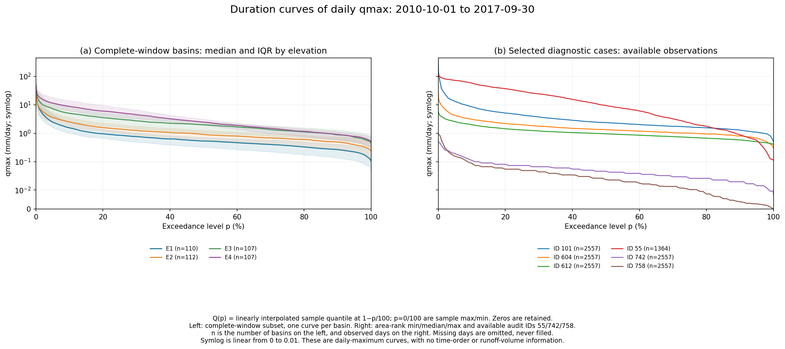

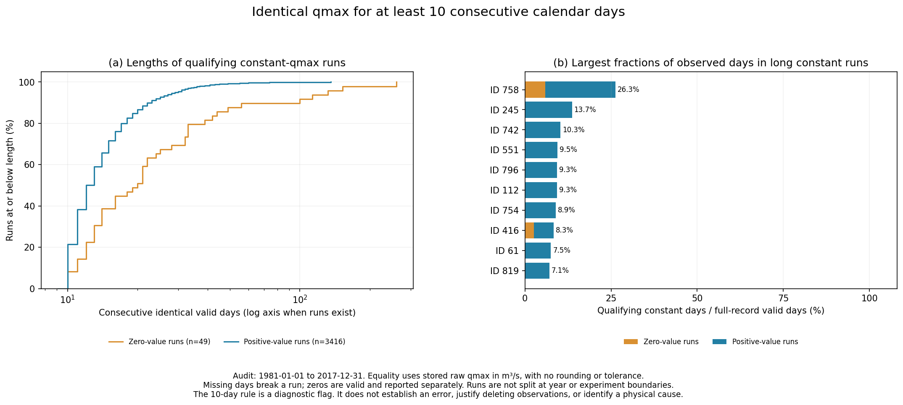

Thời gian thực tế **5,2 giây**. Bốn ID hồ sơ đều có trong cache; tổng ngày bảng trạm/bảng đoạn khớp và không nối qua thiếu. Hai ảnh nhận được giữ nguyên, SHA-256 khớp nguồn. Bảy CSV chi tiết đã xuất trên Kaggle nhưng chưa nhận về repo; không dựng lại toàn bộ các bảng từ vài hàng được in.

### 19.7. Cell 5.7 — đối chiếu Q cùng ngày và các đỉnh lớn

Cell này kiểm tính nhất quán giữa ba đại lượng ngày và đọc bối cảnh các cực đại, trước khi chuyển sang phân phối khí tượng. Kết quả thật bên dưới dựa trên toàn lịch Q 1981–2017 của đúng 451 ID.

Đọc lại CSV Q gốc của đúng 451 ID, giữ nguyên chuỗi ký tự để phân biệt ô rỗng, -999, số âm hữu hạn khác -999, không phải số và vô hạn. Mỗi biến có bảng kiểm đếm riêng; cộng các loại với ngày không có dòng phải đúng lịch 1981–2017. Số âm được lưu để gắn cờ, không làm mất qmean/qmax hợp lệ ở cùng dòng. qmax không âm đọc lại phải khớp chính xác cache 5.1 theo từng ID/ngày, kể cả mặt nạ NaN; không nới dung sai nếu khác.

Ba phép thứ tự là qmin>qmean, qmean>qmax và qmin>qmax; mỗi phép báo mẫu số riêng là cặp hữu hạn không phải -999. Số âm vẫn tham gia kiểm thứ tự và có cờ âm riêng; đạt thứ tự không làm một số âm thành Q hợp lệ. Tách cờ qmean=0 nhưng qmax>0. Bảng dòng cần đọc lại là hợp của các cờ âm/thứ tự/mẫu số 0 này, không phải danh sách mọi ô rỗng hoặc không phải số; các loại sau được kiểm kê trong bảng biến.

Tỷ số qmax/qmean chỉ tính khi qmax hữu hạn ≥0 và qmean hữu hạn >0. Khi qmean=0, âm, rỗng, -999, không phải số hoặc vô hạn, tỷ số giữ NaN; không cộng epsilon. Cả qmax và qmean dùng cùng hệ số 86,4/area_gov nên tỷ số không đổi theo hai đơn vị. Bảng phân vị tỷ số phân biệt mọi cặp ngày hợp lệ (bản ghi dài góp nhiều cặp hơn) với một ngày đầu đạt cực đại cho mỗi ID. Không gọi một tỷ số lớn là lỗi theo một ngưỡng tùy ý.

Với từng ID, tìm **mọi ngày đạt đúng cực đại qmax m³/s toàn bản ghi** (tương đương cực đại mm/ngày trong chính ID đó). Lưu số ngày, ngày đầu/cuối, số ngày thuộc train/validation/test và ngoài ba kỳ. Nhờ đó kiểm được phát biểu còn mở ở 5.1: ngày đầu đạt max không nằm ở test chưa loại trừ max bằng nhau xuất hiện lại trong test. Bảng từng ngày đồng cực đại giữ qmin/qmean và tỷ số cùng ngày; bảng một hàng/ID ghi giá trị của ngày đầu. Không đổi định nghĩa sang cực đại theo từng kỳ.

Hình bối cảnh chọn tối đa sáu ID từ thứ tự giảm của max mm/ngày, lấy ID đầu tiên của mỗi năm lịch đạt max lần đầu khác nhau. Đây là quy tắc đa dạng hình minh họa, chưa phải sáu trận lũ độc lập hoặc mẫu ngẫu nhiên. Vẽ ±15 ngày quanh ngày đầu đạt max, giữ NaN ngắt nét và cho từng panel thang y riêng; cả ba Q đều quy đổi bằng cùng area_gov. Hình thứ hai so qmean/qmax cùng ngày đầu đạt max cho mọi ID, tô viền top 10, kèm đường bằng nhau và ECDF tỷ số. Scatter log chỉ vẽ cặp dương và báo số cặp không vẽ; không xóa các cặp ấy khỏi bảng. Mã vẽ ECDF dùng log khi mọi tỷ số dương, với trục bắt đầu ngay dưới min; nếu có tỷ số 0 thì dùng symlog giữ số 0.

Mã hiện hành xuất tám CSV có tiền tố A1_P5_: q_variable_profile, q_order_by_basin, q_order_flags, q_ratio_summary, q_peak_comparison, q_peak_days, q_peak_context, q_ratio_extremes. Bảng cuối giữ tối đa 15 tỷ số lớn nhất trên mọi ngày, theo thứ tự giảm và thứ tự ID/ngày ổn định khi bằng nhau; ghi qmin/qmean/qmax m³/s cùng mẫu số thực, không cộng epsilon. Hai hình là q_peak_contexts và q_peak_mean_pairs. Cell in bảy bảng, số dòng có cờ, số top-10 ID có ít nhất một ngày đồng cực đại trong test và thời gian. Bảng tỷ số cực đại chưa có output thật; chưa gán ID cho tỷ số 28 từ bảng phân vị.

Mã đã chạy trọn cell trên dữ liệu **giả lập** gồm tám ID: có ngày không có dòng, ô rỗng, sentinel, không phải số, vô hạn, qmin âm, vi phạm thứ tự, qmean=0 và cực đại lặp qua kỳ. Đã kiểm tổng các loại ô, bảo toàn Q khác cùng dòng, NaN của tỷ số không xác định, bảng mọi ngày đồng cực đại, tám schema CSV, bảng tỷ số lớn nhất và bố cục sáu panel. Hình thử nằm riêng ngoài Figures/Tables thật; các số thực dưới đây lấy từ output Kaggle đã nhận.

**Kết quả thực tế:** mỗi biến Q có 6094814 ngày–lưu vực kỳ vọng, 5493121 dòng có mặt, 601693 ngày không có dòng và 14571 ô rỗng. qmax/qmean đều có 5478550 số hữu hạn không âm; qmin có 43 số âm và 5478507 số hữu hạn không âm. Không có -999, nội dung không phải số hoặc vô hạn. qmax đọc lại khớp chính xác cache 5.1.

| Phép kiểm | Cặp/ngày được so | Ngày có cờ | ID có cờ |
|---|---:|---:|---:|
| qmin > qmean | 5478550 | 0 | 0 |
| qmean > qmax | 5478550 | 0 | 0 |
| qmin > qmax | 5478550 | 0 | 0 |
| qmean=0, qmax>0 | 2392 ngày qmean=0, qmax hợp lệ | 122 | 10 |

Tổng hợp cờ âm/thứ tự/mẫu số 0 có **165 dòng**, bằng 43 qmin âm + 122 qmean=0 nhưng qmax>0, nên hai nhóm không giao nhau trong số đếm này. Không có vi phạm thứ tự không đồng nghĩa các qmin âm đã được chứng nhận hợp lệ về vật lý. 2392 ngày qmean=0 gồm 2270 ngày qmax=0 và 122 ngày qmax>0; số cặp tính tỷ số là 5478550−2392=5476158, khớp bảng.

Hai mươi dòng cờ đầu tiên được in thuộc 157/158/265/348/352, đều có qmin=qmean=0 và qmax 0,001–0,007 m³/s. **Giả thuyết làm tròn:** nếu một ngày có đủ 24 giá trị giờ không âm, chỉ một giờ dương với Q≤0,007 m³/s, mean giờ ≤0,007/24≈0,000292 m³/s có thể được làm tròn thành 0 ở ba chữ số thập phân. Đây là ví dụ phù hợp một cơ chế, chưa kiểm số giờ có mặt, cách tổng hợp/làm tròn thật hoặc toàn bộ 122 ngày. Không suy qmean=0 thì cả ngày mọi Q giờ bằng 0, cũng không tự thay qmean bằng một epsilon.

| Mẫu tỷ số qmax/qmean | Số cặp | Min | p01 | Trung vị | p95 | p99 | Max |
|---|---:|---:|---:|---:|---:|---:|---:|
| Mọi ngày hợp lệ có qmean>0 | 5476158 | 1 | 1 | 1,072246 | 1,655340 | 2,663639 | 28 |
| Ngày đầu đạt cực đại toàn bản ghi, một ngày/ID | 451 | 1,0016 | 1,018542 | 1,824584 | 6,681692 | 9,602294 | 11,133176 |

Tỷ số tại cực đại của từng ID có trung vị lớn hơn mẫu mọi ngày, nhưng đây là hai cách chọn mẫu khác nhau, không phải phép so hai nhóm độc lập. Cực đại của tỷ số trên mọi ngày không nhất thiết trùng ngày có Q lớn; cần xem mẫu số và ID/ngày ở bảng q_ratio_extremes. Bảng đó chưa được nhận nên không tự đặt tên trạm cho giá trị 28.

#### 19.7.1. Các cực đại mm/ngày và ngày đồng cực đại

| ID | Ngày đạt max duy nhất | qmax (m³/s) | qmax (mm/ngày) | qmean cùng ngày (m³/s) | qmax/qmean | Kỳ |
|---|---|---:|---:|---:|---:|---|
| 10 | 2005-08-22 | 249 | 644,119760 | 55,477 | 4,488347 | Train |
| 25 | 2005-08-22 | 65,6 | 413,710949 | 15,814 | 4,148223 | Train |
| 23 | 2005-08-23 | 63,2 | 387,268085 | 23,089 | 2,737234 | Train |
| 101 | 2013-06-01 | 17 | 376,615385 | 4,435 | 3,833145 | Validation |
| 30 | 1981-09-29 | 28,5 | 362,117647 | 8,841 | 3,223617 | Trước train |
| 20 | 2005-08-22 | 153 | 317,007194 | 28,925 | 5,289542 | Train |
| 261 | 2002-08-12 | 90,2 | 316,800000 | 31,902 | 2,827409 | Trước train |
| 797 | 1987-07-18 | 79,475 | 314,983486 | 40,788 | 1,948490 | Trước train |
| 102 | 2013-06-02 | 133 | 305,617021 | 79,975 | 1,663020 | Validation |
| 24 | 2005-08-23 | 109 | 302,816720 | 44,787 | 2,433742 | Train |

Cả mười ID có days_at_global_max=1, first=last. Vì vậy đã kiểm được **không có ngày đồng cực đại của mười ID này ở test**, thay vì chỉ xét ngày đầu như 5.1. Năm ID đạt max trong train, hai trong validation, ba trước train. Kết quả chưa nói rằng test không có các ngày Q rất cao ở những ID khác hoặc theo ngưỡng từng lưu vực; phân phối theo kỳ thuộc Phần 8.

Sáu cửa sổ hình là 10/101/30/261/797/15; ID 15 Schwarzach có max 290,928814 mm/ngày ngày 06/08/2010, tỷ số 3,689489. Hình cho thấy biến thiên nhiều ngày của ba Q quanh các mốc, phù hợp bối cảnh một đợt tăng Q hơn việc chỉ xem một con số cực đại. Tuy nhiên ba Q được dựng từ cùng nguồn giờ nên sự đồng biến không phải bằng chứng độc lập chứng nhận từng đỉnh. Chưa đối chiếu quan trắc giờ hoặc gán các ngày này thành những sự kiện độc lập.

Hai hình nhận được đọc rõ, không thấy chữ bị cắt/chồng; scatter có 451 cặp dương, không bỏ cặp nào. Bản ảnh nhận có ECDF để trống miền 0–1; ảnh được giữ nguyên, còn mã vẽ hiện hành tự dùng log bắt đầu gần min dương khi tạo lại. Chưa có ảnh thật tạo lại từ phiên bản trục đó.

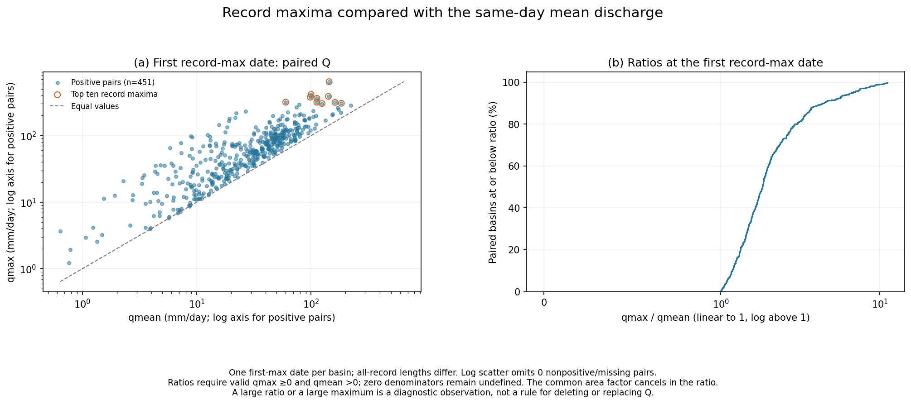

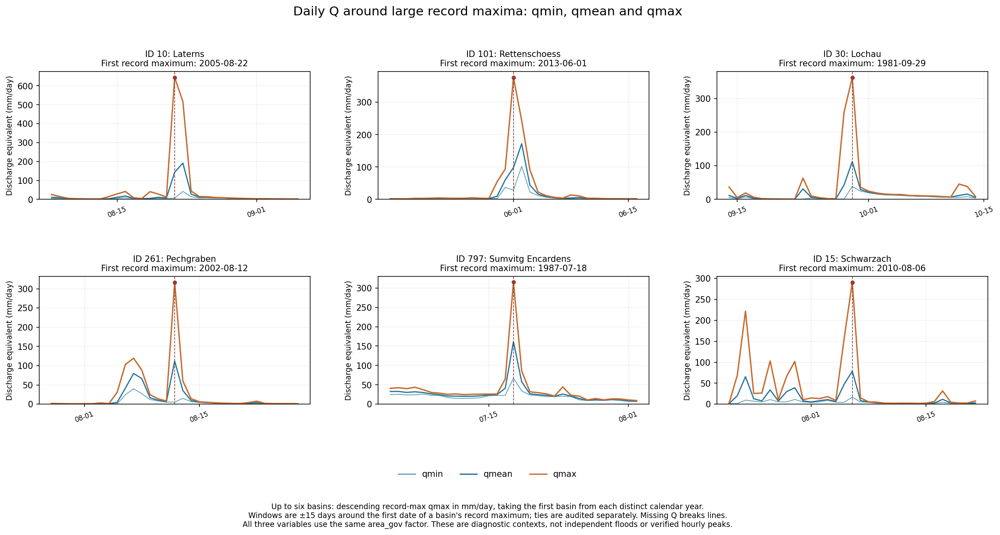

Thời gian thực tế **38,8 giây**. Output đã nhận gồm bảng (1)–(6), thông báo xuất bảy CSV và hai hình; các CSV chi tiết chưa được nhận cục bộ. Hai ảnh nhận được sao chép nguyên bản, SHA-256 khớp nguồn. Bảng (7) q_ratio_extremes chưa có output; không dựng lại CSV 165 dòng có cờ hoặc mọi ngày đồng cực đại từ các hàng đầu được in.

#### 19.7.2. Giới hạn khi nối các kết quả Q

Phương sai Q test của 742/758 nhỏ theo thang mm/ngày, dù CV không gần 0. Với cùng tập ngày đánh giá và độ lệch trung bình dự báo b, MSE≥b² nên NSE≤1−b²/variance(Q), variance dùng ddof=0. Ví dụ **giả định**, b=0,05 mm/ngày và variance đã in cho cận xấp xỉ −7,3/−14,9. Đây là minh họa độ nhạy của chỉ số, chưa đo sai số dự báo, chưa giải thích NSE thật hoặc cho phép sửa mẫu số. Các run có ngày dự báo bị loại cần tính lại trên đúng tập ngày so được.

800 có 38 nhãn train, max 2,034043 mm/ngày, khác hẳn các cực đại 164,022593/181,442082 ở validation/test. Chưa gọi 38 nhãn là 38 cửa sổ dùng được; mô hình nhiều lưu vực còn học từ các ID khác, không đồng nghĩa toàn mô hình chưa thấy nhãn Q lớn. Hai đoạn hằng của 814/818 bắt đầu đúng 01/01/2017 và hai đoạn 819 cùng Q=0,151 m³/s được giữ làm ca đối chiếu qmin/qmean/gaps trong hồ sơ, chưa gán nguyên nhân.

Về mùa, tỷ lệ thiếu theo nhóm độ cao/tháng có cấu trúc mô tả rõ, nhưng chưa kiểm định cơ chế thiếu hoặc tác động lên đỉnh chưa quan trắc. Các trung vị nhóm gần nhau giữa tập có sẵn/đủ khoảng không đảm bảo mỗi ID không thiên lệch; từ các giá trị được in, chênh tương đối lớn nhất khoảng 5,5% (E1 tháng 4, lấy mean có sẵn làm mẫu số), còn chênh tuyệt đối lớn nhất 0,223203 mm/ngày ở E4 tháng 9. Không suy ảnh hưởng lên đánh giá đỉnh là nhỏ chỉ vì một phần thiếu tập trung vào mùa Q thấp.

### 19.8. Cell 5.8 — phân phối 40 biến khí tượng

Khảo sát Q ngày đã đủ cho mô tả phân phối ở các mục 5.1–5.7, với các giới hạn giờ/quan trắc được giữ rõ. Cell này khảo sát phân phối khí tượng để chuẩn bị Phần 6; các cờ Q vẫn được giữ trong hồ sơ riêng. Cell này đọc toàn lịch của tệp A trong đúng 451 ID, lấy hai đầu từ bảng file spans 2.8. Với input đã đo, đó là **1981–2019**, khác lịch Q 1981–2017 và các kỳ thí nghiệm 2003–2017. Các nguồn có phạm vi giá trị khác nhau, đặc biệt ECMWF; không biến khoảng trước/sau bản ghi forecast thành giá trị 0 hoặc coi các phân phối khác kỳ là cặp so trực tiếp.

**Đơn vị tham chiếu:** [Bảng A1 BiasCast, tr. 5086–5087](https://hess.copernicus.org/articles/30/5067/2026/) liệt kê 36 biến của các cấu hình dùng trong bài. Các đơn vị đó là tài liệu tham chiếu cho bảng, chưa phải phép xác minh mỗi phép chuyển đổi trong CSV. Bốn cột có trong schema đang kiểm nhưng không liệt kê tại bảng này là ECMWF_cp/lsp/msl và EOBS_hu; để đơn vị CSV chưa giải quyết, không lấy đơn vị sản phẩm gốc tự gán vào bản đã xử lý. Tên trường và đơn vị tham chiếu được xuất riêng cho cả 40 cột.

Riêng ECMWF_ssrd, Bảng A1 ghi W/m², trong khi [nhãn VARIABLE_PAIRS của mã phân tích tác giả](../../../PaperResearch/PaperResearchCode/BiasCast/Inspect_Experiments/code/wasserstein_distance_static_attributes.py#L55) ghi J/m² cho cặp bức xạ. Đây là bất nhất giữa nhãn tham chiếu, chưa xác định đơn vị thật của CSV hoặc chứng minh một nguồn đã đổi sai. Panel ssrd dùng nhãn raw; unit unresolved. [Bảng A2 LamaH-CE](https://essd.copernicus.org/articles/13/4529/2021/) ghi total_et dương cho bốc hơi, âm cho ngưng tụ; phép đo vẫn giữ dấu thực trong CSV và không tự áp một quy ước khác cho ECMWF/GLEAM. Việc so đúng đại lượng, dấu, tích lũy và đơn vị thuộc Phần 6.

**Giá trị và phân phối:** đọc từng ô dạng chữ, tách không có dòng/rỗng/-999/nội dung không phải số/vô hạn. Giá trị hợp lệ của phép khảo sát là hữu hạn khác -999, gồm số âm và 0. Kiểm số ngày hợp lệ theo từng ID/biến khớp phép quét toàn chuỗi 2.8, tổng âm+0+dương và tổng các loại ô khớp lịch. Không xem mọi số âm là lỗi hoặc dùng một tiêu chí chung 0–1 cho mọi cột.

Tính phân vị chính xác min/p01/p05/p25/median/p75/p95/p99/max và mean/std ddof=0 bằng float64, gộp mọi ngày hợp lệ của từng biến. Không lấy mẫu hoặc dùng trung bình các phân vị theo trạm thay cho phân vị gộp. Các giá trị được ghi vào tệp nhị phân tạm theo biến, đọc lại từng biến để giảm RAM; giới hạn dung lượng dự kiến khoảng 2,11 GB ở lịch đã biết. Tệp tạm tự đóng/xóa sau đo, không thành dữ liệu huấn luyện. Thời gian thực tế được ghi ở kết quả; chưa đo dung lượng đỉnh thực tế.

Histogram vẽ 40 bin trên toàn dải của từng biến, giữ âm/0/đuôi và lấy tỷ lệ trên ngày hợp lệ của chính biến. Mưa/SWE dùng symlog với L=0,1; ET dùng L=0,01 theo giá trị lưu trữ. Bin đều trong tọa độ hiển thị rồi đổi biên về giá trị gốc; các cột khác dùng bin tuyến tính. Một biến hằng chỉ dùng một bin; không có giá trị thì panel báo n=0. Bảng biên/số đếm được lưu, kiểm tổng bin bằng số ngày hợp lệ. Đây là biểu diễn, không phải chuẩn hóa mô hình, mật độ xác suất theo một đơn vị x hoặc bằng chứng các đỉnh nhỏ là chế độ vật lý; giá trị trên lưới số có thể chịu hiệu ứng chia bin.

**GLEAM:** so ETA−ETP trên mọi cặp cùng ID/ngày có hai số hữu hạn khác -999. Báo số bằng nhau chính xác, ETA lớn/nhỏ hơn ETP, số có trị tuyệt đối chênh ≤10⁻⁶, phân vị chênh, max trị tuyệt đối và ID/ngày/giá trị hai cột tại max. So sánh này giải câu hỏi từ vài dòng mẫu ở 2.4; không áp ETA≤ETP làm quy tắc xóa số, không coi bằng nhau tại vài ngày là hai cột trùng toàn bộ dữ liệu. Dung sai chỉ là thống kê được báo riêng, không sửa giá trị để tạo khớp.

**LAI/độ ẩm đất:** với mỗi ID và mỗi trong bốn cột ERA5L_lai_high_veg/lai_low_veg/volsw_123/volsw_4, gộp mọi ngày cùng tháng lịch qua các năm để có 12 mean. Giữ trọng số mỗi ID bằng nhau khi lấy trung vị/IQR ngang các mean đó; tháng không có số giữ NaN. Đây là climatology theo tháng, không phải đường mùa theo nhóm độ cao của Q ở 5.5. Tổng ngày trong 12 tháng phải khớp hồ sơ từng biến/ID.

Đếm riêng từng tháng-năm có đủ mọi ngày lịch và đúng một giá trị lưu trữ. Chỉ các tháng đủ quan trắc được tính trong tỷ lệ hằng tháng; tháng thiếu một ngày không được dùng làm bằng chứng hằng đủ tháng. Phép này kiểm lặp theo lịch, chưa xác nhận độ phân giải gốc hoặc chứng minh số hằng là số được điền.

Sáu hình gồm năm nhóm nguồn ERA5L/ECMWF/EOBS/MSWEP/GLEAM và bốn panel mùa LAI/độ ẩm đất. Chín CSV có tiền tố A1_P5_: forcing_unit_reference, forcing_distributions, forcing_value_profile, forcing_histogram_bins, GLEAM_pair_by_basin, GLEAM_pair_summary, forcing_monthly_by_basin, forcing_monthly_summary, forcing_constant_months. Cell in bảng (1)–(6), cảnh báo đơn vị, phạm vi quét và thời gian; dừng trước khi chuẩn hóa, đảo dấu ET, điền thiếu hoặc chuyển sang kết luận lệch miền.

Mã đã chạy trên **dữ liệu giả lập** gồm 40 biến/8 ID và năm nhuận. Đã kiểm ngày không có dòng, rỗng, -999, chữ, vô hạn, âm/0/dương, biến rỗng hoàn toàn/biến toàn 0, số cặp GLEAM, tháng hằng/thiếu, đối chiếu tổng ngày, các phân vị gộp và tổng histogram. Sáu hình giả lập được kiểm bố cục, không lưu vào Figures/Tables thật. Các số liệu thật được ghi dưới đây từ output đã nhận.

**Kết quả thực tế:** lịch khí tượng là **01/01/1981–31/12/2019**, 14.244 ngày; 451 ID cho **6424044 ngày–lưu vực** kỳ vọng trên mỗi biến. Số ngày theo từng ID/biến khớp 2.8; tổng các loại ô, dấu và histogram khớp. Không có dòng ngày A thiếu, -999, nội dung không phải số hoặc vô hạn trong phạm vi này. Những ô thiếu được báo ở đây đều là ô rỗng trong dòng có mặt, không phải số âm.

#### 19.8.1. Phạm vi và thiếu dữ liệu

| Nhóm biến | Số biến | Ngày có giá trị mỗi biến | Ô rỗng mỗi biến trên lịch 1981–2019 | Phạm vi có giá trị |
|---|---:|---:|---:|---|
| ERA5L | 21 | 6424044 | 0 | 1981–2019 |
| ECMWF cp/e/lsp/ssrd/tp | 5 | 2635644 | 3788400 | 2002–2017 |
| ECMWF d2m/msl/t2m | 3 | 2964874 | 3459170 | 2002–2019 |
| EOBS fg | 1 | 6424013 | 31 | Hai đầu 1981–2019, có thiếu giữa |
| EOBS hu | 1 | 6409860 | 14184 | Hai đầu 1981–2019, có thiếu giữa |
| EOBS pp/qq/rr/tg/tn/tx | 6 | 6424044 | 0 | 1981–2019 |
| MSWEP và GLEAM | 3 | 6424044 | 0 | 1981–2019 |

Các ô ECMWF rỗng khớp phạm vi nguồn đã đo, không biến thành lượng mưa/bốc hơi 0. Ở EOBS, **31 ô fg** là phát hiện của lịch rộng hơn; 4.1 đã đo 0 ô fg thiếu trong 2003–2017 nên chúng nằm ngoài các kỳ này. hu có **14184−8939=5245 ô thiếu ngoài 2003–2017**. Chưa biết ngày/ID cụ thể từ bảng tổng hợp; chưa suy tất cả ngoài kỳ đều không ảnh hưởng khởi động trước train. Cell 5.9 định vị và kiểm riêng 364 ngày trước đầu train, không tính số mẫu mất.

#### 19.8.2. Phân phối và dấu của 40 cột

Các số sau dùng giá trị CSV gốc, phân vị có số 0. Đơn vị tham chiếu ở bảng (1) được giữ riêng; không so độ lớn giữa các cột khác đơn vị hoặc khác phạm vi quan trắc. Số liệu thập phân trong bảng này giữ dấu chấm như output gốc. Toàn bộ p01/p05/p95, mean và std đã cung cấp được giữ nguyên trong [văn bản output bảng (2)–(6)](Tables/A1_P5_forcing_output_tables_2_6.txt).

| Biến | Ngày hợp lệ | Âm (%) | Bằng 0 (%) | Min | Median | p99 | Max |
|---|---|---|---|---|---|---|---|
| ERA5L_10m_wind_u | 6424044 | 33.729704 | 5.679491 | -6.30 | 0.30 | 4.5000 | 8.90 |
| ERA5L_10m_wind_v | 6424044 | 42.299741 | 4.920265 | -8.20 | 0.10 | 2.5000 | 7.80 |
| ERA5L_2m_dp_temp_max | 6424044 | 27.578983 | 0.436625 | -35.60 | 5.30 | 18.7000 | 26.60 |
| ERA5L_2m_dp_temp_mean | 6424044 | 37.336404 | 0.447771 | -38.90 | 2.90 | 16.5000 | 21.50 |
| ERA5L_2m_dp_temp_min | 6424044 | 47.624518 | 0.403188 | -44.60 | 0.50 | 14.6000 | 20.00 |
| ERA5L_2m_temp_max | 6424044 | 13.077868 | 0.285397 | -27.00 | 10.50 | 28.1000 | 37.70 |
| ERA5L_2m_temp_mean | 6424044 | 25.019194 | 0.416965 | -31.50 | 6.30 | 22.4000 | 30.20 |
| ERA5L_2m_temp_min | 6424044 | 40.771810 | 0.469331 | -38.80 | 2.10 | 16.9000 | 24.80 |
| ERA5L_fcst_alb | 6424044 | 0.000000 | 0.000000 | 0.06 | 0.16 | 0.7400 | 0.84 |
| ERA5L_lai_high_veg | 6424044 | 0.000000 | 0.000000 | 0.70 | 2.50 | 4.8000 | 5.10 |
| ERA5L_lai_low_veg | 6424044 | 0.000000 | 1.773836 | 0.00 | 2.10 | 3.2000 | 3.80 |
| ERA5L_prec | 6424044 | 0.000000 | 20.241689 | 0.00 | 0.90 | 27.0900 | 125.27 |
| ERA5L_surf_net_solar_rad_max | 6424044 | 0.000000 | 0.000000 | 3.00 | 362.00 | 750.0000 | 854.00 |
| ERA5L_surf_net_solar_rad_mean | 6424044 | 0.000000 | 0.000016 | 0.00 | 97.00 | 268.0000 | 310.00 |
| ERA5L_surf_net_therm_rad_max | 6424044 | 0.023334 | 0.009387 | -21.00 | 85.00 | 133.0000 | 196.00 |
| ERA5L_surf_net_therm_rad_mean | 6424044 | 0.389677 | 0.119395 | -34.00 | 50.00 | 95.0000 | 120.00 |
| ERA5L_surf_press | 6424044 | 0.000000 | 0.000000 | 68698.00 | 92608.00 | 98392.0000 | 101232.00 |
| ERA5L_swe | 6424044 | 0.000000 | 46.583803 | 0.00 | 0.13 | 3233.8700 | 6968.38 |
| ERA5L_total_et | 6424044 | 3.752636 | 2.113295 | -1.79 | 1.10 | 4.6000 | 8.68 |
| ERA5L_volsw_123 | 6424044 | 0.000000 | 0.000000 | 0.11 | 0.37 | 0.4900 | 0.73 |
| ERA5L_volsw_4 | 6424044 | 0.000000 | 0.000000 | 0.21 | 0.39 | 0.5200 | 0.73 |
| ECMWF_cp | 2635644 | 0.000000 | 91.275529 | 0.00 | 0.00 | 0.0100 | 0.06 |
| ECMWF_d2m | 2964874 | 36.134520 | 0.046849 | -37.24 | 3.18 | 16.7200 | 20.95 |
| ECMWF_e | 2635644 | 2.120544 | 0.267980 | -2.21 | 1.30 | 4.5100 | 6.61 |
| ECMWF_lsp | 2635644 | 0.000000 | 25.069736 | 0.00 | 0.19 | 21.7200 | 138.13 |
| ECMWF_msl | 2964874 | 0.000000 | 0.000000 | 97771.03 | 101756.34 | 103553.9427 | 104787.54 |
| ECMWF_ssrd | 2635644 | 0.000000 | 0.006450 | 0.00 | 133.81 | 326.1200 | 381.64 |
| ECMWF_t2m | 2964874 | 22.366212 | 0.040474 | -26.75 | 6.99 | 23.2600 | 31.10 |
| ECMWF_tp | 2635644 | 0.000000 | 18.067349 | 0.00 | 0.75 | 29.0100 | 170.83 |
| EOBS_fg | 6424013 | 0.000000 | 0.000000 | 0.13 | 1.84 | 6.6300 | 31.14 |
| EOBS_hu | 6409860 | 0.000000 | 0.000000 | 7.50 | 77.71 | 94.2800 | 95.16 |
| EOBS_pp | 6424044 | 0.000000 | 0.000000 | 930.20 | 1018.20 | 1038.9400 | 1058.57 |
| EOBS_qq | 6424044 | 0.000000 | 0.000903 | 0.00 | 115.17 | 323.0000 | 443.00 |
| EOBS_rr | 6424044 | 0.000000 | 56.983218 | 0.00 | 0.00 | 29.8500 | 208.70 |
| EOBS_tg | 6424044 | 21.514672 | 0.040333 | -29.96 | 7.05 | 22.7900 | 30.88 |
| EOBS_tn | 6424044 | 36.798378 | 0.055355 | -31.04 | 2.83 | 16.5500 | 24.84 |
| EOBS_tx | 6424044 | 11.881659 | 0.029514 | -26.52 | 11.28 | 29.9700 | 38.34 |
| MSWEP_RR | 6424044 | 0.000000 | 31.482334 | 0.00 | 0.50 | 28.0000 | 332.56 |
| GLEAM_ETA | 6424044 | 0.372974 | 0.294596 | -0.08 | 1.19 | 4.4500 | 11.17 |
| GLEAM_ETP | 6424044 | 0.371137 | 0.292495 | -0.08 | 1.41 | 6.7200 | 16.90 |

Tỷ lệ số 0 mưa khác nhau rõ: ERA5L_prec **20,241689%**, ECMWF_tp **18,067349%**, EOBS_rr **56,983218%**, MSWEP_RR **31,482334%**. EOBS_rr có median=0 nhất quán với hơn nửa số lưu trữ bằng 0. Các số này chưa phải bằng chứng nguồn nào phản ánh đúng số ngày khô hơn: ECMWF dùng kỳ ngắn hơn, còn ngưỡng lưu số/độ phân giải và cách xử lý cần kiểm. Bin đầu histogram có thể chứa cả giá trị dương nhỏ; tỷ lệ 0 ở tiêu đề là đếm đúng số 0, không đọc từ chiều cao bin.

Ở ET, ERA5L_total_et có **3,752636%** số âm, ECMWF_e **2,120544%**, GLEAM_ETA/ETP **0,372974%/0,371137%**. Min lần lượt −1,79/−2,21/−0,08/−0,08; median 1,10/1,30/1,19/1,41. Các cột đều chủ yếu dương trong CSV hiện tại. Không áp dấu của sản phẩm gốc rồi tự đảo một cột đã được xử lý, không loại số âm theo một quy tắc chung. Ý nghĩa dấu và phép chuyển đổi cần đọc cùng nguồn ở Phần 6.

ECMWF_cp có median=0, **91,275529%** số 0, p95=p99=0,01 và max=0,06; lsp/tp có mean **1,912135/3,358093**, trong khi cp có mean **0,000963**. Chênh mean(tp)−mean(lsp)≈1,445958 theo thang lưu trữ, chưa khớp trực tiếp mean(cp). Nhân riêng cp với 1000 cũng chưa tự làm các mean đã in bằng nhau. Không gán đơn vị cp bằng cách chỉ nhìn dải; cell 5.9 so bộ ba cùng ngày/ID, thử hai hệ số và báo lưới số/giả định làm tròn riêng.

SWE lệch mạnh: **46,583803%** bằng 0, median **0,13**, mean **141,190864**, p95 **477,07**, p99 **3233,87**, max **6968,38** theo giá trị lưu trữ (tham chiếu mm). Phân vị gộp chưa xác định ID/ngày của đuôi và chưa phân loại lỗi. Các cực trị từng ID được truy ở 5.9, không cắt đuôi hoặc diễn giải thành độ dày tuyết thực.

#### 19.8.3. GLEAM_ETA và GLEAM_ETP

Có **6424044 cặp cùng ID/ngày**: **1767201 cặp bằng nhau chính xác (27,509167%)**, **4656843 cặp ETA<ETP**, **0 cặp ETA>ETP**. Số cặp có |ETA−ETP|≤10⁻⁶ đúng bằng số bằng nhau chính xác; dung sai này không tạo thêm cặp gần bằng. Chênh ETA−ETP có min/median/max **−13,3/−0,16/0**, max trị tuyệt đối **13,3**. Hai cột không trùng nhau toàn chuỗi, dù 5 dòng mẫu ở 2.4 bằng nhau và hai histogram khá giống về hình dạng.

Max chênh ở **ID 348, 10/08/1992**, ETA=2,49 và ETP=15,79. Các chênh lớn tiếp theo được in ở 354 (12,74), 352 (12,51), 839 (10,98), 361 (10,77). Đây là đối chiếu số đã lưu, chưa xác nhận mô hình GLEAM hoặc cơ chế vật lý riêng của các ngày bằng nhau. Không đồng nhất tập bằng nhau với các ngày ET=0; tỷ lệ bằng nhau 27,51% lớn hơn rất nhiều tỷ lệ 0 khoảng 0,29% của từng cột.

#### 19.8.4. Mùa và tính hằng trong tháng-năm

| Biến | Tháng có median mean lớn nhất | Giá trị | Tháng nhỏ nhất | Giá trị | Tháng-năm hằng chính xác / đủ dữ liệu | Tỷ lệ (%) |
|---|---|---:|---|---:|---:|---:|
| ERA5L_lai_high_veg | 7 | 3,661290 | 2 | 1,436240 | 10779 / 211068 | 5,106885 |
| ERA5L_lai_low_veg | 6–8 | 2,200000 | 2 | 1,900000 | 132357 / 211068 | 62,708227 |
| ERA5L_volsw_123 | 3 | 0,382945 | 8 | 0,352630 | 3643 / 211068 | 1,725984 |
| ERA5L_volsw_4 | 4 | 0,399325 | 9 | 0,380667 | 69268 / 211068 | 32,817860 |

Cả bốn cột có **451×39×12=211068 tháng-năm**, mọi tháng đủ số ngày và có giá trị. LAI cao có chu kỳ theo tháng rõ hơn LAI thấp; đất lớp trên có biên độ giữa hai median cực trị **0,030315**, lớp sâu **0,018658** m³/m³ theo đơn vị tham chiếu. Đây là khác biệt của các thống kê nhóm, chưa định lượng quan hệ nhân quả với Q hoặc định nghĩa lượng nước hữu dụng của đất.

Tỷ lệ tháng-năm hằng của LAI thấp/lớp đất sâu khá cao nhưng không phải 100%; không thể gọi tất cả các chuỗi đó là dữ liệu tháng chỉ từ các đoạn lặp. LAI cao và đất lớp trên cũng có các tháng hằng, nhưng phần lớn không hằng. Đếm dùng đúng số lưu trữ, chưa chứng minh số hằng là số được điền hoặc độ phân giải vật lý của nguồn. Dải tô là IQR ngang mean tháng của lưu vực, không phải khoảng tin cậy, và 12 tháng được gộp qua 39 năm chứ không phải chỉ một năm mẫu.

#### 19.8.5. Hình và bằng chứng lưu

Sáu ảnh không thấy chữ chồng hoặc bị cắt. Hình ERA5L có 21 panel nên cần mở ảnh gốc để đọc nhãn nhỏ; bảng số đi kèm dùng để đọc chính xác, không đo tỷ lệ từ thumbnail. Các thang symlog giữ âm/0 và toàn bộ đuôi, phần tuyến tính gần 0 chỉ là cách hiển thị. Các dao động histogram LAI/độ ẩm đất vẫn có thể chịu ảnh hưởng lưới lưu số/chia bin; không tự đọc thành nhiều chế độ vật lý.

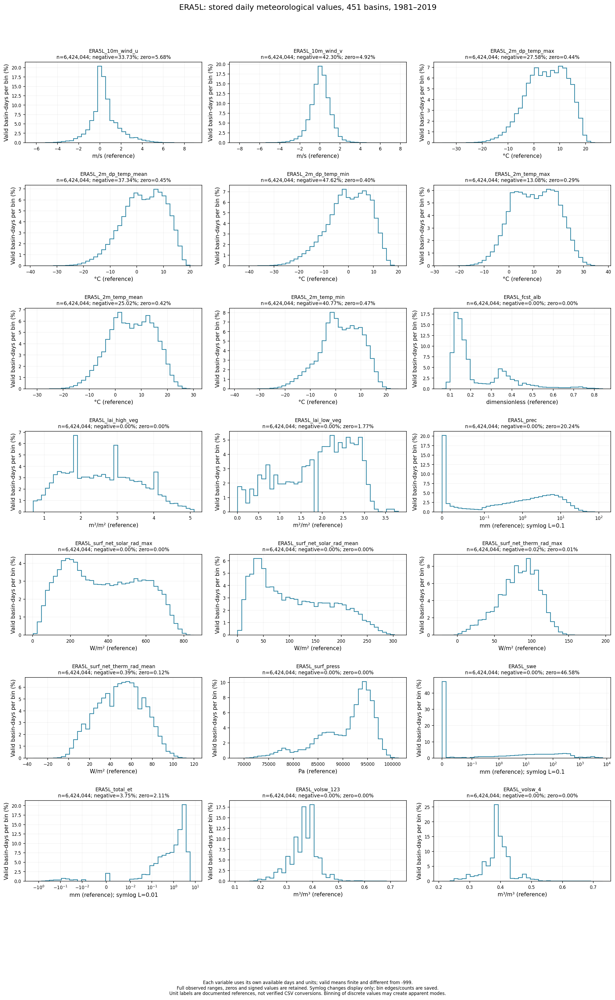

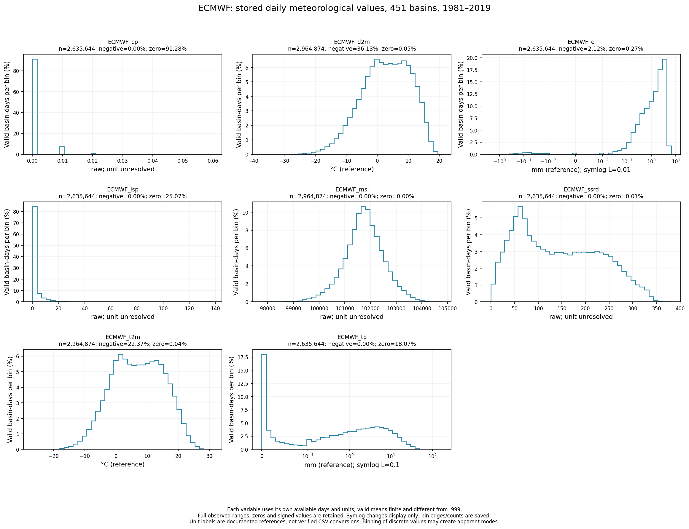

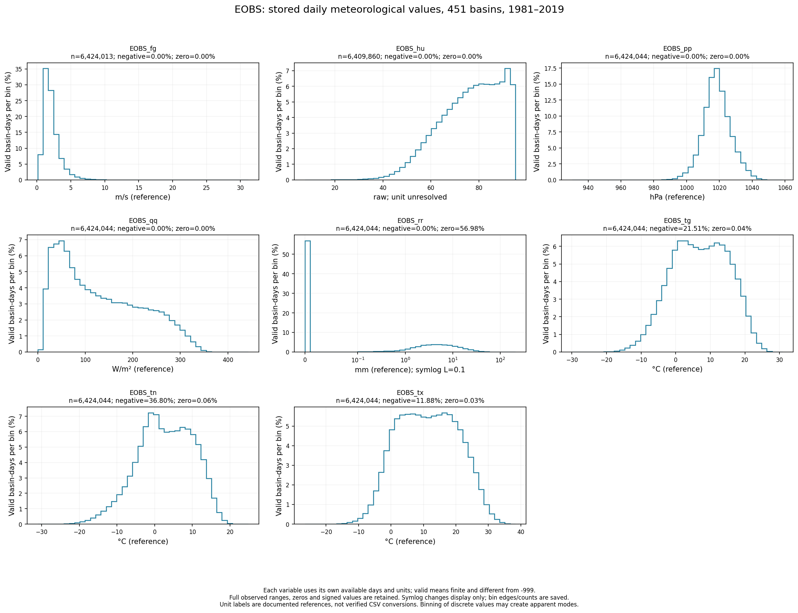

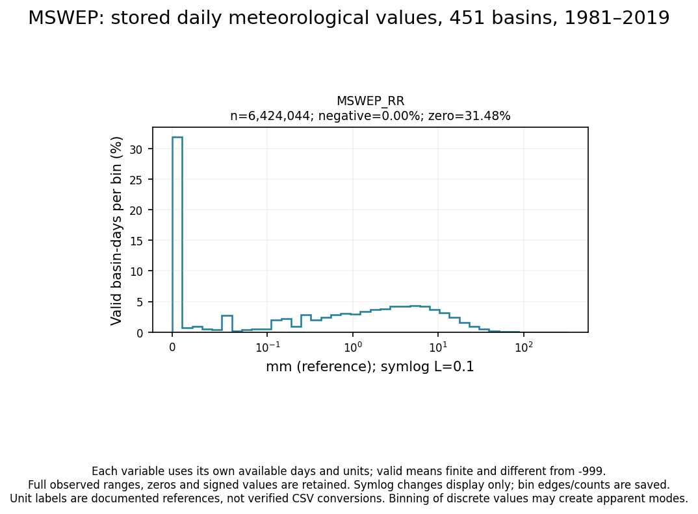

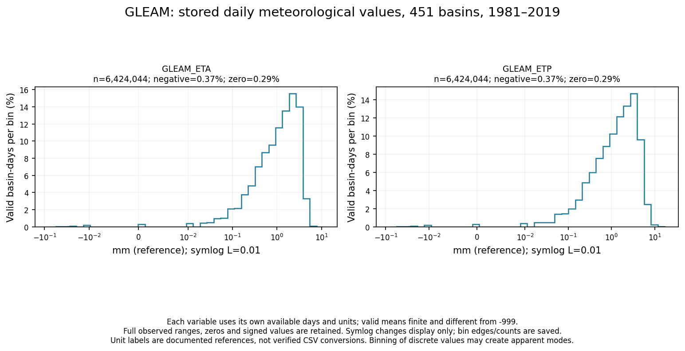

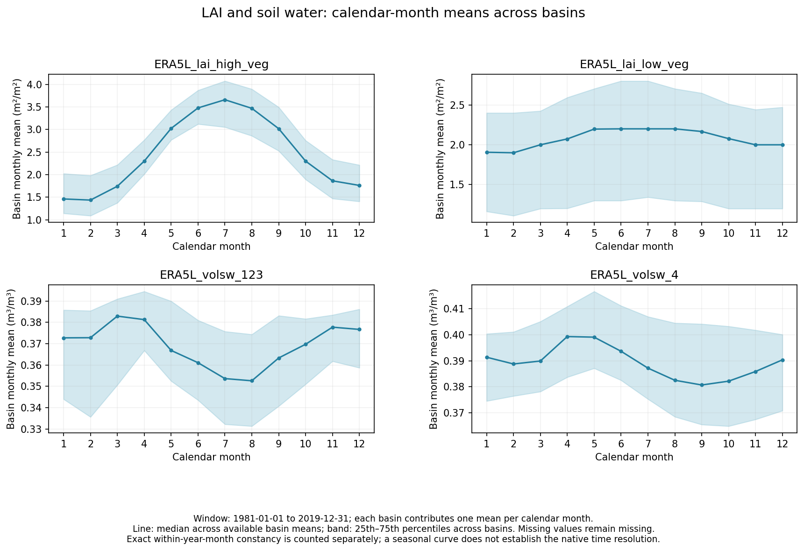

Thời gian thực tế **312,7 giây**; mã báo tệp nhị phân tạm đã đóng/xóa, giới hạn dự kiến khoảng **2,11 GB**. Đây không phải phép đo dung lượng đỉnh thực tế. Sáu ảnh và văn bản bảng (2)–(6) được sao chép nguyên bản, SHA-256 khớp nguồn. Chín CSV chi tiết đã xuất trên Kaggle nhưng chưa được nhận về repo; không tạo lại bảng ngày–ID đầy đủ từ số tổng hợp.

### 19.9. Cell 5.9 — các cờ sau phân phối và nguồn giờ

Phân phối 40 biến đã được đo trên dữ liệu thật. Cell tiếp theo tập trung bốn điểm từ output: vị trí thiếu E-OBS ngoài kỳ, thang số của mưa ECMWF, ID/ngày cực trị SWE và khả năng đọc nguồn Q giờ. Chưa quét lại phân vị 40 cột hoặc tính lệch miền của Phần 6.

Đọc sáu trường EOBS_fg/hu, ECMWF_tp/lsp/cp, ERA5L_swe của đúng 451 ID trên lịch 5.8. Số ngày hợp lệ từng trường/ID phải khớp hồ sơ 5.8. Không có dòng, rỗng, -999, nội dung không phải số và vô hạn được ghi riêng cho danh sách thiếu E-OBS; số âm hữu hạn khác -999 vẫn là giá trị trong phép kiểm này.

**E-OBS:** lưu mọi ngày–ID thiếu, phân nhóm trước các kỳ/train/validation/test/sau các kỳ và khoảng trống giữa các kỳ nếu có. Phạm vi 364 ngày trước đầu train là một cửa sổ chồng trong nhóm trước kỳ, không cộng thêm lần nữa vào tổng thiếu. Đây là cận quét cho kiểm cửa sổ sau này, chưa chứng minh ô đó thực sự làm mất mẫu ở một run cụ thể. Các ngày–ID trong ba kỳ phải khớp đúng tập ở 4.1, không chỉ cùng số đếm. In tối đa 50 dòng fg thiếu để định vị 31 ô mới, toàn bộ hu/fg thiếu lưu CSV.

**Đơn vị nguồn tham chiếu:** [ECMWF parameter 143](https://codes.ecmwf.int/grib/param-db/143) ghi cp gốc bằng m; [parameter 228](https://codes.ecmwf.int/grib/param-db/228) mô tả tp là tổng mưa quy mô lớn và đối lưu. Các định nghĩa này áp dụng sản phẩm gốc với kỳ tích lũy phù hợp, chưa xác nhận thang đã lưu trong CSV Extended. [Tài liệu E-OBS](https://surfobs.climate.copernicus.eu/dataaccess/access_eobs.php) ghi HU là độ ẩm tương đối, chuyển về đơn vị %. Vì vậy % là tham chiếu nguồn có căn cứ cho EOBS_hu ngoài Bảng A1, trong khi bước xử lý CSV vẫn chưa được truy lại; không còn phải suy tên/đơn vị nguồn HU chỉ từ dải 7,5–95,16.

**Mưa ECMWF:** dùng đúng bộ ba cùng ID/ngày hữu hạn khác -999. Thử số dư tp−lsp−k×cp với k=1 và 1000; giữ tp/lsp theo thang lưu trữ. Báo phân vị, mean/max trị tuyệt đối và số cặp có |số dư|≤0,02, dùng cùng dung sai số cho cả hai giả thuyết. Không đổi bất cứ cột nào của dữ liệu hoặc tự chọn đơn vị theo tỷ lệ khớp.

Đếm riêng tỷ lệ số nằm trên lưới 0,01 bằng kiểm |100x−round(100x)|≤10⁻⁸ (không dùng sai số tương đối). Nếu cả ba cột có mọi số hợp lệ trên lưới, báo thêm khoảng tương thích **giả định mỗi cột được làm tròn gần nhất tới 0,01 trước phép so**: biên sai khác 0,005+0,005+k×0,005, bằng 0,015 và 5,01 theo thang tp/lsp. Quan sát lưới chưa chứng minh nguồn đã dùng cách làm tròn này; hai biên khác nhau không được dùng làm thước đo để xếp giả thuyết. Khi có số ngoài lưới, số cặp tương thích giả định giữ NaN. Báo số cp=0 nhưng tp−lsp>0,02 và số tp−lsp<−0,02 để đọc các ví dụ cùng ngày, chưa gọi là lỗi.

**SWE:** lưu max từng ID, ngày đầu đạt max, số ngày bằng max và số ngày có số lưu trữ ≥1000. Ngưỡng 1000 chỉ giúp mô tả đuôi, không phải ngưỡng phát hiện lỗi hoặc độ dày tuyết. Max toàn bộ bảng phải khớp max 6968,38 đã đo tại 5.8; ID/ngày cụ thể được ghi trong kết quả bên dưới, không tự gắn cho lưu vực cao nhất.

**Nguồn giờ:** dùng danh sách thư mục 2.5 đã chuẩn bị và tìm D_gauges/2_timeseries/hourly dưới SEARCH_ROOT/WORK_DIR, đếm CSV ID và độ phủ danh sách 451. Với mỗi thư mục, đọc header và ba dòng mẫu của một ID ưu tiên 10/55/742/758/800 nếu có. Bảng này chỉ kiểm khả năng đọc nguồn, không áp tên cột Q hoặc múi giờ, không tính lại qmin/qmean/qmax. Nếu chưa có thư mục, báo not_found_under_SEARCH_ROOT; trạng thái này được ghi rõ trong kết quả thực tế bên dưới.

Cell in bảng (1)–(7), không thêm hình cho các phép đối chiếu số này. Mười CSV có tiền tố A1_P5_: forcing_followup_eobs_missing, forcing_followup_eobs_periods, forcing_followup_eobs_warmup, forcing_followup_p4_check, ECMWF_rain_grid, ECMWF_rain_candidates, ECMWF_rain_examples, swe_record_maxima, hourly_followup_inventory, hourly_followup_preview. Giữ một cell mới, dừng sau output; chưa chuyển thang cp, sửa SWE, điền E-OBS hoặc tổng hợp giờ.

Mã đã chạy trên **dữ liệu giả lập** về tập ngày thiếu chính xác, ranh giới kỳ/364 ngày trước train, sentinel/chữ/vô hạn/dòng thiếu, bộ ba mưa và giả định làm tròn, cực trị SWE và cả hai trường hợp có/không có Q giờ. Tổng số đếm và mean số dư được so với phép tính độc lập; mười schema CSV được kiểm. Không dùng các mẫu giả lập làm dữ liệu nguồn hoặc output thật của 5.9.

**Kết quả thực tế:** cell 5.9 quét sáu cột của 451 ID trong **54,1 giây** ở output có nguồn giờ. Các tập ngày–ID E-OBS thiếu trong train/validation/test khớp chính xác 4.1 ở cả sáu phép so, không chỉ khớp số lượng. Output báo đã lưu mười CSV vào Kaggle; các tệp chi tiết này chưa nhận cục bộ. Không có ảnh mới ở cell này.

#### 19.9.1. Vị trí thiếu E-OBS và phần trước train

| Biến | Phạm vi | Ô kỳ vọng | Ô thiếu | ID có thiếu | Ngày thiếu đầu–cuối |
|---|---|---|---|---|---|
| EOBS_fg | Trước 2003 | 3623785 | 31 | 3 | 05/10/1981–13/04/1996 |
| EOBS_fg | Train | 1153207 | 0 | 0 | Không có |
| EOBS_fg | Validation | 658911 | 0 | 0 | Không có |
| EOBS_fg | Test | 658911 | 0 | 0 | Không có |
| EOBS_fg | Sau 2017 | 329230 | 0 | 0 | Không có |
| EOBS_hu | Trước 2003 | 3623785 | 4005 | 302 | 03/01/1981–31/12/2002 |
| EOBS_hu | Train | 1153207 | 1980 | 227 | 02/01/2003–31/12/2009 |
| EOBS_hu | Validation | 658911 | 3049 | 338 | 01/01/2010–31/12/2013 |
| EOBS_hu | Test | 658911 | 3910 | 378 | 01/01/2014–31/12/2017 |
| EOBS_hu | Sau 2017 | 329230 | 1240 | 271 | 04/01/2018–27/12/2019 |

Nhóm outside_periods (khoảng trống giữa các kỳ) có 0 ô kỳ vọng và 0 ô thiếu ở cả hai biến. Tổng kỳ vọng mỗi biến là 6424044, fg thiếu 31, hu thiếu **14184**; hu ngoài ba kỳ gồm 4005+1240=**5245**, trong ba kỳ là **8939**. Không cộng số ID có thiếu giữa các kỳ vì một ID có thể xuất hiện nhiều kỳ.

Cửa sổ **02/01/2002–31/12/2002** có 364×451=**164164 ô** mỗi biến: fg không thiếu; hu thiếu **514 ô tại 145 ID**, đầu/cuối **11/01/2002–31/12/2002**. Đây là một phần trong 4005 ô trước kỳ, không phải một tổng thiếu mới. Chưa diễn giải 514 ô thành số mẫu mất; cần xét danh sách đầu vào thực sự của từng run, độ dài cửa sổ và bộ lọc ở Phần 7.

Cả 31 ô fg đều rỗng: **29 ô tại ID 55**, một ô tại **536 ngày 30/01/1982**, một ô tại **813 ngày 13/04/1996**. Các ngày của ID 55 nằm trong 1981/1983/1984/1985/1986/1988; ô cuối tại ID này là 29/01/1988. Không ô nào giao ba kỳ hoặc 364 ngày trước train đang kiểm, nên không dùng chúng làm lời giải thích trực tiếp cho NaN của run 2003–2017. Danh sách đầy đủ giữ trong CSV khi nhận được, không dựng lại từ số đếm.

#### 19.9.2. Mưa ECMWF: khác thang và giả định làm tròn

Có **2635644 bộ ba** cùng ID/ngày; tp, lsp và cp đều có tất cả giá trị nằm trên lưới 0,01 theo phép kiểm 5.9. Không có tp−lsp<−0,02; **1414144 bộ ba có cp=0 nhưng tp−lsp>0,02**.

| Hệ số cp | Min số dư | p05 | Median | p95 | Max | Mean | Số có trị tuyệt đối ≤0,02 |
|---|---|---|---|---|---|---|---|
| 1 | 0 | 0 | 0,19 | 7,18 | 61,28 | 1,444995 | 991554 |
| 1000 | −5 | −2,05 | 0,07 | 3,47 | 5 | 0,482809 | 992463 |

Với cùng dung sai 0,02, nhân cp với 1000 chỉ tăng số khớp **909**. Theo giả định cả ba cột làm tròn gần nhất tới 0,01, biên cộng dồn cho k=1 là **0,015** (936280 bộ ba trong biên), cho k=1000 là **5,010** (2635644 bộ ba trong biên). Hai mẫu số đều là 2635644 nhưng **khác biên**, không dùng tỷ lệ tương thích này để kết luận đã xác nhận đơn vị.

Số dư k=1000 nằm trong [−5,5] phù hợp với giả thuyết cp được lưu ở thang khác rồi làm tròn thô; chưa chứng minh đúng quy trình tác giả, thời kỳ tích lũy hay đơn vị CSV. Nếu giả thuyết cp gốc bằng m và làm tròn 0,01 m đúng, bước số sau khi đổi sẽ là 10 mm; nhân 1000 không phục hồi độ phân giải đã mất. Đây là hệ quả có điều kiện của giả thuyết, không phải phép chuyển đổi đã áp dụng.

Ví dụ tp−lsp lớn nhất được in tại **ID 822, 10/08/2017**: tp=62,47, lsp=1,13, cp=0,06; tp−lsp=61,34, số dư k=1 là 61,28, k=1000 là 1,34. Tại **568, 13/08/2014**, các số tương ứng 70,08/10,10/0,06 cho số dư −0,02 khi k=1000. Các ví dụ chỉ minh họa phép so cùng ngày, không phải xác nhận sự kiện mưa hoặc sửa cp.

#### 19.9.3. SWE: các ID có mức cao kéo dài

| ID | Max lưu trữ | Ngày đầu đạt max | Ngày có giá trị | Ngày ≥1000 |
|---|---|---|---|---|
| 56 | 6968,38 | 22/05/2019 | 14244 | 14244 |
| 112 | 5173,98 | 29/04/2001 | 14244 | 14244 |
| 47 | 4545,24 | 22/05/2019 | 14244 | 14244 |
| 529 | 3977,56 | 28/04/2001 | 14244 | 14244 |
| 531 | 3709,21 | 28/04/2001 | 14244 | 14244 |
| 814 | 3292,60 | 01/05/2001 | 14244 | 14244 |
| 55 | 3249,58 | 30/05/2019 | 14244 | 14244 |
| 113 | 2995,38 | 28/04/2001 | 14244 | 14244 |
| 58 | 2969,60 | 28/04/2001 | 14244 | 14244 |
| 532 | 2723,60 | 28/04/2001 | 14244 | 14244 |

Mỗi cực đại chỉ đạt một ngày. Mã đếm `int((swe >= 1000).sum())` đúng điều kiện; không có căn cứ xem cột đếm này là số ngày hợp lệ bị gán nhầm. Trong output, cả mười chuỗi luôn ≥1000 trên đủ 14244 ngày lịch 1981–2019. Như vậy đây là mức cao kéo dài ở các ca này, không chỉ một đỉnh ngày đơn lẻ. Ngưỡng 1000 vẫn chỉ là cờ theo thang lưu trữ, tham chiếu mm chưa xác minh độc lập chuyển đổi CSV; chưa suy nguyên nhân băng/tuyết, lỗi cảm biến hoặc sản phẩm. Cell 5.10 đọc min/phân vị và diễn biến theo năm để đối chiếu rõ hơn.

#### 19.9.4. Trạng thái nguồn Q giờ

**Kết quả chuẩn bị nguồn giờ:** 2.5 đã tải theo luồng và trả method **download_verified_md5**, added_ids=**452**; có **451/451 ID mô hình** và ca **410**. Mốc log cuối được gửi là 14,80 GB nén ở **122,8 phút**; đây là mốc tiến độ, không phải đo riêng thời gian tải Q. Chưa nhận manifest/số byte cache để ghi dung lượng cache thực tế. Các ID Q bắt đầu xuất hiện gần cuối luồng, từ mốc 13,72 GB, nên số ID giữ bằng 0 ở đoạn đầu không có nghĩa tải bị dừng.

Header ở 10/55/94/410/742/758/800 đều là YYYY;MM;DD;hh;mm;qobs;ckhs;qceq;qcol. Nguồn nằm ở /kaggle/working/Sources/LamaH_CE_v1/D_gauges/2_timeseries/hourly. 5.9 xác nhận **csv_found, 452 CSV, 451 ID được chọn**, preview ID 10 có ba mốc 01/01/1981 00:00/01:00/02:00, qobs đều **1,02**, ckhs=1, qceq=qcol=0. Chưa giải nghĩa cờ hoặc suy chuỗi giờ hằng từ ba dòng đầu.

Output đầy đủ 5.9 giữ các tổng E-OBS, bộ ba mưa và SWE như bảng đã đo; thời gian lần chạy có nguồn giờ **54,1 giây**. Chưa có tổng hợp Q giờ ở 2.5/5.9; có nguồn và header không phải xác nhận các đỉnh ngày. Log nguyên văn 2.5 và 5.9 được giữ trong Tables/A1_P2_hourly_prepare_output.txt và Tables/A1_P5_forcing_followup_output.txt; không có CSV chi tiết nguồn giờ nào được nhận thêm.

### 19.10. Cell 5.10 — mức SWE thấp nhất và diễn biến theo năm

Mục tiêu là kiểm mức cao kéo dài của SWE từ 5.9, không thêm một vòng phân phối 40 biến. Đọc lại riêng ERA5L_swe cho 451 ID trên lịch 5.8; số hữu hạn khác −999 được giữ, kể cả số âm nếu gặp. Ô thiếu không điền; lịch phải không trùng, tăng dần và thuộc lịch khảo sát.

Mỗi ID có min/p01/p05/median/p95/p99/max, số âm/0/thiếu, số ngày <1000 và ≥1000, ngày/giá trị hợp lệ đầu–cuối và ngày đầu đạt min/max. Phân nhóm bằng min/max thành all_ge_1000/some_ge_1000/none_ge_1000/no_valid_value; all_ge_1000 nói về **mọi ngày có giá trị**, không tự chứng minh đủ mọi ngày lịch. Đối chiếu n/max/số ≥1000 với 5.9 và kiểm min≥1000 tương đương mọi số quan sát ≥1000. Dừng nếu các kết quả mâu thuẫn.

Bảng năm dùng từng năm lịch và số ngày kỳ vọng thật; báo n, min/median/max và số ≥1000. Tổng n theo năm phải khớp bảng ID. Giá trị đầu/cuối chỉ là hai điểm, không tự dùng làm bằng chứng xu thế hoặc bước nhảy. Không trừ nền, đổi thang hoặc gán cơ chế vật lý.

Hình chọn tối đa sáu ID: ba max cao nhất, hồ sơ 55 nếu chưa nằm trong ba, một ID ở hạng giữa theo max trong nhóm có cả ngày dưới/trên ngưỡng, một ID tương tự ở nhóm không đạt ngưỡng. Bỏ ID đã chọn trước khi lấy hạng giữa; cùng max sắp ID số tăng dần. Đây là ca minh họa có chủ đích, không phải mẫu ngẫu nhiên. Vẽ min–max và median từng năm với thang y riêng; đường 1000 chỉ vẽ ở panel đạt ngưỡng để không ép phẳng ca SWE thấp. Năm không có giá trị giữ NaN; dải biểu diễn min–max, không phải IQR hoặc khoảng tin cậy.

Đầu ra: A1_P5_swe_annual_ranges.png và năm CSV swe_value_audit/swe_annual_audit/swe_threshold_groups/swe_recheck/swe_plot_selection. Dừng sau hình và bảng (1)–(4); chưa tổng hợp Q giờ, xác nhận chuyển đơn vị CSV, gán nguyên nhân SWE hoặc chuyển sang phép chuẩn hóa Phần 6.

Mã đã kiểm bằng dữ liệu giả lập có chuỗi luôn cao, chạm đúng 1000, qua ngưỡng, toàn 0, toàn thiếu, thiếu dòng, sentinel và năm nhuận. Phép đối chiếu mâu thuẫn phải dừng; tổng năm, nhóm và năm schema CSV được kiểm, bố cục ảnh giả lập đã xem. Kết quả SWE thật được ghi dưới đây.

**Kết quả thực tế:** 451 ID đủ 14244 ngày SWE trên lịch 1981–2019, tổng **6424044 ô**, không thiếu. Bốn đối chiếu với 5.9 đều True cho mọi ID: n, max, số ngày ≥1000 và tính nhất quán giữa min với số đếm. Thời gian **35,3 giây**. Hình thật đã nhận và giữ nguyên; năm CSV chi tiết mới được báo lưu trên Kaggle, chưa nhận cục bộ.

#### 19.10.1. Phân nhóm mức SWE

| Nhóm | ID | Ngày kỳ vọng = có giá trị | Ngày <1000 | Ngày ≥1000 |
|---|---|---|---|---|
| none_ge_1000 | 432 | 6153408 | 6153408 | 0 |
| all_ge_1000 | 13 | 185172 | 0 | 185172 |
| some_ge_1000 | 6 | 85464 | 63672 | 21792 |
| Tổng | 451 | 6424044 | 6217080 | 206964 |

Ở output này, cả 13 ID all_ge_1000 đều có đủ mọi ngày, nên không chỉ là mọi ngày quan trắc có sẵn. Có 19 ID từng đạt ngưỡng, nhưng chưa nhận bảng 451 hàng để liệt kê đầy đủ 13/6 ID; không dựng danh sách đó từ mười dòng đầu. Ngưỡng là 1000 theo số lưu trữ, chưa phải quy tắc lỗi hoặc ngưỡng vật lý.

#### 19.10.2. Mười cực đại và mức thấp nhất

| ID | Min = p01 = p05 | Median | p95 | p99 | Max | Ngày đầu đạt min | Ngày đầu đạt max |
|---|---|---|---|---|---|---|---|
| 56 | 6701,71 | 6755,550 | 6883,8470 | 6915,5641 | 6968,38 | 06/08/1981 | 22/05/2019 |
| 112 | 4743,79 | 4826,210 | 5065,8200 | 5108,2413 | 5173,98 | 03/07/1981 | 29/04/2001 |
| 47 | 4063,09 | 4157,905 | 4396,4340 | 4448,7740 | 4545,24 | 06/08/1981 | 22/05/2019 |
| 529 | 3442,45 | 3537,665 | 3832,6395 | 3883,4740 | 3977,56 | 03/07/1981 | 28/04/2001 |
| 531 | 3138,32 | 3237,895 | 3553,5145 | 3609,2999 | 3709,21 | 03/07/1981 | 28/04/2001 |
| 814 | 2513,78 | 2609,505 | 2936,6655 | 3046,4626 | 3292,60 | 09/07/1981 | 01/05/2001 |
| 55 | 2641,28 | 2766,585 | 3055,9650 | 3127,3493 | 3249,58 | 06/08/1981 | 30/05/2019 |
| 113 | 2421,11 | 2511,825 | 2851,6970 | 2919,9399 | 2995,38 | 07/07/1981 | 28/04/2001 |
| 58 | 2347,41 | 2451,440 | 2752,6700 | 2819,9436 | 2969,60 | 05/08/1981 | 28/04/2001 |
| 532 | 2067,57 | 2180,565 | 2546,4945 | 2610,4912 | 2723,60 | 07/07/1981 | 28/04/2001 |

Cả mười có 14244 ngày ≥1000, không có số âm hoặc 0. Min/p01/p05 trùng nhau ở từng ID và ngày đầu đạt min đều thuộc 1981, cho thấy có nhiều ngày bằng mức thấp nhất; chưa chứng minh giá trị bị cắt ở ngưỡng hoặc được cộng nền. Đặc biệt 56 luôn từ 6701,71 đến 6968,38, khác một đỉnh SWE lớn đơn lẻ. Dải cao được xác nhận trong số lưu trữ, chưa xác minh toàn bộ chuyển đổi CSV hoặc suy nguyên nhân băng/tuyết, mô hình nguồn hay quan trắc. Không trừ min, chuẩn hóa lại hoặc lọc trạm từ kết quả này.

Giá trị đầu/cuối (01/01/1981 và 31/12/2019) của mười ID lần lượt: 56 **6793,25/6816,07**; 112 **4926,91/4954,65**; 47 **4231,54/4259,71**; 529 **3668,98/3709,10**; 531 **3386,40/3423,28**; 814 **2673,69/2821,70**; 55 **2849,76/2890,38**; 113 **2668,11/2690,06**; 58 **2555,21/2623,54**; 532 **2353,75/2394,61**. Hai mốc không thay cho kiểm xu thế hoặc mô tả mọi năm ở giữa.

#### 19.10.3. Các ca minh họa và hình

Hình chọn 56/112/47 theo ba max, thêm hồ sơ 55, đối chiếu 800 và 604. ID 800 có min/median/max **0/139,555/1203,97**, 3165 ngày bằng 0, **53 ngày ≥1000** và 14191 ngày dưới ngưỡng. ID 604 có min/median/max **0/0/293,20**, **7394 ngày bằng 0**, không ngày nào ≥1000. Hai ca đối chiếu cũng đủ 14244 ngày và không có số âm; chúng được chọn theo quy tắc hạng trong nhóm, không phải ca đại diện ngẫu nhiên.

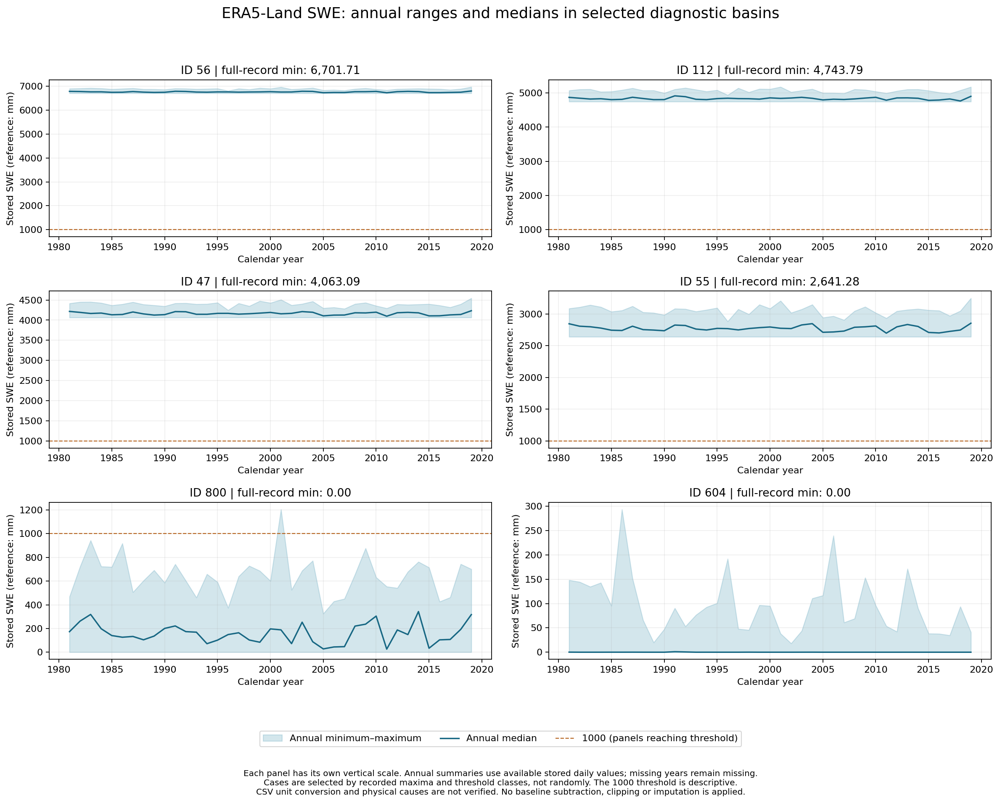

Hình đọc được, dải là min–max năm và đường là median năm, thang y riêng. Mức cao kéo dài ở bốn panel đầu và các năm có SWE=0 ở ca đối chiếu là mô tả số liệu; hình không trình bày chu kỳ trong năm hoặc kiểm định xu thế. Chữ tham chiếu mm chưa thay cho kiểm đường chuyển đổi CSV. Khảo sát SWE ở Phần 5 đã đủ để bàn giao câu hỏi ngữ nghĩa nguồn sang Phần 6, không cần thêm cell SWE chỉ để lặp các cực trị.

### 19.11. Cell 5.11 — đối chiếu Q giờ với Q ngày

Nguồn đã chuẩn bị có 452 ID (451 mô hình và 410), header YYYY/MM/DD/hh/mm/qobs/ckhs/qceq/qcol. [LamaH-CE Mục 4.1](https://essd.copernicus.org/articles/13/4529/2021/#section4) ghi Q giờ/ngày bằng m³/s, mô tả ngày 00:00–23:59 GMT và xử lý lỗ tối đa 6 giờ bằng nội suy. [BiasCast Mục 2.1](https://hess.copernicus.org/articles/30/5067/2026/#section2) cho biết qmin/qmax được trích từ LamaH giờ. Đây là căn cứ cho phép so theo ngày ghi trong tệp, chưa xác nhận mọi quy trình nguồn chỉ bằng khớp số.

Cell đọc lần lượt toàn bộ 452 tệp giờ, không tải lại và không giữ ma trận mọi ID/giờ trong RAM. Kiểm timestamp duy nhất, tăng dần và phút bằng 0; không tự gom các dòng trùng hoặc làm tròn thời gian. Kiểm kê rỗng/−999/chữ/vô hạn/âm khác −999; các số hữu hạn khác −999 (kể cả âm được gắn cờ) tham gia phép so để kiểm cả 43 qmin âm đã biết. Cờ ckhs/qceq/qcol được đếm theo token, chưa tự giải nghĩa hoặc lọc giờ bằng cờ.

Trong lịch Q 1981–2017, mỗi ngày có mẫu số danh định 24 giờ. Tách số dòng giờ và số Q hữu hạn khác −999; phân ba nhóm 24, 1–23 hoặc không có số để tính. Min/mean/max được tính trên **các số giờ có mặt**, không điền lỗ; ngày không có số giữ NaN. Đọc lại qmin/qmean/qmax Extended và so từng biến trong mỗi nhóm, giữ cả ngày không có dòng ngày, rỗng/sentinel/không hợp lệ. Mỗi biến báo số cặp, cả hai thiếu, chỉ có ngày/chỉ có tái dựng và số khớp; các trạng thái phải cộng đúng lịch. Dung sai tuyệt đối cố định 10⁻⁹ và 0,0005 m³/s báo riêng, sai số tương đối bằng 0; mức 0,0005 chưa xác nhận cách làm tròn nguồn.

Tập 452×13514 = 6108328 ngày–ID gồm 410 ngoài danh sách mô hình; không dùng tổng này để thay số của 451. Bảng chéo qmax cho biết khả năng có Q ngày khi giờ chỉ có một phần hoặc không có số. Bảng chênh giữ tối đa năm ví dụ lớn nhất/ID/biến, không phải mọi dòng chênh. Không chọn dịch giờ dựa trên độ khớp; nếu có chênh cần đọc ví dụ và tài liệu thời gian trước khi quyết định phép kiểm kế tiếp.

Các ca gồm mọi ngày đồng cực đại của top 10 ID mm/ngày từ 5.7 (kèm ±1 ngày trong bảng chi tiết), 15 đoạn hằng dài nhất từ 5.6, hai năm 1981/1991 của 94 và khoảng Q ngày của 410. Đoạn hằng báo số mức qobs giờ, qmean/qmin ngày và số ngày max tái dựng khớp; qmax hằng không tự đồng nghĩa mọi giờ đều hằng. Không mở rộng 15 đoạn thành kết luận cho tất cả 3465 đoạn.

Với các đoạn gaps đã đo ở 4.5 trong 452 ID, tra đúng từng mốc vào qobs sau xử lý: số còn −999, có số, thiếu dòng hoặc dạng thiếu khác. Đoạn ≤6 giờ có đầy đủ giá trị và hai biên hữu hạn thì báo max sai khác với đường thẳng qua hai biên; gần tuyến tính chỉ là tính tương thích, chưa là bằng chứng độc lập toàn bộ thuật toán nội suy. Các giờ ở ngày biên giữ nguyên ngày ghi trong tệp. Không tự sửa qmax hoặc coi khớp cùng nguồn là kiểm quan trắc độc lập.

Cell không thêm hình; chín CSV tiền tố A1_P5_: hourly_qobs_profile/hourly_flag_counts/hourly_daily_comparison/hourly_daily_status/hourly_mismatch_examples/hourly_case_daily/hourly_peak_check/hourly_constant_check/hourly_gaps_check. In bảng (1)–(7), dừng đợi output thật. Mã đã kiểm giả lập cho đủ/thiếu giờ, −999, số âm, ba phép tổng hợp, chênh/đỉnh/đoạn hằng, gaps ngắn/dài, tuyến tính và cờ; timestamp trùng hoặc phút khác 0 phải dừng. Kết quả thật được ghi dưới đây.

**Kết quả thực tế:** cell 5.11 đối chiếu **452 ID = 451 mô hình + 410**, lịch **01/01/1981–31/12/2017**, trong **462,4 giây**. Chín CSV đã xuất trên Kaggle nhưng chưa nhận cục bộ; bảng chênh lớn nhất được in rỗng. Không có hình mới.

#### 19.11.1. Số giờ, trạng thái và cờ

| Đại lượng | Số giờ |
|---|---|
| Kỳ vọng trên lịch 452 ID | 146599872 |
| Dòng giờ có mặt | 131878728 |
| Dòng ngoài lịch kiểm | 0 |
| Không có dòng giờ trên lịch | 14721144 |
| −999 | 360096 |
| Số âm hữu hạn khác −999 | 111 |
| Hữu hạn khác −999, gồm số âm đã gắn cờ | 131518632 |
| Rỗng / chữ không rỗng / vô hạn | 0 / 0 / 0 |

131878728+14721144=146599872; 131878728−360096=131518632. Số âm khác −999 được giữ trong phép tái dựng để kiểm qmin, không tự xem là thiếu hoặc Q hợp lệ vật lý.

| Cờ | Token | Số giờ |
|---|---|---|
| ckhs | 0 | 9219232 |
| ckhs | 1 | 122659496 |
| qceq | 0 | 108636295 |
| qceq | 1 | 23242433 |
| qcol | Rỗng | 360202 |
| qcol | 0 | 131508782 |
| qcol | 1 | 9744 |

Mỗi cờ cộng đúng 131878728 dòng. Theo [Bảng A1 LamaH-CE, tr. 4549](../../../PaperResearch/PaperResearchPDF/Evidence/Klingler2021_ESSD_LamaHCE.pdf), ckhs cho biết đã được cơ quan thủy văn kiểm hay chưa, nhưng phạm vi kiểm không mô tả cụ thể; qceq đánh dấu giá trị bằng nhau ít nhất 10 bước liên tiếp; qcol là cờ ngoại lai tự động, có thể bao gồm Q thấp/cao có thật. Trong tệp giờ, 10 bước là 10 giờ, không phải 10 ngày. Không dùng các token để tự lọc Q; token qcol rỗng không được gán bằng 0. Chưa có bảng theo từng giờ/ID trong output để suy 9744 cờ qcol nằm ở ca nào hoặc số âm thuộc bao nhiêu ngày.

#### 19.11.2. Tái dựng ngày và mẫu số

| Phủ Q giờ | Ngày–ID 452 | qmin khớp ≤10⁻⁹ | qmax khớp ≤10⁻⁹ | qmean khớp ≤10⁻⁹ | qmean khớp ≤0,0005 |
|---|---|---|---|---|---|
| 24 số hữu hạn khác −999 | 5479642 | 5479642 | 5479642 | 630080 | 5479642 |
| 1–23 số hữu hạn khác −999 | 593 | 593 | 593 | 198 | 593 |
| Không có số để tổng hợp | 628093 | Không có cặp | Không có cặp | Không có cặp | Không có cặp |

Tổng **6108328 ngày–ID**, trong đó **5480235** có cả Q ngày lẫn Q tái dựng; qmin/qmax có max trị tuyệt đối sai khác bằng **0**. qmean có **630278** cặp trong dung sai 10⁻⁹ và tất cả 5480235 cặp trong dung sai **0,0005 m³/s**, max sai khác hiển thị 0,0005. Kết quả phù hợp khả năng mean được lưu đến 0,001 m³/s nhưng chưa chứng minh chính xác thuật toán làm tròn tại điểm giữa.

Không có ngày chỉ có Q lưu trữ hoặc chỉ có Q tái dựng, ở cả ba biến. 628093 ngày không có số để tổng hợp gồm **14712 ô qmax rỗng** và **613381 ngày không có dòng Q**. Đây là phép khớp về cả vị trí có/thiếu số và giá trị, không chỉ khớp tổng. Không cần dịch timestamp để tái tạo các min/max trong phạm vi này, nhưng không suy được mọi quy ước thời gian của tất cả phiên bản khác.

**Tách đúng 451 ID:** ca 410 góp 1682 ngày đủ 24 số, 3 ngày có một phần giờ, 141 ngày rỗng và 11688 ngày ngoài khoảng tệp ngày. Trừ các số này cho 452 ID cho:

| Đại lượng 451 ID | Số ngày–ID |
|---|---|
| Đủ 24 số giờ | 5477960 |
| Có 1–23 số giờ | 590 |
| Tổng Q có số | 5478550 |
| Q rỗng | 14571 |
| Không có dòng Q | 601693 |
| Lịch kỳ vọng | 6094814 |

Các số Q có/thiếu khớp 5.1/5.7 và Phần 2. 590 ngày có một phần giờ là toàn lịch 1981–2017, khác 309 ngày có mốc gaps ở 2003–2017 của 4.5. Các giờ gaps ngắn đã có số trong nguồn sau xử lý nên một ngày có mốc gaps vẫn có thể đủ 24 Q giờ hữu hạn. Không so hai số như cùng mẫu số hoặc cùng định nghĩa.

Tái dựng ở ngày thiếu giờ dùng min/mean/max của **các giờ còn có số**. Khớp phép tổng hợp chưa bảo đảm đỉnh thật không rơi vào giờ thiếu và chưa chứng minh mean của tập giờ còn lại đại diện đúng cả ngày. Đây là hạn chế nhãn cần giữ khi bàn giao; không tự xóa hoặc điền những ngày này.

#### 19.11.3. Mười cực đại có đủ 24 giờ

| ID | Ngày | Qmax m³/s = max giờ | Giờ đầu đạt max |
|---|---|---|---|
| 10 | 22/08/2005 | 249,000 | 22:00 |
| 20 | 22/08/2005 | 153,000 | 23:00 |
| 23 | 23/08/2005 | 63,200 | 01:00 |
| 24 | 23/08/2005 | 109,000 | 01:00 |
| 25 | 22/08/2005 | 65,600 | 23:00 |
| 30 | 29/09/1981 | 28,500 | 00:00 |
| 101 | 01/06/2013 | 17,000 | 22:00 |
| 102 | 02/06/2013 | 133,000 | 00:00 |
| 261 | 12/08/2002 | 90,200 | 08:00 |
| 797 | 18/07/1987 | 79,475 | 08:00 |

Cả mười ngày có đủ 24 Q giờ hữu hạn và sai khác 0. Các cực đại đã có đúng trong nguồn giờ; không phải phát sinh ở bước trích qmax ngày hoặc đổi diện tích. Đối chiếu cùng nguồn không xác nhận độc lập quan trắc vật lý, đường rating curve hoặc ảnh hưởng xử lý nguồn. Chưa suy các cờ qcol/ckhs tại giờ đỉnh từ bảng tổng cờ toàn bộ.

#### 19.11.4. Các đoạn hằng và mức giờ

Mười lăm đoạn được chọn theo độ dài giảm/run_id tăng, tổng **1617 ngày**, đều có đủ 24 Q giờ mỗi ngày, và max giờ khớp qmax ngày ở mọi ngày. Có **11/15 đoạn** chỉ có một mức qobs giờ; bốn đoạn còn lại có nhiều mức giờ dù qmax ngày hằng.

| ID | Ngày đầu–cuối | Ngày | Qmax hằng m³/s | Mức giờ khác nhau | Mức qmean ngày | Mức qmin ngày |
|---|---|---|---|---|---|---|
| 47 | 14/01–31/03/1999 | 77 | 0,217 | 4 | 2 | 2 |
| 61 | 18/02–20/04/1992 | 63 | 0,029 | 2 | 2 | 2 |
| 112 | 13/12/2011–26/04/2012 | 136 | 0,099 | 2 | 1 | 2 |
| 416 | 20/07–28/11/1984 | 132 | 0 | 1 | 1 | 1 |
| 416 | 29/10/1986–21/01/1987 | 85 | 0,011 | 1 | 1 | 1 |
| 551 | 06/01–03/04/2010 | 88 | 0,038 | 10 | 3 | 3 |
| 758 | 22/01–08/10/1998 | 260 | 0 | 1 | 1 | 1 |
| 758 | 19/08/1997–18/01/1998 | 153 | 0 | 1 | 1 | 1 |
| 758 | 26/07–15/11/1992 | 113 | 0 | 1 | 1 | 1 |
| 758 | 13/09–21/12/1991 | 100 | 0 | 1 | 1 | 1 |
| 758 | 08/10–15/12/1996 | 69 | 0,019 | 1 | 1 | 1 |
| 814 | 01/01–21/03/2017 | 80 | 0,325 | 1 | 1 | 1 |
| 818 | 01/01–15/03/2017 | 74 | 0,384 | 1 | 1 | 1 |
| 819 | 02/12/2005–24/03/2006 | 113 | 0,151 | 1 | 1 | 1 |
| 819 | 27/11/2006–08/02/2007 | 74 | 0,151 | 1 | 1 | 1 |

814 và 818 thực sự hằng ở mọi giá trị giờ trong các đoạn đã chọn, không chỉ do cùng max ngày; chưa biết nguyên nhân. Với 112, hai mức giờ cho qmean ngày cùng một mức lưu trữ, phù hợp độ phân giải/làm tròn nhưng chưa đủ để nhận diện cơ chế nguồn. Không dùng 15 ca này để kết luận cho tất cả đoạn hằng hoặc loại số 0.

#### 19.11.5. Gaps và hai ca vượt dung sai tuyến tính

| Nhóm đoạn gaps | Giờ liệt kê = có dòng | Giờ có số hữu hạn khác −999 | Giờ −999 | Thiếu dạng khác / thiếu dòng |
|---|---|---|---|---|
| >6 giờ | 360096 | 0 | 360096 | 0 / 0 |
| ≤6 giờ | 191 | 191 | 0 | 0 / 0 |

Tổng **360287** mốc bằng 356866 của tập 451 ID cộng 3421 của 410, khớp 4.5. Mọi mốc đoạn dài đều là −999 và tổng bằng toàn bộ số −999 ở 452 tệp đã kiểm. Nhóm ngắn có số ở cả 191 mốc. Phép này xác nhận trực tiếp trạng thái trong nguồn sau xử lý, mạnh hơn suy từ danh sách gaps/ngày Q rỗng.

Cả **77 đoạn ngắn** có đủ hai biên và giá trị giữa để so; **75** có max sai khác tuyến tính ≤0,0005 m³/s, hai đoạn còn lại vượt ngưỡng chung này. Max trên 77 đoạn là **0,0006666666666670373 m³/s**. Chưa gán ID hoặc tự sửa hai đoạn khi chưa đọc các dòng cụ thể.

Một biên có thể xét về mặt số học: **nếu** cả hai biên thật và điểm nội suy thật được làm tròn gần nhất với bước h=0,001, sai khác giữa điểm lưu và đường thẳng qua hai biên lưu bị chặn bởi h/2+(1−w)h/2+wh/2=h=0,001. Đây là điều kiện giả định, không được nâng dung sai chung để gọi toàn bộ nội suy đã xác minh. Lưới giá trị quan sát chưa chứng minh bước làm tròn hoặc phép nội suy gốc. Cell 5.12 đọc hai ca để báo token, biên, giá trị giữa và cờ.

#### 19.11.6. ID 410 và kết luận phép tổng hợp

Trong 1826 ngày của tệp 2013–2017, 1682 ngày đủ số giờ, 3 ngày có một phần, 141 ngày không có Q giờ để tổng hợp và qmax ngày rỗng. Ba ngày biên đều có 24 dòng giờ nhưng chỉ một phần khác −999:

| Ngày | Số giờ hữu hạn | Min giờ = qmin | Mean giờ | qmean lưu | Max giờ = qmax |
|---|---|---|---|---|---|
| 01/08/2013 | 12 | 1,69 | 1,730833 | 1,731 | 1,76 |
| 09/10/2013 | 8 | 2,22 | 2,233750 | 2,234 | 2,26 |
| 30/12/2013 | 15 | 2,81 | 2,871333 | 2,871 | 3,00 |

Số giờ còn lại 12/16/9 là −999, khớp 37 mốc đã đo ở 4.5. Phép tổng hợp từ các Q còn có số đã tái hiện qmin/qmax chính xác và qmean trong dung sai chung. Không còn chỉ dựa vào suy luận từ tổng 141×24; vẫn chưa biết Q thật tại giờ thiếu và nguyên nhân chênh metadata gaps_pre/post.

**Kết luận trong phạm vi:** qmin/qmax Extended tái tạo được từ Q giờ trong toàn bộ 451+410; qmean tái tạo được trong 0,0005 m³/s, vị trí có/thiếu số khớp. Không phát hiện lỗi tổng hợp giờ–ngày trong phép kiểm này. Chất lượng vật lý của quan trắc, ý nghĩa nguyên nhân đoạn hằng, giới hạn đỉnh trên ngày thiếu giờ và ngữ nghĩa SWE vẫn giữ riêng. Phép đọc cờ/giờ âm/hai ca nội suy ở 5.12 là bước kiểm có mục tiêu cuối của nhóm Q trong Phần 5, không tải hoặc quét lại toàn bộ nguồn.

### 19.12. Cell 5.12 — cờ ở các ca Q và hai đoạn ngắn

Chỉ đọc các ID thuộc top 10 ngày đỉnh, 15 đoạn hằng đã kiểm, có giờ âm theo profile 5.11 hoặc có sai khác nội suy ngắn >0,0005. Giữ một lần đọc mỗi ID trong hợp tập; không tải hoặc đọc lại 452 tệp. Nguồn cờ là [Bảng A1 LamaH-CE, tr. 4549](../../../PaperResearch/PaperResearchPDF/Evidence/Klingler2021_ESSD_LamaHCE.pdf): ckhs kiểm của cơ quan thủy văn, qceq bằng nhau ≥10 bước, qcol ngoại lai tự động có thể là dòng chảy thật. Không tự lọc theo cờ, xem ckhs=0 là lỗi hoặc đổi qcol rỗng thành 0.

Đỉnh kiểm **mọi giờ đồng max** của mỗi ngày, không chỉ giờ đầu. Đoạn hằng đếm cờ trên mọi giờ trong đoạn, báo số mức qobs. Giờ âm khác −999 được giữ toàn bộ, nối với qmin ngày đúng ID/ngày; tổng giờ âm phải khớp 5.11. In số ID/ngày và tối đa 20 dòng âm, không suy số ngày từ 111 giờ.

Hai đoạn nội suy đọc thêm một giờ hai bên, giữ token qobs/cờ và số dư từng điểm. Báo lưới 0,001, số dư và hai ngưỡng riêng: 0,0005 chung và biên 0,001 **giả định** sai số làm tròn ở cả hai biên lẫn điểm giữa. Biên chỉ là điều kiện cần về sai khác, không chứng minh có cùng các giá trị ẩn thỏa mãn mọi phép làm tròn hoặc xác nhận thuật toán gốc. Dừng khi số dư đọc lại khác 5.11; không sửa số hoặc nâng dung sai chung để báo khớp.

Bảng (1) tách lại các số so sánh riêng 451 ID mô hình từ bảng đã có, không cần đọc lại dữ liệu. Bảng (2) là ngoại lệ và dòng giờ, (3) cờ tại đỉnh, (4) cờ đoạn hằng, (5) giờ âm. Sáu CSV có tiền tố A1_P5_: hourly_short_exceptions/hourly_short_exception_hours/hourly_peak_flags/hourly_constant_flags/hourly_negative_hours/hourly_model_comparison. Không thêm hình cho các bảng tra này; dừng sau bảng (1)–(5).

Mã đã kiểm giả lập cho biên số dư khi làm tròn, mọi giờ đồng max/cờ, đoạn hằng, âm và nối ngày, tách 410, bảng rỗng đúng schema và dừng nếu nguồn không còn khớp. Kết quả thật được ghi dưới đây. Phần 6 tiếp tục ngữ nghĩa và so năm cặp nguồn khí tượng sau khi ghi kết quả nhóm Q, không mở lại các cực trị SWE đã đủ mô tả.

**Kết quả thực tế:** cell 5.12 đọc **27 ID liên quan**, thời gian **27,1 giây**, xuất sáu CSV trên Kaggle; chưa nhận các CSV chi tiết cục bộ. Output có đủ bảng (1)–(5), không có hình mới. Đây là phần kiểm cờ/ca cụ thể sau phép tổng hợp 452 ID, không phải quét lại hoặc tải lại toàn bộ nguồn.

#### 19.12.1. Tách đúng mẫu số 451 ID

| Phủ Q giờ | Ngày–ID | qmin/qmax khớp ≤10⁻⁹ | qmean khớp ≤10⁻⁹ | qmean khớp ≤0,0005 |
|---|---|---|---|---|
| 24 Q hữu hạn khác −999 | 5477960 | 5477960 | 629936 | 5477960 |
| 1–23 Q hữu hạn khác −999 | 590 | 590 | 198 | 590 |
| Không có Q để tính | 616264 | Không có cặp | Không có cặp | Không có cặp |

Có 5478550 ngày có số ở mỗi biến, 616264 ngày cả hai phía thiếu, cộng **6094814** ngày kỳ vọng của riêng 451 ID. Không có stored_only/reconstructed_only. qmean có **630134** cặp trong 10⁻⁹, mọi cặp trong 0,0005. Các số đúng bằng phép trừ ca 410 từ 5.11, không lẫn mẫu số 452 ID.

#### 19.12.2. Hai đoạn ngắn: giá trị và chiều sai khác

| ID | Đoạn giờ thiếu ban đầu | Giờ | Q biên trái/phải | Max sai khác với đường qua biên lưu | ≤0,0005 | Trong biên 0,001 giả định |
|---|---|---|---|---|---|---|
| 622 | 01/08/2012 17:00–21:00 | 5 | 2,872 / 3,000 | 0,000666667 | False | True |
| 726 | 25/10/2015 15:00–16:00 | 2 | 0,946 / 0,989 | 0,000666667 | False | True |

Cả hai cửa sổ nằm trên lưới 0,001. Giá trị Q lưu tại bảy điểm giữa:

| ID | Giờ | Q lưu m³/s | Đường thẳng qua hai biên lưu | Số dư |
|---|---|---|---|---|
| 622 | 17:00 | 2,894 | 2,893333333 | +0,000666667 |
| 622 | 18:00 | 2,915 | 2,914666667 | +0,000333333 |
| 622 | 19:00 | 2,936 | 2,936000000 | 0 |
| 622 | 20:00 | 2,958 | 2,957333333 | +0,000666667 |
| 622 | 21:00 | 2,979 | 2,978666667 | +0,000333333 |
| 726 | 15:00 | 0,961 | 0,960333333 | +0,000666667 |
| 726 | 16:00 | 0,975 | 0,974666667 | +0,000333333 |

Các số dư đều không âm. Kiểm bằng phân số chính xác từ hai biên đã lưu cho thấy **cả bảy điểm khớp làm tròn lên tới 0,001** của đường thẳng này. Đây là một phép khớp trên hai đoạn, không chứng minh tác giả đã dùng làm tròn lên, không chứng minh toàn bộ 77 đoạn cùng thuật toán và không sửa giá trị nguồn. Biên 0,001 vẫn chỉ xét giả định làm tròn của điểm giữa và hai biên; không thay dung sai chung 0,0005 hoặc xem đó là xác minh đầy đủ quy trình gốc.

Ở 622, hai giờ biên 16:00/22:00 có ckhs=1, năm giờ giữa ckhs=0; ở 726, hai biên và hai giờ giữa đều ckhs=0. Mọi dòng trong hai cửa sổ có qceq=qcol=0. Các token hỗ trợ đọc trạng thái kiểm, chưa tự giải thích nguồn gốc chênh nhỏ.

#### 19.12.3. Cờ ở mọi giờ đồng cực đại

Cả mười ngày top 10 vẫn đủ 24 Q giờ và mỗi ngày chỉ có **một giờ đạt max**. Tất cả mười giờ max có **ckhs=1**, qceq=0 và qcol không rỗng. Hai giờ có **qcol=1** là:

| ID | Ngày/giờ | Qmax m³/s | ckhs | qceq | qcol |
|---|---|---|---|---|---|
| 10 | 22/08/2005 22:00 | 249,000 | 1 | 0 | 1 |
| 797 | 18/07/1987 08:00 | 79,475 | 1 | 0 | 1 |

Tám ID 20/23/24/25/30/101/102/261 có qcol=0 tại giờ max. qcol đánh dấu ngoại lai tự động, không phải kết luận Q sai; ckhs=1 cũng không xác nhận mọi sai số vật lý đã được loại. Hai giá trị có cờ vẫn hiện diện trong Q giờ và qmax ngày. Chưa dùng chúng làm quy tắc lọc trạm/cắt đỉnh hoặc xác nhận đúng/sai của quan trắc.

#### 19.12.4. Cờ trong 15 đoạn qmax ngày hằng

Tổng **38808 giờ = 1617×24** trong 15 đoạn. Không giờ nào có qcol=1 hoặc qcol rỗng. Có **38773 giờ qceq=1**, còn 35 giờ qceq=0 thuộc ID 47 (2 giờ) và 551 (33 giờ); đây là cờ theo bước giờ, khác điều kiện qmax ngày hằng.

| ID / đoạn | Giờ trong đoạn | ckhs=0 | ckhs=1 | qceq=1 |
|---|---|---|---|---|
| 47, 14/01–31/03/1999 | 1848 | 0 | 1848 | 1846 |
| 61, 18/02–20/04/1992 | 1512 | 0 | 1512 | 1512 |
| 112, 13/12/2011–26/04/2012 | 3264 | 0 | 3264 | 3264 |
| 416, 20/07–28/11/1984 | 3168 | 0 | 3168 | 3168 |
| 416, 29/10/1986–21/01/1987 | 2040 | 0 | 2040 | 2040 |
| 551, 06/01–03/04/2010 | 2112 | 0 | 2112 | 2079 |
| 758, 22/01–08/10/1998 | 6240 | 6240 | 0 | 6240 |
| 758, 19/08/1997–18/01/1998 | 3672 | 3672 | 0 | 3672 |
| 758, 26/07–15/11/1992 | 2712 | 2712 | 0 | 2712 |
| 758, 13/09–21/12/1991 | 2400 | 2400 | 0 | 2400 |
| 758, 08/10–15/12/1996 | 1656 | 1656 | 0 | 1656 |
| 814, 01/01–21/03/2017 | 1920 | 0 | 1920 | 1920 |
| 818, 01/01–15/03/2017 | 1776 | 0 | 1776 | 1776 |
| 819, 02/12/2005–24/03/2006 | 2712 | 0 | 2712 | 2712 |
| 819, 27/11/2006–08/02/2007 | 1776 | 0 | 1776 | 1776 |

Năm đoạn của 758 đều có ckhs=0 ở mọi giờ (16680 giờ); mười đoạn còn lại đều ckhs=1 (22128 giờ). Các đoạn hằng theo giờ của 814/818/819 có cờ đã kiểm, nên không dùng một cơ chế “chưa kiểm” chung để giải thích mọi đoạn hằng. ckhs không cho nguyên nhân băng, điều tiết, điền số hoặc làm tròn. Không mở rộng trạng thái năm đoạn 758 trước 1999 thành trạng thái toàn bộ kỳ train/test.

#### 19.12.5. Giờ âm và qmin ngày

| ID | Giờ âm khác −999 | Ngày có giờ âm | Min Q giờ m³/s |
|---|---|---|---|
| 631 | 64 | 12 | −0,168 |
| 644 | 8 | 7 | −0,045 |
| 645 | 4 | 1 | −0,034 |
| 672 | 1 | 1 | −0,036 |
| 699 | 32 | 21 | −0,265 |
| 720 | 2 | 1 | −0,374 |
| Tổng | 111 | 43 | — |

Tập sáu ID và 43 ngày khớp qmin âm đã đo tại Phần 2/5.7. Cùng phép min giờ khớp qmin ở 5.11, kết quả nối nguồn này xác nhận số âm đã có ở Q giờ, không phát sinh từ tổng hợp ngày hoặc đổi đơn vị. Chưa giải thích nguyên nhân vật lý/đo đạc và không tự loại qmean/qmax cùng ngày.

Hai mươi dòng in đầu đều thuộc 631, ckhs=1, qceq=0; qcol chủ yếu rỗng và có một dòng qcol=1 tại 11/08/1998 12:00 (Q=−0,003). Không suy trạng thái cờ của mọi 111 giờ từ 20 dòng này hoặc đồng nhất toàn bộ qcol rỗng với Q âm khi chưa có CSV đầy đủ. Ví dụ 10/08/1998, các giờ âm được in có min −0,143 và qmin ngày lưu −0,143; 11/08 có min −0,118 và qmin lưu −0,118.

### 19.13. Tổng kết Phần 5 và bàn giao

Phần 5 hoàn thành khảo sát phân phối, đuôi theo diện tích, mùa theo độ cao, đường duy trì/đoạn hằng, cặp Q cùng ngày, 40 biến khí tượng, SWE và đối chiếu Q giờ. Các phép tổng hợp Q ngày khớp nguồn trong phạm vi kiểm; số 0 không bị coi là thiếu, các số qmin âm được truy về giờ nguồn, cờ tự động không trở thành quy tắc xóa số. Q trên 590 ngày có một phần giờ của tập 451 vẫn cần giữ giới hạn có thể bỏ lỡ đỉnh chưa quan trắc.

Các câu hỏi còn mở được bàn giao đúng nơi: đơn vị/dấu/tích lũy và tính tương đương vật lý của khí tượng sang Phần 6; số mẫu cửa sổ và khả năng NaN khi có qmean sang Phần 7; lệch giữa kỳ và đánh giá đỉnh sang Phần 8; các hồ sơ 55/742/758/800 sang Phần 9. Chưa thay chuẩn hóa huấn luyện, chọn/bỏ lưu vực, sửa Q hoặc SWE, dùng test để chọn quy tắc xử lý, hoặc kết luận nguyên nhân NSE từ các thống kê mô tả. Các run không đủ provenance scaler giữ giới hạn đã ghi tại 19.2–19.3.

## 20. Năm cặp khí tượng: Phần 6

### 20.1. Cell 6.1 — ngữ nghĩa, phạm vi ghép và mức lưu trữ

Năm cặp lấy đúng từ [VARIABLE_PAIRS của mã phân tích tác giả](../../../PaperResearch/PaperResearchCode/BiasCast/Inspect_Experiments/code/wasserstein_distance_static_attributes.py#L53):

| Cặp | Cột đối chiếu | Cột forecast | Đơn vị Bảng A1 / nhãn mã tác giả |
|---|---|---|---|
| Bức xạ | ERA5L_surf_net_solar_rad_mean | ECMWF_ssrd | W/m² / J/m² |
| Nhiệt độ | ERA5L_2m_temp_mean | ECMWF_t2m | °C / °C |
| Điểm sương | ERA5L_2m_dp_temp_mean | ECMWF_d2m | °C / °C |
| Mưa | MSWEP_RR | ECMWF_tp | mm / mm |
| Bốc hơi | GLEAM_ETA | ECMWF_e | mm / mm |

**Cần phân biệt đại lượng trước khi chấm sai lệch.** [Tài liệu ERA5 của ECMWF](https://confluence.ecmwf.int/pages/viewpage.action?pageId=388500357) phân biệt ssrd (parameter 169, bức xạ mặt trời đi xuống) và ssr (176, bức xạ mặt trời thuần); tên cột ERA5L trong cặp tác giả là net. Hai đại lượng khác định nghĩa ngay cả khi cùng đơn vị, còn đường xử lý CSV Extended chưa được truy đầy đủ. Bảng A1 của BiasCast ghi W/m² cho ssrd trong khi nhãn mã phân tích ghi J/m². Vì vậy không tự gọi chênh hai cột là bias forecast, không tự nhân/chia 86400, dùng albedo để đổi đại lượng hoặc sửa danh sách tác giả ở cell này.

Các cột MSWEP/GLEAM là nguồn đối chiếu khác, không tự là ground truth độc lập hoặc ERA5L. [GLEAM](https://www.gleam.eu/) phân biệt actual với potential evaporation, nhưng phiên bản/thành phần ET trong CSV vẫn cần truy; không áp mô tả phiên bản mới vào bản lưu cũ nếu chưa có căn cứ. [BiasCast Mục 2.1 và Bảng A1](https://hess.copernicus.org/articles/30/5067/2026/#section2) là tham chiếu đơn vị/ngày; cell không khẳng định đã xác nhận toàn bộ chuyển đổi/tích lũy/dấu từng cột.

Cell đọc mười cột của 451 ID trên toàn lịch khí tượng 5.8, kiểm số có giá trị từng ID/cột đúng hồ sơ 5.8. Số hữu hạn khác −999 được giữ, kể cả số âm/0; rỗng/chữ/vô hạn không dùng làm số. Tách cả hai có số/chỉ cột đối chiếu/chỉ forecast/cả hai thiếu, ngày đầu/cuối ghép và số ID có cặp. Trạng thái phải cộng đúng lịch; tổng cặp theo năm phải khớp toàn lịch. Không dùng số 0 để đại diện thời kỳ forecast chưa có.

Mean hai nguồn trong một năm hoặc kỳ dùng **đúng cùng tập ngày–ID có cả hai số**. Gộp theo ngày–ID, không phải median ngang mean của 451 ID; số ngày khác nhau hoặc thiếu có thể làm trọng số khác. Bảng theo năm giữ cả năm không cặp với n=0 và mean=NaN; bảng in năm có ít nhất một cặp. Các kỳ train/validation/test dùng PERIODS hiện hành. Báo số cặp, mean của từng cột, tỷ lệ 0/âm của từng phía và tỷ lệ dấu khác nhau khi cả hai khác 0, không tính bias/RMSE/Wasserstein hoặc chọn chuẩn hóa ở bước này.

Hình A1_P6_pair_scope_annual_means.png có năm panel mean lưu trữ theo năm và một panel độ phủ cặp; cùng miền năm, thang y riêng. Mean năm không có cặp giữ NaN, không nối bằng số 0. Tỷ lệ phủ có mẫu số đúng ngày lịch×451, gồm năm nhuận; các đường phủ trùng nhau vẫn giữ đủ nhãn. Hai mean raw đặt cạnh nhau chỉ mô tả giá trị lưu trữ khi ngữ nghĩa/đơn vị chưa giải quyết, không xếp hạng nguồn đúng/sai.

Năm CSV tiền tố A1_P6_: pair_contract/pair_profile/pair_scope/pair_by_basin_scope/pair_scoped_summary. Dừng sau hình và bảng (1)–(4). Mã đã kiểm giả lập cho ghép ngày đúng, thiếu một phía, sentinel, 0/âm, năm nhuận, phạm vi nguồn kết thúc khác nhau, mean độc lập trên cùng tập cặp và lỗi hồ sơ phải dừng; ảnh giả lập đã xem. Kết quả thực tế 6.1 được ghi dưới đây.

#### 20.1.1. Kết quả thực tế và phạm vi chung

Cell 6.1 đọc **451 ID**, thời gian **62,6 giây**, xuất hình và năm CSV trên Kaggle. Đã nhận hình gốc, chưa nhận năm CSV chi tiết cục bộ; các bảng sau dựa trên output in. Năm cặp giữ nguyên danh sách tác giả ở bảng trên, không tự gán các nguồn đối chiếu đều là tái phân tích ERA5-Land.

| Cặp | Lịch kỳ vọng | Cột đối chiếu có số | Forecast có số = cặp | Chỉ đối chiếu | Chỉ forecast / cả hai thiếu | Ngày cặp đầu–cuối | ID có cặp |
|---|---|---|---|---|---|---|---|
| Điểm sương | 6424044 | 6424044 | 2964874 | 3459170 | 0 / 0 | 01/01/2002–31/12/2019 | 451 |
| Bốc hơi | 6424044 | 6424044 | 2635644 | 3788400 | 0 / 0 | 01/01/2002–31/12/2017 | 451 |
| Mưa | 6424044 | 6424044 | 2635644 | 3788400 | 0 / 0 | 01/01/2002–31/12/2017 | 451 |
| Bức xạ | 6424044 | 6424044 | 2635644 | 3788400 | 0 / 0 | 01/01/2002–31/12/2017 | 451 |
| Nhiệt độ | 6424044 | 6424044 | 2964874 | 3459170 | 0 / 0 | 01/01/2002–31/12/2019 | 451 |

Mỗi cặp có 164615 ngày–ID trong năm thường và 165066 trong năm nhuận (2004/2008/2012/2016). Tất cả năm 2002–2017 đủ cặp ở cả năm biến; 2018–2019 chỉ còn nhiệt độ/điểm sương, ba cặp khác bằng 0 cặp và mean NaN. Các năm trước 2002 không có cặp; cột đối chiếu vẫn có số, không phải toàn bộ khí tượng thiếu. Tổng của năm/kỳ và trạng thái khớp phép kiểm 6.1.

**Trong cả ba kỳ thí nghiệm, năm cặp đều phủ 100%:** train 1153207, validation 658911, test 658911 ngày–ID cho mỗi cặp. Cộng ba kỳ là 2471029; thêm 164615 ngày–ID năm 2002 ra 2635644. Hai cặp kéo dài đến 2019 có thêm 329230 cặp. Vì mọi ID đều đủ ngày ở từng kỳ, mean gộp ngày–ID tại đây cũng bằng mean ngang các mean ID của cùng kỳ; điều này không áp tự động cho các phép đo có thiếu ở phần khác.

#### 20.1.2. Mean lưu trữ trên cùng cặp, theo kỳ

Hiệu dưới đây là **forecast trừ đối chiếu**, tính từ hai mean đã in đến sáu chữ số nên chỉ là xấp xỉ; không phải bias dự báo vật lý đã kiểm chứng. Các đơn vị vẫn là tham chiếu ở 20.1, đặc biệt bức xạ khác đại lượng và chưa xác nhận đơn vị CSV.

| Cặp | Kỳ | Mean đối chiếu raw | Mean forecast raw | Hiệu hai mean in ≈ |
|---|---|---|---|---|
| Điểm sương | train | 2,413282 | 2,546969 | +0,133687 |
| Điểm sương | validation | 2,486322 | 2,323067 | −0,163255 |
| Điểm sương | test | 3,340060 | 3,096425 | −0,243635 |
| Bốc hơi | train | 1,497722 | 1,649793 | +0,152071 |
| Bốc hơi | validation | 1,473869 | 1,615078 | +0,141209 |
| Bốc hơi | test | 1,542911 | 1,545632 | +0,002721 |
| Mưa | train | 3,022998 | 3,221586 | +0,198588 |
| Mưa | validation | 3,100912 | 3,472341 | +0,371429 |
| Mưa | test | 3,181020 | 3,424916 | +0,243896 |
| Bức xạ | train | 113,230501 | 145,333340 | +32,102839 |
| Bức xạ | validation | 111,176965 | 147,692539 | +36,515574 |
| Bức xạ | test | 112,981685 | 144,024363 | +31,042678 |
| Nhiệt độ | train | 6,185453 | 6,717824 | +0,532371 |
| Nhiệt độ | validation | 6,155765 | 6,455703 | +0,299938 |
| Nhiệt độ | test | 7,053177 | 7,194840 | +0,141663 |

Mean forecast nhiệt độ lớn hơn ở cả ba kỳ, mức chênh raw giảm từ khoảng 0,53 xuống 0,14. Điểm sương đổi chiều chênh giữa train và hai kỳ sau; ET test có mean gần nhau hơn hai kỳ trước. Chỉ từ mean không biết mức khớp ngày, phân phối đuôi, từng lưu vực hoặc từng mùa; mean gần nhau có thể che sai khác triệt tiêu. Chênh bức xạ không được quy toàn bộ cho sai số forecast khi net/downward chưa được giải quyết. Những biến thiên này chưa là kiểm định xu thế, thay đổi hệ thống hoặc nguyên nhân khí hậu.

#### 20.1.3. Số 0, số âm và dấu trái nhau trên cùng tập cặp

Mẫu số mỗi tỷ lệ là số cặp của kỳ tương ứng, không phải toàn lịch 1981–2019. Dấu trái nhau chỉ đếm hai số khác 0 và một phía âm/một phía dương.

| Cặp | Kỳ | Đối chiếu =0 (%) | Forecast =0 (%) | Đối chiếu âm (%) | Forecast âm (%) | Dấu trái nhau khác 0 (%) |
|---|---|---|---|---|---|---|
| Điểm sương | train | 0,434007 | 0,046826 | 37,205289 | 37,089352 | 3,251801 |
| Điểm sương | validation | 0,437388 | 0,047806 | 36,958709 | 38,098924 | 2,868217 |
| Điểm sương | test | 0,497943 | 0,047503 | 33,614100 | 34,972553 | 2,704918 |
| Bốc hơi | train | 0,525665 | 0,180106 | 0,776010 | 1,761349 | 2,406073 |
| Bốc hơi | validation | 0,335554 | 0,324930 | 0,437995 | 2,636320 | 2,895991 |
| Bốc hơi | test | 0,056912 | 0,385181 | 0,058278 | 2,303953 | 2,316094 |
| Mưa | train | 31,616353 | 19,236096 | 0 | 0 | 0 |
| Mưa | validation | 35,667639 | 16,455030 | 0 | 0 | 0 |
| Mưa | test | 35,830787 | 18,418269 | 0 | 0 | 0 |
| Bức xạ | train | 0 | 0,010926 | 0 | 0 | 0 |
| Bức xạ | validation | 0 | 0 | 0 | 0 | 0 |
| Bức xạ | test | 0 | 0 | 0 | 0 | 0 |
| Nhiệt độ | train | 0,402790 | 0,039802 | 25,671367 | 24,214907 | 3,596059 |
| Nhiệt độ | validation | 0,405214 | 0,039611 | 25,480224 | 24,476143 | 2,951688 |
| Nhiệt độ | test | 0,424488 | 0,042494 | 19,861863 | 19,316569 | 3,028027 |

Mưa forecast có tỷ lệ đúng bằng 0 thấp hơn MSWEP trong cả ba kỳ; chưa đổi điều này thành số ngày mưa vật lý vì chưa xác nhận độ phân giải/định nghĩa ngưỡng và phép xử lý CSV. ET hai phía chủ yếu dương trong bản lưu, với khoảng 2,3–2,9% cặp trái dấu; không tự đảo toàn bộ một cột theo quy ước sản phẩm gốc. Khác tỷ lệ đúng bằng 0 ở nhiệt độ/điểm sương cũng chưa tự chứng minh sai đơn vị hoặc làm tròn sai.

#### 20.1.4. Hình và bước kiểm tiếp theo

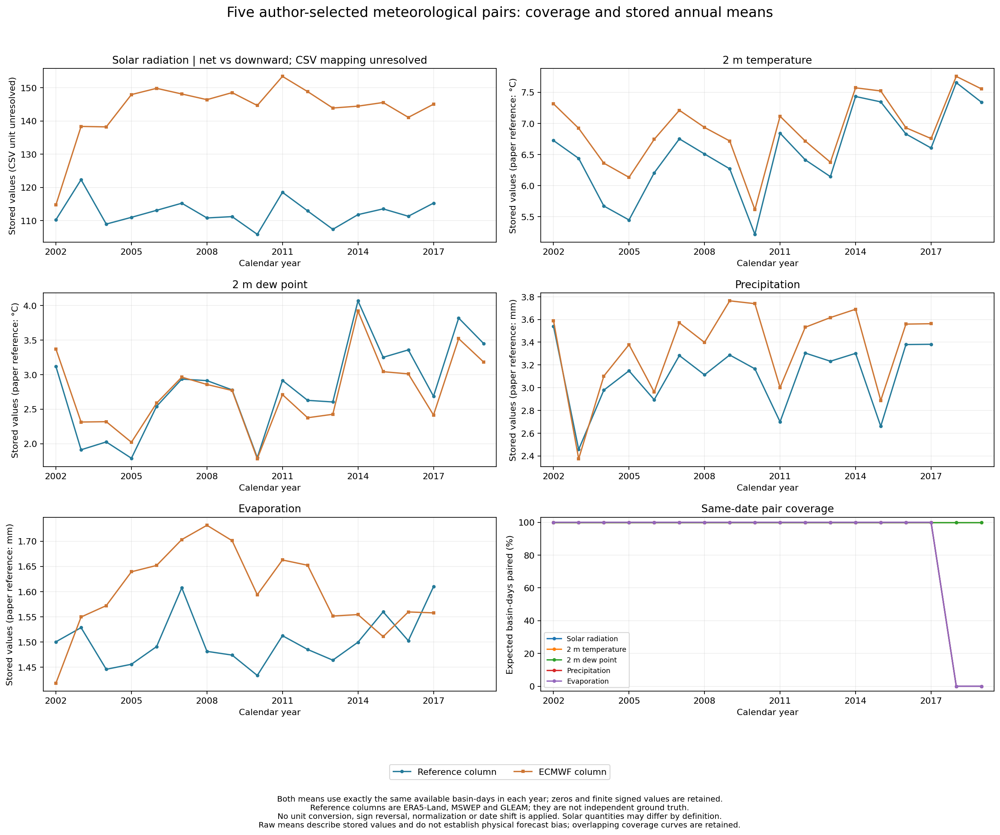

Hình đọc rõ, không thấy chữ chồng/cắt; các đường độ phủ chồng nhau vì có cùng số cặp, không phải bỏ biến. Mean năm của ba cặp kết thúc 2017 không nối thành số 0 ở 2018–2019. Các mean bức xạ cách xa nhau từ 2003 hơn năm 2002 trên hình; chưa xác định nguyên nhân hoặc gọi đó là đổi hệ thống. Thang y của từng panel khác nhau, không dùng độ cao đường để xếp hạng chéo biến. Hình gốc được giữ nguyên; các CSV chi tiết vẫn chờ nhận.

Phạm vi ghép đã rõ. Phép đo tiếp theo tách từng lưu vực/kỳ để phân biệt khoảng cách phân phối với sai khác cùng ngày, giữ giới hạn ngữ nghĩa/đơn vị và không chuẩn hóa theo test.

### 20.2. Cell 6.2 — phân phối ghép và diễn biến cùng ngày theo lưu vực/kỳ

Cell đọc lại đúng mười cột, ghép cùng ngày–ID như 6.1, giữ số hữu hạn khác −999 kể cả âm/0. Mỗi ID/cặp/kỳ phải khớp số cặp, lịch kỳ vọng và tổng giá trị hai phía với 6.1; thay đổi nguồn phải dừng. Chỉ đo train/validation/test, không gộp 2002 hay 2018–2019 vào kỳ khác. Không dùng ngày thiếu để điền 0 hoặc xếp trạm/mô hình.

Các chỉ số raw là mean forecast−đối chiếu, MAE, RMSE, Wasserstein-1 và Pearson r. W1 mô tả phân phối, bỏ thứ tự thời gian; MAE/RMSE/r dùng cùng ngày đã ghép. Với hai dãy cùng n và trọng số đều, W1 bằng mean khoảng cách tuyệt đối giữa hai dãy sắp xếp. Cell đối chiếu từng kết quả với [scipy.stats.wasserstein_distance](https://docs.scipy.org/doc/scipy/reference/generated/scipy.stats.wasserstein_distance.html), đồng thời kiểm |mean delta| ≤ W1 ≤ MAE ≤ RMSE với dung sai số. Không dùng min–max của hai nguồn như nhánh normalize trong mã tác giả. Đây là chẩn đoán giá trị lưu trữ; đặc biệt W1/MAE/RMSE bức xạ chỉ có nghĩa số học trên hai cột, chưa là khoảng cách giữa cùng đại lượng vật lý.

Không có cặp thì các chỉ số giữ NaN. Pearson r chỉ có khi ít nhất hai cặp và cả hai dãy không hằng; trạng thái không xác định được ghi riêng. Không đặt r=0 cho chuỗi hằng, không kiểm định ý nghĩa độc lập của ngày/lưu vực. Các min/p01/p05/median/p95/p99/max được tính riêng trên hai phía và hiệu cùng ngày, không phải hiệu của phân vị hai phía.

Bảng tổng hợp báo p05/median/p95 **ngang chỉ số từng lưu vực**, mỗi ID trọng số bằng nhau; số ID có chỉ số và số cặp báo riêng. Bảng median ngang các phân vị ID cũng không phải phân vị của ngày gộp. Hình A1_P6_pair_distributions_by_period.png gồm năm hàng, mỗi hàng ECDF W1 raw và Pearson r của train/validation/test; nhãn n theo từng metric, các mức trùng có bước nhảy đúng tổng số ID. Trục W1 riêng từng cặp, không xếp hạng khoảng cách chéo đơn vị hoặc chọn mô hình bằng test.

Năm CSV A1_P6_: pair_metrics_by_basin_period, pair_quantiles_by_basin_period, pair_metric_summary, pair_quantile_summary, pair_metric_checks. Bảng in (1) tổng hợp chỉ số, (2) median ngang phân vị ID, (3) các phép kiểm/correlation undefined, (4) tối đa ba ID có W1 lớn nhất mỗi cặp trong test để đọc hồ sơ. Các ca test này là mô tả, không phải danh sách loại hoặc tiêu chí chọn mô hình. Mã đã kiểm giả lập gồm hoán vị ngày giữ W1=0 trong khi MAE>0, dịch hằng, số âm/0, cặp rỗng, r không xác định khi hằng, phân vị/mean/MAE tính độc lập và nguồn khác 6.1 phải dừng. Hình giả lập đã xem; Kết quả thực tế 6.2 được ghi dưới đây.

#### 20.2.1. Kết quả thực tế và kiểm số học

Cell 6.2 đọc **451 ID**, thời gian **68,5 giây**, xuất hình và năm CSV trên Kaggle. Hình gốc đã nhận và được giữ nguyên; năm CSV chi tiết chưa nhận cục bộ. Các bảng tại mục này chép số từ output in, dùng dấu chấm thập phân để đối chiếu trực tiếp, không thay thế các CSV từng ID.

Mỗi một trong **15 tổ hợp cặp×kỳ** có đủ 451/451 lưu vực và số cặp đúng 6.1: train 1153207, validation/test 658911 mỗi kỳ. Có 6765 dòng chỉ số ID×cặp×kỳ; không có ID thiếu cặp hoặc r không xác định. W1 hai cách tính đều khớp, và |mean delta| ≤ W1 ≤ MAE ≤ RMSE đều đạt kiểm số cho từng tổ hợp trong mã. Không có cảnh báo dữ liệu mới ngoài giới hạn đại lượng/đơn vị bức xạ.

#### 20.2.2. Phân phối chỉ số ngang lưu vực

Các phân vị sau tính **ngang chỉ số từng lưu vực**, mỗi ID trọng số bằng nhau; mọi hàng đều có n=451. Mean delta dùng forecast−đối chiếu. Các khoảng cách vẫn mang thang raw của cột lưu trữ; **Pearson r không có đơn vị**. Đây không phải mean/MAE/RMSE tính trên toàn bộ ngày gộp và không xếp hạng khoảng cách chéo đơn vị.

| Cặp | Kỳ | Median mean_delta | W1 p05 | W1 median | W1 p95 | MAE median | RMSE median | r p05 | r median | r p95 |
|---|---|---|---|---|---|---|---|---|---|---|
| solar | train | 27.376406 | 23.680602 | 27.488608 | 64.409140 | 29.918631 | 37.536894 | 0.825493 | 0.959826 | 0.969136 |
| solar | validation | 31.157673 | 26.230856 | 31.157673 | 74.815445 | 32.037810 | 38.524868 | 0.845175 | 0.971678 | 0.978361 |
| solar | test | 26.149822 | 21.017081 | 26.163005 | 67.496030 | 27.473566 | 34.139534 | 0.833096 | 0.976999 | 0.985294 |
| temperature | train | 0.439433 | 0.132655 | 0.515729 | 1.809249 | 0.865092 | 1.163675 | 0.982411 | 0.992032 | 0.995772 |
| temperature | validation | 0.185695 | 0.121804 | 0.313196 | 1.365236 | 0.698323 | 0.958107 | 0.986959 | 0.994477 | 0.996917 |
| temperature | test | 0.099487 | 0.116352 | 0.273285 | 0.879203 | 0.646304 | 0.884295 | 0.984263 | 0.994271 | 0.997628 |
| dewpoint | train | 0.037536 | 0.134194 | 0.421893 | 1.342153 | 0.810583 | 1.080398 | 0.982650 | 0.991814 | 0.994231 |
| dewpoint | validation | -0.215838 | 0.164747 | 0.348549 | 0.746020 | 0.716674 | 0.946176 | 0.989163 | 0.993915 | 0.996156 |
| dewpoint | test | -0.248706 | 0.141057 | 0.320856 | 0.837040 | 0.656010 | 0.871114 | 0.987001 | 0.993829 | 0.996013 |
| precipitation | train | 0.165679 | 0.190506 | 0.459116 | 1.143283 | 1.712260 | 3.760636 | 0.736631 | 0.805085 | 0.842707 |
| precipitation | validation | 0.219309 | 0.253036 | 0.579295 | 1.490414 | 1.781711 | 3.645287 | 0.753988 | 0.828564 | 0.879145 |
| precipitation | test | 0.207926 | 0.272485 | 0.610623 | 1.389141 | 1.752786 | 3.589615 | 0.773656 | 0.833226 | 0.869420 |
| evaporation | train | 0.133101 | 0.068524 | 0.165436 | 0.479435 | 0.446132 | 0.599397 | 0.856618 | 0.900324 | 0.931188 |
| evaporation | validation | 0.137522 | 0.086420 | 0.191923 | 0.481944 | 0.429555 | 0.590717 | 0.857486 | 0.910356 | 0.945712 |
| evaporation | test | -0.008029 | 0.083039 | 0.201834 | 0.382721 | 0.432272 | 0.586459 | 0.836428 | 0.899123 | 0.944450 |

Nhiệt độ và điểm sương có r trung vị khoảng 0,992–0,994 nhưng vẫn có chênh mean và sai khác từng ngày. Nhiệt độ có W1 trung vị 0,515729 → 0,313196 → 0,273285, MAE trung vị 0,865092 → 0,698323 → 0,646304 qua ba kỳ. Các số mô tả phạm vi đã đo; chưa chứng minh hệ thống forecast đã cải tiến vì các kỳ còn khác thời tiết/phân phối và phiên bản nguồn chưa truy đầy đủ. Tương quan trên giá trị có mùa chưa tách khả năng tái hiện mùa khỏi biến thiên bất thường từng ngày.

Ở **mưa**, r trung vị tăng 0,805085 → 0,828564 → 0,833226 trong khi W1 trung vị cũng tăng 0,459116 → 0,579295 → 0,610623. Đây là hai khía cạnh khác nhau: thứ tự ngày có thể khớp hơn trong khi phân phối biên xa hơn. Không gọi việc tăng một chỉ số là mọi mặt cùng tốt hơn. MAE trung vị test 1,752786 vẫn lớn hơn W1 trung vị 0,610623; không suy tỷ số này là tỷ phần sai số do thời gian vì đây là tỷ số giữa các median, không phải phân rã sai số.

Ở **ET**, mean gộp hai nguồn tại test trong 6.1 chỉ chênh khoảng +0,002721 nhưng 6.2 có median mean_delta −0,008029, W1 median 0,201834, MAE median 0,432272, RMSE median 0,586459 và r median 0,899123. Không mâu thuẫn giữa hai dấu: 6.1 lấy mean ngày gộp, 6.2 lấy median của mean từng ID. Mean gần nhau không bảo đảm đúng phân phối hoặc từng ngày; chưa biết mức triệt tiêu theo tháng/ID cho tới phép kiểm tháng.

Bức xạ có r median 0,959826/0,971678/0,976999 và W1 median 27,488608/31,157673/26,163005 trên giá trị lưu trữ. Net/downward vẫn khác định nghĩa và đơn vị CSV chưa xác nhận; r cao không chứng minh cặp cùng đại lượng, W1 không được diễn giải thành bias dự báo vật lý.

#### 20.2.3. Median ngang phân vị từng ID

Mỗi hàng dưới đây là median của 451 giá trị cùng loại phân vị, không phải phân vị gộp mọi ngày hoặc phân phối của một ID đại diện. Riêng forecast_minus_reference lấy hiệu **cùng ngày trước khi tính phân vị**. Không lấy hiệu median/quantile hai nguồn để thay cho phân vị hiệu. min/max trong bảng cũng là median ngang min/max của ID, không phải min/max toàn mạng.

| Cặp | Kỳ | Phía | min | p01 | p05 | median | p95 | p99 | max |
|---|---|---|---|---|---|---|---|---|---|
| dewpoint | test | forecast | -17.85 | -11.8100 | -7.200 | 4.42 | 14.560 | 16.4940 | 18.07 |
| dewpoint | test | forecast_minus_reference | -5.38 | -2.2540 | -1.460 | -0.22 | 0.870 | 1.4980 | 3.20 |
| dewpoint | test | reference | -17.40 | -11.3400 | -6.600 | 4.70 | 14.800 | 16.6000 | 18.10 |
| dewpoint | train | forecast | -18.89 | -13.3252 | -9.042 | 3.84 | 14.342 | 16.0232 | 18.01 |
| dewpoint | train | forecast_minus_reference | -4.36 | -2.2700 | -1.460 | -0.02 | 1.630 | 2.8520 | 5.22 |
| dewpoint | train | reference | -20.20 | -14.2000 | -9.600 | 4.10 | 14.500 | 16.1000 | 17.70 |
| dewpoint | validation | forecast | -22.64 | -15.1520 | -10.180 | 3.83 | 14.680 | 16.6820 | 18.27 |
| dewpoint | validation | forecast_minus_reference | -3.83 | -2.2960 | -1.540 | -0.22 | 1.130 | 1.9980 | 3.96 |
| dewpoint | validation | reference | -21.40 | -14.9400 | -10.000 | 4.30 | 14.700 | 16.7000 | 18.40 |
| evaporation | test | forecast | -0.25 | 0.0060 | 0.110 | 1.33 | 3.840 | 4.4140 | 4.86 |
| evaporation | test | forecast_minus_reference | -2.84 | -1.5180 | -0.890 | -0.02 | 0.920 | 1.2840 | 1.83 |
| evaporation | test | reference | 0.02 | 0.0900 | 0.210 | 1.39 | 3.720 | 4.3920 | 5.24 |
| evaporation | train | forecast | -0.47 | 0.0000 | 0.160 | 1.47 | 3.912 | 4.3500 | 4.98 |
| evaporation | train | forecast_minus_reference | -2.45 | -1.3188 | -0.752 | 0.13 | 1.020 | 1.5196 | 2.45 |
| evaporation | train | reference | -0.04 | 0.0000 | 0.080 | 1.34 | 3.780 | 4.4600 | 5.37 |
| evaporation | validation | forecast | -0.33 | -0.0100 | 0.120 | 1.42 | 3.960 | 4.4640 | 5.09 |
| evaporation | validation | forecast_minus_reference | -2.31 | -1.2420 | -0.710 | 0.08 | 1.070 | 1.5720 | 2.26 |
| evaporation | validation | reference | -0.03 | 0.0160 | 0.100 | 1.32 | 3.800 | 4.4360 | 5.34 |
| precipitation | test | forecast | 0.00 | 0.0000 | 0.000 | 0.79 | 14.880 | 26.2960 | 50.66 |
| precipitation | test | forecast_minus_reference | -30.21 | -11.8020 | -4.140 | 0.04 | 4.580 | 9.5540 | 23.86 |
| precipitation | test | reference | 0.00 | 0.0000 | 0.000 | 0.31 | 15.020 | 28.0760 | 62.00 |
| precipitation | train | forecast | 0.00 | 0.0000 | 0.000 | 0.73 | 14.346 | 28.2568 | 69.01 |
| precipitation | train | forecast_minus_reference | -32.59 | -10.2000 | -4.152 | 0.01 | 4.654 | 11.7344 | 40.92 |
| precipitation | train | reference | 0.00 | 0.0000 | 0.000 | 0.45 | 13.908 | 25.2568 | 62.03 |
| precipitation | validation | forecast | 0.00 | 0.0000 | 0.000 | 0.81 | 15.270 | 28.1580 | 50.76 |
| precipitation | validation | forecast_minus_reference | -30.57 | -11.9000 | -4.130 | 0.06 | 4.900 | 10.6740 | 25.75 |
| precipitation | validation | reference | 0.00 | 0.0000 | 0.000 | 0.31 | 15.380 | 28.8900 | 62.88 |
| solar | test | forecast | 6.00 | 12.9760 | 25.780 | 128.26 | 293.000 | 325.8380 | 336.96 |
| solar | test | forecast_minus_reference | -48.30 | -16.7440 | -3.690 | 23.52 | 64.790 | 81.7820 | 116.76 |
| solar | test | reference | 5.00 | 11.0000 | 20.000 | 102.00 | 242.000 | 272.4000 | 288.00 |
| solar | train | forecast | 0.98 | 8.9896 | 24.056 | 135.63 | 288.974 | 321.8464 | 342.00 |
| solar | train | forecast_minus_reference | -78.53 | -27.9932 | -8.798 | 24.04 | 72.906 | 96.5060 | 142.00 |
| solar | train | reference | 5.00 | 11.0000 | 20.000 | 102.00 | 240.000 | 268.4400 | 286.00 |
| solar | validation | forecast | 4.27 | 12.8080 | 28.200 | 135.08 | 293.000 | 326.8160 | 342.38 |
| solar | validation | forecast_minus_reference | -43.57 | -13.2320 | -1.000 | 28.59 | 70.730 | 91.6680 | 131.52 |
| solar | validation | reference | 4.00 | 10.0000 | 20.000 | 99.00 | 243.000 | 272.2000 | 289.00 |
| temperature | test | forecast | -12.94 | -7.7400 | -3.080 | 8.31 | 20.110 | 22.9480 | 25.47 |
| temperature | test | forecast_minus_reference | -2.70 | -1.5440 | -1.000 | 0.05 | 1.440 | 2.6420 | 4.81 |
| temperature | test | reference | -12.80 | -8.2200 | -3.300 | 8.30 | 20.000 | 22.7400 | 24.90 |
| temperature | train | forecast | -14.43 | -8.9556 | -5.436 | 8.00 | 19.800 | 22.1676 | 25.85 |
| temperature | train | forecast_minus_reference | -3.75 | -1.6964 | -0.982 | 0.37 | 2.130 | 3.4744 | 5.89 |
| temperature | train | reference | -16.40 | -10.2880 | -6.000 | 7.70 | 19.300 | 21.8000 | 24.70 |
| temperature | validation | forecast | -15.80 | -10.7400 | -6.300 | 7.80 | 19.770 | 22.9940 | 25.29 |
| temperature | validation | forecast_minus_reference | -3.04 | -1.6640 | -1.010 | 0.11 | 1.660 | 2.9520 | 5.21 |
| temperature | validation | reference | -15.80 | -11.1400 | -6.500 | 7.70 | 19.700 | 22.8000 | 25.10 |

Chẳng hạn ở mưa test, median ngang median của forecast là 0,79 so với 0,31 phía MSWEP, nhưng median ngang p99 forecast 26,296 thấp hơn 28,076 phía đối chiếu; tại train thứ tự p99 ngược lại (28,2568 so với 25,2568). Các thống kê không phù hợp cách mô tả chỉ bằng một độ dịch mean cố định. Chưa dùng chúng để suy ngày mưa vật lý, đỉnh sự kiện, hiệu chỉnh lượng mưa hoặc chất lượng quan trắc độc lập.

#### 20.2.4. Các ca W1 test lớn nhất trong từng cặp

Mọi hàng là kỳ test, đủ **1461/1461 cặp**, correlation_status=defined. Ba ID/cặp được chọn theo W1 raw để đọc hồ sơ, không phải danh sách lọc hoặc tiêu chí chọn mô hình.

| ID | Cặp | Mean đối chiếu | Mean forecast | Mean delta | MAE | RMSE | W1 | r |
|---|---|---|---|---|---|---|---|---|
| 57 | dewpoint | -4.345380 | -5.816721 | -1.471342 | 1.652656 | 2.191252 | 1.471342 | 0.983218 |
| 539 | dewpoint | -0.091102 | -1.473107 | -1.382005 | 1.483854 | 1.832777 | 1.382005 | 0.990048 |
| 68 | dewpoint | -0.287680 | -1.662402 | -1.374723 | 1.494339 | 1.757463 | 1.374723 | 0.989576 |
| 17 | evaporation | 1.377187 | 1.874798 | 0.497611 | 0.650712 | 0.822972 | 0.542868 | 0.944551 |
| 692 | evaporation | 1.363525 | 1.699384 | 0.335859 | 0.644689 | 0.827077 | 0.505483 | 0.898644 |
| 265 | evaporation | 1.162307 | 1.590575 | 0.428268 | 0.613060 | 0.818939 | 0.502738 | 0.932580 |
| 24 | precipitation | 4.150999 | 6.097372 | 1.946372 | 2.767454 | 4.879844 | 1.973970 | 0.846136 |
| 23 | precipitation | 4.317728 | 6.227029 | 1.909302 | 2.695188 | 4.900882 | 1.935585 | 0.851148 |
| 478 | precipitation | 5.243183 | 3.627317 | -1.615866 | 3.011280 | 7.008443 | 1.882930 | 0.792975 |
| 56 | solar | 46.546201 | 176.868474 | 130.322272 | 130.322272 | 146.549443 | 130.322272 | 0.859238 |
| 47 | solar | 66.595483 | 179.627632 | 113.032149 | 113.032149 | 127.808226 | 113.032149 | 0.844531 |
| 112 | solar | 52.101300 | 162.495907 | 110.394606 | 110.394606 | 126.061643 | 110.394606 | 0.790957 |
| 265 | temperature | 4.608966 | 6.197132 | 1.588166 | 1.639172 | 2.015569 | 1.588166 | 0.985624 |
| 83 | temperature | 2.811362 | 4.209439 | 1.398077 | 1.463429 | 1.846563 | 1.398077 | 0.987675 |
| 92 | temperature | 5.161259 | 6.338816 | 1.177556 | 1.221636 | 1.514801 | 1.177556 | 0.992046 |

Ba ID có W1 bức xạ lớn nhất là 56/47/112; cũng là ba ID có SWE cực đại cao nhất tại 5.10 (thứ tự SWE là 56/112/47). Đây là trùng danh sách quan sát được, chưa xác nhận quan hệ nhân quả giữa SWE/albedo/độ cao và chênh bức xạ. Ở cả ba ID, mean_delta=MAE=W1 đến sáu chữ số được in. Phép đếm từng ngày tại 6.3 xác nhận forecast>đối chiếu ở mọi 1461 ngày test của từng ID; riêng bảng làm tròn 6.2 không đủ để suy dấu từng ngày.

Ở nhiệt độ, các ca W1 lớn vẫn có r khoảng 0,986–0,992 cùng chênh mean dương 1,18–1,59 raw; r cao không loại trừ chênh mức. Điểm sương có ba ca chênh mean âm khoảng −1,37 đến −1,47. Mưa gồm hai ca dương (24/23) và một ca âm (478), nên chênh toàn mạng chưa đại diện cho mọi lưu vực. Không dùng các dấu này để quyết định hiệu chỉnh trên test.

#### 20.2.5. Hình và giới hạn diễn giải

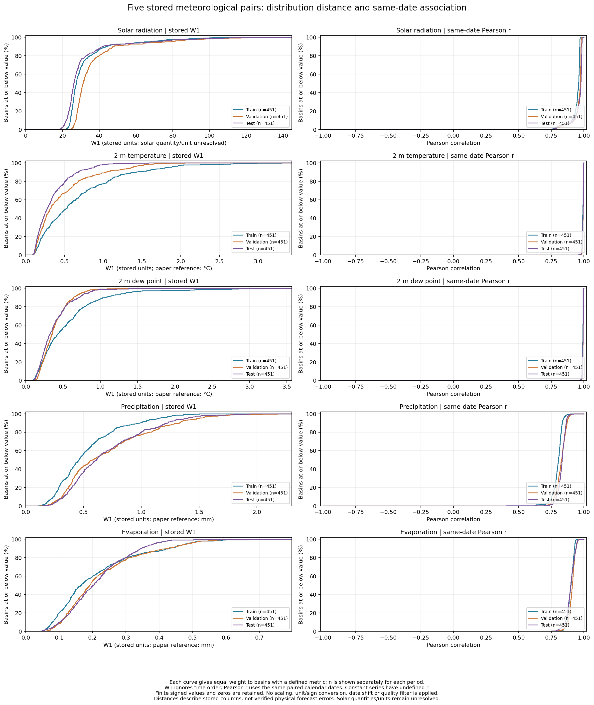

Hình đủ năm cặp và ba kỳ, không thấy chữ cắt/chồng. Các trục W1 riêng từng cặp, đúng giới hạn đơn vị. Trục r giữ −1 đến 1 nên đường nhiệt độ/điểm sương tập trung gần mép phải; bảng số cần dùng để đọc khác biệt nhỏ. Mỗi ECDF có n=451, không có loại ID theo thiếu/r. Tương quan cao và W1 nhỏ vẫn chưa là kiểm chứng dự báo vật lý độc lập hoặc xác nhận ngữ nghĩa nguồn.

### 20.3. Cell 6.3 — chênh theo tháng và dấu ở các ca W1 lớn

Cell dùng cùng năm cặp và ba kỳ, tách 12 tháng lịch của từng kỳ; mỗi tháng gộp các năm thuộc đúng kỳ đó. Giữ số hữu hạn khác −999, cả âm/0. Mỗi ID×cặp×kỳ được tính lại toàn bộ chỉ số và so với 6.2; lịch/số cặp hoặc chỉ số khác phải dừng. Không lấy các năm ngoài kỳ, điền số hoặc dịch ngày.

Mỗi tháng tính mean_delta, W1, MAE, RMSE, r bằng cùng helper 6.2 và đếm delta>0, delta<0, delta=0 với delta=forecast−đối chiếu theo giá trị lưu trữ. Ba loại dấu phải cộng khớp số cặp. Cộng đủ 12 tháng phải khớp lịch và n cả kỳ; mean/MAE gộp theo trọng số n, RMSE qua tổng bình phương có trọng số phải tái tạo chỉ số 6.2. Không dùng trung bình W1 tháng hoặc trung bình r tháng để thay chỉ số cả kỳ. Không cặp giữ NaN, chuỗi hằng/tháng quá ít cặp giữ r không xác định; bảng kiểm ghi số tháng r không xác định riêng.

Bảng tháng báo p05/p25/median/p75/p95 ngang chỉ số ID với số ID có chỉ số riêng. Hình A1_P6_pair_monthly_differences.png có năm hàng: median mean_delta theo tháng ở trái và median W1 tháng ở phải; ba đường train/validation/test, dải IQR chỉ của test. Mỗi ID trọng số bằng nhau; dải là phân tán giữa lưu vực, không phải khoảng tin cậy. Các kỳ 7/4/4 năm khác độ dài, không suy thay đổi hệ thống hay cơ chế mùa từ khác đường. Thang raw từng cặp, giữ giới hạn net/downward và đơn vị bức xạ chưa giải quyết.

Các ca dấu lấy đúng ba ID W1 lớn mỗi cặp ở test theo 6.2, đếm lại từ toàn bộ ngày chứ không suy từ các mean đã làm tròn. Các ca này chỉ mô tả, không chọn quy tắc xử lý/mô hình bằng test. Năm CSV A1_P6_: pair_monthly_by_basin, pair_monthly_summary, pair_monthly_checks, pair_monthly_check_summary, pair_sign_cases. Bảng in (1) kiểm cộng tháng, (2) median mean_delta từng tháng/kỳ, (3) W1/MAE/r tháng ở test, (4) số ngày theo dấu ở các ca test. Mã đã kiểm giả lập 360 dòng ID×cặp×kỳ×tháng, năm nhuận, thiếu/sentinel, âm/0, tháng hằng, W1/mean/MAE/dấu tính độc lập, gộp có trọng số và dừng khi chỉ số 6.2 thay đổi; hình giả lập đã xem. Kết quả thực tế 6.3 được ghi dưới đây.

#### 20.3.1. Kết quả thực tế, lịch tháng và kiểm cộng lại

Cell 6.3 chạy **113,0 giây**. Đã nhận hình và nguyên văn bảng (1)–(4); bản văn nguồn giữ tại [A1_P6_pair_monthly_output.txt](Tables/A1_P6_pair_monthly_output.txt). Năm CSV chi tiết đã xuất trên Kaggle nhưng chưa nhận cục bộ; các bảng Markdown dưới đây chép trực tiếp từ bản văn, không thay thế CSV từng ID. Hình và bản văn được sao chép nguyên byte, không chỉnh ảnh hoặc dựng lại tệp nguồn từ số tóm tắt.

Mỗi một trong 15 tổ hợp cặp×kỳ có đủ 451 ID, không tháng rỗng và không tháng có r không xác định. Đây là 81180 dòng chỉ số ID×cặp×kỳ×tháng theo kích thước phép đo. Số cặp, mean/MAE/RMSE cộng đúng trọng số tháng đều khớp 6.2; sai khác gộp lớn nhất ở bức xạ là 5,684342×10⁻¹⁴ raw, các cặp khác tối đa 3,552714×10⁻¹⁵, phù hợp sai số số học. Không gộp W1/r tháng thành W1/r cả kỳ.

| Cặp | Kỳ | ID | Lịch kỳ vọng | Cặp | Tháng rỗng | Tháng r undefined | Max sai khác gộp raw | Khớp 6.2 | Gộp tháng đạt | Dấu cộng đạt |
|---|---|---|---|---|---|---|---|---|---|---|
| dewpoint | test | 451 | 658911 | 658911 | 0 | 0 | 2.664535e-15 | True | True | True |
| dewpoint | train | 451 | 1153207 | 1153207 | 0 | 0 | 2.220446e-15 | True | True | True |
| dewpoint | validation | 451 | 658911 | 658911 | 0 | 0 | 2.664535e-15 | True | True | True |
| evaporation | test | 451 | 658911 | 658911 | 0 | 0 | 8.881784e-16 | True | True | True |
| evaporation | train | 451 | 1153207 | 1153207 | 0 | 0 | 6.661338e-16 | True | True | True |
| evaporation | validation | 451 | 658911 | 658911 | 0 | 0 | 8.881784e-16 | True | True | True |
| precipitation | test | 451 | 658911 | 658911 | 0 | 0 | 1.776357e-15 | True | True | True |
| precipitation | train | 451 | 1153207 | 1153207 | 0 | 0 | 1.776357e-15 | True | True | True |
| precipitation | validation | 451 | 658911 | 658911 | 0 | 0 | 1.776357e-15 | True | True | True |
| solar | test | 451 | 658911 | 658911 | 0 | 0 | 5.684342e-14 | True | True | True |
| solar | train | 451 | 1153207 | 1153207 | 0 | 0 | 5.684342e-14 | True | True | True |
| solar | validation | 451 | 658911 | 658911 | 0 | 0 | 5.684342e-14 | True | True | True |
| temperature | test | 451 | 658911 | 658911 | 0 | 0 | 3.552714e-15 | True | True | True |
| temperature | train | 451 | 1153207 | 1153207 | 0 | 0 | 3.552714e-15 | True | True | True |
| temperature | validation | 451 | 658911 | 658911 | 0 | 0 | 3.552714e-15 | True | True | True |

Ở test 2014–2017, mỗi tháng 31 ngày có 55924 cặp, mỗi tháng 30 ngày có 54120, tháng 2 có 50963 (113 ngày qua bốn năm, gồm 29/02/2016). Cộng 12 tháng là 658911/cặp nguồn. Mọi tháng test có đủ 451 ID và 451 r xác định.

#### 20.3.2. Chênh theo tháng: median ngang mean của ID

Dấu là forecast−đối chiếu. Mỗi ID được tính mean tháng trên các năm của đúng kỳ, sau đó lấy median ngang 451 ID. Đơn vị vẫn là thang raw; không gọi chênh bức xạ là bias vật lý. Bảng giữ dấu chấm thập phân để đối chiếu nguyên văn output.

| Cặp | Tháng | Train | Validation | Test |
|---|---|---|---|---|
| dewpoint | 1 | 0.498618 | -0.074597 | -0.287016 |
| dewpoint | 2 | 0.468434 | -0.199115 | -0.334513 |
| dewpoint | 3 | 0.281797 | -0.186129 | -0.261613 |
| dewpoint | 4 | -0.094286 | -0.175250 | -0.232417 |
| dewpoint | 5 | -0.292719 | -0.212016 | -0.156129 |
| dewpoint | 6 | -0.312810 | -0.094167 | -0.061083 |
| dewpoint | 7 | -0.228710 | -0.023629 | -0.078306 |
| dewpoint | 8 | -0.218802 | -0.184597 | -0.232581 |
| dewpoint | 9 | -0.205619 | -0.371417 | -0.315167 |
| dewpoint | 10 | -0.080691 | -0.418306 | -0.305484 |
| dewpoint | 11 | 0.057381 | -0.452250 | -0.329083 |
| dewpoint | 12 | 0.210230 | -0.293468 | -0.515968 |
| evaporation | 1 | 0.045991 | -0.050806 | -0.180484 |
| evaporation | 2 | 0.174596 | -0.015133 | -0.139027 |
| evaporation | 3 | 0.116866 | 0.003548 | -0.233306 |
| evaporation | 4 | -0.040143 | -0.013000 | -0.150500 |
| evaporation | 5 | 0.077465 | 0.195403 | 0.108629 |
| evaporation | 6 | 0.330190 | 0.325083 | 0.241583 |
| evaporation | 7 | 0.335853 | 0.469839 | 0.357258 |
| evaporation | 8 | 0.371014 | 0.520403 | 0.359194 |
| evaporation | 9 | 0.173619 | 0.239917 | 0.140000 |
| evaporation | 10 | 0.105899 | 0.098306 | 0.011210 |
| evaporation | 11 | -0.007286 | -0.049667 | -0.128500 |
| evaporation | 12 | -0.046406 | -0.163548 | -0.306129 |
| precipitation | 1 | 0.135991 | 0.246935 | 0.457258 |
| precipitation | 2 | 0.292879 | 0.330708 | 0.409912 |
| precipitation | 3 | 0.268848 | 0.410968 | 0.442016 |
| precipitation | 4 | 0.141714 | 0.477667 | 0.561833 |
| precipitation | 5 | 0.205899 | 0.312339 | 0.270806 |
| precipitation | 6 | 0.372571 | 0.262750 | -0.148917 |
| precipitation | 7 | 0.230968 | 0.344032 | -0.253226 |
| precipitation | 8 | 0.400553 | -0.104194 | -0.067823 |
| precipitation | 9 | -0.003762 | 0.049333 | 0.274667 |
| precipitation | 10 | 0.069171 | 0.155242 | 0.145403 |
| precipitation | 11 | 0.068381 | 0.257667 | 0.436500 |
| precipitation | 12 | 0.047696 | 0.439919 | 0.266210 |
| solar | 1 | 13.131982 | 20.183710 | 15.845403 |
| solar | 2 | 27.882172 | 35.518850 | 26.954248 |
| solar | 3 | 40.473825 | 42.598145 | 28.810000 |
| solar | 4 | 35.416619 | 36.029000 | 33.269917 |
| solar | 5 | 37.953548 | 39.775323 | 39.515968 |
| solar | 6 | 38.799905 | 42.913833 | 39.025250 |
| solar | 7 | 35.676037 | 43.686048 | 36.408710 |
| solar | 8 | 30.844009 | 38.188871 | 32.715242 |
| solar | 9 | 23.186905 | 27.489250 | 21.787667 |
| solar | 10 | 20.439171 | 22.238871 | 16.481613 |
| solar | 11 | 13.097762 | 12.893167 | 10.475167 |
| solar | 12 | 12.365161 | 14.511129 | 9.781290 |
| temperature | 1 | 0.724055 | 0.427500 | 0.270161 |
| temperature | 2 | 0.596061 | 0.414956 | 0.183982 |
| temperature | 3 | 0.588065 | 0.346371 | 0.129758 |
| temperature | 4 | 0.412571 | 0.236250 | 0.061667 |
| temperature | 5 | 0.508295 | 0.136371 | 0.075726 |
| temperature | 6 | 0.461381 | 0.215333 | 0.051250 |
| temperature | 7 | 0.385899 | 0.146452 | 0.038952 |
| temperature | 8 | 0.292903 | 0.064839 | 0.039194 |
| temperature | 9 | 0.208952 | -0.009833 | 0.020083 |
| temperature | 10 | 0.254608 | 0.061129 | -0.012258 |
| temperature | 11 | 0.171524 | -0.045667 | 0.082500 |
| temperature | 12 | 0.375806 | 0.244274 | 0.248468 |

**ET test có đổi dấu theo mùa trong median chênh:** âm tháng 11–4, dương tháng 5–10; tháng 12 là −0,306129, tháng 7/8 là +0,357258/+0,359194. Mean gộp test gần 0 trong 6.1 chưa đủ mô tả các tháng. Các median tháng không cộng thành mean ngày gộp, nên không dùng riêng đường median này để tính lượng triệt tiêu chính xác toàn mạng hoặc suy cơ chế mùa.

Điểm sương test có median mean_delta âm ở cả 12 tháng, từ −0,515968 (12) đến −0,061083 (6); validation cũng âm ở mọi tháng. Train dương tháng 11–3 và âm tháng 4–10. Nhiệt độ train có median chênh dương cả 12 tháng; test đa số gần 0 hơn, tháng 10 là −0,012258 và tháng 1/12 là +0,270161/+0,248468. Khác kỳ chưa chứng minh hệ thống đã cải tiến hoặc xác nhận thay phiên bản dữ liệu.

Mưa test có median chênh âm tháng 6/7/8 (−0,148917/−0,253226/−0,067823), dương ở chín tháng còn lại, lớn nhất tháng 4 (+0,561833). Train và validation có mẫu dấu tháng khác. Các số chưa thể thay cho hiệu chỉnh cộng một hằng số chung, mô tả đúng/sai từng lưu vực hoặc đỉnh sự kiện. Bức xạ có median chênh dương mọi tháng ở cả ba kỳ; tại test từ 9,781290 (12) đến 39,515968 (5), vẫn giữ giới hạn net/downward và đơn vị CSV.

#### 20.3.3. W1, MAE và r tháng ở test

Các median vẫn lấy ngang ID, không phải metric gộp mọi ngày. Pearson r không có đơn vị; W1/MAE trên thang raw từng cặp.

| Cặp | Tháng | Cặp ngày–ID | ID có cặp | W1 median | MAE median | ID có r | r median |
|---|---|---|---|---|---|---|---|
| solar | 1 | 55924 | 451 | 15.865161 | 16.500161 | 451 | 0.893613 |
| solar | 2 | 50963 | 451 | 26.981327 | 27.468938 | 451 | 0.920017 |
| solar | 3 | 55924 | 451 | 28.810000 | 30.416452 | 451 | 0.945931 |
| solar | 4 | 54120 | 451 | 33.392750 | 34.902583 | 451 | 0.925719 |
| solar | 5 | 55924 | 451 | 39.598065 | 41.024194 | 451 | 0.950687 |
| solar | 6 | 54120 | 451 | 39.181583 | 40.148083 | 451 | 0.944439 |
| solar | 7 | 55924 | 451 | 36.416774 | 37.899194 | 451 | 0.946914 |
| solar | 8 | 55924 | 451 | 32.727984 | 34.115806 | 451 | 0.952913 |
| solar | 9 | 54120 | 451 | 21.869500 | 24.103667 | 451 | 0.938370 |
| solar | 10 | 55924 | 451 | 16.590161 | 18.145565 | 451 | 0.934757 |
| solar | 11 | 54120 | 451 | 10.511333 | 12.629167 | 451 | 0.916979 |
| solar | 12 | 55924 | 451 | 9.929194 | 10.665565 | 451 | 0.887172 |
| temperature | 1 | 55924 | 451 | 0.457661 | 0.912581 | 451 | 0.963535 |
| temperature | 2 | 50963 | 451 | 0.414779 | 0.738584 | 451 | 0.955148 |
| temperature | 3 | 55924 | 451 | 0.328790 | 0.637177 | 451 | 0.972664 |
| temperature | 4 | 54120 | 451 | 0.332500 | 0.558833 | 451 | 0.985746 |
| temperature | 5 | 55924 | 451 | 0.275000 | 0.475000 | 451 | 0.989873 |
| temperature | 6 | 54120 | 451 | 0.293333 | 0.479417 | 451 | 0.986694 |
| temperature | 7 | 55924 | 451 | 0.292500 | 0.462903 | 451 | 0.988623 |
| temperature | 8 | 55924 | 451 | 0.301452 | 0.498065 | 451 | 0.989079 |
| temperature | 9 | 54120 | 451 | 0.278083 | 0.470333 | 451 | 0.987486 |
| temperature | 10 | 55924 | 451 | 0.301613 | 0.547581 | 451 | 0.982985 |
| temperature | 11 | 54120 | 451 | 0.348833 | 0.735000 | 451 | 0.972080 |
| temperature | 12 | 55924 | 451 | 0.463548 | 0.950403 | 451 | 0.938178 |
| dewpoint | 1 | 55924 | 451 | 0.447258 | 0.812097 | 451 | 0.978005 |
| dewpoint | 2 | 50963 | 451 | 0.426106 | 0.731504 | 451 | 0.966320 |
| dewpoint | 3 | 55924 | 451 | 0.331935 | 0.594113 | 451 | 0.973277 |
| dewpoint | 4 | 54120 | 451 | 0.351250 | 0.615083 | 451 | 0.984259 |
| dewpoint | 5 | 55924 | 451 | 0.294274 | 0.516048 | 451 | 0.982694 |
| dewpoint | 6 | 54120 | 451 | 0.307917 | 0.574667 | 451 | 0.972015 |
| dewpoint | 7 | 55924 | 451 | 0.310161 | 0.575645 | 451 | 0.972839 |
| dewpoint | 8 | 55924 | 451 | 0.345726 | 0.568710 | 451 | 0.972088 |
| dewpoint | 9 | 54120 | 451 | 0.368250 | 0.520667 | 451 | 0.984618 |
| dewpoint | 10 | 55924 | 451 | 0.348790 | 0.535806 | 451 | 0.984796 |
| dewpoint | 11 | 54120 | 451 | 0.397750 | 0.669917 | 451 | 0.983766 |
| dewpoint | 12 | 55924 | 451 | 0.573871 | 0.975000 | 451 | 0.944566 |
| precipitation | 1 | 55924 | 451 | 0.623468 | 1.130000 | 451 | 0.886359 |
| precipitation | 2 | 50963 | 451 | 0.634602 | 1.096814 | 451 | 0.887857 |
| precipitation | 3 | 55924 | 451 | 0.583468 | 0.938871 | 451 | 0.924660 |
| precipitation | 4 | 54120 | 451 | 0.810833 | 1.474417 | 451 | 0.867041 |
| precipitation | 5 | 55924 | 451 | 1.079516 | 2.449113 | 451 | 0.850075 |
| precipitation | 6 | 54120 | 451 | 0.926083 | 2.507417 | 451 | 0.759745 |
| precipitation | 7 | 55924 | 451 | 0.992500 | 2.953468 | 451 | 0.778768 |
| precipitation | 8 | 55924 | 451 | 0.933145 | 2.395000 | 451 | 0.797994 |
| precipitation | 9 | 54120 | 451 | 0.787583 | 2.003000 | 451 | 0.844254 |
| precipitation | 10 | 55924 | 451 | 0.619919 | 1.376290 | 451 | 0.887161 |
| precipitation | 11 | 54120 | 451 | 0.789833 | 1.133000 | 451 | 0.919591 |
| precipitation | 12 | 55924 | 451 | 0.427823 | 0.770968 | 451 | 0.901003 |
| evaporation | 1 | 55924 | 451 | 0.180484 | 0.227984 | 451 | 0.316470 |
| evaporation | 2 | 50963 | 451 | 0.147080 | 0.251593 | 451 | 0.545468 |
| evaporation | 3 | 55924 | 451 | 0.247823 | 0.420565 | 451 | 0.537369 |
| evaporation | 4 | 54120 | 451 | 0.234500 | 0.434917 | 451 | 0.580640 |
| evaporation | 5 | 55924 | 451 | 0.293952 | 0.510887 | 451 | 0.798720 |
| evaporation | 6 | 54120 | 451 | 0.328750 | 0.603167 | 451 | 0.691108 |
| evaporation | 7 | 55924 | 451 | 0.384032 | 0.680242 | 451 | 0.676378 |
| evaporation | 8 | 55924 | 451 | 0.369677 | 0.599113 | 451 | 0.703726 |
| evaporation | 9 | 54120 | 451 | 0.206250 | 0.413667 | 451 | 0.680872 |
| evaporation | 10 | 55924 | 451 | 0.149516 | 0.308226 | 451 | 0.638874 |
| evaporation | 11 | 54120 | 451 | 0.145000 | 0.269083 | 451 | 0.486573 |
| evaporation | 12 | 55924 | 451 | 0.308226 | 0.334919 | 451 | 0.437204 |

ET có r trung vị tháng **0,316470–0,798720** (thấp nhất tháng 1, cao nhất tháng 5), khác r cả kỳ test 0,899123 ở 6.2. Tập ngày, phép gộp và phạm vi biến thiên khác nhau, nên không lấy hiệu hai r làm tỷ lệ phương sai do mùa. R theo tháng cho thấy cần kiểm tương quan sau khi trừ mức mùa của từng nguồn thay vì chỉ dựa r toàn kỳ. Nhiệt độ/điểm sương vẫn có r tháng khá cao (nhiệt độ khoảng 0,938–0,990; điểm sương khoảng 0,945–0,985), nhưng chưa là chứng minh kỹ năng dự báo độc lập.

Mưa test có W1 median lớn nhất tháng 5 (1,079516), MAE median lớn nhất tháng 7 (2,953468) và r median thấp nhất tháng 6 (0,759745). Các tiêu chí không cùng đạt cực trị một tháng; khác độ lớn mưa/biến thiên theo mùa cũng ảnh hưởng khoảng cách raw. Chưa dùng số này để chọn tháng, lọc ngày hoặc thay mô hình.

#### 20.3.4. Dấu chênh trên từng ngày tại các ca W1 lớn

Tất cả hàng dưới đây thuộc test với 1461 cặp. Dấu được đếm trực tiếp trên dữ liệu số, không suy từ W1/mean đã làm tròn.

| ID | Cặp | Kỳ | Mean delta | MAE | W1 | Cặp | Delta>0 | Delta<0 | Delta=0 |
|---|---|---|---|---|---|---|---|---|---|
| 57 | dewpoint | test | -1.471342 | 1.652656 | 1.471342 | 1461 | 176 | 1282 | 3 |
| 539 | dewpoint | test | -1.382005 | 1.483854 | 1.382005 | 1461 | 137 | 1322 | 2 |
| 68 | dewpoint | test | -1.374723 | 1.494339 | 1.374723 | 1461 | 144 | 1314 | 3 |
| 17 | evaporation | test | 0.497611 | 0.650712 | 0.542868 | 1461 | 1090 | 360 | 11 |
| 692 | evaporation | test | 0.335859 | 0.644689 | 0.505483 | 1461 | 902 | 549 | 10 |
| 265 | evaporation | test | 0.428268 | 0.613060 | 0.502738 | 1461 | 987 | 462 | 12 |
| 24 | precipitation | test | 1.946372 | 2.767454 | 1.973970 | 1461 | 952 | 216 | 293 |
| 23 | precipitation | test | 1.909302 | 2.695188 | 1.935585 | 1461 | 947 | 224 | 290 |
| 478 | precipitation | test | -1.615866 | 3.011280 | 1.882930 | 1461 | 782 | 511 | 168 |
| 56 | solar | test | 130.322272 | 130.322272 | 130.322272 | 1461 | 1461 | 0 | 0 |
| 47 | solar | test | 113.032149 | 113.032149 | 113.032149 | 1461 | 1461 | 0 | 0 |
| 112 | solar | test | 110.394606 | 110.394606 | 110.394606 | 1461 | 1461 | 0 | 0 |
| 265 | temperature | test | 1.588166 | 1.639172 | 1.588166 | 1461 | 1364 | 94 | 3 |
| 83 | temperature | test | 1.398077 | 1.463429 | 1.398077 | 1461 | 1342 | 116 | 3 |
| 92 | temperature | test | 1.177556 | 1.221636 | 1.177556 | 1461 | 1371 | 88 | 2 |

**56/47/112 có forecast bức xạ lớn hơn cột đối chiếu ở cả 1461/1461 ngày**, không ngày âm hoặc bằng nhau; tổng 4383 cặp dương ở ba ID. Điều này xác nhận chiều chênh của các bản lưu trong test, chưa xác nhận hai phía cùng đại lượng, hiệu chuyển đổi hoặc nguyên nhân SWE/albedo/độ cao.

Không thể suy dấu cùng ngày chỉ từ W1=|mean_delta|: ID 57 điểm sương vẫn có 176 ngày dương dù W1=|mean_delta| đến độ chính xác in; ID 265 nhiệt độ có 94 ngày âm. W1 so phân phối, MAE giữ ghép cùng ngày. Ở mưa ID 478, có 782 ngày dương, 511 ngày âm và 168 bằng nhau nhưng mean_delta âm −1,615866: tổng độ lớn phần âm lấn phần dương, số ngày nhiều hơn không bảo đảm mean dương. Không đổi các dấu này thành nhãn lỗi hay quy tắc hiệu chỉnh test.

#### 20.3.5. Hình và giới hạn diễn giải

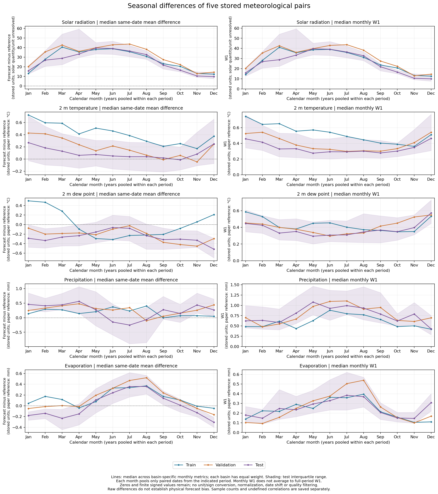

Hình đọc rõ, không thấy chữ chồng/cắt. Đường là median ngang chỉ số tháng của ID, dải tím chỉ là IQR giữa ID ở test, không phải khoảng tin cậy. Các giá trị ở từng tháng còn gộp nhiều năm. Hình mô tả chênh và khoảng cách theo mùa, không suy cơ chế hay dùng test chọn xử lý.

Phép kiểm tiếp theo giữ cùng ngày/ID khi so r trước/sau trừ mean tháng tính riêng trên train, nhằm kiểm mức liên hệ sau khi loại bớt mức mùa. Trừ 12 mean tháng chỉ loại một thành phần, không bảo đảm hết mùa, xu thế hoặc tín hiệu chung giữa các nguồn.

### 20.4. Cell 6.4 — r sau trừ mean tháng train

Với mỗi ID/cặp/tháng m, c_ref(m) là mean cột đối chiếu và c_fc(m) là mean cột forecast trên **đúng các ngày train có cả hai giá trị** đã kiểm tại 6.3. Tạo hai dãy phục vụ chẩn đoán: a(t)=ref(t)−c_ref(month(t)), b(t)=fc(t)−c_fc(month(t)). Mean được đọc từ hồ sơ tháng train và tính lại trực tiếp để kiểm; không fit lại trên validation/test hoặc dùng ngày chỉ một phía để đổi mẫu số. Không chia độ lệch chuẩn, đổi đơn vị/dấu, ghi lại nguồn, thay input mô hình hay scaler.

Tháng train không có cặp giữ mean NaN. Những ngày đánh giá thuộc tháng đó bị loại khỏi **cả hai** phép tính r trước/sau và đếm riêng; không mượn mean validation/test hoặc điền bằng mean tháng khác. Mỗi kỳ phải khớp lịch/số cặp và chỉ số raw 6.2; mean tháng train phải khớp 6.3. Chỉ số chi tiết giữ raw_r_all_pairs, raw_r_same_days, centered_r và delta_r=centered_r−raw_r_same_days để phân biệt tác động thay ngày đủ điều kiện với tác động trừ mean.

r không xác định giữ NaN cho thiếu cặp/chuỗi hằng, kèm trạng thái từng phía. Bảng tổng hợp/đường ECDF chỉ so cùng ID có cả hai r xác định, báo thêm n raw/centered/cùng có r; không lặng lẽ so hai mẫu ID khác nhau. Median delta_r là median hiệu từng ID, không phải hiệu hai median. Không dùng mức giảm r như tỷ lệ phương sai do mùa hoặc bằng chứng tách hết kỹ năng thời tiết khỏi mùa; mức mùa chỉ có 12 mean train, còn khác trong tháng, xu thế và tín hiệu chung.

Hình A1_P6_pair_train_month_centered_correlations.png có năm panel ECDF raw/centered r test cùng ID, trục r theo phạm vi số từng panel, và một panel median delta_r ngang ID cho ba kỳ. Các trục r khác giới hạn hiển thị nên phải đọc tick. Năm CSV A1_P6_: pair_train_monthly_climatology, pair_season_removed_by_basin_period, pair_season_removed_summary, pair_season_removed_checks, pair_season_removed_cases. Bảng in (1) mức phủ mean train, (2) r trước/sau và số ID so được, (3) phép kiểm/số ngày loại do thiếu mean train, (4) tối đa ba ID/cặp có |delta_r| lớn nhất ở test để đọc hồ sơ. Chỉ mô tả, không chọn quy tắc hoặc mô hình bằng test.

Mã đã kiểm giả lập bằng mean nhóm tính độc lập và Pearson đối chiếu NumPy; thay giá trị test mạnh vẫn giữ nguyên mean train; tháng train thiếu không được điền từ validation; cùng ngày đủ điều kiện; chuỗi hằng/cặp rỗng NaN; tín hiệu mùa chung mạnh có thể đi cùng residual yếu; hồ sơ train thay đổi phải dừng. Hình giả lập đã xem. Kết quả thực tế 6.4 được ghi dưới đây.

#### 20.4.1. Kết quả thực tế và mean tháng train

Cell 6.4 đọc **451 ID**, chạy **62,3 giây**, xuất hình và năm CSV trên Kaggle. Hình và nguyên văn bảng (1)–(4) đã nhận; bản văn giữ tại [A1_P6_pair_train_month_centered_output.txt](Tables/A1_P6_pair_train_month_centered_output.txt). Hình/bản văn giữ nguyên byte. Chưa nhận năm CSV chi tiết cục bộ; các bảng dưới đây chép từ output in, dùng dấu chấm thập phân.

| Cặp | ID | ID×tháng | Min cặp train/tháng | Max cặp train/tháng | Tháng train thiếu |
|---|---|---|---|---|---|
| dewpoint | 451 | 5412 | 198 | 217 | 0 |
| evaporation | 451 | 5412 | 198 | 217 | 0 |
| precipitation | 451 | 5412 | 198 | 217 | 0 |
| solar | 451 | 5412 | 198 | 217 | 0 |
| temperature | 451 | 5412 | 198 | 217 | 0 |

Có 5412 ID×tháng cho mỗi cặp (451×12), tổng 27060 mean tháng cho mỗi phía qua năm cặp. Mỗi ID/tháng dùng 198–217 ngày train có cả hai nguồn; không tháng train nào thiếu. Cả ba kỳ giữ nguyên số ngày và 451 ID trước/sau: train 1153207, validation/test 658911 mỗi cặp, không loại ngày do thiếu mean train, mọi r raw/centered đều xác định. Các kiểm nguồn 6.2 và mean train 6.3 đều True.

| Cặp | Kỳ | ID | Cặp raw | Cặp centered | Ngày loại thiếu mean train | Khớp 6.2 | Mean train khớp 6.3 |
|---|---|---|---|---|---|---|---|
| dewpoint | test | 451 | 658911 | 658911 | 0 | True | True |
| dewpoint | train | 451 | 1153207 | 1153207 | 0 | True | True |
| dewpoint | validation | 451 | 658911 | 658911 | 0 | True | True |
| evaporation | test | 451 | 658911 | 658911 | 0 | True | True |
| evaporation | train | 451 | 1153207 | 1153207 | 0 | True | True |
| evaporation | validation | 451 | 658911 | 658911 | 0 | True | True |
| precipitation | test | 451 | 658911 | 658911 | 0 | True | True |
| precipitation | train | 451 | 1153207 | 1153207 | 0 | True | True |
| precipitation | validation | 451 | 658911 | 658911 | 0 | True | True |
| solar | test | 451 | 658911 | 658911 | 0 | True | True |
| solar | train | 451 | 1153207 | 1153207 | 0 | True | True |
| solar | validation | 451 | 658911 | 658911 | 0 | True | True |
| temperature | test | 451 | 658911 | 658911 | 0 | True | True |
| temperature | train | 451 | 1153207 | 1153207 | 0 | True | True |
| temperature | validation | 451 | 658911 | 658911 | 0 | True | True |

#### 20.4.2. Tương quan trước/sau trên cùng mẫu

Các p05/median/p95 lấy ngang 451 ID; cả hai r dùng đúng cùng ngày và tập ID. Delta_r lấy hiệu mỗi ID trước khi lấy phân vị, không phải hiệu các phân vị hai phía. Không gọi delta_r là tỷ lệ phương sai do mùa hoặc phép đo độc lập kỹ năng forecast.

| Cặp | Kỳ | Raw p05 | Raw median | Raw p95 | Centered p05 | Centered median | Centered p95 | Delta p05 | Delta median | Delta p95 |
|---|---|---|---|---|---|---|---|---|---|---|
| solar | train | 0.825493 | 0.959826 | 0.969136 | 0.721435 | 0.881596 | 0.906052 | -0.099567 | -0.074327 | -0.052585 |
| solar | validation | 0.845175 | 0.971678 | 0.978361 | 0.776103 | 0.927194 | 0.941994 | -0.061287 | -0.042172 | -0.029568 |
| solar | test | 0.833096 | 0.976999 | 0.985294 | 0.778610 | 0.934359 | 0.957681 | -0.058432 | -0.037656 | -0.016394 |
| temperature | train | 0.982411 | 0.992032 | 0.995772 | 0.932020 | 0.964416 | 0.981829 | -0.050945 | -0.027254 | -0.013874 |
| temperature | validation | 0.986959 | 0.994477 | 0.996917 | 0.947708 | 0.975027 | 0.985837 | -0.041020 | -0.018805 | -0.010927 |
| temperature | test | 0.984263 | 0.994271 | 0.997628 | 0.927934 | 0.974278 | 0.987835 | -0.056588 | -0.020438 | -0.009751 |
| dewpoint | train | 0.982650 | 0.991814 | 0.994231 | 0.935509 | 0.969579 | 0.981619 | -0.046691 | -0.022217 | -0.012618 |
| dewpoint | validation | 0.989163 | 0.993915 | 0.996156 | 0.949739 | 0.973899 | 0.984848 | -0.038688 | -0.020389 | -0.011298 |
| dewpoint | test | 0.987001 | 0.993829 | 0.996013 | 0.925658 | 0.967819 | 0.982242 | -0.062398 | -0.025444 | -0.013435 |
| precipitation | train | 0.736631 | 0.805085 | 0.842707 | 0.731590 | 0.799681 | 0.840319 | -0.009758 | -0.004449 | -0.000349 |
| precipitation | validation | 0.753988 | 0.828564 | 0.879145 | 0.746493 | 0.821362 | 0.873775 | -0.012795 | -0.006351 | -0.001505 |
| precipitation | test | 0.773656 | 0.833226 | 0.869420 | 0.761790 | 0.827278 | 0.865844 | -0.015291 | -0.004908 | -0.000124 |
| evaporation | train | 0.856618 | 0.900324 | 0.931188 | 0.491777 | 0.592640 | 0.694396 | -0.389152 | -0.301839 | -0.232962 |
| evaporation | validation | 0.857486 | 0.910356 | 0.945712 | 0.478102 | 0.636095 | 0.740595 | -0.397384 | -0.269767 | -0.194909 |
| evaporation | test | 0.836428 | 0.899123 | 0.944450 | 0.453871 | 0.615688 | 0.730631 | -0.400518 | -0.283952 | -0.206707 |

ET thay đổi rõ nhất trong phép kiểm này: r median raw→centered là **0,900324→0,592640** ở train, **0,910356→0,636095** ở validation, **0,899123→0,615688** ở test. Median hiệu từng ID lần lượt −0,301839/−0,269767/−0,283952. Cả 451 ID đều giảm ở mỗi kỳ. Kết quả cho thấy kết luận từ r trên giá trị có mùa cần thận trọng; chưa định lượng được phần kỹ năng thời tiết, tỷ phần phương sai do mùa hoặc cơ chế nguồn.

Nhiệt độ và điểm sương vẫn có r centered median cao ở test, lần lượt **0,974278** và **0,967819**; bức xạ là **0,934359**. Đây là tương quan sau trừ 12 mức tháng train, còn biến thiên trong tháng, xu thế và tín hiệu chung. Bức xạ vẫn khác net/downward và chưa xác nhận đơn vị CSV; r cao sau phép trừ cũng không giải quyết định nghĩa đại lượng.

Mưa có median delta_r nhỏ hơn về độ lớn: −0,004449/−0,006351/−0,004908 cho train/validation/test; centered median test **0,827278** so với raw 0,833226. Một số ID tăng r sau phép trừ: 19 ở train, 7 validation, 21 test. Trừ mức tháng riêng của hai nguồn không bảo đảm r phải giảm ở mọi dữ liệu; số tăng được giữ lại, không ép dấu hoặc lọc bỏ.

| Cặp | Kỳ | r giảm: ID | r tăng: ID | r bằng: ID |
|---|---|---|---|---|
| solar | train | 451 | 0 | 0 |
| solar | validation | 451 | 0 | 0 |
| solar | test | 451 | 0 | 0 |
| temperature | train | 451 | 0 | 0 |
| temperature | validation | 451 | 0 | 0 |
| temperature | test | 451 | 0 | 0 |
| dewpoint | train | 451 | 0 | 0 |
| dewpoint | validation | 451 | 0 | 0 |
| dewpoint | test | 451 | 0 | 0 |
| precipitation | train | 432 | 19 | 0 |
| precipitation | validation | 444 | 7 | 0 |
| precipitation | test | 430 | 21 | 0 |
| evaporation | train | 451 | 0 | 0 |
| evaporation | validation | 451 | 0 | 0 |
| evaporation | test | 451 | 0 | 0 |

#### 20.4.3. Các ca có |delta_r| lớn ở test

Mọi hàng có đủ 1461 ngày raw/centered, không loại ngày, đủ 12 tháng train, hai r đều defined và hai kiểm nguồn đều True. raw_r_all_pairs=raw_r_same_days. Delta tính trên số chưa làm tròn nên có thể khác phép trừ hai số in ở chữ số cuối.

| ID | Cặp | Raw r cùng ngày | Centered r | Delta r |
|---|---|---|---|---|
| 55 | dewpoint | 0.969966 | 0.893067 | -0.076899 |
| 57 | dewpoint | 0.983218 | 0.907015 | -0.076202 |
| 109 | dewpoint | 0.990460 | 0.914343 | -0.076117 |
| 391 | evaporation | 0.838920 | 0.315074 | -0.523846 |
| 390 | evaporation | 0.844894 | 0.340275 | -0.504619 |
| 398 | evaporation | 0.860634 | 0.382067 | -0.478568 |
| 483 | precipitation | 0.810928 | 0.780553 | -0.030375 |
| 477 | precipitation | 0.779767 | 0.749788 | -0.029979 |
| 478 | precipitation | 0.792975 | 0.763031 | -0.029944 |
| 814 | solar | 0.791260 | 0.707293 | -0.083967 |
| 47 | solar | 0.844531 | 0.762680 | -0.081850 |
| 55 | solar | 0.764273 | 0.684624 | -0.079648 |
| 818 | temperature | 0.982203 | 0.866065 | -0.116138 |
| 565 | temperature | 0.983391 | 0.879292 | -0.104099 |
| 566 | temperature | 0.984461 | 0.881827 | -0.102634 |

ET 391/390/398 có centered r 0,315074/0,340275/0,382067, giảm khoảng 0,48–0,52. Đây là các ca đọc hồ sơ theo cùng tiêu chí |delta_r|, không là trạm lỗi hoặc tiêu chí loại. Tương tự, nhiệt độ 818 giảm từ 0,982203 xuống 0,866065, nhưng phép này chỉ xét cặp khí tượng; chưa suy nguyên nhân từ hồ sơ qmax hoặc ảnh hưởng NSE.

#### 20.4.4. Hình và giới hạn của phép trừ

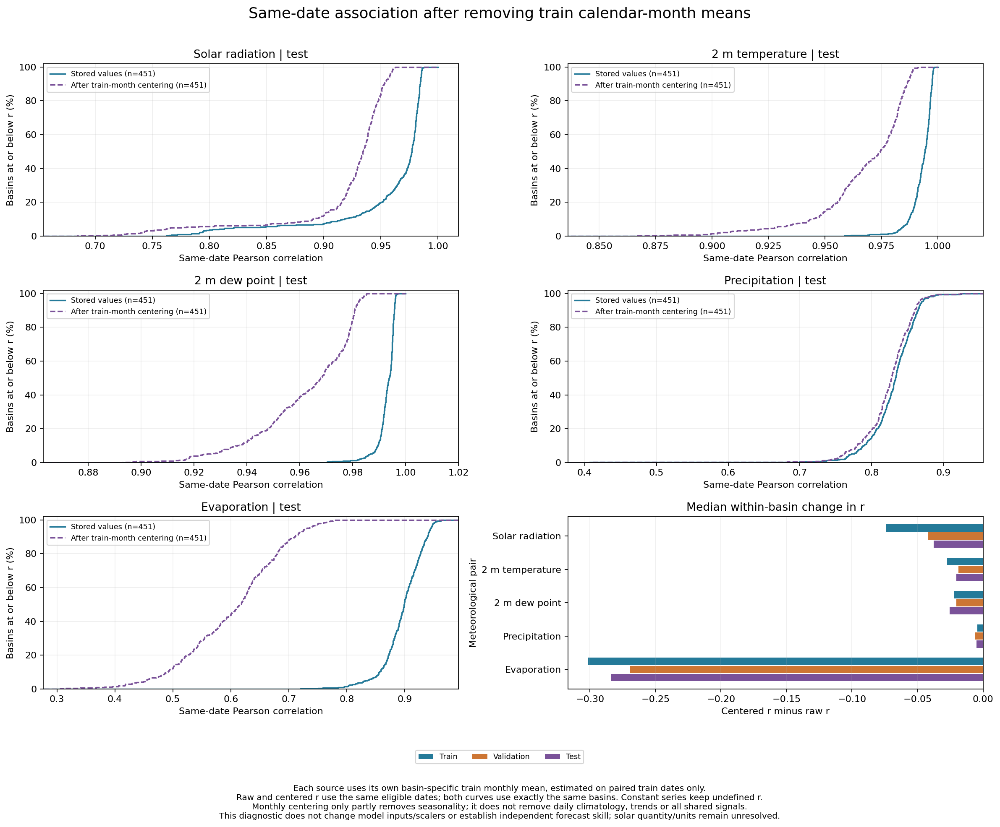

Hình đọc rõ, n=451 ở tất cả đường ECDF test, không chữ cắt/chồng. Các trục r có cận riêng từng panel; độ dịch ngang phải đọc theo tick, không so bằng chiều dài pixel. Panel cuối dùng median hiệu từng ID, không hiệu hai median. Hình tương thích bảng: ET dịch trái mạnh hơn, mưa dịch ít. Phép trừ chỉ dùng mean train và không ghi thay đổi vào input/scaler.

### 20.5. Tổng kết Phần 6 và bàn giao

Khảo sát định lượng Phần 6 hoàn thành trên năm cặp của mã tác giả: lịch/ngữ nghĩa tham chiếu và mean theo năm/kỳ (6.1), phân phối và ghép cùng ngày (6.2), tháng/dấu từng ngày (6.3), tương quan sau trừ mean tháng train (6.4). Năm cặp đều đủ dữ liệu trong ba kỳ mô hình, do đó các khác biệt r của 6.4 không do đổi tập ngày/ID. Đối chiếu theo nguồn và các thang đo giữ riêng, không xếp khoảng cách chéo đơn vị.

Các giới hạn được giữ trong bàn giao: chuyển đổi CSV và quy ước ngày dự báo chưa truy đầy đủ; net ERA5L/downward ECMWF và nhãn W/m²/J/m² chưa thống nhất; không tự đảo dấu ET, đổi cp×1000, trừ nền SWE hoặc chọn hiệu chỉnh bằng test. Kết quả khớp số học/phân phối/tương quan không xác nhận toàn bộ ngữ nghĩa nguồn hay quan trắc độc lập. Các câu hỏi cần provenance được ghi ở đây thay vì dùng thống kê để tự quyết phép đổi.

Phần 7 kiểm ô đầu vào theo từng pha và cửa sổ cùng điều kiện nhãn để đếm mẫu. Những tỷ lệ thiếu ô ở Phần 4 không thể tự đổi thành số mẫu mất. Phần 8 tiếp tục so kỳ/đỉnh với kết quả mô hình; Phần 9 giữ hồ sơ ID. Không dùng những khác biệt test vừa khảo sát làm điều kiện lọc hoặc chọn mô hình.

## 21. Hợp đồng cửa sổ và số mẫu: Phần 7

### 21.1. Cell 7.1 — hợp đồng cửa sổ và ngữ nghĩa trường path

Cell quét các config.yml dưới EXP_DIR, đọc cấu hình thật và lưu SHA256 mỗi file. Nhóm cấu hình theo JSON các trường ảnh hưởng đầu vào/cửa sổ/kỳ sau diễn giải path như Config._parse_config, giữ cả mã JSON thô để đối chiếu. Thứ tự tên và nhóm biến được giữ; đổi optimizer đơn thuần không tạo hợp đồng mới. Nhóm này phục vụ kiểm cấu trúc, chưa xác nhận cùng trọng số, scaler, thư mục dữ liệu hoặc mã thư viện đang cài. Những đường dẫn máy tác giả không được dùng để âm thầm thay input.

Căn cứ cách cắt và kiểm mẫu trong [basedataset.py:158](../../../NeuralHydrology/neuralhydrology/datasetzoo/basedataset.py#L158), [x_d_validate và chế độ train/evaluation](../../../NeuralHydrology/neuralhydrology/datasetzoo/basedataset.py#L613), [_validate_samples](../../../NeuralHydrology/neuralhydrology/datasetzoo/basedataset.py#L861), cùng [Config](../../../NeuralHydrology/neuralhydrology/utils/config.py#L357). Bộ lọc gốc ở train xét NaN của các cột động trên toàn seq_length trước khi __getitem__ cắt pha. Đánh giá không truyền x_d/y vào cùng phép kiểm train. Cờ nan_handling_method không tự thay điều kiện lọc này. Nhãn chỉ kiểm all-NaN trong predict_last_n; ở bước hiện tại chỉ chuẩn bị trường hợp một nhãn cuối/ngày, chưa mô phỏng các trường hợp khác.

Với tổng khung L, forecast F, overlap O, offset tính từ ngày cuối t=0: hindcast dùng từ 1−L đến −F+O (bao gồm hai đầu); forecast từ 1−F đến 0. Biến thuộc cả hai pha dùng hợp các offset; biến không thuộc pha nào nhưng còn trong dynamic_inputs vẫn bị bộ lọc gốc kiểm. Mô hình một pha dùng cả khung. So số bước bộ lọc gốc kiểm với số bước thực sự được cắt cho mô hình ở từng biến để chỉ ra các ô kiểm thêm. Đây chưa là chứng minh mọi ô có số hoặc đầu ra mô hình hữu hạn.

**365/730 ở bảng là tổng seq_length.** Khi F=1, O=0, khung 365 có 364 ngày hindcast và một ngày forecast; khung 730 có 729+1. Nếu O>0 thì số bước hai pha có phần trùng và được đếm riêng theo hợp offset. Không gọi khung 730 là 730 ngày hindcast. Lịch khởi động dùng L−predict_last_n ngày trước đầu kỳ, giữ ngày đích của PERIODS. Ngày YAML dạng DD/MM/YYYY được đọc đúng thứ tự ngày/tháng.

Chỉ hợp đồng scalar, một tần suất ngày và predict_last_n=1 mới có hình học được hỗ trợ; status=ready_for_daily_count còn yêu cầu không có nguồn ngoài cần kiểm. Cấu trúc khác giữ geometry_review_required và lý do, không tự suy để đếm. Lagged/AR/evolving/conceptual hoặc tần suất phức tạp giữ để xem riêng về cấu trúc. Các path bổ sung/cache/per-basin periods được xét sau parse, cờ nguồn ngoài được giữ tách khỏi hình học. Target cũng là input động được gắn cờ để kiểm đường nhãn/quá khứ, không coi sẵn hợp lệ. Trạng thái ready chỉ là tương thích cấu trúc mô phỏng: chưa đọc đủ mặt nạ dữ liệu, xác nhận tập ID riêng của từng file basin, nguồn scaler hoặc chạy loader thực tế. expected_end_dates_selected chỉ là lịch kỳ×selected_ids hiện tại, không phải số mẫu hợp lệ hoặc xác nhận cohort của config.

Cell lập các kịch bản tổng khung 365/730 và L khai báo nếu khác, không ghi đè cấu hình thí nghiệm. Sáu CSV A1_P7_: sample_contract_runs, sample_contract_groups, sample_contract_offsets, sample_contract_roles, sample_calendar_scenarios, sample_path_values. In bảng (1) run thật, (2) nhóm hợp đồng, (3) hình học/ô kiểm thêm, (4) mẫu lịch theo kỳ toàn cục, (5) path thô/sau parse. Không hình mới, chưa đếm mẫu, chuẩn hóa, điền NaN hoặc sửa bộ lọc.

Mã đã kiểm giả lập cho cấu trúc tên/nhóm, ngày đọc đúng day-first, nhóm config cùng đầu vào dù optimizer khác, offset 365/730, overlap, biến cả hai pha/một pha, khởi động và các ô lọc thêm; hợp đồng chưa hỗ trợ vẫn tạo bảng rỗng đúng schema. Kiểm kê thực tế và trạng thái chờ xác nhận path được ghi dưới đây.

#### 21.1.1. Kết quả cấu hình sau diễn giải path

Output bảng (1)–(5) đã nhận đầy đủ: **24 config, 8 nhóm hợp đồng hiệu lực, 23 config ready_for_daily_count và 1 config review_required**. Cả 24 có geometry_ready; bảng vai trò có 24 dòng và bảng lịch có 48 dòng. Nguyên văn được giữ nguyên byte tại [A1_P7_sample_contract_parsed_output.txt](Tables/A1_P7_sample_contract_parsed_output.txt). Sáu CSV được báo đã xuất trên Kaggle, chưa nhận tệp chi tiết cục bộ. Mã nhóm hiệu lực gộp những cấu hình chỉ khác biểu diễn null ở trường path; raw_contract_id và SHA256 config vẫn giữ dấu vết nguồn.

Có 14 cudalstm, 5 handoff_forecast_lstm và 5 sequential_forecast_lstm. Tất cả dataset=lamah_a, seq_length=365, predict_last_n=1 và overlap=0; 10 config hai pha có forecast_seq_length=1, bốn config có qmean trong dynamic. Danh sách 31 biến tái phân tích/đối chiếu gồm 21 ERA5L, 7 EOBS, MSWEP_RR và hai GLEAM; **không có EOBS_hu**. Năm biến forecast là ECMWF_t2m, d2m, ssrd, tp và e. Năm biến đối chiếu của CrossDomain_Reanalysis là ERA5L_2m_temp_mean, ERA5L_2m_dp_temp_mean, ERA5L_surf_net_solar_rad_mean, MSWEP_RR và GLEAM_ETA.

| Hợp đồng | Config | Dynamic | Pha lịch sử / pha forecast | Trạng thái nguồn |
|---|---:|---:|---|---|
| W498335dd5a3f | 9 | 5 forecast | Một pha dùng toàn khung | ready |
| W75bc09bfdfd3 | 2 | 31 đối chiếu + 5 forecast | Một pha dùng toàn khung | ready |
| Wc67e7374cf81 | 2 | 31 đối chiếu | Một pha dùng toàn khung | ready |
| Wd27f1d6163e2 | 1 | 5 đối chiếu | Một pha dùng toàn khung | ready |
| Wb741da88055e | 4 | 31 đối chiếu + qmean + 5 forecast | 32 / 5 | ready |
| Wf1cffeb3e0b8 | 2 | 31 đối chiếu + 5 forecast | 36 / 5; năm forecast thuộc cả hai pha | ready |
| W6f046c6c21f2 | 3 | 31 đối chiếu + 5 forecast | 31 / 5 | ready |
| W8404b4046b9d | 1 | 31 đối chiếu + 5 forecast | 31 / 5 | train_data_file cần kiểm |

“ready” xác nhận cấu trúc hợp đồng hỗ trợ phép đếm CSV, **chưa là số mẫu hợp lệ**, chưa chứng minh cohort hoặc data_dir của mọi run giống nhau. Hợp đồng không dùng model/optimizer làm khóa nhóm nên cùng hình học đầu vào có thể gồm nhiều kiến trúc.

#### 21.1.2. Nguồn ngoài và hình học cửa sổ

Trong **120 giá trị path được kiểm, chỉ 1 hoạt động sau parse**. additional_feature_files và ba per_basin_*_periods_file đều là chuỗi thô "None" trong 24 config và đều thành None. Riêng train_data_file có 8 chuỗi "None", 8 trường không khai báo, 7 YAML null và 1 đường dẫn thật. Quy tắc [Config._parse_config](../../../NeuralHydrology/neuralhydrology/utils/config.py#L203) chỉ đổi đúng null/chuỗi "None", không xóa một path thật dựa trên bool của chuỗi thô.

Path hoạt động thuộc Encoder_Decoder_LSTM/Encoder_Decoder_LSTM_without_q/Encoder_Decoder_LSTM_RA_without_q_Simple_Embedding/config.yml: **/home/ok2907/Documents/BiasCast/Experiments/Encoder_Decoder_LSTM/Encoder_Decoder_LSTM_without_q/Encoder_Decoder_LSTM_RA_without_q_Simple_Embedding/train_data**. Điều này xác nhận cấu hình chỉ định cache, chưa xác nhận cache có trong Input hiện tại hoặc nội dung cache. Bộ nạp có nhánh dùng train_data_file ở train, còn evaluation đọc dữ liệu ngày; không thay cache bằng CSV để gọi là số mẫu huấn luyện lịch sử của run này. Nhóm W8404b4046b9d giữ review_required/source_review_required, dù hình học cửa sổ vẫn rõ.

Với t=0 là ngày cuối và tổng khung L=365/730, bộ lọc train gốc kiểm tất cả dynamic ở [1−L,0]. Một pha dùng chính toàn khung. Hai pha forecast=1/overlap=0 dùng hindcast ở [1−L,−1] và forecast ở [0,0]. Vì vậy biến chỉ thuộc hindcast bị kiểm thêm ô ngày t; biến chỉ thuộc forecast bị kiểm thêm L−1 ô quá khứ. Năm ECMWF của nhóm FCRA thuộc cả hai pha nên thực sự dùng đủ L ngày, không được bỏ lịch sử ECMWF khi kiểm nhóm này. 365/730 là **tổng khung**, tương ứng 364/729 ngày hindcast và 1 ngày forecast ở hai pha.

| Kỳ nhãn | Ngày đầu / cuối | Khởi động L=365 | Khởi động L=730 | Ngày cuối khung mỗi ID | Trên 451 ID |
|---|---|---|---|---:|---:|
| Train | 01/01/2003–31/12/2009 | 02/01/2002 | 02/01/2001 | 2557 | 1153207 |
| Validation | 01/01/2010–31/12/2013 | 02/01/2009 | 03/01/2008 | 1461 | 658911 |
| Test | 01/01/2014–31/12/2017 | 02/01/2013 | 03/01/2012 | 1461 | 658911 |

Đây là lịch lý thuyết theo kỳ toàn cục của config, chưa áp cache và chưa xét giá trị. L=730 là kịch bản khảo sát, các config nguồn vẫn khai báo 365. Các kiểm giả lập đã đối chiếu quy tắc path với Config thật, cùng hình học pha/overlap và ngày day-first; chúng không thay thế số mẫu trên CSV thật.

### 21.2. Cell 7.2 — số cửa sổ trên CSV và mặt nạ theo pha

Phép đếm dùng selected_ids hiện hành và CSV A/D, nhận bảy nhóm ready tương ứng 23 config; nhóm có train_data_file thật được xuất riêng dưới trạng thái chưa đếm, không gán bằng 0. Mỗi nhóm đọc lại YAML tại example_config và đối chiếu chữ ký với contract_json đã lưu ở 7.1 trước khi kiểm hợp đồng. contract_json là phép chiếu các khóa dùng cfg.get, có thể ghi trường vắng thành null; nó chỉ dùng nhận diện nhóm, không dùng thay YAML nguồn. Nếu chữ ký nguồn thay đổi, phép đếm dừng và yêu cầu tạo lại kết quả 7.1. Đây là kịch bản dữ liệu hiện tại trên tập 451, chưa đối chiếu basin files/data_dir/cache/scaler lịch sử của từng run. Mỗi ID chỉ đọc một lần các cột khí tượng cần dùng, qmean và qmax; qmean ghép theo cùng ngày từ D, phù hợp phép dựng Q input ở A2. Không đưa EOBS_hu vào mặt nạ vì không nằm trong danh sách dynamic của những nhóm này.

Lịch từ đầu train trừ L lớn nhất−1 đến cuối test bao đủ các ngày khởi động, kể cả trước 2002 cho tổng khung 730. Tổng tiền tố của mặt nạ NaN đếm chính xác ô thiếu trong cận đóng của mỗi cửa sổ, không tạo tensor ngày×L×biến. Bộ lọc toàn khung dùng tất cả dynamic; phép kiểm theo pha chỉ dùng các offset đã kiểm ở 7.1. Với forecast thuộc cả hai pha, hợp các ô dùng vẫn là toàn L. Thuộc tính tĩnh đọc từ A/Catchment_attributes.csv, còn diện tích chuẩn hóa nhãn area_gov đọc từ D/Gauge_attributes.csv qua gauge và chọn đúng ID, cùng nguồn đã dùng tại 5.1. Không dùng area_calc thay thế. Thuộc tính tĩnh và diện tích được kiểm hữu hạn; số 0 và số âm khí tượng hữu hạn giữ nguyên. Infinity/sentinel hoặc token không đọc được sẽ dừng để kiểm, không tự chuyển thành NaN cho vừa quy tắc; target Q âm theo nhánh bộ nạp được xem là thiếu. Chưa chuẩn hóa giá trị bằng scaler hoặc chạy DataLoader.

Mỗi ngày cuối khung có các mặt nạ riêng: nhãn có số, đầu vào đầy đủ theo toàn khung, đầu vào đầy đủ theo pha, giao mỗi mặt nạ với nhãn, và số ngày giao được phục hồi khi chỉ kiểm ô dùng. Train mô phỏng điều kiện NaN của bộ lọc gốc qua giao toàn khung–nhãn; evaluation lookup gốc chỉ yêu cầu đủ chiều dài lịch sử nên giữ cả ngày có NaN. Các số complete-case có nhãn ở validation/test là chẩn đoán khả năng có đủ dữ liệu, không phải số dự báo hữu hạn hoặc kết quả của bộ lọc mới đang hoạt động. Khả năng masked mean chịu NaN không được mô phỏng.

Ba loại ngày không chồng lấp — nhãn thiếu, nhãn có nhưng đầu vào toàn khung thiếu, và đầu vào toàn khung đủ cùng nhãn — phải cộng đúng lịch. Giao theo pha phải chứa giao toàn khung; hiệu bằng số phục hồi. Tổng theo năm tái tạo đúng từng ID/kỳ. Số ngày nhãn đọc lại đối chiếu từng ID/kỳ với 4.2, không dùng số đếm dự đoán để khớp kết quả. Kiểm cục bộ dùng 50 bộ dữ liệu giả lập so với chính hàm _validate_samples trong repo và phép cắt cửa sổ trực tiếp, cùng một lượt giả lập toàn cell cho bảy nhóm/365–730. Kiểm tích hợp bao gồm cấu hình một pha không khai báo hindcast_inputs/forecast_inputs, chữ ký xuất đủ khóa với null và điều kiện dừng khi YAML nguồn khác chữ ký 7.1. Bảng thuộc tính giả lập tách đúng nguồn A/D: Catchment không có area_gov, Gauge có area_gov và hàng được đảo thứ tự để kiểm ghép theo ID; diện tích tính từ hình học được đặt khác để phát hiện việc dùng nhầm area_calc. Đây là kiểm thuật toán, chưa là kết quả dữ liệu thật.

Cell xuất một hình tỷ lệ train theo hai tổng khung và bảy CSV A1_P7_: sample_counts_by_basin, sample_counts_by_year_basin, sample_counts, sample_counts_by_year, sample_count_sources, sample_count_checks, sample_count_excluded_contracts. Bảng in (1) phạm vi/kiểm đếm, (2) train và phân hoạch lý do, (3) evaluation lookup và giao có nhãn, (4) năm 2003 với L=730, (5) ID hồ sơ/không nhãn train, (6) hợp đồng nguồn ngoài chưa đếm. Kết quả CSV thật của 7.2 được trình bày tại 21.2.1–21.2.3, không suy từ phần trăm thiếu ô. Không đổi loader, dữ liệu nguồn, danh sách 451 hoặc quy tắc chọn mô hình.

#### 21.2.1. Phạm vi, hiện vật và đối chiếu số đếm

Cell 7.2 đã đọc **451 ID**, chạy **120,3 giây**, đếm bảy nhóm hợp đồng ready tương ứng 23 config trên CSV hiện tại. Một nhóm có train_data_file thật được giữ riêng chưa đếm. Lịch đọc **02/01/2001–31/12/2017** bao đủ khởi động của tổng khung 730. Cả 33 thuộc tính tĩnh được kiểm không có ô không hữu hạn/sentinel. Nhãn đọc lại khớp từng ID/kỳ với 4.2; tổng theo năm, phân hoạch lý do loại và quan hệ tập con giữa hai mặt nạ đều đạt.

Hình đã nhận và lưu nguyên bản tại [A1_P7_sample_window_counts.png](Figures/A1_P7_sample_window_counts.png). Nguyên văn bảng (1)–(6) và cảnh báo giữ tại [A1_P7_sample_window_counts_output.txt](Tables/A1_P7_sample_window_counts_output.txt), sao chép nguyên byte. Bản in có 1 dòng kiểm phạm vi, 14 dòng train, 28 dòng validation/test, 7 dòng năm 2003/L=730, 98 dòng hồ sơ và 1 dòng hợp đồng chưa đếm. Bảy CSV chi tiết được báo đã xuất ở Kaggle, chưa nhận tệp cục bộ; không dựng CSV nguồn từ bản in.

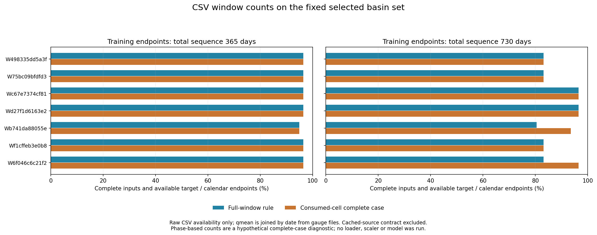

Hình so tỷ lệ trên **1153207 ngày cuối khung train**. Mỗi mã W tra theo bảng nhóm ở 21.1.1; không cộng số mẫu của các nhóm vì chúng có thể dùng lại cùng ngày–ID. Khung 730 là kịch bản khảo sát, không thay seq_length=365 trong config nguồn.

#### 21.2.2. Train: tác động của Q quá khứ và lịch ECMWF

| Nhóm | W tương ứng | L=365: toàn khung → theo pha | L=730: toàn khung → theo pha | Phục hồi L=730 |
|---|---|---:|---:|---:|
| Một pha, 5 forecast | W498335dd5a3f | 1112307 → 1112307 | 958231 → 958231 | 0 |
| Một pha, 31 đối chiếu + 5 forecast | W75bc09bfdfd3 | 1112307 → 1112307 | 958231 → 958231 | 0 |
| Một pha, 31 đối chiếu | Wc67e7374cf81 | 1112307 → 1112307 | 1112307 → 1112307 | 0 |
| Một pha, 5 đối chiếu | Wd27f1d6163e2 | 1112307 → 1112307 | 1112307 → 1112307 | 0 |
| Hai pha, 31 đối chiếu + qmean / 5 forecast | Wb741da88055e | 1094272 → 1094272 | 928114 → 1079046 | 150932 |
| Hai pha FCRA, forecast có cả trong lịch sử | Wf1cffeb3e0b8 | 1112307 → 1112307 | 958231 → 958231 | 0 |
| Hai pha, 31 đối chiếu / 5 forecast | W6f046c6c21f2 | 1112307 → 1112307 | 958231 → 1112307 | 154076 |

Các số là giao **đầu vào đầy đủ và nhãn có số**. Train có 40900 ngày nhãn thiếu, còn 1112307 ngày có nhãn. Ở L=365, nhóm không Q giữ đủ 1112307 (**96,453369% lịch**). Nhóm có qmean còn 1094272 (**94,889469% lịch**), ít hơn **18035** ngày có nhãn vì cửa sổ đầu vào thiếu. Hai quy tắc cho cùng số giao nhãn ở L=365; số ô đầu vào đầy đủ theo pha của nhóm có Q tăng 17 ngày, nhưng cả 17 đều thiếu nhãn cuối nên không tăng số train hợp lệ.

Với L=730, cửa sổ train đầu bắt đầu 02/01/2001 trong khi ECMWF có từ 01/01/2002. Nhóm kiểm đủ L ngày ECMWF chỉ có đủ khí tượng từ **31/12/2003**: riêng năm 2003 có 451 ngày–ID đầu vào đầy đủ và 423 ngày–ID có nhãn đi kèm. Không gọi cả 164164 ngày–ID bị thiếu đầu vào là số mẫu train mất: phần có nhãn bị loại là **154076**, còn các ngày không nhãn đã nằm trong nhóm lý do khác.

Ở nhóm hai pha không Q W6f046c6c21f2, chỉ ECMWF ngày cuối được dùng. Phép kiểm theo pha giữ **154499** mẫu năm 2003 thay cho 423, phục hồi **154076** mẫu ở 425 ID. Trên cả train, tỷ lệ tăng từ **83,092714% lên 96,453369% lịch**, chênh **13,360654 điểm phần trăm**. Nhóm có Q phục hồi **150932** mẫu ở 417 ID, từ 928114 lên 1079046; tỷ lệ từ **80,481128% lên 93,569151%**, chênh **13,088023 điểm phần trăm**. Toàn bộ phục hồi của cả hai nhóm nằm trong năm 2003, khớp bảng năm và bảng cả kỳ. Số phục hồi này là chẩn đoán theo mặt nạ, chưa phải kết quả chạy bộ lọc đã sửa trong DataLoader.

Nhóm một pha dùng forecast và nhóm FCRA hai pha vẫn thật sự tiêu thụ ECMWF lịch sử, nên phép kiểm theo pha không phục hồi phần thiếu trước 2002. Nhóm chỉ dùng đối chiếu không gặp thiếu khí tượng trong các cửa sổ khảo sát; còn 40900 ngày không nhãn vẫn bị loại. EOBS_hu không thuộc danh sách dynamic của các nhóm đếm, nên không đưa tỷ lệ thiếu của biến đó vào số mẫu mất này.

#### 21.2.3. Evaluation, ID không có cửa sổ và giới hạn diễn giải

Validation/test gốc đều giữ **658911 lookup ngày–ID** ở cả hai L, kể cả khi đầu vào hoặc nhãn thiếu. Mặt nạ đầu vào đầy đủ cùng nhãn là đại lượng khác:

| Đầu vào | L | Validation: giao đầy đủ–nhãn | Test: giao đầy đủ–nhãn |
|---|---:|---:|---:|
| Không Q, mọi nhóm đang đếm | 365/730 | 656281 | 657366 |
| Có qmean | 365 | 652489 | 652636 |
| Có qmean | 730 | 648779 | 649787 |

Hai quy tắc cho cùng số giao nhãn ở validation/test. Nhóm có Q có thêm 5/8 ngày đầu vào đầy đủ khi chỉ kiểm pha ở validation/test, nhưng các ngày đó không có nhãn; không phục hồi ngày giao nhãn. ID 55 có 0 ngày giao đầy đủ–nhãn ở mỗi kỳ evaluation cho nhóm có Q, cả hai L, theo hồ sơ 7.3. Đủ mặt nạ không xác nhận mô hình sinh dự báo hữu hạn; thiếu mặt nạ cũng chưa xác nhận masked mean sẽ sinh NaN.

Ba ID **324/600/623** không có nhãn train và không có mẫu train trong mọi nhóm. Với L=365 có Q, năm ID không có cửa sổ train là ba ID này cùng **55 và 800**; bảng hồ sơ cho 55 có 1292 ngày nhãn train, 800 có 38 ngày, nhưng cả hai đều có **0** giao cửa sổ đầy đủ–nhãn khi dùng qmean ở L=365 và L=730. Không Q thì 800 giữ đủ 38 mẫu, nên không dùng số 38 ngày có nhãn để nói mọi mô hình đã học 38 mẫu của ID này. Ở L=730 có Q, số ID train không có giao cửa sổ là **9** theo cả hai quy tắc; bốn ID bổ sung được xác định ở 7.3 là 295, 296, 391 và 791.

ID **742 và 758** có đủ 2557 mẫu train cho mọi nhóm L=365, kể cả có Q. L=730 có Q tăng từ 2193 lên đủ 2557 khi chỉ kiểm ô dùng. Vì hai ID có đủ mẫu L=365, không thể quy NSE âm của chúng cho việc không có cửa sổ train trong kịch bản CSV này; biến thiên nhãn thấp và sai số dự báo vẫn cần xem riêng. Không suy nguyên nhân NSE/NaN, chất lượng quan trắc hoặc khả năng mô hình từ số đếm cửa sổ.

Các kết quả vẫn gắn với **selected_ids hiện tại, CSV A/D và kiểm hữu hạn tĩnh/diện tích**. Tập ID của các tệp ứng viên từng config đã được đối chiếu ở 7.3; data_dir đã dùng lịch sử, nội dung cache/scaler và số mẫu lúc huấn luyện thật chưa được xác nhận. Nhóm W8404b4046b9d giữ train chưa biết vì khai báo cache, còn evaluation CSV được xác định ở 7.4 qua mặt nạ tương đương. Giá trị chưa biết không được viết thành 0; phạm vi cuối và tổng kết ở 21.4–21.5.

### 21.3. Cell 7.3 — cohort từng config, cache và ID không có cửa sổ

Cell đọc lại 24 config và đối chiếu SHA256 với 7.1, kiểm riêng train_basin_file, validation_basin_file và test_basin_file. Path tồn tại như khai báo, ứng viên theo phần sau Experiments và ứng viên tên file duy nhất có trạng thái khác nhau. Nếu nhiều ứng viên thì không tự chọn; nếu không tìm được thì không thay bằng basins_filtered.txt mặc định. Danh sách đọc một ID mỗi dòng như hàm load_basin_file, giữ nguyên ID; phát hiện ID trùng, sai định dạng hoặc ngoài tập 451. Chữ ký tập ID và SHA256 tệp được lưu để phân biệt tập hợp với nội dung file.

Khi danh sách là tập con không trùng của selected_ids và hợp đồng có số đếm 7.2, cell tái cộng các số CSV theo đúng tập ID/kỳ/L. Nếu tệp chưa xác định, có ID ngoài tập đã đếm hoặc hợp đồng nguồn ngoài chưa đếm thì số giữ NaN cùng lý do. Đây là phép cộng theo cohort hiện tại, chưa xác nhận tệp đã dùng lịch sử hoặc chạy lại bộ nạp. Trường data_dir được in theo khai báo và tên cuối; trùng tên thư mục chưa là trùng dữ liệu. Cache chỉ được tìm sự hiện diện/kích thước, chưa mở dữ liệu hoặc tính số mẫu từ cache.

Hồ sơ không có cửa sổ tái dùng bảng từng ID của 7.2, tách ID không có nhãn trong kỳ khỏi ID có nhãn nhưng không có giao cửa sổ đầy đủ. Danh sách được in riêng theo hợp đồng, L và kỳ để xác định bốn ID train bổ sung khi có Q/L=730 và ID evaluation không có giao cửa sổ. Không lọc ID hoặc xác nhận cơ chế dự báo NaN.

Cell xuất năm CSV A1_P7_: sample_config_cohorts, sample_config_sources, sample_config_cohort_counts, sample_zero_profiles, sample_zero_summary; không thêm hình. Bảng (1) tổng hợp danh sách ID theo kỳ/trạng thái tìm path, (2) các config khác tập 451 hoặc chưa xác định, (3) data_dir khai báo, (4) cache đang hoạt động, (5) danh sách ID không có giao cửa sổ, (6) trạng thái tái cộng theo cohort. Kết quả thật 7.3 được trình bày ở 21.3.1–21.3.3. Kiểm cục bộ bằng dữ liệu giả lập đã bao gồm 24 config/72 kiểm cohort/144 dòng tái cộng, tệp di chuyển, tên file mơ hồ, tập con, ID sai định dạng, thay đổi config và giữ NaN khi chưa đếm nguồn ngoài.

#### 21.3.1. Danh sách ID và các nguồn khai báo đã đối chiếu

Cell 7.3 chạy **1,5 giây**. Bảng (1)–(6) được cung cấp trực tiếp trong chat; chưa nhận năm CSV chi tiết hoặc một tệp log nguyên bản riêng. Không dựng CSV nguồn từ các bảng dán. Đã kiểm **24 config × 3 kỳ = 72** danh sách: mọi danh sách tìm được có **451 ID khác nhau, 0 dòng trùng**, cùng cohort_key **702fe55b22be** và bằng selected_ids. Bảng các config khác tập 451 hoặc chưa đọc được không có dòng. Tất cả path được tìm bằng **candidate_by_Experiments_suffix**, nên kết quả xác nhận nội dung tập ID của các tệp hiện có, chưa xác nhận tệp lịch sử trên máy tác giả.

| Khai báo data_dir | qmean dynamic | Số config | Tồn tại như path khai báo | Trùng tên cuối với LAMAH_DIR hiện tại |
|---|---|---:|---|---|
| /home/ok2907/Documents/Data/LamaH_expanded | False | 20 | False | False |
| /home/ok2907/Documents/Data/LamaH_expanded_q_input | True | 4 | False | False |

Đây là hai đường dẫn tuyệt đối trên máy tác giả. False ở kiểm tồn tại/path không có nghĩa CSV hiện tại thiếu hoặc sai; nguồn hiện tại có tên LamaH_extended và phép đếm 7.2 đọc trực tiếp A/D, ghép qmean từ D theo ngày. So tên cuối không chứng minh các thư mục có nội dung giống hoặc khác nhau. Giới hạn dữ liệu/scaler lịch sử vẫn giữ riêng với phép đếm Input hiện tại.

Nguồn cache duy nhất được khai báo bởi Encoder_Decoder_LSTM_RA_without_q_Simple_Embedding, nhóm **W8404b4046b9d**. Path nguồn là /home/ok2907/Documents/BiasCast/Experiments/Encoder_Decoder_LSTM/Encoder_Decoder_LSTM_without_q/Encoder_Decoder_LSTM_RA_without_q_Simple_Embedding/train_data. Trạng thái **not_found_in_current_Experiments**, 0 ứng viên, kích thước NaN và cache_content_checked=False. Kết luận tìm kiếm giới hạn ở path khai báo và cây Experiments hiện tại; chưa mở nội dung cache hoặc khẳng định cache không tồn tại ở mọi kho khác.

#### 21.3.2. Các ID không có giao cửa sổ đầy đủ–nhãn

| Đầu vào / tổng khung | Kỳ | Không có nhãn trong kỳ | Có nhãn nhưng không có cửa sổ đầy đủ |
|---|---|---|---|
| Không Q, cả hai L và mọi nhóm đang đếm | Train | 324, 600, 623 | Không có |
| Có Q, L=365 | Train | 324, 600, 623 | 55, 800 |
| Có Q, L=730 | Train | 324, 600, 623 | 55, 295, 296, 391, 791, 800 |
| Có Q, L=365 hoặc 730 | Validation | Không có | 55 |
| Có Q, L=365 hoặc 730 | Test | Không có | 55 |

Danh sách giống nhau giữa mặt nạ toàn khung và mặt nạ ô dùng theo pha. Tăng từ L=365 lên L=730 làm thêm **295, 296, 391 và 791** không có cửa sổ train đầy đủ dù có nhãn. Số ID train không có mẫu giao tăng từ **5 lên 9** khi có Q. Đây là chẩn đoán cửa sổ, chưa là lý do loại ID hoặc giải thích nguyên nhân dự báo NaN. ID **55** là trường hợp duy nhất không có giao cửa sổ đầy đủ–nhãn ở evaluation có Q, cả validation/test và cả hai L; kết quả nối với hồ sơ Q đã có, không thay thế kiểm dự báo thực tế của A2.

Tái cộng theo cohort hiện có cho **23 config ở mỗi kỳ/L**, cùng tập 451 nên không đổi mẫu số hoặc các số CSV 7.2. Bảng (6) có **138 dòng current_CSV_subset_count** và **6 dòng external_source_contract_not_counted** của nhóm W8404b4046b9d; cả sáu giữ NaN. Đây là phạm vi tái cộng đã thực hiện ở 7.3, không phải bằng chứng cache làm thiếu cả ba kỳ. Nguồn [basedataset.py:346](../../../NeuralHydrology/neuralhydrology/datasetzoo/basedataset.py#L346) chỉ dùng train_data_file khi is_train=True; evaluation vào nhánh đọc CSV. Do đó cần tách số train chưa biết từ cache khỏi khả năng xác định mặt nạ evaluation trên CSV.

#### 21.3.3. Giới hạn bàn giao

Các tệp danh sách ứng viên hiện tại đều có đủ 451 ID, nhưng path chuyển vị trí và trùng tập ID không xác nhận byte nguồn hoặc data_dir/scaler/cache lịch sử. Train của config cache chưa có số đếm từ nguồn thực sự được cấu hình yêu cầu. Kết quả 7.2–7.3 không tự xác nhận dự báo hữu hạn hoặc tác động đến NSE. Danh sách 451 và các ngày gốc vẫn giữ nguyên; không suy thêm quy tắc chọn trạm từ các ID không có cửa sổ.

### 21.4. Cell 7.4 — phạm vi từng kỳ và mặt nạ CSV tương đương

Phép kiểm tách cache train khỏi evaluation theo nhánh is_train của bộ nạp. Mọi config được kiểm SHA256 so 7.1 và tệp cohort được kiểm SHA256 so 7.3. Khóa mặt nạ CSV gồm tập tên dynamic/tĩnh, target, predict_last_n, các cận offset đóng của từng biến, tổng khung và cận lịch/khởi động từng kỳ; không chỉ so số cột hoặc tên mô hình. Chữ ký này mô tả khả năng có đủ dữ liệu trên CSV hiện tại, không phải khóa mô hình/scaler hoặc xác nhận nội dung dữ liệu lịch sử.

Với nhóm không có nguồn ngoài, giữ nguồn số đếm CSV riêng của nhóm. Với nhóm chỉ có train_data_file, train vẫn NaN cùng trạng thái train_cache_content_unknown; evaluation chỉ dùng lại số CSV nếu có nhóm ready với chữ ký mặt nạ giống hoàn toàn. Nếu có nhiều nhóm tương đương, các bảng từng ID phải khớp trước khi tái cộng. Nếu không tìm được mặt nạ tương đương, cohort không xác định hoặc có nguồn ngoài khác thì giữ chưa đếm. Không suy số train từ nhóm có hình học tương đương và không mở cache.

Cell giữ bảng 7.2–7.3 nguyên trạng và xuất ba CSV riêng A1_P7_: sample_final_counts, sample_final_mask_map, sample_final_scope. Bảng (1) ánh xạ mặt nạ của nhóm nguồn ngoài, (2) phạm vi số đếm cuối theo kỳ/L, (3) các số của nhóm cache với trạng thái riêng, (4) các dòng còn chưa đếm. Kết quả Kaggle 7.4 được trình bày tại 21.4.1. Kiểm giả lập đã kiểm 144 dòng config/kỳ/L, giữ NaN cho cache train và từ chối dùng lại khi offset, nguồn ngoài hoặc tệp cohort thay đổi. Phần 7 không phải kiểm chứng số mẫu huấn luyện lịch sử hoặc hiệu năng mô hình.

#### 21.4.1. Kết quả phạm vi theo kỳ và hai dòng còn chưa biết

Cell 7.4 chạy **1,6 giây**; bảng (1)–(4) và cảnh báo đã nhận, nguyên văn giữ nguyên byte tại [A1_P7_sample_final_scope_output.txt](Tables/A1_P7_sample_final_scope_output.txt). Ba CSV cuối được báo đã xuất trên Kaggle, chưa nhận tệp chi tiết cục bộ. Bảng in có 6 dòng ánh xạ nhóm nguồn ngoài, 12 dòng tổng hợp phạm vi, 6 dòng số của nhóm cache và 2 dòng còn chưa đếm; không dựng CSV nguồn từ bản văn.

Hợp đồng mặt nạ của nhóm cache **W8404b4046b9d** khớp nhóm ready **W6f046c6c21f2** ở cả ba kỳ và hai L. Tuy vậy, hai dòng train có trạng thái train_cache_content_unknown và provider_contract để trống: khớp mặt nạ CSV không cho phép suy nội dung cache. Bốn dòng validation/test có trạng thái **equivalent_mask_current_CSV_count**, dùng W6f046c6c21f2 làm nguồn số CSV hiện tại sau khi kiểm target, tập biến động/tĩnh, offset và lịch giống hoàn toàn. Đây là tái dùng số đếm mặt nạ, không phải phép xác nhận mô hình hoặc scaler tương đương.

| Kỳ / mỗi L=365 hoặc 730 | Config có số CSV riêng | Config dùng số CSV từ mặt nạ tương đương | Config train từ cache còn chưa biết |
|---|---:|---:|---:|
| Train | 23 | 0 | 1 |
| Validation | 23 | 1 | 0 |
| Test | 23 | 1 | 0 |

Trên **144 dòng config × kỳ × L**, có **138 dòng số CSV riêng, 4 dòng evaluation từ mặt nạ tương đương và 2 dòng train chưa biết**. Các dòng là kịch bản lặp theo config, không cộng chúng thành số ngày–ID duy nhất. Hai dòng chưa biết là **một config** ở L=365 và kịch bản L=730, không phải hai config thiếu dữ liệu.

| Nhóm W8404b4046b9d, L=365/730 | Lookup lịch gốc | Nhãn có số | Đầu vào CSV đầy đủ | Giao đầu vào đầy đủ–nhãn, cả hai quy tắc |
|---|---:|---:|---:|---:|
| Validation | 658911 | 656281 | 658911 | 656281 |
| Test | 658911 | 657366 | 658911 | 657366 |
| Train | Chưa biết theo cache | Chưa biết theo cache | Chưa biết theo cache | Chưa biết theo cache |

Train của nhóm này giữ NaN ở mọi cột số của bảng cuối; đây là trạng thái thiếu bằng chứng cache, không phải kết luận 0 nhãn hoặc 0 mẫu. Cột historical_training_count_verified=False cho mọi dòng: các phép đếm mô tả CSV hiện tại và cohort ứng viên đã kiểm, chưa xác nhận số mẫu huấn luyện lịch sử của tác giả. Evaluation lookup đủ lịch cũng không xác nhận dự báo hữu hạn.

### 21.5. Tổng kết Phần 7 — cửa sổ dữ liệu và giới hạn nguồn

**Phần 7 hoàn thành khảo sát số cửa sổ trên CSV hiện tại**, với một giới hạn nguồn được giữ rõ: train của config khai báo cache không có nội dung cache để xác nhận. Có bốn cell thực thi 7.1–7.4; tổng kết tập trung tại mục này. Không cần coi hai dòng cache chưa biết là số 0 hoặc kéo dài kiểm mô tả sang suy đoán số mẫu lịch sử.

Tập ID trong 72 tệp danh sách ứng viên đều khớp 451; 24 config chia tám hợp đồng hiệu lực. Với forecast=1 và overlap=0, tổng khung 365/730 gồm 364/729 ngày hindcast và một ngày forecast. Các phép kiểm phải theo ô mô hình dùng; không lấy tỷ lệ thiếu ô làm tỷ lệ mẫu bị loại. EOBS_hu không nằm trong dynamic của các nhóm đếm nên không đi vào mặt nạ mô hình này.

Train có 1112307 ngày nhãn trên 1153207 ngày–ID lịch. Khung 365 không Q giữ đủ số nhãn đó; có Q còn 1094272 do cửa sổ lịch sử. Ở khung 730, phép kiểm theo pha phục hồi **154076** mẫu cho nhóm hai pha chỉ dùng ECMWF ngày cuối và **150932** cho nhóm có Q, đều trong năm 2003. Các nhóm thực sự dùng ECMWF lịch sử không được bỏ điều kiện đầy đủ của những ô đó. Đây là chẩn đoán để đối chiếu bộ lọc ở A3/B2, chưa thay bộ lọc hoặc cấu hình huấn luyện.

324/600/623 không có nhãn train. Nhóm có Q/L=365 thêm 55 và 800 không có cửa sổ đầy đủ cùng nhãn; L=730 thêm 295/296/391/791. ID 55 là trường hợp duy nhất không có giao cửa sổ đầy đủ–nhãn ở evaluation có Q, cả hai kỳ và hai L. 742/758 vẫn có đủ mẫu train L=365; thiếu cửa sổ không thể tự là lời giải thích NSE âm của chúng. Hồ sơ chuỗi ở Phần 9 kiểm tiếp mặt nạ và đầu ra; cơ chế NaN bên trong mô hình chưa được xác nhận.

Phạm vi CSV cuối: 23 config có số train, toàn bộ 24 config có số evaluation trên CSV hiện tại sau đối chiếu mặt nạ; hai kịch bản train của một config cache còn NaN. Cohort trùng không xác nhận byte dữ liệu, đơn vị/scaler hoặc cache lịch sử. Không mở cache, điền thiếu, bỏ ID, đổi nguồn hoặc chọn bộ lọc bằng test. Phần 8 chuyển sang so phân phối nhãn giữa các kỳ; Phần 7 không thay các ngày có nhãn bằng mặt nạ cửa sổ khi mô tả phân phối quan trắc.

## 22. Phân phối nhãn giữa các kỳ: Phần 8

### 22.1. Cell 8.1 — phân phối qmax và ngưỡng tham chiếu từ train

Phép đo tái dùng qmax mm/ngày từ cache 5.1, đối chiếu ID/lịch và số nhãn từng ID/kỳ với 7.2. Không đọc thêm dữ liệu, lọc theo cửa sổ mô hình hoặc thay tập 451. Mỗi lưu vực có thống kê riêng từng kỳ: ngày hợp lệ/thiếu/bằng 0, min/max, p01/p05/p50/p95/p99, mean và std ddof=0. Các đại lượng mô tả giá trị qmax tương đương theo diện tích; không phải tổng lượng dòng chảy ngày.

So validation/test với chính train của cùng ID bằng tỷ số mean, tỷ số std và khoảng cách Wasserstein-1 trên phân phối ngày có số. Mẫu số không dương hoặc không có train giữ NaN; chuỗi train bằng nhau chính xác có std=0, không chèn epsilon để tạo tỷ số. W1 so phân phối, không dùng thứ tự ngày hoặc đo kỹ năng dự báo. Bảng tóm tắt lấy phân vị ngang các chỉ số từng ID, mỗi ID trọng số bằng nhau; không phải phân vị của các ngày gộp.

Hai ngưỡng tham chiếu p95/p99 được tính riêng từng ID **chỉ từ train**, bằng phân vị mẫu nội suy tuyến tính. Đếm ba trạng thái >, =, < và kiểm tổng bằng số ngày có nhãn. Tỷ lệ vượt chỉ dùng ngày có số khi ngưỡng train xác định; ID không có train không được fit từ validation/test hoặc gán ngưỡng bằng 0. Không đặt ngưỡng loại mẫu theo số ngày train tối thiểu; trường hợp 800 có 38 ngày train vẫn được mô tả kèm số ngày để thấy giới hạn ước lượng. Đây là ngưỡng chẩn đoán phân phối, chưa thay phân mức hoặc ngưỡng lũ ở Phần 10.

Bảng tỷ lệ báo riêng tổng số ngày đủ điều kiện, tần suất trên các ngày đủ điều kiện gộp và trung vị tỷ lệ từng ID. Những mẫu số khác nhau không được dùng thay nhau; các ngày thiếu không được suy là ngày không vượt. Mỗi ECDF cho trọng số bằng nhau với các ID có chỉ số xác định, n ghi trên hình. Một hình bốn ô trình bày tỷ số mean, tỷ số std, W1 và tỷ lệ vượt p95 train; giữ toàn miền giá trị, symlog chỉ đổi hiển thị.

Cell xuất năm CSV A1_P8_: qmax_period_profile, qmax_train_thresholds, qmax_train_threshold_counts, qmax_period_summary và qmax_train_threshold_summary. Bảng in (1) độ phủ nhãn từng kỳ, (2) phân vị ngang các chỉ số từng ID, (3) vượt p95/p99 train cùng ngày bằng ngưỡng, (4) các ID hồ sơ và không có nhãn train. Kết quả thực tế 8.1 được trình bày ở 22.1.1–22.1.4. Kiểm giả lập đã bao gồm không có train, train 38 ngày, mean/std bằng 0, chuỗi hằng, ngày bằng ngưỡng và tính bất biến của ngưỡng train khi đổi giá trị held-out. Chưa ghép NSE, quy nguyên nhân hoặc chọn mô hình/hiệu chỉnh bằng test.

#### 22.1.1. Độ phủ và các phạm vi so sánh

Cell 8.1 chạy **2,6 giây**; hình và bảng (1)–(4) đã nhận. Hình giữ nguyên byte tại [A1_P8_qmax_period_distributions.png](Figures/A1_P8_qmax_period_distributions.png). Các bảng được dán trực tiếp trong chat, chưa nhận năm CSV chi tiết hoặc một tệp log nguyên bản riêng; không dựng CSV nguồn từ bản in. Số nhãn từng ID/kỳ đã khớp 7.2; phép mô tả giữ toàn bộ ngày qmax có số, không lọc theo cửa sổ mô hình.

| Kỳ | ID có nhãn / 451 | Ngày–ID lịch | Ngày có nhãn | Thiếu | qmax=0 |
|---|---:|---:|---:|---:|---:|
| Train | 448 | 1153207 | 1112307 | 40900 | 148 |
| Validation | 451 | 658911 | 656281 | 2630 | 133 |
| Test | 451 | 658911 | 657366 | 1545 | 256 |

Các thống kê riêng kỳ validation/test có 451 ID, trong khi tỷ số so train, W1 và ngưỡng train chỉ xác định ở **448 ID**. Ba ID **324/600/623** không có nhãn train nên các đại lượng cần train đều NaN; vẫn giữ các quan trắc validation/test của họ trong thống kê riêng kỳ. Không coi các ID này là bị xóa khỏi danh sách mô hình.

Tổng ngày đủ điều kiện cho phép vượt ngưỡng là **1112307 / 652230 / 652983** ở train/validation/test. Validation có 4051 ngày nhãn thuộc ba ID không có train, khớp **1212+1380+1459**; test có **4383=3×1461** ngày như vậy. Những ngày này không được gán ngưỡng từ kỳ khác, nên mẫu số vượt ngưỡng khác số nhãn của toàn bộ 451.

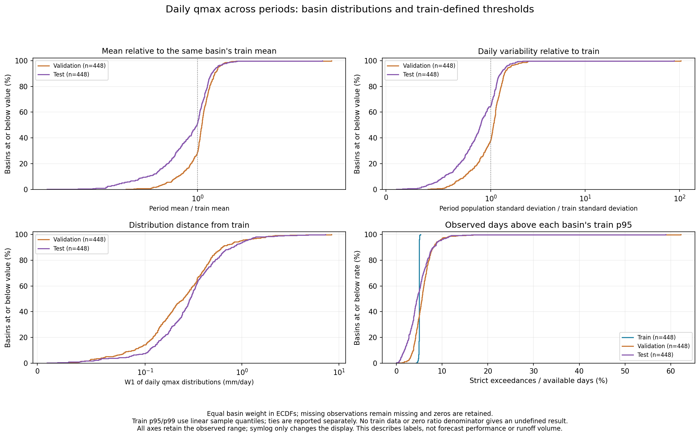

Hình đọc rõ, giữ đủ miền giá trị; các đường ECDF có n=448 vì chỉ dùng ID có đại lượng so train xác định. Mỗi ID có trọng số bằng nhau trong ECDF, còn tỷ lệ ngày gộp bên dưới dùng mẫu số số ngày có nhãn đủ điều kiện. Hai cách gộp không thay thế nhau.

#### 22.1.2. Mean, biến thiên và khoảng cách phân phối

| Kỳ | Trung vị mean từng ID | Trung vị std ddof=0 từng ID | Trung vị p99 từng ID | Trung vị mean/kỳ so train | Trung vị std/kỳ so train | Trung vị W1 so train |
|---|---:|---:|---:|---:|---:|---:|
| Train | 1,839542 | 2,392850 | 11,480474 | 1 | 1 | 0 |
| Validation | 1,984873 | 2,496847 | 11,864118 | 1,056465 | 1,063381 | 0,247428 |
| Test | 1,858761 | 2,285344 | 10,692290 | 0,995390 | 0,901536 | 0,290672 |

Mean/std/p99 và W1 có đơn vị mm/ngày; các tỷ số không có đơn vị. Ba cột thống kê riêng kỳ dùng 448 ID ở train và 451 ở hai kỳ sau; ba cột so train dùng cùng 448 ID. Vì vậy không lấy tỷ số hai trung vị của các kỳ làm trung vị tỷ số từng ID, hoặc xem những trung vị này là thống kê ngày gộp.

Ở 448 ID so được, trung vị mean validation/train cao hơn 1 khoảng 5,65%, còn test/train gần 1. Trung vị std test/train là **0,901536**, tức thấp hơn khoảng **9,85%** theo tỷ số từng ID. Tuy vậy W1 trung vị test lớn hơn validation (**0,290672 so với 0,247428 mm/ngày**). Đây là các khía cạnh mô tả khác nhau, không chứng minh xu thế khí hậu, thay đổi quan trắc hoặc kỳ nào dễ dự báo hơn. Các cực trị tỷ số/W1 phải đọc cùng độ phủ train từng ID.

#### 22.1.3. Vượt ngưỡng train và ảnh hưởng của cách gộp

| Kỳ | Ngưỡng train | Ngày đủ điều kiện | Ngày > ngưỡng | Ngày = ngưỡng | % vượt trên ngày gộp | Trung vị % vượt từng ID |
|---|---|---:|---:|---:|---:|---:|
| Train | p95 | 1112307 | 55281 | 830 | 4,969941 | 5,005866 |
| Train | p99 | 1112307 | 11227 | 194 | 1,009344 | 1,016817 |
| Validation | p95 | 652230 | 38107 | 382 | 5,842571 | 5,544148 |
| Validation | p99 | 652230 | 9627 | 78 | 1,476013 | 1,300479 |
| Test | p95 | 652983 | 32184 | 137 | 4,928765 | 4,483231 |
| Test | p99 | 652983 | 7706 | 14 | 1,180123 | 0,889802 |

Các ngưỡng giữ cố định từ train và dùng phép so **>**, không gộp ngày bằng ngưỡng vào số vượt. Phân vị mẫu nội suy, kích thước mẫu và giá trị trùng khiến tỷ lệ train không nhất thiết đúng 5%/1%; đây không phải lỗi số đếm. Các tỷ lệ gộp đã được tính lại từ tử số/mẫu số trong bảng và khớp đến độ chính xác hiển thị.

Validation có tỷ lệ vượt cao hơn train theo cả cách gộp ngày và trung vị từng ID. Ở test, tỷ lệ p99 trên ngày gộp **1,180123%** cao hơn tỷ lệ train gộp **1,009344%**, nhưng trung vị từng ID test **0,889802%** thấp hơn trung vị train **1,016817%**. Không lấy một cách gộp để khẳng định test đồng loạt có nhiều hoặc ít ngày Q cao hơn. Cần xem phân bố đóng góp từng ID, độ phủ train và năm quan trắc; các ngày vượt chưa là sự kiện lũ độc lập.

#### 22.1.4. Hồ sơ 55/742/758/800 và ba ID không có train

ID 55 có 1292/768/807 ngày nhãn theo ba kỳ; mean giảm từ **22,310696** xuống **19,319043/18,634331 mm/ngày**, std test/train **0,929585**, W1 test **3,676572 mm/ngày**. Số ngày thiếu lớn hạn chế việc diễn giải thay đổi phân phối quan trắc; các thống kê này không điền lại phần thiếu hoặc xác nhận nguyên nhân dự báo NaN.

742 có mean test/train **0,372395**, std test/train **0,156114**, còn 758 là **0,211303/0,100242**. Hai ID có thang và phương sai nhãn test nhỏ, trong khi W1 test chỉ **0,059285/0,057028 mm/ngày**. Khoảng cách tuyệt đối nhỏ không đồng nghĩa tác động nhỏ lên chỉ số chuẩn hóa như NSE; chưa có sai số dự báo theo cùng ngày để quy nguyên nhân.

800 chỉ có **38 ngày train**, mean **1,591469**, std **0,164561**, p99 **1,977811 mm/ngày**. Validation/test có đủ 1461 ngày, mean **9,564135/8,487811**, std **16,953857/14,398316**, p99 **88,037228/74,107882**. Tỷ số mean **6,009626/5,333317**, tỷ số std **103,024895/87,495430** và W1 **8,366351/7,283518** khớp các cực đại của bảng so train. Những tỷ số này phụ thuộc mạnh vào mẫu train ngắn và std train nhỏ; chưa chứng minh cơ chế vật lý hoặc lỗi dữ liệu. Ngưỡng 800 vẫn được mô tả cùng n=38, không được tự fit lại bằng validation/test. Phần 7 đã xác định nhóm có qmean không có cửa sổ train của 800, dù nhóm không Q có 38 ngày nhãn để tạo mẫu.

324/600/623 giữ các thống kê riêng validation/test nhưng mọi tỷ số/W1 so train và ngưỡng train đều NaN. 8.2 đã phân rã số ngày vượt theo ID/năm và đối chiếu riêng ảnh hưởng của hồ sơ 800 ở 22.2, không đổi tập 451 hoặc chọn xử lý bằng test.

### 22.2. Cell 8.2 — đóng góp đuôi phân phối, độ phủ train và đối chiếu ID 800

Phép đo giữ nguyên các ngưỡng p95/p99 của 8.1. Độ phủ train được kiểm theo 12 tháng lịch, số loại tháng/năm có quan trắc và ngày quan trắc đầu/cuối; số ngày cộng tháng phải khớp train. Các ngày >, =, < ngưỡng được đếm riêng theo ID/năm và cộng lại khớp từng ID/kỳ của 8.1. ID không có ngưỡng train giữ NaN ở số ngày so ngưỡng, không thành 0 khi cộng theo năm.

Đóng góp từng ID là tỷ phần số ngày vượt trên tổng số ngày vượt của cùng kỳ/ngưỡng, không phải tỷ phần lưu lượng hoặc số sự kiện. Cell báo thêm số tham chiếu nếu tỷ lệ vượt quan trắc ở train của ID đó giữ nguyên: số ngày có nhãn trong kỳ nhân với tỷ lệ train thực nghiệm. Hiệu giữa số vượt được thấy và số tham chiếu chỉ là đối chiếu mô tả, không phải mô hình kỳ vọng hay kiểm định nguyên nhân. Dùng tỷ lệ train thực nghiệm giúp phân biệt với mốc danh nghĩa 5%/1%, nhất là train ngắn hoặc có nhiều giá trị bằng nhau.

Hai phạm vi mô tả là toàn bộ ID có ngưỡng train và cùng phạm vi trừ riêng ID 800, hồ sơ đã được xác định trước tại Phần 2/5/7. Giữ ngưỡng và mọi bảng 8.1 nguyên trạng; không đổi selected_ids hoặc danh sách mô hình. Báo cả tỷ lệ ngày gộp và trung vị tỷ lệ từng ID, kèm mẫu số. Phạm vi toàn bộ phải tái tạo đúng các tổng 8.1; chênh với phạm vi không có 800 chỉ để lượng hóa ảnh hưởng của một hồ sơ train ngắn, không là quy tắc loại trạm.

Hình bốn ô gồm hai đường tỷ lệ vượt theo năm và hai biểu đồ mười ID góp nhiều ngày vượt nhất ở test. Thứ hạng chỉ phục vụ mô tả, không chọn mô hình bằng test; n train trên nhãn cột là ngày có quan trắc, không phải số cửa sổ mô hình. Hình không gộp các ngày liên tiếp thành trận và không xác nhận tính độc lập của sự kiện.

Cell xuất sáu CSV A1_P8_: qmax_train_month_counts, qmax_train_coverage, qmax_threshold_year_basin, qmax_threshold_year_summary, qmax_tail_contributions, qmax_tail_diagnostic_scopes. Bảng (1) 15 ID có ít ngày train nhất, (2) năm ID góp nhiều ngày vượt nhất theo kỳ/ngưỡng, (3) cộng năm, (4) hai phạm vi mô tả. Kết quả thực tế được trình bày ở 22.2.1–22.2.4. Kiểm giả lập đã xác nhận cộng năm/tháng, train 38 ngày, ID không có train, tỷ phần đóng góp, phép trừ riêng 800, tham chiếu theo train thực nghiệm, giữ nguyên cache/bảng 8.1 và dừng nếu ngưỡng bị thay đổi. Chưa ghép NSE, kiểm nguyên nhân hoặc thay dữ liệu/đầu vào mô hình.

#### 22.2.1. Độ phủ train và giới hạn của ngưỡng

Cell 8.2 chạy **3,6 giây**. [Output nguyên văn](Tables/A1_P8_qmax_tail_output.txt) và hình đã được giữ nguyên byte; sáu CSV chi tiết chưa nhận cục bộ, không dựng lại từ bản in. Tổng tháng khớp số ngày train; tổng năm khớp từng ID/kỳ/ngưỡng của 8.1. Bảng sau là 15 ID có ít ngày train nhất, mẫu số lịch mỗi ID là 2557 ngày.

| ID | Ngày train có nhãn | Loại tháng có nhãn / 12 | Năm có nhãn | Ngày đầu — cuối | p95 train | p99 train |
|---|---:|---:|---:|---|---:|---:|
| 324 | 0 | 0 | 0 | — | NaN | NaN |
| 600 | 0 | 0 | 0 | — | NaN | NaN |
| 623 | 0 | 0 | 0 | — | NaN | NaN |
| 800 | 38 | 2 | 1 | 2009-11-24 — 2009-12-31 | 1,844900 | 1,977811 |
| 295 | 365 | 12 | 1 | 2009-01-01 — 2009-12-31 | 27,004372 | 75,136518 |
| 296 | 380 | 12 | 2 | 2008-12-17 — 2009-12-31 | 24,991838 | 58,086246 |
| 791 | 671 | 12 | 2 | 2008-03-01 — 2009-12-31 | 0,968587 | 1,138605 |
| 391 | 710 | 12 | 2 | 2008-01-22 — 2009-12-31 | 0,559573 | 2,142346 |
| 561 | 731 | 12 | 2 | 2008-01-01 — 2009-12-31 | 3,918140 | 5,527017 |
| 309 | 796 | 12 | 3 | 2007-10-28 — 2009-12-31 | 12,983699 | 35,423323 |
| 608 | 840 | 12 | 3 | 2007-09-14 — 2009-12-31 | 2,884714 | 6,450163 |
| 577 | 878 | 12 | 3 | 2007-08-07 — 2009-12-31 | 4,280461 | 6,066744 |
| 590 | 967 | 12 | 3 | 2007-05-10 — 2009-12-31 | 1,744794 | 2,693447 |
| 485 | 1096 | 12 | 3 | 2007-01-01 — 2009-12-31 | 7,453281 | 9,674751 |
| 622 | 1096 | 12 | 3 | 2007-01-01 — 2009-12-31 | 13,320955 | 19,981432 |

Ngưỡng có đơn vị mm/ngày. ID 800 chỉ được quan trắc trong 38 ngày cuối train thuộc tháng 11–12/2009; p95/p99 của ID này không đại diện một mẫu quan trắc đủ 12 tháng. Các ID có đủ 12 loại tháng vẫn khác nhau về số năm/ngày; đủ loại tháng không đồng nghĩa đủ chuỗi hoặc ngưỡng ổn định. 324/600/623 giữ NaN ở ngưỡng và số vượt cần ngưỡng, không bị biến thành số 0.

#### 22.2.2. Đóng góp ngày vượt của ID 800 và các ID nổi bật

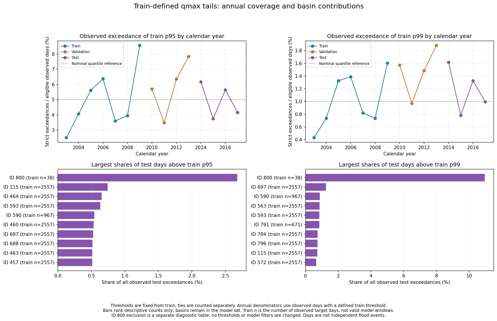

Hình có chữ và nhãn đọc rõ. Mỗi cột là tỷ phần **ngày vượt**, không phải tỷ lệ ngày vượt riêng của ID, khối lượng dòng chảy hoặc số sự kiện độc lập. n train là số ngày có nhãn, chưa áp mặt nạ cửa sổ mô hình. Bốn dòng của 800 cho thấy:

| Kỳ | Ngưỡng | Ngày có nhãn | Ngày vượt | % ngày riêng ID vượt | % đóng góp vào tổng ngày vượt cùng kỳ/ngưỡng |
|---|---|---:|---:|---:|---:|
| Validation | p95 | 1461 | 909 | 62,217659 | 2,385389 |
| Validation | p99 | 1461 | 893 | 61,122519 | 9,275995 |
| Test | p95 | 1461 | 861 | 58,932238 | 2,675242 |
| Test | p99 | 1461 | 844 | 57,768652 | 10,952505 |

Trong test, các ID tiếp theo theo số ngày vượt p99 là **697: 97 ngày (1,258759%)**, **590: 67 (0,869452%)**, **563: 66 (0,856475%)**, **593: 65 (0,843499%)**. 590 chỉ có 967 ngày train; những ID còn lại trong nhóm này có 2557. Theo p95, sau 800 là **115: 239**, **464: 210**, **593: 204**, **590: 175** ngày. Thứ hạng thay đổi theo ngưỡng và phụ thuộc nhãn có mặt; không dùng để loại lưu vực hoặc chọn mô hình bằng test.

#### 22.2.3. Tỷ lệ quan trắc theo năm

| Kỳ | Năm | Ngày đủ điều kiện | Ngày > p95 | % > p95 | Ngày > p99 | % > p99 |
|---|---:|---:|---:|---:|---:|---:|
| Train | 2003 | 154499 | 3863 | 2,500340 | 666 | 0,431071 |
| Train | 2004 | 156460 | 6354 | 4,061102 | 1154 | 0,737569 |
| Train | 2005 | 157457 | 8850 | 5,620582 | 2089 | 1,326711 |
| Train | 2006 | 158538 | 10099 | 6,370082 | 2201 | 1,388311 |
| Train | 2007 | 160083 | 5759 | 3,597509 | 1312 | 0,819575 |
| Train | 2008 | 162622 | 6429 | 3,953340 | 1199 | 0,737293 |
| Train | 2009 | 162648 | 13927 | 8,562663 | 2606 | 1,602233 |
| Validation | 2010 | 162786 | 9278 | 5,699507 | 2556 | 1,570160 |
| Validation | 2011 | 163015 | 5670 | 3,478208 | 1584 | 0,971690 |
| Validation | 2012 | 163491 | 10399 | 6,360595 | 2423 | 1,482039 |
| Validation | 2013 | 162938 | 12760 | 7,831200 | 3064 | 1,880470 |
| Test | 2014 | 163010 | 10060 | 6,171401 | 2637 | 1,617692 |
| Test | 2015 | 162909 | 6100 | 3,744422 | 1273 | 0,781418 |
| Test | 2016 | 163714 | 9240 | 5,643989 | 2169 | 1,324871 |
| Test | 2017 | 163350 | 6784 | 4,153046 | 1627 | 0,996021 |

Mẫu số là ngày quan trắc có ngưỡng train xác định, thay đổi theo độ phủ mỗi năm. Tỷ lệ dao động giữa các năm, trong đó p95 train 2009 là 8,562663% và p99 validation 2013 là 1,880470%. Các đường 5%/1% chỉ là mốc danh nghĩa; không phải tỷ lệ bắt buộc của từng năm hoặc xác nhận sự kiện lũ. Không suy cơ chế khí hậu từ các tổng ngày này.

#### 22.2.4. Phạm vi toàn bộ và đối chiếu riêng phần không có 800

| Kỳ | Ngưỡng | Ngày vượt / đủ điều kiện: 448 ID | % gộp 448 ID | Ngày vượt / đủ điều kiện: 447 ID không có 800 | % gộp 447 ID |
|---|---|---:|---:|---:|---:|
| Train | p95 | 55281 / 1112307 | 4,969941 | 55279 / 1112269 | 4,969931 |
| Train | p99 | 11227 / 1112307 | 1,009344 | 11226 / 1112269 | 1,009288 |
| Validation | p95 | 38107 / 652230 | 5,842571 | 37198 / 650769 | 5,716007 |
| Validation | p99 | 9627 / 652230 | 1,476013 | 8734 / 650769 | 1,342104 |
| Test | p95 | 32184 / 652983 | 4,928765 | 31323 / 651522 | 4,807666 |
| Test | p99 | 7706 / 652983 | 1,180123 | 6862 / 651522 | 1,053226 |

ID 800 đóng góp 844/7706=10,952505% số ngày test vượt p99. Phép đối chiếu không có 800 giảm tỷ lệ test từ 1,180123% xuống 1,053226%, vẫn cao hơn train tương ứng 1,009288%. Trung vị tỷ lệ p99 từng ID test vẫn là 0,889802% ở cả hai phạm vi. Vì vậy ảnh hưởng của 800 lớn ở số ngày gộp nhưng không thay được kết luận về trung vị từng ID; cũng không giải thích toàn bộ chênh lệch giữa các kỳ.

Đối chiếu theo tỷ lệ train thực nghiệm từng ID cho số tham chiếu test p99 **6618,328384**, so với 7706 ngày được thấy; phần chênh **1087,671616**. Phạm vi không có 800 có tham chiếu **6579,881015**, so với 6862, phần chênh **282,118985**. Các số thập phân này là tổng tỷ lệ nhân với ngày có nhãn, không phải số ngày thật hoặc kỳ vọng nhân quả. Sai số train ở mức 10⁻¹⁴ trong bảng là làm tròn số thực. Danh sách 451, ngưỡng train và đầu vào mô hình giữ nguyên; chưa ghép NSE hoặc chẩn đoán nguyên nhân dự báo.

### 22.3. Cell 8.3 — kiểm kê nguồn CSV NSE trước phép ghép

Sáu run và mã ngắn lấy từ A2 Phần 2/5: SeqLSTM_Q, SeqLSTM_noQ, EncDec_Q, EncDec_noQ, D_FC, D_RA. Mã đọc riêng CSV tác giả tại test/best_model/test_metrics.csv và output chạy lại theo bố cục A2 Phần 8: environment.json cùng runs/<mã run>/test_metrics.csv và config.yml. Các tệp environment.json được tìm dưới SEARCH_ROOT và WORK_DIR hiện tại; không thấy trong phạm vi đó không chứng minh chưa từng chạy A2. Candidate khác epoch chỉ liệt kê, không tự chọn tệp theo NSE hoặc chọn tệp đầu tiên.

Nguồn tác giả được ghi author_packaged; nguồn có metadata A2 được ghi A2_rerun_export, kèm đường dẫn artifact, SHA-256 và reported_repro_ok. Metadata là khai báo của export, chưa xác nhận lại tái lập hoặc phiên bản lịch sử. Từng run phải khớp ánh xạ trong environment.json; nhiều export giữ riêng, chưa tự chọn phiên bản. Không thay output A2 chưa tìm thấy bằng kết quả tác giả.

Cell kiểm config có target qmax và ngày test trùng PERIODS của A1; scope_status chỉ xác nhận khai báo config, chưa xác nhận tập ngày/quan trắc chấm NSE. Chỉ nhận cột basin và đúng một cột NSE hoặc qmax_NSE; schema khác/không rõ, ID sai hoặc trùng, ô không phải số được báo riêng. Giữ NSE âm, NaN và vô hạn theo trạng thái, báo ID ngoài/thiếu so tập 451; chưa ghép với các chỉ số phân phối hoặc tính tương quan. Không mở test_results.p hoặc thực thi mô hình.

Cell xuất bốn CSV A1_P8_: nse_author_candidates, nse_manifest_audit, nse_file_audit, nse_values; in năm bảng nguồn/phạm vi, thống kê NSE, ứng viên tác giả, schema/path và hồ sơ 55/742/758/800. Kết quả thực tế 8.3 được trình bày ở 22.3.1–22.3.4. Kiểm giả lập dùng đúng helper ngày/tên biến của A1 đã xác nhận trường hợp không có export, lựa chọn đúng best_model, tách nguồn tác giả/A2, NSE âm/NaN/inf, schema không rõ, ID trùng, giá trị không phải số và lệch ngày/ánh xạ run. Đây là kiểm mã, không phải kết quả NSE thực. Phạm vi ghép tiếp theo được xác định từ nguồn thực có ở 22.3.4.

#### 22.3.1. Nguồn NSE hiện có trong phiên A1

Cell 8.3 chạy **76,3 giây**; bảng (1)–(5) và cảnh báo được giữ nguyên byte trong [A1_P8_nse_inventory_output.txt](Tables/A1_P8_nse_inventory_output.txt). Bốn CSV kiểm kê/giá trị NSE đã xuất ở Kaggle nhưng chưa nhận cục bộ; không dựng CSV nguồn từ bản in.

Phạm vi tìm là **/kaggle/input và /kaggle/working**. Không tìm thấy environment.json theo schema export A2, nên sáu dòng A2_rerun_export có trạng thái A2_export_not_found_in_search_roots. Đây là tình trạng nguồn trong phiên A1 hiện tại; lần tái lập A2 đã ghi tại Mục 6.3 ghi chú dữ liệu vẫn là bằng chứng riêng, chưa có export đó để đối chiếu trong lần kiểm này.

Sáu run tác giả đều có đúng một candidate, đồng thời là đường dẫn test/best_model/test_metrics.csv. Các schema đều **basin | NSE | KGE**; cell chỉ đọc NSE. Mỗi tệp có đúng 451 ID, không ID trùng/ngoài/thiếu so tập chọn; không ô NSE không phải số hoặc vô hạn. Cả sáu config khai báo qmax và ngày test khớp A1. Sự khớp khai báo chưa xác nhận tập ngày/quan trắc thực sự chấm từng NSE, hoặc cùng byte quan trắc với CSV hiện tại.

#### 22.3.2. Phân phối NSE tác giả theo sáu run

| Run | Dòng | NSE hữu hạn | NSE âm hữu hạn | NaN/rỗng | Min NSE | Median NSE hữu hạn | Max NSE |
|---|---:|---:|---:|---:|---:|---:|---:|
| SeqLSTM_Q | 451 | 450 | 4 | 1 | -78,295601 | 0,705284 | 0,963512 |
| SeqLSTM_noQ | 451 | 451 | 3 | 0 | -8,714366 | 0,627573 | 0,901427 |
| EncDec_Q | 451 | 450 | 13 | 1 | -131,419769 | 0,662180 | 0,906630 |
| EncDec_noQ | 451 | 451 | 20 | 0 | -157,913528 | 0,568854 | 0,887867 |
| D_FC | 451 | 451 | 39 | 0 | -33,289719 | 0,386676 | 0,893906 |
| D_RA | 451 | 451 | 3 | 0 | -85,115341 | 0,692254 | 0,930696 |

Đây là số liệu **author_packaged**, không được gắn nhãn kết quả chạy lại A2. Hai run có Q có một NSE NaN ở ID 55; bốn run còn lại đủ NSE hữu hạn. NSE âm giữ nguyên trong phân phối và các phép ghép sau; không thay bằng 0 hoặc bỏ các giá trị cực âm. Tỷ lệ âm/tóm tắt từng run chưa phải phép so trên cùng ngày chấm hoặc cùng tập NSE hữu hạn giữa hai run.

#### 22.3.3. Bốn hồ sơ đã xác định

| Run | ID 55 | ID 742 | ID 758 | ID 800 |
|---|---:|---:|---:|---:|
| SeqLSTM_Q | NaN | -43,940674 | -78,295601 | 0,624186 |
| SeqLSTM_noQ | 0,705703 | -4,263644 | -8,714366 | 0,424788 |
| EncDec_Q | NaN | -51,199471 | -131,419769 | 0,526949 |
| EncDec_noQ | 0,732324 | -63,028679 | -157,913528 | 0,180123 |
| D_FC | 0,448833 | -10,795778 | -33,289719 | 0,369651 |
| D_RA | 0,583690 | -34,283207 | -85,115341 | 0,498844 |

742/758 có NSE âm ở cả sáu run. Phần 5/8.1 đã xác định thang và phương sai nhãn test nhỏ, nhưng chưa có sai số trên đúng ngày chấm để xác nhận nguyên nhân NSE. Hai run có Q giữ NaN tại 55, phù hợp hồ sơ thiếu đầu vào/cửa sổ của CSV hiện tại; sự phù hợp chưa xác nhận đầy đủ chuỗi xử lý lịch sử.

800 có NSE dương ở cả sáu run, dù chỉ có 38 ngày nhãn train và không có cửa sổ train ở nhóm có Q theo phép đếm CSV Phần 7. Mô hình được huấn luyện chung nhiều lưu vực; thiếu cửa sổ train riêng ID không đồng nghĩa không thể có dự báo hoặc NSE test dương. Chưa suy đóng góp huấn luyện thực tế hoặc nguyên nhân khác biệt giữa sáu run từ các số này.

#### 22.3.4. Phạm vi cho phép ghép kế tiếp

Phép ghép kế tiếp dùng rõ nguồn **NSE tác giả** và đặc điểm nhãn CSV hiện tại theo ID, phục vụ mô tả. Nguồn author_packaged không thay thế hoặc được gọi là output A2_rerun_export. Giữ giới hạn tập ngày/quan trắc chấm chưa đối chiếu; không tính lại NSE hoặc mở pickle trong phép ghép này. Khi có export A2, cần kiểm kê lại nguồn trước khi so trực tiếp.

### 22.4. Cell 8.4 — đặc điểm nhãn và NSE tác giả theo ID

Cell giữ đúng sáu run author_packaged đã kiểm 8.3, kiểm duy nhất run/ID, đúng tập ID chọn, scope config và SHA-256 của CSV không đổi. Ghép nhiều run với một bảng đặc điểm mỗi ID; không đưa A2_rerun_export vào phép ghép tác giả hoặc tự chọn phiên bản. Bảng nhãn từ 8.1–8.2 giữ nguyên NaN ở đại lượng cần train khi ID không có train.

Tám đặc điểm cố định gồm phần trăm ngày có nhãn train/test, std train/test ddof=0, tỷ số mean test/train, tỷ số std test/train, W1 test so train và tỷ lệ ngày test vượt p99 train. Đây là đặc điểm quan trắc CSV hiện tại, không phải số mẫu huấn luyện thực tế hoặc đặc điểm trên tập ngày chấm NSE đã xác nhận. Mỗi tương quan dùng đúng cặp đặc điểm/NSE hữu hạn theo ID; báo riêng thiếu NSE rồi thiếu đặc điểm khi NSE hữu hạn để tránh đếm lặp. NSE âm giữ nguyên; không điền NaN hoặc cắt ngoại lai.

Pearson đo quan hệ tuyến tính, Spearman là Pearson của thứ hạng trung bình cho giá trị trùng. Hệ số giữ NaN khi dưới ba cặp hoặc một phía hằng. Không xuất p-value vì các lưu vực có thể lồng nhau, không giả định mẫu độc lập. Mỗi ID có trọng số bằng nhau trong từng phép đo; các run/đặc điểm có thể dùng tập hữu hạn khác nhau, được báo n và danh sách loại theo trạng thái.

Hai phạm vi độ nhạy đã định trước theo hồ sơ Phần 5/8 là không có 742/758 và không có 800, mỗi phạm vi so với toàn bộ ID chọn. Đây là đối chiếu mô tả, không thay danh sách mô hình hoặc chọn loại ID theo NSE. Bảng chi tiết giữ cả tám đặc điểm; bản in độ nhạy tập trung std test, tỷ số std và W1. Hình gồm hai ma trận Pearson/Spearman toàn bộ, có hệ số và n trong mỗi ô. NSE có chuẩn hóa theo phương sai quan trắc; mối liên hệ với std hoặc tỷ số std có thể chịu cấu trúc chỉ số, chưa phải quan hệ nhân quả hoặc thước đo kỹ năng độc lập.

Cell xuất hình A1_P8_author_nse_label_associations.png và bốn CSV A1_P8_: author_nse_label_join, author_nse_label_coverage, author_nse_label_associations, author_nse_label_sensitivity. Bảng (1) độ phủ NSE, (2) tương quan toàn bộ, (3) độ nhạy, (4) hồ sơ 55/324/600/623/742/758/800. Kết quả thực tế 8.4 được trình bày ở 22.4.1–22.4.3. Kiểm giả lập đã xác nhận tách nguồn, mặt nạ thiếu/no-train, số đếm không chồng lấp, 144 tổ hợp run/đặc điểm/phạm vi, hệ số có ties khớp SciPy, trường hợp hằng/ít cặp, giữ bảng nhãn và dừng khi tệp nguồn đổi. Hình giả lập đã được kiểm bố cục; các phép kiểm mã này không phải kết quả NSE thực.

#### 22.4.1. Độ phủ và kết quả tương quan

Cell 8.4 chạy **1,3 giây**. [Output nguyên văn](Tables/A1_P8_author_nse_label_output.txt) và hình được giữ nguyên byte; bốn CSV chi tiết chưa nhận cục bộ. Nguồn là sáu CSV author_packaged, không phải export chạy lại A2. Số NSE hữu hạn/âm giữ đúng 8.3: 450/4, 451/3, 450/13, 451/20, 451/39, 451/3 theo thứ tự sáu run trong bảng dưới.

Đặc điểm không cần train dùng 450 cặp ở hai run có Q và 451 ở bốn run còn lại. Đặc điểm cần train giảm còn **447/448** vì 324/600/623 không có nhãn train; NaN NSE ở 55 được đếm riêng trước đó. Không loại NSE âm hoặc điền đại lượng chưa xác định. Cả 48 tương quan toàn bộ đều xác định.

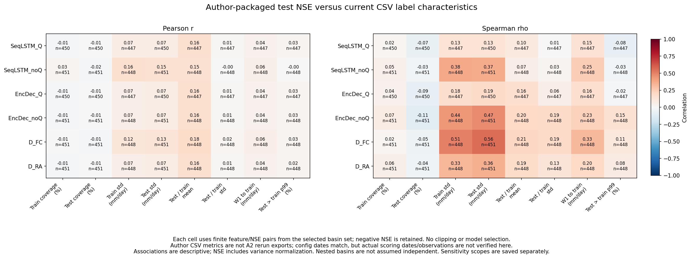

Hình đọc rõ, hiển thị hai chữ số cho hệ số và n từng ô; số chính xác lấy từ bảng văn bản. Không diễn giải các ô gần 0 hoặc khác hai chữ số như kiểm định ý nghĩa thống kê.

| Run | Pearson NSE–std test | Spearman NSE–std test | Pearson NSE–W1 test/train | Spearman NSE–W1 test/train |
|---|---:|---:|---:|---:|
| SeqLSTM_Q | 0,073922 | 0,134738 | 0,044910 | 0,147796 |
| SeqLSTM_noQ | 0,153573 | 0,374418 | 0,059938 | 0,246092 |
| EncDec_Q | 0,072219 | 0,187813 | 0,043521 | 0,164584 |
| EncDec_noQ | 0,072416 | 0,472534 | 0,041811 | 0,232317 |
| D_FC | 0,131294 | 0,562259 | 0,062896 | 0,326982 |
| D_RA | 0,071974 | 0,357729 | 0,040303 | 0,198862 |

Spearman NSE–std test dương ở sáu run, từ 0,134738 đến 0,562259; Pearson chỉ từ 0,071974 đến 0,153573. Hai phép đo mô tả quan hệ khác nhau và có độ nhạy khác với giá trị cực trị. NSE chuẩn hóa sai số bằng phương sai quan trắc; mối liên hệ với std chưa chứng minh phương sai nhãn là nguyên nhân duy nhất hoặc chỉ số kỹ năng độc lập.

Spearman NSE–W1 thô cũng dương ở sáu run, từ 0,147796 đến 0,326982. W1 có đơn vị mm/ngày và phụ thuộc thang lưu lượng, nên không dùng dấu này để khẳng định lệch phân phối làm mô hình tốt hơn hoặc xấu hơn. Pearson với phần trăm nhãn train gần 0 (−0,010545 đến 0,029994), Spearman 0,018665–0,072014; số ngày nhãn là một đặc điểm toàn kỳ, không thay cho số cửa sổ/mẫu train hoặc xác nhận thiếu dữ liệu không gây tác động ở từng ID.

#### 22.4.2. Độ nhạy với 742/758 và 800

| Run | Pearson NSE–std test toàn bộ | Pearson không có 742/758 | Spearman toàn bộ | Spearman không có 742/758 |
|---|---:|---:|---:|---:|
| SeqLSTM_Q | 0,073922 | 0,138146 | 0,134738 | 0,123098 |
| SeqLSTM_noQ | 0,153573 | 0,281682 | 0,374418 | 0,366021 |
| EncDec_Q | 0,072219 | 0,178350 | 0,187813 | 0,176886 |
| EncDec_noQ | 0,072416 | 0,306779 | 0,472534 | 0,465454 |
| D_FC | 0,131294 | 0,424646 | 0,562259 | 0,556384 |
| D_RA | 0,071974 | 0,232980 | 0,357729 | 0,349108 |

Khi đối chiếu không có hai hồ sơ đã biết, Pearson tăng ở cả sáu run; Spearman giảm ít, khoảng 0,005876–0,011640 theo cột delta trong output. Điều này lượng hóa độ nhạy của hệ số trong mẫu đang xét, không là quy tắc bỏ hai ID hoặc xác nhận nguyên nhân NSE cực âm của chúng. Các phép này có 448/449 cặp thay vì 450/451.

| Run | Pearson NSE–tỷ số std toàn bộ | Pearson không có 800 | Spearman toàn bộ | Spearman không có 800 |
|---|---:|---:|---:|---:|
| SeqLSTM_Q | 0,014901 | 0,171046 | 0,007283 | 0,009870 |
| SeqLSTM_noQ | -0,002598 | 0,141455 | 0,029094 | 0,033777 |
| EncDec_Q | 0,014604 | 0,169780 | 0,063729 | 0,067743 |
| EncDec_noQ | 0,013493 | 0,172159 | 0,190258 | 0,196702 |
| D_FC | 0,017306 | 0,192641 | 0,191181 | 0,192488 |
| D_RA | 0,013520 | 0,169418 | 0,126506 | 0,131434 |

800 có tỷ số std test/train **87,495430**, trong khi train chỉ 38 ngày. Phép đối chiếu riêng không có 800 làm Pearson tăng khoảng 0,144053–0,175335, còn Spearman chỉ tăng 0,001307–0,006444. Đây là bằng chứng độ nhạy với một hồ sơ train ngắn đã xác định trước, chưa cho phép chọn phạm vi tương quan theo hệ số mong muốn. Danh sách mô hình vẫn 451 ID.

#### 22.4.3. Ba ID không có nhãn train và phạm vi suy luận

| Run | NSE ID 324 | NSE ID 600 | NSE ID 623 |
|---|---:|---:|---:|
| SeqLSTM_Q | 0,410151 | 0,223199 | 0,748529 |
| SeqLSTM_noQ | 0,468634 | -0,147282 | 0,655505 |
| EncDec_Q | -0,493062 | 0,338786 | 0,724308 |
| EncDec_noQ | -0,393201 | -0,080739 | 0,496013 |
| D_FC | 0,374076 | 0,223356 | 0,428810 |
| D_RA | 0,423347 | 0,024480 | 0,735471 |

Cả ba có 1461 ngày nhãn test theo CSV và không có nhãn train riêng ID. NSE tác giả vẫn có số, với cả giá trị dương và âm; tỷ số/W1/ngưỡng cần train giữ NaN. Mô hình chung nhiều lưu vực không đòi mỗi ID phải có nhãn train riêng để xuất dự báo. Phép ghép này chưa kiểm chuỗi dự báo/ngày chấm của ba ID hoặc quy các kết quả cho một cơ chế tổng quát hóa cụ thể.

### 22.5. Tổng kết Phần 8 — phân phối nhãn và NSE theo nguồn

Phần 8 hoàn thành khảo sát mô tả 8.1–8.4 trên nhãn CSV hiện tại và sáu NSE tác giả đã kiểm kê. Độ phủ, phân phối giữa kỳ, ngày vượt ngưỡng train, đóng góp theo ID/năm và tương quan ngang ID đã được đo với mẫu số tương ứng. Tỷ lệ ngày gộp và trung vị từng ID có thể khác hướng; ngưỡng train ngắn như 800 cần giữ giới hạn đại diện mùa. Đối chiếu không có các hồ sơ 742/758/800 chỉ phục vụ độ nhạy, không đổi tập mô hình, fit ngưỡng bằng test hoặc chọn xử lý theo NSE.

NSE tác giả và export A2 là hai nguồn riêng. Phiên A1 hiện chưa tìm thấy export A2 trong Input/Working; kết quả tái lập trước đó được giữ tại ghi chú A2. Các tương quan ghép theo ID chưa xác nhận đặc điểm CSV và NSE cùng tập ngày/quan trắc chấm. Phần 9 đã kiểm chuỗi tác giả cho bốn hồ sơ cố định; kết quả đồng nhất ngày/obs chưa được mở rộng cho toàn bộ 451.

Phương sai nhãn nhỏ, mean sai số và phương sai sai số cần được đo trên đúng cặp obs/sim trước khi giải thích NSE. Việc đếm sự kiện độc lập, ngưỡng tần suất lũ và đánh giá persistence/PNSE/KGE chưa được thực hiện ở Phần 8; được giữ ở phần chuyên biệt/A3. Chưa thay dữ liệu gốc, scaler, mô hình hoặc danh sách 451.

## 23. Hồ sơ quan trắc và dự báo: Phần 9

### 23.1. Cell 9.1 — đối chiếu chuỗi tác giả của 55/742/758/800

Cell đọc lần lượt sáu test_results.p đúng cạnh CSV best_model đã kiểm 8.3, xác nhận đường dẫn metrics, hash và config ngày/target trước khi đọc. Tệp chuỗi được ghi SHA-256/kích thước/trạng thái; không tự chọn epoch hoặc tệp đầu tiên. Mỗi lượt chỉ giữ chuỗi bốn ID và giải phóng dict kết quả trước run sau để hạn chế RAM. Nguồn là author_packaged, không phải A2 chạy lại.

Schema nhận là dict basin → 1D → xr với qmax_obs/qmax_sim có hai chiều date/time_step. Bộ chấm ngày trong tester.py lấy phần tử time_step cuối; cell yêu cầu phần tử cuối là 0, ghi số time_step, không tự dịch ngày hoặc gộp samples. Ngày phải duy nhất, tăng dần, đúng mốc ngày và không mang múi giờ. Các ngày ngoài kỳ test được đếm riêng; thiếu dòng trong kỳ giữ NaN. Schema khác được báo theo run/ID; không tự diễn giải như chuỗi hợp lệ.

Quan trắc từ pickle được so với qmax mm/ngày cache 5.1 của CSV hiện tại trên cùng ngày: số ngày chung, mặt nạ thiếu khác nhau, sai khác tuyệt đối lớn nhất, số ngày trong 10⁻⁷ và 10⁻⁵ mm/ngày. Hai dung sai chỉ mô tả sai khác số học, không là quy tắc sửa giá trị. Phép tính NSE dùng obs tác giả và đúng giao obs/sim hữu hạn, không dùng CSV obs thay vào. Quan trắc bằng 0 giữ nguyên.

Mã tester.py áp clip_targets_to_zero khi tính metrics, sau khi lưu xr chứa dự báo. Cell giữ sim_raw, ghi số dự báo âm và chỉ tạo sim_evaluated chặn dưới 0 nếu config khai báo qmax; tính cả NSE từ sim gốc và NSE theo chính sách chấm khai báo. Không thêm chính sách chặn mới. Báo sai khác NSE float64 với CSV, trạng thái hữu hạn/NaN, mean error=sim−obs, RMSE và std obs ddof=0. Phân rã MSE thành bình phương mean error cộng phương sai sai số được kiểm cộng khớp; hai phần chia phương sai obs cộng thành 1−NSE khi xác định. Không tự gán tất cả NSE âm cho mean sai số hoặc phương sai nhỏ.

Hình bốn panel vẽ qmax CSV và hai run SeqLSTM_Q/noQ cố định theo ngày test; mỗi panel có thang dọc riêng. Bảng kiểm cả sáu run; CSV ngày giữ cả obs tác giả, obs CSV, sim gốc và sim theo chính sách config. Tệp xuất là A1_P9_author_profile_series.png cùng ba CSV A1_P9_: author_profile_files, author_profile_scores, author_profile_daily. In bảng (1) tệp nguồn, (2) obs/ngày/mask, (3) sai số và NSE. Kết quả thực tế 9.1 được trình bày ở 23.1.1–23.1.4.

#### 23.1.1. Nguồn, lịch và độ khớp quan trắc

Cell 9.1 chạy **25,2 giây**; hình và [output nguyên văn](Tables/A1_P9_author_profile_output.txt) giữ nguyên byte. Sáu dòng tiến độ đọc run đã được cung cấp trong chat. Ba CSV chi tiết chưa nhận cục bộ; bảng văn bản rút gọn đường dẫn/hash bằng dấu ..., nên chưa có chuỗi SHA-256 đầy đủ từ bản in để đối chiếu cục bộ.

Cả sáu archive đúng cạnh best_model metrics đều đọc được, mỗi tệp có **451 khóa basin**. Hai tệp run có Q có 16177813 byte/tệp, bốn tệp còn lại 16177815 byte/tệp. Chỉ bốn ID được trích và kiểm trong mỗi run: **24 hồ sơ**. Mỗi hồ sơ có một time_step, không dòng ngoài test hoặc thiếu dòng kết quả trong lịch 2014–2017. Việc archive có 451 khóa chưa xác nhận chất lượng chuỗi của 447 ID còn lại.

| ID | Ngày obs tác giả/CSV hữu hạn trong mỗi run | Ngày khác mặt nạ thiếu | Max sai khác tuyệt đối obs–CSV giữa các run (mm/ngày) | Ngày trong 10⁻⁵ mỗi run |
|---|---:|---:|---:|---:|
| 55 | 807 / 807 | 0 | 7,902447×10⁻⁶ | 807 |
| 742 | 1461 / 1461 | 0 | 1,199719×10⁻⁷ | 1461 |
| 758 | 1461 / 1461 | 0 | 1,186967×10⁻⁷ | 1461 |
| 800 | 1461 / 1461 | 0 | 1,068512×10⁻⁵ | 1460 |

800 có **một ngày trong mỗi run vượt 10⁻⁵**, với max 1,068512×10⁻⁵ ở bốn run LSTM/EncDec và 1,031053×10⁻⁵ ở D_FC/D_RA. Không ghi mọi obs đều khớp trong dung sai đó, không tự nâng dung sai hoặc sửa quan trắc. Mức sai khác nhỏ tương thích với nhu cầu kiểm đường tính số học; chưa xác nhận nguyên nhân chỉ từ cỡ sai khác. Mã hiện tại có chuẩn hóa/ép float32/khôi phục nhãn, nên ép CSV sang float32 trực tiếp không tự tái tạo được toàn bộ đường tính tác giả.

#### 23.1.2. Chính sách chấm và NSE tính lại

Cả sáu config đều khai báo chặn qmax âm về 0 khi chấm. sim_raw trong archive được giữ riêng; sim_evaluated chỉ áp chính sách đã khai báo. Trạng thái NSE hữu hạn/NaN tính lại khớp CSV ở **24/24 hồ sơ**, gồm **22 NSE hữu hạn** và hai ca NaN của 55. Sai khác tuyệt đối lớn nhất giữa NSE float64 tính lại và NSE lưu là **8,661331×10⁻⁶**, tại SeqLSTM_Q/758; không phải sai khác dự báo giữa tác giả và chạy lại A2.

Ví dụ ảnh hưởng chính sách chặn âm trên đủ 1461 cặp của 742/758 ở SeqLSTM_noQ:

| ID | Ngày sim_raw âm | NSE từ sim gốc | NSE sau chính sách config | NSE lưu |
|---|---:|---:|---:|---:|
| 742 | 397 | -6,523761 | -4,263644 | -4,263644 |
| 758 | 581 | -13,830682 | -8,714366 | -8,714366 |

Chặn âm là một bước của bộ chấm tác giả, không là xử lý mới do A1 lựa chọn để tăng NSE. Ở các hồ sơ khác, số sim âm trong toàn lịch có thể khác số sim âm trên ngày có obs; cần phân biệt trước khi quy ảnh hưởng lên NSE. Tệp dự báo gốc và NSE CSV không bị thay đổi.

#### 23.1.3. Sai số ở 742/758: các thành phần khác nhau giữa run

Trên đúng 1461 cặp, std obs là **0,017361 mm/ngày** ở 742 và **0,012552** ở 758. Đặt b là mean(sim−obs), v là phương sai obs ddof=0 và e=sim−obs, thì **1−NSE=b²/v+Var(e)/v**. Đây là đồng nhất thức sai số, không giải thích cơ chế mô hình hoặc tình trạng quan trắc vật lý.

| Run | ID | Mean error (mm/ngày) | RMSE (mm/ngày) | b²/v | Var(e)/v | NSE float64 |
|---|---:|---:|---:|---:|---:|---:|
| SeqLSTM_Q | 742 | 0,096242 | 0,116386 | 30,730283 | 14,210393 | -43,940676 |
| SeqLSTM_Q | 758 | 0,092153 | 0,111776 | 53,897887 | 25,397722 | -78,295610 |
| SeqLSTM_noQ | 742 | -0,001009 | 0,039831 | 0,003380 | 5,260265 | -4,263644 |
| SeqLSTM_noQ | 758 | 0,010126 | 0,039123 | 0,650755 | 9,063611 | -8,714366 |
| EncDec_Q | 742 | 0,123997 | 0,125434 | 51,010070 | 1,189403 | -51,199473 |
| EncDec_Q | 758 | 0,143597 | 0,144444 | 130,870193 | 1,549570 | -131,419763 |
| EncDec_noQ | 742 | 0,137833 | 0,138922 | 63,028679 | 1,000000 | -63,028679 |
| EncDec_noQ | 758 | 0,157737 | 0,158236 | 157,913531 | 1,000000 | -157,913531 |
| D_FC | 742 | 0,044969 | 0,059627 | 6,709166 | 5,086611 | -10,795777 |
| D_FC | 758 | 0,061989 | 0,073503 | 24,388121 | 9,901600 | -33,289721 |
| D_RA | 742 | 0,096892 | 0,103126 | 31,146564 | 4,136641 | -34,283205 |
| D_RA | 758 | 0,111371 | 0,116483 | 78,721708 | 7,393634 | -85,115342 |

SeqLSTM_Q và EncDec có phần bình phương mean error lớn, trong khi SeqLSTM_noQ có phần phương sai sai số chiếm ưu thế. Vì vậy không thể gán mọi NSE âm của hai ID cho duy nhất độ lệch trung bình. Với EncDec_noQ, Var(e)/v được in bằng 1 ở cả hai ID; phép kiểm số mức trực tiếp ở 23.2.1 xác nhận hai chuỗi sim là cùng một hằng số trên toàn test. Các con số không đề xuất hiệu chỉnh mean error bằng nhãn test.

#### 23.1.4. Hồ sơ 55/800 và hình chuỗi

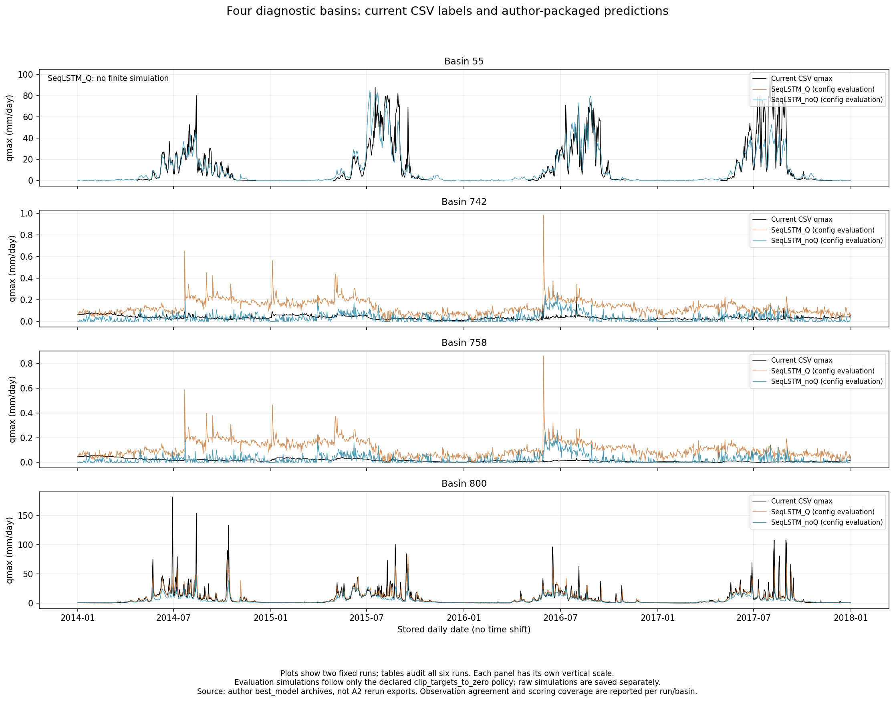

Hình đọc rõ, có thang dọc riêng mỗi ID. Tại 55, hai run có Q đều **0 ngày sim hữu hạn**, nên không có cặp để chấm dù có 807 ngày obs; NSE NaN được giữ đúng. Bốn run còn lại có sim trên đủ 1461 ngày, nhưng NSE chỉ dùng 807 ngày có obs. Kết quả xác nhận dự báo NaN trong archive, phù hợp bằng chứng cửa sổ thiếu ở Phần 7; chưa truy nguyên toàn bộ đường xử lý NaN bên trong mô hình.

800 có đủ 1461 cặp, std obs 14,398316 mm/ngày. Mean error/RMSE theo SeqLSTM_Q, SeqLSTM_noQ, EncDec_Q, EncDec_noQ, D_FC, D_RA lần lượt là **−0,737215/8,826693; −3,185964/10,920074; −3,121835/9,902977; −5,336298/13,037255; −3,158166/11,431475; −3,477593/10,192908 mm/ngày**. Mean dự báo thấp hơn mean obs trong cả sáu run; NSE vẫn dương, từ 0,180123 đến 0,624186. Mẫu train riêng 38 ngày chưa đủ để quy nguyên nhân sai số test hoặc kết luận mô hình không có khả năng dự báo ID này.

Mức khớp ngày/mặt nạ và NSE ở 24 hồ sơ tăng độ chắc chắn cho chính các ca đã kiểm, chưa xác nhận toàn bộ 451 ID hoặc quan trắc độc lập. Phép kiểm tiếp theo tập trung số mức sim chính xác, phần sim âm thuộc ngày chấm và ví dụ obs vượt dung sai.

### 23.2. Cell 9.2 — độ biến thiên sim, ngày chặn âm và ví dụ sai khác obs

Cell dùng A1_AUTHOR_PROFILE_DAILY/SCORES của 9.1; không đọc lại sáu archive. Kiểm đủ 24 khóa run/ID, ngày duy nhất đúng lịch, số cặp, chính sách sim_evaluated và MSE khớp 9.1 trước khi tính. Dữ liệu gốc/cache giữ nguyên.

Số mức giá trị chính xác, min/max/std của sim gốc và sim theo config được tính trên ngày sim hữu hạn. Chuỗi chỉ được gọi constant nếu có số và max=min chính xác; toàn NaN không trở thành chuỗi hằng. Đếm riêng sim âm toàn lịch, trên cặp chấm và ngoài ngày có obs; báo số 0 sau chặn trên ngày chấm, phần bình phương mean error/MSE và mức thay đổi NSE do chính sách chấm đã khai báo. Đây không phải thử một hiệu chỉnh mới.

So riêng sim 742/758 của mỗi run trên cùng ngày, báo số giá trị bằng nhau chính xác, sai khác tuyệt đối và Pearson khi hai chuỗi có biến thiên; chuỗi hằng giữ tương quan NaN. Hai dự báo giống nhau hoặc hằng chưa chỉ ra nguyên nhân mô hình. Hình hai panel trình bày b²/v và Var(e)/v trên sáu run của 742/758; tổng chiều cao là 1−NSE, không phải tỷ phần nguyên nhân vật lý.

Giữ ba sai khác obs–CSV lớn nhất mỗi run/ID cùng ngày, chỉ in các ví dụ vượt 10⁻⁵ mm/ngày. Ngày vượt không bị bỏ hoặc đổi dung sai. Báo thêm sai khác với CSV ép float32 trực tiếp; phép so này không tái tạo đầy đủ chuẩn hóa/khôi phục nhãn tác giả, nên khớp hoặc không khớp ứng viên này không tự xác nhận nguồn sai khác.

Cell xuất hình A1_P9_author_profile_error_components.png và ba CSV A1_P9_: author_profile_variation, author_profile_obs_examples, author_profile_pair_similarity; in bảng (1) độ biến thiên, (2) chặn âm/phần mean error, (3) so cặp 742/758, (4) ví dụ obs vượt dung sai. Kết quả thực tế 9.2 được trình bày ở 23.2.1–23.2.3. Kiểm giả lập đã xác nhận 24 hồ sơ, chuỗi hằng so với toàn NaN, số đếm sim âm trong/ngoài tập chấm, hai chuỗi hằng giống nhau giữ r NaN, ví dụ vượt dung sai, giữ bảng đầu vào và dừng khi trùng ngày; hình giả lập đã kiểm bố cục.

#### 23.2.1. Dự báo hằng của EncDec_noQ đã được xác nhận

Cell 9.2 chạy **0,7 giây**; [output nguyên văn](Tables/A1_P9_author_profile_variation_output.txt) và hình giữ nguyên byte. Ba CSV chi tiết chưa nhận cục bộ. Phép đo dùng cache chuỗi 9.1, không mở lại archive hoặc chạy mô hình.

EncDec_noQ tại **742 và 758 đều có đúng một mức sim_raw trong 1461 ngày**, min=max, std=0, giá trị hiển thị **0,173010 mm/ngày**. Hai chuỗi bằng nhau chính xác trên **1461/1461 ngày**, trước và sau chính sách chặn âm; không phải chỉ gần nhau tới sáu chữ số. Tương quan Pearson giữa hai chuỗi hằng giữ NaN, không gán bằng 1. Kết quả xác nhận tính chất đầu ra lưu, chưa xác nhận nguyên nhân như trạng thái mạng, lớp nhúng hoặc dữ liệu đầu vào.

Với sim hằng c, e=c−obs nên Var(e)=Var(obs) trên cùng cặp; phần Var(e)/Var(obs)=1 ở 9.1 được giải thích bằng tính chất chuỗi vừa đo. NSE bằng −(c−mean(obs))²/Var(obs), tương ứng hai giá trị khoảng **−63,028679/−157,913531** khi tính float64. Đây là mô tả đại số của dự báo đã lưu, không đề xuất dùng mean test để hiệu chỉnh.

Các run khác có biến thiên ở hai ID. EncDec_Q có 1046/1020 mức, std sim **0,010477/0,009026 mm/ngày**, dải **0,156127–0,286684 / 0,156156–0,286726**. SeqLSTM_Q có std sau chặn **0,067690/0,064246**, SeqLSTM_noQ **0,038526/0,035829**. Hai ca 55 toàn NaN ở run có Q được ghi 0 mức và constant=False, không bị hiểu thành dự báo hằng bằng 0.

#### 23.2.2. Thành phần sai số và dự báo âm trên ngày chấm

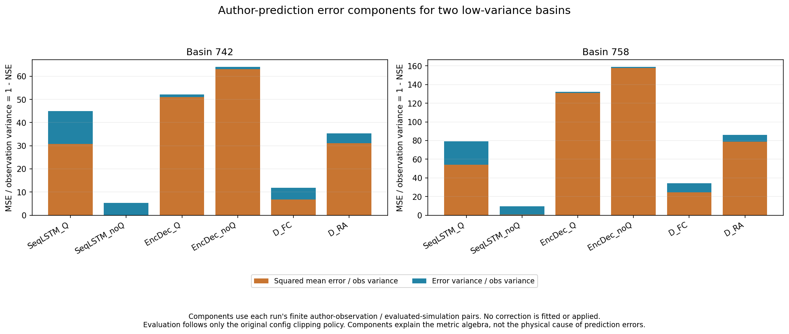

Hình đọc rõ, hai panel có thang dọc riêng. Tổng cột là MSE/Var(obs)=1−NSE; các phần không phải tỷ lệ nguyên nhân vật lý. Tỷ phần MSE từ bình phương mean error được đo như sau:

| Run | ID 742 | ID 758 |
|---|---:|---:|
| SeqLSTM_Q | 68,3797% | 67,9708% |
| SeqLSTM_noQ | 0,0642% | 6,6989% |
| EncDec_Q | 97,7214% | 98,8298% |
| EncDec_noQ | 98,4382% | 99,3707% |
| D_FC | 56,8777% | 71,1237% |
| D_RA | 88,2759% | 91,4143% |

EncDec có MSE chủ yếu từ phần mean error trong hai hồ sơ này, còn SeqLSTM_noQ chủ yếu từ phương sai sai số. Kết quả định lượng củng cố việc không gán mọi NSE âm cho một thành phần chung; chưa cho phép chọn sửa dự báo theo số liệu test.

Ở 55, **113/113 sim_raw âm của SeqLSTM_noQ nằm ngoài ngày có obs**, nên không thuộc 807 cặp chấm và mức tăng NSE do chặn âm bằng 0. D_FC có 143 sim âm, gồm **47 trên cặp chấm và 96 ngoài obs**; NSE thay đổi khoảng **0,000043** theo chính sách chấm. 742/758 có obs đủ mọi ngày nên 397/581 sim âm SeqLSTM_noQ đều thuộc tập chấm; mức tăng NSE **2,260116/5,116316** khớp phép so gốc/theo config ở 9.1. Đây là chính sách chấm tác giả đã khai báo, không là thử nghiệm xử lý mới của A1.

#### 23.2.3. Mức giống nhau của hai chuỗi và các ngày obs vượt dung sai

| Run | Ngày sim_raw bằng nhau / 1461 | Mean sai khác tuyệt đối (mm/ngày) | Max sai khác tuyệt đối | Pearson sim_raw |
|---|---:|---:|---:|---:|
| SeqLSTM_Q | 0 | 0,024206 | 0,121760 | 0,995578 |
| SeqLSTM_noQ | 0 | 0,013422 | 0,023848 | 0,997626 |
| EncDec_Q | 69 | 0,000427 | 0,042837 | 0,974435 |
| EncDec_noQ | 1461 | 0 | 0 | NaN |
| D_FC | 0 | 0,003239 | 0,013525 | 0,999120 |
| D_RA | 0 | 0,005458 | 0,025864 | 0,997324 |

Tương quan cao ở năm run có biến thiên chưa chứng minh hai lưu vực bị trùng dữ liệu, hoặc mô hình bỏ qua thuộc tính riêng. Sau chặn âm, một số ngày bằng nhau chỉ vì cả hai sim về 0; ví dụ SeqLSTM_noQ tăng từ 0 lên **397 ngày bằng nhau**. Cần tách điều này khỏi trường hợp sim gốc hằng/bằng nhau của EncDec_noQ.

Các ví dụ obs–CSV vượt 10⁻⁵ đều thuộc 800:

| Nhóm run | Ngày | Obs tác giả hiển thị | qmax CSV hiển thị | Max sai khác đã đo ở 9.1 |
|---|---|---:|---:|---:|
| SeqLSTM_Q/noQ, EncDec_Q/noQ | 2017-08-31 | 108,308136 | 108,308125 | 1,068512×10⁻⁵ |
| D_FC, D_RA | 2017-08-09 | 107,958351 | 107,958361 | 1,031053×10⁻⁵ |

Đơn vị mm/ngày; các giá trị trong hai cột obs đã được bản in làm tròn, nên không dùng phép trừ số hiển thị thay sai khác đầy đủ. Chênh với CSV ép float32 trực tiếp còn khoảng **8×10⁻⁶ mm/ngày** trong các ví dụ. Ứng viên ép trực tiếp chưa khớp hoàn toàn; chưa tái tạo đầy đủ đường chuẩn hóa/khôi phục nhãn tác giả, không tự sửa obs hoặc nâng dung sai.

### 23.3. Tổng kết Phần 9 — hồ sơ đã đo và giới hạn nguyên nhân

Phần 9 hoàn thành khảo sát mô tả bốn hồ sơ trên sáu chuỗi tác giả với hai cell 9.1–9.2. 55 có quan trắc nhưng không có sim hữu hạn ở hai run có Q; bốn run còn lại được chấm trên 807 ngày. 742/758 có phương sai nhãn nhỏ, sai số và cơ cấu MSE khác nhau theo run; EncDec_noQ dự báo cùng một hằng số suốt test. 800 có train riêng ngắn, sim test biến thiên và NSE dương; sai số mean âm ở sáu run. Mặt nạ obs trùng CSV tại 24 hồ sơ, sai khác giá trị được giữ định lượng, 22 NSE hữu hạn tính lại gần số lưu.

Các kết quả này không xác nhận nguyên nhân bên trong mạng, tính đúng vật lý của quan trắc, toàn bộ 451 chuỗi hoặc export A2 chưa có trong phiên A1. Điều tra cơ chế đầu ra hằng/NaN có thể bàn giao bước kiểm mô hình; không cần suy nguyên nhân để coi các phép mô tả hiện tại đã hoàn tất. Không hiệu chỉnh mean test, thay dữ liệu/scaler, chọn bỏ ID hoặc gọi chuỗi hằng là lỗi quan trắc.

Phần 10 trình bày ngưỡng đánh giá theo giao thức đã định ở kế hoạch Mục 6.2: bốn mức trên qmax quan trắc 1981–2013, tách khỏi ngưỡng p95/p99 train chẩn đoán ở Phần 8. Các mức phân phối chưa là ngưỡng lũ theo chu kỳ lặp lại hoặc sự kiện độc lập.

## 24. Ngưỡng phân mức và lũ: Phần 10

### 24.1. Cell 10.1 — bốn mức từ qmax quan trắc trước test

Phạm vi fit cố định là **01/01/1981–31/12/2013**, theo [kế hoạch Mục 6.2](../../../Document/01_Plan/03_Pipeline.md#L207). Dùng mọi qmax quan trắc hữu hạn không âm của từng ID trong cache, giữ 0 và dữ liệu thiếu; không dùng dự báo hoặc quan trắc test để fit/chọn ngưỡng. Giai đoạn tham chiếu gồm cả validation; đây là ngưỡng đánh giá theo giao thức đã định trước, không phải scaler hoặc ngưỡng chỉ tính từ train của Phần 8. Reference chứa các kỳ train/validation nên không cộng số ngày các phạm vi này với nhau.

Ba ngưỡng là phân vị mẫu **q30/q80/q98**, nội suy tuyến tính. Chúng tương ứng các mốc xác suất vượt 0,7/0,2/0,02. Đề tài dùng bốn mức để phủ toàn bộ đường duy trì; không nói Yilmaz gốc định nghĩa nguyên xi bốn mức này. Quy ước bằng ngưỡng vào mức cao hơn khớp [tài liệu phân mức hiện có](../../../Document/06_Theory/05_BiasCast3_Data.md#L447):

| Mức | Quy tắc trên giá trị qmax |
|---|---|
| Thấp | q < q30 |
| Trung bình | q30 ≤ q < q80 |
| Cao | q80 ≤ q < q98 |
| Rất cao | q ≥ q98 |

Mỗi ID báo số ngày lịch/hợp lệ/thiếu/0, tháng và năm có số, ngày đầu/cuối và số ngưỡng phân biệt. Ngưỡng trùng được giữ nguyên và gắn collapsed_thresholds, không thêm epsilon hoặc chia các giá trị bằng nhau sang nhiều mức để ép tỷ lệ. Không có quan trắc tham chiếu thì cả ba ngưỡng giữ NaN; ngày hợp lệ trong kỳ khác được đếm valid_days_without_threshold, không tự gán mức. Không tự loại ID theo độ dài tham chiếu tối thiểu. Vì tham chiếu dài hơn train, ID không có nhãn train vẫn có thể có ngưỡng từ ngày trước test trong validation; đây là hai vai trò dữ liệu khác nhau.

Đếm bốn mức riêng mỗi ID trên reference/train/validation/test và kiểm tổng mức + thiếu + có số nhưng không có ngưỡng bằng lịch. Số nhãn từng kỳ phải khớp 8.1. Số ngày bằng mỗi ngưỡng lưu riêng để đọc ties; các số này có thể chồng nhau khi ngưỡng trùng, không cộng như bốn mức loại trừ nhau. Tỷ lệ gộp dùng số ngày đã phân mức, còn median tỷ lệ từng ID cho mỗi ID trọng số bằng nhau. Ties và thiếu quan trắc có thể làm tỷ lệ khác mốc 30/50/18/2%; không ép các tỷ lệ này hoặc đổi ngưỡng theo test.

Hình gồm ECDF ba ngưỡng và tỷ lệ ngày bốn mức theo các kỳ trên cùng ngưỡng. Xuất A1_P10_qmax_four_levels.png cùng ba CSV A1_P10_: qmax_level_thresholds, qmax_level_counts_by_basin, qmax_level_counts_summary. In bảng (1) trạng thái/độ phủ tham chiếu, (2) số mức theo kỳ, (3) các hồ sơ, (4) ngưỡng trùng/thiếu. Kết quả thực tế 10.1 được trình bày ở 24.1.1–24.1.3.

#### 24.1.1. Ngưỡng và độ phủ tham chiếu đã đo

Cell 10.1 chạy **2,2 giây**. Hình đã nhận và giữ nguyên byte; bảng (1)–(4) được cung cấp trực tiếp trong chat, chưa nhận ba CSV chi tiết hoặc một tệp log nguyên bản riêng. Không dựng CSV nguồn từ bản in.

**451/451 ID có ba ngưỡng phân biệt**; không có ngưỡng trùng hoặc thiếu ngưỡng. Giai đoạn 1981–2013 có **5435903 ngày–ID lịch**, **4821184 ngày có nhãn**, **614719 ngày thiếu** và **2014 ngày qmax=0**. Mỗi ID có từ **1212 đến 12053** ngày nhãn tham chiếu. Không có ngày có số nhưng không phân được mức ở các phạm vi đã báo. Tổng bốn mức đã được cộng kiểm khớp số nhãn; số nhãn cộng thiếu khớp lịch từng kỳ.

Hình đọc rõ và giữ các ngưỡng không âm. Trục symlog bản ảnh đã nhận có khoảng trống/tick âm do giới hạn tự động, không phải ngưỡng âm. Mã hiện hành giới hạn trục x từ 0 để bỏ khoảng trống; bản hình tạo lại sau chỉnh hiển thị chưa được nhận, hình trên vẫn là bản gốc người dùng gửi.

#### 24.1.2. Số ngày và tỷ lệ bốn mức

| Phạm vi | Ngày đã phân mức | Thấp: ngày (%) | Trung bình: ngày (%) | Cao: ngày (%) | Rất cao: ngày (%) |
|---|---:|---:|---:|---:|---:|
| Reference 1981–2013 | 4821184 | 1436820 (29,802223) | 2415328 (50,098233) | 871662 (18,079833) | 97374 (2,019711) |
| Train | 1112307 | 364148 (32,738084) | 536912 (48,270127) | 189575 (17,043406) | 21672 (1,948383) |
| Validation | 656281 | 183893 (28,020467) | 339074 (51,665978) | 118662 (18,080974) | 14652 (2,232580) |
| Test | 657366 | 196161 (29,840454) | 341592 (51,963746) | 107739 (16,389500) | 11874 (1,806300) |

Reference chứa train/validation nên các dòng không cộng với nhau thành một tổng lịch. Tỷ lệ dùng ngày đã phân mức, không gồm nhãn thiếu; qmax=0 vẫn thuộc số ngày phân mức theo ngưỡng. Phân vị mẫu, giá trị trùng và quy tắc bằng ngưỡng vào mức cao hơn làm tỷ lệ reference gần nhưng không đúng 30/50/18/2%; chưa có lỗi số đếm hoặc lý do ép tỷ lệ danh nghĩa.

Train có 448 ID có nhãn; 447 có ngày cao và 446 có ngày rất cao. Validation có 451 ID có ngày ở mỗi mức. Test có đủ 451 ID có nhãn, **450 có ngày cao, 441 có ngày rất cao**: có 10 ID không có ngày test rất cao theo ngưỡng riêng, không đồng nghĩa không có đợt tăng lưu lượng hoặc bị loại khỏi đánh giá. Bản in hiện tại chưa liệt kê tên 10 ID này.

| Phạm vi | Median % ngày thấp từng ID | Trung bình | Cao | Rất cao |
|---|---:|---:|---:|---:|
| Reference | 29,917863 | 50,029038 | 18,025937 | 2,011665 |
| Train | 32,499022 | 48,455221 | 16,933907 | 1,916308 |
| Validation | 27,926078 | 52,292950 | 17,385352 | 2,190281 |
| Test | 28,405202 | 52,361396 | 16,495551 | 1,779603 |

Các median không phải bốn phần của cùng một phân phối ngày gộp, nên không ép tổng bằng 100%. Test có tỷ lệ rất cao gộp **1,806300%**, thấp hơn reference **2,019711%**; đây là mô tả trên quan trắc có mặt và các ngưỡng trước test, chưa phải xu thế khí hậu, số sự kiện lũ độc lập hoặc kết quả mô hình. Các ngưỡng và tập đủ điều kiện khác p95/p99 train ở Phần 8, nên không dùng hai phép đếm thay nhau.

#### 24.1.3. Các hồ sơ tham chiếu ngắn và thiếu theo thời gian

| ID | Ngày nhãn tham chiếu / 12053 | Năm lịch có số | Loại tháng có số | q30 | q80 | q98 |
|---|---:|---:|---:|---:|---:|---:|
| 55 | 6101 | 33 | 12 | 2,887579 | 31,376842 | 75,334737 |
| 324 | 1212 | 4 | 12 | 0,156946 | 0,323894 | 1,279827 |
| 600 | 1380 | 4 | 12 | 0,655166 | 1,629725 | 5,241327 |
| 623 | 1459 | 4 | 12 | 1,900917 | 7,827992 | 22,234418 |
| 742 | 12053 | 33 | 12 | 0,045431 | 0,171778 | 0,526895 |
| 758 | 12053 | 33 | 12 | 0,019382 | 0,143318 | 0,537782 |
| 800 | 1499 | 5 | 12 | 1,309533 | 14,020534 | 55,540751 |

Ngưỡng có đơn vị mm/ngày. 324/600/623 không có nhãn train nhưng có quan trắc 2010–2013, nên có ngưỡng theo giao thức tham chiếu trước test; không phải đã điền nhãn train hoặc đổi nguồn bằng test. 800 có **1499 ngày từ 24/11/2009 đến 31/12/2013**, khác mẫu train 38 ngày ở Phần 8. Ba ngưỡng phân biệt không bảo đảm ước lượng ổn định hoặc đại diện nhiều năm.

55 có **5952 ngày thiếu** dù xuất hiện quan trắc ở cả 33 năm và 12 loại tháng; các chỉ số này chỉ nói năm/tháng có ít nhất một giá trị, không phải 33 năm đủ quan trắc. 742/758 đủ 12053 ngày tham chiếu; 758 có 828 ngày bằng 0 và vẫn giữ ba ngưỡng phân biệt. Độ nhạy ngưỡng giữa hai giai đoạn trước test được đo riêng ở 24.2, không suy từ việc có đủ ba ngưỡng.

### 24.2. Cell 10.2 — độ nhạy ngưỡng theo hai nửa giai đoạn tham chiếu

Hai khoảng cố định **1981–1997** và **1998–2013** lấy từ [danh sách khảo sát A1](../../../Document/06_Theory/05_BiasCast3_Data.md#L991). Chỉ dùng qmax trước test, fit lại q30/q80/q98 cho từng nửa bằng cùng phân vị tuyến tính/quy tắc biên. Bảng ngưỡng chính 1981–2013 của 10.1 giữ nguyên; cell tính lại từ cache để kiểm n và các ngưỡng chính không bị thay đổi. Không chọn giai đoạn, ngưỡng hoặc ID theo mức khớp test.

Mỗi ID ghi số ngày lịch/hợp lệ/thiếu, năm và loại tháng có quan trắc, số ngưỡng phân biệt ở từng nửa. Trạng thái both_halves/early_only/late_only/no_reference_observations tách riêng. Chỉ có một nửa thì các phép chênh/tỷ số/đổi mức cần hai nửa giữ NaN; không gán 0 hoặc thay bằng ngưỡng toàn kỳ. Có một số ngày ở mỗi nửa chưa bảo đảm đủ năm hoặc đủ mùa để coi ngưỡng ổn định.

Báo chênh **late−early** theo mm/ngày và tỷ số **late/early**; tỷ số chỉ xác định khi ngưỡng early>0. Giữ số trường hợp early=0 riêng, không thêm epsilon. Tổng hợp p05/median/p95 ngang các ID có phép so xác định và n từng đại lượng; không lấy tỷ số hai median làm median tỷ số.

Để lượng hóa thay đổi phân mức, áp cả hai bộ ngưỡng lên **cùng các ngày quan trắc có mặt của reference 1981–2013**, chỉ ở ID có cả hai bộ. Lưu bảng 4×4 mức theo early/mức theo late của từng ID, số ngày đổi mức và số ngày đổi trạng thái rất cao; kiểm tổng ma trận, phần ngoài đường chéo và số ngày so khớp nhau. Đây là phép so độ nhạy trong mẫu tham chiếu, không là ma trận nhầm lẫn dự báo, kiểm định ngoài mẫu hoặc thước đo kỹ năng. Tỷ lệ gộp ngày và median từng ID báo riêng, ID thiếu nửa không bị coi là đổi mức bằng 0.

Hình gồm ECDF tỷ số ba ngưỡng và ECDF phần trăm ngày reference bị đổi mức theo ID. Xuất A1_P10_qmax_level_stability.png cùng sáu CSV A1_P10_: level_stability_support, level_stability_thresholds, level_stability_assignments, level_stability_confusion, level_stability_threshold_summary, level_stability_assignment_summary. In bảng (1) độ phủ hai nửa, (2) chênh/tỷ số ngưỡng, (3) thay mức trên cùng quan trắc, (4) các hồ sơ. Kết quả thực tế 10.2 được trình bày ở 24.2.1–24.2.3.

#### 24.2.1. Độ phủ hai nửa và tập so sánh

Cell 10.2 chạy **2,6 giây**. Hình đã nhận và giữ nguyên byte; bảng (1)–(4) được dán trực tiếp trong chat, sáu CSV chi tiết và tệp log nguyên bản riêng chưa nhận cục bộ. Không dựng CSV nguồn từ bản in.

| Trạng thái | ID | Ngày nhãn early | Ngày nhãn late | Thiếu early | Thiếu late |
|---|---:|---:|---:|---:|---:|
| Có cả hai nửa | 413 | 2286227 | 2407298 | 278090 | 6274 |
| Chỉ late | 38 | 0 | 127659 | 235942 | 94413 |

Early 1981–1997 có 6209 ngày lịch/ID; late 1998–2013 có 5844. Tổng ngày nhãn hai nhóm cộng đúng **4821184** và thiếu cộng đúng **614719**, khớp 10.1. Không có ID chỉ early hoặc không có cả hai nửa. Tập so sánh 413 ID có **4693525 ngày nhãn reference**; 127659 ngày của 38 ID late_only không được coi là ngưỡng/đổi mức bằng 0.

Có số ở cả hai nửa chỉ làm phép so xác định, chưa bảo đảm độ phủ đủ năm hoặc đủ mùa để gọi ngưỡng ổn định. 38 ID late_only vẫn có ngưỡng chính trong 10.1, nhưng chưa có phép so early/late; thiếu bằng chứng này không phải bằng chứng ổn định hoặc căn cứ loại khỏi tập 451.

#### 24.2.2. Ngưỡng q98 nhạy hơn ở phần trên của phân bố tỷ số

| Ngưỡng | n | Chênh late−early p05 | Chênh median | Chênh p95 | Tỷ số late/early p05 | Tỷ số median | Tỷ số p95 |
|---|---:|---:|---:|---:|---:|---:|---:|
| q30 | 413 | -0,122836 | 0,008402 | 0,244920 | 0,787742 | 1,013158 | 1,259952 |
| q80 | 413 | -0,503095 | 0,036482 | 0,825114 | 0,837311 | 1,020000 | 1,236185 |
| q98 | 413 | -1,655777 | 0,409309 | 4,538606 | 0,840961 | 1,058653 | 1,462652 |

Chênh có đơn vị mm/ngày; tỷ số không có đơn vị. Không có mẫu số early bằng 0 trong tập 413 nên cả chênh và tỷ số đều có n=413. q98 có tỷ số median **1,058653**, tức tăng khoảng 5,87% theo tỷ số riêng ID; p95 tỷ số **1,462652**, lớn hơn p95 của q30/q80. Các p05/p95 là phân vị ngang ID, không phải khoảng tin cậy hoặc kiểm định xu thế. Không lấy tỷ số hai median ngưỡng thay median tỷ số và không quy mọi thay đổi cho khí hậu.

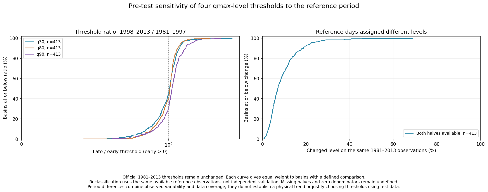

Hình đọc rõ, các đường chỉ dùng n=413 có so sánh xác định; không gán các ID thiếu early vào tỷ số 1 hoặc thay mức 0%. Trục tỷ số giữ đủ miền hiển thị đã quan trắc, còn phần trăm đổi mức có thang 0–100%.

#### 24.2.3. Đổi mức trên cùng ngày reference và các hồ sơ

Hai bộ ngưỡng phân mức khác nhau ở **416579/4693525 ngày**, bằng **8,875611%** theo gộp ngày. Median tỷ lệ đổi mức từng ID là **6,977516%**. Có **29128 ngày** thay đổi trạng thái rất cao/không rất cao; chúng là một phần của ngày đổi mức, không cộng thêm vào 416579. Đây là độ nhạy của nhãn mức trên cùng quan trắc, không phải lỗi phân loại mô hình, số sự kiện độc lập hoặc kiểm định ngoài mẫu.

| ID | Nhãn early / late | Năm có số early / late | Loại tháng early / late | Tỷ số q30 | Tỷ số q80 | Tỷ số q98 |
|---|---:|---:|---:|---:|---:|---:|
| 55 | 2802 / 3299 | 17 / 16 | 7 / 12 | 0,661740 | 1,073048 | 1,447103 |
| 324 | 0 / 1212 | 0 / 4 | 0 / 12 | NaN | NaN | NaN |
| 600 | 0 / 1380 | 0 / 4 | 0 / 12 | NaN | NaN | NaN |
| 623 | 0 / 1459 | 0 / 4 | 0 / 12 | NaN | NaN | NaN |
| 742 | 6209 / 5844 | 17 / 16 | 12 / 12 | 1,223684 | 0,828571 | 0,943878 |
| 758 | 6209 / 5844 | 17 / 16 | 12 / 12 | 2,024390 | 0,857143 | 1,115789 |
| 800 | 0 / 1499 | 0 / 5 | 0 / 12 | NaN | NaN | NaN |

55 có q98 tăng từ **58,658021 lên 84,884211 mm/ngày**, chênh **26,226189**; q30 giảm từ 3,589389 xuống 2,375242. Nửa đầu thiếu 3407 ngày và chỉ có số ở 7 loại tháng, nửa sau thiếu 2545 ngày nhưng có 12 loại tháng. Thay đổi ngưỡng có thể kết hợp khác biệt quan trắc và độ phủ mùa; chưa xác nhận thay đổi chế độ dòng chảy.

742/758 đủ lịch hai nửa nhưng các ngưỡng không cùng đổi theo một tỷ lệ: 742 q30 tăng, q80/q98 giảm; 758 q30 tăng khoảng hai lần, q80 giảm và q98 tăng. Số liệu cho thấy không thể mô tả mọi thay đổi bằng một hệ số thang chung, chưa suy nguyên nhân. Với 324/600/623/800, ngưỡng late bằng ngưỡng chính vì mọi quan trắc reference của họ nằm ở late; sự bằng nhau này không phải bằng chứng ổn định qua hai nửa.

Ngưỡng chính 1981–2013 và danh sách 451 giữ nguyên. Phép so chưa đặt ngưỡng loại ID theo độ nhạy, chưa dùng test chọn lại giai đoạn. Phần tiếp theo kiểm số năm/đỉnh có thể dùng trước khi fit ngưỡng lũ, tách khỏi ba phân vị ngày này.

### 24.3. Cell 10.3 — độ phủ và đỉnh quan trắc theo năm thủy văn

Trước khi fit Gumbel, cell kiểm chuỗi đỉnh năm theo [giao thức năm thủy văn và thiếu quá nửa số ngày](../../../Document/01_Plan/03_Pipeline.md#L209). Một năm chạy **01/10 năm trước đến 30/09 năm kết thúc**, gắn nhãn bằng năm kết thúc. Chỉ đọc quan trắc có ngày trong reference **01/01/1981–31/12/2013**; không dùng ngày test để hoàn thành một năm bị cắt ở rìa.

Do reference theo năm lịch, nó giao 34 năm thủy văn gắn nhãn 1981–2014; chỉ 1982–2013 là 32 năm nằm trọn trong reference. Năm 1981 có 273 ngày trong reference và 92 ngày ngoài; năm 2014 chỉ có 92 ngày cuối 2013 trong reference và 273 ngày ngoài. Cell giữ mẫu số cả năm **365/366 ngày**, đếm riêng ngày thiếu bên trong reference và ngày ngoài reference. Không rút mẫu số xuống lát 273/92 ngày hoặc coi ngày ngoài reference là số quan trắc.

Quy tắc không thiếu quá nửa được viết **2×valid_days ≥ full_year_days**: năm thường cần ít nhất 183 ngày, năm nhuận đúng 183/366 ngày vẫn đủ điều kiện theo quy tắc này. Cell báo đồng thời số năm qua quy tắc đó và số năm còn qua thêm điều kiện nằm trọn reference. Đây là hai bảng khả năng sử dụng đỉnh năm để thấy tác động rìa lịch; phép fit 10.4 giữ quy tắc đủ nửa lịch năm làm mẫu chính theo phương pháp, còn điều kiện năm nằm trọn reference là độ nhạy riêng. Trường hợp dưới 10 năm được báo riêng như kế hoạch, không tự loại ID.

Mỗi ID/năm lưu số ngày đầy đủ/nằm trong reference/có số/thiếu, số tháng có quan trắc, phần trăm thấp nhất theo tháng với mẫu số tháng thật, cờ đạt quy tắc và max trên phần quan trắc có mặt. Ngày đầu/cuối đạt max và số ngày đồng max được giữ riêng. Max được gọi observed_max, không tự bảo đảm là đỉnh thật của năm khi còn thiếu ngày/mùa. Đủ ít nhất nửa ngày cũng chưa bảo đảm đã quan trắc đỉnh lũ.

Cộng ngày theo năm phải khớp reference từng ID ở 10.1. Bảng ID báo số năm có ít nhất một quan trắc, số năm đủ độ phủ theo hai quy tắc, số năm quan trắc hoàn chỉnh, số năm qua quy tắc nhưng thiếu nguyên tháng và số mức đỉnh phân biệt. Hình heatmap độ phủ theo năm và phân bố số năm có thể dùng theo hai cách đếm giúp đọc độ dài mẫu; không là hình khớp Gumbel.

Xuất A1_P10_hydrological_year_coverage.png và bốn CSV A1_P10_: hydrological_year_coverage, hydrological_year_basin_support, hydrological_year_calendar_summary, hydrological_year_rule_summary. Bảng (1) trạng thái độ phủ/cắt biên, (2) số năm theo hai quy tắc, (3) lịch năm và số ID đủ điều kiện, (4) các hồ sơ. Kết quả thực tế 10.3 được trình bày ở 24.3.1–24.3.3.

#### 24.3.1. Độ phủ và số đỉnh năm có thể sử dụng

Cell 10.3 chạy **6,2 giây**. Hình đã nhận và giữ nguyên byte; bảng (1)–(4) được cung cấp trực tiếp trong chat, bốn CSV chi tiết và tệp log nguyên bản riêng chưa nhận cục bộ. Không dựng CSV nguồn từ bản in.

| Năm nằm trọn reference | Trạng thái | Năm–ID | Ngày có nhãn | Thiếu trong reference | Ngày ngoài reference |
|---|---|---:|---:|---:|---:|
| Không | Đủ ít nhất nửa lịch năm | 310 | 84630 | 0 | 28520 |
| Có | Đủ ít nhất nửa lịch năm | 12881 | 4689202 | 15599 | 0 |
| Không | Dưới nửa lịch năm | 451 | 41505 | 168 | 122942 |
| Không | Không quan trắc | 141 | 0 | 38312 | 13153 |
| Có | Không quan trắc | 1504 | 0 | 549319 | 0 |
| Có | Dưới nửa lịch năm | 47 | 5847 | 11321 | 0 |

Tổng **15334 năm–ID = 451×34**; trong đó **14432 = 451×32** nằm trọn reference và 902 ở hai năm biên. Ngày có nhãn cộng đúng **4821184**, thiếu trong reference cộng đúng **614719**, khớp 10.1. Ngày ngoài reference được đếm riêng, không cộng vào số thiếu 614719 hoặc dùng làm quan trắc.

| Quy tắc | ID | Không có năm đủ điều kiện | Có 1–9 năm | Có ≥10 năm | Ít nhất | Median | Nhiều nhất |
|---|---:|---:|---:|---:|---:|---:|---:|
| Đủ ≥50% cả lịch năm | 451 | 0 | 24 | 427 | 3 | 33 | 33 |
| Đồng thời năm nằm trọn reference | 451 | 0 | 24 | 427 | 3 | 32 | 32 |

Quy tắc thứ nhất có **13191 đỉnh năm ứng viên**, quy tắc thứ hai có **12881**; chênh 310 là những ID giữ được năm biên 1981. Phân nhóm 24/427 theo mốc 10 năm không đổi giữa hai cách. Các số này là độ dài mẫu đỉnh quan trắc qua quy tắc ngày, chưa chứng minh Gumbel phù hợp hoặc mọi đỉnh thật đã được quan trắc.

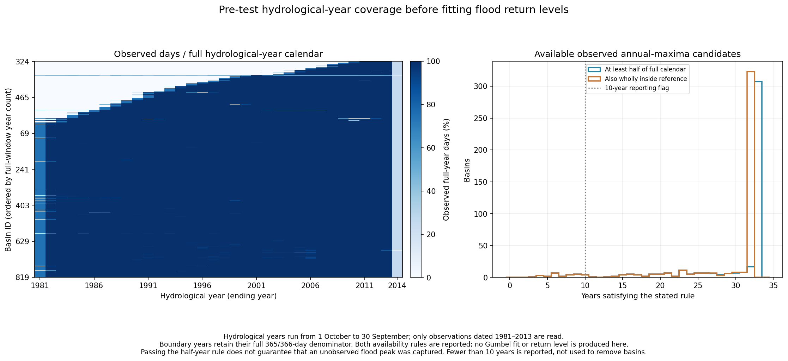

Hình thể hiện mẫu số cả lịch năm và hai phân bố số năm riêng. Vùng trống đầu chuỗi phản ánh độ phủ trước khi có quan trắc; không được diễn giải là Q bằng 0. Phần lớn ID có 32/33 năm qua quy tắc, nhưng nhóm ngắn vẫn giữ trong mẫu 451 và được báo riêng.

#### 24.3.2. Hai năm biên và lịch số ID có đỉnh

Năm thủy văn **1981** chạy 01/10/1980–30/09/1981: 365 ngày, chỉ 273 trong reference và 92 ngoài. Có 311 ID có ít nhất một quan trắc, 310 đủ nửa cả lịch năm; không ID nào có năm này nằm trọn reference. Median tỷ lệ quan trắc trên cả năm là **74,794521%**.

Năm thủy văn **2014** chạy 01/10/2013–30/09/2014: 365 ngày, chỉ 92 trong reference và 273 ngoài. Có 450 ID có số nhưng **0 ID đủ nửa cả lịch năm**; median độ phủ là **25,205479%**. Không đọc quan trắc test 2014 để hoàn thành năm này. Với quy tắc ≥50% lịch năm đã định, nó không thể cung cấp đỉnh năm cho fit.

| Nhãn năm kết thúc | ID có quan trắc | ID đủ nửa cả lịch năm | ID đồng thời có năm nằm trọn reference |
|---|---:|---:|---:|
| 1981 | 311 | 310 | 0 |
| 1982 | 329 | 327 | 327 |
| 1983 | 334 | 333 | 333 |
| 1984 | 343 | 340 | 340 |
| 1985 | 347 | 346 | 346 |
| 1986 | 350 | 349 | 349 |
| 1987 | 357 | 356 | 356 |
| 1988 | 364 | 362 | 362 |
| 1989 | 370 | 369 | 369 |
| 1990 | 378 | 374 | 374 |
| 1991 | 387 | 385 | 385 |
| 1992 | 388 | 387 | 387 |
| 1993 | 397 | 394 | 394 |
| 1994 | 400 | 399 | 399 |
| 1995 | 405 | 404 | 404 |
| 1996 | 407 | 405 | 405 |
| 1997 | 412 | 410 | 410 |
| 1998 | 416 | 415 | 415 |
| 1999 | 419 | 418 | 418 |
| 2000 | 422 | 421 | 421 |
| 2001 | 422 | 422 | 422 |
| 2002 | 423 | 423 | 423 |
| 2003 | 425 | 423 | 423 |
| 2004 | 429 | 426 | 426 |
| 2005 | 433 | 431 | 431 |
| 2006 | 436 | 435 | 435 |
| 2007 | 441 | 437 | 437 |
| 2008 | 445 | 445 | 445 |
| 2009 | 447 | 447 | 447 |
| 2010 | 450 | 448 | 448 |
| 2011 | 450 | 450 | 450 |
| 2012 | 451 | 450 | 450 |
| 2013 | 451 | 450 | 450 |
| 2014 | 450 | 0 | 0 |

Các năm 1982–2013 nằm trọn reference, số ngày kỳ vọng là 365/366 theo lịch thật; median tỷ lệ quan trắc mỗi năm này đều 100%. Median không có nghĩa mọi ID đầy đủ: ngay cả năm 2012/2013 có cả 451 ID quan trắc vẫn chỉ 450 qua quy tắc nửa năm.

#### 24.3.3. Hồ sơ ngắn và giới hạn của quy tắc nửa năm

Tất cả hồ sơ dưới đây đều giao 34 năm thủy văn và có 32 năm lịch nằm trọn reference. Cột thiếu nguyên tháng chỉ đếm năm qua quy tắc ≥50% ngày, không phải mọi năm giao reference.

| ID | Năm có quan trắc | Năm đủ nửa lịch | Năm trọn reference đủ nửa | Năm đủ mọi quan trắc | Năm qua nửa nhưng thiếu nguyên tháng | Năm biên qua nửa | Số mức đỉnh phân biệt (nửa / trọn) | Dưới 10 năm |
|---|---:|---:|---:|---:|---:|---:|---:|---|
| 55 | 34 | 14 | 14 | 1 | 13 | 0 | 13 / 13 | Không |
| 324 | 5 | 3 | 3 | 3 | 0 | 0 | 3 / 3 | Có |
| 600 | 5 | 4 | 4 | 3 | 1 | 0 | 4 / 4 | Có |
| 623 | 5 | 4 | 4 | 3 | 1 | 0 | 4 / 4 | Có |
| 742 | 34 | 33 | 32 | 32 | 1 | 1 | 27 / 27 | Không |
| 758 | 34 | 33 | 32 | 32 | 1 | 1 | 28 / 27 | Không |
| 800 | 5 | 4 | 4 | 3 | 1 | 0 | 4 / 4 | Có |

**55 có 14 năm qua quy tắc nhưng chỉ một năm đủ mọi quan trắc; 13 năm còn lại thiếu ít nhất một tháng.** Không được gọi đây là 14 năm đỉnh đã quan trắc đầy đủ. Điều này cùng với 7 loại tháng có số early ở 10.2 cho thấy phải giữ thông tin phủ mùa khi đọc ngưỡng của hồ sơ này; chưa xác nhận đã mất đỉnh hoặc nguyên nhân vật lý.

324 có ba đỉnh năm đủ điều kiện; 600/623/800 có bốn. Số năm có ít nhất một quan trắc là năm, gồm cả những lát không đạt quy tắc. Không dùng năm có số lẻ tẻ thay năm đủ điều kiện để tăng n fit. Với 742/758, các năm có cùng max vẫn là các năm riêng: giữ ties, không lấy số mức đỉnh phân biệt thay n năm. Quy tắc số ngày chưa xác nhận tính độc lập hay ổn định phân phối.

10.3 chưa fit phân phối hoặc đổi ngưỡng bốn mức. Phép fit tiếp theo giữ chính sách năm biên đã mô tả trong phương pháp: đủ ít nhất nửa cả lịch năm là mẫu chính, còn yêu cầu năm nằm trọn reference dùng để đối chiếu độ nhạy.

### 24.4. Cell 10.4 — Gumbel L-moments và độ nhạy với năm biên

Cell dùng đỉnh quan trắc từ 10.3, không đọc thêm nhãn test. **Mẫu chính half_calendar_primary** giữ năm có 2×valid_days ≥ full_year_days, kể cả năm biên 1981 nếu đủ điều kiện, nhất quán với [phương pháp lấy đỉnh năm](../../../Document/06_Theory/05_BiasCast3_Data.md#L748). Mẫu phụ full_window_sensitivity yêu cầu thêm năm nằm trọn reference, chỉ có nhãn 1982–2013. Đây là hai mẫu thay thế, không cộng đỉnh của chúng với nhau. Năm thủy văn 2014 chỉ có tối đa 92 ngày reference nên không qua quy tắc; không dùng test hoàn thành năm đó.

Với n đỉnh năm, l₁ là mean, l₂ là tổng chênh tuyệt đối trên mọi cặp i<j chia n(n−1), bằng nửa mean chênh cặp. Cell kiểm bằng công thức trọng số theo thứ tự của cùng mẫu. Tham số Gumbel α=l₂/ln2 và ξ=l₁−γ×α, γ là hằng số Euler; ngưỡng x_T=ξ−α×ln[−ln(1−1/T)] tại **T=1,5; 2; 5; 10 năm**. Kiểm riêng với hàm phân vị gumbel_r của SciPy, không dùng fit MLE thay cho L-moments. Công thức và ví dụ được đối chiếu với [chi tiết kỹ thuật](../../../Document/06_Theory/05_BiasCast3_Data.md#L750).

Có ít hơn hai đỉnh hoặc l₂=0 thì tham số/ngưỡng giữ NaN với trạng thái riêng; không tự thêm nhiễu hoặc đổi phân phối. **Fit xác định về số học không đồng nghĩa đủ bằng chứng thống kê.** Mẫu dưới 10 năm vẫn được tính nếu xác định, gắn cờ và in toàn bộ ID; không lọc khỏi tập 451. Số năm hoàn chỉnh, năm thiếu nguyên tháng, năm biên, số mức đỉnh phân biệt được lưu. Giữ ties và số 0. Ngưỡng âm nếu có được lưu và gắn cờ, không chặn về 0; T lớn hơn số năm mẫu và ngưỡng cao hơn max mẫu cũng có cờ riêng.

So độ nhạy chỉ tổng hợp ID có số năm thay đổi, báo chênh **mẫu chính − full-window**, tỷ số **mẫu chính/full-window** khi mẫu số dương. Mẫu số 0/âm và fit không xác định giữ NaN cho tỷ số. Ngưỡng 1,5 năm được ghép với q98 ngày từ 10.1 theo đúng ID; hai thước đo có mẫu và ý nghĩa khác nhau nên không áp điều kiện một ngưỡng nhất thiết lớn hơn ngưỡng kia. Không thay ba phân vị q30/q80/q98 bằng ngưỡng Gumbel.

Hình sáu hồ sơ cố định 55/324/742/758/800/604 vẽ đỉnh năm với vị trí Weibull T=(n+1)/(n+1−i), đường Gumbel bắt đầu T=1,5, bốn ngưỡng yêu cầu và q98 ngày. Không chọn hồ sơ theo độ khớp test. Đường vẽ chỉ mô tả phép fit, chưa kiểm định phân phối hoặc đưa khoảng tin cậy; đỉnh trên năm có ngày thiếu chưa bảo đảm là đỉnh thật.

Xuất A1_P10_gumbel_return_levels.png và bảy CSV A1_P10_: flood_gumbel_fits, flood_return_levels, flood_annual_sample, flood_boundary_sensitivity, flood_level_comparison, flood_return_level_summary, flood_boundary_summary. In bảng (1) trạng thái fit/độ dài mẫu theo hai quy tắc, (2) phân vị ngưỡng chính ngang ID, (3) hồ sơ và toàn bộ mẫu dưới 10 năm, (4) ảnh hưởng năm biên, (5) so ngưỡng 1,5 năm với q98 ngày. Kết quả thực tế 10.4 được trình bày ở 24.4.1–24.4.4.

#### 24.4.1. Fit xác định ở 451 ID, mẫu ngắn giữ riêng

Cell 10.4 chạy **5,8 giây**. Hình đã nhận và giữ nguyên byte; bảng (1)–(5) được dán trực tiếp trong chat. Bảy CSV chi tiết và tệp log nguyên bản riêng chưa nhận cục bộ; không dựng CSV nguồn từ bản in.

| Chính sách | Trạng thái | Nhóm n | ID | n nhỏ nhất | n median | n lớn nhất | Năm dùng có thiếu nguyên tháng | Năm biên dùng |
|---|---|---|---:|---:|---:|---:|---:|---:|
| Nửa lịch năm, mẫu chính | Fit xác định | ≥10 | 427 | 10 | 33 | 33 | 441 | 310 |
| Nửa lịch năm, mẫu chính | Fit xác định | <10 | 24 | 3 | 6 | 9 | 14 | 0 |
| Năm trọn reference, độ nhạy | Fit xác định | ≥10 | 427 | 10 | 32 | 32 | 131 | 0 |
| Năm trọn reference, độ nhạy | Fit xác định | <10 | 24 | 3 | 6 | 9 | 14 | 0 |

Không có fit suy biến ở cả hai mẫu; ngưỡng mẫu chính tại bốn T được yêu cầu đều không âm. Độ dài mẫu khớp 10.3: 427 ID có ít nhất 10 năm, 24 ID có 3–9 năm, median của nhóm ngắn là 6. Fit xác định chỉ xác nhận phép tính tham số có nghiệm hữu hạn và scale dương; chưa chứng minh phân phối Gumbel phù hợp hoặc đủ bằng chứng cho ngưỡng ngoại suy.

Mẫu chính dùng **455 năm–ID có thiếu nguyên tháng**; mẫu phụ dùng 145. Chênh 310 đúng số năm biên 1981 được thêm: mỗi năm biên thiếu ba tháng ngoài reference theo thiết kế. Ngoài phần biên này vẫn có 145 năm–ID nằm trọn reference nhưng thiếu nguyên tháng. Không gộp mọi thiếu mùa thành tác động năm biên hoặc cho rằng điều kiện ≥50% ngày đã bảo đảm đúng đỉnh năm.

#### 24.4.2. Phân bố ngưỡng ngang ID và các mẫu ngắn

| T (năm) | n ID | Min | p05 | Median | p95 | Max | ID có T>n năm mẫu |
|---|---:|---:|---:|---:|---:|---:|---:|
| 1,5 | 451 | 0,239910 | 3,314560 | 14,742515 | 62,267953 | 124,010896 | 0 |
| 2 | 451 | 0,378036 | 4,077172 | 19,247298 | 74,618318 | 145,388332 | 0 |
| 5 | 451 | 0,717961 | 5,585802 | 29,935596 | 107,949670 | 210,481375 | 4 |
| 10 | 451 | 0,940224 | 6,569518 | 36,029289 | 132,223904 | 253,578634 | 24 |

Ngưỡng có đơn vị mm/ngày. Các phân vị p05/p95 là phân vị ngang các ngưỡng riêng lưu vực, **không phải khoảng tin cậy**. Cả bốn T đều có 24 ID dưới 10 năm, dù cờ T lớn hơn số năm mẫu chỉ bật cho 4 ID ở T=5 và 24 ID ở T=10. T≤n cũng chưa bảo đảm ước lượng tin cậy; T>n chỉ mô tả mức chu kỳ so với độ dài mẫu, không phải tiêu chí loại tự động.

| ID | n năm | Số mức đỉnh | Năm quan trắc hoàn chỉnh | Năm thiếu nguyên tháng | ξ (mm/ngày) | α (mm/ngày) |
|---|---:|---:|---:|---:|---:|---:|
| 55 | 14 | 13 | 1 | 13 | 76,081338 | 19,658568 |
| 92 | 8 | 8 | 7 | 1 | 12,786346 | 6,278566 |
| 110 | 9 | 9 | 9 | 0 | 45,597393 | 19,147449 |
| 295 | 5 | 5 | 4 | 1 | 65,142659 | 25,434422 |
| 296 | 5 | 5 | 4 | 1 | 61,725648 | 19,897928 |
| 298 | 8 | 8 | 7 | 0 | 49,435356 | 23,655261 |
| 309 | 6 | 6 | 5 | 0 | 47,646785 | 24,066867 |
| 324 | 3 | 3 | 3 | 0 | 2,426301 | 1,440421 |
| 327 | 8 | 8 | 7 | 0 | 8,006168 | 7,229377 |
| 329 | 8 | 8 | 8 | 0 | 10,177015 | 9,753317 |
| 341 | 9 | 9 | 9 | 0 | 7,235619 | 7,029045 |
| 391 | 6 | 6 | 5 | 1 | 3,770301 | 4,163962 |
| 485 | 7 | 7 | 6 | 1 | 9,897861 | 4,649991 |
| 561 | 6 | 6 | 5 | 1 | 8,387332 | 2,178249 |
| 577 | 6 | 5 | 6 | 0 | 11,710832 | 3,128193 |
| 590 | 6 | 6 | 6 | 0 | 3,678840 | 0,867663 |
| 600 | 4 | 4 | 3 | 1 | 9,765683 | 4,647256 |
| 608 | 6 | 6 | 6 | 0 | 7,722753 | 3,708184 |
| 622 | 7 | 7 | 6 | 1 | 33,501340 | 13,441829 |
| 623 | 4 | 4 | 3 | 1 | 38,936439 | 7,797576 |
| 742 | 33 | 27 | 32 | 1 | 0,312569 | 0,278912 |
| 758 | 33 | 28 | 32 | 1 | 0,268115 | 0,299909 |
| 791 | 6 | 5 | 5 | 1 | 1,423855 | 0,416239 |
| 800 | 4 | 4 | 3 | 1 | 126,479638 | 26,249847 |
| 822 | 9 | 9 | 8 | 1 | 12,039419 | 8,400894 |
| 823 | 9 | 9 | 8 | 1 | 8,056477 | 6,277037 |
| 824 | 9 | 9 | 8 | 1 | 9,956093 | 4,157219 |

Bảng giữ đủ 24 ID dưới 10 năm cùng các hồ sơ 55/742/758. 324 chỉ có ba đỉnh; 600/623/800 có bốn. 800 có ngưỡng 1,5 năm lớn nhất trong 451 ID (**124,010896 mm/ngày**) nhưng chỉ dựa trên bốn năm, không được trình bày như ngưỡng đã kiểm chứng. 55 có n=14 nhưng chỉ một năm đủ mọi quan trắc; chưa suy độ tin cậy chỉ từ việc vượt mốc 10 năm. 577/791 có các đỉnh trùng nhau, vẫn giữ sáu năm thay vì giảm n xuống năm mức phân biệt.

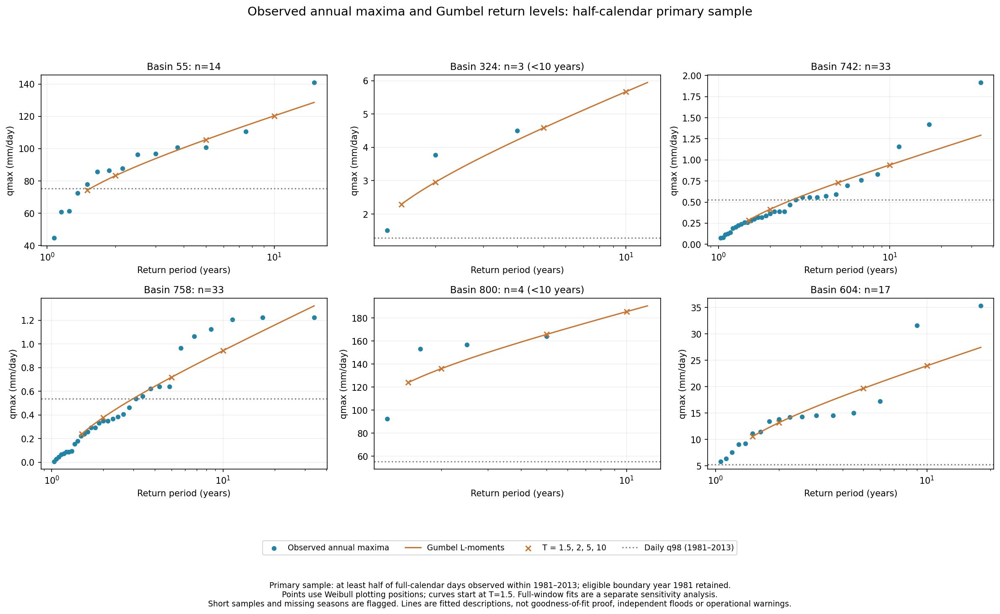

Hình sáu hồ sơ đọc rõ và giữ thang riêng. Các điểm 742/758/604 không nằm sát đường ở mọi phần của mẫu; đây là quan sát hình học để tiếp tục chẩn đoán, chưa là kiểm định bác bỏ/chấp nhận Gumbel. Điểm trên vị trí Weibull và đường fit không phải bằng chứng dự báo ngoài mẫu. Không chọn phân phối khác hoặc bỏ hồ sơ theo hình này.

#### 24.4.3. Năm biên: median gần một không đại diện mọi ID

Cả bốn T có **310 ID đổi mẫu** khi bỏ năm biên, đúng số ở 10.3; 141 ID còn lại có cùng mẫu theo hai chính sách. Tất cả 310 phép chênh xác định. Dấu chênh là chính−full-window và tỷ số là chính/full-window.

| T (năm) | ID đổi mẫu | Median chênh (mm/ngày) | Max trị tuyệt đối chênh | Tỷ số p05 | Tỷ số median | Tỷ số p95 |
|---|---:|---:|---:|---:|---:|---:|
| 1,5 | 310 | 0,047642 | 2,663409 | 0,966097 | 1,004081 | 1,018507 |
| 2 | 310 | 0,011389 | 5,588119 | 0,975330 | 1,000653 | 1,021666 |
| 5 | 310 | -0,083042 | 12,785749 | 0,983855 | 0,995079 | 1,028168 |
| 10 | 310 | -0,146785 | 17,551206 | 0,985120 | 0,993445 | 1,030992 |

Median tỷ số gần 1, nhưng max chênh tuyệt đối lên tới **17,551206 mm/ngày ở T=10**. Không kết luận tác động năm biên nhỏ cho mọi ID, cũng không dùng mức chênh chọn lại quy tắc. Ngưỡng chính tiếp tục dùng mẫu nửa lịch năm đã ghi trong phương pháp; mẫu trọn reference chỉ là độ nhạy. Khác biệt năm biên không đo hết ảnh hưởng của từng năm cực đoan hoặc các mùa quan trắc bị thiếu.

#### 24.4.4. Ngưỡng 1,5 năm và q98 ngày có thể đảo thứ tự

Cả 451 tỷ số Q1,5/q98 ngày xác định, p05/median/p95 lần lượt **1,110738 / 1,744736 / 2,632140**. Có **15 ID** có Q1,5 thấp hơn q98 ngày; không chặn ngưỡng Gumbel lên bằng q98 vì hai thước đo dùng mẫu và ý nghĩa khác nhau.

| ID | Q1,5 năm (mm/ngày) | n năm | q98 ngày (mm/ngày) | Q1,5/q98 | Q1,5<q98 |
|---|---:|---:|---:|---:|---|
| 55 | 74,232492 | 14 | 75,334737 | 0,985369 | Có |
| 324 | 2,290832 | 3 | 1,279827 | 1,789955 | Không |
| 600 | 9,328619 | 4 | 5,241327 | 1,779820 | Không |
| 623 | 38,203094 | 4 | 22,234418 | 1,718196 | Không |
| 742 | 0,286338 | 33 | 0,526895 | 0,543445 | Có |
| 758 | 0,239910 | 33 | 0,537782 | 0,446109 | Có |
| 800 | 124,010896 | 4 | 55,540751 | 2,232791 | Không |

Q1,5 là phân vị 1−1/1,5≈0,3333 của phân phối đỉnh năm đã fit; q98 là phân vị 0,98 của các ngày reference có nhãn. Không có ràng buộc đại số buộc Q1,5 lớn hơn q98 ngày. Riêng 55 còn có khác biệt mẫu mùa/ngày và năm qua độ phủ; phép so hiện tại không xác định nguyên nhân. 742/758 có tỷ số thấp dù n=33 cho thấy độ dài mẫu không giải thích mọi khác biệt giữa hai thước đo.

10.4 đã tạo các ngưỡng hữu hạn nhưng chưa có đánh giá độ khớp hoặc bất định. Chẩn đoán tiếp theo bỏ lần lượt một đỉnh năm để đo độ nhạy của cùng phép fit; giữ nguyên phân phối, hai chính sách năm biên, ba ngưỡng mức ngày và danh sách 451.

### 24.5. Cell 10.5 — độ nhạy khi bỏ lần lượt một đỉnh năm

Cell chỉ dùng **mẫu chính half_calendar_primary của 10.4**, không đọc quan trắc test. Với mỗi ID có n năm, lần lượt bỏ đúng một năm rồi fit lại Gumbel L-moments trên n−1 đỉnh còn lại, tính lại bốn ngưỡng 1,5/2/5/10 năm. Các năm có cùng đỉnh vẫn là các lần bỏ riêng; nếu nhiều lần có cùng mức thay đổi lớn nhất, bảng hồ sơ ghi năm sớm nhất theo thứ tự lịch. Không thay ngưỡng gốc bằng trung bình các fit bỏ năm.

Trước khi tính, cell tái tạo n, trạng thái, l₁/l₂, ξ/α và bốn ngưỡng từ mẫu đã lưu rồi so với bảng 10.4; bất kỳ khác biệt vượt dung sai số học sẽ dừng. Lần bỏ còn dưới hai đỉnh hoặc làm l₂=0 giữ NaN với trạng thái riêng. Lưu mọi lần bỏ, năm/đỉnh bị bỏ, cờ có phải max mẫu và độ phủ năm bị bỏ; không âm thầm bỏ các fit suy biến khỏi số lần thử.

Từng ID/T có số lần bỏ kỳ vọng/xác định, min/max ngưỡng sau bỏ, độ rộng miền, thay đổi tuyệt đối lớn nhất so với ngưỡng gốc, tỷ lệ so ngưỡng gốc khi mẫu số dương và năm gây thay đổi lớn nhất. Ngưỡng âm sau bỏ nếu có được giữ và đếm riêng. Khi không có ngưỡng gốc dương, tỷ lệ giữ NaN; không dùng epsilon thay mẫu số. Nếu chỉ một phần fit bỏ năm xác định, miền min/max của phần xác định vẫn được lưu cùng số lần có số, nhưng không đưa vào tổng hợp tương đối đủ-lần.

Bảng tổng hợp tách ID n<10 và n≥10 theo **n gốc**. Mỗi ID trọng số bằng nhau; chỉ tổng hợp tương đối khi ngưỡng gốc >0 và mọi n lần bỏ đều fit được, đồng thời báo số ID/lần bị thiếu. Số n−1 và cờ T>n−1 giúp đọc các fit bỏ năm rất ngắn. Top 10 thay đổi tương đối ở T=10 chỉ là bảng mô tả, không chọn bộ lọc hoặc thay giao thức.

Hình gồm ECDF thay đổi tuyệt đối lớn nhất theo phần trăm ngưỡng 10 năm gốc, tách hai nhóm n, cùng miền min–max tương đối ở tám hồ sơ cố định 55/324/600/623/742/758/800/604; chấm 100% là ngưỡng gốc. Nhãn hồ sơ ghi số lần fit xác định trên n lần bỏ để không che mẫu suy biến. Các miền này **không phải khoảng tin cậy**, không xác nhận Gumbel phù hợp và không phục hồi đỉnh bị thiếu hoặc giải quyết phụ thuộc/biến đổi theo thời gian.

Xuất A1_P10_gumbel_leave_one_year_out.png và bốn CSV A1_P10_: flood_loo_details, flood_loo_by_basin, flood_loo_summary, flood_loo_profiles. In bảng (1) phân vị độ nhạy tách n gốc, (2) hồ sơ ở T=10, (3) mười ID thay đổi tương đối lớn nhất T=10, (4) trạng thái mọi fit bỏ năm và các ID/T chưa đủ mọi lần. Kết quả thực tế 10.5 được trình bày ở 24.5.1–24.5.4.

#### 24.5.1. Mọi lần bỏ năm đều fit được, mẫu số không giảm

Cell 10.5 chạy **8,7 giây**. Hình và tệp output được cung cấp đã lưu nguyên byte; bốn CSV chi tiết chưa nhận cục bộ. [Output nguyên bản](Tables/A1_P10_gumbel_leave_one_year_out_output.txt) giữ đầy đủ bảng (1)–(4) và cảnh báo; không dựng CSV nguồn từ bản in.

Mỗi T có **13191 lần bỏ năm xác định**, khớp tổng đỉnh năm ứng viên của mẫu chính ở 10.3. Bốn T cho **52764 dòng ngưỡng sau bỏ**; đó không phải 52764 năm quan trắc hoặc mẫu độc lập. Toàn bộ 451 ID có đủ n lần fit, không có fit suy biến, baseline không dương hoặc ngưỡng âm sau bỏ tại bốn T đã kiểm. Vì vậy tổng hợp tương đối dùng đủ **427 ID n≥10 và 24 ID n<10**, không mất ID do điều kiện tính chỉ số.

#### 24.5.2. Nhóm ngắn nhạy hơn ở các median đã đo

Mỗi ID có một mức thay đổi tuyệt đối lớn nhất so ngưỡng gốc tại từng T, rồi lấy phân vị ngang ID. Độ rộng miền là max−min của các ngưỡng sau bỏ, cũng chia ngưỡng gốc để biểu diễn phần trăm. Mốc n<10/≥10 dùng n gốc, không đổi nhóm sau mỗi lần bỏ.

| T (năm) | Nhóm n gốc | ID | Thay đổi lớn nhất p05 (%) | Median (%) | p95 (%) | Độ rộng miền median (%) | Độ rộng miền p95 (%) |
|---|---|---:|---:|---:|---:|---:|---:|
| 1,5 | ≥10 | 427 | 1,714528 | 3,059859 | 6,158197 | 5,110219 | 10,795157 |
| 1,5 | <10 | 24 | 7,393638 | 12,940379 | 36,407209 | 20,521902 | 48,552369 |
| 2 | ≥10 | 427 | 1,892031 | 4,230001 | 12,251905 | 6,444864 | 15,797016 |
| 2 | <10 | 24 | 7,364662 | 12,329141 | 29,006548 | 21,646012 | 49,208841 |
| 5 | ≥10 | 427 | 2,854891 | 7,163202 | 20,053610 | 8,453878 | 22,215486 |
| 5 | <10 | 24 | 6,062021 | 15,003291 | 32,151281 | 19,651268 | 41,439752 |
| 10 | ≥10 | 427 | 3,161596 | 8,283694 | 22,735924 | 9,574917 | 24,971055 |
| 10 | <10 | 24 | 7,934635 | 17,440408 | 35,394873 | 23,607196 | 47,593000 |

Ở T=10, median mức thay đổi lớn nhất **8,283694%** trong nhóm ≥10 năm và **17,440408%** trong nhóm ngắn; p95 tương ứng **22,735924% / 35,394873%**. Các median nhóm ngắn đều cao hơn nhóm dài ở bốn T. Đây là mô tả trên các mẫu đã quan trắc, chưa tách ảnh hưởng độ dài mẫu khỏi dạng phân phối, năm cực đoan, độ phủ hoặc biến thiên theo thời gian; không suy quan hệ nhân quả chỉ từ hai nhóm này.

Trong nhóm ≥10 năm, median thay đổi lớn nhất tăng từ khoảng 3,06% ở T=1,5 lên 8,28% ở T=10. Nhóm ngắn không có quy luật tăng đều theo mọi T. Không coi mọi ngưỡng cùng ID có một tỷ lệ nhạy chung, không cộng các phần trăm trên những T khác nhau.

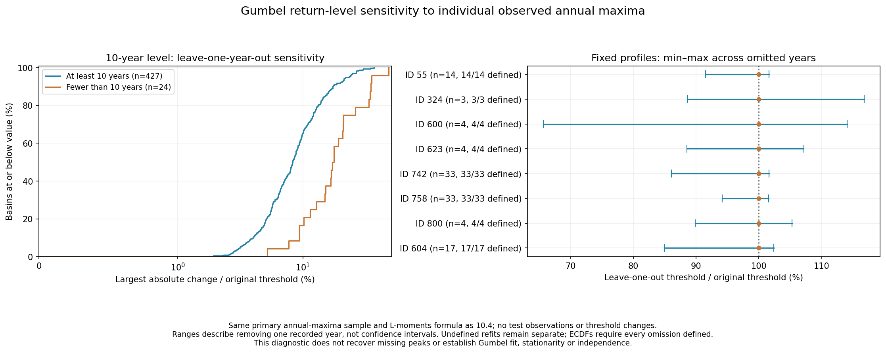

Hình giữ toàn bộ 427/24 ID ở ECDF và nhãn số lần fit tại từng hồ sơ. Đường nhóm ngắn lệch sang phải phù hợp với các median ở T=10. Các đoạn ngang bên phải là miền của các fit bỏ năm, chấm 100% là ngưỡng gốc; **miền này không phải khoảng tin cậy**, cũng không chứa mọi dạng bất định do thiếu đỉnh/mùa hoặc giả định phân phối.

#### 24.5.3. Hồ sơ: năm ảnh hưởng nhất không luôn là đỉnh lớn nhất

| ID | n | Ngưỡng 10 năm gốc | Min sau bỏ | Max sau bỏ | Đổi tuyệt đối lớn nhất (mm/ngày) | Đổi lớn nhất (%) | Năm bị bỏ gây đổi lớn nhất | Bỏ max mẫu? | Năm bị bỏ quan trắc hoàn chỉnh? |
|---|---:|---:|---:|---:|---:|---:|---:|---|---|
| 55 | 14 | 120,320337 | 110,085653 | 122,242289 | 10,234685 | 8,506197 | 2012 | Có | Không |
| 324 | 3 | 5,667777 | 5,019901 | 6,618315 | 0,950539 | 16,770924 | 2012 | Không | Có |
| 600 | 4 | 20,223715 | 13,283658 | 23,065162 | 6,940057 | 34,316430 | 2013 | Có | Có |
| 623 | 4 | 56,483851 | 50,018830 | 60,453954 | 6,465021 | 11,445787 | 2013 | Có | Có |
| 742 | 33 | 0,940224 | 0,809349 | 0,955284 | 0,130876 | 13,919609 | 1987 | Có | Có |
| 758 | 33 | 0,943021 | 0,888192 | 0,957833 | 0,054830 | 5,814266 | 1987 | Có | Có |
| 800 | 4 | 185,551435 | 166,718311 | 195,358843 | 18,833124 | 10,149813 | 2010 | Không | Không |
| 604 | 17 | 23,966668 | 20,356013 | 24,533683 | 3,610655 | 15,065319 | 2010 | Có | Có |

Các ngưỡng/chênh tuyệt đối trong bảng có đơn vị mm/ngày. 600 có miền **65,683570–114,050075%** ngưỡng gốc, độ rộng **48,366505%**, mức đổi lớn nhất **34,316430%**. 324 chỉ ba đỉnh nên mỗi fit bỏ còn hai đỉnh; fit vẫn xác định nhưng chưa là bằng chứng ước lượng ổn định. Với 324 và 800, năm gây thay đổi lớn nhất không phải năm có max mẫu. Phép bỏ năm làm đổi cả vị trí và scale của Gumbel, nên không được giả định chỉ bỏ đỉnh lớn nhất mới đáng kiểm.

55 có năm gây ảnh hưởng nhất là 2012, chính năm đó không quan trắc hoàn chỉnh; 800 là 2010, cũng chưa đầy đủ. Cell chỉ loại một đỉnh đã lưu, không phục hồi đỉnh thật bị bỏ lỡ hoặc xác nhận đỉnh lưu sai. 742/758 cùng n=33 và cùng năm gây ảnh hưởng nhất 1987 nhưng mức nhạy khác nhau (**13,919609% / 5,814266%**); cùng n chưa bảo đảm mức nhạy giống nhau.

T=10 lớn hơn n−1 ở 324/600/623/800, phù hợp mẫu 3/4 năm; không phải cờ cho bốn hồ sơ còn lại. Các mẫu ngắn vẫn giữ trong tập 451, không thay ngưỡng bằng giới hạn của miền bỏ năm.

#### 24.5.4. Mẫu dài vẫn có thể chịu ảnh hưởng của một năm

| ID | n | Ngưỡng 10 năm gốc (mm/ngày) | Thay đổi lớn nhất (mm/ngày) | Thay đổi lớn nhất (%) | Năm bị bỏ |
|---|---:|---:|---:|---:|---:|
| 391 | 6 | 13,140744 | 6,376809 | 48,527003 | 2010 |
| 338 | 33 | 23,535537 | 8,688551 | 36,916733 | 2002 |
| 329 | 8 | 32,125562 | 11,393203 | 35,464603 | 2007 |
| 309 | 6 | 101,806076 | 35,631854 | 34,999732 | 2009 |
| 197 | 29 | 62,256298 | 21,624903 | 34,735286 | 1987 |
| 600 | 4 | 20,223715 | 6,940057 | 34,316430 | 2013 |
| 822 | 9 | 30,944516 | 10,446388 | 33,758445 | 2011 |
| 102 | 14 | 168,463102 | 51,288014 | 30,444657 | 2013 |
| 336 | 33 | 18,029079 | 5,481497 | 30,403641 | 2002 |
| 779 | 19 | 71,289292 | 21,485048 | 30,137833 | 1996 |

Trong mười ID thay đổi tương đối lớn nhất ở T=10, cả mười năm ảnh hưởng nhất đều là max mẫu và là năm quan trắc hoàn chỉnh; kết luận này chỉ áp dụng bảng top 10, không mâu thuẫn các hồ sơ 324/800 bên trên. 391 đứng đầu **48,527003%** với n=6, nhưng 338 có n=33 vẫn **36,916733%**, 197 có n=29 vẫn **34,735286%**. Bảng không ủng hộ cách coi mọi ID có ≥10 năm là ổn định hoặc chỉ cần xem các mẫu ngắn.

Không dùng thứ hạng này loại trạm, bỏ năm cực đoan hoặc đổi phân phối. Độ nhạy bỏ một năm không thay thế kiểm dạng phân phối; bước kế tiếp mô tả chênh CDF/phân vị của cùng mẫu với Gumbel đã fit, giữ nguyên giao thức và ngưỡng.

### 24.6. Cell 10.6 — chênh CDF và phân vị trên mẫu Gumbel đã fit

Cell dùng đúng mẫu chính và tham số 10.4, không đọc thêm nhãn test hoặc refit bằng phương pháp khác. Tái tạo n/trạng thái/l₁/l₂/ξ/α từ đỉnh đã lưu để chặn bảng tham số khác mẫu. Với ID không có fit xác định, chỉ số giữ NaN và trạng thái riêng, không gán độ khớp bằng 0.

Tính F(xᵢ) theo Gumbel và hai giới hạn trái/phải của ECDF tại mỗi giá trị quan trắc. **D=max[D⁺,D⁻]**, với D⁺=max[Fₙ(xᵢ)−F(xᵢ)] và D⁻=max[F(xᵢ)−Fₙ(xᵢ−)], là chênh CDF lớn nhất, không đơn vị. Ties được giữ nguyên; giới hạn trái/phải dùng toàn bộ số mức bằng nhau chứ không thêm jitter. D chỉ là khoảng cách trên mẫu đã dùng fit, **không có p-value hoặc ngưỡng chấp nhận/bác bỏ**. Không áp trực tiếp diễn giải kiểm định KS cho một phân phối có tham số đã ước lượng từ chính mẫu này.

Phân vị lý thuyết đối chiếu đỉnh thứ i dùng vị trí Weibull pᵢ=i/(n+1). Lưu xᵢ−F⁻¹(pᵢ), RMSE theo mm/ngày và RMSE/α để mô tả độ lệch so độ trải đã fit; giữ chênh tại đỉnh lớn nhất và chênh/α. Đây là so thống kê thứ tự trong mẫu, không phải sai số dự báo theo ngày, không gọi là kỹ năng mô hình hoặc khoảng tin cậy. Vị trí Weibull hữu hạn không khẳng định thời gian chờ thật của một đỉnh cụ thể.

F(0) mô tả phần xác suất Gumbel liên tục đã fit đặt dưới 0, trong khi nhãn qmax quan trắc dùng ở đây không âm. Giá trị này được lưu để thấy miền hỗ trợ của phép fit, không đếm như Q âm quan trắc và không tự cắt phân phối về 0. Không dùng F(0), D hoặc thứ hạng độ lệch để chọn phân phối/ngưỡng hoặc lọc ID.

Bảng tổng hợp phân vị từng chỉ số ngang ID, tách n gốc <10/≥10 và báo n xác định. Khác biệt D giữa nhóm có thể kèm hiệu ứng số điểm, độ phủ và dạng mẫu; không kết luận nguyên nhân từ so nhóm. Tám hồ sơ cố định giữ n/ties/số năm hoàn chỉnh và thiếu tháng. Top 10 D trong nhóm n≥10 chỉ dùng nhận diện ca cần đọc, không là xếp hạng chất lượng trạm.

Hình P–P sáu hồ sơ 55/324/742/758/800/604 vẽ ECDF theo F(x), đường chéo là hai CDF bằng nhau, trục 0–1; bậc nhảy phản ánh mẫu hữu hạn và ties. Hình/độ nhạy không giải quyết quan trắc mất đỉnh, mùa bị thiếu, biến đổi theo thời gian hoặc phụ thuộc. Xuất A1_P10_gumbel_cdf_diagnostics.png và bốn CSV A1_P10_: flood_fit_diagnostics, flood_fit_points, flood_fit_diagnostic_summary, flood_fit_diagnostic_profiles. In bảng (1) phân vị chênh CDF/phân vị/F(0), (2) hồ sơ, (3) top 10 D ở n≥10, (4) trạng thái/n đỉnh. Kết quả thực tế 10.6 được trình bày ở 24.6.1–24.6.4.

#### 24.6.1. Đủ mẫu chẩn đoán, chưa có kiểm định chấp nhận

Cell 10.6 chạy **3,0 giây**. Hình và tệp output được cung cấp đã giữ nguyên byte; bốn CSV chi tiết chưa nhận cục bộ. [Output nguyên bản](Tables/A1_P10_gumbel_cdf_diagnostics_output.txt) lưu bảng (1)–(4) và cảnh báo; không dựng CSV nguồn từ bản in.

Cả 451 ID có fit xác định và chỉ số mô tả: **427 ID n≥10 dùng 13033 đỉnh**, **24 ID n<10 dùng 158 đỉnh**. Tổng **13191** khớp mẫu chính 10.3–10.5; không có ID phải loại khỏi tổng hợp vì chỉ số không xác định.

| Nhóm n gốc | Chỉ số | ID xác định | Min | p05 | Median | p95 | Max |
|---|---|---:|---:|---:|---:|---:|---:|
| ≥10 | D lớn nhất giữa hai CDF | 427 | 0,057617 | 0,078185 | 0,132249 | 0,212309 | 0,363198 |
| <10 | D lớn nhất giữa hai CDF | 24 | 0,134676 | 0,137878 | 0,212231 | 0,336517 | 0,446926 |
| ≥10 | RMSE phân vị / α | 427 | 0,140083 | 0,171808 | 0,343798 | 0,852955 | 1,491321 |
| <10 | RMSE phân vị / α | 24 | 0,248637 | 0,268951 | 0,375853 | 0,657207 | 0,669104 |
| ≥10 | Chênh điểm lớn nhất / α | 427 | -0,993540 | -0,473021 | 1,091291 | 4,322295 | 8,161611 |
| <10 | Chênh điểm lớn nhất / α | 24 | -0,181536 | -0,086659 | 0,563776 | 1,297278 | 1,683048 |

D không có đơn vị, nằm giữa 0 và 1. Median nhóm ngắn cao hơn (**0,212231 so với 0,132249**), nhưng số điểm hữu hạn và dạng bước ECDF khác nhau theo n nên đây không phải bằng chứng kiểm định hai nhóm hoặc nguyên nhân do mẫu ngắn. Không gán nhãn đạt/không đạt Gumbel bằng các mức D này.

RMSE/α là sai khác giữa các thống kê thứ tự và phân vị tại vị trí Weibull, không phải sai số dự báo dòng chảy theo ngày. Chênh điểm lớn nhất có cả dấu âm/dương: median dương ở cả hai nhóm nhưng không áp dụng cho từng ID. Giá trị 8,161611 nghĩa chênh tại điểm thứ tự lớn nhất bằng khoảng 8,16 lần scale đã fit, không phải dự báo sai 816% hoặc xác suất vượt thực tế.

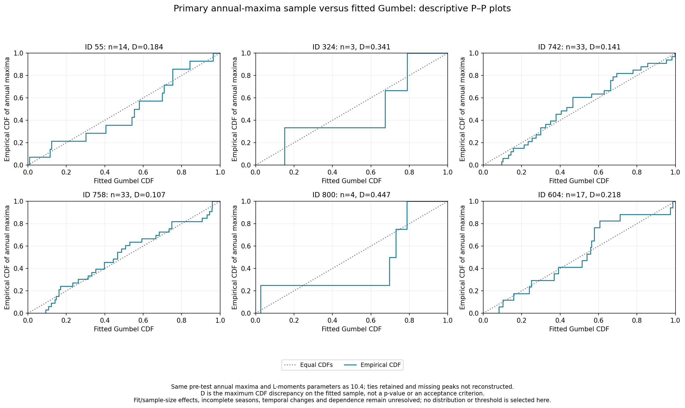

Hình P–P giữ thang 0–1 và ties, thể hiện rõ bước nhảy của mẫu ba/bốn đỉnh ở 324/800. Khoảng trống trên đường bậc là khoảng giữa các giá trị đỉnh trong mẫu, không phải ngày lịch bị thiếu. Tham số và mẫu dùng vẽ cùng lấy từ reference, vì vậy hình không phải kiểm định hoặc đánh giá dự báo ngoài mẫu.

#### 24.6.2. Khối xác suất dưới 0 của Gumbel

| Nhóm | ID | F(0) nhỏ nhất | F(0) p05 | F(0) median | F(0) p95 | F(0) lớn nhất |
|---|---:|---:|---:|---:|---:|---:|
| n≥10 | 427 | 1,648880×10⁻²⁵⁰ | 5,969337×10⁻²⁶ | 0,000196 | 0,067542 | 0,188673 |
| n<10 | 24 | 9,307122×10⁻⁶⁵ | 1,082617×10⁻³¹ | 0,000253 | 0,060495 | 0,084326 |

Các giá trị là tỷ phần, chưa nhân 100. Trong nhóm ≥10 năm, median khoảng **0,0196%**, p95 **6,7542%** và max **18,8673%**; trong nhóm ngắn là khoảng **0,0253% / 6,0495% / 8,4326%**. Chúng là xác suất do Gumbel liên tục đã fit đặt dưới 0, không phải phần trăm năm có Q âm trong quan trắc. Miền hỗ trợ này khác ràng buộc qmax không âm của mẫu đã dùng.

Riêng **742 có F(0)=0,04656443 ≈4,656443%**, **758 có F(0)=0,08673815 ≈8,673815%**. Bốn ngưỡng yêu cầu ở 10.4 đều dương không đồng nghĩa phân phối đã fit không có khối xác suất âm. Đây là giới hạn cần ghi khi sử dụng ngưỡng; không tự chặn Gumbel về 0, chuẩn hóa lại xác suất hoặc chọn phân phối khác theo chẩn đoán này.

#### 24.6.3. Hồ sơ cố định và độ phủ đi kèm

| ID | n / số mức đỉnh | Năm hoàn chỉnh / thiếu nguyên tháng | D⁺ | D⁻ | D | RMSE phân vị (mm/ngày) | Chênh điểm lớn nhất (mm/ngày) | F(0) |
|---|---|---|---:|---:|---:|---:|---:|---:|
| 55 | 14 / 13 | 1 / 13 | 0,104672 | 0,183567 | 0,183567 | 6,163934 | 12,324945 | 1,499852×10⁻²¹ |
| 324 | 3 / 3 | 3 / 0 | 0,210902 | 0,340796 | 0,340796 | 0,560106 | 0,279967 | 0,004565 |
| 600 | 4 / 4 | 3 / 1 | 0,193867 | 0,236608 | 0,236608 | 1,731446 | 3,287220 | 0,000281 |
| 604 | 17 / 16 | 16 / 1 | 0,217629 | 0,102059 | 0,217629 | 3,208209 | 7,868377 | 0,000927 |
| 623 | 4 / 4 | 3 / 1 | 0,143451 | 0,277074 | 0,277074 | 2,390865 | 2,849206 | 9,307122×10⁻⁶⁵ |
| 742 | 33 / 27 | 32 / 1 | 0,140954 | 0,095531 | 0,140954 | 0,138218 | 0,624753 | 0,046564 |
| 758 | 33 / 28 | 32 / 1 | 0,106758 | 0,091643 | 0,106758 | 0,093585 | -0,098262 | 0,086738 |
| 800 | 4 / 4 | 3 / 1 | 0,224172 | 0,446926 | 0,446926 | 17,512527 | -1,830239 | 1,795099×10⁻⁵⁴ |

800 có D lớn nhất trong nhóm ngắn (**0,446926**) và chỉ bốn đỉnh. Đỉnh lớn nhất 164,022593 mm/ngày thấp hơn phân vị tại vị trí Weibull lớn nhất khoảng 1,830239 mm/ngày; điều này không phải dự báo mô hình vượt đỉnh theo ngày. 758 cũng có chênh điểm lớn nhất âm, trong khi 742/604 dương. Sai khác đuôi và D tổng thể đo các khía cạnh khác nhau.

55 có D=0,183567 nhưng chỉ một năm quan trắc hoàn chỉnh; D không sửa giới hạn thiếu mùa đã ghi ở 10.3. 742/758 đủ n=33 nhưng số mức đỉnh chỉ 27/28, vẫn giữ mọi năm trong ECDF. Không jitter hoặc bỏ ties để làm hình gần đường chéo hơn.

#### 24.6.4. Ca có n≥10 và D cao cần giữ giới hạn diễn giải

| ID | n | Số mức đỉnh | D | RMSE phân vị / α | Chênh điểm lớn nhất / α | F(0) |
|---|---:|---:|---:|---:|---:|---:|
| 161 | 33 | 24 | 0,363198 | 0,966420 | 4,243297 | 0,037101 |
| 197 | 29 | 29 | 0,312923 | 1,482840 | 7,053598 | 0,059853 |
| 290 | 33 | 32 | 0,265751 | 1,272716 | 6,116075 | 0,044664 |
| 573 | 10 | 9 | 0,262794 | 0,375806 | 0,049176 | 0,000628 |
| 322 | 32 | 32 | 0,250516 | 0,885275 | 3,884942 | 0,188673 |
| 162 | 33 | 32 | 0,246554 | 0,818708 | 2,572557 | 6,230285×10⁻⁷ |
| 338 | 33 | 33 | 0,243383 | 1,491321 | 8,161611 | 0,105617 |
| 796 | 33 | 28 | 0,240367 | 0,391363 | 0,790162 | 1,873124×10⁻⁶ |
| 453 | 26 | 26 | 0,232430 | 1,008462 | 4,318667 | 0,033593 |
| 516 | 24 | 24 | 0,229754 | 0,414280 | 0,030422 | 0,046217 |

161 có D lớn nhất trong nhóm n≥10 nhưng không phải ID có chênh đỉnh lớn nhất/α lớn nhất. 338 đạt chênh điểm lớn nhất/α **8,161611**, đồng thời đã có độ nhạy bỏ một năm **36,916733%** ở ngưỡng 10 năm trong 10.5. Hai mô tả dùng cùng dữ liệu reference, chưa phải hai kiểm chứng độc lập hoặc bằng chứng nguyên nhân vật lý.

Các phép 10.3–10.6 xác nhận giới hạn độ phủ, mẫu ngắn, độ nhạy và dạng phân phối cần giữ khi đọc ngưỡng. Chưa có kiểm định chấp nhận hoặc khoảng bất định cho Gumbel. Bước tiếp theo chỉ kiểm số ngày nhãn có thể đối chiếu với ngưỡng cố định; chưa biến ngày vượt thành số trận độc lập, thay phân phối, loại ID hoặc dùng test điều chỉnh ngưỡng.

### 24.7. Cell 10.7 — ngày vượt ngưỡng Gumbel cố định theo kỳ/năm

Cell dùng bốn ngưỡng mẫu chính 1,5/2/5/10 năm của 10.4 trên cache qmax mm/ngày. Chỉ đọc test để **đếm nhãn theo ngưỡng đã cố định**; không fit ngưỡng từ test hoặc đổi ngưỡng theo số đếm. Bảng số ngày/max từng năm thủy văn reference được tái tạo từ cache rồi so với 10.3; n/trạng thái/bốn ngưỡng được tái tạo từ cùng mẫu trước test và so 10.4. Dừng nếu cache/fit không khớp thay vì dùng ngưỡng cũ cho nguồn khác.

Phép đếm ngày dùng **qmax > x_T**. Ngày bằng ngưỡng đếm riêng, giữ phép so số thực theo giá trị đã lưu, không làm tròn để tạo hoặc xóa ties. Đây là phép so ngưỡng Gumbel, khác quy tắc bằng ngưỡng vào mức cao hơn ở bốn mức ngày 10.1. Giữ số 0, không điền ngày thiếu, không lọc theo cửa sổ hoặc dự báo hữu hạn của bất kỳ mô hình nào.

Với từng ID/kỳ/T: expected=valid+missing; valid=eligible_valid+valid_without_threshold; eligible_valid=below+equal+above. Tỷ lệ chỉ chia above cho ngày quan trắc có ngưỡng hữu hạn. Không có ngưỡng nhưng có số được giữ ở valid_without_threshold; ID/kỳ không có ngày đủ điều kiện giữ tỷ lệ NaN, không coi là 0%. ID có ngày đủ điều kiện nhưng không vượt có tỷ lệ 0%, được đếm riêng. Không dùng epsilon thay mẫu số.

Phạm vi gồm reference_1981_2013 và ba kỳ train/validation/test đã định; reference chồng train/validation nên không cộng các phạm vi đó. Bảng năm là **năm lịch của ngày nhãn**, khác năm thủy văn dùng fit đỉnh. Tổng các năm phải bằng bảng kỳ từng ID/T; phủ nhãn ba kỳ đối chiếu 8.1. Số ngày vượt phải không tăng khi T tăng; các mức T lồng nhau nên không cộng ngày vượt ở các T khác nhau.

Tổng hợp báo cả tỷ lệ gộp ngày và median tỷ lệ riêng ID, số ID có nhãn/đủ điều kiện/có vượt/có quan trắc nhưng không vượt. Tách thêm nhóm n fit gốc <10/≥10 để giữ giới hạn mẫu ngắn, không thay danh sách 451. Hồ sơ test cố định 55/324/600/623/742/758/800/604. Hình ECDF tỷ lệ ngày vượt theo ID ở ba kỳ, bốn ô tương ứng bốn T; số 0 giữ trong đường, NaN giữ ngoài mẫu số và báo số ID tham gia.

Đây là **ngày vượt ngưỡng quan trắc**, không phải số trận lũ độc lập. 1/T là xác suất vượt theo đỉnh năm trong mô hình đã fit, không phải tỷ lệ ngày vượt cần đạt; không chỉnh ngưỡng để tỷ lệ ngày khớp 1/T. Thiếu mùa/đỉnh, độ nhạy và khối xác suất âm trong 10.3–10.6 vẫn là giới hạn của phép fit, không được giải quyết bằng số đếm ngày.

Xuất A1_P10_gumbel_exceedance_days.png và năm CSV A1_P10_: flood_exceedance_by_basin, flood_exceedance_summary, flood_exceedance_annual_by_basin, flood_exceedance_annual_summary, flood_exceedance_short_sample_summary. In bảng (1) kỳ/T, (2) tổng ngày vượt theo năm lịch trong ba kỳ, (3) hồ sơ test, (4) test tách n fit ngắn/dài và các ID/kỳ không có ngày đủ điều kiện. Kết quả thực tế 10.7 được trình bày ở 24.7.1–24.7.4.

#### 24.7.1. Phủ nhãn và ngày vượt theo kỳ

Cell 10.7 chạy **7,6 giây**. Hình và tệp output được cung cấp đã giữ nguyên byte; năm CSV chi tiết chưa nhận cục bộ. [Output nguyên bản](Tables/A1_P10_gumbel_exceedance_days_output.txt) giữ bảng (1)–(4), hồ sơ và cảnh báo; không dựng CSV nguồn từ bản in.

| Kỳ | Ngày–ID kỳ vọng | Có nhãn/đủ điều kiện | Thiếu | ID có ngày đủ điều kiện |
|---|---:|---:|---:|---:|
| Reference 1981–2013 | 5435903 | 4821184 | 614719 | 451 |
| Train 2003–2009 | 1153207 | 1112307 | 40900 | 448 |
| Validation 2010–2013 | 658911 | 656281 | 2630 | 451 |
| Test 2014–2017 | 658911 | 657366 | 1545 | 451 |

Phủ nhãn khớp 8.1 và reference 10.1. Toàn bộ ngày có nhãn đều có ngưỡng xác định ở bốn T; valid_days_without_threshold=0. **Không có ngày bằng ngưỡng** trong các bảng đã in, nhưng quy tắc đếm ties riêng vẫn giữ. 324/600/623 không có nhãn train nên tỷ lệ train là NaN, không phải 0%; hình chỉ dùng 448 ID train và 451 ID ở hai kỳ sau. Không áp mặt nạ cửa sổ hoặc dự báo hữu hạn của mô hình.

| Kỳ | T (năm) | Ngày vượt > | ID có vượt | ID có quan trắc nhưng không vượt | Tỷ lệ gộp ngày (%) | Median tỷ lệ từng ID (%) |
|---|---:|---:|---:|---:|---:|---:|
| Reference | 1,5 | 33965 | 451 | 0 | 0,704495 | 0,506098 |
| Reference | 2 | 17883 | 451 | 0 | 0,370925 | 0,282087 |
| Reference | 5 | 4919 | 449 | 2 | 0,102029 | 0,082967 |
| Reference | 10 | 2352 | 442 | 9 | 0,048785 | 0,041483 |
| Train | 1,5 | 7137 | 446 | 2 | 0,641639 | 0,469300 |
| Train | 2 | 3712 | 437 | 11 | 0,333721 | 0,234650 |
| Train | 5 | 940 | 333 | 115 | 0,084509 | 0,078217 |
| Train | 10 | 438 | 218 | 230 | 0,039378 | 0,000000 |
| Validation | 1,5 | 5282 | 451 | 0 | 0,804838 | 0,616016 |
| Validation | 2 | 2806 | 433 | 18 | 0,427561 | 0,342231 |
| Validation | 5 | 869 | 324 | 127 | 0,132413 | 0,068446 |
| Validation | 10 | 394 | 210 | 241 | 0,060035 | 0,000000 |
| Test | 1,5 | 3509 | 410 | 41 | 0,533797 | 0,342231 |
| Test | 2 | 1773 | 368 | 83 | 0,269713 | 0,136893 |
| Test | 5 | 498 | 214 | 237 | 0,075757 | 0,000000 |
| Test | 10 | 220 | 131 | 320 | 0,033467 | 0,000000 |

Test có **220 ngày–ID vượt ngưỡng 10 năm tại 131 ID**, còn **320 ID có quan trắc nhưng không có ngày vượt**. Không gọi là 220 trận lũ hoặc 131 lưu vực đã đủ điều kiện chấm POD theo từng mô hình, vì chưa tách/gộp trận và chưa ghép dự báo. Với T=5, median tỷ lệ test bằng 0 do hơn nửa ID không vượt, trong khi tỷ lệ gộp ngày vẫn dương. Hai cách trọng số trả lời khác nhau, không thay thế lẫn nhau.

Reference chồng train/validation, bốn T lồng nhau; không cộng các hàng đó như số ngày hoặc sự kiện độc lập. 1/T là xác suất vượt của **đỉnh năm trong phân phối đã fit**, không phải tỷ lệ ngày vượt cần đạt. Không chỉnh ngưỡng để tỷ lệ ngày khớp 1/T. Reference vẫn có 9 ID không có ngày vượt T=10; ngưỡng fit hữu hạn có thể nằm trên các đỉnh đã thấy, chưa tự chứng minh fit sai hay đúng.

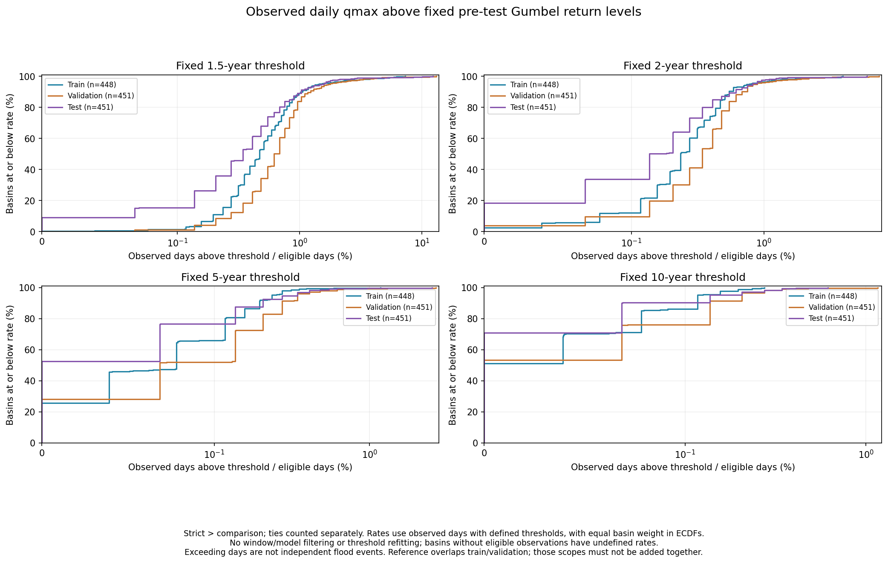

Hình giữ số 0 trong ECDF, mẫu số train 448 khác 451 ở hai kỳ sau. Các bước lớn tại 0 ở T=5/10 phản ánh nhiều ID có quan trắc nhưng không vượt. Phép so giữa kỳ là mô tả quan trắc theo ngưỡng cố định, chưa chứng minh xu thế vật lý hoặc thay đổi tần suất trận độc lập.

#### 24.7.2. Ngày vượt theo năm lịch

| Kỳ | Năm lịch | T=1,5 | T=2 | T=5 | T=10 |
|---|---:|---:|---:|---:|---:|
| Train | 2003 | 653 | 363 | 62 | 16 |
| Train | 2004 | 594 | 301 | 49 | 14 |
| Train | 2005 | 1319 | 786 | 251 | 142 |
| Train | 2006 | 1534 | 852 | 220 | 95 |
| Train | 2007 | 695 | 347 | 78 | 36 |
| Train | 2008 | 575 | 256 | 66 | 24 |
| Train | 2009 | 1767 | 807 | 214 | 111 |
| Validation | 2010 | 1441 | 784 | 234 | 105 |
| Validation | 2011 | 818 | 398 | 89 | 21 |
| Validation | 2012 | 1194 | 604 | 182 | 86 |
| Validation | 2013 | 1829 | 1020 | 364 | 182 |
| Test | 2014 | 1412 | 774 | 240 | 115 |
| Test | 2015 | 480 | 188 | 50 | 24 |
| Test | 2016 | 986 | 503 | 150 | 56 |
| Test | 2017 | 631 | 308 | 58 | 25 |

Cộng các năm của từng kỳ khớp bảng kỳ ở cả bốn T. Năm 2014 đóng góp 115 trong 220 ngày–ID test vượt T=10; chưa gọi là 115 trận hoặc dùng số này chọn giai đoạn đánh giá. Đây là **năm lịch đếm ngày nhãn**, khác năm thủy văn dùng lấy đỉnh fit. Thiếu quan trắc, chuỗi liên tiếp và nhiều lưu vực cùng chịu một diễn biến chưa được xử lý như các mẫu độc lập.

#### 24.7.3. Hồ sơ test và số ngày có thể quan trắc

| ID | n fit | Ngày có nhãn / thiếu trên 1461 ngày | Ngày vượt T=1,5 | T=2 | T=5 | T=10 |
|---|---:|---|---:|---:|---:|---:|
| 55 | 14 | 807 / 654 | 28 | 7 | 0 | 0 |
| 324 | 3 | 1461 / 0 | 3 | 2 | 0 | 0 |
| 600 | 4 | 1461 / 0 | 25 | 13 | 4 | 4 |
| 604 | 17 | 1461 / 0 | 14 | 5 | 1 | 0 |
| 623 | 4 | 1461 / 0 | 3 | 2 | 1 | 0 |
| 742 | 33 | 1461 / 0 | 0 | 0 | 0 | 0 |
| 758 | 33 | 1461 / 0 | 0 | 0 | 0 | 0 |
| 800 | 4 | 1461 / 0 | 3 | 2 | 1 | 0 |

55 có 28/807 ngày vượt T=1,5, **3,469641% trên ngày có số**, và 7/807 ngày vượt T=2, 0,867410%. 654 ngày thiếu không được coi là không vượt; không suy tỷ lệ toàn lịch hoặc toàn bộ trận đã xảy ra từ phần quan trắc. 742/758 đủ mọi ngày test nhưng không vượt cả bốn ngưỡng, phù hợp việc phải tách tỷ lệ 0% khỏi thiếu dữ liệu. Không xác nhận cơ chế từ việc không vượt.

600 có bốn ngày vượt cả T=5 và T=10; cùng số đếm không có nghĩa hai ngưỡng bằng nhau hoặc có bốn trận độc lập. Các ngưỡng giữ nguyên 16,736288 và 20,223715 mm/ngày. 800 dùng ngưỡng T=10 là 185,551435 mm/ngày từ chỉ bốn đỉnh năm; không có ngày vượt trong test chưa chứng minh ngưỡng phù hợp, đặc biệt với giới hạn n=4 và D ở 10.6.

#### 24.7.4. Test tách mẫu fit ngắn/dài, không loại ID

| Nhóm n fit | ID | Ngày có nhãn | T | Ngày vượt | ID có vượt | ID có số nhưng không vượt | Tỷ lệ gộp (%) | Median từng ID (%) |
|---|---:|---:|---:|---:|---:|---:|---:|---:|
| ≥10 | 427 | 622302 | 1,5 | 3334 | 391 | 36 | 0,535753 | 0,342231 |
| ≥10 | 427 | 622302 | 2 | 1667 | 350 | 77 | 0,267876 | 0,183318 |
| ≥10 | 427 | 622302 | 5 | 462 | 199 | 228 | 0,074240 | 0,000000 |
| ≥10 | 427 | 622302 | 10 | 203 | 123 | 304 | 0,032621 | 0,000000 |
| <10 | 24 | 35064 | 1,5 | 175 | 19 | 5 | 0,499087 | 0,205339 |
| <10 | 24 | 35064 | 2 | 106 | 18 | 6 | 0,302304 | 0,136893 |
| <10 | 24 | 35064 | 5 | 36 | 15 | 9 | 0,102669 | 0,068446 |
| <10 | 24 | 35064 | 10 | 17 | 8 | 16 | 0,048483 | 0,000000 |

Hai nhóm cộng đúng 451 ID, 657366 ngày có nhãn và số ngày vượt mỗi T. 24 ID ngắn có đủ **35064=24×1461** ngày test, còn 1545 ngày thiếu nằm trong nhóm ≥10 năm. Độ dài **mẫu fit trước test** và độ phủ **kỳ test** là hai thuộc tính khác nhau; đủ quan trắc test không làm mẫu fit ngắn trở nên dài hơn. Không dùng tỷ lệ nhóm này chọn bộ lọc trạm hoặc sửa phân phối.

10.7 đã đếm được ngày vượt theo ngưỡng cố định. Bước tiếp theo kiểm các đoạn ngày vượt liên tiếp và ngữ cảnh trước/sau; ngày thiếu hoặc ranh giới kỳ có thể cắt một đoạn, nên chưa chuyển trực tiếp số ngày sang số trận.

### 24.8. Cell 10.8 — đoạn vượt liên tiếp và ngữ cảnh trước/sau

Cell dùng đúng qmax/ngưỡng và số ngày đã kiểm ở 10.7, chỉ tách những **khối ngày liên tiếp có qmax>x_T và quan trắc hữu hạn** trong từng phạm vi reference/train/validation/test. Ngày thiếu tách đoạn; không nối hai phía của khoảng trống. Ngày bằng ngưỡng là không vượt theo quy tắc >, nên có thể chặn đoạn. Không đọc ngày ngoài phạm vi để gán ngữ cảnh đầu/cuối; các phạm vi chồng nhau vẫn được lưu riêng, không cộng thành tổng sự kiện.

Với mỗi đoạn lưu ngày đầu/cuối, số ngày, peak quan trắc, ngày đầu/cuối đạt peak và số ngày đồng peak. Trước đầu đoạn: observed_not_above khi ngày ngay trước còn trong kỳ, có số và không vượt; missing_previous_day khi ngày đó thiếu; scope_boundary khi đoạn chạm đầu kỳ. Phía sau dùng observed_not_above/missing_next_day/scope_boundary tương ứng. Chỉ gọi khởi đầu/kết thúc vượt ngưỡng là được quan trắc khi ngày kề trong kỳ có số và không vượt.

Bốn nhóm loại trừ nhau là biết cả hai phía, chỉ biết khởi đầu, chỉ biết kết thúc và chưa biết cả hai phía; tổng phải bằng số đoạn. Cờ chạm ranh giới kỳ và cờ kề ngày thiếu được đếm bổ sung, **có thể chồng nhau trên cùng đoạn**, không cộng hai cờ này để thay số đoạn bị cắt. Đủ hai phía cũng chỉ xác nhận khối vượt có hai ngày kề quan trắc, chưa xác nhận độc lập với khối khác theo USWRC.

Tổng độ dài các đoạn phải bằng above_days ở 10.7 cho từng ID/kỳ/T. Số đếm ngày/thiếu/ties và ngưỡng/n fit/trạng thái cũng phải khớp trước khi tách. Không có ngày đủ điều kiện khác có quan trắc nhưng không có đoạn; giữ cả hai trường hợp trong bảng ID. Ngưỡng cao hơn có thể tách một đoạn thành nhiều đoạn nên **không ép số đoạn giảm theo T**. Đoạn không chạm khoảng trống vẫn có thể chung một diễn biến với đoạn khác; không tự lấy mỗi đoạn làm một trận độc lập.

Tổng hợp báo số đoạn, bốn nhóm ngữ cảnh, số ID có đoạn/không có đoạn trên quan trắc, tổng ngày vượt, median/p95/max độ dài. Độ dài là số ngày quan trắc liên tiếp nhìn thấy, có thể bị cắt; phân vị gộp theo đoạn chứ không cho mỗi ID trọng số bằng nhau. Hình gồm cột chồng ngữ cảnh test ở bốn T và ECDF độ dài các đoạn test, giữ nhãn số đoạn. Hồ sơ cố định 55/324/600/623/742/758/800/604; bảng 20 đoạn dài nhất là mô tả, cùng chuỗi có thể xuất hiện ở nhiều T lồng nhau.

Xuất A1_P10_gumbel_exceedance_runs.png và bốn CSV A1_P10_: flood_run_details, flood_run_by_basin, flood_run_summary, flood_run_context_summary. In bảng (1) tổng hợp kỳ/T, (2) ngữ cảnh đầu/cuối test, (3) hồ sơ test, (4) tối đa 20 đoạn test dài nhất. Kết quả thực tế 10.8 được trình bày ở 24.8.1–24.8.4. Chưa gộp theo tiêu chí độc lập, ghép dự báo hoặc thay ngưỡng/danh sách ID.

#### 24.8.1. Từ ngày vượt sang đoạn liên tiếp, chưa sang trận độc lập

Cell 10.8 chạy **11,4 giây**. Hình và tệp output được cung cấp đã giữ nguyên byte; bốn CSV chi tiết chưa nhận cục bộ. [Output nguyên bản](Tables/A1_P10_gumbel_exceedance_runs_output.txt) giữ bảng (1)–(4), hồ sơ, các đoạn dài và cảnh báo; không dựng CSV nguồn từ bản in.

Tổng độ dài đoạn khớp ngày vượt 10.7 theo từng ID/kỳ/T. Một đoạn có thể dài nhiều ngày, nên số đoạn thấp hơn số ngày vượt; khác biệt này chưa đo mức giảm khi gộp theo tiêu chí độc lập.

| Kỳ | T (năm) | Ngày vượt | Đoạn liên tiếp | Biết cả hai phía | Chỉ biết đầu | Chỉ biết cuối | Chưa biết cả hai | Median độ dài | p95 | Max |
|---|---:|---:|---:|---:|---:|---:|---:|---:|---:|---:|
| Reference | 1,5 | 33965 | 16063 | 16062 | 1 | 0 | 0 | 1 | 4 | 192 |
| Reference | 2 | 17883 | 9198 | 9197 | 1 | 0 | 0 | 1 | 4 | 163 |
| Reference | 5 | 4919 | 3023 | 3023 | 0 | 0 | 0 | 1 | 3 | 74 |
| Reference | 10 | 2352 | 1520 | 1520 | 0 | 0 | 0 | 1 | 3 | 60 |
| Train | 1,5 | 7137 | 3572 | 3564 | 1 | 7 | 0 | 1 | 4 | 121 |
| Train | 2 | 3712 | 2073 | 2066 | 0 | 7 | 0 | 1 | 3 | 95 |
| Train | 5 | 940 | 663 | 662 | 0 | 1 | 0 | 1 | 3 | 24 |
| Train | 10 | 438 | 325 | 325 | 0 | 0 | 0 | 1 | 2 | 6 |
| Validation | 1,5 | 5282 | 2786 | 2785 | 0 | 1 | 0 | 1 | 4 | 79 |
| Validation | 2 | 2806 | 1581 | 1581 | 0 | 0 | 0 | 1 | 4 | 70 |
| Validation | 5 | 869 | 533 | 533 | 0 | 0 | 0 | 1 | 3 | 37 |
| Validation | 10 | 394 | 285 | 285 | 0 | 0 | 0 | 1 | 3 | 14 |
| Test | 1,5 | 3509 | 2093 | 2091 | 2 | 0 | 0 | 1 | 3 | 120 |
| Test | 2 | 1773 | 1157 | 1157 | 0 | 0 | 0 | 1 | 3 | 61 |
| Test | 5 | 498 | 366 | 366 | 0 | 0 | 0 | 1 | 2 | 22 |
| Test | 10 | 220 | 184 | 184 | 0 | 0 | 0 | 1 | 2 | 9 |

Test có **2093/1157/366/184 đoạn** ở T=1,5/2/5/10, trên **3509/1773/498/220 ngày vượt**. Median độ dài đều một ngày; p95 là 3/3/2/2 ngày. Những phân vị này gộp theo đoạn, không theo ID trọng số bằng nhau. Số đoạn test ở T=10 là 184, vẫn không phải số trận độc lập hoặc số trận đã ghép được với dự báo.

Số ID có đoạn giữ đúng số ID có ngày vượt ở 10.7: 410/368/214/131 trong test. Train còn ba ID không có ngày đủ điều kiện, không đưa họ vào nhóm có quan trắc nhưng không vượt. Không cộng các T lồng nhau hoặc cộng reference với train/validation.

#### 24.8.2. Ranh giới kỳ và ngày thiếu được giữ riêng

Trong test, **2091 đoạn T=1,5** có cả hai ngày kề quan trắc không vượt, bao gồm 3507 ngày vượt. **Hai đoạn còn lại, mỗi đoạn một ngày**, có đầu được quan trắc nhưng kết thúc chạm ranh giới kỳ test; không giả định chúng kết thúc thật tại đó. Ở T=2/5/10, mọi đoạn test đều có cả hai phía quan trắc.

Không đoạn test nào có **ngày thiếu ngay kề** đầu/cuối. Điều này không có nghĩa toàn test đủ quan trắc, cũng không bảo đảm khoảng dài giữa hai đoạn không có ngày thiếu: ID 55 vẫn thiếu 654 ngày test. Chỉ số ngữ cảnh 10.8 kiểm ngày kề; phép gộp 10.9 cần kiểm toàn khoảng giữa các đỉnh.

Reference T=1,5/T=2 mỗi mức có một đoạn kề ngày thiếu, không có đoạn chạm biên reference. Train có 8/7/1/0 đoạn chạm ranh giới kỳ theo bốn T, không có đoạn kề ngày thiếu; validation có một đoạn chạm biên ở T=1,5 và không có ở ba T sau. Bốn nhóm biết đầu/cuối cộng đúng số đoạn; chưa có đoạn nào ở nhóm chưa biết cả hai phía trong các bảng đã in.

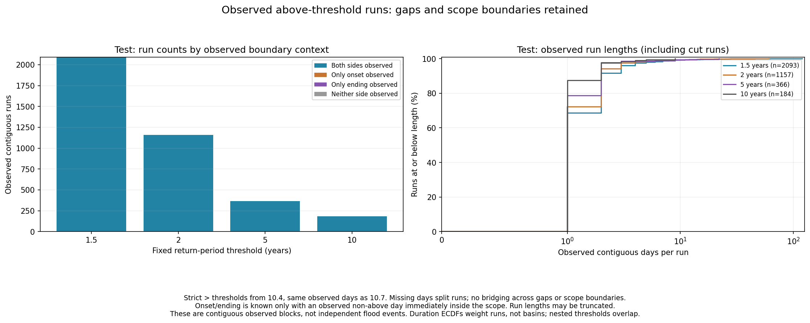

Phần lớn cột test là nhóm biết cả hai phía, hai đoạn bị cắt ở T=1,5 rất nhỏ so tổng nên khó thấy trên cùng thang; bảng giữ số riêng. Đường độ dài giữ mọi đoạn, kể cả đoạn bị cắt. Có hai ngày kề không vượt mới chỉ xác nhận một khối vượt quan trắc, chưa kiểm thời gian cách đỉnh hoặc mức rút giữa các khối.

#### 24.8.3. Các hồ sơ test

| ID | Ngày có nhãn | Ngày vượt → số đoạn T=1,5 | T=2 | T=5 | T=10 | Max độ dài T=1,5 |
|---|---:|---|---|---|---|---:|
| 55 | 807 | 28 → 14 | 7 → 4 | 0 → 0 | 0 → 0 | 8 |
| 324 | 1461 | 3 → 3 | 2 → 2 | 0 → 0 | 0 → 0 | 1 |
| 600 | 1461 | 25 → 16 | 13 → 11 | 4 → 4 | 4 → 4 | 3 |
| 604 | 1461 | 14 → 10 | 5 → 4 | 1 → 1 | 0 → 0 | 3 |
| 623 | 1461 | 3 → 3 | 2 → 2 | 1 → 1 | 0 → 0 | 1 |
| 742 | 1461 | 0 → 0 | 0 → 0 | 0 → 0 | 0 → 0 | NaN |
| 758 | 1461 | 0 → 0 | 0 → 0 | 0 → 0 | 0 → 0 | NaN |
| 800 | 1461 | 3 → 3 | 2 → 2 | 1 → 1 | 0 → 0 | 1 |

Mọi đoạn ở tám hồ sơ được in đều có hai phía quan trắc. Với 55, 28 ngày T=1,5 thuộc 14 đoạn, đoạn dài nhất tám ngày; ngữ cảnh các đoạn có số không phục hồi 654 ngày thiếu ngoài chúng. Với 600, bốn ngày vượt T=10 thuộc bốn đoạn một ngày; vẫn có thể phải gộp một số đoạn nếu chúng quá gần hoặc chưa rút đủ giữa đỉnh. 742/758 không có đoạn nên thống kê độ dài giữ NaN, không gán độ dài bằng 0.

#### 24.8.4. Đoạn dài và các ngưỡng lồng nhau

| ID | T | Ngày đầu–cuối đoạn | Ngày quan trắc liên tiếp | Peak quan trắc (mm/ngày) | Ngày đạt peak |
|---|---:|---|---:|---:|---|
| 697 | 1,5 | 11/06/2016–08/10/2016 | 120 | 3,253889 | 05–06/08/2016 |
| 563 | 1,5 | 09/02/2014–12/04/2014 | 63 | 4,276724 | 24/02/2014 |
| 697 | 2 | 12/07/2016–10/09/2016 | 61 | 3,253889 | 05–06/08/2016 |
| 563 | 2 | 16/02/2014–02/04/2014 | 46 | 4,276724 | 24/02/2014 |
| 697 | 5 | 02/08/2016–23/08/2016 | 22 | 3,253889 | 05–06/08/2016 |
| 563 | 5 | 20/02/2014–05/03/2014 | 14 | 4,276724 | 24/02/2014 |

Các đoạn dài nhất ở 697/563 có hai phía quan trắc, không phải phần kéo dài do nối qua ngày thiếu. Cùng một phần chuỗi xuất hiện ở nhiều T và cùng peak, không đếm như các trận khác nhau rồi cộng. Ở 697, đoạn vượt T=1,5 kéo dài 120 ngày chỉ là khối luôn nằm trên ngưỡng đó; chưa suy là một trận lũ vật lý kéo dài 120 ngày hoặc xác nhận cơ chế duy trì lưu lượng.

Phép gộp tiếp theo áp trên các đoạn đã xác định, không tự tách những peak cục bộ trong một khối luôn vượt ngưỡng. Nó giảm việc đếm nhiều lần vượt gần nhau theo giao thức đã ghi, không bảo đảm đã thu được mọi trận vật lý hoặc độc lập thống kê. Ngưỡng, mẫu fit, diện tích quy đổi và danh sách 451 giữ nguyên.

### 24.9. Cell 10.9 — gộp đoạn theo khoảng cách đỉnh và mức rút USWRC

Cell giữ ngưỡng 10.4, tái tạo các đoạn từ cache rồi so toàn bộ ngày đầu/cuối, độ dài, peak/ties và ngữ cảnh với 10.8 trước khi gộp. Dùng **area_gov_km2 trong bảng quy đổi Q 5.1**, không lấy area_calc hoặc tìm area_gov trong bảng Catchment. Diện tích phải hữu hạn/dương và hệ số 86,4/area_gov phải khớp bảng đổi đơn vị.

Diện tích dặm vuông bằng area_gov_km2/(1,609344²). Khoảng cách ngày tối thiểu là **ceil[5+ln(A dặm vuông)]**, ln tự nhiên; trên lịch ngày nguyên, tương đương khoảng cách ≥5+ln(A) trước khi làm tròn. Công thức/đơn vị/ceiling được đối chiếu [HEC-USACE, Peaks Over Threshold Filtering](https://www.hec.usace.army.mil/confluence/sspdocs/sspum/latest/peaks-over-threshold-analysis/peaks-over-threshold-filtering). Tiêu chí đáy giữ theo phương pháp ở Mục 3.6(g) tài liệu lý thuyết: giữa hai peak phải có giá trị **nhỏ hơn 0,75×peak nhỏ hơn** để đủ điều kiện tách. Đáy bằng đúng 0,75 chưa đủ; khoảng cách bằng giới hạn ngày nguyên là đủ về thời gian. Dùng tỷ số peak/đáy trên mm/ngày tương đương trên m³/s trong cùng ID vì cùng hệ số dương.

Chi tiết triển khai của đề tài: xử lý từ trái sang phải, mỗi đoạn là cụm ban đầu. Cặp cụm kề có đủ quan trắc giữa peak được gộp nếu chưa đủ khoảng cách hoặc chưa rút đủ; cụm mới giữ ngày bắt đầu sớm nhất, ngày cuối muộn nhất, peak lớn nhất và toàn bộ ngày đồng peak. Sau mỗi lần gộp kiểm lại cặp kề bằng peak đại diện mới, không chỉ nối nhãn từ các cặp đoạn thô một lần. Lưu cả lịch sử so trung gian và các ranh giới cuối, tránh coi một quyết định trước gộp là quyết định cuối.

Với đồng cực đại, dùng khoảng cách **từ ngày peak cuối của cụm trái đến ngày peak đầu của cụm phải**, là khoảng cách gần nhất giữa các ngày đồng peak; không chọn tùy ý ngày peak sớm để tăng khoảng cách. Đáy xét các ngày ở giữa, không gồm hai ngày peak. Nếu có bất kỳ ngày thiếu trong khoảng đó, **không nối qua khoảng trống**, giữ ranh giới unresolved_missing. Đây là chính sách xử lý thiếu của đề tài; chưa kết luận hai phía độc lập hoặc cùng trận. Ranh giới kỳ không được nối giữa hai phạm vi khác nhau; ngữ cảnh bị cắt từ 10.8 tiếp tục giữ.

Đầu ra gọi **cụm theo quy tắc**, không tuyên bố độc lập vật lý/thống kê đã được chứng minh. Mỗi đoạn thô thuộc đúng một cụm, tổng ngày vượt bảo toàn, số thao tác merge bằng mức giảm số đoạn. Span cụm gồm cả ngày không vượt giữa các đoạn nên khác above_days, không gọi toàn span là ngày vượt. Mọi ranh giới cuối có đủ quan trắc phải thỏa cả khoảng cách và mức rút; các ranh giới thiếu có cờ riêng. Không lấy số cụm có đầu/cuối quan trắc thay cho số cụm chưa bị cắt mà không báo mẫu số.

Hình test so số đoạn trước gộp với số cụm, và ECDF tỷ lệ giảm số đoạn từng ID có ít nhất một đoạn (giữ giảm 0%). Các ID không có đoạn không được gán mức giảm 0% để đưa vào ECDF, nhưng vẫn có trong bảng ID với số cụm 0; mặt nạ đủ ngày được giữ riêng. Reference chồng các kỳ và T lồng nhau nên không cộng các số đó. Mới áp trên quan trắc qmax ngày; chưa ghép hoặc chấm chuỗi dự báo.

Xuất A1_P10_uswrc_grouping.png và bảy CSV A1_P10_: uswrc_parameters, uswrc_clusters, uswrc_membership, uswrc_comparisons, uswrc_boundaries, uswrc_counts, uswrc_summary. In bảng (1) trước/sau và ngữ cảnh, (2) diện tích/khoảng cách, (3) hồ sơ test, (4) audit phép so và ranh giới cuối, (5) tối đa 15 cụm test gộp nhiều đoạn nhất. Kết quả Kaggle được trình bày ở Mục 24.9.1–24.9.4; tổng kết Phần 10 ở Mục 24.10.

#### 24.9.1. Kết quả trước và sau gộp

Cell 10.9 chạy **83,1 giây**. [Output nguyên bản](Tables/A1_P10_uswrc_grouping_output.txt) và hình được giữ nguyên byte từ tệp đã cung cấp. Bảy CSV chi tiết được báo đã xuất trên Kaggle nhưng chưa nhận cục bộ; các bảng dưới đây là trích số từ output, không thay thế CSV nguồn.

| Phạm vi | T (năm) | Ngày vượt bảo toàn | Đoạn trước gộp | Cụm sau gộp | Số giảm | Giảm gộp (%) | Ranh giới thiếu chưa xác định |
|---|---:|---:|---:|---:|---:|---:|---:|
| Reference | 1,5 | 33965 | 16063 | 14146 | 1917 | 11,934259 | 94 |
| Reference | 2 | 17883 | 9198 | 8391 | 807 | 8,773646 | 86 |
| Reference | 5 | 4919 | 3023 | 2848 | 175 | 5,788951 | 53 |
| Reference | 10 | 2352 | 1520 | 1456 | 64 | 4,210526 | 32 |
| Train | 1,5 | 7137 | 3572 | 3092 | 480 | 13,437850 | 22 |
| Train | 2 | 3712 | 2073 | 1851 | 222 | 10,709117 | 17 |
| Train | 5 | 940 | 663 | 630 | 33 | 4,977376 | 3 |
| Train | 10 | 438 | 325 | 314 | 11 | 3,384615 | 0 |
| Validation | 1,5 | 5282 | 2786 | 2483 | 303 | 10,875808 | 4 |
| Validation | 2 | 2806 | 1581 | 1474 | 107 | 6,767868 | 4 |
| Validation | 5 | 869 | 533 | 511 | 22 | 4,127580 | 1 |
| Validation | 10 | 394 | 285 | 280 | 5 | 1,754386 | 0 |
| Test | 1,5 | 3509 | 2093 | 1869 | 224 | 10,702341 | 4 |
| Test | 2 | 1773 | 1157 | 1073 | 84 | 7,260156 | 2 |
| Test | 5 | 498 | 366 | 345 | 21 | 5,737705 | 0 |
| Test | 10 | 220 | 184 | 178 | 6 | 3,260870 | 0 |

Trong test, số ID có cụm là **410/368/214/131**, bằng số ID có đoạn ở 10.8. Median tỷ lệ giảm từng ID có đoạn đều **0%**, trong khi tỷ lệ giảm gộp dương: số lần gộp tập trung ở một phần lưu vực. Không đưa ID không có đoạn vào mẫu số tỷ lệ giảm. Không cộng các mức T lồng nhau hoặc cộng reference với train/validation.

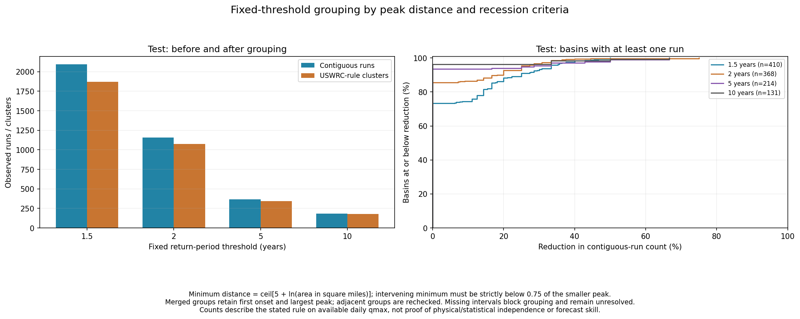

#### 24.9.2. Diện tích, ranh giới thiếu và audit

Trên **451 ID được chọn**, area_gov có min/median/max **3,9/101/15131 km²**. Khoảng cách thực 5+ln(A dặm vuông) có min/median/max **5,409323/8,663467/13,672848 ngày**; sau ceiling là **6/9/14 ngày**. Các số này thuộc tập 451, không thay cho thống kê toàn bộ trạm.

Test giữ **4/2/0/0 ranh giới thiếu chưa xác định** ở bốn T. Hai phía không được nối qua khoảng thiếu và cũng không được coi là đã xác nhận độc lập. Có 1867/1869 cụm T=1,5 biết cả hai ngữ cảnh kề; hai cụm còn lại vẫn giữ phần bị cắt tại biên kỳ. Các T sau có đủ hai ngữ cảnh kề cho mọi cụm test, nhưng điều đó không phục hồi quan trắc thiếu ở xa giữa các đỉnh.

Lịch sử thao tác khác bảng ranh giới cuối vì thuật toán kiểm lại cụm kề sau gộp. Ở T=1,5, **21 + 12 + 191 = 224** thao tác gộp, đúng mức giảm 2093−1869. Có 1623 phép so trung gian kết luận tách, nhưng chỉ **1455 ranh giới tách + 4 chưa xác định = 1459** ranh giới cuối, bằng 1869 cụm−410 ID có cụm. T=2 tương ứng **6 + 3 + 75 = 84** lần gộp và **703 + 2 = 705 = 1073−368** ranh giới cuối. Hai mức T=5/10 có **131 = 345−214** và **47 = 178−131** ranh giới cuối; không có ranh giới thiếu trong hai nhóm này.

#### 24.9.3. Hồ sơ và ý nghĩa độ dài cụm

ID 55 giảm **14→9 cụm** ở T=1,5 và **4→3** ở T=2, bảo toàn 28/7 ngày vượt; còn 2/1 ranh giới thiếu chưa xác định. ID 600 chỉ giảm **16→15** ở T=1,5; các mức sau giữ 11/4/4 cụm. Các hồ sơ 324/604/623/800 không giảm số đoạn ở các mức đã in. 742/758 không có ngày vượt trong test nên số cụm bằng 0, tỷ lệ giảm giữ NaN.

ID 593, T=2: bốn đoạn thành một cụm 10–23/08/2016; span 14 ngày chứa **7 ngày vượt và 7 ngày không vượt**. ID 697, T=2: bốn đoạn thành cụm 19/06–30/09/2016; span 104 ngày chứa **88 ngày vượt và 16 ngày không vượt**, peak đồng hạng vào 05–06/08. Vì vậy, span không phải số ngày vượt và chưa là thời lượng một trận lũ vật lý đã xác nhận. Ví dụ ID 791 còn dựa trên mẫu Gumbel sáu năm; việc gộp không xóa cờ mẫu ngắn.

#### 24.9.4. Giới hạn sử dụng

Các cụm mô tả quy tắc đã định trên **qmax ngày**. Số liệu chưa chứng minh độc lập vật lý/thống kê, chưa dùng thủy đồ tức thời và chưa ghép với dự báo. Không suy POD/precision/F1 từ số cụm quan trắc; không thay ngưỡng hoặc chọn quy tắc theo số giảm trên test. Ngày thiếu, biên kỳ và 24 mẫu Gumbel dưới 10 năm tiếp tục được giữ trong hồ sơ bàn giao.

### 24.10. Tổng kết Phần 10

Phần 10 hoàn thành khảo sát 10.1–10.9: ngưỡng q30/q80/q98, độ nhạy giai đoạn tham chiếu, độ phủ năm thủy văn, Gumbel L-moments, độ nhạy bỏ năm, chênh CDF và chuỗi đếm **ngày vượt → đoạn liên tiếp → cụm theo quy tắc USWRC**. Hai họ ngưỡng giữ vai trò riêng; ngưỡng 1981–2013 là giao thức đánh giá trước test, không phải scaler hay thống kê train.

451 ID đều có ba ngưỡng phân mức phân biệt và fit Gumbel xác định. Tuy nhiên, **24 ID chỉ có 3–9 năm đỉnh**, năm đủ ≥50% lịch vẫn có thể mất mùa/đỉnh, và chẩn đoán CDF hoặc bỏ năm không phải bằng chứng chấp nhận phân phối. Mẫu chính giữ năm biên đủ điều kiện; full-window là độ nhạy riêng. Không lọc ID hoặc sửa ngưỡng từ các chẩn đoán này.

Bước tiếp theo sử dụng các bảng ngưỡng, đoạn, membership và ranh giới có cờ để đánh giá dự báo theo giao thức cố định. A1 chưa có phép ghép/chấm sự kiện dự báo. **Danh sách lưu vực vượt mức 10 năm riêng trong tháng 6/2013 chưa được trích thành một kết quả chuyên biệt**; không suy danh sách này từ hình hoặc trình bày như mục đã đo. Đây là ca có thể đối chiếu khi bàn giao đánh giá, không mở thêm cell khảo sát trong notebook đã chốt.

## 25. Phần 11 — tổng hợp kết quả và bàn giao A3/B2

### 25.1. Kết quả sử dụng được

A1 đã hoàn thành khảo sát thực thi đến 10.9 trên Input hiện tại. Tập mô hình giữ **451 ID**; 452 ID trong phép kiểm nguồn giờ gồm thêm ca 410 để chẩn đoán. Khí tượng, Q và thuộc tính được ghép bằng ID/ngày, không theo thứ tự dòng. Cấu trúc tệp, lịch có dữ liệu và mặt nạ giá trị hợp lệ phải được phân biệt khi tính mẫu số.

| Kết quả | Cách dùng tiếp | Giới hạn cần giữ |
|---|---|---|
| Nhãn qmax theo ngày, hệ số 86,4/area_gov | Chuẩn hóa m³/s thành mm/ngày bằng diện tích trạm | qmax không phải tổng lượng nước ngày; không tự thay area_calc |
| Đối chiếu Q giờ–ngày | qmin/qmax khớp, qmean khớp trong 0,0005 m³/s trên phạm vi đã kiểm, kể cả ngày thiếu một phần giờ | Cùng nguồn không xác nhận quan trắc độc lập hoặc nguyên nhân vật lý |
| Phân phối, thiếu khí tượng và năm cặp nguồn | Giữ phạm vi cùng ngày–ID và các đơn vị raw khi so | Net/downward bức xạ khác đại lượng; nguồn, dấu và phép chuyển đổi CSV còn điểm chưa xác nhận |
| Cửa sổ 365/730, có/không qmean | So mặt nạ toàn khung với ô từng pha thực sự sử dụng | Số trên CSV hiện tại chưa là số mẫu loader/cache lịch sử |
| Ngưỡng bốn mức và Gumbel 1981–2013 | Đầu vào cho đánh giá theo giao thức đã định | 24 mẫu Gumbel ngắn; độ phủ thiếu và độ nhạy vẫn đi kèm |
| Đoạn và cụm USWRC trên quan trắc | So trước/sau gộp với membership và cờ ranh giới | Không tự gọi là sự kiện độc lập đã xác nhận hoặc điểm dự báo |

Độ phủ nhãn train/validation/test lần lượt là **1112307/1153207**, **656281/658911** và **657366/658911** ngày–ID. Các tỷ lệ dùng ngày lịch; khi chấm mô hình còn cần giao mặt nạ obs/sim và điều kiện cửa sổ tương ứng. Số ngày vượt, số đoạn và số cụm không thay thế nhau.

### 25.2. Các hồ sơ cần mang theo

| Hồ sơ/cờ | Bằng chứng đã đo | Hành động bàn giao |
|---|---|---|
| 324/600/623 | Không có nhãn train 2003–2009, có nhãn evaluation | Giữ ID; báo thống kê train không xác định, không lấy test để điền |
| 800 | Chỉ 38 ngày nhãn train; ngưỡng train đại diện rất hạn chế | Giữ cờ độ phủ; không tự loại hoặc sửa thống kê theo test |
| 55 | Thiếu cửa sổ có Q; hai run tác giả có Q không có sim hữu hạn; Gumbel dùng 14 năm, chỉ một năm đủ toàn bộ quan trắc | Kiểm theo từng run và mặt nạ; chưa gán cơ chế NaN hoặc bảo đảm đã quan trắc đủ đỉnh |
| 742/758 | Phương sai test nhỏ; EncDec_noQ cho đầu ra hằng ở hai hồ sơ | Phân tích sai số trên đúng cặp obs/sim; không suy lỗi quan trắc từ NSE âm |
| SWE | 13 ID có mọi giá trị lưu trữ ≥1000, sáu ID có một phần ≥1000 | Giữ nguyên; chưa trừ nền, chặn số hoặc tự đổi đơn vị |
| Q âm và cờ giờ | 111 giờ âm khác −999 trên 43 ngày–ID, thuộc sáu ID | Giữ audit; không coi cờ ckhs/qceq/qcol tự là quy tắc loại Q |
| Cache/scaler | Train của một config cache chưa có nội dung để kiểm; còn giới hạn scaler đã ghi tại Phần 3/5 | Xác nhận nguồn/byte và phạm vi fit ở lần chạy tiếp theo |

Các ca đã chọn chỉ phục vụ chẩn đoán. Tập 451 không đổi theo độ nhạy ngưỡng, NSE, hình dạng chuỗi hoặc số cụm test.

### 25.3. Hợp đồng bàn giao A3

A3 cần ghi nguồn của từng chuỗi dự báo, config/checkpoint, đơn vị, lịch chấm và mặt nạ obs/sim. Sáu kết quả tác giả ở Phần 8–9 phải được phân biệt với export chạy lại A2; export A2 chưa có trong phạm vi Input/Working của phiên A1 này. Việc đã đối chiếu bốn hồ sơ không xác nhận toàn bộ 451 chuỗi cùng quan trắc hoặc cùng ngày chấm.

Đánh giá cần giữ các kỳ **train 2003–2009, validation 2010–2013, test 2014–2017**, danh sách ID và cách báo NaN. Thống kê/scaler huấn luyện chỉ fit từ train; ngưỡng đánh giá 1981–2013 bao gồm validation theo giao thức đã định và không dùng test. Chọn mô hình theo tiêu chí validation đã thống nhất; test dùng báo cáo kết quả.

Với đánh giá sự kiện, dùng chung ngưỡng quan trắc cố định và quy tắc gộp cho obs/sim; giữ đối chiếu không gộp như kế hoạch. Cần định nghĩa rõ ghép một–một, dung sai thời gian, biên kỳ, khoảng thiếu và trường hợp không có sự kiện trước khi tính POD/precision/F1. Các mục đó là công việc đánh giá tiếp theo, chưa là kết quả của A1. Không cộng reference với train/validation hoặc cộng các T lồng nhau.

### 25.4. Hợp đồng bàn giao B2

B2 có thể dùng hợp đồng biến/pha và bảng đếm Phần 7 để kiểm bộ lọc mẫu. Ở khung 730, kiểm đúng ô tiêu thụ theo pha phục hồi 154076 mẫu cho nhóm hai pha chỉ dùng ECMWF ngày cuối và 150932 cho nhóm có Q trong khảo sát CSV. Đây là ứng viên kiểm triển khai, chưa phải kết quả huấn luyện hoặc lý do thay mọi điều kiện thiếu cho mọi mô hình.

Trước khi áp thay đổi cần đối chiếu loader, cache, scaler, thứ tự biến, đoạn khởi động và đơn vị của qmean đầu vào. qmean trong hợp đồng tác giả không tự được chuẩn hóa giống qmax nhãn. EOBS_hu không nằm trong dynamic của các nhóm đã đếm; không dùng số ô thiếu của nó để suy số mẫu mô hình mất. Không đưa quy tắc điền thiếu, đổi dấu/đơn vị hoặc lọc trạm vào pipeline chỉ vì làm chỉ số test đẹp hơn.

### 25.5. Giới hạn và phạm vi đã chốt

Các vấn đề còn mở gồm phép chuyển đổi CSV bức xạ/mưa thành phần, dấu và thành phần bốc hơi, phiên bản sản phẩm và quy ước ngày forecast; nội dung cache/scaler lịch sử; chất lượng vật lý của các quan trắc bất thường; độ phù hợp phân phối và ảnh hưởng mất đỉnh năm. Chẩn đoán trừ mean tháng train chỉ loại một phần mùa để đọc tương quan, không tạo scaler mới hoặc chứng minh kỹ năng dự báo độc lập.

Các phép so NSE tác giả, phân tích đầu ra hằng và phân rã MSE ở Phần 8–9 được giữ như hồ sơ hỗ trợ vì chúng kiểm nguồn, mặt nạ và cách đọc nhãn. Chúng không thay nghiên cứu mô hình hoặc suy nguyên nhân bên trong mạng. Các chẩn đoán độ nhạy ở Phần 10 giới hạn cách dùng ngưỡng, không mở thêm bước chọn phân phối/ngưỡng bằng test. A1 dừng tại đây; không thêm mô hình, hiệu chỉnh dự báo, kiểm định nguyên nhân hoặc phân tích ca tháng 6/2013 chưa có kết quả riêng.

Phát biểu kết quả phải nêu **phạm vi, đại lượng và mẫu số**. Ví dụ, thiếu qmax test là 1545/658911 ngày–ID, không phải tỷ lệ trạm không có quan trắc. Các CSV chi tiết mới được báo xuất nhưng chưa nhận được giữ trạng thái chưa có cục bộ; nguồn đã nhận được dẫn tại Mục 26. Phần 11 là tổng hợp báo cáo, không có cell thực thi trong notebook.

## 26. Nguồn và cách đối chiếu

Số liệu đo lấy từ output Kaggle thật của các cell 1–10.9 và các tệp đã nhận trong repo. Notebook được lưu không kèm output thực thi; kết quả đã cung cấp nằm trong báo cáo, hình và các tệp văn bản/bảng tại `Figures`, `Tables`. Không dùng hình giả lập hoặc bản in tái dựng làm CSV nguồn.

| Phạm vi | Bằng chứng cục bộ và giới hạn |
|---|---|
| Phần 1–3 | Kết quả kiểm kê ghi trong báo cáo; các bảng/hình đã nhận giữ trong repo, gồm bảng bin diện tích ở Mục 17.14 |
| 4.3, 4.5 | Đã nhận và đối chiếu trực tiếp sáu CSV 4.3 và tám CSV 4.5 |
| Phần 5 | Giữ log nguồn giờ 2.5/5.9, output 5.2/5.3/5.8 và các tệp thật đã cung cấp; CSV chi tiết 5.1–5.12 chưa nhận cục bộ, kể cả bảng q_ratio_extremes chưa có output thật |
| 6.1–6.4 | Bảng kết quả đã cung cấp, bốn hình và output nguyên văn 6.3/6.4; năm CSV mỗi cell chưa nhận cục bộ |
| 7.1 | Đã nhận bảng path 120 dòng, vai trò 24 dòng, lịch 48 dòng và kiểm kê trước/sau diễn giải path; các CSV hợp đồng chi tiết khác chưa nhận |
| 7.2–7.4 | Giữ output nguyên văn 7.2/7.4 và hình cửa sổ; 7.3 được dán trực tiếp trong chat; CSV đếm/cohort/cache chi tiết chưa nhận |
| 8.1–8.4 | Giữ hình 8.1, hình/output nguyên văn 8.2/8.4 và output nguyên văn 8.3; bảng 8.1 dán trong chat; các CSV chi tiết chưa nhận |
| 9.1–9.2 | Hình và output nguyên văn đã nhận; các CSV hồ sơ/chuỗi/sai số chi tiết chưa nhận |
| 10.1–10.4 | Hình đã nhận, bảng dán trong chat; lần lượt 3/6/4/7 CSV chi tiết chưa nhận |
| 10.5–10.9 | Hình và tệp output nguyên bản đã nhận; lần lượt 4/4/5/4/7 CSV chi tiết chưa nhận |

Hình và log được cung cấp dưới dạng tệp được sao chép nguyên byte. Các bảng trích trong MD là trình bày lại số đo từ output, không phải CSV gốc mới nhận. Bảng dẫn xuất có nhãn riêng. Tệp trong `WORK_DIR/Tables` sau một lần chạy là bằng chứng chi tiết của lần đó; chỉ coi đã có trong repo khi tệp thực sự được nhận và sao chép. Chi tiết provenance và ngoại lệ của từng kết quả được giữ tại mục tương ứng.

Nguồn giải thích:

- [BiasCast, Mục 2.1 và Phụ lục A](https://hess.copernicus.org/articles/30/5067/2026/index.html): bản mở rộng, nguồn qmin/qmax và các nhóm đầu vào.
- [LamaH-CE, Mục 4.1 và Mục 5](https://essd.copernicus.org/articles/13/4529/2021/): nguồn dữ liệu, quy trình xử lý giờ và định nghĩa thuộc tính.
- [Bảng 1 — typimpact](https://essd.copernicus.org/articles/13/4529/2021/essd-13-4529-2021-t01.xlsx), [Bảng 2 — degimpact](https://essd.copernicus.org/articles/13/4529/2021/essd-13-4529-2021-t02.xlsx), [Bảng A1 — metadata trạm](https://essd.copernicus.org/articles/13/4529/2021/essd-13-4529-2021-t03.xlsx): mã và đơn vị thuộc tính trạm.
- [Bộ nạp lamah.py](../../../NeuralHydrology/neuralhydrology/datasetzoo/lamah.py#L240): hành vi đọc thuộc tính và chuẩn hóa Q của mã đang dùng.
- [Mã phân tích cặp biến và thuộc tính tĩnh của tác giả](../../../PaperResearch/PaperResearchCode/BiasCast/Inspect_Experiments/code/wasserstein_distance_static_attributes.py#L53): tên các cặp nguồn và danh sách thuộc tính trong phân tích tác giả.

Khi mô tả trong bài khác quan trắc của input, giữ cả hai cùng phạm vi và nguồn. Các giả thuyết chưa được xác nhận không dùng làm kết luận về chất lượng trạm hoặc tiêu chí tác giả.
