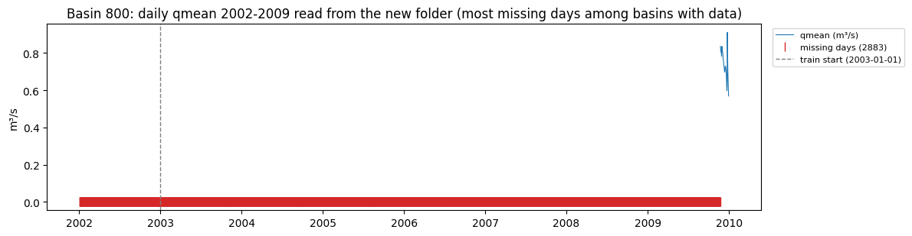
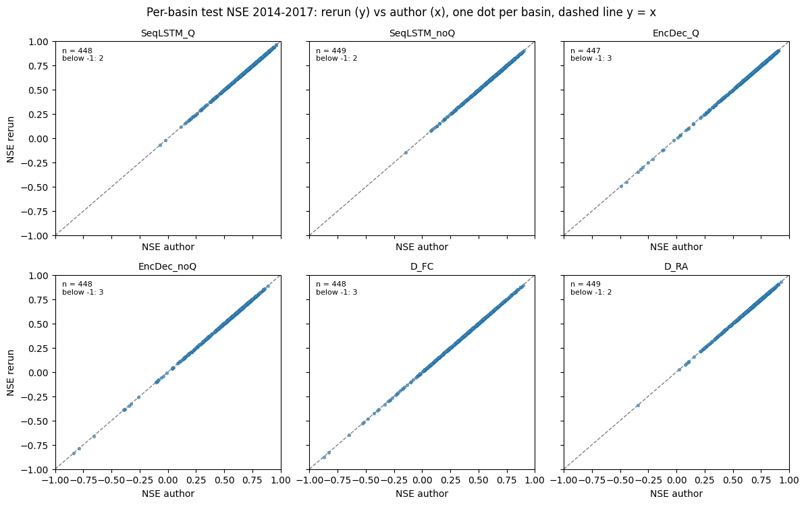
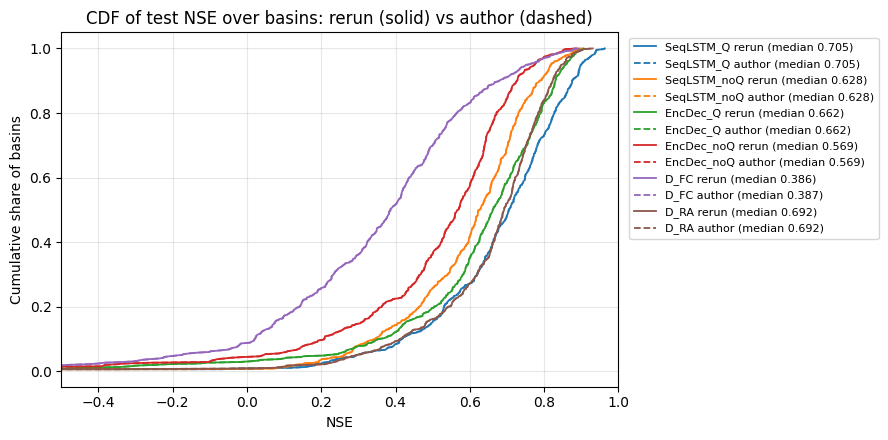
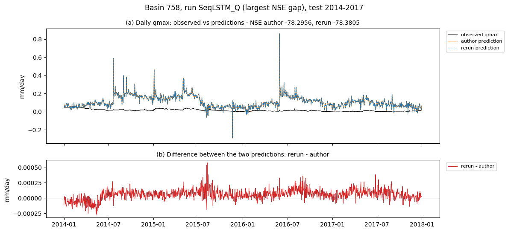

# A2 — Tái lập BiasCast bằng trọng số của tác giả

Tài liệu đi cùng [mã Python](01_A2_LamaHCEExt_Reproduce.py) của notebook Kaggle `01_A2_LamaHCEExt_Reproduce`. A2 chạy lại `best_model.pt` của tác giả BiasCast (không huấn luyện) trên kỳ test 2014–2017 cho sáu cấu hình, kiểm môi trường của đề tài (thư viện cài từ fork, thư mục lưu lượng tự dựng, cách đánh giá) cho ra đúng số của tác giả, và lưu dự báo theo ngày làm đầu vào cho A3.

**Kết luận: tái lập đạt.** NSE trung vị chạy lại khớp kết quả tác giả ở cả sáu cấu hình (lệch lớn nhất 0,0002), quan trắc trùng hoàn toàn, dự báo theo ngày lệch dưới 0,03 mm/ngày ở mức 99,9%.

## Mục lục

- [Cài đặt notebook và bản lưu chính thức](#setup)
- [Phần 1. Môi trường](#p1)
- [Phần 2. Kết quả của tác giả và sáu run được chọn](#p2)
- [Phần 3. Đơn vị `qmean` tác giả đưa vào mô hình](#p3)
- [Phần 4. Thư mục dữ liệu có `qmean`](#p4)
- [Phần 5. Chuẩn bị run và đối chiếu với bài](#p5)
- [Phần 6. Đánh giá lại trên kỳ test](#p6)
- [Phần 7. So từng lưu vực và từng ngày](#p7)
- [Phần 8. Lưu kết quả cho A3, A4](#p8)

## Cài đặt notebook và bản lưu chính thức

| Mục | Giá trị |
|---|---|
| Notebook Kaggle | `01_A2_LamaHCEExt_Reproduce` (tài khoản `hunhngcthng`) |
| Cài đặt | GPU T4, Internet On, Persistence Files only |
| Input | Kaggle Dataset `lamah-ce-ext` (dữ liệu Zenodo 17119635 và kết quả thí nghiệm của tác giả Zenodo 17292895) |
| Bản lưu chính thức | Version 2: Save & Run All, GPU T4, 2106 giây, Output 1,55 GB, kết luận `REPRO_OK = True` |
| Chạy trên máy khác | Đặt biến môi trường `LAMAH_ROOT` trỏ tới thư mục dữ liệu đã giải nén |

Ở chế độ Save & Run All, Kaggle chạy trong phiên mới và không thấy tệp do Persistence giữ ở phiên tương tác: thư mục Q được dựng lại (khoảng 270 giây) và sáu run được đánh giá lại (2,5–5,4 phút mỗi run, theo mốc thời gian trong nhật ký).

## Phần 1. Môi trường

Thư viện cài từ fork `Ticasslo/neuralhydrology` commit `dda45fc` (pip ghi đúng mã commit trong `direct_url.json`). Kaggle: Python 3.13.15, NumPy 2.1.3, pandas 2.3.3, xarray 2025.12.0, torch 2.11.0+cu128, SciPy 1.16.3, numba 0.61.2, ruamel.yaml 0.19.1, matplotlib 3.10.0; GPU Tesla T4. Cài thư viện không làm đổi phiên bản gói có sẵn.

## Phần 2. Kết quả của tác giả và sáu run được chọn

Thư mục `Experiments/` có 24 run (thư mục có `config.yml`) và `basins_filtered.txt` (451 lưu vực). Mọi run dùng `seed` 111, `seq_length` 365, nhãn `qmax`. Hai biến thể lớp nhúng: `Simple_Embedding` (một lớp tuyến tính) và `Complex_Embedding` (30-20-64). Pha quá khứ của mô hình hai pha có 31 biến tái phân tích (RA), 32 khi thêm `qmean`, hoặc 36 khi thêm 5 biến dự báo lưu trữ (FCRA); ngày t luôn là 5 biến ECMWF HRES. Bốn run học chuyển giao thiếu tệp (ba run `PreRun` chỉ dựng cấu trúc nên không có `test_metrics.csv`; `TL_AllWeights` không có tệp chuẩn hóa); các run khác đủ `best_model.pt`, `train_data/train_data_scaler.yml`, `test/best_model/test_metrics.csv`.

| Mô hình dùng ở A2 | Thư mục run (dưới `Experiments/`) |
|---|---|
| Sequential Forecast LSTM có lưu lượng quá khứ | `Sequential_Forecast_LSTM/Sequential_Forecast_LSTM_with_q/Sequential_Forecast_LSTM_RA_with_q_Simple_Embedding` |
| Sequential Forecast LSTM không lưu lượng | `Sequential_Forecast_LSTM/Sequential_Forecast_LSTM_without_q/Sequential_Forecast_LSTM_RA_without_q_Simple_Embedding` |
| Encoder–Decoder LSTM có lưu lượng quá khứ | `Encoder_Decoder_LSTM/Encoder_Decoder_LSTM_with_q/Encoder_Decoder_LSTM_with_q_Complex_Embedding` |
| Encoder–Decoder LSTM không lưu lượng | `Encoder_Decoder_LSTM/Encoder_Decoder_LSTM_without_q/Encoder_Decoder_LSTM_RA_without_q_Complex_Embedding` |
| 𝒟FC (mốc dưới) | `Baseline/Forecast` |
| 𝒟RA (mốc trên) | `Baseline/Reanalysis/Reanalysis_Simple_Embedding` |

**Lý do chọn 6 trên 24 run.** Sáu run được chọn theo bốn tiêu chí:

1. **Lấy từ các run tác giả dùng cho kết luận chính về lưu lượng quá khứ:** mục 3.4 của bài (*The role of integrating past discharge in the training domain*) có Hình 7 gồm sáu đường CDF, khai báo trong tệp cấu hình vẽ hình của mã tác giả (`Inspect_Experiments/config/Role_of_integrating_discharge.yml`): 𝒟FC, 𝒟RA, Sequential Forecast LSTM không Q và có Q (Simple), Encoder–Decoder LSTM không Q và có Q (Complex); sáu run trên đúng là sáu đường đó; các tệp cấu hình hình vẽ khác cũng dùng `Reanalysis_Simple_Embedding` làm 𝒟RA. NSE trung vị của hai bản 𝒟RA trong kết quả tác giả đều làm tròn thành 0,69 (Simple 0,6923, Complex 0,6884), nên bản dùng được xác định qua tệp cấu hình hình vẽ, không qua số trong bài.
2. **Bao trùm mọi thành phần cần kiểm:** đủ ba kiến trúc (LSTM thường, Sequential Forecast LSTM, Encoder–Decoder LSTM), có và không có `qmean` (kiểm thư mục Q tự dựng), hai loại lớp nhúng (Simple, Complex), hai nguồn dữ liệu (dự báo ECMWF HRES, tái phân tích). Các run còn lại chỉ lặp lại một tổ hợp đã có: bản lớp nhúng khác của cùng mô hình, biến thể có dự báo lưu trữ trong pha quá khứ (FCRA, cùng thư mục dữ liệu gốc), CrossDomain (LSTM thường 5 biến).
3. **Là các mốc các bước sau cần:** Sequential Forecast LSTM có Q là mô hình tốt nhất của bài (0,71) và là điểm xuất phát của bước B, C; 𝒟FC và 𝒟RA là mốc dưới, mốc trên; Sequential Forecast LSTM không Q và hai run Encoder–Decoder LSTM (có, không Q) là đối chứng cho vai trò của Q và của kiến trúc. Đề tài không phát triển tiếp hướng học chuyển giao và FCRA.
4. **Chạy lại trọn được:** bốn run học chuyển giao thiếu tệp (ba run `PreRun` không có `test_metrics.csv`, `TL_AllWeights` không có tệp chuẩn hóa).

Mỗi run đánh giá mất 2–6 phút GPU (Phần 6: 136–311 giây); tái lập thêm khoảng 20 run còn chạy được tốn khoảng 1,5 giờ GPU, không cung cấp kiểm tra mới và không phục vụ các bước sau, nên chỉ làm khi cần chứng minh toàn bộ Bảng F1 tái lập được.

Config ghi cứng đường dẫn máy tác giả ở 6 trường: `data_dir` (`/home/ok2907/Documents/Data/LamaH_expanded`; run có Q dùng `LamaH_expanded_q_input`), `run_dir`, `train_dir`, `train_basin_file`, `validation_basin_file`, `test_basin_file`. Tệp khí tượng mức A có 40 biến (ERA5-Land 21, ECMWF HRES 8, E-OBS 8, MSWEP 1, GLEAM 2) và `DOY`, từ 1981 tới 2019; tệp trạm có `qmin`, `qmean`, `qmax` (m³/s), từ 1981 tới 2017.

## Phần 3. Đơn vị `qmean` tác giả đưa vào mô hình

Thư viện chuẩn hóa mỗi biến bằng trung bình và độ lệch chuẩn tính trên kỳ train, lưu ở `train_data/train_data_scaler.yml` (`xarray_feature_center`, `xarray_feature_scale`). Cách tính trong mã (`basedataset.py` dòng 437–449, 762–765): gộp mọi lưu vực và mọi ngày, bỏ ô trống, độ lệch chuẩn dạng tổng thể; biến đầu vào tính từ ngày bắt đầu train trừ 364 ngày khởi động (02/01/2002) tới 31/12/2009, nhãn bị xóa trong các ngày khởi động nên chỉ tính từ 01/01/2003. Tính lại từ tệp trạm của 451 lưu vực theo hai đơn vị và so với tệp chuẩn hóa của run Sequential Forecast LSTM có lưu lượng quá khứ:

| Biến | Nguồn | Trung bình | Độ lệch chuẩn | Lệch so với tác giả |
|---|---|---|---|---|
| `qmean` | tệp chuẩn hóa của tác giả | 4,5778 | 16,1461 | |
| `qmean` | tính lại, m³/s | 4,5778 | 16,1461 | 0,00% / 0,00% |
| `qmean` | tính lại, mm/ngày | 2,0872 | 3,5224 | 54,41% / 78,18% |
| `qmax` (đối chứng) | tệp chuẩn hóa của tác giả | 2,5721 | 5,2624 | |
| `qmax` (đối chứng) | tính lại, m³/s | 5,2147 | 17,5222 | 102,74% / 232,97% |
| `qmax` (đối chứng) | tính lại, mm/ngày | 2,5721 | 5,2624 | 0,00% / 0,00% |

Dòng đối chứng `qmax` khớp ở mm/ngày theo `MATCH_TOL` = 0,01 (1%) của cell, phù hợp mã đổi nhãn sang mm/ngày. Bảng hiển thị bốn chữ số thập phân; phép kiểm này không xác nhận bằng nhau ở dung sai 10⁻⁵ hoặc giống hệt phép giảm số học của thư viện. A1 Mục 5.3 sau đó đã xác nhận trung bình và độ lệch chuẩn `qmax` mm/ngày theo `area_gov` ở dung sai 10⁻⁵ cho 22 run tái dựng được phạm vi ([A1](../../02_Exploration/01_A1_LamaHCEExt_Explore/01_A1_LamaHCEExt_Explore.md)). Kết luận trong phạm vi phép kiểm đơn vị này:

- Tác giả đưa `qmean` vào mô hình theo **m³/s**, trong khi nhãn `qmax` theo mm/ngày.
- Giá trị `qmean` lấy nguyên từ tệp trạm `D_gauges`, ngày thiếu để trống, không điền: thống kê khớp tới chữ số thứ tư. Hàm đọc tệp trạm của thư viện đổi số âm (mã ghi chú −999 là giá trị thiếu) thành ô trống (`lamah.py` dòng 228–229), còn hàm đọc tệp khí tượng không đổi, nên khi chép `qmean` sang tệp khí tượng cũng đổi số âm thành ô trống; ở 3 lưu vực kiểm ngẫu nhiên (788, 330, 698) tệp trạm không có −999, ngày thiếu là ô trống.
- Thư mục dữ liệu có Q của tác giả tên `LamaH_expanded_q_input`, không công bố trên Zenodo.
- A2 và A4 dựng thư mục Q theo đúng cách này; bước B1a đổi `qmean` sang mm/ngày cho cùng đơn vị với nhãn (`02_Pipeline.md` Mục 3.3, 7).

## Phần 4. Thư mục dữ liệu có `qmean`

Bộ nạp đọc `qmean` thẳng từ tệp khí tượng (`datasetzoo/lamah.py` dòng 107–135; chỉ nhãn `qmax` được đọc từ `D_gauges`), nên Phần 4 chép cột `qmean` (m³/s, số âm đổi thành ô trống) từ `D_gauges` vào tệp khí tượng mức A của 451 lưu vực. Thư mục dựng lại có 451 tệp, 1,35 GB. `qmean` đọc bằng hàm đọc tệp khí tượng của thư viện có trung bình 4,5778, độ lệch chuẩn 16,1461 trên 02/01/2002–31/12/2009, khớp tệp chuẩn hóa của tác giả.

Ô trống chiếm 3,89% số ngày–lưu vực trong khoảng này; lưu vực 324, 600, 623 không có `qmean` cả khoảng. Trong các lưu vực có dữ liệu, lưu vực 800 thiếu nhiều nhất: 2883 ngày, chỉ có `qmean` từ 24/11/2009 (khớp ngày bắt đầu đo ở `Document/03_Data/01_LamaHCE.md` Mục 6.1), nên ở run có Q lưu vực này không có mẫu train nào (bộ lọc của thư viện bỏ mẫu có ô trống trong cửa sổ 365 ngày, `basedataset.py` dòng 861–919, mà kỳ train hết 31/12/2009).

*Hình: `qmean` của lưu vực 800 trong kỳ dùng để chuẩn hóa; dữ liệu chỉ bắt đầu từ 24/11/2009.*

## Phần 5. Chuẩn bị run và đối chiếu với bài

NSE trung vị test trong kết quả có sẵn của tác giả khớp số trong bài ở cả sáu run (lệch ≤ 0,005 do bài làm tròn hai chữ số):

| Run | NSE trung vị (tệp tác giả) | Trong bài | Số lưu vực có NSE | Số tham số |
|---|---|---|---|---|
| Sequential Forecast LSTM có Q | 0,7053 | 0,71 (mục 3.4) | 450 | 84.785 |
| Sequential Forecast LSTM không Q | 0,6276 | 0,63 (mục 3.2) | 451 | 84.769 |
| Encoder–Decoder LSTM có Q | 0,6622 | 0,66 (mục 3.4) | 450 | 341.436 |
| Encoder–Decoder LSTM không Q | 0,569 | 0,57 (mục 3.2, 3.4) | 451 | |
| 𝒟FC | 0,3867 | 0,39 (Bảng F1) | 451 | 83.713 |
| 𝒟RA | 0,6923 | 0,69 (mục 3.4, Bảng F1) | 451 | 84.129 |

Số trong bài lấy từ Bảng F1 (Phụ lục F, trang 5093 của tạp chí, trang 27 của tệp PDF) và phần chữ mục 3.2 (trang 5076) và 3.4 (trang 5078). Trong bản PDF, tên dòng của Bảng F1 in lệch so với hàng số, nên dòng tương ứng của mỗi run được xác định qua cột Min: giá trị Min trùng NSE của lưu vực 758 trong kết quả tác giả (Sequential Forecast LSTM có Q −78,3; không Q −8,71; Encoder–Decoder LSTM có Q −131,42; 𝒟FC −33,29; 𝒟RA −85,12). Encoder–Decoder LSTM không Q khớp 0,57 ở phần chữ mục 3.2 và 3.4 (NSE trung vị lấy từ hình CDF của Phần 7, làm tròn ba chữ số). Hai run có Q chỉ có NSE ở 450 lưu vực.

Sáu run được chép sang thư mục làm việc (bỏ kết quả test cũ, trọng số từng epoch và trạng thái optimizer; 0,3–1,4 MB mỗi run), đổi sáu trường đường dẫn, `device` sang GPU và `num_workers` từ 20 xuống 4 (số CPU của Kaggle); không run nào dùng mã hóa lưu vực hay tệp đặc trưng thêm. Cả sáu run dựng lại được mô hình bằng thư viện và nạp `best_model.pt` không lỗi.

## Phần 6. Đánh giá lại trên kỳ test

Chạy `eval_run` với `best_model.pt` của tác giả (không huấn luyện) trên T4, 451 lưu vực, kỳ 2014–2017:

| Run | Thời gian | Lưu vực có NSE | NSE trung vị chạy lại | NSE trung vị tác giả | Chênh |
|---|---|---|---|---|---|
| Sequential Forecast LSTM có Q | 288 giây | 450 | 0,7053 | 0,7053 | 0,0000 |
| Sequential Forecast LSTM không Q | 283 giây | 451 | 0,6276 | 0,6276 | 0,0000 |
| Encoder–Decoder LSTM có Q | 287 giây | 450 | 0,6622 | 0,6622 | 0,0000 |
| Encoder–Decoder LSTM không Q | 311 giây | 451 | 0,569 | 0,569 | dưới 0,001 |
| 𝒟FC | 136 giây | 451 | 0,3864 | 0,3867 | −0,0002 |
| 𝒟RA | 233 giây | 451 | 0,6923 | 0,6923 | +0,0001 |

Ở hai run có Q, lưu vực 55 không có giá trị dự báo nào trong kỳ test (thư viện báo mọi giá trị dự báo là NaN), nên chỉ còn 450 lưu vực; kết quả của tác giả cũng có 450 lưu vực. Lưu vực 55 chỉ có `qmean` ở 1025 trên 1825 ngày của kỳ test cộng 364 ngày khởi động, nên cửa sổ 365 ngày của mọi mẫu đều chứa ô `qmean` trống; ở kỳ test mẫu không bị lọc mà vẫn chạy, nhưng đầu vào có ô trống nên dự báo ra NaN.

## Phần 7. So từng lưu vực và từng ngày

So với `test_metrics.csv` và `test_results.p` của tác giả (có trên Zenodo):

- Quan trắc `qmax_obs` trùng hoàn toàn ở cả sáu run (lệch lớn nhất 0, vị trí ô trống giống nhau).
- Dự báo `qmax_sim` lệch rất nhỏ: trung vị 0,0001–0,0003 mm/ngày, mức 99,9% là 0,011–0,028 mm/ngày, lớn nhất 0,09–0,22 mm/ngày trên khoảng 650 nghìn ngày–lưu vực mỗi run; mức này phù hợp với sai khác số học giữa hai GPU và hai môi trường thư viện, không phải sai khác dữ liệu.
- Lệch NSE trung bình theo lưu vực 0,00004–0,0003. Chỉ hai lưu vực có lệch NSE trên 0,01 là 742 và 758 (tới 0,085 ở lưu vực 758, run Sequential Forecast LSTM có Q); cả hai có phương sai `qmax` quan trắc kỳ test chỉ 0,0002–0,0003 (mm/ngày)² và NSE từ −4 tới −131 ở mọi run. Vì NSE = 1 − SSE / (n × phương sai quan trắc), phương sai gần 0 khuếch đại lệch dự báo khoảng 0,001 mm/ngày thành lệch NSE vài phần trăm.
- Riêng run Encoder–Decoder LSTM không Q, hàm tính KGE báo hệ số tương quan không xác định (một chuỗi không đổi) ở ít nhất một lưu vực; A3 xác định đó là dự báo hằng ở lưu vực 742 và 758 ([A3](../02_A3_LamaHCEExt_Benchmarks/02_A3_LamaHCEExt_Benchmarks.md) Mục 3.3).

*Hình: NSE từng lưu vực của lần chạy lại (trục tung) so với kết quả tác giả (trục hoành), sáu run; các điểm nằm trên đường y = x.*

*Hình: phân bố tích lũy NSE theo lưu vực; đường chạy lại trùng đường của tác giả ở cả sáu run.*

*Hình: lưu vực 758 có `qmax` quan trắc gần như không đổi, nên lệch dự báo rất nhỏ cũng làm NSE lệch đáng kể.*

**Tiêu chí tái lập** xét trên dự báo thay vì trên NSE từng lưu vực (vì NSE khuếch đại lệch ở lưu vực có phương sai quan trắc gần 0), gồm bốn điều kiện, đều thỏa ở cả sáu run: quan trắc trùng tác giả; lệch NSE trung vị ≤ 0,005; lệch dự báo ở mức 99,9% ≤ 0,05 mm/ngày; mọi lưu vực lệch NSE trên 0,01 (742, 758) đều có NSE dưới −1.

## Phần 8. Lưu kết quả cho A3, A4

Thư mục `a2_output` trong Output của bản lưu gồm: với mỗi run `test_metrics.csv`, `test_results.p` (chuỗi quan trắc và dự báo theo ngày) và `config.yml` (đường dẫn trỏ về thư mục làm việc); `eval_summary.csv` (bảng Phần 6), `compare_per_basin.csv` (bảng Phần 7); `environment.json` (Python, nền tảng, GPU, commit thư viện, phiên bản thư viện, `repro_ok`, danh sách run). Thư mục Q (1,35 GB) không lưu vì A4 dựng lại bằng mã Phần 4.

Notebook sau gắn thẳng Output của bản lưu làm Input; A3 đọc tại `/kaggle/input/notebooks/hunhngcthng/01-a2-lamahceext-reproduce/a2_output`.
