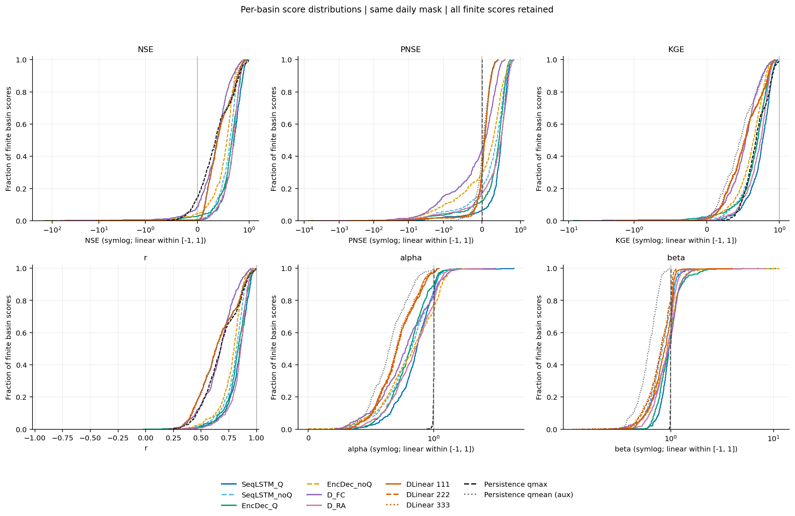
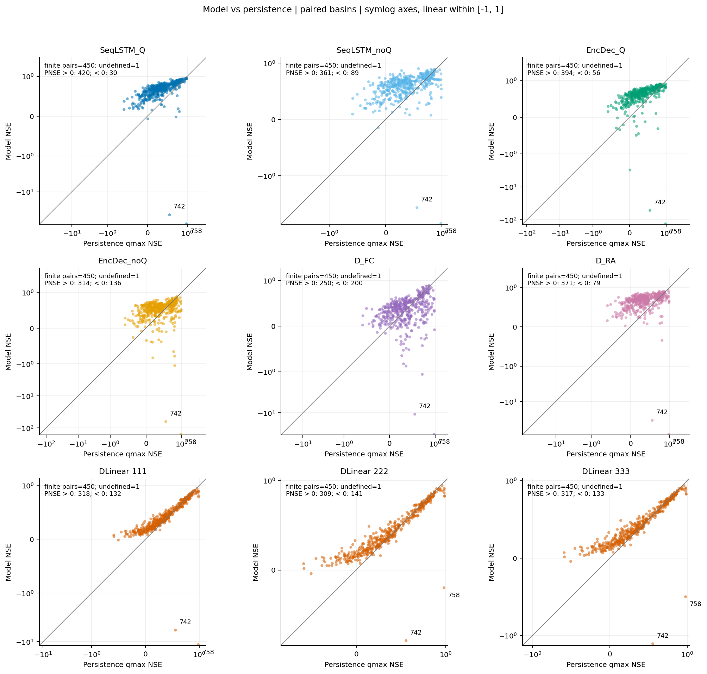
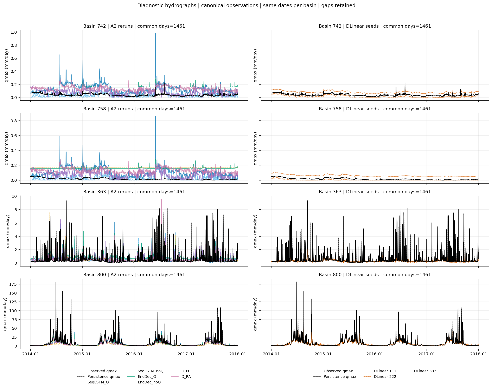
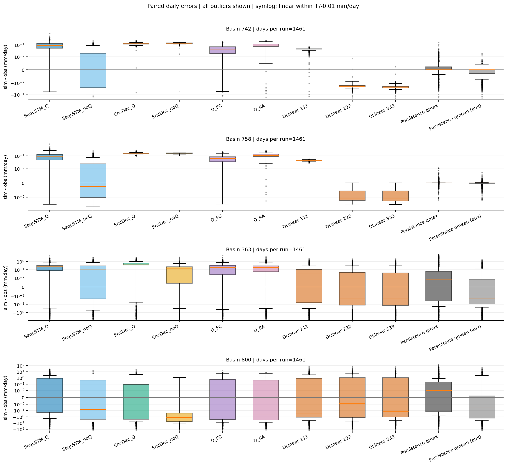
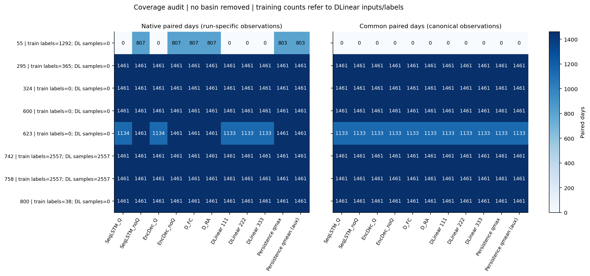

# A3 — Các mốc so sánh trên Extended LamaH-CE

Tài liệu đi cùng [notebook](02_A3_LamaHCEExt_Benchmarks.ipynb) (bản chính thức: Version 1 của notebook Kaggle `02_A3_LamaHCEExt_Benchmarks`, Save & Run All trên GPU T4, có output) và [mã Python](02_A3_LamaHCEExt_Benchmarks.py). Các phép tính A3 đã chạy thành công: persistence, sáu A2, DLinear ba seed và sáu hình chẩn đoán. Giao chung có 652628 ngày–ID trên 450 lưu vực; DLinear có mean ± std mẫu giữa ba NSE median 0,380152 ± 0,002415.

Notebook dùng tiêu đề Phần → đề mục → cell code theo chức năng. Các đề mục dưới đây trùng notebook; phần thảo luận chi tiết và số liệu đã đo được giữ riêng trong báo cáo. Bảng, dự báo, checkpoint và hình được lưu trực tiếp trong a3_output bằng Save & Commit của Kaggle.

## Mục lục

- [Phần 1. Môi trường và kiểm kê Input](#report-part-1)
- [Phần 2. Nguồn dữ liệu và cấu hình thí nghiệm](#report-part-2)
- [Phần 3. Dự báo A2, lịch ngày và đơn vị quan trắc](#report-part-3)
- [Phần 4. Persistence và mặt nạ đánh giá](#report-part-4)
- [Phần 5. Chỉ số đánh giá và kiểm hàm](#report-part-5)
- [Phần 6. Đánh giá A2 và kiểm sai khác số học](#report-part-6)
- [Phần 7. Dữ liệu và tiền xử lý DLinear](#report-part-7)
- [Phần 8. DLinear và kiểm triển khai PyTorch](#report-part-8)
- [Phần 9. Huấn luyện DLinear với ba seed](#report-part-9)
- [Phần 10. So sánh các mô hình trên giao ngày chung](#report-part-10)
- [Phần 11. Hồ sơ bất thường và trực quan hóa kết quả](#report-part-11)

## Phần 1. Môi trường và kiểm kê Input

Nhận diện output A1, A2 và dữ liệu gốc trước khi đọc dự báo.

### 1.1. Thư viện, hằng số và môi trường

Khai báo nguồn Input, sáu run A2 và các hàm hiển thị dùng chung.

### 1.2. Tìm các nguồn đã gắn vào notebook

Quét Input để nhận diện output A1/A2, dữ liệu LamaH và danh sách ID.

### 1.3. Kiểm kê export A2

Kiểm metadata, các tệp chính và CSV metrics đã lưu của sáu run.

### 1.4. Kiểm kê các bảng A1

Liệt kê các nhóm bảng có thể tái sử dụng; chưa thay thế việc kiểm nội dung.

### 1.5. Kiểm kê dữ liệu gốc và 451 ID

Kiểm tệp Q, khí tượng và tính duy nhất của danh sách lưu vực.

### 1.6. Kết luận kiểm kê Input

Tóm tắt nguồn hiện có và các lỗi quét trước khi cố định đường dẫn.

### Thuyết minh và kết quả thực nghiệm

#### Kết quả thực tế trên Kaggle

Môi trường chạy là Python 3.13.15, pandas 2.3.3. Input được tổ chức dưới hai nhánh `datasets` và `notebooks`. Tìm được đúng một export chạy lại A2 tại `/kaggle/input/notebooks/hunhngcthng/01-a2-lamahceext-reproduce/a2_output`; các tệp chung đều tồn tại và khác rỗng. Metadata khai báo `repro_ok=True`, commit NeuralHydrology `dda45fcf19ee7ffd481b9d192778539df46fb074`.

| Run | Dung lượng pickle (MB, làm tròn) | Dòng metrics | NSE hữu hạn | NSE trung vị đọc từ CSV A2 |
|---|---|---|---|---|
| SeqLSTM_Q | 16,18 | 451 | 450 | 0,705259 |
| SeqLSTM_noQ | 16,18 | 451 | 451 | 0,627604 |
| EncDec_Q | 16,18 | 451 | 450 | 0,662155 |
| EncDec_noQ | 16,18 | 451 | 451 | 0,568896 |
| D_FC | 16,18 | 451 | 451 | 0,386428 |
| D_RA | 16,18 | 451 | 451 | 0,692313 |

Mỗi run có đủ `test_results.p`, `test_metrics.csv`, `config.yml`. Các trung vị phù hợp mốc A2 đã ghi trong repo, nhưng đây vẫn là chỉ số đọc từ tệp, chưa tính lại từ chuỗi dự báo. Hai run có Q có một NSE không hữu hạn; chưa xác định ID từ output kiểm kê này.

Output A1 có **305 CSV** tại `/kaggle/input/notebooks/hunhthanhnhn/a1-dataset/Tables`. Nhóm phân phối/độ phủ Q và scaler có 43 CSV, nhóm cửa sổ/số mẫu có 21, nhóm nguồn NSE/liên hệ nhãn có 8, nhóm hồ sơ bất thường theo ngày có 6. Đây là kiểm kê tệp; chưa chứng minh nội dung mọi bảng đủ để bàn giao A3.

Dữ liệu gốc nằm tại `/kaggle/input/datasets/hunhngcthng/lamah-ce-ext/lamah_ce_ext/LamaH_extended`, có 882 tệp Q ngày và 859 tệp khí tượng ngày. Danh sách mô hình trong `biascast_experiments/Experiments/basins_filtered.txt` có đúng **451 ID phân biệt, không trùng**. Số tệp toàn nguồn không thay thế phép kiểm đủ dữ liệu cho từng ID được chọn.

Kết luận Phần 1: các tệp cần thiết hiện có trong Input của phiên mới, chưa cần chạy lại A1 hoặc phần đánh giá A2. Bước tiếp theo là định danh nguồn/config và kiểm nội dung dự báo trước khi tính các chỉ số. Chưa xác nhận pickle đọc được, obs/sim khớp lịch, quan trắc khớp nguồn Q hay đơn vị đã được chuyển đúng.

## Phần 2. Nguồn dữ liệu và cấu hình thí nghiệm

Cố định nguồn, cấu hình và thông tin truy vết của sáu run A2.

### 2.1. Công cụ đọc cấu hình và kiểm nguồn

Định nghĩa kỳ dữ liệu, ánh xạ run và các hàm ngày/ID/hash.

### 2.2. Cố định đường dẫn và metadata A2

Chọn duy nhất mỗi nguồn và tạo thư mục a3_output trên Working.

### 2.3. Hash các tệp đầu vào

Lập manifest cho export A2, danh sách ID và các CSV A1 ưu tiên.

### 2.4. Kiểm cấu hình sáu run A2

Đối chiếu biến mục tiêu, đầu vào qmean, cửa sổ, kỳ dữ liệu và chính sách clip.

### 2.5. Lưu kiểm nguồn và danh mục A1

Lưu các bảng nhỏ và xác nhận điều kiện đọc dự báo.

### Thuyết minh và kết quả thực nghiệm

#### Định danh nguồn và các giới hạn

SHA-256 được tính bằng cách đọc từng khối byte cho các tệp A2, danh sách ID và các CSV A1 ưu tiên. Ví dụ minh họa: `A1_P8_nse_values.csv` từ phiên khảo sát A1 và `test_metrics.csv` trong export A2 là hai nguồn khác nhau, dù có thể chứa cùng tên run; trường `source` trong manifest giữ nguồn gốc riêng cho từng tệp.

Hash giúp ghi lại chính xác byte của tệp đang sử dụng và đối chiếu ở các lần chạy sau. Khi chưa có hash chuẩn độc lập, hash không tự xác nhận dữ liệu đúng, checkpoint đúng hoặc nội dung pickle hợp lệ. Config và metadata A2 cũng chỉ ghi nguồn/checkpoint được khai báo; cell chưa nạp trọng số hoặc mở pickle.

Các đường dẫn `data_dir` và `test_basin_file` trong config có thể trỏ phiên làm việc A2 cũ. Chúng được giữ làm thông tin nguồn; không yêu cầu đường dẫn cũ tồn tại trong phiên A3 và không sửa Input. Các bước sau sử dụng đường dẫn nguồn A3 đã chọn.

`clip_qmax_declared=True` chỉ nói config khai báo chặn qmax âm. Chưa được kết luận dự báo đã chặn ở giai đoạn nào hoặc áp chặn thêm vào chuỗi đã lưu trước khi kiểm mã và dữ liệu thực tế.

#### Kết quả thực tế và điều kiện chuyển bước

`A3_SOURCE_AUDIT_OK=True`. Metadata và ánh xạ đúng sáu biến thể. Cả **32 tệp** trong manifest có trạng thái `hashed`: 21 tệp A2, danh sách 451 ID và 10 CSV A1 ưu tiên; không thiếu CSV nào trong danh sách ưu tiên. Bốn tệp audit đã lưu tại `/kaggle/working/a3_output`.

| Run | Model trong config | Seed | qmean đầu vào | clip qmax khai báo |
|---|---|---|---|---|
| SeqLSTM_Q | sequential_forecast_lstm | 111 | Có | Có |
| SeqLSTM_noQ | sequential_forecast_lstm | 111 | Không | Có |
| EncDec_Q | handoff_forecast_lstm | 111 | Có | Có |
| EncDec_noQ | handoff_forecast_lstm | 111 | Không | Có |
| D_FC | cudalstm | 111 | Không | Có |
| D_RA | cudalstm | 111 | Không | Có |

Sáu config cùng khai báo mục tiêu qmax, `seq_length=365`, `predict_last_n=1`; các kỳ train/validation/test đúng 2003–2009/2010–2013/2014–2017. Cột `issues` rỗng ở cả sáu run. Đây là kiểm khai báo cấu hình; cần đọc pickle để kiểm lịch và dữ liệu thực tế.

Một số hash định danh cho lần chạy này:

| Tệp | SHA-256 |
|---|---|
| environment.json A2 | 7311c5180e04507c8ed68e2565e7e22a0b5bad76e54b1dc133a9592eb5e0dadb |
| basins_filtered.txt | 45c3d648b3868d5bb27ef50b3cff2c23658bd09ace001141380d82ce1ded2feb |
| SeqLSTM_Q/test_results.p | a4868e0c79ee236849c853c540827fd8bef8a096081fcf608ad0fe79e9be721e |
| SeqLSTM_noQ/test_results.p | 23a071b79a898a4fa7757cc3cf9cb5f1ea63be92a2633bd6d57e5dee8bf53de5 |
| EncDec_Q/test_results.p | f979947e24035e131a6d56b915e64708f95c2232cf73fd6e0dd0995f8ada23d8 |
| EncDec_noQ/test_results.p | a5038a8ade80f835d26953c985f353b5d5dd0efaf2bcf207a62a6153b494c293 |
| D_FC/test_results.p | d528b4a56ab7fa594f79d6bbc537ef0cd2ab57b557e304556e2e557be9376a6a |
| D_RA/test_results.p | b3cb9e547946c1e74824a0adf8eaeac31e729b03b88868b95e1f65e99500a0e2 |

Các hash trên được ghi nhận từ output chạy, không phải một chứng nhận độc lập về nội dung. Đủ điều kiện chuyển sang bước kiểm dự báo A2; chưa có căn cứ phải chạy lại A1/A2.

## Phần 3. Dự báo A2, lịch ngày và đơn vị quan trắc

Kiểm schema dự báo rồi đối chiếu qmax với Q gốc và diện tích trạm.

### 3.1. Lịch test và hàm đọc dự báo ngày

Cố định 451 ID, lịch test và schema obs/sim trong pickle A2.

### 3.2. Đọc và kiểm sáu pickle A2

Kiểm hash, khóa ID, trục ngày và biến dự báo trên toàn bộ lưu vực.

### 3.3. Độ phủ, dự báo hằng và dự báo thiếu

Đếm ngày hữu hạn, số cặp và các chuỗi cần chẩn đoán.

### 3.4. Đối chiếu obs giữa các run

So quan trắc A2 trên cùng ngày–ID và giữ riêng sai khác số học.

### 3.5. Hồ sơ A1 và lưu kiểm schema

Xem 55/742/758/800, lưu bảng kiểm và trạng thái schema.

### 3.6. Diện tích trạm và quy đổi đơn vị

Đọc area_gov theo ID; dùng q(mm/ngày)=Q(m³/s)×86,4/area_gov(km²).

### 3.7. Đọc cửa sổ Q nguồn và kiểm giá trị thiếu

Giữ test cộng một ngày trước test; phân biệt giá trị thô và bản theo hợp đồng loader.

### 3.8. Đối chiếu qmax nguồn với obs A2

Kiểm giả thuyết đơn vị, mặt nạ và các hồ sơ lệch lớn nhất.

### 3.9. Lưu kết quả đối chiếu Q

Lưu diện tích, kiểm Q, cửa sổ nguồn và các cờ cấu trúc/mặt nạ.

### Thuyết minh và kết quả thực nghiệm

#### Kiểm nội dung pickle và lịch dự báo sáu run A2

#### Mục đích và cách đọc dữ liệu

Cell bước kiểm dự báo A2 chỉ đọc sáu `test_results.p` trong export chạy lại A2 đã được kiểm nguồn. Trước mỗi lần mở pickle, kiểm hash còn khớp manifest Phần 2. Nếu phiên hiện tại chưa có các biến Phần 1–2 thì chạy lại hai cell đó trước; không tự cài hoặc đổi phiên bản thư viện để vượt qua lỗi đọc.

Mỗi pickle cần là một dict theo ID; sau chuẩn hóa ID phải có đúng 451 ID của danh sách mô hình, không thiếu/thừa/trùng. Từng ID cần có `1D/xr` là một xarray.Dataset với hai biến số `qmax_obs`, `qmax_sim`, đúng hai chiều date/time_step và `time_step=[0]`. Không tự lấy bước cuối của một mảng nhiều hạn khi chưa hiểu ý nghĩa trục.

Kiểm ngày không trùng, tăng dần, không NaT/múi giờ, ở đầu ngày; sau đó đối chiếu đúng lịch **1461 ngày từ 01/01/2014 đến 31/12/2017**. Mọi ngày thiếu hoặc ngoài kỳ được lưu audit và làm điều kiện schema chưa đạt. NaN trong giá trị vẫn được giữ và báo độ phủ; vô cực là vấn đề cần kiểm riêng, không biến thành NaN để tiếp tục âm thầm.

Đọc lần lượt từng pickle để hạn chế RAM. Sau khi kiểm, giữ dữ liệu trong `A3_DAILY[run]` dưới hai ma trận obs và sim_raw, hàng là ngày đích, cột là ID đã chọn. Đây là cách căn chỉ mục để kiểm, không có nội suy hoặc sửa giá trị. Cell chưa chuyển đổi đơn vị hoặc thay quan trắc giữa các run.

#### Kiểm quan trắc và chuỗi hằng/toàn thiếu

Trên từng run/ID, đếm obs/sim hữu hạn, số cặp hữu hạn, giá trị âm và số mức giá trị phân biệt. Một chuỗi có ít nhất hai giá trị hữu hạn nhưng chỉ một mức sim là chuỗi sim hằng; toàn thiếu được báo riêng. Các ca đọc lỗi không được gọi là dự báo toàn thiếu.

So obs của mỗi run với SeqLSTM_Q trên cùng ngày–ID: đếm khác mặt nạ hữu hạn và độ lệch tuyệt đối của các cặp hữu hạn. Các mức 10⁻⁷/10⁻⁵ chỉ là thống kê chẩn đoán, chưa là ngưỡng tự động chấp nhận đơn vị hay sai khác. Không thay obs của run này bằng obs của run khác để làm kết quả trùng nhau.

Ví dụ minh họa: một ID có đủ 1461 dòng, obs hữu hạn 807 ngày và sim hữu hạn 0 ngày vẫn có thể có schema/lịch hợp lệ. Khi đó chưa có cặp để tính chỉ số; không xem 654 ngày obs thiếu là 654 giá trị 0. Nếu sim có 1461 giá trị bằng nhau thì đó là đầu ra hằng, khác với không có dự báo. Các số trong ví dụ mô tả cách đọc, không phải kết quả bước kiểm dự báo A2 đã chạy.

#### Giữ dự báo raw và chính sách clip

Đối chiếu [mã tester](../../../NeuralHydrology/neuralhydrology/evaluation/tester.py): xarray kết quả được lưu vào cấu trúc kết quả trước thao tác clip dùng khi tính metrics. Vì vậy config khai báo clip không đủ để suy mọi giá trị sim trong pickle đã không âm. bước kiểm dự báo A2 giữ sim_raw và đếm số âm; khi tái lập chỉ số cần tách bản chấm theo chính sách config khỏi chuỗi raw. Chưa thực hiện bước chấm đó trong cell này.

#### Kết quả thực tế bước kiểm dự báo A2

`A3_SCHEMA_AUDIT_OK=True`. Môi trường hiện tại là NumPy 2.1.3, xarray 2025.12.0, cùng phiên bản được metadata A2 khai báo cho hai gói này. Cả sáu pickle có hash khớp Phần 2; mỗi pickle có đúng 451 ID, không thiếu/thừa, và 451 ID đạt kiểm schema/lịch. Mỗi ID có đúng 1461 ngày đích test; không có lỗi schema được báo.

| Run | Obs hữu hạn | Sim raw hữu hạn | Cặp hữu hạn | Sim âm | Sim toàn thiếu / hằng |
|---|---|---|---|---|---|
| SeqLSTM_Q | 657366 | 652644 | 652636 | 657 | Toàn thiếu: 55 |
| SeqLSTM_noQ | 657366 | 658911 | 657366 | 3256 | Không có ca được báo |
| EncDec_Q | 657366 | 652644 | 652636 | 17 | Toàn thiếu: 55 |
| EncDec_noQ | 657366 | 658911 | 657366 | 5 | Hằng: 742, 758 |
| D_FC | 657366 | 658911 | 657366 | 2342 | Không có ca được báo |
| D_RA | 657366 | 658911 | 657366 | 246 | Không có ca được báo |

Tổng lịch là 451×1461=658911 ngày–ID. Obs thiếu **1545 ngày–ID** ở mỗi run; không có obs âm được báo. Hai run có Q thiếu **6267 giá trị sim**, trong đó ID 55 chiếm 1461, còn **4806** nằm ở các ID khác. Vì vậy việc chỉ có một ID không tính được NSE không đồng nghĩa các ID còn lại có dự báo đầy đủ mọi ngày.

Hai run có Q mất **4730 cặp** so với 657366 obs hữu hạn; 807 cặp thuộc ID 55, còn **3923 cặp** ở các ID khác. Bốn run còn lại có sim hữu hạn trên toàn bộ lịch, nhưng chỉ 657366 cặp có obs. Các kết quả này sẽ quyết định mặt nạ so sánh, không được gán những ngày thiếu thành 0.

Obs của SeqLSTM_noQ, EncDec_Q và EncDec_noQ trùng SeqLSTM_Q trên toàn bộ các cặp hữu hạn. D_FC và D_RA có cùng mặt nạ hữu hạn với SeqLSTM_Q nhưng sai khác giá trị: median độ lệch tuyệt đối bằng 0, max khoảng **1,5×10⁻⁵**, có 136312 cặp vượt 10⁻⁷ và 14 cặp vượt 10⁻⁵. Chưa suy nguyên nhân số học hay nguồn dữ liệu chỉ từ độ lệch nhỏ; cần đối chiếu Q gốc và phép đổi đơn vị.

Ở ID 55, obs có 807 ngày hữu hạn; hai run có Q không có sim hữu hạn, bốn run còn lại có sim trên 1461 ngày nhưng chỉ 807 cặp chấm được. ID 742/758 có obs hữu hạn toàn test, lần lượt 78/57 mức phân biệt; EncDec_noQ có đúng một mức sim trên mỗi chuỗi. Đây là ca tương quan Pearson không xác định theo công thức chuẩn, cần giữ cờ khi tính KGE. ID 800 có đủ 1461 cặp ở cả sáu run; độ phủ train thấp của ID này vẫn là một giới hạn riêng từ A1.

Số dự báo âm trong pickle xác nhận cần giữ riêng sim_raw và bản chấm theo config. Chưa áp clip, tính NSE/KGE/PNSE hoặc kết luận về chất lượng dự báo tại bước này. Bốn CSV audit bước kiểm dự báo A2 đã lưu thành công trong `a3_output`.

#### Đối chiếu Q gốc, diện tích và đơn vị quan trắc

#### Mục đích và phạm vi nguồn

Chạy sau bước kiểm dự báo A2, dùng `D_gauges/1_attributes/Gauge_attributes.csv` và các CSV Q ngày của đúng 451 ID. Kiểm khóa ID, `area_gov` hữu hạn/dương và cấu trúc ngày của từng tệp; không dùng `area_calc` thay thế. Tính hash các tệp nguồn để bổ sung manifest.

Chỉ lưu cửa sổ **31/12/2013–31/12/2017**, gồm lịch test cộng một ngày trước test. Ngày 31/12/2013 dùng để chuẩn bị mốc persistence ngày đầu test. Đây chưa phải cửa sổ huấn luyện hoặc scaler DLinear; không suy độ phủ train từ dữ liệu cell này.

Đọc qmax/qmean dạng chữ để đếm riêng: ngày không có dòng, ô trống, token thiếu rõ ràng, −999, số âm khác −999, token không hiểu và vô cực. Ngày nguồn lỗi/trùng/không tăng hoặc token lạ/vô cực trong cửa sổ phải được báo, không tự sửa. Số dòng ngày có thể thiếu hợp lệ do độ phủ nguồn; không yêu cầu mỗi tệp Q thô có đủ lịch khi obs A2 tương ứng cũng thiếu.

#### Bản số thô, bản theo loader và phép đổi đơn vị

Giữ `A3_Q_NUMERIC` với giá trị số thô, kể cả −999 và số âm khác. Bản `A3_Q_LOADER_M3S` tái hiện hợp đồng của [loader LamaH](../../../NeuralHydrology/neuralhydrology/datasetzoo/lamah.py): Q âm được thay bằng NaN. Đây là cách đối chiếu đúng nhãn A2, không phải kết luận mọi số âm đều là lỗi quan trắc; các ca đó vẫn nằm trong audit. Chưa dùng quy tắc này để chốt xử lý qmean của DLinear.

Từ bản theo loader, tính `A3_Q_MM_DAY` bằng **q = Q×86,4/area_gov**, với Q tính bằng m³/s, diện tích km². Ví dụ minh họa: Q=3 m³/s, area_gov=43,2 km² cho q=6 mm/ngày. qmax theo mm/ngày là cường độ tương đương quy đổi theo diện tích, không phải tổng lượng dòng chảy thực tế của cả ngày.

So obs của từng run với hai giả thuyết số nguồn: m³/s thô và mm/ngày theo area_gov, trên cùng ngày–ID. Báo số cặp, khác mặt nạ và độ lệch tuyệt đối median/P99/max; đây là chẩn đoán đơn vị, không phải chỉ số kỹ năng dự báo. Giữ obs của mỗi run, không thay bằng nguồn Q hoặc lấy trung bình giữa các run.

#### Kết quả thực tế bước đối chiếu Q nguồn

`A3_Q_SOURCE_STRUCTURE_OK=True`, `A3_Q_OBS_MASK_OK=True`. Đã đọc đủ 451 tệp Q và area_gov của 451 ID. Diện tích nhỏ nhất/trung vị/lớn nhất lần lượt **3,9 / 101 / 15131 km²**. Thời gian đọc và đối chiếu là **481,6 giây**; các cell tiếp theo dùng dữ liệu đã giữ trong phiên, không đọc lại toàn bộ CSV chỉ để dựng lag.

| Biến | Ngày–ID trong cửa sổ | Ngày không có dòng | Ô trống | −999 / âm khác / token lạ / vô cực | Hữu hạn không âm |
|---|---|---|---|---|---|
| qmax | 659362 | 0 | 1547 | Đều 0 | 657815 |
| qmean | 659362 | 0 | 1547 | Đều 0 | 657815 |

Trong cửa sổ này, thiếu là ô trống, không phải dòng ngày bị bỏ hoặc −999. Cửa sổ gồm 1462 ngày×451 ID; trừ 657366 qmax hữu hạn trong test, ngày **31/12/2013 có 449 ID hữu hạn**, hai ID thiếu. Ngày đầu test vì vậy không được tự bỏ, nhưng persistence cũng không thể có số cho mọi ID nếu hôm trước thiếu. Không suy phân bố mã thiếu của toàn bộ lịch sử từ riêng cửa sổ này.

Mặt nạ obs của sáu run khớp qmax nguồn trên toàn bộ 657366 cặp hữu hạn; không có ngày–ID khác mặt nạ. Bảng chẩn đoán đơn vị:

| Nhóm run | Giả thuyết qmax nguồn | Median độ lệch tuyệt đối | P99 | Max, làm tròn | Số cặp vượt 10⁻⁵ |
|---|---|---|---|---|---|
| Bốn run SeqLSTM/EncDec | mm/ngày theo area_gov | 5,275438×10⁻⁸ | 8,065046×10⁻⁷ | 0,000014 | 11 |
| D_FC/D_RA | mm/ngày theo area_gov | 5,221572×10⁻⁸ | 1,076346×10⁻⁶ | 0,000011 | 7 |
| Cả sáu run | m³/s thô | 0,8679661 | 50,98866 | 774,080063 | 657110 |

Mã chuyển đơn vị của loader, area_gov hợp lệ, mặt nạ khớp và sự khác biệt rõ giữa hai giả thuyết cùng hỗ trợ việc dùng **mm/ngày** cho qmax trong obs A2. Tuy nhiên obs A2 và Q nguồn không trùng từng bit; chưa xác định riêng thao tác số học gây ra từng sai khác. Giữ nguyên obs gốc khi tái lập metrics A2 và ghi riêng cách dùng Q nguồn cho so sánh chung.

Trong bốn run SeqLSTM/EncDec, max sai khác ở ID 531 khoảng 1,4×10⁻⁵; ID 210 khoảng 1,1×10⁻⁵. D_FC/D_RA có ID 320 thuộc nhóm lớn nhất khoảng 1,1×10⁻⁵. Ở các hồ sơ 742/758, max khoảng 1,2×10⁻⁷; ở 800 khoảng 1,07×10⁻⁵ cho SeqLSTM/EncDec và 1,03×10⁻⁵ cho D_FC/D_RA. Các sai khác vẫn được giữ trong CSV, không sửa obs để làm khớp nguồn.

Đã lưu sáu CSV, manifest nguồn cập nhật và NPZ cửa sổ Q. Đủ căn cứ chuyển sang dựng persistence trên Q nguồn; chưa tính điểm NSE/KGE/PNSE.

## Phần 4. Persistence và mặt nạ đánh giá

Dựng qmax(t−1), mốc qmean phụ và các phạm vi ngày dùng chấm điểm.

### 4.1. Hàm lag theo ngày và tóm tắt mặt nạ

Lấy đúng ngày lịch t−1; không lấy số đo hợp lệ gần nhất qua khoảng thiếu.

### 4.2. Ví dụ kiểm lag qua ngày thiếu

Ví dụ minh họa độc lập để kiểm ngày nguồn và giá trị persistence.

### 4.3. Dựng hai chuỗi persistence

Tạo qmax(t−1) làm mốc chính và qmean(t−1) làm mốc phụ.

### 4.4. Dựng các mặt nạ chấm điểm

Tách native, pnse_native, paired_source và giao A2/persistence.

### 4.5. Kiểm ngày đầu test và các hồ sơ thiếu

Đối chiếu ngày nguồn thật, những ngày mất lag và bốn hồ sơ A1.

### 4.6. Lưu persistence và quy ước đánh giá

Lưu dự báo, mặt nạ, số ngày và hợp đồng đánh giá vào a3_output.

### Thuyết minh và kết quả thực nghiệm

#### Dự báo ngày t từ số đo ngày t−1

Mốc chính lấy qmax ngày hôm trước từ Q nguồn, cùng đơn vị mm/ngày. Mốc phụ lấy qmean hôm trước để đối chiếu khảo sát persistence trước đây; mẫu số PNSE vẫn là qmax persistence, không thay bằng mốc phụ. Không cần mô hình, huấn luyện, scaler hoặc truy cập dữ liệu ngày tương lai.

Cell kiểm lịch nguồn đầy đủ và có ngày trước test, sau đó dịch một hàng trên lịch ngày giữ nguyên NaN. Kiểm lại bằng cách tra trực tiếp t−1 của toàn bộ ngày–ID. Không dropna trước khi dịch, không forward-fill, không tự lấy ngày có số gần nhất.

Ví dụ minh họa dùng trong cell: qmax các ngày 31/12, 01/01, 02/01, 03/01, 04/01 lần lượt là 10, 20, thiếu, 40, 50. Persistence cho 01/01–04/01 là **10, 20, thiếu, 40**. Ngày 03/01 không dùng giá trị 20 của 01/01 thay cho số đo thiếu của 02/01. Ví dụ này kiểm quy tắc dịch ngày, không phải kết quả thực nghiệm trên dataset.

#### Tách tái lập A2 khỏi so sánh chung

Do obs A2 và Q nguồn có sai khác nhỏ đã đo, cần công bố rõ cả nguồn obs lẫn mặt nạ. Giữ nguyên mọi ma trận gốc; tạo các phạm vi đánh giá riêng, không ghi đè obs của A2.

| Phạm vi | Quan trắc dùng chấm | Ngày hợp lệ | Mục đích |
|---|---|---|---|
| native | Obs của chính run A2 | Obs và sim của run hữu hạn | Tái lập metrics CSV A2 với đúng config |
| pnse_native | Obs của chính run A2 | native và qmax persistence hữu hạn | PNSE trên nguồn obs A2; cả hai SSE dùng cùng obs và ngày |
| paired_source | qmax nguồn theo area_gov | Obs nguồn, sim của run và persistence hữu hạn | So mô hình với persistence trên cùng obs và ngày |
| common_source | qmax nguồn theo area_gov | Giao paired_source của sáu run A2 | So tất cả dự báo trên cùng obs và ngày–ID |

Đối với persistence tự thân, phạm vi native_source là obs nguồn và dự báo persistence hữu hạn. Qmean persistence là dòng phụ, không làm thu hẹp giao chính của sáu run A2. Khi có DLinear, giao chung sẽ được lập lại với DLinear và ghi rõ tập run tham gia; không dùng nhầm giao của sáu run hiện tại như giao cuối cùng của A3.

Việc chọn Q nguồn cho paired_source/common_source dựa trên hợp đồng đơn vị và nguồn đã kiểm, trước khi tính kỹ năng; không chọn nguồn obs theo điểm test nào cao hơn. PNSE và chênh điểm ở từng phép so phải dùng cùng obs/mặt nạ. Khi đọc điểm, luôn giữ cột scope để không so trực tiếp các số trên các phạm vi khác nhau.

#### Kiểm độ phủ và ngày đầu test

Đếm số ngày–ID hợp lệ, ID có 0/1/ít nhất 2 ngày và số ngày mất so với native. Giữ đủ 451 ID trong các ma trận, kể cả ID không có ngày trong giao chung; không tự loại ID 55 khỏi danh sách mô hình.

Kiểm riêng ngày 01/01/2014 với nguồn đúng 31/12/2013; in số lag hữu hạn và số cặp có cả obs. In ví dụ ngày obs đã có lại nhưng hôm trước thiếu để kiểm việc giữ NaN. Báo số ngày chấm riêng/common ở 55/742/758/800 và giữ toàn bộ bảng theo ID trong CSV.

Các mặt nạ pnse_native/paired_source phải là tập con của native theo mặt nạ obs đã được xác nhận ở bước đối chiếu Q nguồn. Giao chung phải là tập con của từng paired_source. Clip sim âm theo config sẽ được thực hiện khi tính metrics; ở đây chỉ dùng tính hữu hạn và chưa đổi sim_raw.

#### Kết quả thực tế và ảnh hưởng của mặt nạ

`A3_PERSISTENCE_MASKS_OK=True`. Kiểm lag qua ngày thiếu đạt: ví dụ minh họa cho chuỗi 10, 20, thiếu, 40, 50 tạo lag 10, 20, thiếu, 40 như dự kiến. Bảng độ phủ thực nghiệm:

| Dự báo/nhóm run | Scope | Ngày–ID hợp lệ | ID có ít nhất 2 ngày | Ngày hợp lệ đầu test |
|---|---|---|---|---|
| Persistence qmax | native_source | 657347 | 451 | 449 |
| Persistence qmean phụ | native_source | 657347 | 451 | 449 |
| SeqLSTM_Q, EncDec_Q | native / pnse_native / paired_source | 652636 | 450 | 447 |
| Bốn run không Q | native | 657366 | 451 | 449 |
| Bốn run không Q | pnse_native / paired_source | 657347 | 451 | 449 |
| Sáu run A2 và persistence qmax | common_source | 652636 | 450 | 447 |

Persistence thiếu **19 cặp** so với 657366 obs hữu hạn vì có obs ngày t nhưng qmax ngày t−1 thiếu. Bốn run không Q mất đúng 19 ngày–ID khi chuyển từ native sang phạm vi PNSE/paired. Hai run có Q không mất thêm ngày khi yêu cầu persistence, vì các cặp native của chúng đã có qmax hôm trước hữu hạn trong dữ liệu hiện tại; không suy đây là quy luật cho mọi dữ liệu hoặc mọi mô hình.

Giao chung có cùng 652636 cặp với hai run có Q và mất **4711 cặp** so với persistence native_source. Đây là thay đổi phạm vi chấm, chưa phải chênh lệch chất lượng mô hình. Giữ bảng theo scope để không so điểm từ những tập ngày khác nhau.

Ngày 01/01/2014 dùng đúng nguồn 31/12/2013: có 449 lag qmax hữu hạn, 449 lag qmean hữu hạn, 449 obs hữu hạn và đủ 449 cặp persistence. Không loại ngày đầu test theo quy ước máy móc.

Ví dụ thực nghiệm ngày có obs nhưng hôm trước thiếu gồm ID 55 ngày 23/04/2014, ID 695 ngày 07/12/2014 và ID 683 ngày 28/02/2015; các dự báo persistence tương ứng vẫn là NaN. Không lấy lần quan trắc gần nhất thay thế số đo hôm trước.

Ở ID 55, bốn run không Q có 807 ngày native, 803 ngày PNSE/paired; mất bốn ngày do thiếu hôm trước. Hai run có Q có 0 ngày chấm ở ID này, nên giao chung cũng bằng 0. ID 742/758/800 có 1461 ngày ở mọi phạm vi đã kiểm. Danh sách vẫn giữ 451 ID; ID 55 không có ngày trong giao chung chứ không bị xóa khỏi tập nghiên cứu. Các ID còn lại không có ca chỉ một ngày trong bảng độ phủ.

Đã lưu dự báo, mặt nạ, bảng số ngày và quy ước đánh giá thành công. Phần 4 chưa tính điểm kỹ năng.

## Phần 5. Chỉ số đánh giá và kiểm hàm

Định nghĩa NSE, PNSE, KGE, r, alpha, beta và kiểm các trường hợp biết trước.

### 5.1. Hàm NSE, PNSE, KGE và các thành phần

Tính float64 trên một mặt nạ; giữ NaN/lý do khi mẫu số hoặc tương quan không xác định.

### 5.2. Công cụ kiểm ví dụ số

Định nghĩa cách so giá trị, số cặp và trạng thái kỳ vọng.

### 5.3. Ví dụ đúng trước và các ca suy biến

Kiểm dự báo hoàn hảo, persistence, chuỗi hằng, thiếu mẫu và đổi đơn vị.

### 5.4. Kiểm đầu vào và mặt nạ không hợp lệ

Từ chối sai shape, mask không boolean, vô cực và mask chọn giá trị thiếu.

### 5.5. Đối chiếu hàm tham chiếu

So Pearson và NeuralHydrology khi gói có sẵn; không tự cài thêm.

### 5.6. Bảng kiểm và trạng thái hàm chỉ số

Hiển thị/lưu các kiểm tra và xác nhận điều kiện chấm dữ liệu thật.

### Thuyết minh và kết quả thực nghiệm

#### Hợp đồng hàm tính chỉ số

`a3_metrics` nhận obs, sim và persistence nếu cần PNSE, dưới dạng mảng 1D cùng kích thước. Tính bằng float64, một mặt nạ cho cả sáu chỉ số trong mỗi kết quả. Hàm không căn chỉ mục ngày/ID; bên gọi cần dùng các ma trận đã kiểm ở Phần 4.

- Nếu truyền mask, mask phải là boolean 1D đúng kích thước; mọi giá trị được chọn phải hữu hạn. Nếu mask chọn NaN/vô cực, hàm báo lỗi thay vì tự giảm số ngày.
- Nếu không truyền mask, hàm chọn giao hữu hạn obs/sim và persistence nếu có. Khi truyền persistence, giao này được dùng cho cả NSE/KGE/PNSE, không để các chỉ số âm thầm dùng các ngày khác nhau.
- Nếu không truyền persistence, vẫn tính được NSE/KGE và các thành phần; PNSE có trạng thái `persistence_not_provided`. Cách này dùng cho native A2 khi không muốn thu hẹp ngày chỉ vì persistence thiếu.
- Đầu vào vô cực khi tự lập mask là lỗi, không được mặc nhiên xử lý như NaN. NaN ngoài một mask được chỉ định rõ không tham gia tính.
- Mỗi chỉ số có giá trị và cột trạng thái riêng, cùng n, SSE mô hình, SSE persistence, TSS obs, mean/std obs/sim. Các giá trị không xác định là NaN có lý do, không phải điểm 0.

#### Công thức và ví dụ kiểm được bằng tay

Gọi o là obs, s là sim, p là qmax persistence trên cùng n ngày. SSE mô hình là tổng (s−o)²; SSE persistence là tổng (p−o)²; TSS obs là tổng (o−mean(o))².

| Chỉ số | Định nghĩa |
|---|---|
| NSE | 1 − SSE mô hình / TSS obs |
| PNSE | 1 − SSE mô hình / SSE persistence |
| r | Tương quan Pearson của obs và sim |
| α | std(sim) / std(obs), cùng ddof=0 |
| β | mean(sim) / mean(obs) |
| KGE | 1 − √[(r−1)²+(α−1)²+(β−1)²] |

Đây là KGE theo Gupta và cs. (2009), đúng dạng trong [mã metrics NeuralHydrology](../../../NeuralHydrology/neuralhydrology/evaluation/metrics.py). β là tỷ số trung bình của KGE, không phải `beta_nse`.

Ví dụ minh họa: o=[1,2,3,4], p=[1,1,2,3]. Mean obs=2,5, TSS obs=5; SSE persistence=3. Nếu s=p thì:

- NSE=1−3/5=**0,4**, PNSE=1−3/3=**0**.
- Mean sim=1,75 nên β=**0,7**.
- Tổng bình phương độ lệch sim là 2,75; α=√[(2,75/4)/(5/4)]=**√(11/20)**.
- Tổng tích hai chuỗi đã trừ trung bình là 3,5; r=3,5/√(5×2,75)=**7/√55**.
- KGE tính từ ba thành phần trên. Nếu s=2o thì NSE=**−5**, PNSE=**−9**, r=1, α=β=2 và KGE=**1−√2**.

Các số này là ví dụ kiểm hàm, không phải kết quả dataset. Chúng kiểm cả điểm âm, tỷ lệ biên độ và bias, không chỉ trường hợp dự báo hoàn hảo.

#### Trường hợp không xác định và chính sách clip

Obs hằng làm TSS/std obs bằng 0 nên NSE/α không xác định. Sim hằng làm Pearson r không xác định; khi đó KGE cũng không xác định, nhưng α có thể bằng 0 và β vẫn tính được. Không tự gán r=0 hoặc gọi KGE của chuỗi hằng là một số hữu hạn theo một quy ước khác.

Mean obs bằng 0 làm β không xác định. SSE persistence bằng 0 làm PNSE không xác định, kể cả SSE mô hình cũng bằng 0. Không có cặp hữu hạn thì cả sáu chỉ số thiếu; một cặp không đủ tính r/KGE, nhưng β hoặc PNSE vẫn có thể có giá trị đại số nếu mẫu số phù hợp. Số mẫu và trạng thái phải được giữ khi tổng hợp; trong output Phần 4 không có ID chỉ một ngày.

Phương sai dương rất nhỏ vẫn được dùng nguyên giá trị, không thêm epsilon để làm NSE bớt âm. Cell kiểm một ví dụ có NSE hữu hạn nhỏ hơn −10¹² để bảo đảm chính sách này. Nếu số học bị tràn hoặc chỉ số khai báo hợp lệ nhưng không hữu hạn, hàm báo lỗi.

`a3_sim_for_scoring` tạo bản sao dự báo, chỉ chặn số âm về 0 khi được yêu cầu theo config và giữ NaN. Hàm không sửa sim_raw. Chưa áp helper này vào dự báo thật trong Phần 5.

#### Kiểm thử và đối chiếu tham chiếu

Cell chạy 16 ca số học/chính sách và 6 ca đầu vào sai: dự báo hoàn hảo, bằng persistence, biên độ gấp đôi, đảo chiều, sim/obs hằng, mean obs=0, SSE persistence=0, không có/một cặp, mặt nạ chung, phương sai rất nhỏ, bất biến khi cùng đổi đơn vị dương và bản sao clip. Các ca đầu vào sai kiểm kích thước, số chiều, dtype mask, mask chọn NaN, vô cực và kích thước persistence.

Pearson được đối chiếu độc lập với `statistics.correlation` của thư viện chuẩn trên bốn chuỗi không suy biến. Nếu môi trường có NeuralHydrology, cell gọi trực tiếp NSE/KGE của gói trên bốn ví dụ, in phiên bản/commit và báo kết quả. Không tự cài gói chỉ để chạy các ví dụ; nếu gói chưa có, trạng thái là `not_run_package_not_installed`, không phải pass.

`A3_METRIC_TESTS_OK=True` có nghĩa các kiểm số học/đầu vào/tham chiếu đã thực sự chạy đều đạt; không tự suy gói NeuralHydrology đã được gọi. `A3_NH_REFERENCE_OK=None` nghĩa phần đối chiếu gói chưa chạy. Phần 6 vẫn phải đối chiếu NSE và KGE tái tính native với CSV A2; nếu sai khác không giải thích được, cần kiểm tiếp công thức, clip, độ chính xác số và gói tham chiếu trước khi kết luận tái lập.

Đã kiểm cell Phần 5 tại máy phát triển: 16 ca số học/chính sách, 6 ca đầu vào sai và 4 đối chiếu Pearson đều đạt; gói NeuralHydrology chưa có tại máy này nên chưa chạy phần tham chiếu gói. Đây là kiểm mã bằng ví dụ, chưa là output Kaggle hoặc điểm A3 thực nghiệm.

#### Kết quả thực tế Phần 5 trên Kaggle

`A3_METRIC_TESTS_OK=True`, `A3_NH_REFERENCE_OK=None`. Cả **16 ca số học/chính sách**, **6 ca từ chối đầu vào sai** và **4 đối chiếu Pearson với thư viện chuẩn** đều đạt. NeuralHydrology chưa được cài trong phiên mới nên đối chiếu gói có trạng thái `not_run_package_not_installed`, không được gọi là đã khớp thư viện.

Các ví dụ cho kết quả đúng dự kiến: persistence minh họa có NSE=0,4, PNSE=0, KGE≈0,600113; biên độ gấp đôi có NSE=−5, PNSE=−9, KGE≈−0,414214; sim hằng giữ r/KGE là NaN nhưng α=0, β=1; SSE persistence=0 giữ PNSE là NaN. Ví dụ phương sai dương nhỏ giữ NSE≈−1,5×10¹⁶ thay vì làm điểm bớt âm bằng epsilon.

Các kết quả trên chỉ kiểm bộ hàm bằng ví dụ nhỏ. Chưa phải điểm dự báo trên LamaH-CE. Đã lưu ba CSV kiểm thử; đủ điều kiện dùng hàm để chấm và đối chiếu trực tiếp CSV A2 ở Phần 6.

## Phần 6. Đánh giá A2 và kiểm sai khác số học

Chấm các mốc, so CSV A2 và giải thích sai khác KGE do kiểu số.

### 6.1. Hợp đồng chấm điểm và dung sai CSV

Giữ quy tắc clip theo config và hàm chấm từng run–scope.

### 6.2. Chấm sáu A2 và hai persistence

Tính các chỉ số trên từng phạm vi đã định; không thay obs native bằng Q nguồn.

### 6.3. Đối chiếu NSE và KGE native với CSV

So cả giá trị, số cặp và trạng thái hữu hạn/NaN trên cùng nguồn A2.

### 6.4. Tổng hợp điểm, kỹ năng và NaN

Báo median/mean/phân vị, số ID hơn persistence và lý do không xác định.

### 6.5. Lưu bảng điểm A2 và metadata đánh giá

Giữ kết quả float64 và trạng thái đối chiếu; không nới dung sai.

### 6.6. Hàm tham chiếu từ commit A2

Giữ bốn hàm nguyên bản và thông tin nguồn cho phép replay kiểu số.

### 6.7. Môi trường replay và các ca đối chứng

Chọn các sai khác KGE đã phát hiện cùng ca đối chứng của từng run.

### 6.8. Replay KGE với kiểu gốc và float64

Giữ cùng ngày/obs/sim/clip để phân biệt tác động số học.

### 6.9. Kết luận kiểm sai khác số học

Lưu replay và giữ riêng cờ so CSV nghiêm ngặt với cờ giải thích kiểu số.

### Thuyết minh và kết quả thực nghiệm

#### Chấm persistence và sáu run A2, đối chiếu CSV native

#### Luồng chấm và chính sách dự báo âm

Chạy sau Phần 5 trong cùng phiên, dùng các ma trận và mask đã kiểm, không đọc lại toàn bộ Q hoặc chạy mô hình. Kiểm hash config và metrics CSV của mỗi run còn khớp Phần 2 trước khi sử dụng.

Từ sim_raw tạo một bản sao để chấm, áp clip âm về 0 chỉ khi config có qmax trong `clip_targets_to_zero`. Kiểm mặt nạ hữu hạn không đổi, đếm sim âm toàn lịch và trên native, số giá trị được clip và số âm còn lại. Không sửa sim_raw hoặc obs A2. Mọi ngày/ID của ma trận obs/sim/mask/persistence phải khớp hợp đồng trước khi gọi hàm.

Mỗi run A2 được chấm trên native, pnse_native, paired_source và common_source. Native dùng obs riêng và không truyền persistence để giữ đủ ngày tái lập CSV; PNSE native được báo trong scope pnse_native riêng. Paired/common dùng cùng qmax nguồn cho cả mô hình và mốc persistence. Mọi kết quả vẫn giữ 451 ID; ID không có cặp nhận n=0 và trạng thái thiếu tương ứng.

Persistence qmax được chấm trên native_source và common_source; PNSE của chính nó phải bằng 0 khi SSE persistence dương. Qmean persistence là mốc phụ: native_source không tự thu hẹp bởi qmax lag, PNSE được tính riêng ở paired_source với mẫu số qmax persistence. Chỉ đưa dòng qmean phụ vào cùng scope common_source nếu có đủ dự báo trên toàn bộ giao chung; nếu thiếu thì gắn scope `common_source_aux_available` riêng, không xem đó là bảng cùng ngày.

#### Đối chiếu CSV A2 bằng native

CSV phải có đúng 451 ID duy nhất và cột NSE/KGE được nhận diện rõ. Không gộp token lạ hoặc vô cực thành NaN. So từng ID, từng chỉ số với kết quả native đã clip theo config, không dùng paired/common để đối chiếu điểm gốc.

Ghi riêng trạng thái hữu hạn/NaN và độ lệch giá trị. Hai bên cùng NaN được ghi nhận khớp trạng thái, không coi đó là một điểm hữu hạn. Dung sai sàng lọc được đặt trước khi chấm:

**|computed−stored| ≤ 5×10⁻⁶ + 5×10⁻⁶×|stored|.**

Ví dụ minh họa: với điểm stored=0,7, giới hạn là 8,5×10⁻⁶; với stored=−100, giới hạn là 0,000505. Thành phần tương đối giúp ghi nhận sai khác khi tính float64 từ chuỗi đã lưu float32, trong khi vẫn xuất mọi sai khác để kiểm. Đây không phải tiêu chí NSE trung vị lệch 0,005 của bước tái lập tác giả A2 và không tự chứng minh mọi nguồn sai khác đều do float32.

Nếu bất kỳ ID/chỉ số khác trạng thái hoặc vượt ngưỡng, `A3_NATIVE_CSV_REVIEW_OK=False`: lưu bảng chẩn đoán và in các ca chưa khớp; chỉ được chuyển sang bước replay KGE ở các mục 6.6–6.9, chưa chuyển huấn luyện. Không tự nâng dung sai sau khi xem điểm; cần kiểm clip, mặt nạ, số học hoặc mã tham chiếu trước khi chốt kết quả.

#### Bảng tổng hợp và cách đọc

Mỗi run/scope/chỉ số được tổng hợp riêng trên các giá trị hữu hạn: số ID hợp lệ/không xác định, median, mean và P10/P25/P75/P90. Giữ điểm âm khi tính trung bình/phân vị. Bảng median có thêm tổng ngày–ID và số ID có ngày; không đổi NaN thành 0.

In hai bảng riêng: phạm vi native/native_source giúp đọc độ phủ riêng và tái lập; common_source dùng cùng obs và giao ngày cho mọi dự báo tham gia. Không lấy chênh giữa hai điểm từ các bảng/scope khác nhau làm bằng chứng mô hình tốt hơn.

Median r, α, β là thống kê từng thành phần trên tập có thành phần xác định. Không lấy ba median này thế vào công thức để dựng median KGE; KGE phải tính từng lưu vực rồi tổng hợp. Đặc biệt sim hằng có thể có α/β hữu hạn nhưng r/KGE thiếu.

Bảng PNSE đếm ID có điểm >0, =0, <0 và không xác định trên đúng scope. Mẫu số là số ID có PNSE hữu hạn; dấu được đọc từ số chưa làm tròn. Native A2 không truyền persistence có PNSE `persistence_not_provided`, đây là chủ ý tách scope, không phải lỗi tính chỉ số.

#### Kết quả thực tế bước chấm A2

Cell chấm trong **3,5 giây**, lưu đủ tám CSV và metadata. Sáu config đều bật clip qmax. Số giá trị raw âm/được clip toàn lịch lần lượt là SeqLSTM_Q 657, SeqLSTM_noQ 3256, EncDec_Q 17, EncDec_noQ 5, D_FC 2342, D_RA 246; sau chính sách không còn sim âm. Raw và obs gốc được giữ nguyên.

Tất cả **NSE native khớp CSV** theo dung sai đã ghi. Mọi KGE cũng khớp trạng thái hữu hạn/NaN; EncDec_noQ có 449 KGE hữu hạn, đúng hai ca sim hằng 742/758. Tuy nhiên có **7 KGE** vượt dung sai; `A3_NATIVE_CSV_REVIEW_OK=False`, cờ chấm mốc chưa đạt ở bước này. Sai khác median tuyệt đối KGE theo run chỉ khoảng 2,5×10⁻⁷–3,7×10⁻⁷, nhưng không được bỏ qua các ca riêng vượt ngưỡng:

| Run | ID | KGE CSV, làm tròn | KGE float64, làm tròn | Độ lệch tuyệt đối, xấp xỉ |
|---|---|---|---|---|
| EncDec_noQ | 391 | −0,523139 | −0,523118 | 0,000021 |
| SeqLSTM_noQ | 758 | −1,202600 | −1,202582 | 0,000017 |
| D_RA | 742 | −2,032703 | −2,032688 | 0,000015 |
| EncDec_noQ | 390 | 0,090870 | 0,090880 | 0,000010 |
| EncDec_noQ | 756 | −0,179997 | −0,180006 | 0,000010 |
| SeqLSTM_Q | 754 | 0,259312 | 0,259304 | 0,000008 |
| D_FC | 754 | −0,010316 | −0,010321 | 0,000005 |

Điểm float64 ban đầu trên **common_source**, cùng 652636 ngày–ID và 450 ID có cặp, được giữ để kiểm tiếp:

| Run | NSE median | PNSE median | KGE median | KGE hữu hạn | ID hơn qmax persistence / PNSE hữu hạn |
|---|---|---|---|---|---|
| SeqLSTM_Q | 0,705259 | 0,495584 | 0,767074 | 450 | 420/450 |
| SeqLSTM_noQ | 0,622922 | 0,375311 | 0,688235 | 450 | 361/450 |
| EncDec_Q | 0,662155 | 0,435417 | 0,698093 | 450 | 394/450 |
| EncDec_noQ | 0,567347 | 0,285036 | 0,640148 | 448 | 314/450 |
| D_FC | 0,385892 | 0,076259 | 0,533138 | 450 | 250/450 |
| D_RA | 0,692511 | 0,485222 | 0,737006 | 450 | 371/450 |
| Persistence qmax | 0,350031 | 0 | 0,674939 | 450 | 0/450, ngang 450 |
| Persistence qmean phụ | 0,366131 | 0,034721 | 0,457145 | 450 | 269/450 |

Trên native_source 451 ID, persistence qmax có NSE median **0,345612**, KGE **0,672811**; qmean phụ có NSE **0,367703**, KGE **0,456106**. Các NSE phù hợp mốc khảo sát trước, nhưng không so trực tiếp với điểm common_source như cùng tập ngày/ID.

ID 55 là ca không có cặp ở giao chung; r/KGE của EncDec_noQ tại 742/758 thiếu do sim hằng. Không thay các giá trị thiếu bằng 0. Sai khác KGE native đã được kiểm bằng replay ở bước replay KGE; bảng chính giữ nguyên float64. Chưa có DLinear hoặc kiểm định về khác biệt giữa mô hình.

#### Chẩn đoán sai khác KGE bằng mã cố định của A2 và kiểu số gốc

#### Căn cứ và giả thuyết cần kiểm

Hàm A3 dùng float64; hàm KGE gốc dùng Pearson SciPy và mean/std xarray trên kiểu đầu vào. Tài liệu [NumPy 2.1 về std](https://numpy.org/doc/2.1/reference/generated/numpy.std.html) cho biết đầu vào dấu phẩy động mặc định dùng cùng độ chính xác khi tính std, và float32 có thể tạo sai khác so với tích lũy float64. [Xarray std](https://docs.xarray.dev/en/stable/generated/xarray.DataArray.std.html) và [các tùy chọn xarray](https://docs.xarray.dev/en/stable/generated/xarray.set_options.html) cũng là nguồn để kiểm đường tính toán và các bộ tăng tốc.

Đây là căn cứ cho giả thuyết sai khác số học, chưa là bằng chứng giải thích bảy ca thực tế. Không thay dung sai hoặc đổi toàn bộ bảng sang float32 để làm khớp CSV. Cần replay cùng dữ liệu/mặt nạ/clip bằng đúng hàm của commit A2, theo kiểu số gốc và float64, rồi so từng kết quả.

#### Mã tham chiếu và nguồn kiểm được

Trích nguyên bốn hàm `_validate_inputs`, `_mask_valid`, `nse`, `kge` từ [metrics.py ở commit A2](https://github.com/Ticasslo/neuralhydrology/blob/dda45fcf19ee7ffd481b9d192778539df46fb074/neuralhydrology/evaluation/metrics.py). Chỉ các hàm này và thư viện NumPy/SciPy/xarray có sẵn cần cho replay, không cài cả gói NeuralHydrology và không cần Internet khi chạy cell. Bốn hàm được trình bày trực tiếp dưới dạng mã Python trong một hàm tạo phạm vi riêng. Nội dung phần trích và SHA-256 được đối chiếu với git blob khi tạo notebook; cell không dùng chuỗi mã nhiều dòng hoặc exec, không thay hàm A3.

- Commit: `dda45fcf19ee7ffd481b9d192778539df46fb074`.
- SHA-256 toàn module trong git blob: `363c64c80464b6f6fed03310b451eddb9e4e4e4de06c19d7ba8ba917349ef4af`.
- SHA-256 bốn hàm trích: `f1639d3d647af42df66f45a2e0a98bb4be80c717306d607d04db8e47de2ee06c`.

Cell kiểm hash config/metrics còn khớp manifest, lấy dtype gốc từ schema bước kiểm dự báo A2, xác nhận float64 đang giữ có thể chuyển về dtype gốc rồi quay lại mà không đổi giá trị. Kiểu nguồn phải là float32 ở cả obs/sim mới được chấp nhận theo giả thuyết này. Không suy dtype từ việc số được in có ít chữ số.

#### Thiết kế replay và điều kiện kết luận

Chọn toàn bộ ca chưa khớp cùng một ca KGE đã khớp có sai khác lớn nhất mỗi run làm đối chứng. Với output hiện tại là 7 ca lệch và 6 đối chứng. Không chọn giữa nhiều backend để lấy cách có điểm khớp: giữ options hiện hành, ghi phiên bản NumPy/xarray/SciPy/bottleneck/numbagg/flox và options dùng.

Cho mỗi ca, áp đúng clip bằng xarray trên dtype tương ứng, kiểm lại mặt nạ native, chạy hàm KGE cố định hai lần: dtype gốc và float64. Ghi r/α/β, mean/std, dtype các thành phần và cảnh báo. Điểm KGE được lấy trực tiếp từ hàm gốc, không dựng từ các thành phần đã ép sang float64 để in bảng.

Điều kiện một ca được giải thích theo độ chính xác số là: dtype gốc float32 được xác nhận, round-trip đúng, replay kiểu gốc khớp CSV theo **chính atol=rtol=5×10⁻⁶ đã dùng**, và replay float64 khớp KGE float64 A3 theo atol=rtol=10⁻¹⁰. Điều kiện chung còn yêu cầu không có sai khác NSE hoặc trạng thái hữu hạn/NaN, và mọi ca lệch/đối chứng đều đạt.

Nếu đủ điều kiện, `A3_PRECISION_REPLAY_OK=True` có thể cho phép chuyển bước qua `A3_BASELINE_EVAL_OK`; **`A3_NATIVE_CSV_REVIEW_OK` vẫn giữ False** để phản ánh phép so float64/CSV ban đầu. Bảng điểm chính vẫn float64, không sửa nguồn hoặc dung sai. Nếu không đạt, dừng để kiểm tiếp. Replay khớp không tự chứng minh bộ tăng tốc/options lịch sử của A2 giống hệt options hiện hành.

Bước chấm A2 giữ các cờ và in trạng thái chờ khi cần kiểm; bước replay KGE quyết định dựa trên replay. Cách này cho phép lần chạy toàn notebook đi vào nhánh chẩn đoán, vẫn chặn huấn luyện khi vấn đề chưa được giải thích.

#### Kết quả thực tế bước replay KGE

Cả **13/13 ca** gồm bảy ca vượt dung sai và sáu đối chứng đều có trạng thái `checked`, dtype gốc obs/sim là float32, round-trip giữ đúng giá trị và `precision_explained=True`. Không có sai khác NSE hoặc trạng thái hữu hạn/NaN. Không có cảnh báo trong bảng thành phần của bảy ca lệch.

| Nhóm | Số ca đạt / đã kiểm | Max lệch replay kiểu gốc so CSV | Max lệch replay float64 so A3 |
|---|---|---|---|
| Bảy KGE vượt dung sai | 7/7 | 4,440892×10⁻¹⁶ | 3,108624×10⁻¹⁵ |
| Đối chứng mỗi run | 6/6 | 8,881784×10⁻¹⁶ | 9,769963×10⁻¹⁵ |

Ví dụ EncDec_noQ, ID 391: KGE CSV và replay kiểu gốc đều khoảng −0,523139; replay float64 và hàm A3 đều khoảng −0,523118. Trên cùng dữ liệu, mặt nạ và clip, thay kiểu đầu vào trong đường tính cố định tái hiện hai kết quả. Đây là bằng chứng giải thích sai khác số học ở các ca đã kiểm, không phải thay đổi kỹ năng dự báo hoặc lỗi cần sửa trong nguồn.

Môi trường replay: NumPy 2.1.3, xarray 2025.12.0, SciPy 1.16.3, bottleneck 1.4.2; không cài numbagg/flox dù options `use_numbagg`/`use_flox` khai báo True. Ba options được ghi đều True và không bị đổi để tìm kết quả khớp. Output không tự xác nhận backend lịch sử của A2. Các thành phần α/β được in với dtype float64 cũng không thay thế phép kiểm toàn bộ đường tính từ đầu vào float32.

`A3_NATIVE_CSV_REVIEW_OK=False` tiếp tục mô tả phép so float64/CSV ban đầu. `A3_PRECISION_REPLAY_OK=True` và `A3_BASELINE_EVAL_OK=True` xác nhận đủ điều kiện chuyển sang kiểm dữ liệu DLinear. Không nới atol/rtol, không ghi đè CSV hoặc bảng điểm chính. A3 chưa hoàn thành vì còn ba seed DLinear và đối chiếu hồ sơ NSE âm.

## Phần 7. Dữ liệu và tiền xử lý DLinear

Chuẩn bị cửa sổ 365 ngày, scaler train, loss và cấu hình dùng chung cho ba seed.

### 7.1. Lịch DLinear và hàm kiểm cửa sổ

Dùng 365 ngày qmean trước ngày đích; kiểm ví dụ không lấy qmean(t).

### 7.2. Đọc và kiểm Q train, validation, test

Đối chiếu hash nguồn và mã thiếu trong lịch 2002–2017.

### 7.3. Đếm lịch sử đầy đủ và mẫu từng kỳ

Tách ngày có thể suy luận khỏi ngày đủ nhãn để train/chấm.

### 7.4. Thống kê train và các hồ sơ A1

Mô tả phạm vi fit train và những ID ít/không có nhãn hoặc mẫu train.

### 7.5. Lưu dữ liệu và kiểm độ phủ DLinear

Lưu bảng/cửa sổ và kiểm tác động dự kiến lên giao test.

### 7.6. Hàm scaler, đổi ngược và loss tham chiếu

Fit từ train; inverse scaling trước clip và giữ quy ước NSE* của NH.

### 7.7. Fit scaler chung và chuẩn hóa qmean/qmax

Mỗi ngày–ID train hữu hạn góp một lần; không fit ngữ cảnh trước train hoặc evaluation.

### 7.8. Std train từng ID và trọng số loss

Giữ NaN ở ID không đủ nhãn; không lấy std từ validation/test thay thế.

### 7.9. Chỉ mục mẫu và ngày suy luận

Lưu ngày đích/cột ID theo lịch, tránh sao chép toàn bộ cửa sổ.

### 7.10. Kiểm tiền xử lý và loss

Kiểm phạm vi fit, độ chính xác float32, inverse scaling và clip.

### 7.11. Cấu hình DLinear cố định

Giữ kiến trúc, optimizer, scheduler và tiêu chí chọn checkpoint cho ba seed.

### 7.12. Lưu scaler, dữ liệu chuẩn bị và cấu hình

Lưu các tệp cần dùng cho mô hình và xác nhận hash config.

### Thuyết minh và kết quả thực nghiệm

#### Kiểm dữ liệu train và cửa sổ trước khi chọn tiền xử lý

#### Mục đích và căn cứ A1

bước đối chiếu Q nguồn chỉ lưu test cùng ngày liền trước, chưa đủ để huấn luyện. Cell 7.1 đọc Q từ **01/01/2002 đến 31/12/2017**: 365 ngày ngữ cảnh trước train và đủ ba kỳ đã cố định. Dùng CPU, không cần Internet/GPU. Việc đọc 451 tệp có thể mất vài phút tùy Input Kaggle; in tiến độ mỗi 100 ID. Byte của từng tệp được đọc một lần để vừa kiểm SHA-256 theo manifest bước đối chiếu Q nguồn vừa phân tích CSV.

Căn cứ từ [thuyết minh A1](../../02_Exploration/01_A1_LamaHCEExt_Explore/01_A1_LamaHCEExt_Explore.md): Mục 19.2–19.3 phân biệt đổi đơn vị với chuẩn hóa và độ chính xác tính toán; Mục 21 phân biệt ngày có nhãn với mẫu đủ cửa sổ; Mục 25 giữ thống kê scaler chỉ từ train. A1 ghi ba ID 324/600/623 không có nhãn train, ID 800 chỉ có 38 nhãn, ID 55 thiếu lịch sử Q dài. Những số này cần đối chiếu bằng dữ liệu A3, không được đổi 38 nhãn thành 38 mẫu đủ 365 ngày.

Đầu vào ứng viên là **qmean(t−365), …, qmean(t−1)**, nhãn qmax(t). Đây là hợp đồng DLinear riêng; bảng đếm khí tượng/cửa sổ của A1 có hình học và biến tiêu thụ khác nên không yêu cầu số mẫu trùng A1. Đặc biệt không dùng qmean ngày đích và không dịch lag thêm lần nữa khi triển khai.

#### Lịch, mã thiếu và mặt nạ ứng viên

Giữ số numeric thô ở `A3_DLINEAR_Q_NUMERIC`; phân biệt dòng không có, ô trống, token NA, −999, số âm khác, token không hiểu và vô cực theo kỳ. Nếu có số âm/token không rõ/vô cực, lưu audit rồi dừng để kiểm; chưa quyết định xử lý chúng cho DLinear. Ngày thiếu giữ NaN và số 0 vẫn hợp lệ. Phần test đọc lại phải trùng cửa sổ numeric bước đối chiếu Q nguồn.

Khảo sát phương án đủ 365 ngày đầu vào hữu hạn, không âm. `inference_input_days` đếm ngày có thể cung cấp đầu vào dù thiếu nhãn; `candidate_sample_days` còn yêu cầu qmax ngày đích hợp lệ, dùng cho train hoặc chấm. Các ID không có mẫu vẫn giữ trong tập 451. Đây chưa phải quyết định tiền xử lý cuối cùng hoặc dự báo từ mô hình.

Ví dụ kiểm chỉ mục gồm chuỗi 1, 2, 3, thiếu, 5, 6, 7, 8 và cửa sổ dài ba ngày. Ngày thứ tư có đầu vào 1, 2, 3 đầy đủ dù nhãn ngày đó có thể thiếu; ngày thứ năm không đủ đầu vào vì lịch sử chứa ngày thứ tư. So kết quả đếm tích lũy với cách duyệt từng cửa sổ trước khi đọc dữ liệu thật.

#### Phân phối train và hai phạm vi fit cần so

In phân phối qmean/qmax theo cả m³/s và mm/ngày theo area_gov. Đây là hai đơn vị ứng viên để hiểu thang số, chưa áp scaler cho mô hình. Thống kê dùng float64, std ddof=0, giữ số 0; gộp theo ngày–ID và không lấy trung bình các mean/std của lưu vực. Phân vị và thống kê chỉ dùng train, không dùng validation/test để chọn biến đổi.

Hai phạm vi khảo sát gồm mọi ngày train hữu hạn và hợp các ngày train thực sự được mẫu đủ cửa sổ sử dụng. Với qmean, mỗi ngày trong hợp chỉ tính một lần, dù xuất hiện ở nhiều cửa sổ; với qmax, chỉ ngày đích của mẫu train đủ điều kiện đóng góp ở phạm vi thứ hai. **Cả hai đều loại ngày ngữ cảnh trước train khỏi thống kê fit**, đồng thời in số ngày–ID ngữ cảnh được các cửa sổ train tiêu thụ. Chưa chọn một phạm vi hoặc xuất scaler đã fit.

Bảng riêng giữ số nhãn, số cửa sổ từng kỳ và phân phối train của 55/324/600/623/742/758/800. Độ lệch chuẩn 0 hoặc NaN được giữ để định nghĩa scaler/loss ở bước sau; không thêm epsilon trong cell khảo sát hoặc lấy std evaluation thay thế.

#### Giao ngày và đầu ra

Giao `A3_DLINEAR_CANDIDATE_COMMON_MASK` chỉ đo tác động dữ liệu nếu dùng phương án đủ cửa sổ. Nó chưa xác nhận đầu ra DLinear hữu hạn, không thay `A3_COMMON_MASK` và không tính lại bảng điểm chính. Giao so sánh cuối cùng cần lập sau khi có dự báo thật của cả ba seed.

| Output | Nội dung cần xem |
|---|---|
| 7.1.1 | Mã thiếu/bất thường của qmax và qmean theo ngữ cảnh/train/validation/test |
| 7.1.2 | Số nhãn, đầu vào suy luận, mẫu ứng viên và ID không có mẫu từng kỳ |
| 7.1.3 | Phân phối train theo đơn vị/phạm vi fit; số ngày ngữ cảnh bị loại khỏi fit |
| 7.1.4a/b | Cửa sổ và phân phối train của bảy hồ sơ A1 |
| 7.1.5 | Tác động dữ liệu dự kiến lên giao test |
| 7.1.6 | Cờ audit, thời gian và các tệp đã lưu |

Xuất năm CSV `A3_DLinear_file_audit.csv`, `A3_DLinear_value_audit.csv`, `A3_DLinear_window_counts.csv`, `A3_DLinear_train_distribution.csv`, `A3_DLinear_train_by_basin.csv`; một NPZ `A3_DLinear_data_audit.npz` giữ dữ liệu numeric/lịch/mặt nạ; một JSON `A3_DLinear_data_protocol.json` giữ hợp đồng khảo sát. Không sao chép các tệp Q nguồn vào Git.

Cell đã qua kiểm cục bộ bằng dữ liệu giả lập với lịch ngữ cảnh 365 ngày: đánh chỉ mục đúng, nhãn ngày đích không bị dùng làm input, lỗ thiếu làm mất cửa sổ sau đó, ID có nhãn nhưng không có mẫu train, mask fit không có ngày trước train, đọc/ghi output và từ chối nguồn đổi hash. Đây là kiểm triển khai; kết quả LamaH-CE từ Kaggle được trình bày dưới đây.

#### Kết quả thực tế bước kiểm dữ liệu DLinear

`A3_DLINEAR_DATA_AUDIT_OK=True`, thời gian đọc/kiểm **43,9 giây**. Đủ 451 tệp đã đọc và kiểm nguồn. Trong cửa sổ 2002–2017 không thấy token lạ, −999, giá trị âm hoặc vô cực ở qmean/qmax. Hai biến có cùng số giá trị hợp lệ theo từng kỳ; số 0 vẫn giữ nguyên. Các ô thiếu gồm cả dòng vắng và ô trống, không được gọi tất cả là ô CSV rỗng.

| Kỳ | Ngày–ID lịch | Nhãn hợp lệ | Đủ đầu vào để suy luận | Đủ đầu vào và nhãn | Nhãn mất do thiếu lịch sử |
|---|---|---|---|---|---|
| Train | 1153207 | 1112307 | 1094246 | 1094229 | 18078 |
| Validation | 658911 | 656281 | 652486 | 652481 | 3800 |
| Test | 658911 | 657366 | 652636 | 652628 | 4738 |

Sáu ID **55, 295, 324, 600, 623, 800** không có mẫu train đủ điều kiện; số ID có mẫu train là **445**. Ba ID 324/600/623 không có nhãn train; ID 800 có 38 nhãn và vẫn không có cửa sổ train đủ 365 ngày. ID 55 có 1292 nhãn train nhưng không có cửa sổ suy luận ở cả train/validation/test. Các ID giữ trong danh sách 451; không tự tạo dự báo hoặc thống kê từ evaluation để bù.

Mô hình chung có thể suy luận các ID không có mẫu train khi lịch sử đã đủ: validation bắt đầu có cặp tại 324 ngày 07/09/2011, 600 ngày 23/03/2011, 623 ngày 01/01/2011 và 800 ngày 24/11/2010. ID 623 có 1133 cặp test, bắt đầu 25/11/2014. Đây là độ phủ đầu vào/nhãn, chưa phải dự báo hữu hạn đã được mô hình xác nhận.

Thống kê float64 trên **mọi ngày train hữu hạn**, theo mm/ngày:

| Biến | Số ngày–ID | Mean | Std ddof=0 | Median | P99 | Max |
|---|---|---|---|---|---|---|
| qmean | 1112307 | 2,030198 | 3,422199 | 1,023000 | 16,393514 | 191,867497 |
| qmax | 1112307 | 2,572082 | 5,262434 | 1,130416 | 23,960136 | 644,119760 |

Phạm vi ngày train thực sự được mẫu đủ cửa sổ sử dụng khác phạm vi mọi ngày train: qmean có 1108043 ngày–ID riêng biệt, mean/std 2,010710/3,362649; qmax có 1094229 ngày–ID, mean/std 2,542858/5,145085. Không gộp hai phạm vi này hoặc fit theo số ngày lặp lại giữa các cửa sổ. Có **153626 ngày–ID ngữ cảnh trước train** được các cửa sổ train tiêu thụ nhưng loại khỏi thống kê fit.

Giao test dữ liệu ứng viên với sáu run A2/persistence có **652628 ngày–ID**, ít hơn giao hiện tại 652636 đúng **8 ngày–ID**, vẫn có 450 ID có cặp. Số này không làm thay đổi hợp đồng 365 ngày của DLinear hoặc bảng điểm hiện tại. Sau khi có dự báo DLinear, phải lập lại giao theo giá trị hữu hạn thực tế.

#### Cố định scaler, loss và cấu hình DLinear từ train

#### Tiền xử lý được chọn từ kiểm dữ liệu

Giữ phương án **365 ngày qmean đầy đủ, không điền thiếu**, vì bảng kiểm đã xác định rõ số mẫu và các ca không thể suy luận. Không có căn cứ từ audit để nội suy các khoảng trống hoặc chuyển NaN thành 0. Thiếu nhãn chỉ cản train/chấm; suy luận không yêu cầu nhãn ngày đích. Không loại sáu ID không có mẫu train ra khỏi phạm vi báo cáo.

Đổi cả qmean đầu vào và qmax nhãn sang **mm/ngày theo area_gov**, sau đó dùng hai scaler z-score chung. Khác biệt với A2 phải được ghi rõ: qmean A2 giữ m³/s, còn DLinear dùng qmean đã quy đổi. Đây là lựa chọn tiền xử lý cho mốc DLinear, không sửa dự báo/scaler A2. Chuẩn hóa chung giúp suy luận ID chưa có nhãn train mà không cần thống kê riêng từ evaluation.

Chọn phạm vi **mọi ngày train hữu hạn**, mỗi ngày–ID một lần, theo hợp đồng thống kê nhãn đã đọc từ NH/A1. Phạm vi này độc lập điều kiện đủ cửa sổ; các ID không có mẫu train vẫn có thể đóng góp thống kê nếu có số đo train. Ngày trước train chỉ làm ngữ cảnh; validation/test không tham gia fit. Không dùng điểm đánh giá để chọn giữa hai phạm vi fit đã khảo sát. Giá trị mean/std được tính đầy đủ từ RAM, không nhập lại các con số đã làm tròn trong bảng 7.1.

Fit bằng float64, std ddof=0; scaler chung phải có ít nhất hai giá trị và std dương, không tự thêm epsilon. Chuẩn hóa về z rồi ép float32 để chuẩn bị PyTorch. Lưu mặt nạ fit theo ngày–ID, không chỉ lưu hai số mean/std. Giữ NaN sau chuẩn hóa; mỗi mẫu được truy cập theo chỉ mục ngày đích và cột ID, chưa sao chép toàn bộ 365 ngày của mọi mẫu vào RAM.

#### NSE* và quy ước std của mã tham chiếu

Nguồn kiểm là [MaskedNSELoss tại commit A2](https://github.com/Ticasslo/neuralhydrology/blob/dda45fcf19ee7ffd481b9d192778539df46fb074/neuralhydrology/training/loss.py) và [BaseDataset cùng commit](https://github.com/Ticasslo/neuralhydrology/blob/dda45fcf19ee7ffd481b9d192778539df46fb074/neuralhydrology/datasetzoo/basedataset.py). BaseDataset tính std qmax từng lưu vực **trước chuẩn hóa**, với ddof=0; loss dùng residual của nhãn đã chuẩn hóa và epsilon mặc định 0,1. Để bám đúng quy ước này, hợp đồng DLinear là:

\[
L_{NSE^*}=\frac{1}{N}\sum_i
\frac{(\hat z_i-z_i)^2}{(\sigma^{train}_{qmax,b(i),\,mm/day}+0.1)^2}.
\]

Không thay std trong mẫu số bằng std của z hoặc dùng epsilon 0,1 trên một thang số khác. Nếu biểu diễn bằng residual mm/ngày, loss trên bằng weighted MSE vật lý chia thêm bình phương scale qmax chung; hai giá trị loss không được gọi là giống hệt nhau. Loss huấn luyện này cũng khác **NSE đánh giá không epsilon** ở Phần 5.

Std từng ID lấy từ mọi qmax train hữu hạn, không phụ thuộc số cửa sổ train. ID có ít hơn hai nhãn train giữ std/weight NaN. Nếu ID đó có mẫu train thì phải dừng; không điền bằng std test hoặc std lưu vực khác. ID không có mẫu train vẫn có thể suy luận bằng scaler chung; checkpoint validation chỉ cần NSE trên các cặp hữu hạn, không yêu cầu tính NSE* cho ID thiếu std train. Lấy mẫu train đều trên mẫu hợp lệ, như bộ nạp NH; không bổ sung lấy mẫu đều theo ID.

Hash SHA-256 các module tham chiếu đã đọc từ git blob: loss.py `faa1b5cba0fa25885aa11a7c56439b3990399da83990d59ba61e71849fb469ae`; basedataset.py `9da162ecc1cff00783fbc66e85ace386193c3c9f0f7d272429f8c5521720a494`. Mục 7.6 định nghĩa hàm NumPy làm tham chiếu loss; kiểm loss/gradient PyTorch thực hiện trước huấn luyện ở Phần 8.

#### Dự báo âm, kiến trúc và cấu hình ba seed

Đầu ra mô hình là z của qmax. **Đổi ngược về mm/ngày rồi mới chặn âm tại 0 khi đánh giá**, cùng hướng chính sách sáu run A2. Không clip tại z=0 vì mốc này tương ứng mean qmax train. Giữ cả sim raw và sim đã clip; loss train dùng đầu ra chưa clip. Ví dụ scaler center=2, scale=4 và z=−1 cho raw −2 mm/ngày, sau clip là 0; z=0 cho 2 mm/ngày và phải được giữ.

Cố định [mã DLinear chính thức tại commit 7f7a25b6d32fa0df77ce4c20d4ffeb849b5a7e47](https://github.com/cure-lab/LTSF-Linear/blob/7f7a25b6d32fa0df77ce4c20d4ffeb849b5a7e47/models/DLinear.py): một kênh, 365→1, moving average 25 với lặp biên, hai nhánh tuyến tính và khởi tạo mặc định nn.Linear. Dùng qmean để học qmax là áp dụng của đề tài; không phải tái lập nhiệm vụ cùng biến trong benchmark gốc. Phần 8 mới dựng và kiểm mô hình.

Ba seed 111/222/333 cùng Adam lr 0,001, batch 256, tối đa 30 epoch, CosineAnnealingLR T_max=30/eta_min=0,00001, cắt norm gradient 1, không dropout/weight decay/AMP, giữ batch cuối. Checkpoint lưu mỗi cải thiện NSE trung vị validation hữu hạn, dù nhỏ hơn 0,005; bộ đếm dừng sớm riêng có patience 5 và chỉ reset khi vượt mốc cải thiện đáng kể hơn 0,005. Ghi NSE test mỗi epoch theo pipeline, không dùng test để chọn checkpoint/cấu hình. Chưa chạy bất kỳ seed nào trong phần tiền xử lý.

#### Kết quả thực tế bước tiền xử lý DLinear

`A3_DLINEAR_PREPROCESSING_OK=True`, thời gian chuẩn bị **5,4 giây**. Hai scaler đều có 1112307 phần tử train, ddof=0 và khớp bước kiểm dữ liệu DLinear. Mean/scale được in lần lượt là qmean **2,030198/3,422199**, qmax **2,572082/5,262434** mm/ngày; tệp giữ đầy đủ độ chính xác.

Cả **bảy kiểm** đều đạt: fit không lấy evaluation, clip đúng đơn vị/giữ raw và NaN, NSE* với std=0 dùng epsilon khai báo, round-trip float32 và phạm vi fit của hai biến. Sai khác đổi ngược lớn nhất được in khoảng **0,000007 mm/ngày** cho qmean và **0,000015 mm/ngày** cho qmax, dưới các giới hạn làm tròn float32 đã ghi; đây là sai số lưu/đổi số, không phải sai số dự báo.

| ID | Nhãn train | Mẫu train | Std qmax train, mm/ngày | Weight NSE*, xấp xỉ | Tham gia train |
|---|---|---|---|---|---|
| 55 | 1292 | 0 | 24,420870 | 0,001663 | Không |
| 295 | 365 | 0 | 13,188000 | 0,005663 | Không |
| 324, 600, 623 | 0 mỗi ID | 0 | NaN | NaN | Không |
| 742 | 2557 | 2557 | 0,111209 | 22,416851 | Có |
| 758 | 2557 | 2557 | 0,125220 | 19,714570 | Có |
| 800 | 38 | 0 | 0,164561 | 14,287264 | Không |

Có **445 ID tham gia train**. Std/weight hữu hạn ở ID 55/295/800 không làm phát sinh mẫu train khi cửa sổ chưa đủ. Ngược lại, NaN ở 324/600/623 không bị thay bằng std validation/test để suy luận. Chỉ mục có 1094229/652481/652628 mẫu train/validation/test; số ngày đích có thể suy luận lần lượt 1094246/652486/652636, tách khỏi điều kiện có nhãn.

Config SHA-256: **`0640b77b27ff9799d336220ae01ed3c3bf26d5db0dc92ef4349cf11caad396f4`**. Đây là config dùng kiểm mô hình và ba seed; không sửa dựa trên điểm test hoặc epoch tạm. Đủ tám tệp tiền xử lý đã xuất ở mục 7.12, chưa có seed chính thức.

## Phần 8. DLinear và kiểm triển khai PyTorch

Kiểm kiến trúc, loss, gradient, checkpoint và một epoch chạy thử.

### 8.1. Thiết bị và chế độ tính xác định

Thiết lập PyTorch, CUDA/cuBLAS, tắt TF32 và kiểm config đã cố định.

### 8.2. Kiến trúc DLinear và loss PyTorch

Hai nhánh tuyến tính theo mùa/xu thế, moving average và loss đúng quy ước.

### 8.3. Batch, huấn luyện và dự báo

Đọc cửa sổ qua chỉ mục; giữ NaN khi không đủ lịch sử và đổi ngược trước chấm.

### 8.4. Kiểm kiến trúc và gradient loss

Đối chiếu NumPy, số tham số và đạo hàm giải tích trước chạy dữ liệu.

### 8.5. Kiểm chỉ mục và gradient trên thiết bị

Xác nhận ngày đầu/cuối input và gradient hữu hạn trên batch thật.

### 8.6. Chạy thử một epoch và checkpoint

Dùng seed tạm; kiểm khôi phục dự báo, optimizer, scheduler và trạng thái shuffle.

### 8.7. Báo cáo kiểm triển khai và thời gian

Lưu kiểm, validation thử và bộ nhớ; đây không phải seed chính thức thứ tư.

### Thuyết minh và kết quả thực nghiệm

#### Mục đích và điều kiện chạy

Chạy sau bước tiền xử lý DLinear trong cùng phiên, dùng ma trận/chỉ mục/scaler đã chuẩn bị; kiểm lại hash config và các tệp trong manifest trước khi tạo mô hình. Cell tự dùng `cuda:0` nếu có, nếu không thì CPU; không cần Internet hoặc cài thêm thư viện. Chạy CPU vẫn hợp lệ, thời gian đo thuộc thiết bị thực tế được in.

Mô hình tạm dùng seed **20261022**, tách ba seed chính thức 111/222/333. Chạy trọn **một epoch trên train** để đo tốc độ thực, tiếp theo suy luận toàn bộ validation để kiểm ngày/NaN và quy trình tính NSE. Không chấm test trong cell này. Trọng số/checkpoint tạm không được dùng khởi tạo seed chính thức; mỗi seed sẽ khởi tạo mới theo config.

#### Kiến trúc, mã tham chiếu và kiểm toán số

Bản triển khai một kênh giữ trung bình trượt 25 ngày với lặp biên, trend/residual và hai lớp Linear 365→1, tổng **732 tham số**. Đầu vào `[batch,365,1]`, đầu ra `[batch,1,1]`. Nguồn là [DLinear.py tại commit đã ghim](https://github.com/cure-lab/LTSF-Linear/blob/7f7a25b6d32fa0df77ce4c20d4ffeb849b5a7e47/models/DLinear.py); SHA-256 nội dung tệp tham chiếu UTF-8 là `0893b53cb6473d6bdca7aeca514cb3ee12efa6df227c29c4469571c9711451cc`. Bản triển khai tập trung vào nhánh `individual=False` của cấu hình đã chọn.

Kiểm trung bình trượt bằng NumPy với padding lặp biên và duyệt từng cửa sổ, sau đó kiểm đầu ra bằng hai phép nhân ma trận độc lập dùng cùng trọng số. Thực hiện trên CPU float64 với atol=rtol=10⁻¹²; kiểm này khác phép so dung sai CSV A2. Kiểm loss so hàm NumPy ở mục 7.6 và đạo hàm giải tích, có std=0; từ chối shape không khớp để tránh broadcast nhầm.

Các batch thật ở đầu/cuối chỉ mục được đối chiếu trực tiếp với lát qmean từ t−365 đến t−1. In ngày đầu/cuối input cùng ngày đích; kiểm forward/backward trên thiết bị được chọn và mọi gradient tham số hữu hạn. Không đưa ngày đích vào input, không dùng std evaluation cho train.

#### Tính xác định, bộ nạp batch và đo thời gian

Bật [thuật toán xác định của PyTorch](https://docs.pytorch.org/docs/2.11/generated/torch.use_deterministic_algorithms.html), tắt TF32/AMP và cudnn benchmark; ghi PyTorch, thiết bị, số thread CPU và `CUBLAS_WORKSPACE_CONFIG`. Tính xác định được kiểm trong môi trường thực tế, không khẳng định khớp bit giữa các phiên bản PyTorch hoặc giữa CPU/GPU. Cell chạy thử khởi tạo Linear trên CPU trong phạm vi RNG riêng, khôi phục RNG CPU sau khi kiểm; xáo mẫu dùng NumPy Generator riêng.

Bộ nạp lấy cửa sổ theo từng batch từ ma trận ngày–ID, không sao chép trước toàn bộ 1094229 cửa sổ. Xáo toàn bộ chỉ mục train, dùng mọi mẫu, batch cuối không bị bỏ. Mean loss của epoch được cân theo số mẫu từng batch. Dùng Adam/cắt norm gradient/scheduler theo config đã cố định; dừng nếu loss/gradient/trọng số không hữu hạn. Thông báo tiến độ mỗi 1000 batch.

Thời gian train gồm lấy batch, forward/backward, optimizer và bước scheduler; đồng bộ CUDA tại hai đầu phép đo. Thời gian validation gồm suy luận và tính NSE từng ID. Dự báo được đổi về mm/ngày rồi clip; mọi ngày đủ input phải có sim hữu hạn, còn ngày không đủ input giữ NaN. Báo số ngày có dự báo, số cặp chấm và số NSE hữu hạn riêng.

NSE validation của epoch tạm chỉ kiểm luồng chạy, không dùng chọn kiến trúc/scaler hoặc báo như seed thứ tư. Quy đổi thời gian một epoch sang 30 epoch × ba seed **chỉ gồm train+validation**, chưa gồm test mỗi epoch, ghi tệp và khởi tạo; không xem đây là tổng thời gian hoặc cận trên bảo đảm. Nếu có GPU, ghi đỉnh bộ nhớ tensor CUDA trong cell; khi chạy CPU giữ trường này là null, không báo 0 như đã đo bộ nhớ CPU.

#### Checkpoint và kiểm chạy tiếp

Lưu checkpoint tạm riêng tại `a3_output/dlinear/smoke/one_epoch.pt`, gồm trọng số, optimizer, scheduler, trạng thái Generator xáo mẫu, epoch và hash config. Dùng [torch.load với weights_only=True](https://docs.pytorch.org/docs/2.11/generated/torch.load.html) để đọc lại checkpoint vừa tạo. Kiểm dự báo trùng chính xác, sau đó thêm một bước optimizer trên cùng batch ở mô hình đang chạy và bản nạp lại để kiểm trọng số tiếp tục trùng; kiểm trạng thái scheduler và thứ tự xáo mẫu tiếp theo.

Điểm validation và thời gian epoch được ghi **trước bước optimizer bổ sung dùng kiểm checkpoint**. Checkpoint vẫn là sau đúng một epoch. Các mô hình/optimizer tạm được bỏ sau kiểm; thư mục seed_111/222/333 không được tạo hoặc dùng. Các kiểm này chưa thay thế lần chạy lại notebook chính thức từ phiên mới.

#### Kết quả thực tế trên Kaggle

`A3_DLINEAR_MODEL_CHECKS_OK=True`: **13/13 kiểm đạt**, gồm kiến trúc, loss/đạo hàm giải tích, ba cửa sổ lịch ngày, forward/backward trên thiết bị, dự báo sau nạp checkpoint, một bước optimizer tiếp theo, scheduler/RNG, batch cuối và trọng số thay đổi.

Môi trường là **PyTorch 2.11.0+cu128, Tesla T4 tại cuda:0**, hai thread CPU; deterministic=True, `CUBLAS_WORKSPACE_CONFIG=:4096:8`, AMP/TF32 tắt. Các cửa sổ kiểm ngày đích 01/01/2003 có input 01/01/2002–31/12/2002; ngày đích 31/12/2009 có input 31/12/2008–30/12/2009. Mỗi input đúng 365 ngày, không chứa ngày đích.

| Kết quả mô hình tạm seed 20261022 | Giá trị |
|---|---|
| NSE trung vị validation | 0,413147 |
| ID có NSE validation hữu hạn | 450 |
| Cặp obs/sim validation | 652481 ngày–ID |
| Dự báo validation hữu hạn | 652486 ngày–ID |
| Thời gian validation | 4,049981 giây |
| Đỉnh bộ nhớ tensor CUDA của cell | 65,12207 MiB |
| Ma trận X/Y chuẩn bị | 20,108368 MiB |
| Dự phóng train+validation, 30 epoch × ba seed | 0,616898 giờ, khoảng 37,0 phút |

Năm ngày–ID có sim nhưng thiếu nhãn validation được giữ trong dự báo và không đưa vào chấm. Dự phóng thời gian chưa gồm test mỗi epoch, khởi tạo, checkpoint hoặc xuất tệp; không phải tổng thời gian bảo đảm. NSE 0,413147 chỉ xác nhận mô hình tạm đi qua luồng đánh giá, không phải kết quả seed 111 hoặc lựa chọn siêu tham số.

Đã lưu bốn tệp chạy thử trong `a3_output/dlinear/smoke/`; không dùng trọng số chạy thử cho huấn luyện chính thức. Đủ điều kiện chạy seed 111 với config SHA-256 `0640b77b27ff9799d336220ae01ed3c3bf26d5db0dc92ef4349cf11caad396f4` giữ nguyên.

## Phần 9. Huấn luyện DLinear với ba seed

Dùng cùng cấu hình; chọn checkpoint bằng NSE trung vị validation.

### 9.1. Lưu checkpoint và quy tắc dừng sớm

Tách việc lưu mọi cải thiện validation khỏi mốc reset patience.

### 9.2. Hàm chấm, hợp đồng train và xuất dự báo

Giữ đơn vị, nguồn và cấu hình khi đọc/lưu kết quả từng seed.

### 9.3. Hàm chạy một seed DLinear

Khởi tạo riêng từng seed; chọn best bằng validation và ghi test chỉ để theo dõi.

### 9.4. Kiểm chọn checkpoint và patience

Kiểm bằng chuỗi điểm nhỏ, gồm cải thiện nhỏ và trường hợp bằng điểm.

### 9.5. Huấn luyện và báo cáo seed 111

Chạy seed 111 theo config đã cố định; xuất best/last và dự báo từng kỳ.

### 9.6. Huấn luyện và báo cáo seed 222

Kiểm kết quả seed trước, khởi tạo trọng số riêng và giữ cùng config.

### 9.7. Huấn luyện seed 333 và kiểm đủ ba seed

Kiểm 111/222, chạy 333 và xác nhận ba kết quả hoàn tất với cùng config.

### Thuyết minh và kết quả thực nghiệm

#### Seed 111 — huấn luyện và xuất checkpoint tốt nhất

#### Mục đích, đầu vào và cấu hình cố định

Cell này **chỉ gọi seed 111** sau khi Phần 8 đạt. Hàm chạy một seed được tái sử dụng ở các lần triển khai tiếp theo, nhưng cell chưa chạy 222 hoặc 333. Giữ thiết bị và thiết lập số học đã kiểm ở Phần 8, không đổi đơn vị/scaler/loss hoặc siêu tham số dựa vào kết quả chạy thử.

Trước chạy, kiểm hash config và toàn bộ manifest tiền xử lý; đối chiếu RAM X/Y/std/chỉ mục với các NPZ đã lưu, để không train bằng dữ liệu đã bị sửa trong phiên. Scaler, 445 ID có mẫu train và 1094229 mẫu/epoch giữ nguyên. Model seed 111 khởi tạo mới bằng nn.Linear mặc định; NumPy Generator và Python Random riêng được đặt seed, RNG PyTorch CPU/CUDA được quản lý trong phạm vi có khôi phục. Không nạp checkpoint smoke.

Ghi `run_info.json` trong `a3_output/dlinear/seed_111/`, gồm seed, hash config, hash manifest tiền xử lý và môi trường thực thi. Tiếp tục seed có sẵn chỉ khi nguồn và môi trường khớp; chưa cam kết khớp bit giữa CPU/GPU hoặc các phiên bản PyTorch. Xem [quy tắc tái lập của PyTorch 2.11](https://docs.pytorch.org/docs/2.11/notes/randomness.html).

#### Chọn checkpoint và dừng sớm là hai bộ đếm khác nhau

Mỗi epoch dùng toàn bộ chỉ mục train đã xáo theo Generator, Adam/NSE*/cắt gradient theo config. Scheduler tiến sau epoch train. Tính NSE trung vị validation bằng qmax nguồn và sim đã đổi về mm/ngày/clip, trên các cặp hữu hạn, không thay NaN bằng 0.

- **Best:** mỗi cải thiện validation hữu hạn nghiêm ngặt đều thay trọng số tốt nhất, kể cả tăng dưới 0,005. Khi bằng điểm, giữ epoch trước.
- **Patience:** reset khi validation vượt mốc cải thiện đáng kể gần nhất hơn 0,005; nếu không, tăng bộ đếm. Dừng khi đạt 5 epoch không reset, hoặc chạy đủ 30 epoch.
- **Test:** dự báo và ghi NSE sau mỗi epoch theo pipeline; không truyền điểm test vào bộ chọn checkpoint hoặc bộ đếm dừng.

Ví dụ kiểm chính sách: chuỗi validation 0,500→0,502→0,504→0,506 đều cập nhật best, nhưng chỉ mốc 0,506 reset patience sau mốc 0,500. Chuỗi 0,500→0,501→…→0,505 có thể dừng ở epoch thứ sáu theo ngưỡng **lớn hơn** 0,005, nhưng best của cải thiện nhỏ cuối vẫn được lưu. Ba ca kiểm trong cell xác nhận lưu best nhỏ, reset tích lũy và giữ best trước khi bằng điểm.

Lịch sử ghi learning rate đã dùng trong epoch, loss train theo trọng số số mẫu/batch, NSE validation/test, best epoch, bộ đếm patience và thời gian train/validation/test. Thời gian này không gồm ghi checkpoint và xuất kết quả seed.

#### Tiếp tục khi phiên bị ngắt

Sau mỗi epoch đã hoàn tất cả train/validation/test, ghi `last.pt` qua tệp tạm rồi thay thế tệp đích. Checkpoint chứa trọng số hiện tại, optimizer, scheduler, epoch, lịch sử, trọng số best, hai bộ đếm và trạng thái RNG. Chỉ sau khi checkpoint hoàn tất mới xuất CSV lịch sử; **history trong last.pt là nguồn chính khi tiếp tục**, kể cả CSV chưa kịp cập nhật.

Nếu bị ngắt giữa epoch, tiếp tục từ ranh giới epoch đã lưu và chạy lại toàn bộ epoch bị ngắt; không ghép các batch của hai trạng thái. Khôi phục model/optimizer/scheduler và RNG trong môi trường khớp run_info, kiểm lịch sử epoch liên tục và tái tính bộ chọn chỉ từ validation. Khởi tạo scheduler trước khi nạp trạng thái optimizer theo [hướng dẫn PyTorch](https://docs.pytorch.org/docs/2.11/generated/torch.optim.Optimizer.load_state_dict.html).

`last.pt` là checkpoint tiếp tục; `best.pt` chỉ dùng suy luận từ epoch được validation chọn. Khi xuất kết quả seed bị ngắt, có thể dựng lại best và các export từ last.pt mà không cần train thêm các epoch đã hoàn tất. Nếu seed đã có summary cùng manifest đủ tệp và khớp hash, chạy lại cell chỉ đọc kết quả. Tệp hiện có đổi hash hoặc nguồn/môi trường khác phải được kiểm, không tự trộn lần chạy.

#### Dự báo từ best.pt và hợp đồng tệp

Sau dừng, khôi phục trọng số best, ghi/nạp lại `best.pt`, dự báo toàn bộ validation và test. NSE validation tính lại từ best.pt phải khớp điểm đã chọn với atol=rtol=10⁻¹²; không dùng điểm test tốt nhất theo epoch để xuất kết quả.

Hai NPZ dự báo giữ đầy đủ ngày/ID, obs nguồn qmax mm/ngày, sim raw và sim clip, diện tích area_gov, seed, selected_epoch, kỳ và hash config. Trường `source_last_dates` là ngày t−1 cuối cửa sổ input, **không phải thời điểm phát hành dữ liệu thực tế**. Ngày thiếu input vẫn giữ sim NaN; ngày thiếu nhãn vẫn có thể có dự báo. Đọc lại từng NPZ và so mảng/NaN/ngày/ID trước khi hoàn tất.

| Tệp trong `dlinear/seed_111/` | Vai trò |
|---|---|
| run_info.json | Seed, nguồn/hash và môi trường |
| last.pt | Tiếp tục sau epoch hoàn tất, gồm cả trạng thái best |
| best.pt | Trọng số chọn theo validation cho suy luận |
| history.csv | Log tất cả epoch đã hoàn tất |
| validation_predictions.npz, test_predictions.npz | Ngày/ID, obs và sim raw/clip của best.pt |
| validation_nse.csv, test_nse.csv | NSE/số cặp/trạng thái từng ID từ best.pt |
| profile_nse.csv | Hai kỳ của bảy hồ sơ A1 và ID 295 |
| summary.json | Best epoch, điểm validation/test, độ phủ, thời gian và trạng thái seed |
| manifest.csv | SHA-256 mười tệp trên, không tự hash chính manifest |

Đây là hoàn tất **một seed**, chưa phải hoàn thành A3. NSE ở bước này dùng phạm vi riêng của DLinear; bảng sáu chỉ số/giao ngày chung cùng A2/persistence và tổng hợp ba seed thuộc Phần 10. Không so trực tiếp median từ các phạm vi khác nhau như đã ghép cặp.

#### Kết quả thực tế seed 111

`A3_DLINEAR_SEED_111_OK=True`. Khởi tạo mới trên Tesla T4, chạy **6 epoch**, dừng theo patience=5 và khôi phục **epoch 4** có NSE trung vị validation cao nhất. Config SHA-256 giữ `0640b77b27ff9799d336220ae01ed3c3bf26d5db0dc92ef4349cf11caad396f4`.

| Epoch | Loss train | NSE validation median | NSE test median, chỉ ghi nhận | Best epoch | Patience |
|---|---|---|---|---|---|
| 1 | 0,016028 | 0,420191 | 0,378458 | 1 | 0 |
| 2 | 0,015579 | 0,402118 | 0,353174 | 1 | 1 |
| 3 | 0,015559 | 0,413126 | 0,378178 | 1 | 2 |
| 4 | 0,015534 | 0,424701 | 0,382799 | 4 | 3 |
| 5 | 0,015573 | 0,420416 | 0,380766 | 4 | 4 |
| 6 | 0,015533 | 0,422507 | 0,382638 | 4 | 5 |

Epoch 4 tăng khoảng **0,00451** so với epoch 1, nên được lưu làm best nhưng chưa vượt mốc reset 0,005. Bộ đếm đáng kể vẫn neo ở epoch 1 và đạt 5 ở epoch 6; việc dừng này phù hợp config, không phải bỏ sót best hoặc chọn theo test. Cả ba ca kiểm chính sách ở mục 9.4 đều đạt.

| Kỳ từ best.pt, epoch 4 | NSE trung vị | ID có NSE hữu hạn | Cặp obs/sim | Sim hữu hạn |
|---|---|---|---|---|
| Validation | 0,42470130717371873 | 450 | 652481 | 652486 |
| Test | 0,38279888678864976 | 450 | 652628 | 652636 |

Có 1094229 mẫu train mỗi epoch. Tổng thời gian train/validation/test các epoch **171,80 giây**, khoảng 2,86 phút; chưa gồm khởi tạo, checkpoint I/O và export cuối. Runtime là PyTorch 2.11.0+cu128, NumPy 2.1.3, Tesla T4, deterministic=True, TF32 tắt; cùng môi trường đã kiểm ở Phần 8.

Các hồ sơ test từ checkpoint được chọn:

| ID | Số cặp | NSE test | Số ngày sim raw âm trên toàn lịch test |
|---|---|---|---|
| 55 | 0 | NaN: no_valid_pairs | 0 |
| 295 | 1461 | 0,501452 | 24 |
| 324 | 1461 | 0,307436 | 0 |
| 600 | 1461 | 0,160255 | 0 |
| 623 | 1133 | 0,394772 | 1 |
| 742 | 1461 | −5,797199 | 0 |
| 758 | 1461 | −11,563870 | 0 |
| 800 | 1461 | 0,377447 | 175 |

ID 55 giữ thiếu dự báo do không có cửa sổ đầy đủ. Các ID không có mẫu train 295/324/600/623/800 vẫn có dự báo khi input đã đủ, dùng scaler chung. Hai NSE âm lớn 742/758 cần đối chiếu cùng hồ sơ phương sai nhỏ A1 ở Phần 11; không suy lỗi quan trắc hoặc đổi tập lưu vực từ hai con số. NSE trong bảng dùng sim đã clip, còn số ngày âm mô tả sim raw.

Đã xuất gói seed 111 gồm best/last checkpoint, lịch sử, dự báo validation/test, bảng NSE và manifest. Đây là một seed hoàn tất; giữ nguyên cấu hình cho seed tiếp theo, không chọn seed hoặc điều chỉnh tiền xử lý theo điểm test này.

#### Seed 222 — cùng cấu hình, trọng số khởi tạo riêng

#### Mục đích và kiểm nguồn

Cell mới chạy **riêng seed 222** sau khi seed 111 hoàn tất. Dùng lại chính hàm `a3_run_dlinear_seed`, kiến trúc, scaler, loss, chỉ mục mẫu, optimizer/scheduler và quy tắc checkpoint/dừng. Hash config không đổi; không lấy trọng số seed 111 hoặc mô hình smoke để khởi tạo.

Trước gọi runner, xác nhận summary seed 111 có complete=True, đúng seed/hash config; kiểm mọi tệp trong manifest seed 111. Sau đó runner tiếp tục kiểm toàn bộ nguồn tiền xử lý như các mục 9.1–9.3. Gói seed 111 được giữ nguyên, kết quả mới nằm trong `a3_output/dlinear/seed_222/`. Nếu seed 222 đã có trạng thái hợp lệ, quy tắc tiếp tục sau epoch hoặc đọc gói hoàn tất dùng lại từ các mục 9.1–9.3.

Không cần chạy lại seed 111 hoặc đọc Q gốc trong phiên hiện tại. Việc đổi nhãn cell seed 111 thành mục 9.5 chỉ tổ chức mục lục khi Phần 9 có thêm cell, không đổi hàm huấn luyện hoặc dữ liệu.

#### Kết quả thực tế seed 222

`A3_DLINEAR_SEED_222_OK=True`, gói seed 111 được kiểm hash và giữ nguyên. Seed 222 khởi tạo mới, chạy **6 epoch**, dừng theo patience và khôi phục **epoch 2** có NSE validation cao nhất. Hash config giữ `0640b77b27ff9799d336220ae01ed3c3bf26d5db0dc92ef4349cf11caad396f4`.

| Epoch | Loss train | NSE validation median | NSE test median, chỉ ghi nhận | Best epoch | Patience |
|---|---|---|---|---|---|
| 1 | 0,015968 | 0,422357 | 0,382239 | 1 | 0 |
| 2 | 0,015589 | 0,423997 | 0,378069 | 2 | 1 |
| 3 | 0,015564 | 0,422060 | 0,386596 | 2 | 2 |
| 4 | 0,015570 | 0,422285 | 0,381775 | 2 | 3 |
| 5 | 0,015551 | 0,414431 | 0,377858 | 2 | 4 |
| 6 | 0,015555 | 0,417735 | 0,380039 | 2 | 5 |

Cải thiện validation epoch 2 so với epoch 1 khoảng 0,00164, đủ cập nhật best nhưng chưa reset mốc đáng kể 0,005. Epoch 3 có NSE test cao nhất trong lịch sử hiển thị nhưng không được chọn vì validation thấp hơn epoch 2. Kết quả xuất từ epoch 2 đúng giao thức validation-only, không dùng max test.

| Kỳ từ best.pt, epoch 2 | NSE trung vị | ID có NSE hữu hạn | Cặp obs/sim | Sim hữu hạn |
|---|---|---|---|---|
| Validation | 0,4239968232328928 | 450 | 652481 | 652486 |
| Test | 0,37806925642069816 | 450 | 652628 | 652636 |

Có 1094229 mẫu train mỗi epoch. Tổng thời gian train/validation/test các epoch **163,43 giây**, khoảng 2,72 phút, không gồm checkpoint I/O, khởi tạo và export. Runtime tiếp tục PyTorch 2.11.0+cu128, NumPy 2.1.3, Tesla T4, deterministic=True và TF32 tắt.

Các hồ sơ test từ checkpoint được chọn:

| ID | Số cặp | NSE test | Số ngày sim raw âm trên toàn lịch test |
|---|---|---|---|
| 55 | 0 | NaN: no_valid_pairs | 0 |
| 295 | 1461 | 0,494488 | 25 |
| 324 | 1461 | 0,298233 | 4 |
| 600 | 1461 | 0,162966 | 0 |
| 623 | 1133 | 0,395756 | 1 |
| 742 | 1461 | −0,787833 | 347 |
| 758 | 1461 | −0,198420 | 1116 |
| 800 | 1461 | 0,370093 | 108 |

Ở validation, NSE của 742/758 lần lượt 0,905245/0,949843; trên test vẫn âm. Các điểm test tại hai ID này khác rõ seed 111, đồng thời số ngày raw âm cũng khác. Đây là các hồ sơ cần xem cùng chuỗi quan trắc/dự báo, clip và phương sai A1 ở Phần 11; chưa suy nguyên nhân vật lý hoặc kết luận độ ổn định toàn tập từ hai ID. ID 55 tiếp tục có 0 cặp; không đổi NaN thành 0.

Đã xuất best/last checkpoint, lịch sử, dự báo validation/test, bảng NSE và manifest seed 222. Chưa đủ ba seed để báo trung bình ± std giữa seed hoặc kết luận hiệu năng trên giao cuối cùng. Không thay scaler, loss hoặc siêu tham số theo điểm test seed 222.

#### Seed 333 — cùng cấu hình và kiểm đủ ba gói seed

#### Mục đích và kiểm nguồn

Mục 9.7 gọi **seed 333**, dùng lại runner đã kiểm ở mục 9.3, với hash config/scaler, chỉ mục và giao thức huấn luyện giữ nguyên. Trọng số khởi tạo riêng từ seed 333; không nạp trọng số 111/222 hoặc smoke. Trọng số và các tệp của hai seed trước được giữ riêng.

Trước chạy, yêu cầu cờ hoàn tất 111/222 và kiểm summary của từng gói: đúng seed, config, complete=True và chọn bằng validation; xác nhận mọi tệp trong manifest còn đúng hash. Hai gói trước được giữ nguyên; kết quả mới nằm tại `a3_output/dlinear/seed_333/`. Cơ chế tiếp tục sau epoch hoặc dùng lại gói 333 hoàn tất áp dụng như runner 9.1.

#### Kết quả thực tế seed 333

`A3_DLINEAR_SEED_333_OK=True`, `A3_DLINEAR_THREE_SEEDS_OK=True`. Hai manifest trước được kiểm đủ mười tệp mỗi seed, cùng hash config. Seed 333 khởi tạo mới, chạy **10 epoch**, dừng theo patience và khôi phục **epoch 5** có validation cao nhất.

| Epoch | Loss train | NSE validation median | NSE test median, chỉ ghi nhận | Best epoch | Patience |
|---|---|---|---|---|---|
| 1 | 0,015878 | 0,416580 | 0,377116 | 1 | 0 |
| 2 | 0,015565 | 0,406032 | 0,360783 | 1 | 1 |
| 3 | 0,015555 | 0,399239 | 0,346888 | 1 | 2 |
| 4 | 0,015548 | 0,401365 | 0,353118 | 1 | 3 |
| 5 | 0,015544 | 0,428187 | 0,379588 | 5 | 0 |
| 6 | 0,015552 | 0,407753 | 0,368119 | 5 | 1 |
| 7 | 0,015531 | 0,413729 | 0,371950 | 5 | 2 |
| 8 | 0,015532 | 0,416809 | 0,377247 | 5 | 3 |
| 9 | 0,015501 | 0,421475 | 0,378123 | 5 | 4 |
| 10 | 0,015499 | 0,424880 | 0,385017 | 5 | 5 |

Epoch 5 vượt mốc validation epoch 1 hơn 0,005 nên vừa thay best vừa reset patience. Năm epoch tiếp theo không reset, dừng ở epoch 10. Epoch 10 có test cao hơn epoch 5 nhưng validation thấp hơn; kết quả xuất vẫn từ epoch 5, đúng quy tắc validation-only.

| Kỳ từ best.pt, epoch 5 | NSE trung vị | ID có NSE hữu hạn | Cặp obs/sim | Sim hữu hạn |
|---|---|---|---|---|
| Validation | 0,42818650160845584 | 450 | 652481 | 652486 |
| Test | 0,37958829946360906 | 450 | 652628 | 652636 |

Có 1094229 mẫu train mỗi epoch. Tổng thời gian train/validation/test các epoch **277,47 giây**, khoảng 4,62 phút, không gồm checkpoint I/O, khởi tạo và export. Runtime tiếp tục PyTorch 2.11.0+cu128, NumPy 2.1.3, Tesla T4, deterministic=True, TF32 tắt; config SHA-256 vẫn `0640b77b27ff9799d336220ae01ed3c3bf26d5db0dc92ef4349cf11caad396f4`.

| ID | Cặp test | NSE test | Số ngày sim raw âm trên toàn lịch test |
|---|---|---|---|
| 55 | 0 | NaN: no_valid_pairs | 0 |
| 295 | 1461 | 0,496665 | 13 |
| 324 | 1461 | 0,300430 | 8 |
| 600 | 1461 | 0,161688 | 0 |
| 623 | 1133 | 0,397848 | 1 |
| 742 | 1461 | −1,311861 | 580 |
| 758 | 1461 | −0,498288 | 1171 |
| 800 | 1461 | 0,376121 | 147 |

Ở validation, 742/758 có NSE 0,872575/0,941354; trên test vẫn âm. Các hồ sơ và số ngày raw âm được giữ để phân tích cùng A1, không loại ID hoặc thay chính sách clip theo điểm test. ID 55 tiếp tục thiếu dự báo. Đã có ba gói checkpoint/dự báo hoàn tất; cờ này chưa xác nhận bảng sáu chỉ số trên giao chung hoặc hoàn thành A3.

## Phần 10. So sánh các mô hình trên giao ngày chung

Kiểm export, chấm cùng obs/ngày và tổng hợp biến động giữa ba seed.

### 10.1. Hàm đọc export và chấm cùng phạm vi

Kiểm ngày/ID/obs/clip và tính chỉ số từ các tệp DLinear đã lưu.

### 10.2. Kiểm export ba seed DLinear

So manifest, checkpoint, NPZ và CSV của validation/test.

### 10.3. Lập giao ngày thật của mọi mô hình

Thêm ba DLinear vào giao A2/persistence bằng giá trị dự báo thực.

### 10.4. Tổng hợp sáu chỉ số trên từng phạm vi

Giữ bảng A2 gốc và báo số ID hữu hạn cho từng chỉ số.

### 10.5. Thống kê giữa ba seed

Tính mean và std mẫu giữa thống kê từng seed, tách khỏi ensemble dự báo.

### 10.6. Kiểm nhất quán và lưu bảng so sánh

Kiểm số ngày từng ID, PNSE persistence bằng 0 và lưu kết quả chung.

### 10.7. Bảng kết quả và kỹ năng hơn persistence

Trình bày native/paired/common, biến động giữa seed và lý do NaN.

### Thuyết minh và kết quả thực nghiệm

#### Kiểm nguồn trước khi chấm

Cell đọc sáu export validation/test của ba seed, chạy trên CPU, không train hoặc suy luận GPU lại. Yêu cầu ba seed và bộ đánh giá trước đó đã đạt. Với mỗi seed, kiểm manifest đúng mười tệp/hash, summary hoàn tất/cùng config/chọn bằng validation, selected_epoch trùng epoch có validation cao nhất trong history, và metadata best.pt khớp seed/config/epoch.

Với từng NPZ, kiểm lịch ngày đích/ngày cuối input/thứ tự ID, diện tích, seed/kỳ/epoch/config, shape và không có vô cực. Obs phải trùng **từng giá trị** với qmax nguồn đã quy đổi; sim scored phải đúng max(raw,0), mặt nạ raw phải khớp đầu vào đủ 365 ngày. Không tự sửa obs hoặc chặn thêm sau khi sai hợp đồng.

Tính lại NSE native từ NPZ bằng hàm float64 Phần 5; so từng ID với CSV seed về số cặp, trạng thái hữu hạn/NaN/lý do không xác định và giá trị atol=rtol=10⁻¹². Kiểm median/số ID/số cặp/số dự báo khớp summary của cả validation/test. Đây là kiểm đọc lại gói DLinear đã lưu float64, khác phép so float64/CSV A2 gốc có sai khác số học đã giải thích trong bước replay KGE.

Lưu/in audit trước khi đi tiếp. Nếu có nguồn/export không đạt, giữ audit và dừng, không tạo bảng so sánh bằng một phần seed hoặc tự thay tệp nguồn. Dùng test cho chỉ số báo cáo, không chọn lại epoch hoặc seed theo điểm vừa tính.

#### Giao ngày thật và các phạm vi cần phân biệt

Mốc PNSE vẫn là **qmax(t−1)**. Giao mới gồm cùng obs nguồn hữu hạn, qmax persistence hữu hạn, sim scored của sáu run A2 và cả ba seed DLinear hữu hạn. Lập theo từng ngày–ID, giữ đủ danh sách 451 và báo ID không có ngày chấm. Không dùng số ngày ứng viên 7.1 thay cho kiểm giá trị dự báo thật.

| Tên scope trong bảng mới | Vai trò |
|---|---|
| native, pnse_native, paired_source gốc | Giữ các kết quả A2/nguồn obs như Phần 6 |
| common_source_A2_persistence | Giao A2/persistence cũ, chưa có DLinear |
| native_source của DLinear | Obs nguồn và sim hữu hạn; PNSE chưa cấp persistence, không đọc NaN như bằng 0 |
| paired_source của DLinear | Native và qmax(t−1) hữu hạn, sáu chỉ số cùng mask |
| common_source_all | Giao ngày thật của sáu A2, ba DLinear và qmax persistence, dùng cùng obs nguồn |

Mốc qmean(t−1) vẫn là phụ. Nếu đủ toàn bộ giao mới thì báo cùng common_source_all; nếu thiếu, báo scope có hậu tố aux_available và không thu hẹp giao của các mô hình chính theo mốc phụ. PNSE của mốc phụ vẫn lấy qmax persistence làm tham chiếu.

Tái dựng scored A2 bằng clip theo đúng config và kiểm không khác bản Phần 6. Giao A2/persistence dựng lại phải khớp A3_COMMON_MASK cũ. Bảng mới giữ bản sao kết quả Phần 6, đổi tên scope giao cũ để phân biệt; **không thay dataframe gốc hoặc ghi đè các CSV Phần 6**. Giao mới được lưu riêng trong A3_ALL_COMMON_MASK.

#### Chỉ số và bảng so sánh

Chấm NSE/PNSE/KGE/r/α/β bằng float64 trên một mask của từng kết quả, không epsilon ở mẫu số chỉ số. Giữ NaN và lý do ở chuỗi hằng, không có cặp hoặc mẫu số bằng 0. Không suy median KGE từ median r/α/β; α/β có mốc lý tưởng 1, không phải càng lớn càng tốt.

Bảng theo ID giữ kết quả, số ngày, SSE/TSS, các thành phần, seed/selected_epoch và trạng thái. Tổng hợp mỗi run/scope bằng median, mean, P10/P25/P75/P90 và std mẫu ngang lưu vực, cùng số ID hữu hạn/không xác định. Giữ NSE âm và các cực trị trong thống kê. Bảng hơn persistence đếm PNSE>0, =0, <0, mẫu số là số ID có PNSE hữu hạn; PNSE của qmax persistence bằng 0 khi được xác định.

Giao ngày chung không bảo đảm mọi KGE đều xác định: một mô hình có sim hằng có thể thiếu r/KGE dù có cùng số ngày với mô hình khác. Do đó đọc kèm finite_IDs và bảng trạng thái, không coi tất cả median đều lấy trên cùng tập ID hữu hạn của mọi chỉ số.

#### Tổng hợp giữa ba seed

Tính thống kê từng seed trước, sau đó lấy trung bình và **std mẫu ddof=1 giữa ba thống kê**. Ví dụ dòng NSE/median báo mean(median₁₁₁,median₂₂₂,median₃₃₃) và std mẫu của ba số đó. Không nhầm với std ngang lưu vực hoặc NSE của dự báo trung bình ba seed. Cell không tạo ensemble hoặc chọn seed tốt nhất theo test.

CSV giữ hai cách báo cohort cho từng chỉ số: mỗi seed dùng ID có chỉ số xác định của chính nó, và giao ID có chỉ số hữu hạn ở **cả ba seed**. Số ID được ghi riêng, không thay NaN bằng 0. Bảng chính 10.4 hiển thị median từng seed và mean/std giữa seed trên cohort khớp của từng chỉ số; nếu không đủ ba thống kê hữu hạn thì giữ mean/std NaN. Tệp riêng theo lưu vực cũng chỉ tính mean/std khi cả ba seed có chỉ số hữu hạn.

Chỉ phạm vi common_source_all dùng so ghép cặp với A2/persistence. Native/paired DLinear vẫn được báo để kiểm độ phủ và đọc kết quả riêng; không lấy chênh giữa median khác scope làm bằng chứng kỹ năng hơn/kém.

#### Kết quả thực tế trên Kaggle

`A3_FINAL_COMPARISON_OK=True`; thời gian kiểm/chấm **6,8 giây**. Cả sáu export validation/test có status=ok; sai khác NSE tính lại với CSV DLinear lớn nhất 1,110223×10⁻¹⁶. Các checkpoint được chọn vẫn là epoch 4/2/5 cho seed 111/222/333; không huấn luyện hoặc chọn lại bằng test.

Giao A2/persistence cũ có 652636 ngày–ID. Thêm ba seed DLinear còn **652628**, giảm 8 ngày–ID; **450 ID có ngày chấm**, ID 55 không có ngày và vẫn giữ trong danh sách 451. Mốc qmean phụ đủ toàn bộ giao này. Native và paired của mỗi DLinear đều có 652628 cặp; riêng native PNSE không được cấp persistence nên NaN, không có nghĩa PNSE bằng 0.

Các chỉ số trung vị trên **common_source_all**, cùng obs nguồn và cùng ngày:

| Run | NSE median | NSE mean | PNSE median | KGE median | r median | α median | β median |
|---|---:|---:|---:|---:|---:|---:|---:|
| SeqLSTM_Q | 0,705259 | 0,401554 | 0,495584 | 0,767074 | 0,847537 | 0,864209 | 0,981657 |
| SeqLSTM_noQ | 0,622922 | 0,565503 | 0,375311 | 0,688235 | 0,815200 | 0,816869 | 0,925859 |
| EncDec_Q | 0,662155 | 0,207468 | 0,435417 | 0,698093 | 0,832517 | 0,809130 | 0,979833 |
| EncDec_noQ | 0,567347 | 0,013414 | 0,285036 | 0,640148 | 0,795630 | 0,837107 | 0,975955 |
| D_FC | 0,385892 | 0,251283 | 0,076250 | 0,533138 | 0,674072 | 0,773929 | 0,980603 |
| D_RA | 0,692511 | 0,387618 | 0,485222 | 0,737006 | 0,856484 | 0,849528 | 0,968711 |
| DLinear 111 | 0,382799 | 0,391289 | 0,066592 | 0,519476 | 0,632100 | 0,704707 | 0,945998 |
| DLinear 222 | 0,378069 | 0,424958 | 0,055647 | 0,520644 | 0,630630 | 0,710888 | 0,915582 |
| DLinear 333 | 0,379588 | 0,423480 | 0,059714 | 0,513177 | 0,632347 | 0,698379 | 0,911207 |
| Persistence qmax | 0,350031 | 0,356946 | 0 | 0,674939 | 0,674941 | 0,999922 | 0,999466 |
| Persistence qmean, phụ | 0,366131 | 0,420600 | 0,034721 | 0,457145 | 0,634603 | 0,644588 | 0,809256 |

Mỗi dòng có 450 NSE hữu hạn. KGE/r của EncDec_noQ có **448 ID hữu hạn**, các run khác 450; cùng mask ngày không loại được trường hợp sim hằng. Bảng trạng thái 10.6 bị rút gọn khi hiển thị 68 dòng; CSV giữ đầy đủ và Phần 11 in bảng gộp kèm ID để kiểm tiếp. Không đọc phần bị ẩn như đã kiểm từng dòng.

| Chỉ số, thống kê median từng seed | Trung bình giữa ba seed | Std mẫu giữa ba seed | Giao ID hữu hạn của ba seed |
|---|---:|---:|---:|
| NSE | 0,380152 | 0,002415 | 450 |
| PNSE | 0,060651 | 0,005532 | 450 |
| KGE | 0,517766 | 0,004017 | 450 |
| r | 0,631692 | 0,000928 | 450 |
| α | 0,704658 | 0,006254 | 450 |
| β | 0,924262 | 0,018950 | 450 |

DLinear hơn qmax persistence theo PNSE ở **318/450, 309/450 và 317/450 ID**, tương ứng 70,67%, 68,67%, 70,44%; các ID còn lại kém hơn, không có điểm hòa. SeqLSTM_Q hơn ở 420/450 ID (93,33%), SeqLSTM_noQ 361, EncDec_Q 394, EncDec_noQ 314, D_FC 250 và D_RA 371. Qmax persistence tự so có 450 điểm PNSE=0; mốc qmean phụ hơn ở 269/450 ID.

NSE và PNSE trung vị của DLinear cao hơn qmax persistence trên giao này, nhưng **KGE trung vị thấp hơn**: khoảng 0,518 so với 0,675. Các median r/α/β mô tả tương quan thấp hơn và tỷ lệ std khoảng 0,70 ở DLinear; cần xem thành phần từng ID để giải thích KGE, không cộng khoảng lệch các median thành median KGE. Không kết luận DLinear tốt hơn theo mọi tiêu chí. DLinear hiện dùng một biến qmean lịch sử, trong khi A2 có các tổ hợp khí tượng khác; chênh lệch không cô lập tác động kiến trúc.

SeqLSTM_Q có NSE trung vị cao nhất trong các run đã chấm. Khoảng cách giữa mean và median của một số A2 lớn, ví dụ EncDec_noQ 0,013414 so với 0,567347; Phần 11 cần xác định những ID đóng góp vào phần đuôi âm trước khi diễn giải. Độ phân tán thấp giữa ba median DLinear không bảo đảm ổn định từng lưu vực: 742/758 đã có chênh giữa seed ở Phần 9.

Số ngày dự báo raw âm toàn lịch test của DLinear 111/222/333 là **9197/12134/13218**; validation là 11333/12046/13288. Đây là số trên mọi ngày có sim, khác số trên mask chấm. Dự báo raw và bản clip theo config được giữ riêng để chẩn đoán; không thay chính sách clip sau khi đọc test.

## Phần 11. Hồ sơ bất thường và trực quan hóa kết quả

Đối chiếu A1, phân tích NSE âm và vẽ sáu hình phục vụ báo cáo.

### 11.1. Đọc lại hồ sơ A1 đã cố định nguồn

Đối chiếu hash và 24 hồ sơ tác giả; giữ riêng nguồn A1 với A2 chạy lại.

### 11.2. Độ phủ train/test của các hồ sơ cố định

Phân biệt số nhãn train, mẫu DLinear và số ngày trên giao chung.

### 11.3. Hàm phân rã sai số và ảnh hưởng clip

Giữ đúng mask; kiểm MSE=bias²+var(error), kể cả sim hằng.

### 11.4. NSE âm và đối chiếu dự báo tác giả

Giữ toàn bộ ID âm; kiểm lại điểm và các trường hợp sim hằng.

### 11.5. Độ nhạy và lý do chỉ số không xác định

Bảng bỏ hồ sơ chỉ là chẩn đoán bổ sung; kết quả chính giữ đủ danh sách ID.

### 11.6. Lưu và đọc các bảng chẩn đoán

Lưu kết quả, hồ sơ A1 và trạng thái; không thay bảng so sánh chính.

### 11.7. Chuẩn bị dữ liệu và cách hiển thị hình

Kiểm nguồn bảng, cố định màu/nhãn và các hàm lưu hình/dữ liệu dùng vẽ.

### 11.8. ECDF của sáu chỉ số

Giữ toàn bộ điểm âm; mẫu số là số ID hữu hạn riêng cho mỗi run/chỉ số.

### 11.9. NSE mô hình ghép cặp với persistence

So cùng ID/ngày, giữ đuôi âm và đánh dấu 742/758.

### 11.10. Chuỗi dự báo ở 742, 758, 363 và 800

Hai cột A2/DLinear cùng obs, ngày và thang Q của mỗi hàng; giữ khoảng thiếu.

### 11.11. Phân bố sai số ngày theo hồ sơ

Boxplot sim−obs trên giao chung; giữ các điểm ngoài whisker.

### 11.12. Thành phần sai số chuẩn hóa

Vẽ bias²/var(obs) và var(error)/var(obs), tổng bằng 1−NSE.

### 11.13. Độ phủ native/common và số mẫu train

Giữ hàng ID 55 và phân biệt nhãn train với cửa sổ train hoàn chỉnh.

### 11.14. Danh mục hình và tệp kết quả

Lưu sáu PNG, dữ liệu dùng vẽ và danh mục vào a3_output để Kaggle lưu output.

### Thuyết minh và kết quả thực nghiệm

#### Chẩn đoán NSE âm và đối chiếu hồ sơ A1

#### Nguồn đối chiếu và phạm vi

Cell đọc lại hai CSV A1 đã hash trong Phần 2: A1_P9_author_profile_scores và A1_P9_author_profile_variation. Yêu cầu đúng nguồn author_packaged, đúng 24 khóa run–ID duy nhất (sáu run × 55/742/758/800), trạng thái compared và schema/cờ boolean hợp lệ. Hash hoặc schema sai thì dừng; không tìm bản khác thay thế. Không cần đọc lại Q gốc, pickle, huấn luyện hoặc suy luận GPU.

Các cột A1 luôn có tiền tố a1_author_; giá trị NSE của tác giả được giữ cạnh A2 native để đối chiếu **hai nguồn dự báo**. Không dùng NSE A1 thay NSE chạy lại, không diễn giải chênh điểm là tác động mô hình hoặc yêu cầu chúng bằng nhau. DLinear không có dòng dự báo tác giả tương ứng; cờ hồ sơ của lưu vực vẫn đi cùng kết quả mới.

Hồ sơ cố định gồm 55/742/758/800/324/600/623 từ [bàn giao A1, Mục 25](../../02_Exploration/01_A1_LamaHCEExt_Explore/01_A1_LamaHCEExt_Explore.md#sec-25) và 295 từ audit A3 không có mẫu train. Đếm lại nhãn train hữu hạn và mẫu DLinear bằng dữ liệu/mask đã kiểm; báo std train, số obs test và số ngày giao. Cờ thiếu nhãn/biến thiên nhỏ chỉ mô tả dữ liệu; không tự kết luận lỗi trạm, nguyên nhân NaN hoặc cơ chế vật lý.

#### Bảng chẩn đoán và phân rã sai số

Chẩn đoán giữ mọi ID của mỗi run trên common_source_all, hoặc scope aux_available riêng nếu mốc phụ thiếu. Tính lại sáu chỉ số và trạng thái, kiểm số cặp/giá trị trùng Phần 10 ở atol=rtol=10⁻¹² trước khi xuất. Bảng chi tiết gồm nguồn obs/dự báo/mask, số ngày, mean/std/min/max, SSE mô hình/persistence, TSS obs, số mức sim, sim hằng và số ngày raw âm trên cả lịch/trên mask.

Tính thêm NSE từ sim raw trên **chính mask của bản chấm**, chênh NSE do clip đã khai báo và số giá trị bằng 0 sau clip. Đây là chẩn đoán phụ, không tạo cách chọn bản dự báo theo test. Native ở tám hồ sơ cố định dùng obs riêng của A2 hoặc obs nguồn của DLinear/persistence; PNSE không cấp persistence trong các dòng native này, do có thể thiếu lag. PNSE native NaN không phải kỹ năng bằng 0. Các dòng native giúp thấy ID 55 có thể có cặp trong run không Q nhưng không có ngày trên giao chung.

Với e=sim−obs và ddof=0, **MSE=mean(e)²+var(e)**. Nếu var(obs)>0, hai tỷ số mean(e)²/var(obs) và var(e)/var(obs) cộng thành 1−NSE. Đẳng thức này vẫn dùng được khi sim hằng. Chỉ khi r xác định mới kiểm thêm (α−1)²+2α(1−r)+mean(e)²/var(obs)=1−NSE. Sim hằng giữ r/KGE NaN; không gán r=0 để dùng công thức.

Ví dụ minh họa, không phải dữ liệu LamaH-CE: obs=(1,2,3), sim=(4,4,4) cho SSE=14, TSS=2 nên NSE=−6. Phần bình phương mean error chia phương sai obs bằng 6, phần phương sai error chia phương sai obs bằng 1; tổng 7=1−NSE. Sim hằng nên α=0, β=2, r và KGE không xác định. NSE âm có thể phát sinh từ sai lệch mean lớn so với mức biến thiên obs mà không đủ bằng chứng kết luận quan trắc sai.

#### Cờ NSE âm và độ nhạy

Xuất toàn bộ NSE<0, đánh dấu thêm NSE<−1, lưu tối đa mười NSE âm thấp nhất mỗi run; màn hình chỉ in tối đa ba để đọc gọn. Không bỏ giá trị âm khỏi mean, median, phân vị hoặc kết quả chính. Bảng độ nhạy giữ nguyên ngày của các ID còn lại và báo riêng all_selected, without_742_758_diagnostic, without_800_diagnostic cho đủ sáu chỉ số, gồm số ID chọn/hữu hạn/không xác định. Chỉ in độ nhạy NSE ở cell này; CSV có đủ các chỉ số. Không dùng bảng phụ để đổi tập 451 hoặc thay headline kết quả.

Bảng trạng thái gộp theo chỉ số/lý do, giữ danh sách run và ID cùng số cặp run–ID, thay cho cách in 68 dòng bị rút gọn ở 10.6. Bảng chi tiết gốc Phần 10 vẫn giữ nguyên.

#### Kết quả thực tế trên Kaggle

`A3_NEGATIVE_DIAGNOSTICS_OK=True`, thời gian **7,0 giây**. Hai bảng A1 đều có 24 hồ sơ, nguồn author_packaged và hash khớp Phần 2. Mọi kết quả chẩn đoán trên giao chung tái lập được số cặp, sáu chỉ số và trạng thái của Phần 10; không thay tập ID hoặc kết quả chính.

| Hồ sơ | Nhãn train hữu hạn | Mẫu train DLinear | Obs test | Ngày trên giao chung | Std qmax test, mm/ngày |
|---|---:|---:|---:|---:|---:|
| 55 | 1292 | 0 | 807 | 0 | 22,701275 |
| 295 | 365 | 0 | 1461 | 1461 | 8,468989 |
| 324 | 0 | 0 | 1461 | 1461 | 0,278130 |
| 600 | 0 | 0 | 1461 | 1461 | 2,405921 |
| 623 | 0 | 0 | 1461 | 1133 | 4,925606 |
| 742 | 2557 | 2557 | 1461 | 1461 | 0,017361 |
| 758 | 2557 | 2557 | 1461 | 1461 | 0,012552 |
| 800 | 38 | 0 | 1461 | 1461 | 14,398316 |

Có nhãn train không đồng nghĩa có mẫu với đủ 365 ngày qmean lịch sử. ID 55 có 1292 nhãn nhưng không có mẫu DLinear; 295 có 365 nhãn và 800 có 38 nhãn cũng không có mẫu. Ba ID 324/600/623 không có nhãn train nhưng được giữ ở evaluation bằng mô hình/scaler chung, không điền std loss từ test. Chưa suy quan hệ nhân quả giữa thiếu train và từng kết quả dự báo.

| Run trên giao chung | ID NSE<0 | ID NSE<−1 | NSE nhỏ nhất |
|---|---:|---:|---:|
| SeqLSTM_Q | 4 | 2 | −78,380224 |
| SeqLSTM_noQ | 3 | 2 | −8,717853 |
| EncDec_Q | 13 | 3 | −131,427445 |
| EncDec_noQ | 20 | 3 | −157,912982 |
| D_FC | 39 | 3 | −33,267195 |
| D_RA | 3 | 2 | −85,118977 |
| DLinear 111 | 3 | 2 | −11,563870 |
| DLinear 222 | 3 | 0 | −0,787833 |
| DLinear 333 | 3 | 1 | −1,311861 |
| Persistence qmax | 67 | 0 | −0,587700 |
| Persistence qmean, phụ | 1 | 0 | −0,053396 |

Mỗi run vẫn có 450 NSE hữu hạn và một ID không xác định. Ba ID âm của mỗi seed DLinear là **742, 758, 363**. Ở 363, NSE của 111/222/333 là −0,015076/−0,040489/−0,042837, nhưng PNSE tương ứng **0,324989/0,308090/0,306529**; qmax persistence tại đây có NSE −0,503792. Vì vậy NSE âm không đồng nghĩa kém persistence. Mốc qmean phụ chỉ âm tại 363 (NSE −0,053396), vẫn có PNSE 0,299507 so với qmax persistence.

Hai ID 742/758 có std obs nhỏ so với sai lệch mean ở nhiều run, làm tỷ số sai số/phương sai obs lớn. Ví dụ DLinear 111 tại 758 có **r=0,983693** nhưng mean error 0,044408 mm/ngày, β=3,907622 và NSE=−11,563870. Thành phần bình phương mean error chia phương sai obs bằng 12,51630, phần phương sai error bằng 0,047565; tổng xấp xỉ 12,56387=1−NSE. Tương quan cao không bảo đảm đúng mức lưu lượng hoặc NSE tốt.

EncDec_noQ có đúng **một giá trị dự báo** ở cả 742 và 758: std sim=0, α=0; β lần lượt 4,918226 và 11,327823. NSE còn xác định (−63,028575 và −157,912982 trên obs nguồn), nhưng **r/KGE NaN**. Trên native A2, các điểm là −63,028679/−157,913531; giữ đúng scope khi trích số. Hồ sơ tác giả A1 cũng có sim hằng tại hai ID, được đối chiếu như nguồn riêng.

Qmax persistence tại 758 có NSE **0,979438**. Trên cùng mask, mẫu số PNSE là SSE của mốc rất mạnh này; PNSE EncDec_noQ vì thế đạt −7727,496151, DLinear 111 −610,025113. Giá trị âm lớn là kết quả tỷ số SSE theo định nghĩa, không tự chứng minh lỗi đơn vị hoặc cho phép chặn điểm. Khi NSE/TSS và SSE persistence xác định, quan hệ PNSE=1−(1−NSE_model)/(1−NSE_persistence) giúp đọc khác biệt hai thang đo.

Ảnh hưởng của 742/758 tới thống kê ngang lưu vực, chỉ là bảng độ nhạy bổ sung:

| Run | Mean đủ ID | Mean không 742/758 | Median đủ ID | Median không 742/758 |
|---|---:|---:|---:|---:|
| SeqLSTM_Q | 0,401554 | 0,676449 | 0,705259 | 0,706765 |
| SeqLSTM_noQ | 0,565503 | 0,596992 | 0,622922 | 0,625349 |
| EncDec_Q | 0,207468 | 0,616044 | 0,662155 | 0,663023 |
| EncDec_noQ | 0,013414 | 0,506647 | 0,567347 | 0,569835 |
| D_FC | 0,251283 | 0,350728 | 0,385892 | 0,386207 |
| D_RA | 0,387618 | 0,655874 | 0,692511 | 0,692944 |
| DLinear 111 | 0,391289 | 0,431789 | 0,382799 | 0,384259 |
| DLinear 222 | 0,424958 | 0,429056 | 0,378069 | 0,379171 |
| DLinear 333 | 0,423480 | 0,429411 | 0,379588 | 0,382087 |
| Persistence qmax | 0,356946 | 0,355112 | 0,350031 | 0,347246 |
| Persistence qmean, phụ | 0,420600 | 0,418748 | 0,366131 | 0,365062 |

Hai ID giải thích phần lớn thay đổi NSE mean ở một số A2, trong khi median dịch ít. DLinear 111 nhạy với hai ID hơn 222/333, dù median toàn tập giữa seed gần nhau. Không dùng các hàng không 742/758 thay kết quả chính. Loại riêng 800 trong bảng phụ làm mean/median thay đổi nhỏ trên output hiện tại; 800 vẫn cần cờ chỉ 38 nhãn train.

Bảng trạng thái gộp đã xác nhận: **ID 55 không có cặp ở cả mười một run trên giao**, khiến sáu chỉ số cùng không xác định; riêng EncDec_noQ thiếu thêm r/KGE tại 742/758 do sim hằng. Không có nguyên nhân NaN khác trong giao đã chấm. Native A2 tại 55 vẫn có 807 cặp ở bốn run không qmean, hai run có qmean không có cặp. NSE native của SeqLSTM_noQ ở đây 0,705722, EncDec_noQ 0,732372, D_FC 0,448854 và D_RA 0,583756; các giá trị này không đưa ID 55 trở lại giao chung khi run khác thiếu dự báo.

#### Vẽ phân phối chỉ số, so persistence và các hồ sơ chẩn đoán

#### Nguồn và cách đọc hình

Cell dùng kết quả Phần 10/11.1 và các chuỗi/mask đã kiểm trong session; xác minh hash tệp của hai manifest trước khi vẽ. Chỉ chạy CPU, không nạp lại pickle, không fit hoặc chọn mô hình. Mỗi run chính phải đủ danh sách ID và có đúng số ngày từng ID của giao chung. Mốc qmean phụ chỉ tham gia bộ hình này khi đủ toàn bộ giao, không tự thu hẹp giao theo mốc phụ.

Sáu PNG dùng chữ tiếng Anh, dấu chấm thập phân; phần giải thích bằng tiếng Việt. Trục symlog tuyến tính quanh 0 và log ở phần đuôi, giữ được số âm và toàn bộ điểm. Ngưỡng tuyến tính của các chỉ số/so NSE là ±1, của sai số vật lý là ±0,01 mm/ngày. Khoảng cách trên phần log không phải chênh lệch tuyến tính. Hình không cắt điểm âm để làm hẹp khung.

| Hình | Nội dung và cách đọc |
|---|---|
| A3_score_ecdf.png | ECDF của NSE/PNSE/KGE/r/α/β; mẫu số là số ID hữu hạn riêng cho từng run/chỉ số. Vạch NSE/PNSE=0; các thành phần và KGE đánh dấu mốc lý tưởng 1. Không coi α/β càng lớn càng tốt hoặc mẫu số KGE luôn bằng NSE. |
| A3_NSE_vs_persistence.png | Chín panel A2/DLinear, x=NSE persistence qmax, y=NSE mô hình trên cùng ID/ngày; trên đường chéo là NSE mô hình cao hơn. Cùng biến đổi và khoảng trục x/y trong từng panel; đủ mọi điểm âm, ghi số cặp hữu hạn. |
| A3_profile_hydrographs.png | Các hàng 742/758/363/800; cột A2 và DLinear cùng obs nguồn, ngày và thang Q trong mỗi hàng. Giữ NaN thành khoảng đứt, không nối qua ngày thiếu. |
| A3_profile_errors.png | Boxplot sim−obs trên đúng giao ngày từng hồ sơ; giữ các điểm ngoài whisker, không coi chúng là điểm cần loại. |
| A3_profile_error_components.png | Hai phần bias²/var(obs) và var(error)/var(obs), tổng=1−NSE; dùng cả khi sim hằng. Trục symlog làm chiều cao/diện tích màu không tỷ lệ tuyến tính với tỷ phần; đọc giá trị chính xác từ CSV. |
| A3_profile_coverage.png | Native và common của tám hồ sơ cố định, ghi số nhãn train và mẫu DLinear. Native có obs của từng run, chỉ dùng so độ phủ; không coi là mặt nạ chung cho chỉ số. Giữ hàng 55 với 0 ngày common. |

742/758/800 được chọn theo hồ sơ A1. **363 là ca chẩn đoán bổ sung sau khi xem test**, do NSE âm ở cả ba seed DLinear; không phải cohort xác nhận độc lập hoặc tiêu chí chọn cấu hình. Bốn hồ sơ không đại diện toàn bộ 451 lưu vực. Giữ số liệu/tập chính và không thay checkpoint theo hình.

Hình chấm điểm và chuỗi dùng cùng obs canonical nguồn; hình hydrograph là bản sim đã clip theo config. Dữ liệu raw và ảnh hưởng clip tiếp tục nằm trong export/diagnostic bước chẩn đoán, không thay bằng phiên bản được chọn theo test. Đường quan trắc vẽ đầy đủ trên ngày common; phần thiếu giữ trống.

#### Kết quả hình thực tế trên Kaggle

`A3_FIGURES_OK=True`, thời gian vẽ/xuất **9,7 giây**. Đã nhận và đọc sáu PNG thực tế, giữ nguyên byte trong Figures/ cạnh notebook. Dung lượng từng tệp khớp bảng Kaggle; [bảng tiếp nhận hình](Tables/A3_figure_receipt.csv) lưu dung lượng, kích thước ảnh và SHA-256. Bảng này đối chiếu các bản hình được cung cấp, không thay manifest do notebook tạo hoặc xác nhận nội dung CSV chưa tải về.

| Hình | Dung lượng, byte |
|---|---:|
| A3_score_ecdf.png | 305867 |
| A3_NSE_vs_persistence.png | 396175 |
| A3_profile_hydrographs.png | 742237 |
| A3_profile_errors.png | 338736 |
| A3_profile_error_components.png | 165608 |
| A3_profile_coverage.png | 159558 |

Các đuôi NSE/PNSE/KGE âm được giữ trong hình. ECDF phù hợp bảng Phần 10: DLinear nằm gần qmax persistence về phân phối NSE, nhưng có r/α thấp hơn trên phần lớn phân phối; KGE của qmax persistence cao hơn DLinear ở thống kê trung vị. Với α/β, đọc khoảng lệch khỏi mốc 1, không suy mô hình tốt hơn chỉ từ đường ECDF dịch phải. Ba đường DLinear gần nhau trên phần chính của phân phối, không phủ nhận khác biệt lớn ở một số ID.

Mỗi panel có 450 cặp NSE hữu hạn và một ID không xác định, khớp Phần 10. SeqLSTM_Q hơn qmax persistence ở 420 ID; ba seed DLinear ở 318/309/317 ID. Hai điểm 742/758 nằm xa dưới đường chéo ở nhiều panel; không ẩn các điểm này để tăng độ rõ cụm trung tâm. Phạm vi trục giữa các panel khác nhau do giữ đầy đủ cực trị, nên không dùng khoảng cách hiển thị giữa hai panel làm độ lớn chênh lệch chỉ số.

742/758 cho thấy nhiều dự báo A2 có mức nền cao hơn obs; EncDec_noQ là đường hằng như bảng đã kiểm. DLinear 111 cũng cao hơn obs ở phần lớn chuỗi hai ID, còn 222/333 thường thấp hơn; mô tả này phù hợp dấu mean error ở bước chẩn đoán. Tại 363, obs có nhiều đỉnh ngắn trong khi các đường DLinear biến thiên ít và không theo được nhiều đỉnh. Đây là quan sát trên hình, không xác nhận cơ chế vật lý. Dù NSE âm nhẹ, PNSE DLinear ở 363 vẫn dương như bảng đã tính.

Tại 800, mô hình giữ được một phần biến thiên theo mùa nhưng thấp hơn nhiều đỉnh quan trắc. ID này chỉ có 38 nhãn train và không có mẫu train DLinear hoàn chỉnh; hình không cô lập được ảnh hưởng của thiếu train với các khác biệt khác giữa lưu vực. Cả bốn hàng đều có 1461 ngày common, cùng thang Q giữa hai cột trong mỗi hàng.

Boxplot cho thấy sai lệch dương của DLinear 111 ở 742/758 và sai lệch âm thường gặp của 222/333; các điểm ngoại lệ được giữ. 363 và 800 có đuôi sai số âm dài khi sim thấp hơn các đỉnh obs. Trung vị sai số gần 0 không loại được sai số bình phương lớn ở đuôi; cần đọc cùng NSE, SSE và các chuỗi ngày.

Thành phần bình phương mean error đóng góp lớn trong 1−NSE tại 742/758 đối với nhiều A2 và DLinear 111, phù hợp bảng số. Tại 363 và 800, thành phần phương sai error lớn hơn phần bình phương mean error trong các cột được hiển thị. Đây là phân rã đại số, không phải tỷ phần nguyên nhân. Chiều cao/diện tích màu trên phần log không tỷ lệ tuyến tính với tỷ phần số học.

ID 55 vẫn hiện đủ: native bốn A2 không Q có 807 cặp, persistence có 803, hai A2 có Q và ba DLinear không có cặp; common bằng 0 cho tất cả. ID 623 có 1134 cặp native ở hai A2 có Q, 1133 ở DLinear, còn các run khác 1461; giao chung giữ 1133 cho tất cả. Các hàng 295/324/600/800 cho thấy có dự báo evaluation dù không có mẫu train DLinear của chính ID đó; mô hình dùng trọng số/scaler chung đã fit trên tập train hợp lệ.

Sáu hình hỗ trợ các kết quả đã chấm, không bổ sung tiêu chí chọn seed hoặc thay tập 451 ID. Các tệp được ghi trực tiếp vào a3_output và lưu qua Save & Commit của Kaggle.
