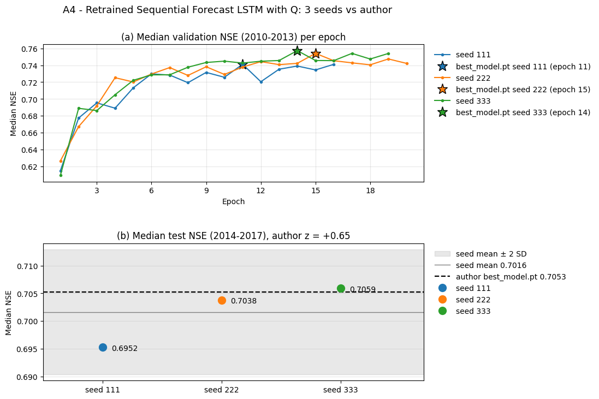
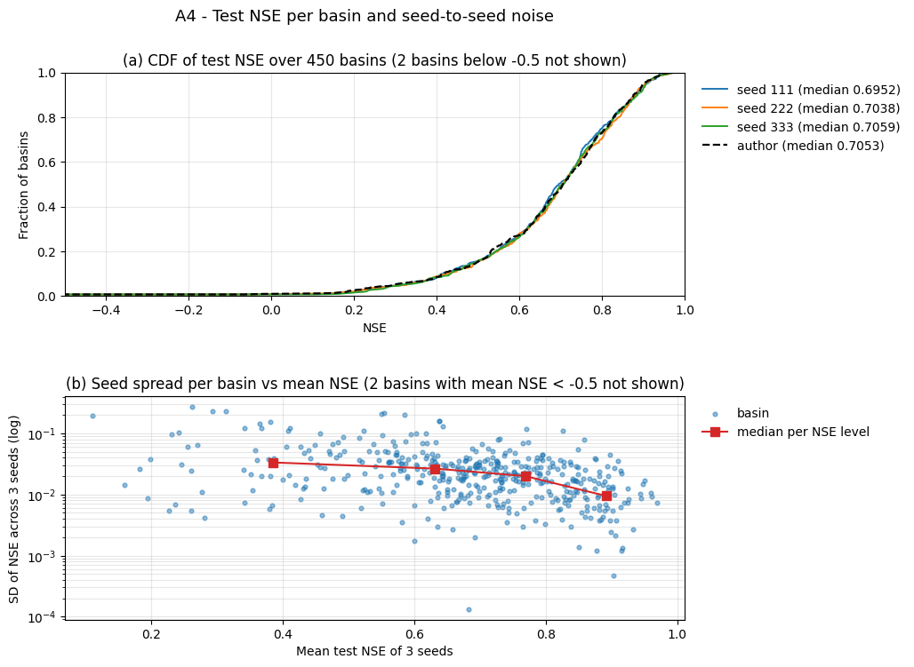

# A4 — Huấn luyện lại Sequential Forecast LSTM có Q với ba hạt giống

Tài liệu đi cùng mã của bốn notebook Kaggle: [03_A4_LamaHCEExt_Retrain_Seed111.py](03_A4_LamaHCEExt_Retrain_Seed111.py), [_Seed222](03_A4_LamaHCEExt_Retrain_Seed222.py), [_Seed333](03_A4_LamaHCEExt_Retrain_Seed333.py) (huấn luyện, mỗi hạt giống một notebook) và [04_A4_LamaHCEExt_Compare.py](04_A4_LamaHCEExt_Compare.py) (so sánh, xuất dự báo cho bộ đánh giá). A4 huấn luyện lại từ đầu mô hình tốt nhất của BiasCast — Sequential Forecast LSTM có lưu lượng quá khứ, lớp nhúng đơn giản — đúng cấu hình của tác giả, với ba hạt giống 111 (hạt giống của tác giả), 222, 333, để trả lời ba câu hỏi:

1. Mã đã công bố huấn luyện lại có ra kết quả của bài (NSE trung vị test 0,7053) không?
2. Chỉ đổi hạt giống thì kết quả dao động bao nhiêu? Đây là mốc nhiễu để đọc mọi so sánh ở bước B, C: chênh lệch giữa hai mô hình nhỏ hơn mức này chưa đủ để kết luận mô hình nào tốt hơn.
3. Một lần huấn luyện trên Kaggle T4 mất bao lâu? Số này dùng để lập ngân sách và lịch các bước sau.

**Hạt giống** (seed) là số khởi tạo bộ sinh số ngẫu nhiên: nó quyết định trọng số ban đầu, thứ tự các mẫu trong mỗi epoch và vị trí bị dropout. Hai lần huấn luyện cùng dữ liệu, cùng cấu hình nhưng khác hạt giống cho ra hai mô hình khác nhau một chút; bài BiasCast chỉ báo cáo một lần chạy (hạt giống 111) nên không có khoảng dao động của tác giả để so.

**Kết luận: tái lập bằng huấn luyện lại đạt.** NSE trung vị test của ba hạt giống là 0,6952; 0,7038; 0,7059 (trung bình 0,7016, độ lệch chuẩn 0,0056). Giá trị 0,7053 của tác giả nằm trong khoảng [0,6952; 0,7059] và cách trung bình 0,65 độ lệch chuẩn. Đổi hạt giống làm NSE trung vị test dao động 0,0106 và NSE trung vị validation dao động 0,0163; theo từng lưu vực, trung vị độ lệch chuẩn NSE giữa ba hạt giống là 0,0207. Một lần huấn luyện mất 2,5–3,2 giờ trên T4.

## Mục lục

- [Cài đặt notebook và bản lưu chính thức](#setup)
- [Cấu hình huấn luyện](#config)
- [Notebook huấn luyện (Phần 1–7)](#retrain)
- [Thời gian huấn luyện](#time)
- [Phần 1–2 notebook so sánh. Kết quả ba hạt giống và điều kiện đạt](#p2)
- [Phần 3. Nhiễu hạt giống theo lưu vực](#p3)
- [Phần 4. Hình](#p4)
- [Phần 5. Dự báo theo hợp đồng của bộ đánh giá](#p5)
- [Phần 6. Đầu ra](#p6)
- [Hệ quả cho các bước sau](#next)

## Cài đặt notebook và bản lưu chính thức

| Notebook Kaggle (tài khoản `hunhngcthng`) | Cài đặt | Input | Bản lưu chính thức |
|---|---|---|---|
| `03_A4_LamaHCEExt_Retrain_Seed111` | GPU T4 x2 (dùng 1), Internet On, Persistence Files only, Pin to original environment | Dataset `lamah-ce-ext` | Version 1 |
| `03_A4_LamaHCEExt_Retrain_Seed222` | như trên | như trên | Version 2 |
| `03_A4_LamaHCEExt_Retrain_Seed333` | như trên | như trên | Version 2 |
| `04_A4_LamaHCEExt_Compare` | CPU, Internet On | Output ba notebook trên (đúng các Version ở cột cuối), Output `02_A3_LamaHCEExt_Benchmarks` Version 1 (tài khoản `hunhthanhnhn`), Dataset `lamah-ce-ext` | Version 2 |

Ba tệp huấn luyện giống hệt nhau, chỉ khác dòng `RUN_SEED` ở Phần 1, để mỗi notebook chạy Save & Run All mà không phải sửa dòng nào. Mỗi hạt giống một notebook vì một lần chạy dài 2,7–3,4 giờ kể cả dựng dữ liệu và đánh giá; chạy hai hạt giống song song trên hai GPU của một phiên chậm 1,45 lần do tranh 4 CPU, chạy ba hạt giống nối tiếp trong một phiên có thể vượt giới hạn 12 giờ của Kaggle. Một lần huấn luyện phải nằm trọn trong một phiên: chức năng chạy tiếp (`continue_training`) của thư viện chỉ khôi phục trọng số và optimizer, không khôi phục trạng thái dừng sớm và bộ lập lịch learning rate (`training/basetrainer.py` dòng 180–190, 313–325), nên không tương đương một lần chạy liền.

Môi trường cả bốn notebook: ảnh Kaggle dựng ngày 22/10/2026, Python 3.13.15, torch 2.11.0+cu128, NumPy 2.1.3, pandas 2.3.3, xarray 2025.12.0, SciPy 1.16.3, matplotlib 3.10.0; thư viện NeuralHydrology cài từ fork `Ticasslo/neuralhydrology` commit `dda45fc` (giống A2).

## Cấu hình huấn luyện

Cấu hình lấy nguyên từ `config.yml` của tác giả (run `Sequential_Forecast_LSTM_RA_with_q_Simple_Embedding`, Zenodo 17292895), chỉ đổi đường dẫn, hạt giống, số tiến trình đọc dữ liệu và bỏ các khóa thư viện tự ghi sau khi chạy:

| Nhóm | Giá trị |
|---|---|
| Đầu vào | Pha quá khứ 365 ngày: 31 biến tái phân tích và `qmean` (m³/s, đúng cách tác giả đưa vào, A2 Phần 3); ngày t: 5 biến dự báo ECMWF HRES; 33 thuộc tính tĩnh |
| Mô hình | `hidden_size` 128, `output_dropout` 0,3, `initial_forget_bias` 3, lớp nhúng tuyến tính đơn giản |
| Huấn luyện | Loss NSE*, Adam lr 1e-3, CosineAnnealingLR (T_max 30, eta_min 1e-5), batch 256, tối đa 30 epoch, `clip_gradient_norm` 1, `clip_targets_to_zero: [qmax]` |
| Dừng sớm | Theo NSE trung vị validation trên 451 lưu vực, kiểm sau mỗi epoch, patience 5, min_delta 0,005 |
| Kỳ | Train 2003–2009, validation 2010–2013, test 2014–2017 (theo cấu hình tác giả) |
| Đổi so với tác giả | `seed` 111/222/333; `num_workers` 20 => 2 (Kaggle có 4 CPU; chỉ đổi số tiến trình đọc dữ liệu, không đổi thứ tự mẫu vì thứ tự lấy từ bộ sinh số của tiến trình chính, `basetrainer.py` dòng 103–108); `verbose` 0 (chỉ tắt thanh tiến độ) |

Hai điểm của mã tác giả được **giữ nguyên** ở A4, sửa ở bước B1:

- **Lưu mô hình tốt nhất:** `best_model.pt` được ghi mỗi khi NSE validation vượt mốc tốt nhất mà bộ dừng sớm ghi nhận, còn bộ dừng sớm chỉ nâng mốc khi tăng quá 0,005 (`basetrainer.py` dòng 286–289, 336–344; `early_stopping.py` dòng 59–65). Vì vậy `best_model.pt` có thể kém epoch tốt nhất thật tới 0,005. Ở cả ba hạt giống của A4, epoch chứa trong `best_model.pt` (xác định bằng cách so từng tensor với `model_epochXXX.pt`) trùng epoch có NSE validation cao nhất, nên lỗi này không ảnh hưởng tới kết quả A4.
- **Không bật chế độ tất định:** thư viện đặt hạt giống cho `random`, `numpy`, `torch` nhưng không bật `cudnn.deterministic` (`basetrainer.py` dòng 419–427); LSTM trên cuDNN có thể không tất định (tài liệu `torch.nn.LSTM`). Các bước B, C chạy cùng mã này, nên nhiễu đo ở A4 phải gồm cả phần không tất định của GPU.

Tác giả huấn luyện ở commit `91af6a0` của thư viện; commit này không có trong fork công khai `conestone/neuralhydrology` (chỉ có `f00cf47` và `9d94908`), và Zenodo không có nhật ký huấn luyện, nên không so được đường NSE validation theo epoch hay thời gian chạy với tác giả.

## Notebook huấn luyện (Phần 1–7)

| Phần | Việc | Kết quả ở bản lưu chính thức |
|---|---|---|
| 1 | Cài thư viện commit `dda45fc`, kiểm môi trường, GPU, gói `tensorboard` (`training/logger.py` dòng 8 nạp khi import) | Đạt ở cả ba |
| 2 | Tìm dữ liệu, `basins_filtered.txt` (451 lưu vực), config tác giả; kiểm các khóa cấu hình theo bảng trên; đọc NSE test từng lưu vực của tác giả | Đạt; tác giả 0,7053 trên 450 lưu vực có NSE (lưu vực 55 không có `qmean`, NSE trống, giống A2) |
| 3 | Dựng thư mục `LamaH_expanded_q_input` (thêm `qmean` từ `D_gauges` vào tệp khí tượng, số âm => ô trống) như A2 Phần 4 | 451/451 tệp, 1,35 GB, 224–345 giây; thống kê chuẩn hóa `qmean` khớp tác giả |
| 4 | Ghi config cho hạt giống của notebook | Đạt |
| 5 | Huấn luyện trong tiến trình con, in tiến độ mỗi 5 phút, đọc `output.log` thành bảng theo epoch | Mã thoát 0, dừng sớm ở epoch 16 / 20 / 19 |
| 6 | Xác định epoch của `best_model.pt`, đường NSE validation theo epoch, đánh giá test `best_model.pt` | Epoch 11 / 15 / 14, trùng epoch NSE validation cao nhất; đánh giá test 5,2–5,3 phút |
| 7 | Ghi `environment.json`, `manifest.csv` (sha256 sáu tệp chính của run), xóa thư mục Q tạm | Output khoảng 0,3 GB mỗi hạt giống |

Đường NSE trung vị validation theo epoch (đọc từ `validation/model_epochXXX/validation_metrics.csv`, khớp nhật ký):

| Epoch | 1 | 3 | 5 | 7 | 9 | 11 | 13 | 15 | 17 | 19 | 20 |
|---|---|---|---|---|---|---|---|---|---|---|---|
| Hạt giống 111 | 0,6148 | 0,6953 | 0,7132 | 0,7284 | 0,7315 | **0,7411** | 0,7353 | 0,7345 | – | – | – |
| Hạt giống 222 | 0,6265 | 0,6919 | 0,7201 | 0,7373 | 0,7382 | 0,7379 | 0,7408 | **0,7541** | 0,7429 | 0,7475 | 0,7422 |
| Hạt giống 333 | 0,6093 | 0,6862 | 0,7222 | 0,7287 | 0,7433 | 0,7426 | 0,7456 | 0,7457 | 0,7541 | 0,7540 | – |

Số đậm là epoch lưu thành `best_model.pt`; hạt giống 333 đạt cao nhất ở epoch 14 (0,7574). Sau epoch tốt nhất, năm epoch liền không vượt mốc thêm 0,005 nên bộ dừng sớm kết thúc (111: epoch 16; 222: epoch 20; 333: epoch 19).

## Thời gian huấn luyện

Đo từ mốc thời gian trong `output.log` của bản lưu chính thức:

| Hạng mục | Hạt giống 111 | Hạt giống 222 | Hạt giống 333 |
|---|---|---|---|
| Dựng thư mục Q (Phần 3) | 224 giây | 295 giây | 345 giây |
| Một epoch huấn luyện | khoảng 5,6 phút | khoảng 5,7 phút | khoảng 5,9 phút |
| Một lượt validation 451 lưu vực | 4,8 phút lần đầu, sau đó khoảng 3,4 phút | 5,0 phút lần đầu, sau đó khoảng 3,5 phút | 5,1 phút lần đầu, sau đó khoảng 3,6 phút |
| Huấn luyện tới khi dừng sớm (Phần 5) | 2,50 giờ (16 epoch) | 3,17 giờ (20 epoch) | 3,08 giờ (19 epoch) |
| Đánh giá test (Phần 6) | 5,2 phút | 5,3 phút | 5,3 phút |

Trung bình một epoch kể cả validation là khoảng 9,5 phút, trong đó validation chiếm khoảng 38%. Nếu chạy đủ 30 epoch (không dừng sớm), một lần huấn luyện mất khoảng 4,7 giờ. Lượt validation đầu tiên chậm hơn vì dựng và đệm dữ liệu validation (`cache_validation_data: true`).

## Phần 1–2 notebook so sánh. Kết quả ba hạt giống và điều kiện đạt

Phần 1 tìm Output ba notebook hạt giống qua `a4_output/environment.json` (không dựa vào tên đường dẫn), tính lại sha256 của sáu tệp chính mỗi run (`config.yml`, `train_data_scaler.yml`, `best_model.pt`, `test_metrics.csv`, `test_results.p`, `output.log`) và so với `manifest.csv`: khớp 18/18, cả ba run cùng commit `dda45fc`, cùng torch. Phần 2 đọc lại NSE, KGE từng lưu vực từ `test_metrics.csv`, tính lại trung vị và đối chiếu bản tóm tắt notebook hạt giống đã ghi (khớp tuyệt đối).

| Mô hình | Epoch `best_model.pt` | Số epoch | Giờ huấn luyện | NSE trung vị validation | NSE trung vị test | KGE trung vị test | Chênh NSE test so với tác giả |
|---|---|---|---|---|---|---|---|
| Hạt giống 111 | 11 | 16 | 2,50 | 0,7411 | 0,6952 | 0,7581 | −0,0100 |
| Hạt giống 222 | 15 | 20 | 3,17 | 0,7541 | 0,7038 | 0,7910 | −0,0015 |
| Hạt giống 333 | 14 | 19 | 3,08 | 0,7574 | 0,7059 | 0,7860 | +0,0006 |
| Tác giả (`best_model.pt`, Zenodo) | – | – | – | – | 0,7053 | 0,7671 | 0 |

| Chỉ số qua 3 hạt giống | Trung bình | Độ lệch chuẩn (ddof = 1) | Nhỏ nhất | Lớn nhất | Lớn nhất − nhỏ nhất |
|---|---|---|---|---|---|
| NSE trung vị validation | 0,7509 | 0,0086 | 0,7411 | 0,7574 | 0,0163 |
| NSE trung vị test | 0,7016 | 0,0056 | 0,6952 | 0,7059 | 0,0106 |
| KGE trung vị test | 0,7783 | 0,0177 | 0,7581 | 0,7910 | 0,0329 |

Mỗi mô hình có 451 lưu vực, 450 lưu vực có NSE (lưu vực 55 trống). Trung vị bỏ ô trống như logger của thư viện (`training/logger.py` dòng 210).

**Điều kiện đạt** (đặt trước khi chạy): NSE trung vị test của tác giả nằm trong [nhỏ nhất, lớn nhất] của ba hạt giống, hoặc cách trung bình không quá 2 độ lệch chuẩn. Điều kiện dùng khoảng của chính ba hạt giống vì bài chỉ có một lần chạy, không có khoảng tin cậy của tác giả; với ba mẫu, độ lệch chuẩn ước lượng còn thô nên ghi kèm cả khoảng [nhỏ nhất, lớn nhất]. Kết quả: 0,7053 nằm trong [0,6952; 0,7059], z = (0,7053 − 0,7016) / 0,0056 = +0,65 => **đạt**. KGE trung vị của tác giả (0,7671) cũng nằm trong khoảng của ba hạt giống [0,7581; 0,7910].

Hạt giống 111 trùng hạt giống của tác giả nhưng cho NSE test 0,6952, không phải 0,7053: cùng hạt giống không cho cùng mô hình vì thư viện tác giả dùng (commit `91af6a0`) khác thư viện của đề tài (`dda45fc`), phần cứng khác (tác giả dùng RTX 4090) và phép tính trên GPU không tất định.

## Phần 3. Nhiễu hạt giống theo lưu vực

So trên 450 lưu vực có NSE ở cả bốn mô hình. Với mỗi lưu vực, tính độ lệch chuẩn và khoảng lớn nhất − nhỏ nhất của NSE test qua ba hạt giống:

| Đại lượng | Phân vị 50% | Phân vị 75% | Phân vị 90% | Lớn nhất |
|---|---|---|---|---|
| Độ lệch chuẩn NSE qua 3 hạt giống | 0,0207 | 0,0353 | 0,0644 | 3,9117 |
| Lớn nhất − nhỏ nhất qua 3 hạt giống | 0,0396 | 0,0681 | 0,1212 | 7,4043 |
| \|NSE tác giả − trung bình 3 hạt giống\| | 0,0171 | 0,0353 | 0,0611 | 69,3014 |

Giá trị lớn nhất đến từ hai lưu vực 758 và 742, nơi `qmax` kỳ test gần như hằng số (phương sai 0,0002–0,0003, A2 Phần 7): mẫu số của NSE gần 0 nên sai số rất nhỏ cũng cho NSE âm sâu (tác giả −78,3 và −43,9; ba hạt giống −13,4 tới −2,6). Bỏ qua hai lưu vực này, chênh lệch theo lưu vực giữa hai lần chạy chỉ khác hạt giống thường vào khoảng 0,02–0,04 NSE, có lưu vực tới 0,4–0,5 (312, 119, 754).

Nếu mô hình của tác giả chỉ như một lần chạy thứ tư cùng phân phối với ba hạt giống, xác suất nó nằm giữa nhỏ nhất và lớn nhất của ba lần kia là 2/4 = 50% (bốn giá trị hoán đổi được, nó không phải nhỏ nhất cũng không phải lớn nhất). Thực đo: 52,2% lưu vực — phù hợp với việc mô hình tác giả là một mẫu cùng phân phối.

| Mức NSE (trung bình 3 hạt giống) | Số lưu vực | Trung vị độ lệch chuẩn | Trung vị lớn nhất − nhỏ nhất | Tỉ lệ tác giả trong khoảng 3 hạt giống |
|---|---|---|---|---|
| < 0 | 2 | 2,8648 | 5,3100 | 0% |
| 0 – 0,5 | 68 | 0,0335 | 0,0647 | 51,5% |
| 0,5 – 0,7 | 156 | 0,0265 | 0,0517 | 51,3% |
| 0,7 – 0,85 | 154 | 0,0200 | 0,0383 | 51,3% |
| ≥ 0,85 | 70 | 0,0094 | 0,0182 | 58,6% |

Lưu vực mô hình dự báo càng tốt thì nhiễu hạt giống càng nhỏ: trung vị độ lệch chuẩn giảm từ 0,034 ở nhóm NSE 0–0,5 xuống 0,009 ở nhóm ≥ 0,85.

**Kiểm định ghép cặp theo lưu vực.** Cùng cách của bộ đánh giá (`Workspace/06_Evaluation/01_Evaluation_LamaHCEExt.py` Phần 7.1): Wilcoxon hạng có dấu hai phía trên hiệu NSE từng lưu vực, Cohen's dz = trung bình hiệu / độ lệch chuẩn hiệu, hiệu chỉnh Holm trong từng họ so sánh. Hiệu dương nghĩa là mô hình bên trái tốt hơn.

| Họ | Trái | Phải | Trái tốt hơn | Trái kém hơn | Trung bình hiệu | Trung vị hiệu | Cohen's dz | p Wilcoxon | p Holm |
|---|---|---|---|---|---|---|---|---|---|
| Hạt giống với tác giả | 111 | tác giả | 209 | 241 | 0,2270 | −0,0023 | 0,064 | 0,096 | 0,193 |
| Hạt giống với tác giả | 222 | tác giả | 248 | 202 | 0,2540 | 0,0037 | 0,066 | 0,048 | 0,144 |
| Hạt giống với tác giả | 333 | tác giả | 253 | 197 | 0,2563 | 0,0048 | 0,065 | 0,132 | 0,193 |
| Hạt giống với hạt giống | 111 | 222 | 197 | 253 | −0,0270 | −0,0038 | −0,084 | 0,0028 | 0,0084 |
| Hạt giống với hạt giống | 111 | 333 | 196 | 254 | −0,0293 | −0,0044 | −0,077 | 0,0064 | 0,0129 |
| Hạt giống với hạt giống | 222 | 333 | 234 | 216 | −0,0023 | 0,0013 | −0,023 | 0,189 | 0,189 |

Hai điều rút ra:

- **Ba hạt giống không khác tác giả có ý nghĩa** (p Holm 0,14–0,19), trung vị hiệu chỉ ±0,005.
- **Hai lần chạy chỉ khác hạt giống vẫn có thể khác nhau "có ý nghĩa thống kê":** hạt giống 111 kém 222 và 333 với p Holm 0,008 và 0,013, dù trung vị hiệu chỉ 0,004 NSE. Với 450 cặp lưu vực, Wilcoxon đủ nhạy để phát hiện chênh lệch rất nhỏ; vì vậy ở bước B, C, p < 0,05 một mình không đủ để nói mô hình mới tốt hơn, phải so độ lớn chênh lệch với mốc nhiễu ở trên và so trên nhiều hạt giống.

Trung bình hiệu và Cohen's dz ở họ "hạt giống với tác giả" bị hai lưu vực 758, 742 kéo lên (+0,23 tới +0,26) vì NSE của tác giả ở đó âm sâu hơn; trung vị hiệu và số lưu vực tốt hơn/kém hơn phản ánh đúng hơn.

## Phần 4. Hình

Hình 1. (a) NSE trung vị validation sau mỗi epoch của ba hạt giống; ngôi sao là epoch lưu thành `best_model.pt` (11, 15, 14), trùng epoch có NSE validation cao nhất; mỗi đường dừng ở epoch dừng sớm. Ba đường tăng nhanh trong 5 epoch đầu rồi dao động quanh 0,73–0,76. (b) NSE trung vị test của ba hạt giống (chấm tròn) so với `best_model.pt` của tác giả (nét đứt); dải xám là trung bình ± 2 độ lệch chuẩn của ba hạt giống. Giá trị của tác giả nằm giữa các hạt giống và trong dải xám.

Hình 2. (a) Hàm phân phối tích lũy NSE test theo lưu vực của ba hạt giống và tác giả: mỗi điểm (x, y) cho biết tỉ lệ y lưu vực có NSE không quá x, đường càng lệch phải càng tốt. Bốn đường gần như chồng lên nhau; hai lưu vực 742, 758 có NSE dưới −0,5 nằm ngoài trục. (b) Mỗi chấm là một lưu vực: trục ngang là NSE trung bình ba hạt giống, trục dọc là độ lệch chuẩn NSE qua ba hạt giống (thang log); đường đỏ nối trung vị của từng mức NSE. Nhiễu hạt giống giảm dần khi NSE của lưu vực tăng.

## Phần 5. Dự báo theo hợp đồng của bộ đánh giá

Mỗi hạt giống được xuất thành một tệp `contracts/SeqLSTM_Q_A4_seed{111,222,333}_test_S0_lead1.npz` theo hợp đồng NPZ của bộ đánh giá (`Workspace/06_Evaluation/01_Evaluation_LamaHCEExt.md` Mục 7), để bộ đánh giá đọc bằng tham số `--extra-contract` và chấm cùng A2, DLinear, persistence trên cùng tập ngày–lưu vực.

- Dự báo thô lấy từ `test_results.p` của `best_model.pt` (`qmax_sim`, bước thời gian 0), chưa chặn âm; thư viện chỉ chặn âm khi tính chỉ số (`evaluation/tester.py` dòng 319–322). Dự báo dùng để chấm = max(dự báo thô, 0) theo `clip_targets_to_zero: [qmax]` của config; mỗi hạt giống có 1.660–2.261 ngày–lưu vực dự báo âm trước khi chặn.
- Quan trắc, persistence, diện tích và thứ tự 451 lưu vực lấy nguyên từ ngữ cảnh A3 (`A3_persistence_predictions.npz`, `A3_Q_source_window.npz`), dựng lại và kiểm như hàm `read_context` của bộ đánh giá, vì bộ đánh giá đòi các mô hình cùng nhóm có quan trắc và persistence bằng nhau từng bit.
- Kiểm lại mỗi tệp: (1) đọc ngược theo đúng các điều kiện của `read_contract` và `check_same_context`; (2) NSE từng lưu vực tính lại từ dự báo trong tệp khớp `test_metrics.csv` của thư viện (sai lệch lớn nhất 0); (3) quan trắc trong `test_results.p` trùng vị trí ô trống với quan trắc A3, lệch giá trị lớn nhất 1,1 × 10⁻⁵ mm/ngày (do thư viện lưu dạng float32). Mỗi tệp có 652.644 ngày–lưu vực có dự báo trên 1.461 ngày × 451 lưu vực.

Metadata mỗi tệp: `run` = `SeqLSTM_Q_A4_seed{N}`, kỳ `test`, kịch bản `S0`, hạn 1, `forecast_horizon` 1, đơn vị `mm/day_area_gov`, sha256 của `config.yml`, commit thư viện `dda45fc`, `clip_to_zero` true, epoch đã chọn và notebook nguồn kèm số Version.

## Phần 6. Đầu ra

Thư mục `a4_compare/` trong Output notebook `04_A4_LamaHCEExt_Compare` Version 2 (11 tệp, 30,4 MB; `manifest.csv` ghi sha256 từng tệp):

| Tệp | Nội dung |
|---|---|
| `A4_seed_table.csv`, `A4_seed_stats.csv` | Bảng ba hạt giống và tác giả; thống kê qua ba hạt giống (Phần 2) |
| `A4_seed_noise_by_basin.csv` | NSE từng lưu vực của bốn mô hình, độ lệch chuẩn, khoảng, mức NSE (Phần 3) |
| `A4_paired_tests.csv` | Kiểm định ghép cặp (Phần 3) |
| `A4_Seeds.png`, `A4_BasinNoise.png` | Hai hình (Phần 4), bản sao ở [Figures/](Figures/) |
| `contracts/*.npz` | Ba tệp dự báo cho bộ đánh giá (Phần 5) |
| `a4_summary.json` | Số liệu chính: đạt/không, NSE từng hạt giống, z, nhiễu theo lưu vực và theo mức, p Holm các cặp hạt giống |
| `environment.json` | Input đã gắn kèm số Version, sha256 tệp A3 và tệp chỉ số tác giả, thư viện |

Trọng số mọi epoch, kết quả validation mỗi epoch, kết quả test và nhật ký của từng run nằm ở `a4_runs/` trong Output notebook hạt giống tương ứng.

## Hệ quả cho các bước sau

| Số đo ở A4 | Dùng ở |
|---|---|
| Độ lệch chuẩn NSE trung vị validation giữa hạt giống: 0,0086 | Luật chọn B* (`03_Pipeline.md` Mục 7): cấu hình kém cấu hình tốt nhất không quá mức này coi như ngang nhau |
| Độ lệch chuẩn NSE trung vị test: 0,0056; khoảng 0,0106 | Đọc chênh lệch NSE trung vị giữa các mô hình ở B, C |
| Trung vị độ lệch chuẩn NSE theo lưu vực: 0,0207 (0,009–0,034 tùy mức NSE) | Đọc chênh lệch từng lưu vực, phân tích theo lưu vực |
| Hai lần chạy chỉ khác hạt giống vẫn khác nhau với p Holm < 0,05 | So sánh mô hình phải kèm độ lớn hiệu và nhiều hạt giống, không chỉ p |
| Một lần huấn luyện 2,5–3,2 giờ (khoảng 9,5 phút/epoch, validation chiếm khoảng 38%), tối đa khoảng 4,7 giờ nếu chạy đủ 30 epoch | Ngân sách và lịch (`03_Pipeline.md` Mục 8.1, 9.7) |
| Ba tệp NPZ của mô hình nền | Bộ đánh giá chấm mô hình nền huấn luyện lại cùng các mốc A3; mốc so sánh cho B1 |
