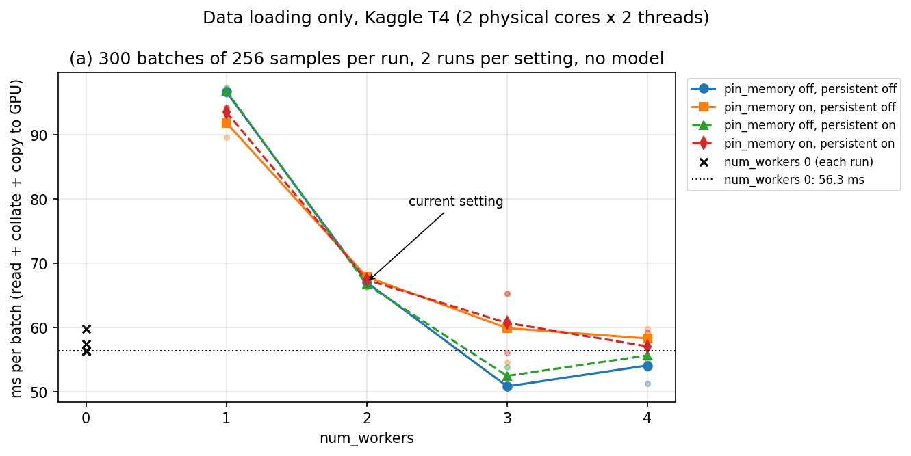
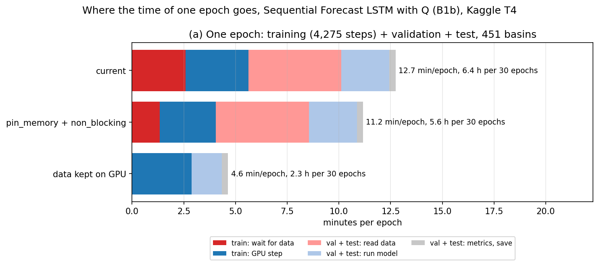

# Bước 0 — Đo tốc độ bộ nạp dữ liệu

Tài liệu đi cùng [mã Python](02_0_DataLoader_Benchmark.py) của notebook Kaggle `02_0_DataLoader_Benchmark`. Notebook đo xem một epoch huấn luyện trên Kaggle T4 tốn thời gian vào đâu: đọc dữ liệu hay chạy mô hình, rồi thử các cách làm phần đọc dữ liệu nhanh hơn. Cấu hình đo là B1b (Sequential Forecast LSTM có Q của BiasCast, thêm `qmean` và `qmax` quá khứ theo mm/ngày, hạt giống 111), cấu hình nhiều biến đầu vào nhất trong B0–B1b.

## Mục lục

- [1. Câu hỏi cần trả lời](#1)
- [2. Khái niệm dùng trong báo cáo](#2)
- [3. Cài đặt notebook](#3)
- [4. Các Phần và kết quả](#4)
- [5. Kết luận cho các bước sau](#5)
- [6. Nguồn](#6)

## 1. Câu hỏi cần trả lời

Ở buổi họp 25/10/2026, GVHD nhận xét thời gian mỗi epoch là chậm với dữ liệu dạng số, nghi bộ nạp dữ liệu chỉ chạy một tiến trình, và yêu cầu đo thời gian chỉ lặp qua bộ nạp, không có mô hình, tới khi ra lô đầu và hết một epoch (`Document/02_Meetings/Meeting_2026-10-25.md` Mục 2.4). Notebook trả lời ba câu:

1. Chỉ đọc dữ liệu (không mô hình) thì mất bao lâu cho lô đầu và cho một epoch, theo từng tham số của `DataLoader`?
2. Khi có mô hình, bao nhiêu phần thời gian một bước huấn luyện là GPU đứng chờ dữ liệu?
3. Validation (và chấm test mỗi epoch theo giao thức 30 epoch, `02_Pipeline.md` Mục 5.1) tốn thời gian vào đâu?

Luật quyết định ghi trong mã trước khi chạy: thay đổi nào rút ngắn từ 5% thời gian một lần chạy chính thức trở lên thì sửa fork thư viện trước B0.

## 2. Khái niệm dùng trong báo cáo

- **Mẫu (sample):** một lưu vực tại một ngày t, gồm 365 ngày đầu vào (364 ngày quá khứ với 33 biến, ngày t với 5 biến ECMWF HRES), 33 thuộc tính tĩnh và nhãn `qmax`. Kỳ train 2003–2009 của 451 lưu vực có 1.094.272 mẫu; batch 256 => 4.275 lô (batch) mỗi epoch.
- **Cách thư viện nạp một lô:** dữ liệu cả kỳ nằm trong RAM, mỗi biến của mỗi lưu vực là một tensor riêng. Với mỗi mẫu, `__getitem__` cắt 42 đoạn tensor (từng biến, nhãn, ngày, thuộc tính) thành một dict; `collate_fn` ghép 256 dict thành lô; vòng huấn luyện chép lô từ RAM sang GPU (`basedataset.py` dòng 150–212, 839–857; `basetrainer.py` dòng 376–382). Toàn bộ việc cắt và ghép chạy bằng Python trên CPU.
- **`num_workers`:** số tiến trình phụ đọc dữ liệu song song với tiến trình chính (tiến trình chính điều khiển GPU). 0 nghĩa là tiến trình chính tự đọc. Cấu hình của tác giả đặt 20, A4 và cấu hình hiện tại đặt 2.
- **`pin_memory`:** đặt lô vào vùng RAM ghim cố định, GPU đọc thẳng nên chép nhanh hơn. **`non_blocking=True`** trong `.to(device)`: lệnh chép chạy nền, CPU không chờ chép xong (chỉ chạy nền thật khi lô đã ghim). **`persistent_workers`:** giữ tiến trình phụ qua các epoch thay vì dựng lại. **`prefetch_factor`:** số lô mỗi tiến trình phụ chuẩn bị trước (tài liệu PyTorch 2.11 `torch.utils.data`, ghi chú CUDA).
- **Chờ dữ liệu:** thời gian vòng huấn luyện đứng ở lệnh lấy lô tiếp theo; trong lúc đó GPU không làm gì.

## 3. Cài đặt notebook

| Mục | Giá trị | Lý do |
|---|---|---|
| Accelerator | GPU T4 x2 (dùng GPU 0) | Đo trên đúng GPU huấn luyện |
| Internet | On | Cài fork NeuralHydrology từ GitHub |
| Persistence | Files only | Giữ thư mục dữ liệu dựng ở Phần 3 khi phiên tương tác khởi động lại |
| Input | Kaggle Dataset `hunhngcthng/lamah-ce-ext` | Extended LamaH-CE (Zenodo 17119635) và config tác giả (Zenodo 17292895) |
| Thư viện | Fork `Ticasslo/neuralhydrology` commit `e794d7c` | Bản dùng từ B0 (`02_Pipeline.md` Mục 9.1) |

## 4. Các Phần và kết quả

Kết quả dưới đây lấy từ bản lưu chính thức **Version 1** (Save & Run All, phiên sạch, 25/10/2026, các cell chạy từ 10:37 đến 11:29 giờ máy Kaggle, khoảng 52 phút): chạy hết Phần 1–9, 80 điều kiện kiểm đều đạt. Notebook kèm output ở [02_0_DataLoader_Benchmark.ipynb](02_0_DataLoader_Benchmark.ipynb). Phiên tương tác chạy trước đó cùng ngày cho cùng kết luận ở mọi Phần; số đo thời gian chênh nhau vài phần trăm giữa hai lần chạy.

Môi trường (`environment.json` của Output): Python 3.13.15, torch 2.11.0+cu128, cuDNN 9.19, ảnh Kaggle dựng ngày 22/10/2026, 4 CPU Intel Xeon 2,00 GHz, RAM 31,3 GB. `lscpu` cho thấy 4 CPU này là **2 lõi thật × 2 luồng**.

### Phần 1. Cài fork và kiểm môi trường

Cài đúng commit `e794d7c`; ba tệp chứa bộ nạp và vòng huấn luyện (`training/basetrainer.py`, `evaluation/tester.py`, `datasetzoo/basedataset.py`) trùng từng byte với commit đó; pip không đổi thư viện có sẵn của ảnh Kaggle.

### Phần 2. Config tác giả

Đọc config run `Sequential_Forecast_LSTM_RA_with_q_Simple_Embedding` của tác giả (68 khóa) và kiểm 20 điều kiện, đều đạt: lõi `sequential_forecast_lstm`, hạt giống 111, 128 nút ẩn, batch 256, 30 epoch, tốc độ học 0,001, dropout 0,3, chuỗi 365 ngày, dừng sớm 5 epoch / 0,005 theo NSE, loss NSE, nhãn `qmax`; 32 biến quá khứ (có `qmean` m³/s đúng một lần), 5 biến ngày t, 33 thuộc tính; tên hai cột Q mới chưa có trong config. Danh sách có 451 lưu vực.

### Phần 3. Thư mục dữ liệu có Q theo mm/ngày

Bộ nạp chỉ đọc biến đầu vào từ tệp khí tượng (`lamah.py` dòng 119–131), còn Q nằm ở tệp trạm `D_gauges`. Notebook thêm hai cột `qmean_mmd`, `qmax_mmd` vào tệp khí tượng của 451 lưu vực (255 giây, 1,53 GB), đổi đơn vị bằng chính hàm thư viện dùng cho nhãn: q (mm/ngày) = Q (m³/s) × 86,4 / diện tích `area_gov` (km²). Kiểm trên 2.635.193 ngày–lưu vực: `qmax_mmd` trùng nhãn `qmax` của bộ nạp tới lệch tương đối 7,8e-14 (làm tròn khi ghi 17 chữ số), cùng ô trống, không âm, `qmax_mmd` ≥ `qmean_mmd`, cột cũ giữ nguyên.

### Phần 4. Dựng trainer B1b và chi phí một lô

Config B1b chỉ khác config tác giả ở các khóa đường dẫn, tên thí nghiệm, `num_workers` 2, `early_stopping_patience` 30, và biến quá khứ (`qmean` đổi thành `qmean_mmd`, thêm `qmax_mmd`: 33 biến quá khứ, 5 biến ngày t). Dựng trainer bằng đúng lệnh thư viện dùng khi huấn luyện mất 118 giây; mô hình có 84.801 tham số.

Đo ở tiến trình chính (trung vị 20 lô ngẫu nhiên): một mẫu `__getitem__` 167 µs, ghép một lô `collate_fn` 12,9 ms, **một lô 256 mẫu 55,5 ms**. Nếu chỉ tiến trình chính đọc, phần đọc của một epoch đã mất khoảng 4,0 phút, chưa tính chép sang GPU.

### Phần 5. Chỉ lặp bộ nạp, không mô hình

Đo đúng yêu cầu của GVHD: 18 tổ hợp `num_workers` 0–4 × `pin_memory` × `persistent_workers`, thứ tự ngẫu nhiên, mỗi tổ hợp 2 lần × 300 lô, mỗi lô chép sang GPU như vòng huấn luyện.

*Hình 1. Thời gian lấy một lô 256 mẫu khi chỉ lặp bộ nạp (cắt mẫu, ghép lô, chép sang GPU). Mỗi đường là một cặp `pin_memory`/`persistent_workers`, chấm mờ là từng lần đo.*

| `num_workers` | Tổ hợp nhanh nhất (ms/lô) | Một epoch ngoại suy (phút) |
|---|---|---|
| 0 | 56,3 | 4,0 |
| 1 | 91,9 | 6,6 |
| 2 (hiện tại, không pin, không persistent) | 67,0 | 4,8 |
| 3 | 50,8 | 3,6 |
| 4 | 54,1 | 3,9 |

- Lô đầu ra sau 0,13–0,16 giây với `num_workers` 0 và 0,36–0,71 giây khi có tiến trình phụ (gồm thời gian dựng tiến trình).
- Đo đủ một epoch 4.275 lô: cấu hình hiện tại 4,80 phút, tổ hợp nhanh nhất (`num_workers` 3) 3,63 phút.
- Thêm tiến trình phụ không làm nhanh tương ứng: 2 tiến trình còn chậm hơn chỉ tiến trình chính, 3 tiến trình chỉ nhanh hơn 10%. Máy có 2 lõi thật nên các tiến trình đọc tranh CPU với nhau và với tiến trình chính. `pin_memory` và `persistent_workers` đổi tối đa 9,9 ms trong cùng `num_workers`, ngang mức hai lần đo cùng tổ hợp chênh nhau (10,6 ms). `prefetch_factor` 4 chậm hơn 2 (57,5 so với 50,8 ms/lô).

### Phần 6. Có mô hình: chờ dữ liệu và tính

Vòng lặp chép đúng các bước của vòng huấn luyện thư viện, 3 cấu hình × 2 lần × 500 bước, mỗi lần khôi phục cùng trọng số. Đối chứng: vòng huấn luyện thật của thư viện cho 80,3 ms/bước, lệch vòng chép 1,6%.

| Cấu hình | ms/bước | Chờ dữ liệu (ms) | Tính (ms) | % chờ | Phút/epoch huấn luyện |
|---|---|---|---|---|---|
| Hiện tại (`num_workers` 2) | 79,0 | 36,3 | 42,7 | 46% | 5,63 |
| Tốt nhất Phần 5 (`num_workers` 3) | 79,1 | 36,0 | 43,2 | 45% | 5,64 |
| Tốt nhất + `pin_memory` + `non_blocking` | 56,9 | 18,8 | 38,1 | 33% | 4,05 |

- 5,63 phút/epoch khớp thời gian huấn luyện đo ở A4 (5,6–5,9 phút, `Workspace/03_Baseline/03_A4_LamaHCEExt_Retrain/03_A4_LamaHCEExt_Retrain.md`).
- Gần một nửa thời gian một bước là GPU chờ dữ liệu. Tổ hợp nhanh nhất ở Phần 5 không nhanh hơn khi có mô hình, vì tiến trình chính cũng cần CPU để điều khiển GPU. Chỉ `pin_memory` + `non_blocking` rút được 28%.

### Phần 7. Validation và chấm test

Validation chạy đúng hàm của thư viện trên 451 lưu vực (2.706 lô); notebook bọc đồng hồ quanh từng bước. Tester của thư viện dựng một `DataLoader` `num_workers` 0 cho từng lưu vực (`tester.py` dòng 219–232), nên mọi việc đọc dữ liệu chạy ở tiến trình chính.

| Lượt | Dựng dataset (s) | Đọc dữ liệu (s) | Chạy mô hình (s) | Tính chỉ số (s) | Tổng (phút) |
|---|---|---|---|---|---|
| 1. Epoch đầu, dựng và giữ dataset | 94,6 | (gộp vào cột sau) | 204,8 | 8,6 | 5,13 |
| 2. Từ epoch 2, dataset đã giữ | 0 | 134,8 | 69,7 | 8,7 | 3,55 |
| 3. Như lượt 2, batch suy luận 2048 | 0 | (gộp vào cột sau) | 203,7 | 8,8 | 3,54 |

- 3,55 phút/lượt khớp A4 (3,4–3,6 phút). Đọc dữ liệu chiếm 63% thời gian lượt 2.
- Chấm test mỗi epoch tốn như lượt 2: kỳ test 2014–2017 dài bằng kỳ validation 2010–2013, và notebook huấn luyện sẽ giữ sẵn dataset test (thư viện chỉ tự giữ dataset validation, `tester.py` dòng 229).
- Batch suy luận 2048 không nhanh hơn (phần đọc dữ liệu không đổi) và cho NSE từng lưu vực trùng lượt 2 (lệch 0), nên không dùng.
- NSE trung vị −0,23 ở cả ba lượt vì mô hình chưa huấn luyện; Phần 7 chỉ đo thời gian.

### Phần 8. Thử để sẵn dữ liệu trên GPU

Thử một cách nạp khác ngay trong notebook (chưa sửa thư viện): ghép dữ liệu train của 451 lưu vực thành 3 tensor nằm sẵn trên GPU (quá khứ, ngày t, nhãn; 211 MB, dựng 1,3 giây). Mỗi lô lấy bằng một phép chọn theo chỉ số trên GPU, không còn `__getitem__`, `collate_fn` và chép CPU → GPU. Thứ tự mẫu lấy bằng chính một `DataLoader` trên dãy chỉ số với cùng bộ sinh số ngẫu nhiên, nên lô thứ k trùng lô thứ k của bộ nạp thư viện.

| Kiểm | Kết quả |
|---|---|
| Thứ tự đủ mọi mẫu, không lặp | Đạt |
| 3 lô đầu: cùng chỉ số => trùng từng giá trị với `__getitem__` + `collate_fn` | Đạt |
| 3 lô đầu: bộ nạp thư viện cho đúng thứ tự này | Đạt |
| Loss của 3 lô đầu lệch so với lô thư viện | 0 |
| Validation: dự báo 3 lưu vực ngẫu nhiên lệch so với hàm `_evaluate` của thư viện | 0 |

| Cách | ms/bước | Phút/epoch huấn luyện | So với hiện tại |
|---|---|---|---|
| Hiện tại | 79,0 | 5,63 | – |
| `pin_memory` + `non_blocking` | 56,9 | 4,05 | −28% |
| Dữ liệu sẵn trên GPU | 40,4 | 2,88 | −49% |

Validation với dữ liệu sẵn trên GPU (lô không vượt qua ranh giới lưu vực, như tester): đọc dữ liệu và chạy mô hình còn 44 giây, so với 204 giây của lượt 2 Phần 7.

### Phần 9. Tổng hợp một epoch và một lần chạy

*Hình 2. Thời gian một epoch theo giao thức từ B0 (huấn luyện, validation, chấm test 451 lưu vực), ngoại suy từ số đo Phần 6–8. Đỏ đậm: GPU chờ dữ liệu khi huấn luyện; xanh đậm: bước huấn luyện trên GPU; hồng: đọc dữ liệu khi chấm điểm; xanh nhạt: chạy mô hình khi chấm điểm; xám: tính chỉ số, ghi kết quả. Với dữ liệu sẵn trên GPU, thời gian lấy lô gộp vào cột tính.*

Một lần chạy 30 epoch gồm 5,1 phút chi phí một lần (dựng trainer, dựng dataset validation và test ở epoch đầu); bảng ở [Tables/S0_Summary.csv](Tables/S0_Summary.csv), chia theo thành phần ở [Tables/S0_EpochBreakdown.csv](Tables/S0_EpochBreakdown.csv).

| Cách | Huấn luyện (phút/epoch) | Validation + test (phút/epoch) | Tổng (phút/epoch) | Một lần chạy (giờ) | Tiết kiệm | Luật ≥ 5% |
|---|---|---|---|---|---|---|
| Hiện tại | 5,63 | 7,11 | 12,74 | 6,45 | – | – |
| `pin_memory` + `non_blocking` | 4,05 | 7,11 | 11,16 | 5,67 | 47 phút (12%) | Đạt |
| Dữ liệu sẵn trên GPU | 2,88 | 1,75 | 4,63 | 2,40 | 243 phút (63%) | Đạt |

Với cách hiện tại, 56% thời gian một epoch là chờ hoặc đọc dữ liệu. Số "validation + test" của cách dữ liệu sẵn trên GPU ngoại suy từ bản thử Phần 8 (chạy mô hình không qua hàm `_evaluate` của thư viện); số đo trên thư viện đã sửa lấy ở notebook kiểm `03_0_GPUData_Check`.

## 5. Kết luận cho các bước sau

- Trả lời GVHD: bộ nạp hiện tại dùng 2 tiến trình phụ khi huấn luyện, nhưng tester dùng 1 tiến trình khi validation. Thời gian chậm không do thiếu tiến trình: Kaggle chỉ có 2 lõi CPU thật, và mỗi lô phải cắt, ghép bằng Python khoảng 55 ms trên CPU. Thêm tiến trình không giúp khi có mô hình (Phần 5–6).
- Thời gian một lần chạy chính thức theo cách hiện tại khoảng 6,5 giờ (30 epoch, chấm test mỗi epoch), gần ước tính 6,8 giờ ở `02_Pipeline.md` Mục 8.1 (ước tính đó cộng thêm dựng dữ liệu và chấm `best_model.pt`).
- Cả hai cách đạt luật ≥ 5%. Để dữ liệu sẵn trên GPU bỏ được cả phần chờ khi huấn luyện lẫn phần đọc khi chấm điểm, rút một lần chạy từ khoảng 6,5 giờ xuống khoảng 2,4 giờ, và cho lô trùng từng giá trị với bộ nạp thư viện. Đề tài chọn cách này: thêm vào fork một khóa config `data_on_gpu` (mặc định tắt, nên A2, A4 không đổi), giữ batch 256 và mô hình.
- Trước khi dùng cho B0, bản sửa thư viện phải qua kiểm thử đơn vị trên CPU và notebook `03_0_GPUData_Check` trên GPU: huấn luyện B1b 2 epoch bằng bộ nạp cũ và mới, so trọng số và chỉ số.
- Dữ liệu train trên GPU chiếm 211 MB (T4 có 14,6 GB), còn đủ chỗ cho các lõi ở bước C.

## 6. Nguồn

- Konold và cs. (2026), BiasCast, HESS 30:5067–5096; config tác giả Zenodo 17292895; dữ liệu Zenodo 17119635.
- Fork `Ticasslo/neuralhydrology` commit `e794d7c`: `training/basetrainer.py` (dòng 103–108 `DataLoader` huấn luyện, 363–421 vòng huấn luyện), `evaluation/tester.py` (dòng 219–232 dataset và `DataLoader` từng lưu vực, 229 giữ dataset validation), `datasetzoo/basedataset.py` (dòng 150–212 `__getitem__`, 839–857 `collate_fn`), `datasetzoo/lamah.py` (dòng 119–131 đọc tệp khí tượng).
- PyTorch 2.11 documentation: `torch.utils.data` (`num_workers`, `pin_memory`, `persistent_workers`, `prefetch_factor`, tính ngẫu nhiên khi nạp nhiều tiến trình), CUDA semantics (`non_blocking`). https://docs.pytorch.org/docs/2.11/
- Output notebook Version 1: `environment.json`, `manifest.csv` (14 tệp kèm sha256), log thư viện `S0_neuralhydrology.log`.
