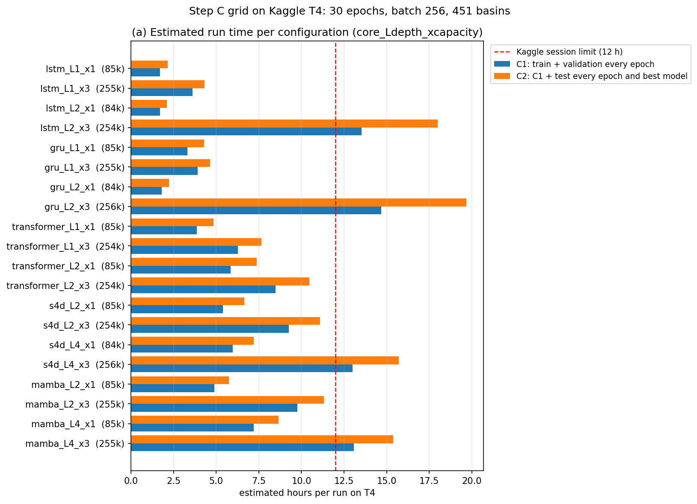

# Bước 0 — Kiểm 20 cấu hình tinh chỉnh C1 và thời gian chạy trên T4

Tài liệu đi cùng [mã Python](05_0_C_Configs_Check.py) của notebook Kaggle `05_0_C_Configs_Check`. Tinh chỉnh C1 của bước C thử cho mỗi lõi (LSTM, GRU, Transformer, S4D, Mamba) 8 cấu hình = 2 mức dung lượng × 2 độ sâu × 2 learning rate (`02_Pipeline.md` Mục 5.2). Notebook dựng đủ 20 cấu hình lõi × độ sâu × mức dung lượng trên dữ liệu thật, kiểm số tham số, đo thời gian một bước huấn luyện và một lượt validation trên T4, rồi ước tính giờ cho một lần chạy C1, C2 so với giới hạn một phiên Kaggle. Learning rate không đổi số tham số và thời gian nên không đo riêng. Không có lần chạy nào ở đây là kết quả của bước C.

## Mục lục

- [1. Câu hỏi cần trả lời](#1)
- [2. Cài đặt notebook](#2)
- [3. Các Phần và kết quả](#3)
- [4. Chạy một lần huấn luyện qua hai phiên Kaggle](#4)
- [5. Kết luận cho bước C](#5)
- [6. Nguồn](#6)

## 1. Câu hỏi cần trả lời

1. Mức "gấp khoảng 3 lần" tham số có khớp được trong 1% cho cả 10 cặp lõi–độ sâu không, và kích thước tính ở máy có trùng mô hình dựng thật trên GPU không?
2. Mỗi cấu hình tốn bao nhiêu phút một epoch huấn luyện, bao nhiêu phút một lượt validation 451 lưu vực, bao nhiêu bộ nhớ GPU?
3. Một lần chạy C1 (30 epoch, validation mỗi epoch) và một lần chạy C2 (thêm chấm test mỗi epoch) mất bao nhiêu giờ; cấu hình nào vượt giới hạn 12 giờ một phiên Kaggle?

## 2. Cài đặt notebook

| Mục | Giá trị | Lý do |
|---|---|---|
| Accelerator | GPU T4 x2 (dùng GPU 0) | Đúng GPU huấn luyện; `mamba_ssm` cần sm_75 trở lên |
| Internet | On | Cài fork từ GitHub |
| Input | Kaggle Dataset `hunhngcthng/lamah-ce-ext`; Output notebook `01_0_MambaSSM_Build` Version 1 | Dữ liệu, config tác giả; wheel `mamba-ssm`, `causal-conv1d` dựng cho T4 |
| Thư viện | Fork `Ticasslo/neuralhydrology` commit `fed53dc` (nhánh `research`) | Bản có mô hình chung 5 lõi |
| Cấu hình nền | B1b hạt giống 111 (`qmean_mmd`, `qmax_mmd` quá khứ; 84.801 tham số) | Đại diện cho B* (chọn trong B1b–B3, chưa có); khác biệt về lớp nhúng giữa các ứng viên B* ảnh hưởng ít tới thời gian, nên số giờ ở đây là ước tính |

## 3. Các Phần và kết quả

Kết quả lấy từ bản lưu chính thức **Version 1** (Save & Run All, phiên sạch, 31/10/2026), notebook kèm output ở [05_0_C_Configs_Check.ipynb](05_0_C_Configs_Check.ipynb); mọi bảng "Điều kiện" của 8 Phần đều đạt. Môi trường: Python 3.13.15, torch 2.11.0+cu128, cuDNN 9.19 (91900), pandas 2.3.3, ảnh Kaggle dựng ngày 22/10/2026, 2 GPU T4 14,6 GB, 4 CPU, RAM 31,3 GB. Phiên tương tác chạy trước đó cho cùng kết luận ở mọi Phần; số đo thời gian chênh nhau giữa hai lần (ví dụ `lstm_L1_x1` 2,88 ở phiên tương tác so với 2,48 phút/epoch huấn luyện ở Version 1).

### Phần 1. Cài thư viện

Cài đúng commit `fed53dc`, cài `mamba-ssm` 2.3.2.post1 + `causal-conv1d` 1.6.2.post1 từ wheel tự dựng (chạy thử xuôi + ngược đạt); pip không đổi thư viện có sẵn của ảnh Kaggle; `sf_cores` thấy `mamba_ssm`; Config có các khóa `sf_core`, `sf_dropout`, `sf_s4d_lr`, `data_on_gpu`.

### Phần 2. Dữ liệu và config tác giả

Tìm thấy dữ liệu Extended LamaH-CE, danh sách 451 lưu vực và run tác giả `Sequential_Forecast_LSTM_RA_with_q_Simple_Embedding` (config, `best_model.pt`, tệp chuẩn hóa, `test_metrics.csv`). Config tác giả khớp các khóa chính của bài (365 ngày quá khứ, lô 256, 30 epoch, learning rate 10⁻³, `output_dropout` 0,3, loss NSE*, 32 biến quá khứ, 5 biến ECMWF HRES ngày t, 33 thuộc tính tĩnh); NSE trung vị test của tác giả 0,7053 trên 450 lưu vực có NSE (lưu vực 55 không có `qmean`).

### Phần 3. Thư mục dữ liệu có Q theo mm/ngày

Dựng `LamaH_q_mmd_input` như B1b: thêm `qmean_mmd`, `qmax_mmd` vào tệp khí tượng của 451 lưu vực, đổi đơn vị theo `area_gov` bằng hàm của thư viện (313 giây, 1,53 GB). Trên 2.635.193 ngày–lưu vực: `qmax_mmd` trùng nhãn `qmax` (lệch tương đối 7,8e-14, ô trống trùng), ô trống của `qmean_mmd` trùng `qmean` m³/s của B0, không có giá trị âm; trung bình / độ lệch chuẩn `qmean_mmd` 2,0872 / 3,5224 mm/ngày, như B1b (`Workspace/05_Training/04_B1b_LamaHCEExt_Train/04_B1b_LamaHCEExt_Train.md`).

### Phần 4. Config B1b và 20 cấu hình

Config B1b khác config tác giả ở 12 khóa đổi (đường dẫn, `data_on_gpu`, `early_stopping_patience` 30, danh sách biến có `qmean_mmd`, `qmax_mmd`, `num_workers`, `verbose`, tên run) và 5 khóa bỏ (thư viện tự ghi); `seed`, `device` đặt lại nhưng trùng giá trị tác giả (111, `cuda:0`); mô hình `SequentialForecastLSTM` của B1b và lõi LSTM 1 lớp của mô hình chung cùng 84.801 tham số (mốc). `match_parameters` của fork dò kích thước cho mức cùng tham số (mốc 84.801) và mức gấp 3 (254.403); kích thước ra trùng từng số với bảng tính ở máy trước khi chạy (Mamba đếm bằng công thức), nay đếm bằng mô hình dựng thật. Siêu tham số ngoài lưới theo `02_Pipeline.md` Mục 5.2: dropout trong khối Transformer 0,1, S4D 0,1, Mamba 0; các khóa khác giữ mặc định (4 đầu chú ý, S4D N = 64, Mamba `d_state` 16, `d_conv` 4). Bảng: [Tables/c1_configs.csv](Tables/c1_configs.csv).

| Lõi | Độ sâu | Cùng tham số: `hidden_size` / trong / tham số / lệch | Gấp 3: `hidden_size` / trong / tham số / lệch |
|---|---|---|---|
| LSTM | 1 | 128 / – / 84.801 / 0 | 235 / – / 254.824 / +0,165% |
| LSTM | 2 | 77 / – / 84.042 / −0,895% | 139 / – / 253.736 / −0,262% |
| GRU | 1 | 150 / – / 84.679 / −0,144% | 274 / – / 255.179 / +0,305% |
| GRU | 2 | 90 / – / 84.439 / −0,427% | 162 / – / 255.583 / +0,464% |
| Transformer | 1 | 80 / 335 / 84.864 / +0,074% | 144 / 565 / 254.438 / +0,014% |
| Transformer | 2 | 56 / 243 / 84.759 / −0,050% | 100 / 416 / 254.361 / −0,017% |
| S4D | 2 | 111 / – / 84.757 / −0,052% | 216 / – / 254.017 / −0,152% |
| S4D | 4 | 72 / – / 84.385 / −0,491% | 146 / – / 255.769 / +0,537% |
| Mamba | 2 | 72 / 143 / 84.975 / +0,205% | 132 / 264 / 254.641 / +0,094% |
| Mamba | 4 | 49 / 96 / 84.525 / −0,325% | 91 / 183 / 254.613 / +0,083% |

"Trong" là kích thước trong: tầng truyền thẳng của Transformer (`sf_transformer_dim_feedforward`), `d_inner` của Mamba. Cả 20 cấu hình lệch mốc dưới 1% (lớn nhất 0,895%). Mốc chính thức của bước C là LSTM của B*, nên notebook C1 gọi lại `match_parameters` với mốc đó.

### Phần 5. Dataset dùng chung

Dataset train dựng một lần với `data_on_gpu` (1,7 phút): 1.094.272 mẫu, 4.275 bước mỗi epoch với lô 256, bằng B0. Dataset validation 451 lưu vực kỳ 2010–2013 dựng một lần vào bộ đệm của Tester (1,5 phút). Bộ nhớ GPU đã cấp sau hai lần dựng 0,35 GB. Thư viện cảnh báo lưu vực 324, 600, 623 không đủ giá trị nhãn kỳ train để tính độ lệch chuẩn cho loss NSE*, như mọi run có cấu hình này.

### Phần 6. Đo thời gian 20 cấu hình

Mỗi cấu hình (hạt giống 111) chạy 200 bước huấn luyện đúng như vòng `_train_epoch` của thư viện (loss NSE*, Adam, cắt gradient), đo thời gian từ bước 20; quy ra phút/epoch bằng 4.275 bước. Sau đó chạy một lượt validation đủ 451 lưu vực bằng Tester của thư viện. Tổng Phần 6 khoảng 72 phút. Bảng: [Tables/c1_timing.csv](Tables/c1_timing.csv).

| Cấu hình | ms/bước | Phút/epoch huấn luyện | Phút/lượt validation | GPU đỉnh huấn luyện / validation (GB) |
|---|---|---|---|---|
| `lstm_L1_x1` | 34,8 | 2,48 | 0,82 | 1,73 / 1,45 |
| `lstm_L1_x3` | 81,2 | 5,78 | 1,32 | 1,44 / 0,91 |
| `lstm_L2_x1` | 36,5 | 2,60 | 0,71 | 1,39 / 1,05 |
| `lstm_L2_x3` | **256,9** | **18,30** | **8,63** | 2,04 / 1,55 |
| `gru_L1_x1` | 66,0 | 4,71 | 1,82 | 1,75 / 1,36 |
| `gru_L1_x3` | 88,6 | 6,31 | 1,39 | 1,70 / 0,92 |
| `gru_L2_x1` | 38,2 | 2,72 | 0,78 | 1,56 / 1,00 |
| `gru_L2_x3` | **275,0** | **19,59** | **9,65** | 2,31 / 1,45 |
| `transformer_L1_x1` | 81,3 | 5,79 | 1,84 | 1,11 / 1,72 |
| `transformer_L1_x3` | 137,2 | 9,78 | 2,64 | 1,64 / 1,85 |
| `transformer_L2_x1` | 121,4 | 8,65 | 2,91 | 1,28 / 1,69 |
| `transformer_L2_x3` | 182,8 | 13,03 | 3,81 | 1,94 / 1,80 |
| `s4d_L2_x1` | 116,7 | 8,32 | 2,38 | 1,57 / 0,91 |
| `s4d_L2_x3` | 208,9 | 14,88 | 3,51 | 2,66 / 1,39 |
| `s4d_L4_x1` | 133,3 | 9,50 | 2,33 | 1,71 / 0,74 |
| `s4d_L4_x3` | 290,5 | 20,70 | 5,20 | 3,03 / 1,07 |
| `mamba_L2_x1` | 113,3 | 8,07 | 1,62 | 1,31 / 0,81 |
| `mamba_L2_x3` | 230,2 | 16,40 | 2,99 | 2,02 / 1,13 |
| `mamba_L4_x1` | 162,3 | 11,56 | 2,75 | 1,36 / 0,69 |
| `mamba_L4_x3` | 303,7 | 21,64 | 4,42 | 2,12 / 0,92 |

Tên cấu hình: `lõi_L<độ sâu>_x<mức dung lượng>` (x1 cùng tham số, x3 gấp 3).

- Số tham số mô hình dựng trên GPU trùng Phần 4; loss hữu hạn và giảm ở mọi cấu hình; validation cho NSE ở 450 lưu vực ở mọi cấu hình. 200 bước chưa đủ để so độ chính xác giữa các cấu hình.
- Bộ nhớ GPU đỉnh không quá 3,03 GB, xa giới hạn 14,6 GB của T4.
- **LSTM và GRU 2 lớp mức x3 chậm bất thường:** 256,9 và 275,0 ms/bước, gấp 3,2 và 3,1 lần bản 1 lớp cùng số tham số (81,2 và 88,6 ms); validation cũng chậm gấp 6,5 và 6,9 lần. Một cell thử tạm ở phiên tương tác (chỉ `nn.LSTM`, `nn.GRU` của PyTorch trên dữ liệu ngẫu nhiên [366, 256, 32], cuDNN 9.19; không lưu thành bản chính thức) cho thấy thời gian một bước của nhân cuDNN không tăng đều theo `hidden_size`: LSTM 1 lớp `hidden_size` 128 mất 27 ms, 139 mất 115 ms, 235 mất 68 ms; GRU 1 lớp 150 mất 55 ms, 162 mất 130 ms, 274 mất 79 ms; ở 2 lớp, mọi `hidden_size` quanh mức x3 (LSTM 136–160, GRU 162–176) đều mất 225–286 ms, nên không né được bằng đổi `hidden_size` trong khoảng lệch 1%. Hiện tượng cùng loại đã được ghi nhận với LSTM của PyTorch (Stack Overflow, câu hỏi 74306153: `hidden_size` 192 chậm 17 lần 193; cách né nêu ở đó là float16 và bội số của 8, đề tài không dùng vì đổi số học so với B*). Nguyên nhân bên trong cuDNN chưa xác nhận. Hiện tượng chỉ ảnh hưởng thời gian, không ảnh hưởng kết quả.

### Phần 7. Ước tính giờ một lần chạy C1, C2

Theo giao thức 30 epoch (`02_Pipeline.md` Mục 5.1): C1 = dựng train + dựng validation + 30 × (phút/epoch huấn luyện + phút/lượt validation); C2 = C1 + dựng test + 31 lượt test (30 epoch và `best_model.pt`, như B0). Kỳ validation và test cùng 1.461 ngày nên lượt test lấy bằng lượt validation. Chưa tính cài thư viện, dựng thư mục Q (khoảng 5 phút) và ghi trọng số mỗi epoch, nên ước tính thấp hơn thực tế vài phút. Kiểm cách đo: `lstm_L1_x1` (trùng B1b) cho 2,48 phút huấn luyện và 0,82 phút validation mỗi epoch, trong khoảng 20% quanh số đo B0 chạy thật (2,6–2,9 và 0,8 phút; `Workspace/05_Training/01_B0_LamaHCEExt_Train/01_B0_LamaHCEExt_Train.md`). Bảng: [Tables/c1_estimates.csv](Tables/c1_estimates.csv).

| Lõi | C1 (giờ): L thấp x1 / L thấp x3 / L cao x1 / L cao x3 | C2 (giờ): cùng thứ tự |
|---|---|---|
| LSTM (1, 2 lớp) | 1,71 / 3,60 / 1,71 / **13,52** | 2,15 / 4,31 / 2,10 / **18,01** |
| GRU (1, 2 lớp) | 3,32 / 3,91 / 1,80 / **14,67** | 4,28 / 4,65 / 2,23 / **19,69** |
| Transformer (1, 2 lớp) | 3,87 / 6,26 / 5,84 / 8,47 | 4,84 / 7,66 / 7,37 / 10,47 |
| S4D (2, 4 khối) | 5,40 / 9,25 / 5,97 / **13,00** | 6,66 / 11,09 / 7,20 / **15,72** |
| Mamba (2, 4 khối) | 4,90 / 9,75 / 7,21 / **13,08** | 5,76 / 11,32 / 8,66 / **15,39** |

*Hình C0. Số giờ ước tính cho một lần chạy của từng cấu hình (trong ngoặc là số tham số). Cột xanh là C1 (huấn luyện và validation mỗi epoch), cột cam là C2 (thêm chấm test mỗi epoch); vạch đỏ là giới hạn 12 giờ một phiên Kaggle.*

- **4 cấu hình vượt 12 giờ ở cả C1 và C2:** `lstm_L2_x3`, `gru_L2_x3`, `s4d_L4_x3`, `mamba_L4_x3`. Ở C2 còn 3 cấu hình sát giới hạn: `mamba_L2_x3` 11,32 giờ, `s4d_L2_x3` 11,09 giờ, `transformer_L2_x3` 10,47 giờ.
- Kaggle giới hạn mỗi phiên notebook GPU 12 giờ chạy (kaggle.com/docs/notebooks), nên các cấu hình này không chạy trọn trong một phiên; cách xử lý ở Mục 4.
- **Tổng C1:** 39 lần chạy (8 cấu hình × 5 lõi, trừ `lstm_L1_x1` learning rate 10⁻³ là B* hạt giống 111), khoảng **273 giờ GPU**: LSTM 39,4 giờ (7 lần), GRU 47,4, Transformer 48,9, S4D 67,2, Mamba 69,9 (8 lần mỗi lõi).
- C2 chạy 3 hạt giống cho tối đa 2 cấu hình mỗi lõi, chọn theo kết quả C1 (`02_Pipeline.md` Mục 5.2), nên giờ C2 chưa tính được chính xác: từ khoảng 65 giờ (mỗi lõi chỉ một cấu hình, cấu hình cùng tham số nhanh nhất) tới khoảng 327 giờ (mỗi lõi hai cấu hình chậm nhất có thể).

### Phần 8. Tóm tắt và dọn

Lưu `c_summary.json` (số liệu chính của mọi Phần, [Tables/c_summary.json](Tables/c_summary.json)), `environment.json`, `manifest.csv` (sha256 7 tệp Output) và config B1b dùng để đo; xóa thư mục Q, dataset tạm và thư mục config. Commit thư viện đúng `fed53dc`.

## 4. Chạy một lần huấn luyện qua hai phiên Kaggle

Thư viện có sẵn chế độ chạy tiếp (`nh_run continue_training`) nhưng chỉ nạp trọng số và trạng thái optimizer (`basetrainer.py` dòng 309–340, `nh_run.py` dòng 80–109 ở `fed53dc`): lịch learning rate cosine tạo lại từ đầu, giá trị NSE tốt nhất và trạng thái dừng sớm đặt lại, bộ sinh số ngẫu nhiên đặt lại theo hạt giống, và vòng lặp chạy thêm đủ `epochs` epoch. Một lần chạy nối như vậy không còn là cùng một lần huấn luyện. Thư viện gốc (`neuralhydrology/neuralhydrology`, nhánh `master` tới 10/10/2026) cũng chưa có tính năng này.

Nhánh fork `resume-state` (tách từ `fed53dc`, đầu nhánh `5844037`) thêm hai khóa config, không bật thì thư viện chạy như cũ:

- Mỗi epoch, sau validation, lưu `best_model.pt` và kiểm dừng sớm, thư viện ghi thêm `training_state_epochNNN.pt`: epoch, trạng thái lịch learning rate, trạng thái dừng sớm, NSE tốt nhất và epoch của `best_model.pt`, bộ đếm của logger, trạng thái bộ sinh số ngẫu nhiên của Python, NumPy, PyTorch CPU và CUDA (`basetrainer.py` dòng 398–420 ở `5844037`).
- `resume_training_state: true` dùng với `continue_training`: chạy tiếp ngay trong thư mục run từ epoch lớn nhất có đủ trọng số, optimizer và trạng thái, tới epoch `epochs` (không chạy thêm `epochs` epoch); khôi phục mọi trạng thái trên ở cuối bước khởi tạo, sau khi đã dựng mô hình và dữ liệu, để phần dựng không tiêu số ngẫu nhiên đã khôi phục (dòng 233–240, 422–451), theo cách PyTorch và Hugging Face Transformers khuyến nghị (issue 201119, 39215). Config của lần chạy tiếp ghi ra `config_continue_from_epochNNN.yml`, giữ nguyên `config.yml` gốc.
- `max_training_hours`: sau mỗi epoch, nếu thời gian đã chạy cộng epoch dài nhất vượt mức thì ghi log "Training paused at epoch N" rồi dừng gọn (dòng 329–335), để còn thời gian lưu Output trước mốc 12 giờ.

Kiểm:

- Kiểm thử `test/test_resume.py` (5 kiểm thử, CPU, dữ liệu kiểm thử CAMELS-US của thư viện, mô hình chung lõi LSTM và Transformer có dropout, lịch cosine, dừng sớm): chạy liền 4 epoch so với 2 epoch rồi chạy tiếp 2 epoch trùng từng bit ở trọng số mọi epoch, optimizer, `best_model.pt`, NSE validation và trạng thái epoch 4. Chạy trên Kaggle cùng bộ kiểm thử liên quan: 75 đạt, 24 bỏ qua, 0 hỏng.
- Phép thử tạm trên Kaggle T4 (31/10/2026, không lưu thành notebook chính thức): config B1b, `data_on_gpu`, 451 lưu vực, 300 bước mỗi epoch, mỗi lần chạy một tiến trình `nh_run` riêng như hai phiên. Lõi LSTM (`lstm_L1_x1`) chạy liền 2 epoch và chạy 1 epoch rồi chạy tiếp 1 epoch trùng từng bit (trọng số, optimizer, `best_model.pt`, NSE từng lưu vực; NSE trung vị 0,479982 cả hai). Lõi Mamba (`mamba_L2_x1`) lệch trọng số 9,5e-07, NSE từng lưu vực 1,4e-06, NSE trung vị trùng tới 6 chữ số (0,519638); cùng cỡ phần không tất định của Mamba trên GPU khi chạy hai lần liền cùng hạt giống (1,7e-06, `Workspace/04_Setup/04_0_Cores_Check/04_0_Cores_Check.md` Phần 6). Cả hai chạy tiếp trong cùng thư mục và dừng đúng ở epoch 2.

Kết quả: một lần huấn luyện chia làm hai phiên cho cùng kết quả với chạy liền một phiên (LSTM trùng từng bit; Mamba trong mức không tất định vốn có). Nhánh gộp vào `research` trước mốc `freeze-C` (`02_Pipeline.md` Mục 9.1).

## 5. Kết luận cho bước C

- Cả 20 cấu hình khớp số tham số trong 1% trên mô hình dựng thật; lưới C1 dùng được như đã định.
- Một lần C1 mất từ 1,7 giờ (LSTM 1 lớp cùng tham số) tới 14,7 giờ (GRU 2 lớp gấp 3); tổng C1 khoảng 273 giờ GPU cho 39 lần chạy, trung bình 7,0 giờ mỗi lần, gấp khoảng 4 lần cấu hình LSTM nền (`02_Pipeline.md` Mục 8.1 dùng số này cho ngân sách).
- 4 cấu hình vượt 12 giờ một phiên Kaggle; chúng chạy qua hai phiên bằng nhánh `resume-state` (Mục 4), các cấu hình còn lại chạy trọn một phiên.
- LSTM, GRU 2 lớp mức gấp 3 chậm do nhân cuDNN ở các kích thước này, không phải do mô hình; chỉ ảnh hưởng thời gian.
- Bộ nhớ GPU không phải giới hạn (đỉnh 3,03 GB).

## 6. Nguồn

- Konold và cs. (2026), BiasCast, HESS 30:5067–5096; config tác giả Zenodo 17292895; dữ liệu Zenodo 17119635.
- Fork `Ticasslo/neuralhydrology`: commit `fed53dc` (`modelzoo/sf_cores.py` dòng 338– `match_parameters`; `training/basetrainer.py` dòng 309–340; `nh_run.py` dòng 80–109); nhánh `resume-state` commit `e59205e`, `347427e`, `5844037` (`training/basetrainer.py` dòng 233–240, 249, 329–335, 341–451; `utils/config.py` khóa `max_training_hours`, `resume_training_state`; `training/logger.py`; `test/test_resume.py`).
- Kaggle, tài liệu Notebooks (kaggle.com/docs/notebooks): giới hạn 12 giờ chạy cho phiên notebook CPU và GPU.
- PyTorch, issue 201119; Hugging Face Transformers, issue 39215 (khôi phục trạng thái bộ sinh số ngẫu nhiên khi chạy tiếp).
- Stack Overflow, câu hỏi 74306153 (LSTM của PyTorch chậm bất thường ở một số `hidden_size`).
- `Workspace/04_Setup/04_0_Cores_Check/04_0_Cores_Check.md` (mô hình chung, lõi không tất định); `Workspace/05_Training/01_B0_LamaHCEExt_Train/01_B0_LamaHCEExt_Train.md`, `Workspace/05_Training/04_B1b_LamaHCEExt_Train/04_B1b_LamaHCEExt_Train.md` (số đo B0, B1b).
- Output notebook Version 1: `c1_configs.csv`, `c1_timing.csv`, `c1_estimates.csv`, `c_summary.json`, `environment.json`, `manifest.csv`.
