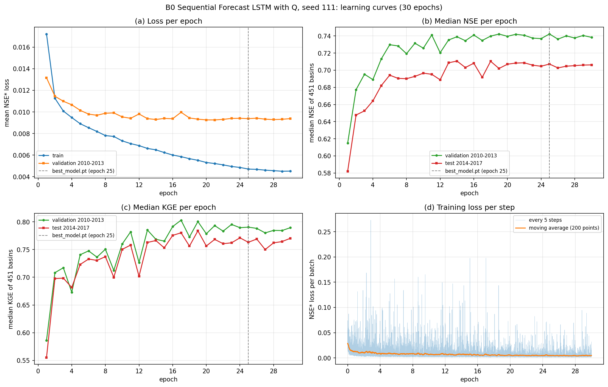
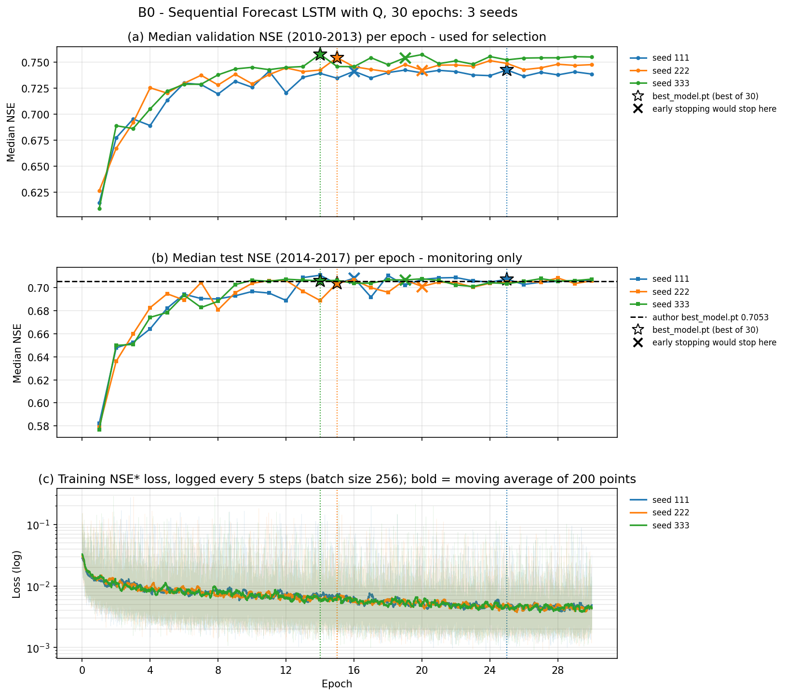
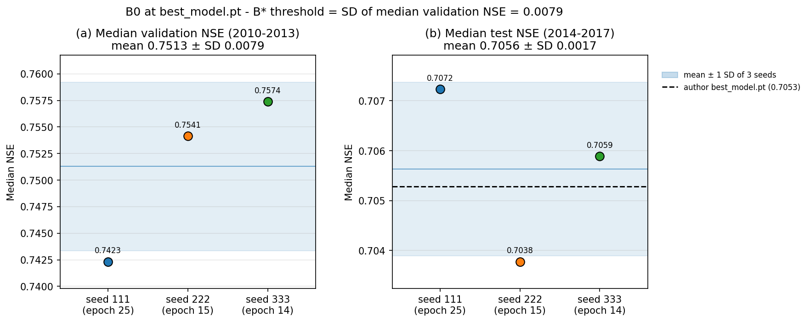
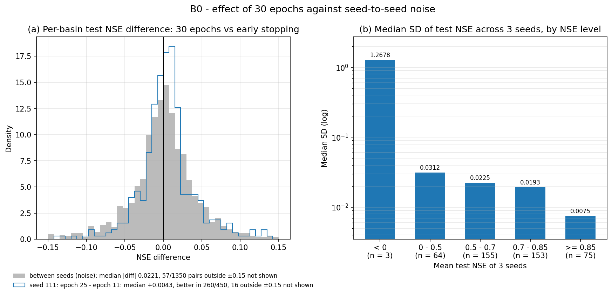

# B0 — Sequential Forecast LSTM có Q, 30 epoch, ba hạt giống

Tài liệu đi cùng mã của bốn notebook Kaggle: [01_B0_LamaHCEExt_Train_Seed111.py](01_B0_LamaHCEExt_Train_Seed111.py), [_Seed222](01_B0_LamaHCEExt_Train_Seed222.py), [_Seed333](01_B0_LamaHCEExt_Train_Seed333.py) (huấn luyện, mỗi hạt giống một notebook) và [02_B0_LamaHCEExt_Compare.py](../02_B0_LamaHCEExt_Compare/02_B0_LamaHCEExt_Compare.py) (so sánh, xuất dự báo cho bộ đánh giá).

B0 là mốc của cả bước B (`Document/01_Plan/02_Pipeline.md` Mục 5.1, Mục 7 dòng B0): cùng mô hình, dữ liệu và cấu hình như A4 — Sequential Forecast LSTM có lưu lượng quá khứ (`qmean`, m³/s) của BiasCast — chỉ đổi giao thức huấn luyện của đề tài: chạy đủ 30 epoch, không dừng sớm, `best_model.pt` là epoch có NSE trung vị validation cao nhất, chấm test sau mọi epoch để theo dõi. Mọi bước B1a, B1b, B2, B3 chạy cùng giao thức nên so với B0, không so với A4. B0 trả lời bốn câu hỏi:

1. Khi chạy đủ 30 epoch, đổi hạt giống làm NSE trung vị validation dao động bao nhiêu? Độ lệch chuẩn này là ngưỡng của luật chọn B* (`02_Pipeline.md` Mục 7, dòng B*).
2. Mốc NSE validation và test của bước B là bao nhiêu?
3. Chạy đủ 30 epoch thay vì dừng sớm đổi kết quả bao nhiêu?
4. Một lần huấn luyện 30 epoch với dữ liệu đặt sẵn trên GPU (`data_on_gpu`) mất bao lâu trên Kaggle T4?

**Kết luận.**

- **Ngưỡng luật B\* = 0,0079**: độ lệch chuẩn NSE trung vị validation giữa ba hạt giống tại `best_model.pt` (0,7423; 0,7541; 0,7574).
- **Mốc bước B**: NSE trung vị test 0,7072; 0,7038; 0,7059 (trung bình 0,7056, độ lệch chuẩn 0,0017); của tác giả là 0,7053.
- **Huấn luyện lặp lại được từng bit**: ở mọi epoch chung, trọng số B0 trùng từng bit trọng số A4 cùng hạt giống, dù không bật chế độ tất định và đã đổi bộ nạp dữ liệu. Vì vậy chạy đủ 30 epoch chỉ đổi kết quả ở hạt giống 111, nơi epoch tốt nhất (25) nằm sau điểm dừng sớm (16): NSE test tăng 0,0043 theo trung vị lưu vực, nhỏ hơn mức chênh thường gặp giữa hai hạt giống (0,0221).
- **Thời gian**: một notebook chạy 2,36–2,58 giờ, trong đó huấn luyện 30 epoch 1,76–1,93 giờ (2,6–2,9 phút/epoch huấn luyện, 0,8 phút/lượt validation), chấm test 30 epoch 26,5–27,9 phút.

## Mục lục

- [Cài đặt notebook và bản lưu chính thức](#setup)
- [Cấu hình huấn luyện](#config)
- [Notebook huấn luyện (Phần 1–8)](#train)
- [Thời gian](#time)
- [Notebook so sánh, Phần 1–2. Kết quả ba hạt giống, ngưỡng B*](#p2)
- [Phần 3. B0 lặp lại A4 ở các epoch chung](#p3)
- [Phần 4. Nhiễu hạt giống theo lưu vực, kiểm định ghép cặp](#p4)
- [Phần 5. Hình](#p5)
- [Phần 6. Dự báo theo hợp đồng của bộ đánh giá](#p6)
- [Phần 7. Đầu ra](#p7)
- [Hệ quả cho các bước sau](#next)

## Cài đặt notebook và bản lưu chính thức

| Notebook Kaggle (tài khoản `hunhngcthng`) | Cài đặt | Input | Bản lưu chính thức |
|---|---|---|---|
| `01_B0_LamaHCEExt_Train_Seed111` | GPU T4 (dùng `cuda:0`), Internet On, Persistence Files only, Pin to original environment | Dataset `lamah-ce-ext` | Version 1 |
| `01_B0_LamaHCEExt_Train_Seed222` | như trên | như trên | Version 1 |
| `01_B0_LamaHCEExt_Train_Seed333` | như trên | như trên | Version 1 |
| `02_B0_LamaHCEExt_Compare` | CPU, Internet On, Persistence Files only, Pin to original environment | Output ba notebook trên (Version 1); Output `03_A4_LamaHCEExt_Retrain_Seed111` Version 1, `_Seed222` Version 2, `_Seed333` Version 2 (trọng số mọi epoch, validation từng epoch, dự báo test của A4); Output `02_A3_LamaHCEExt_Benchmarks` Version 1 (tài khoản `hunhthanhnhn`); Dataset `lamah-ce-ext` | Version 1 |

Ba tệp huấn luyện giống hệt nhau, chỉ khác dòng `RUN_SEED`, để mỗi notebook chạy Save & Run All mà không sửa dòng nào. Mỗi hạt giống một notebook, một GPU; một lần huấn luyện nằm trọn một phiên vì chức năng chạy tiếp của thư viện không khôi phục trạng thái dừng sớm và bộ lập lịch learning rate (`.claude/rules/library.md`).

Môi trường: ảnh Kaggle dựng ngày 22/10/2026, Python 3.13.15, torch 2.11.0+cu128 (notebook so sánh: 2.11.0+cpu), NumPy 2.1.3, pandas 2.3.3, xarray 2025.12.0, SciPy 1.16.3, tensorboard 2.20.0; NeuralHydrology cài từ fork `Ticasslo/neuralhydrology` commit `f229e02` (nhánh `research`: bản sửa lưu mô hình tốt nhất `e794d7c` và khóa `data_on_gpu`, `02_Pipeline.md` Mục 9.1).

## Cấu hình huấn luyện

Cấu hình dựng lại từ `config.yml` của tác giả (run `Sequential_Forecast_LSTM_RA_with_q_Simple_Embedding`, Zenodo 17292895) như A4 (bảng cấu hình ở [báo cáo A4](../../03_Baseline/03_A4_LamaHCEExt_Retrain/03_A4_LamaHCEExt_Retrain.md#config)): 53 khóa giữ nguyên, 12 khóa đổi, 5 khóa thư viện tự ghi sau khi chạy bị bỏ. Notebook so từng khóa với config tác giả và dừng nếu có khóa khác ngoài danh sách cho phép. So với A4, B0 chỉ khác hai khóa:

| Khóa | A4 | B0 | Tác dụng |
|---|---|---|---|
| `early_stopping_patience` | 5 (của tác giả) | 30 (bằng `epochs`) | Không bao giờ dừng sớm, vẫn lưu `best_model.pt` theo NSE trung vị validation. Bỏ khóa này thì thư viện không lưu `best_model.pt` (`training/basetrainer.py` dòng 214–227, 343–351 ở `f229e02`) |
| `data_on_gpu` | không có | true | Dữ liệu cả kỳ được xếp lên GPU một lần, lấy lô bằng chỉ số thay cho `DataLoader`; lô trùng từng giá trị bộ nạp cũ (`Workspace/04_Setup/02_0_DataLoader_Benchmark/02_0_DataLoader_Benchmark.md` Mục 5) |

Thư viện `f229e02` còn khác `dda45fc` của A4 ở cách lưu `best_model.pt`: mốc tốt nhất để lưu được tách khỏi mốc của bộ dừng sớm, nên `best_model.pt` luôn là epoch có NSE validation cao nhất (`01_BasePaper.md` Mục 11.5). Ở cả ba hạt giống B0, epoch ghi `best_model.pt` sau cùng trùng epoch có NSE validation cao nhất trong 30 epoch.

## Notebook huấn luyện (Phần 1–8)

| Phần | Việc | Kết quả ở bản lưu chính thức |
|---|---|---|
| 1 | Cài thư viện theo commit `f229e02`, kiểm commit đã cài, môi trường, GPU | Đạt ở cả ba |
| 2 | Tìm dữ liệu, `basins_filtered.txt` (451 lưu vực), config tác giả; đọc NSE test từng lưu vực của tác giả | Đạt; tác giả 0,7053 trên 450 lưu vực có NSE (lưu vực 55 không có `qmean`, NSE trống, như A2, A4) |
| 3 | Dựng thư mục `LamaH_expanded_q_input` (thêm `qmean` từ `D_gauges` vào tệp khí tượng, số âm => ô trống) như A4 Phần 3 | 451/451 tệp, 1,35 GB, 226 / 398 / 308 giây |
| 4 | Ghi config, nạp bằng `Config` của thư viện, so từng khóa với config tác giả | Đạt; khác tác giả 15 khóa (hạt giống 111 trùng `seed` của tác giả) hoặc 16 khóa, đều trong danh sách |
| 5 | Huấn luyện trong tiến trình con, in tiến độ và bộ nhớ GPU mỗi 5 phút, đọc `output.log` thành bảng theo epoch | Mã thoát 0; đủ 30 epoch, không có dòng dừng sớm; `best_model.pt` epoch 25 / 15 / 14, trùng epoch NSE validation cao nhất; bộ nhớ GPU cao nhất 2.805 MiB |
| 6 | Kiểm `best_model.pt` trùng tensor với đúng một `model_epochNNN.pt`; chấm test bằng một Tester kỳ test dựng dataset 451 lưu vực một lần rồi chấm `model_epoch001` … `030` và `best_model.pt`; chấm lại `best_model.pt` bằng Tester không đệm dữ liệu để chắc việc đệm không đổi kết quả | Đạt; 30 tệp `test/model_epochNNN/test_metrics.csv`; Tester không đệm mất 2,3–2,5 phút |
| 7 | Hình đường học theo epoch và loss theo bước (đọc tệp sự kiện tensorboard, mỗi 5 bước) | `B0_Curve_Seed<N>.png`, bảng theo epoch `B0_Curve_Seed<N>.csv` |
| 8 | Ghi `environment.json`, `manifest.csv` (sha256 bảy tệp chính của run), xóa thư mục Q tạm | Output 0,54 GB mỗi hạt giống |

Đường NSE trung vị validation và test theo epoch (bảng theo epoch của từng hạt giống, [Tables/](Tables/)):

| Epoch | 1 | 5 | 10 | 14 | 15 | 20 | 25 | 30 |
|---|---|---|---|---|---|---|---|---|
| Hạt giống 111, validation | 0,6148 | 0,7132 | 0,7257 | 0,7391 | 0,7345 | 0,7396 | **0,7423** | 0,7384 |
| Hạt giống 111, test | 0,5821 | 0,6821 | 0,6966 | 0,7107 | 0,7031 | 0,7070 | **0,7072** | 0,7062 |
| Hạt giống 222, validation | 0,6265 | 0,7201 | 0,7291 | 0,7423 | **0,7541** | 0,7422 | 0,7486 | 0,7474 |
| Hạt giống 222, test | 0,5790 | 0,6946 | 0,7037 | 0,6888 | **0,7038** | 0,7010 | 0,7045 | 0,7058 |
| Hạt giống 333, validation | 0,6093 | 0,7222 | 0,7449 | **0,7574** | 0,7456 | 0,7571 | 0,7521 | 0,7548 |
| Hạt giống 333, test | 0,5767 | 0,6784 | 0,7064 | **0,7059** | 0,7063 | 0,7076 | 0,7034 | 0,7073 |

Số đậm là epoch lưu thành `best_model.pt`. NSE validation tăng nhanh trong khoảng 5 epoch đầu, sau epoch 10 dao động trong khoảng 0,72–0,76 và không còn xu hướng tăng rõ; loss huấn luyện (trung bình mỗi epoch) giảm đều tới epoch 30, còn loss validation đạt thấp nhất ở epoch 20 / 19 / 27 rồi đi ngang. Không thấy NSE validation giảm rõ sau đỉnh trong 30 epoch.

Hình 1. Đường học của hạt giống 111 (hình của hai hạt giống còn lại: [222](Figures/B0_Curve_Seed222.png), [333](Figures/B0_Curve_Seed333.png)). (a) Loss NSE* trung bình mỗi epoch trên tập huấn luyện và validation; (b) NSE trung vị validation và test sau mỗi epoch; (c) KGE trung vị validation và test; (d) loss của từng lô 256 mẫu, ghi mỗi 5 bước, kèm trung bình trượt 200 điểm. Vạch đứt là epoch lưu thành `best_model.pt`.

## Thời gian

Đo từ mốc giờ trong `output.log` và trong notebook của bản lưu chính thức:

| Hạng mục | Hạt giống 111 | Hạt giống 222 | Hạt giống 333 |
|---|---|---|---|
| Dựng thư mục Q (Phần 3) | 226 giây | 398 giây | 308 giây |
| Một epoch huấn luyện (trung vị) | 2,70 phút | 2,89 phút | 2,60 phút |
| Một lượt validation 451 lưu vực (trung vị từ epoch 2) | 0,84 phút | 0,85 phút | 0,81 phút |
| Lượt validation đầu (kể cả dựng dataset validation) | 2,56 phút | 2,45 phút | 2,38 phút |
| Huấn luyện 30 epoch (Phần 5) | 1,83 giờ | 1,93 giờ | 1,76 giờ |
| Chấm test 30 epoch (Phần 6, kể cả dựng dataset test 1,5–1,7 phút) | 27,7 phút | 27,9 phút | 26,5 phút |
| Cả notebook (Save & Run All) | 2,43 giờ | 2,58 giờ | 2,36 giờ |

So với A4 (bộ nạp cũ: 5,7–5,8 phút/epoch huấn luyện, khoảng 3,4–3,6 phút/lượt validation), một epoch kể cả validation giảm từ 9,1–9,5 phút xuống khoảng 3,4–3,7 phút. Ước tính khoảng 3,3 giờ/notebook khi lập kế hoạch (`02_0_DataLoader_Benchmark` đo ở chế độ tất định) cao hơn số đo thật. Notebook so sánh chạy 2 phút 15 giây trên CPU.

## Notebook so sánh, Phần 1–2. Kết quả ba hạt giống, ngưỡng B*

Phần 1 nhận Output sáu notebook hạt giống (ba B0, ba A4) qua `environment.json`, tính lại sha256 các tệp chính và so với `manifest.csv` (B0: 7 tệp × 3, A4: 6 tệp × 3, khớp hết), kiểm B0 cùng commit `f229e02`, A4 cùng `dda45fc`, cùng torch. Phần 2 đọc lại NSE, KGE từng lưu vực của `best_model.pt` và đối chiếu bản tóm tắt notebook hạt giống đã ghi (khớp tuyệt đối).

| Mô hình | Epoch `best_model.pt` | Số epoch | NSE trung vị validation | NSE trung vị test | KGE trung vị test | NSE test cao nhất trong 30 epoch (epoch) | Chênh NSE test so với tác giả |
|---|---|---|---|---|---|---|---|
| B0 hạt giống 111 | 25 | 30 | 0,7423 | 0,7072 | 0,7631 | 0,7107 (14) | +0,0019 |
| B0 hạt giống 222 | 15 | 30 | 0,7541 | 0,7038 | 0,7910 | 0,7083 (28) | −0,0015 |
| B0 hạt giống 333 | 14 | 30 | 0,7574 | 0,7059 | 0,7860 | 0,7077 (27) | +0,0006 |
| A4 hạt giống 111 (dừng sớm) | 11 | 16 | 0,7411 | 0,6952 | 0,7581 | – | −0,0100 |
| A4 hạt giống 222 (dừng sớm) | 15 | 20 | 0,7541 | 0,7038 | 0,7910 | – | −0,0015 |
| A4 hạt giống 333 (dừng sớm) | 14 | 19 | 0,7574 | 0,7059 | 0,7860 | – | +0,0006 |
| Tác giả (`best_model.pt`, Zenodo) | – | – | – | 0,7053 | 0,7671 | – | 0 |

| Chỉ số qua 3 hạt giống | B0: trung bình ± độ lệch chuẩn (ddof = 1) | B0: lớn nhất − nhỏ nhất | A4: trung bình ± độ lệch chuẩn |
|---|---|---|---|
| NSE trung vị validation | 0,7513 ± **0,0079** | 0,0151 | 0,7509 ± 0,0086 |
| NSE trung vị test | 0,7056 ± 0,0017 | 0,0035 | 0,7016 ± 0,0056 |
| KGE trung vị test | 0,7800 ± 0,0148 | 0,0278 | 0,7783 ± 0,0177 |

**Ngưỡng luật B\*** là độ lệch chuẩn NSE trung vị validation giữa ba hạt giống B0, đo tại `best_model.pt` — cùng cách chọn checkpoint mà B1b–B3 sẽ dùng: **0,0079**. Với ba mẫu, độ lệch chuẩn ước lượng còn thô; khoảng lớn nhất − nhỏ nhất (0,0151) ghi kèm để thấy hai hạt giống có thể cách nhau gần gấp đôi ngưỡng.

Cột "NSE test cao nhất trong 30 epoch" chỉ để thấy chọn checkpoint bằng validation mất bao nhiêu so với nhìn test (0,0019–0,0045 NSE); không dùng để chọn (`02_Pipeline.md` Mục 6.1). Hạt giống 222 và 333 cho đúng cùng số với A4 vì chọn cùng epoch và trọng số trùng nhau (Phần 3).

## Phần 3. B0 lặp lại A4 ở các epoch chung

A4 (`dda45fc`, bộ nạp cũ, dừng sớm) và B0 (`f229e02`, `data_on_gpu`, 30 epoch) dùng cùng config tác giả, cùng hạt giống, đều không bật chế độ tất định. Bản sửa `e794d7c` chỉ đổi cách lưu `best_model.pt`, còn `data_on_gpu` cho lô trùng bộ nạp cũ, nên nếu phép tính trên GPU lặp lại được thì các epoch chung (từ 1 tới epoch A4 dừng) phải như nhau.

| Hạt giống | Epoch chung | Epoch trọng số trùng từng bit | Lệch NSE/KGE validation lớn nhất | Epoch `best_model.pt` A4 / B0 | Lệch NSE/KGE test cùng epoch | Dự báo test thô của `best_model.pt` |
|---|---|---|---|---|---|---|
| 111 | 1–16 | 16 / 16 | 0 | 11 / 25 | 0 | khác epoch, không so |
| 222 | 1–20 | 20 / 20 | 0 | 15 / 15 | 0 | 451/451 lưu vực trùng từng bit |
| 333 | 1–19 | 19 / 19 | 0 | 14 / 14 | 0 | 451/451 lưu vực trùng từng bit |

Trọng số mọi epoch chung trùng từng bit (`model_epochNNN.pt`, so từng tensor), NSE/KGE validation từng lưu vực trùng, test của cùng trọng số trùng, dự báo test thô từng ngày của hạt giống 222, 333 trùng từng bit dù chấm bằng hai bộ nạp khác nhau. Như vậy với LSTM này trên T4, cùng hạt giống cho cùng mô hình ở hai lần chạy cách nhau hai ngày, trên hai commit thư viện và hai bộ nạp khác nhau: phần không tất định của GPU không đóng góp vào nhiễu, nhiễu giữa các lần chạy B0 chỉ do hạt giống. Kết luận này chỉ cho LSTM trên cuDNN ở cấu hình này; lõi Mamba có đạo hàm không tất định từng bit (`gpuAtomicAdd`, `.claude/rules/library.md`) nên phải kiểm lại ở bước C.

Hệ quả: A4 hạt giống 222, 333 chính là B0 dừng ở epoch 20, 19; khác biệt duy nhất của giao thức 30 epoch so với dừng sớm nằm ở hạt giống 111.

## Phần 4. Nhiễu hạt giống theo lưu vực, kiểm định ghép cặp

So trên 450 lưu vực có NSE ở cả bảy mô hình (ba B0, ba A4, tác giả). Với mỗi lưu vực, tính độ lệch chuẩn và khoảng lớn nhất − nhỏ nhất của NSE test qua ba hạt giống B0:

| Đại lượng | Phân vị 50% | Phân vị 75% | Phân vị 90% | Lớn nhất |
|---|---|---|---|---|
| Độ lệch chuẩn NSE qua 3 hạt giống | 0,0197 | 0,0360 | 0,0636 | 3,0401 |
| Lớn nhất − nhỏ nhất qua 3 hạt giống | 0,0379 | 0,0686 | 0,1208 | 5,8568 |
| \|NSE tác giả − trung bình 3 hạt giống\| | 0,0182 | 0,0358 | 0,0726 | 69,8173 |

Giá trị lớn nhất đến từ hai lưu vực 758 và 742, nơi `qmax` kỳ test gần như hằng số (phương sai 0,0002–0,0003): mẫu số của NSE gần 0 nên sai số rất nhỏ cũng cho NSE âm sâu (B0 từ −11,9 tới −2,6, tác giả −78,3 và −43,9). Bỏ hai lưu vực này, các lưu vực dao động mạnh nhất giữa hạt giống là 411, 754, 119, 312 (khoảng 0,43–0,70 NSE). Tác giả nằm trong [nhỏ nhất, lớn nhất] của ba hạt giống ở 49,1% lưu vực; nếu mô hình tác giả chỉ là một lần chạy thứ tư cùng phân phối thì tỉ lệ kỳ vọng là 2/4 = 50%.

| Mức NSE (trung bình 3 hạt giống B0) | Số lưu vực | Trung vị độ lệch chuẩn B0 | Trung vị lớn nhất − nhỏ nhất B0 | Trung vị độ lệch chuẩn A4 |
|---|---|---|---|---|
| < 0 | 3 | 1,2678 | 2,2619 | 1,8179 |
| 0 – 0,5 | 64 | 0,0312 | 0,0579 | 0,0291 |
| 0,5 – 0,7 | 155 | 0,0225 | 0,0440 | 0,0267 |
| 0,7 – 0,85 | 153 | 0,0193 | 0,0363 | 0,0202 |
| ≥ 0,85 | 75 | 0,0075 | 0,0147 | 0,0100 |

Như ở A4, lưu vực mô hình dự báo càng tốt thì nhiễu hạt giống càng nhỏ: trung vị độ lệch chuẩn giảm từ 0,031 ở nhóm NSE 0–0,5 xuống 0,0075 ở nhóm ≥ 0,85.

**Kiểm định ghép cặp theo lưu vực** — cùng cách của bộ đánh giá (`Workspace/06_Evaluation/01_Evaluation_LamaHCEExt/01_Evaluation_LamaHCEExt.py` Phần 7.1): Wilcoxon hạng có dấu hai phía trên hiệu NSE từng lưu vực, Cohen's dz = trung bình hiệu / độ lệch chuẩn hiệu, hiệu chỉnh Holm trong từng họ. Hiệu dương nghĩa là mô hình bên trái tốt hơn.

| Họ | Trái | Phải | Trái tốt hơn | Trái kém hơn | Trung bình hiệu | Trung vị hiệu | Cohen's dz | p Wilcoxon | p Holm |
|---|---|---|---|---|---|---|---|---|---|
| B0 với tác giả | B0 111 | tác giả | 245 | 205 | 0,2380 | 0,0028 | 0,066 | 0,148 | 0,264 |
| B0 với tác giả | B0 222 | tác giả | 248 | 202 | 0,2540 | 0,0037 | 0,066 | 0,048 | 0,144 |
| B0 với tác giả | B0 333 | tác giả | 253 | 197 | 0,2563 | 0,0048 | 0,065 | 0,132 | 0,264 |
| Cặp hạt giống B0 | B0 111 | B0 222 | 227 | 223 | −0,0160 | 0,0003 | −0,066 | 0,714 | 1 |
| Cặp hạt giống B0 | B0 111 | B0 333 | 233 | 217 | −0,0183 | 0,0018 | −0,060 | 0,930 | 1 |
| Cặp hạt giống B0 | B0 222 | B0 333 | 234 | 216 | −0,0023 | 0,0013 | −0,023 | 0,189 | 0,566 |
| B0 với A4 cùng hạt giống | B0 111 | A4 111 | 260 | 190 | 0,0110 | 0,0043 | 0,106 | 0,0005 | 0,0014 |
| B0 với A4 cùng hạt giống | B0 222 | A4 222 | 0 | 0 | 0 | 0 | – | 1 | 1 |
| B0 với A4 cùng hạt giống | B0 333 | A4 333 | 0 | 0 | 0 | 0 | – | 1 | 1 |

Ba điều rút ra:

- **B0 không khác tác giả có ý nghĩa** (p Holm 0,14–0,26), trung vị hiệu +0,003 tới +0,005. Trung bình hiệu và Cohen's dz bị hai lưu vực 758, 742 kéo lên vì NSE của tác giả ở đó âm sâu hơn; trung vị hiệu và số lưu vực tốt hơn/kém hơn phản ánh đúng hơn.
- **Ba hạt giống B0 không khác nhau có ý nghĩa** (p Holm 0,57–1), trung vị hiệu lớn nhất 0,0018. Khác A4, nơi hạt giống 111 dừng sớm ở epoch 11 kém hai hạt giống còn lại với p Holm 0,008–0,013: chạy đủ 30 epoch làm ba hạt giống gần nhau hơn ở mức trung vị.
- **Chạy đủ 30 epoch so với dừng sớm (hạt giống 111, epoch 25 so với 11)**: trung vị hiệu +0,0043, tốt hơn ở 260/450 lưu vực, p Holm 0,0014, dz 0,11. Hiệu này có ý nghĩa thống kê nhưng nhỏ: nhỏ hơn trung vị \|chênh\| giữa hai hạt giống B0 ở cùng lưu vực (0,0221) và nhỏ hơn ngưỡng B* ở mức NSE trung vị. Vì vậy, như ở A4, p < 0,05 một mình không đủ để nói một mô hình tốt hơn.

## Phần 5. Hình

Hình chỉ vẽ B0: A4 trùng B0 ở mọi epoch chung (Phần 3), nên dừng sớm được vẽ thành mốc epoch trên đường của B0 thay vì một mô hình riêng.

Hình 2. Ba hạt giống (ba màu) trên chung trục epoch. Ngôi sao và đường chấm dọc là epoch lưu thành `best_model.pt` (25, 15, 14); chữ x là epoch mà quy tắc dừng sớm của tác giả sẽ dừng (16, 20, 19). Hạt giống 111 có ngôi sao nằm sau chữ x: dừng sớm bỏ lỡ epoch tốt nhất. (a) NSE trung vị validation, thước đo duy nhất để chọn epoch; (b) NSE trung vị test mỗi epoch, chỉ để theo dõi, nét đứt là tác giả; (c) loss NSE* từng lô (mờ) và trung bình trượt 200 điểm (đậm), trục log: loss huấn luyện còn giảm tới epoch 30 trong khi NSE validation đi ngang từ khoảng epoch 10.

Hình 3. Mỗi chấm là một hạt giống tại `best_model.pt` (epoch ghi dưới trục). (a) NSE trung vị validation; dải xanh là trung bình ± 1 độ lệch chuẩn (0,7513 ± 0,0079) — độ lệch chuẩn này là ngưỡng luật B*: cấu hình B1b–B3 kém cấu hình tốt nhất không quá 0,0079 được coi là ngang nhau. (b) NSE trung vị test (0,7056 ± 0,0017), nét đứt là tác giả 0,7053.

Hình 4. (a) Đường xanh: chênh NSE test từng lưu vực trong cùng run B0 hạt giống 111 giữa `best_model.pt` (epoch 25) và epoch tốt nhất nếu dừng sớm (epoch 11); nền xám: chênh giữa các cặp hạt giống B0 (mốc nhiễu). Hai phân phối chồng lên nhau gần hết: trung vị chênh do chạy đủ 30 epoch (+0,0043) nhỏ so với độ trải của nhiễu hạt giống (trung vị \|chênh\| 0,0221, khoảng tứ phân vị 0,0444; của đường xanh 0,0327). (b) Trung vị độ lệch chuẩn NSE test qua ba hạt giống theo mức NSE của lưu vực, thang log: 1,27 ở nhóm NSE âm (3 lưu vực), 0,031 → 0,0075 từ nhóm 0–0,5 tới ≥ 0,85.

## Phần 6. Dự báo theo hợp đồng của bộ đánh giá

Mỗi hạt giống được xuất thành `contracts/SeqLSTM_Q_B0_seed{111,222,333}_test_S0_lead1.npz` theo hợp đồng NPZ của bộ đánh giá (`Workspace/06_Evaluation/01_Evaluation_LamaHCEExt/01_Evaluation_LamaHCEExt.md` Mục 7), cùng cách dựng A4 (A4 báo cáo Phần 5):

- Dự báo thô lấy từ `test_results.p` của `best_model.pt`, chưa chặn âm; dự báo dùng để chấm = max(dự báo thô, 0) theo `clip_targets_to_zero: [qmax]`. Số ngày–lưu vực dự báo âm trước khi chặn: 1.584 / 2.261 / 1.978.
- Quan trắc, persistence, diện tích, thứ tự 451 lưu vực lấy nguyên từ ngữ cảnh A3 (`A3_persistence_predictions.npz`, `A3_Q_source_window.npz`), vì bộ đánh giá đòi các mô hình cùng nhóm có quan trắc và persistence bằng nhau từng bit. Lịch test 1.461 ngày lấy từ `config.yml` của B0 và khớp lịch A3.
- Kiểm lại mỗi tệp: đọc ngược theo đúng các điều kiện của `read_contract` và `check_same_context`; NSE từng lưu vực tính lại từ dự báo trong tệp khớp `test_metrics.csv` của thư viện (sai lệch lớn nhất 0; NSE trung vị 0,7072 / 0,7038 / 0,7059); quan trắc trong `test_results.p` trùng vị trí ô trống với quan trắc A3, lệch giá trị lớn nhất 1,1 × 10⁻⁵ mm/ngày như A4. Mỗi tệp có 652.644 ngày–lưu vực có dự báo, khoảng 10 MB.

Metadata: `run` = `SeqLSTM_Q_B0_seed{N}`, kỳ `test`, kịch bản `S0`, hạn 1, `forecast_horizon` 1, đơn vị `mm/day_area_gov`, sha256 của `config.yml`, commit thư viện `f229e02`, `clip_to_zero` true, `selected_epoch` (25 / 15 / 14), notebook nguồn kèm số Version.

## Phần 7. Đầu ra

Thư mục `b0_compare/` trong Output notebook `02_B0_LamaHCEExt_Compare` Version 1 (15 tệp, 30,7 MB; `manifest.csv` ghi sha256 từng tệp):

| Tệp | Nội dung |
|---|---|
| `B0_seed_table.csv`, `B0_seed_stats.csv`, `B0_timing.csv` | Bảng ba hạt giống B0, A4 và tác giả; thống kê qua ba hạt giống; thời gian (Phần 2) |
| `B0_A4_reproduction.csv`, `B0_A4_reproduction_by_epoch.csv` | So B0 với A4 ở các epoch chung (Phần 3) |
| `B0_seed_noise_by_basin.csv`, `B0_paired_tests.csv` | NSE từng lưu vực, nhiễu, mức NSE; kiểm định ghép cặp (Phần 4) |
| `B0_Seeds.png`, `B0_Summary.png`, `B0_Noise.png` | Ba hình (Phần 5), bản sao ở [Figures/](../02_B0_LamaHCEExt_Compare/Figures/) |
| `contracts/*.npz` | Ba tệp dự báo cho bộ đánh giá (Phần 6) |
| `b0_summary.json` | Số liệu chính: ngưỡng B*, NSE từng hạt giống, epoch `best_model.pt` và epoch dừng sớm, B0 lặp lại A4, thời gian, nhiễu theo lưu vực và theo mức, p Holm các cặp hạt giống, chênh do chạy đủ 30 epoch, đường dẫn NPZ |
| `environment.json` | Input đã gắn kèm số Version, sha256 tệp A3 và tệp chỉ số tác giả, thư viện, commit của B0 và A4 |

Trọng số mọi epoch, validation và test mỗi epoch, nhật ký, tệp sự kiện tensorboard của từng run nằm ở `b0_runs/` trong Output notebook hạt giống tương ứng.

## Hệ quả cho các bước sau

| Số đo ở B0 | Dùng ở |
|---|---|
| Độ lệch chuẩn NSE trung vị validation giữa hạt giống tại `best_model.pt`: 0,0079 | Ngưỡng luật chọn B* (`02_Pipeline.md` Mục 7, dòng B*) |
| NSE trung vị validation 0,7513 ± 0,0079, test 0,7056 ± 0,0017 | Mốc để B1a, B1b, B2, B3 so cùng giao thức 30 epoch |
| Trung vị độ lệch chuẩn NSE theo lưu vực 0,0197 (0,0075–0,031 tùy mức NSE) | Đọc chênh lệch từng lưu vực ở B, C |
| Với LSTM trên T4, cùng hạt giống cho trọng số trùng từng bit dù không bật chế độ tất định | Nhiễu giữa các lần chạy LSTM chỉ do hạt giống; lõi Mamba phải kiểm lại ở C |
| Chạy đủ 30 epoch so với dừng sớm: +0,0043 NSE trung vị lưu vực ở một hạt giống, nhỏ hơn nhiễu hạt giống | Giao thức 30 epoch không làm mốc tệ đi; khác biệt giữa B0 và A4 chủ yếu ở hạt giống 111 |
| Một notebook 2,36–2,58 giờ (huấn luyện 1,76–1,93 giờ, chấm test 30 epoch khoảng 27 phút) | Ngân sách và lịch (`02_Pipeline.md` Mục 8.1, 9.7) |
| Ba tệp NPZ `SeqLSTM_Q_B0_seed*` | Bộ đánh giá chấm B0 cùng các mốc A2, A3, A4 |
