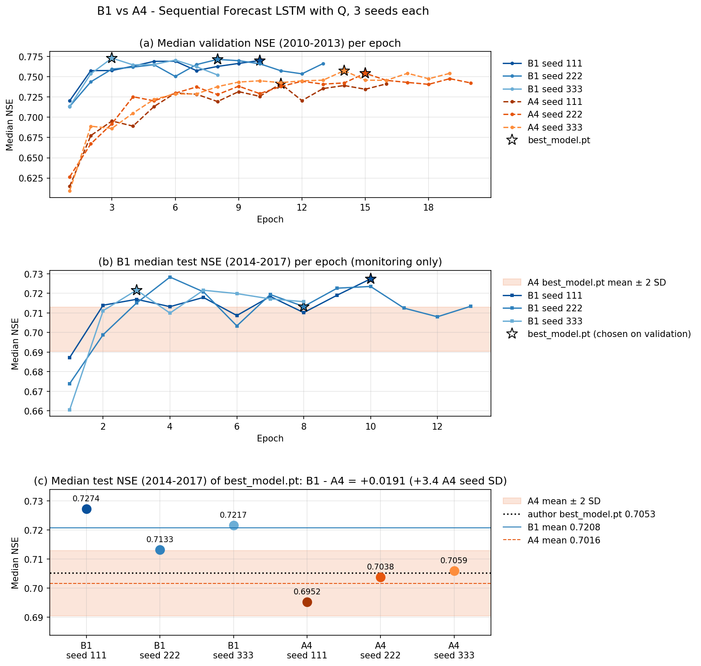
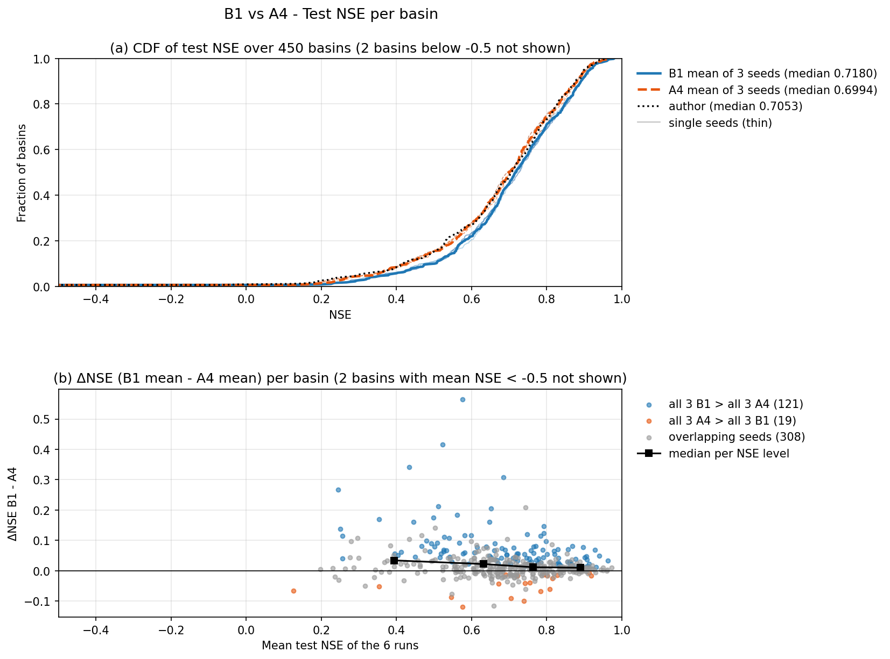

# B1 — Sequential Forecast LSTM có Q với ba thay đổi, ba hạt giống

Tài liệu đi cùng mã của bốn notebook Kaggle: [01_B1_LamaHCEExt_Train_Seed111.py](01_B1_LamaHCEExt_Train_Seed111.py), [_Seed222](01_B1_LamaHCEExt_Train_Seed222.py), [_Seed333](01_B1_LamaHCEExt_Train_Seed333.py) (huấn luyện, mỗi hạt giống một notebook) và [02_B1_LamaHCEExt_Compare.py](../02_B1_LamaHCEExt_Compare/02_B1_LamaHCEExt_Compare.py) (so với A4, xuất dự báo cho bộ đánh giá). B1 là bước cải tiến đầu tiên của LSTM (`03_Pipeline.md` Mục 7): giữ nguyên kiến trúc, siêu tham số và kỳ dữ liệu của mô hình A4 (Sequential Forecast LSTM có lưu lượng quá khứ, lớp nhúng đơn giản — mô hình tốt nhất của BiasCast), chỉ đổi ba điểm:

1. **Lưu mô hình tốt nhất đúng epoch có NSE validation cao nhất** (sửa thư viện, fork `Ticasslo/neuralhydrology` commit `e794d7c`).
2. **Lưu lượng trung bình ngày quá khứ theo mm/ngày** (chia theo diện tích lưu vực `area_gov`, cùng đơn vị với nhãn) thay vì m³/s như tác giả.
3. **Thêm lưu lượng cực đại ngày quá khứ** (`qmax`, mm/ngày) vào pha quá khứ.

Mỗi thay đổi có lý do riêng: (1) là lỗi của mã gốc có thể làm `best_model.pt` kém epoch tốt nhất tới 0,005 NSE; (2) lưu lượng theo m³/s tỉ lệ với diện tích lưu vực, nên khi chuẩn hóa chung cho 451 lưu vực, giá trị của các lưu vực nhỏ dồn sát nhau; chia theo diện tích (mm/ngày) đưa lưu lượng mọi lưu vực về cùng thang và cùng đơn vị với nhãn (A2 xác nhận tác giả đưa `qmean` theo m³/s, `Document/03_Data/01_LamaHCE.md` Mục 6.3); (3) mô hình dự báo `qmax` ngày t, nên `qmax` của những ngày trước là thông tin gần nhất với nhãn — persistence (lấy `qmax` hôm qua làm dự báo hôm nay) đã đạt NSE trung vị 0,350 (A3).

**Kết luận: B1 tốt hơn A4 rõ hơn mức nhiễu hạt giống.** NSE trung vị test của ba hạt giống B1 là 0,7274; 0,7133; 0,7217 (trung bình 0,7208), so với A4 0,6952; 0,7038; 0,7059 (trung bình 0,7016): chênh +0,0191, bằng 3,4 lần độ lệch chuẩn hạt giống A4, và hạt giống B1 kém nhất vẫn cao hơn hạt giống A4 tốt nhất. NSE trung vị validation chênh +0,0204 (2,4 lần độ lệch chuẩn), cũng không chồng khoảng. Theo từng lưu vực, B1 tốt hơn ở 326/450 lưu vực; ở 121 lưu vực cả ba hạt giống B1 cao hơn cả ba hạt giống A4 (nếu hai bước chỉ khác do hạt giống thì kỳ vọng khoảng 22). KGE trung vị gần như không đổi (+0,0014). Bản sửa lưu mô hình không đổi epoch được chọn ở hạt giống nào, nên phần cải thiện đến từ hai thay đổi đầu vào. Một lần huấn luyện mất 1,3–2,2 giờ trên T4 vì dừng sớm hơn A4, tốc độ mỗi epoch như A4.

## Mục lục

- [Cài đặt notebook và bản lưu chính thức](#setup)
- [Ba thay đổi so với A4](#changes)
- [Notebook huấn luyện (Phần 1–8)](#train)
- [Thời gian huấn luyện](#time)
- [Phần 1–2 notebook so sánh. Kết quả ba hạt giống và quy tắc lưu mô hình](#p2)
- [Phần 3. So từng lưu vực](#p3)
- [Phần 4. Hình](#p4)
- [Phần 5. Dự báo theo hợp đồng của bộ đánh giá](#p5)
- [Phần 6. Đầu ra](#p6)
- [Hạn chế](#limits)
- [Hệ quả cho các bước sau](#next)

## Cài đặt notebook và bản lưu chính thức

| Notebook Kaggle (tài khoản `hunhngcthng`) | Cài đặt | Input | Bản lưu chính thức |
|---|---|---|---|
| `01_B1_LamaHCEExt_Train_Seed111` | GPU T4 x2 (dùng 1), Internet On, Persistence Files only, Pin to original environment | Dataset `lamah-ce-ext` | Version 1 |
| `01_B1_LamaHCEExt_Train_Seed222` | như trên | như trên | Version 1 |
| `01_B1_LamaHCEExt_Train_Seed333` | như trên | như trên | Version 2 |
| `02_B1_LamaHCEExt_Compare` | CPU, Internet On, Persistence Files only, Pin to original environment | Output ba notebook trên và ba notebook `03_A4_LamaHCEExt_Retrain_Seed111/222/333` (Version 1, 2, 2), Output `02_A3_LamaHCEExt_Benchmarks` Version 1 (tài khoản `hunhthanhnhn`), Dataset `lamah-ce-ext` | Version 1 |

Ba tệp huấn luyện giống hệt nhau, chỉ khác dòng `RUN_SEED` ở Phần 1; mỗi hạt giống một notebook vì một lần huấn luyện phải nằm trọn trong một phiên Kaggle (`continue_training` không khôi phục trạng thái dừng sớm, như A4).

Môi trường cả bốn notebook: ảnh Kaggle dựng ngày 22/10/2026, Python 3.13.15, torch 2.11.0+cu128, NumPy 2.1.3, pandas 2.3.3, xarray 2025.12.0, SciPy 1.16.3, matplotlib 3.10.0. Thư viện NeuralHydrology 1.12.0 cài từ fork `Ticasslo/neuralhydrology` commit `e794d7c` (nhánh `research`, `dda45fc` của A2–A4 cộng bản sửa lưu mô hình); A4 dùng `dda45fc`.

## Ba thay đổi so với A4

Mọi khóa cấu hình khác giữ như A4 (bảng "Cấu hình huấn luyện" trong [báo cáo A4](../../03_Baseline/03_A4_LamaHCEExt_Retrain/03_A4_LamaHCEExt_Retrain.md#config)): `hidden_size` 128, `output_dropout` 0,3, loss NSE*, Adam lr 1e-3 với CosineAnnealingLR, batch 256, tối đa 30 epoch, dừng sớm theo NSE trung vị validation (patience 5, min_delta 0,005), kỳ train 2003–2009, validation 2010–2013, test 2014–2017.

| Thay đổi | A4 (như tác giả) | B1 | Kiểm ở notebook |
|---|---|---|---|
| Lưu `best_model.pt` | Ghi khi NSE validation vượt mốc của bộ dừng sớm; mốc chỉ nâng khi tăng quá 0,005 => có thể ghi đè bằng epoch kém hơn tối đa 0,005 | Ghi khi NSE validation vượt giá trị đã lưu gần nhất (`_best_metric_value` riêng, `training/basetrainer.py`); dừng sớm giữ nguyên | Phần 1: kiểm thử `test/test_best_model.py` của fork, 4/4 đạt; Phần 6: `best_model.pt` trùng tensor với đúng một epoch và là epoch NSE validation cao nhất |
| Lưu lượng trung bình quá khứ | `qmean` theo m³/s | `qmean_mmd` = `qmean` × 86,4 / `area_gov` (mm/ngày) | Phần 3: dựng 451/451 tệp; Phần 4: thống kê chuẩn hóa của thư viện khớp dữ liệu dựng |
| Lưu lượng cực đại quá khứ | không có | `qmax_mmd` (mm/ngày, cùng công thức) | Phần 3: `qmax_mmd` khớp nhãn `qmax` của bộ nạp, lệch tương đối lớn nhất 7,8 × 10⁻¹⁴; ô trống trùng nhãn |

Đầu vào pha quá khứ thành 33 biến (31 biến tái phân tích + `qmean_mmd` + `qmax_mmd`), pha ngày t vẫn 5 biến dự báo ECMWF HRES, 33 thuộc tính tĩnh; số tham số 84.801 (A4 84.785, thêm 16 trọng số của một đầu vào ở lớp nhúng 16 chiều). `qmax_mmd` chỉ vào pha quá khứ, kết thúc ở ngày t−1 (`datasetzoo/basedataset.py` dòng 158–164 với `forecast_seq_length` 1), nên không lộ nhãn ngày t. Số mẫu huấn luyện sau lọc 1.094.272, bằng đúng A4: cột thêm vào có ô trống trùng `qmean` (kiểm ở Phần 3), nên bộ lọc mẫu có NaN của thư viện bỏ cùng các mẫu.

Thống kê kỳ 2002–2009 trên 451 lưu vực (Phần 3): `qmean_mmd` trung bình 2,09 mm/ngày, độ lệch chuẩn 3,52; `qmax_mmd` 2,66 và 5,49; cả hai trống 3,89% ngày–lưu vực, trùng ô trống.

## Notebook huấn luyện (Phần 1–8)

| Phần | Việc | Kết quả ở bản lưu chính thức |
|---|---|---|
| 1 | Cài fork commit `e794d7c`, chạy kiểm thử lưu mô hình tốt nhất, kiểm môi trường và GPU | 4 kiểm thử đạt ở cả ba |
| 2 | Tìm dữ liệu, `basins_filtered.txt` (451 lưu vực), config tác giả; đọc NSE test từng lưu vực của tác giả | Đạt; tác giả 0,7053 trên 450 lưu vực có NSE |
| 3 | Dựng thư mục `LamaH_q_mmd_input` (thêm `qmean_mmd`, `qmax_mmd` vào tệp khí tượng; số âm => ô trống); kiểm cả 451 lưu vực | 451/451 tệp, 1,53 GB, 214–345 giây; 2.635.193 ngày–lưu vực kiểm, đạt |
| 4 | Ghi config, nạp dataset train của thư viện, so số mẫu, số bước mỗi epoch, số tham số với A4 | 1.094.272 mẫu, 4.275 bước/epoch như A4 |
| 5 | Huấn luyện trong tiến trình con, đọc `output.log` thành bảng theo epoch | Mã thoát 0, dừng sớm ở epoch 10 / 13 / 8 |
| 6 | Xác định epoch của `best_model.pt`, đường NSE validation theo epoch, đánh giá test `best_model.pt` | Epoch 10 / 8 / 3, trùng epoch NSE validation cao nhất; NSE trung vị test 0,7274 / 0,7133 / 0,7217 |
| 7 | Đánh giá test mọi epoch (chỉ theo dõi theo góp ý GVHD, không dùng để chọn) | Đủ mọi epoch; giá trị ở epoch `best_model.pt` khớp Phần 6 |
| 8 | Ghi `environment.json`, `manifest.csv` (sha256 tám tệp chính của run), xóa thư mục dữ liệu dựng | Output 0,28–0,45 GB mỗi hạt giống |

NSE trung vị validation (V) và test (T, chỉ theo dõi) theo epoch; số đậm là epoch lưu thành `best_model.pt`:

| Epoch | 1 | 2 | 3 | 4 | 5 | 6 | 7 | 8 | 9 | 10 | 11 | 12 | 13 |
|---|---|---|---|---|---|---|---|---|---|---|---|---|---|
| 111 V | 0,7203 | 0,7574 | 0,7576 | 0,7629 | 0,7689 | 0,7690 | 0,7575 | 0,7626 | 0,7663 | **0,7699** | – | – | – |
| 111 T | 0,6872 | 0,7139 | 0,7170 | 0,7132 | 0,7179 | 0,7087 | 0,7184 | 0,7102 | 0,7191 | **0,7274** | – | – | – |
| 222 V | 0,7132 | 0,7436 | 0,7593 | 0,7617 | 0,7647 | 0,7502 | 0,7648 | **0,7712** | 0,7697 | 0,7659 | 0,7572 | 0,7535 | 0,7661 |
| 222 T | 0,6739 | 0,6989 | 0,7151 | 0,7283 | 0,7208 | 0,7034 | 0,7194 | **0,7133** | 0,7226 | 0,7235 | 0,7125 | 0,7080 | 0,7134 |
| 333 V | 0,7134 | 0,7535 | **0,7728** | 0,7645 | 0,7651 | 0,7704 | 0,7622 | 0,7521 | – | – | – | – | – |
| 333 T | 0,6606 | 0,7111 | **0,7217** | 0,7099 | 0,7216 | 0,7199 | 0,7172 | 0,7158 | – | – | – | – | – |

So với A4 (NSE validation tăng dần tới khoảng epoch 11–15), B1 đạt NSE validation 0,74–0,76 ngay từ epoch 2 và đạt đỉnh sớm hơn, nên dừng sớm ở 8–13 epoch thay vì 16–20. Loss validation của cả ba hạt giống gần như không giảm thêm sau epoch 3–5 (0,0083–0,0087) trong khi loss huấn luyện tiếp tục giảm (hình `B1_EpochCurve_Seed{N}.png`), nên các epoch sau chủ yếu khớp thêm kỳ train. Chọn theo validation trùng epoch test cao nhất ở hạt giống 111 và 333; ở hạt giống 222, test cao nhất ở epoch 4 (0,7283), cao hơn epoch được chọn 0,015 — mức chênh này là cái giá của việc không nhìn test khi chọn và nằm trong dao động test giữa các epoch liền nhau (0,70–0,73).

## Thời gian huấn luyện

Đo từ mốc thời gian trong `output.log` và output của bản lưu chính thức:

| Hạng mục | Hạt giống 111 | Hạt giống 222 | Hạt giống 333 |
|---|---|---|---|
| Dựng thư mục Q (Phần 3) | 227 giây | 214 giây | 345 giây |
| Nạp dataset train (Phần 4) | 1,9 phút | 2,0 phút | 1,9 phút |
| Một epoch huấn luyện | 5,8–6,1 phút | 5,8–5,9 phút | 5,8–5,9 phút |
| Một lượt validation 451 lưu vực | 5,0 phút lần đầu, sau đó 3,4–3,9 phút | 5,3 phút lần đầu, sau đó 3,8–3,9 phút | 5,0 phút lần đầu, sau đó 3,5–3,7 phút |
| Huấn luyện tới khi dừng sớm (Phần 5) | khoảng 1,67 giờ (10 epoch) | khoảng 2,17 giờ (13 epoch) | khoảng 1,33 giờ (8 epoch) |
| Đánh giá test `best_model.pt` (Phần 6) | 5,1 phút | 5,5 phút | 5,4 phút |
| Đánh giá test mọi epoch (Phần 7) | 1,7 phút nạp + 3,4 phút/epoch | 1,7 phút nạp + 3,7 phút/epoch | 1,7 phút nạp + 3,5 phút/epoch |

Giờ huấn luyện đọc theo dòng tiến độ in mỗi 5 phút nên chính xác tới khoảng 5 phút. Một epoch kể cả validation khoảng 9,6 phút, gần như A4 (9,5 phút; một epoch huấn luyện 5,8–6,1 phút so với 5,6–5,9 phút): hai cột thêm vào gần như không làm chậm. Thời gian huấn luyện của B1 ngắn hơn A4 trung bình 1,2 giờ chỉ vì dừng sớm hơn; mỗi phiên B1 cộng thêm 0,5–0,8 giờ đánh giá test mọi epoch (Phần 7).

## Phần 1–2 notebook so sánh. Kết quả ba hạt giống và quy tắc lưu mô hình

Phần 1 tìm Output sáu notebook huấn luyện qua `b1_output/environment.json`, `a4_output/environment.json` (không dựa vào tên đường dẫn), tính lại sha256 các tệp chính của mỗi run so với `manifest.csv` (B1 tám tệp, A4 sáu tệp): khớp 42/42; ba run B1 cùng commit `e794d7c`, ba run A4 cùng `dda45fc`, cả sáu cùng torch 2.11.0+cu128. Phần 2 đọc NSE, KGE từng lưu vực từ `test_metrics.csv`, tính lại trung vị và đối chiếu bản tóm tắt của notebook huấn luyện (khớp tuyệt đối); cả sáu run cùng kỳ validation 01/01/2010–31/12/2013 và test 01/01/2014–31/12/2017 theo `config.yml`.

| Mô hình | Epoch `best_model.pt` | Số epoch | Giờ huấn luyện | NSE trung vị validation | NSE trung vị test | KGE trung vị test | Chênh NSE test so với tác giả |
|---|---|---|---|---|---|---|---|
| B1 hạt giống 111 | 10 | 10 | 1,67 | 0,7699 | 0,7274 | 0,7796 | +0,0221 |
| B1 hạt giống 222 | 8 | 13 | 2,17 | 0,7712 | 0,7133 | 0,7817 | +0,0080 |
| B1 hạt giống 333 | 3 | 8 | 1,33 | 0,7728 | 0,7217 | 0,7779 | +0,0164 |
| A4 hạt giống 111 | 11 | 16 | 2,50 | 0,7411 | 0,6952 | 0,7581 | −0,0100 |
| A4 hạt giống 222 | 15 | 20 | 3,17 | 0,7541 | 0,7038 | 0,7910 | −0,0015 |
| A4 hạt giống 333 | 14 | 19 | 3,08 | 0,7574 | 0,7059 | 0,7860 | +0,0006 |
| Tác giả (`best_model.pt`, Zenodo) | – | – | – | – | 0,7053 | 0,7671 | 0 |

| Chỉ số qua 3 hạt giống | B1 trung bình | A4 trung bình | B1 độ lệch chuẩn | A4 độ lệch chuẩn | B1 [nhỏ nhất; lớn nhất] | A4 [nhỏ nhất; lớn nhất] | B1 − A4 | (B1 − A4) / độ lệch chuẩn A4 |
|---|---|---|---|---|---|---|---|---|
| NSE trung vị validation | 0,7713 | 0,7509 | 0,0015 | 0,0086 | [0,7699; 0,7728] | [0,7411; 0,7574] | +0,0204 | +2,4 |
| NSE trung vị test | 0,7208 | 0,7016 | 0,0071 | 0,0056 | [0,7133; 0,7274] | [0,6952; 0,7059] | +0,0191 | +3,4 |
| KGE trung vị test | 0,7797 | 0,7783 | 0,0019 | 0,0177 | [0,7779; 0,7817] | [0,7581; 0,7910] | +0,0014 | +0,1 |

Độ lệch chuẩn tính trên ba hạt giống (ddof = 1). B1 không có ngưỡng đạt theo NSE test vì là bước cải tiến, không phải tái lập; chênh lệch được đọc theo đơn vị độ lệch chuẩn hạt giống A4 và theo việc khoảng [nhỏ nhất; lớn nhất] của hai bước có chồng nhau không. Với NSE, cả validation và test đều không chồng khoảng. Với KGE, chênh chỉ bằng 0,1 độ lệch chuẩn: B1 cải thiện sai số bình phương (NSE) nhưng không cải thiện tổng hợp tương quan – độ lệch trung bình – độ biến động (KGE). Ba hạt giống B1 có NSE validation sát nhau hơn A4 nhiều (độ lệch chuẩn 0,0015 so với 0,0086).

**Quy tắc lưu mô hình cũ và mới.** Phần 2 mô phỏng cả hai quy tắc trên đường NSE validation của từng run, với patience 5 và min_delta 0,005 đọc từ `config.yml`. Dừng sớm (như nhau ở hai commit): một epoch được tính là cải thiện khi NSE vượt mốc thêm hơn 0,005, khi đó mốc = NSE và bộ đếm về 0; không thì bộ đếm tăng 1, dừng khi bộ đếm đạt 5. Mã cũ `dda45fc` lưu `best_model.pt` khi NSE vượt mốc của bộ dừng sớm; mã mới `e794d7c` lưu khi NSE vượt giá trị đã lưu gần nhất. Phép mô phỏng được kiểm bằng chính các run: mã cũ trên A4 ra đúng epoch lưu 11 / 15 / 14 và epoch dừng 16 / 20 / 19, mã mới trên B1 ra đúng 10 / 8 / 3 và 10 / 13 / 8 (6/6 khớp). Áp mã cũ lên đường validation của B1 cũng chọn 10 / 8 / 3, nên **bản sửa không đổi epoch được chọn ở hạt giống B1 nào**; chênh B1 − A4 đến từ hai thay đổi đầu vào. Bản sửa vẫn giữ ở các bước sau vì nó loại bỏ khả năng `best_model.pt` không phải epoch tốt nhất, điều phụ thuộc vào hình dạng đường validation của từng run.

## Phần 3. So từng lưu vực

So trên 450 lưu vực có NSE ở cả bảy mô hình (lưu vực 55 không có `qmean`, không có dự báo, như A2, A4). NSE từng lưu vực là NSE của thư viện, mỗi run trên mặt nạ quan trắc riêng; chấm chính thức trên giao chung ngày–lưu vực ở bộ đánh giá. Với mỗi lưu vực, ΔNSE = trung bình ba hạt giống B1 − trung bình ba hạt giống A4.

| Đại lượng | Số lưu vực | Tỉ lệ |
|---|---|---|
| B1 tốt hơn (ΔNSE > 0) | 326 | 72,4% |
| B1 kém hơn (ΔNSE < 0) | 124 | 27,6% |
| \|ΔNSE\| lớn hơn độ lệch chuẩn hạt giống của chính lưu vực đó, B1 tốt hơn | 199 | 44,2% |
| \|ΔNSE\| lớn hơn độ lệch chuẩn hạt giống của chính lưu vực đó, B1 kém hơn | 41 | 9,1% |
| Cả ba hạt giống B1 cao hơn cả ba hạt giống A4 | 121 | 26,9% |
| Cả ba hạt giống A4 cao hơn cả ba hạt giống B1 | 19 | 4,2% |

Độ lệch chuẩn hạt giống của lưu vực gộp hai bước: √((sd²B1 + sd²A4) / 2). Dòng "cả ba hạt giống" có mốc so rõ ràng: nếu B1 và A4 chỉ là sáu lần chạy cùng phân phối (hoán đổi được), xác suất ba lần B1 cùng đứng trên ba lần A4 là 1 / C(6,3) = 1/20 = 5% mỗi phía, tức khoảng 22 lưu vực. Phía A4 ra 19 lưu vực (4,2%), đúng mức ngẫu nhiên; phía B1 ra 121 lưu vực (26,9%), gấp hơn năm lần.

| Đại lượng | Phân vị 10% | 25% | 50% | 75% | 90% |
|---|---|---|---|---|---|
| ΔNSE B1 − A4 | −0,0189 | −0,0021 | +0,0133 | +0,0396 | +0,0773 |
| Độ lệch chuẩn NSE qua 3 hạt giống B1 | 0,0048 | 0,0086 | 0,0148 | 0,0258 | 0,0434 |
| Độ lệch chuẩn NSE qua 3 hạt giống A4 | 0,0060 | 0,0108 | 0,0207 | 0,0353 | 0,0644 |

| Mức NSE (trung bình 6 run) | Số lưu vực | Trung vị ΔNSE | Tỉ lệ B1 tốt hơn | Tỉ lệ cả 3 B1 > cả 3 A4 | Tỉ lệ cả 3 A4 > cả 3 B1 | Trung vị độ lệch chuẩn B1 | Trung vị độ lệch chuẩn A4 |
|---|---|---|---|---|---|---|---|
| < 0 | 2 | −4,5511 | 0% | 0% | 0% | 6,6598 | 2,8648 |
| 0 – 0,5 | 53 | +0,0340 | 79,2% | 30,2% | 3,8% | 0,0231 | 0,0276 |
| 0,5 – 0,7 | 158 | +0,0220 | 71,5% | 26,0% | 2,5% | 0,0195 | 0,0273 |
| 0,7 – 0,85 | 156 | +0,0115 | 67,3% | 26,3% | 7,1% | 0,0136 | 0,0201 |
| ≥ 0,85 | 81 | +0,0099 | 81,5% | 28,4% | 2,5% | 0,0077 | 0,0114 |

Mức NSE xếp theo trung bình cả sáu run, không theo A4, để lưu vực A4 tình cờ thấp không bị đếm thành "B1 tốt lên" (hồi quy về trung bình). Ba điều rút ra:

- **Cải thiện có ở mọi mức NSE**, lớn nhất ở lưu vực khó (trung vị +0,034 ở mức 0–0,5) và nhỏ dần ở lưu vực đã dự báo tốt (+0,010 ở mức ≥ 0,85).
- **Nhiễu hạt giống của B1 nhỏ hơn A4** ở mọi mức: trung vị độ lệch chuẩn theo lưu vực 0,0148 so với 0,0207.
- **Hai lưu vực 742, 758 kém đi** (mức < 0): `qmax` kỳ test gần như hằng số (phương sai 0,0002–0,0003, A2 Phần 7), mẫu số NSE gần 0 nên sai số rất nhỏ cũng cho NSE âm sâu (B1 hạt giống 222: −24,7 và −11,9). Các lưu vực kém đi khác chỉ giảm tối đa khoảng 0,12 (167, 235, 98).

Lưu vực tốt lên nhiều nhất (ΔNSE +0,21 tới +0,56: 119, 754, 312, 595, 411, 337, 590, 568) trùng nhóm lưu vực mà A4 nhiễu hạt giống lớn (báo cáo A4 nêu 312, 119, 754): ở đó A4 dao động 0,1–0,5 NSE giữa hạt giống, còn ba hạt giống B1 sát nhau và cao hơn.

**Kiểm định ghép cặp theo lưu vực.** Cùng cách của bộ đánh giá (`Workspace/06_Evaluation/01_Evaluation_LamaHCEExt/01_Evaluation_LamaHCEExt.py` Phần 7.1): Wilcoxon hạng có dấu hai phía trên hiệu NSE từng lưu vực, Cohen's dz = trung bình hiệu / độ lệch chuẩn hiệu, hiệu chỉnh Holm trong từng họ. Hiệu dương nghĩa là mô hình bên trái tốt hơn.

| Họ | Trái | Phải | Trái tốt hơn | Trái kém hơn | Trung bình hiệu | Trung vị hiệu | Cohen's dz | p Holm |
|---|---|---|---|---|---|---|---|---|
| (a) chính | B1 trung bình | A4 trung bình | 326 | 124 | +0,0053 | +0,0133 | +0,016 | 2,5 × 10⁻²⁶ |
| (b) cùng hạt giống | B1 111 | A4 111 | 325 | 125 | +0,0352 | +0,0168 | +0,336 | 1,3 × 10⁻²⁵ |
| (b) cùng hạt giống | B1 222 | A4 222 | 294 | 156 | −0,0379 | +0,0127 | −0,041 | 8,9 × 10⁻¹³ |
| (b) cùng hạt giống | B1 333 | A4 333 | 303 | 147 | +0,0186 | +0,0150 | +0,148 | 3,0 × 10⁻¹⁶ |
| (c) với tác giả | B1 111 | tác giả | 316 | 134 | +0,2622 | +0,0154 | +0,073 | 4,3 × 10⁻²⁰ |
| (c) với tác giả | B1 222 | tác giả | 310 | 140 | +0,2161 | +0,0160 | +0,074 | 6,6 × 10⁻¹⁹ |
| (c) với tác giả | B1 333 | tác giả | 311 | 139 | +0,2749 | +0,0157 | +0,072 | 2,5 × 10⁻¹⁸ |
| (d) hạt giống B1 | 111 | 222 | 211 | 239 | +0,0460 | −0,0014 | +0,070 | 0,90 |
| (d) hạt giống B1 | 111 | 333 | 214 | 236 | −0,0127 | −0,0010 | −0,045 | 1,0 |
| (d) hạt giống B1 | 222 | 333 | 234 | 216 | −0,0588 | +0,0017 | −0,065 | 1,0 |

- **Trung bình hiệu và Cohen's dz ở đây không phản ánh độ lớn cải thiện**: hai lưu vực 742, 758 có hiệu hàng đơn vị (âm hoặc dương tùy cặp) làm độ lệch chuẩn của hiệu rất lớn, nên dz chỉ 0,016 ở họ chính và đổi dấu ở cặp 222 dù trung vị hiệu dương. Trung vị hiệu (+0,013 tới +0,017 ở mọi cặp B1 với A4 và với tác giả) và số lưu vực tốt hơn/kém hơn mới là số đọc.
- **Ba hạt giống B1 không khác nhau có ý nghĩa** (p Holm 0,90–1,0, trung vị hiệu ±0,002), trong khi ở A4 hai cặp hạt giống khác nhau với p Holm 0,008 và 0,013. Cùng với độ lệch chuẩn nhỏ hơn ở trên, B1 ổn định hơn A4 khi đổi hạt giống.

## Phần 4. Hình

Hình 1. (a) NSE trung vị validation sau mỗi epoch của sáu run (B1 nét liền xanh, A4 nét đứt cam); ngôi sao là epoch lưu thành `best_model.pt` (B1 10, 8, 3; A4 11, 15, 14). Ba đường B1 nằm trên ba đường A4 ở gần như mọi epoch và dừng sớm hơn. (b) NSE trung vị test theo epoch của ba hạt giống B1, chỉ để theo dõi; dải cam là trung bình ± 2 độ lệch chuẩn của ba hạt giống A4. Từ epoch 2, phần lớn các điểm của B1 nằm ở mép trên hoặc trên dải A4; epoch test cao nhất là 10 (hạt giống 111), 4 (222), 3 (333). (c) NSE trung vị test của `best_model.pt` sáu run: B1 trung bình 0,7208, A4 0,7016, tác giả 0,7053 (nét chấm); ba điểm B1 nằm trên dải A4.

Hình 2. (a) Hàm phân phối tích lũy NSE test theo lưu vực: mỗi điểm (x, y) cho biết tỉ lệ y lưu vực có NSE không quá x, đường càng lệch phải càng tốt. Đường đậm là trung bình ba hạt giống mỗi bước, đường mảnh là từng hạt giống, nét chấm là tác giả; đường B1 lệch phải ở khoảng NSE 0,4–0,85. Hai lưu vực 742, 758 có NSE dưới −0,5 nằm ngoài trục. (b) Mỗi chấm là một lưu vực: trục ngang NSE trung bình sáu run, trục dọc ΔNSE; xanh là 121 lưu vực cả ba hạt giống B1 cao hơn cả ba hạt giống A4, cam là 19 lưu vực ngược lại, xám là lưu vực hai bước chồng nhau; đường đen nối trung vị ΔNSE từng mức NSE (+0,034; +0,022; +0,011; +0,010), giảm dần khi lưu vực dự báo tốt hơn.

Hình từng hạt giống ở thư mục [Figures/](Figures/): `B1_EpochCurve_Seed{N}.png` (loss huấn luyện, loss validation, NSE validation và test theo epoch) và `B1_TestNSE_Seed{N}.png` (NSE test từng lưu vực của hạt giống đó so với tác giả).

## Phần 5. Dự báo theo hợp đồng của bộ đánh giá

Mỗi hạt giống B1 được xuất thành một tệp `contracts/SeqLSTM_Q_B1_seed{111,222,333}_test_S0_lead1.npz` theo hợp đồng NPZ của bộ đánh giá (`Workspace/06_Evaluation/01_Evaluation_LamaHCEExt/01_Evaluation_LamaHCEExt.md` Mục 7), để bộ đánh giá đọc bằng tham số `--extra-contract` và chấm cùng A2, A4, DLinear, persistence trên cùng tập ngày–lưu vực. Cách dựng giống A4 (`04_A4_LamaHCEExt_Compare` Phần 5); B1 vẫn dự báo `qmax` nên tên biến trong `test_results.p` như A4.

- Dự báo thô lấy từ `test_results.p` của `best_model.pt` (`qmax_sim`, bước thời gian 0); dự báo dùng để chấm = max(dự báo thô, 0) theo `clip_targets_to_zero: [qmax]` của config, như thư viện làm khi tính chỉ số (`evaluation/tester.py` dòng 319–322). Số ngày–lưu vực dự báo âm trước khi chặn: 348 / 1.765 / 4.454 (A4 1.660–2.261).
- Quan trắc, persistence, diện tích và thứ tự 451 lưu vực lấy nguyên từ ngữ cảnh A3, kiểm như hàm `read_context` của bộ đánh giá (lịch trùng kỳ test của `config.yml`, quan trắc và persistence khớp Q gốc chia diện tích).
- Kiểm lại mỗi tệp: (1) đọc ngược theo các điều kiện của `read_contract` và `check_same_context`, không lỗi; (2) NSE từng lưu vực tính lại từ tệp khớp `test_metrics.csv` của thư viện, sai lệch lớn nhất 1 × 10⁻⁶; (3) quan trắc trong `test_results.p` trùng vị trí ô trống với quan trắc A3, lệch giá trị lớn nhất 1,1 × 10⁻⁵ mm/ngày (thư viện lưu float32). Mỗi tệp có 652.644 ngày–lưu vực có dự báo trên 1.461 ngày × 451 lưu vực.

Metadata mỗi tệp: `run` = `SeqLSTM_Q_B1_seed{N}`, kỳ `test`, kịch bản `S0`, hạn 1, `forecast_horizon` 1, đơn vị `mm/day_area_gov`, sha256 của `config.yml`, commit thư viện `e794d7c`, `clip_to_zero` true, epoch đã chọn và notebook nguồn kèm số Version.

## Phần 6. Đầu ra

Thư mục `b1_compare/` trong Output notebook `02_B1_LamaHCEExt_Compare` Version 1 (12 tệp kèm `manifest.csv` ghi sha256 từng tệp):

| Tệp | Nội dung |
|---|---|
| `B1_seed_table.csv`, `B1_seed_stats.csv` | Bảng sáu run và tác giả; thống kê qua ba hạt giống và chênh B1 − A4 (Phần 2) |
| `B1_selection_rule.csv` | Mô phỏng quy tắc lưu mô hình cũ và mới trên từng run (Phần 2) |
| `B1_basin_delta.csv` | NSE từng lưu vực của bảy mô hình, trung bình, độ lệch chuẩn, ΔNSE, mức NSE (Phần 3) |
| `B1_paired_tests.csv` | Kiểm định ghép cặp bốn họ (Phần 3) |
| `B1_Compare.png`, `B1_BasinDelta.png` | Hai hình (Phần 4), bản sao ở [Figures/](../02_B1_LamaHCEExt_Compare/Figures/) |
| `contracts/*.npz` | Ba tệp dự báo cho bộ đánh giá (Phần 5) |
| `b1_summary.json` | Số liệu chính của báo cáo này |
| `environment.json` | Input đã gắn kèm số Version, commit thư viện từng run, sha256 tệp A3 và tệp chỉ số tác giả, thư viện |

Trọng số mọi epoch, kết quả validation mỗi epoch, kết quả test `best_model.pt` và nhật ký của từng run nằm ở `b1_runs/` trong Output notebook huấn luyện tương ứng; `b1_output/` chứa bảng theo epoch, đường validation, tóm tắt, hình. Dự báo validation của epoch `best_model.pt` (`validation/model_epochXXX/validation_results.p`) có trong `manifest.csv` để dựng NPZ kỳ validation khi chọn B*.

## Hạn chế

- **Chưa tách riêng tác dụng của hai thay đổi đầu vào**: B1 đổi đơn vị `qmean` và thêm `qmax` cùng lúc, nên chưa biết phần cải thiện chia cho mỗi thay đổi bao nhiêu. Kế hoạch tách thành B1a (chỉ đổi đơn vị Q) và B1b (thêm `qmax`), mỗi bước ba hạt giống (`03_Pipeline.md` Mục 7).
- **Số epoch khác nhau giữa các run**: B1 và A4 dừng sớm theo quy tắc của tác giả (B1 ở epoch 8–13, A4 ở 16–20), nên đường học trên Hình 1 không cùng độ dài và lịch cosine bị cắt giữa chừng. Kế hoạch chạy LSTM nền (B0), B1a, B1b đủ 30 epoch để so cùng số epoch (`03_Pipeline.md` Mục 5.1).
- **Ba hạt giống mỗi bước**: độ lệch chuẩn qua ba lần chạy là ước lượng thô; kết luận dựa thêm vào khoảng [nhỏ nhất; lớn nhất] không chồng nhau và phép so theo từng lưu vực.
- **Chỉ số ở đây là chỉ số thư viện trên mặt nạ quan trắc của từng run**, chưa gồm PNSE, chỉ số theo mức lưu lượng, sự kiện lũ và kịch bản S1–S4; các chỉ số đó do bộ đánh giá chấm từ ba tệp NPZ.

## Hệ quả cho các bước sau

| Kết quả B1 | Dùng ở |
|---|---|
| Fork `e794d7c` (bản sửa lưu mô hình, kiểm thử `test/test_best_model.py`) | Mã nền của B2, B3 và các lõi ở bước C |
| Thư mục dữ liệu `qmean_mmd`, `qmax_mmd` (Phần 3 notebook huấn luyện) | Bộ nạp B2 dùng lại cùng nhóm Q theo mm/ngày |
| NSE trung vị validation B1: trung bình 0,7713, độ lệch chuẩn 0,0015 | Đối chiếu với B1b (cùng hai thay đổi, 30 epoch); ứng viên của luật chọn B* là B1b (`03_Pipeline.md` Mục 7) |
| Ba tệp NPZ test S0 | Lưu trong Output notebook so sánh; không đưa vào bộ đánh giá vì bước B chấm B0, B1a, B1b (`03_Pipeline.md` Mục 7) |
| Một lần huấn luyện 1,3–2,2 giờ + đánh giá test mọi epoch khoảng 0,5–0,8 giờ; khoảng 9,6 phút/epoch | Ngân sách và lịch (`03_Pipeline.md` Mục 8.1, 9.7): với 30 epoch khoảng 4,8 giờ huấn luyện |
| Mã notebook huấn luyện 3 hạt giống | Dựng notebook B0, B1a, B1b 30 epoch (`03_Pipeline.md` Mục 7) |
| Hai lưu vực 742, 758 chi phối trung bình hiệu và Cohen's dz | Khi so mô hình ở B, C, đọc trung vị hiệu và số lưu vực tốt hơn/kém hơn kèm Cohen's dz |
