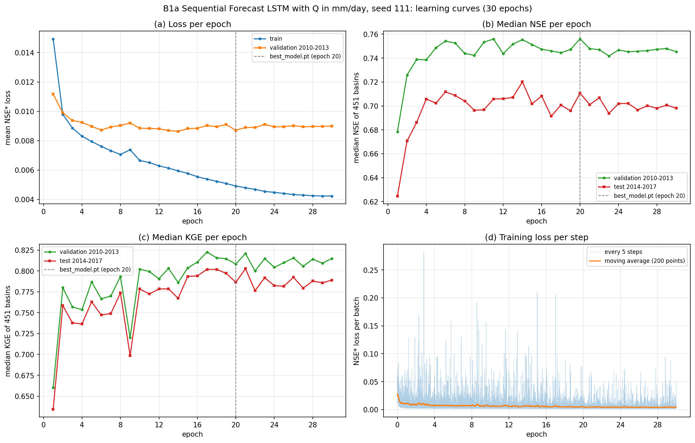
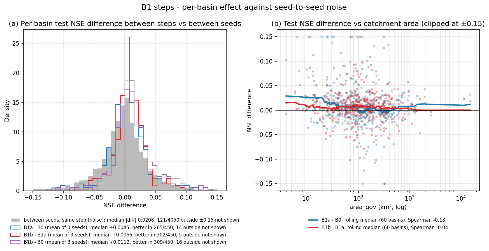
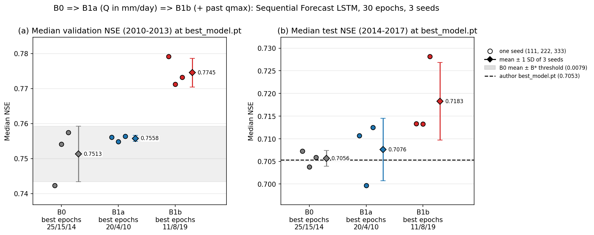

# B1a — Q quá khứ theo mm/ngày, 30 epoch, ba hạt giống

Tài liệu đi cùng mã của ba notebook huấn luyện [03_B1a_LamaHCEExt_Train_Seed111.py](03_B1a_LamaHCEExt_Train_Seed111.py), [_Seed222](03_B1a_LamaHCEExt_Train_Seed222.py), [_Seed333](03_B1a_LamaHCEExt_Train_Seed333.py) và notebook so sánh chung của bước B1 [05_B1_LamaHCEExt_Compare.py](../05_B1_LamaHCEExt_Compare/05_B1_LamaHCEExt_Compare.py) (so B0 => B1a => B1b, xuất dự báo cho bộ đánh giá). Kết quả của B1b ở [04_B1b_LamaHCEExt_Train.md](../04_B1b_LamaHCEExt_Train/04_B1b_LamaHCEExt_Train.md).

B1a là bước ablation đầu tiên của bước B (`Document/01_Plan/02_Pipeline.md` Mục 7, dòng B1a): giữ nguyên B0 (mô hình, config tác giả, fork `f229e02`, giao thức 30 epoch, hạt giống 111/222/333) và **chỉ đổi đơn vị của lưu lượng quá khứ** đưa vào mô hình. BiasCast đưa `qmean` (lưu lượng trung bình ngày) theo m³/s, trong khi nhãn `qmax` được bộ nạp đổi sang mm/ngày theo diện tích `area_gov` (`.claude/rules/library.md`, mục Dữ liệu và bộ nạp). B1a thay `qmean` bằng `qmean_mmd` = `qmean` × 86,4 / `area_gov`, cùng đơn vị với nhãn, tại đúng vị trí cũ trong danh sách biến. B1a không là ứng viên của luật chọn B* (B* chọn trong B1b–B3); B1a chỉ để tách đóng góp của việc đổi đơn vị khỏi đóng góp của `qmax` quá khứ ở B1b.

**Vì sao đơn vị có thể quan trọng.** Mọi biến đầu vào được chuẩn hóa bằng một trung bình và một độ lệch chuẩn chung cho cả 451 lưu vực. Với `qmean` theo m³/s, hai số này là 4,5778 và 16,1461 (`library.md`), do vài sông lớn chi phối. Ví dụ tự tính: một lưu vực 24 km² có Q tăng gấp đôi từ 0,5 lên 1 m³/s thì giá trị chuẩn hóa chỉ đổi từ −0,253 sang −0,222 (chênh 0,03); cùng lưu lượng đó theo mm/ngày là 1,8 => 3,6 mm/ngày, chuẩn hóa bằng trung bình 2,0872 và độ lệch chuẩn 3,5224 của `qmean_mmd` (Phần 3 notebook hạt giống) thì đổi từ −0,08 sang +0,43 (chênh 0,51). Giả thuyết: với m³/s, mô hình khó thấy biến động lưu lượng của lưu vực nhỏ; đổi sang mm/ngày đưa lưu vực lớn và nhỏ về cùng cỡ.

B1a trả lời ba câu hỏi:

1. Đổi đơn vị Q làm NSE trung vị validation (thước đo duy nhất của tầng chọn, `02_Pipeline.md` Mục 6.1) thay đổi bao nhiêu so với ngưỡng nhiễu hạt giống B* = 0,0079 của B0?
2. Cải thiện, nếu có, có tập trung ở lưu vực nhỏ như giả thuyết không?
3. Đường học qua 30 epoch khác B0 thế nào?

**Kết luận.**

- **Tầng chọn: trong ngưỡng nhiễu.** NSE trung vị validation trung bình 3 hạt giống 0,7558 so với B0 0,7513: hiệu +0,0045 = 0,56 lần ngưỡng B*. Riêng từng hạt giống: +0,0137 / +0,0007 / −0,0010, phần lớn hiệu đến từ hạt giống 111 của B0 thấp (0,7423).
- **Theo lưu vực trên test: hiệu nhỏ nhưng nhất quán.** Trung bình 3 hạt giống, B1a tốt hơn B0 ở 265/450 lưu vực, trung vị hiệu +0,0045, Cohen's dz 0,08, p Holm 3,9 × 10⁻⁶; cả ba cặp cùng hạt giống đều cùng chiều (trung vị +0,0067 / +0,0046 / +0,0053, p Holm ≤ 0,027). Hiệu này nhỏ hơn mức chênh thường gặp giữa hai hạt giống ở cùng lưu vực (trung vị \|chênh\| 0,0221).
- **Hiệu tập trung ở lưu vực nhỏ**, đúng chiều giả thuyết: trung vị hiệu +0,0198 ở 90 lưu vực nhỏ nhất (trung vị 24 km²), giảm còn +0,0003 ở 90 lưu vực lớn nhất; tương quan Spearman giữa hiệu và log diện tích −0,18 (p 1 × 10⁻⁴). Đây là bằng chứng phù hợp với giả thuyết, không chứng minh cơ chế.
- **Đường học: hội tụ nhanh hơn nhưng đạt đỉnh sớm rồi giảm.** NSE validation epoch 1 trung bình 0,684 so với B0 0,617; đường trung bình đạt đỉnh ở epoch 10 (B0: 19) rồi giảm, tới epoch 30 thấp hơn B0 (0,7426 so với 0,7469). Ba hạt giống có NSE validation tại `best_model.pt` rất sát nhau (độ lệch chuẩn 0,0008) nhưng NSE test phân tán gấp 4 lần B0 (0,7076 ± 0,0069 so với 0,7056 ± 0,0017); hạt giống 222 chọn epoch 4 và cho test 0,6997, thấp nhất trong 9 run.
- **Thời gian**: 2,42–2,54 giờ/notebook, như B0.

## Mục lục

- [Cài đặt notebook và bản lưu chính thức](#setup)
- [Cấu hình: khác B0 đúng một biến](#config)
- [Notebook huấn luyện (Phần 1–8)](#train)
- [Thời gian](#time)
- [Notebook so sánh B0 => B1a => B1b](#compare)
- [Kết quả ba hạt giống tại `best_model.pt`](#seeds)
- [So từng lưu vực](#basins)
- [Theo epoch](#epochs)
- [Dự báo theo hợp đồng của bộ đánh giá và đầu ra](#npz)
- [Hệ quả cho các bước sau](#next)

## Cài đặt notebook và bản lưu chính thức

| Notebook Kaggle (tài khoản `hunhngcthng`) | Cài đặt | Input | Bản lưu chính thức |
|---|---|---|---|
| `03_B1a_LamaHCEExt_Train_Seed111` | GPU T4 (dùng `cuda:0`), Internet On, Persistence Files only, Pin to original environment | Dataset `lamah-ce-ext` | Version 1 |
| `03_B1a_LamaHCEExt_Train_Seed222` | như trên | như trên | Version 1 |
| `03_B1a_LamaHCEExt_Train_Seed333` | như trên | như trên | Version 1 |
| `05_B1_LamaHCEExt_Compare` | CPU, Internet On, Persistence Files only, Pin to original environment | Output 3 notebook B0 (`01_B0_LamaHCEExt_Train_Seed*`), 3 notebook B1a, 3 notebook B1b (`04_B1b_LamaHCEExt_Train_Seed*`), đều Version 1; Output `02_A3_LamaHCEExt_Benchmarks` Version 1 (tài khoản `hunhthanhnhn`); Dataset `lamah-ce-ext` | Version 1 |

Ba tệp huấn luyện giống hệt nhau, chỉ khác dòng `RUN_SEED`. Chú thích đầu tệp huấn luyện còn ghi tên notebook so sánh dự kiến ban đầu `04_B1a_LamaHCEExt_Compare`; notebook so sánh thực tế là `05_B1_LamaHCEExt_Compare`, gộp cả B0, B1a, B1b để so trong một lần.

Môi trường: ảnh Kaggle dựng ngày 22/10/2026, Python 3.13.15, torch 2.11.0+cu128 (notebook so sánh 2.11.0+cpu), NumPy 2.1.3, pandas 2.3.3, xarray 2025.12.0, SciPy 1.16.3, tensorboard 2.20.0; NeuralHydrology cài từ fork `Ticasslo/neuralhydrology` commit `f229e02`, như B0.

## Cấu hình: khác B0 đúng một biến

Config dựng từ config tác giả như B0 ([báo cáo B0](../01_B0_LamaHCEExt_Train/01_B0_LamaHCEExt_Train.md#config)): giữ 51 khóa, đổi 14 khóa, bỏ 5 khóa thư viện tự ghi. So với B0, hai khóa đổi thêm là `hindcast_inputs` và `dynamic_inputs`: `qmean` (vị trí 32, cuối pha quá khứ, trước 5 biến ECMWF HRES của ngày dự báo) thay bằng `qmean_mmd` tại cùng vị trí; số biến giữ 32 / 5 / 37 (quá khứ / ngày t / động). Notebook so sánh Phần 1 đọc lại `config.yml` thư viện ghi của cả 9 run và xác nhận: cùng hạt giống thì B1a chỉ khác B0 ở khóa đường dẫn, tên thí nghiệm và hai danh sách biến.

Vì chỉ thay một biến, không thêm, số tham số (84.785) và kích thước lớp nhúng giữ nguyên => **cùng hạt giống thì B1a và B0 có cùng trọng số khởi tạo**; `qmean_mmd` có cùng ô trống với `qmean` nên số mẫu huấn luyện (1.094.272) và thứ tự lô cũng như B0. Hiệu B1a − B0 cùng hạt giống vì vậy chỉ do đổi đơn vị (B0 đã cho thấy cùng hạt giống trên T4 lặp lại từng bit, [báo cáo B0](../01_B0_LamaHCEExt_Train/01_B0_LamaHCEExt_Train.md#p3)).

## Notebook huấn luyện (Phần 1–8)

Phần 1, 2, 5–8 như B0; Phần 3, 4 mới.

| Phần | Việc | Kết quả ở bản lưu chính thức |
|---|---|---|
| 1 | Cài thư viện theo commit `f229e02`, kiểm môi trường, GPU | Đạt ở cả ba |
| 2 | Tìm dữ liệu, `basins_filtered.txt`, config tác giả; kiểm đúng run SeqLSTM có Q nhúng đơn giản; tên cột mới chưa có trong config và nằm ngoài danh sách nhãn của bộ nạp (`qobs, qmean, qmin, qmax`, `datasetzoo/lamah.py` dòng 18) | Đạt; tác giả 0,7053 trên 450 lưu vực |
| 3 | Dựng thư mục `LamaH_q_mmd_input`: thêm hai cột `qmean_mmd`, `qmax_mmd` vào tệp khí tượng của 451 lưu vực, đổi đơn vị bằng chính hàm của thư viện (`load_lamah_discharge`, ô âm −999 => trống, `lamah.py` dòng 228–229; `_normalize_discharge` với `area_gov`, dòng 303–308). `qmax_mmd` để sẵn cho B1b; B1a không đưa vào config nên mô hình không dùng | 451/451 tệp, 1,53 GB, 248 / 463 / 425 giây. Kiểm cả 451 lưu vực, 2.635.193 ngày–lưu vực: `qmax_mmd` trùng nhãn `qmax` của thư viện (lệch tương đối lớn nhất 7,8 × 10⁻¹⁴), `qmean_mmd` khớp `qmean` m³/s đổi đơn vị, cùng ô trống với `qmean` của B0 (0 ô khác), không có giá trị âm |
| 4 | Ghi config, nạp bằng `Config`; dựng dataset huấn luyện bằng thư viện, so số mẫu và số tham số với B0; so mảng `qmean_mmd` thư viện dùng để chuẩn hóa với dữ liệu Phần 3 | Khác tác giả 16–17 khóa, đều trong danh sách; 1.094.272 mẫu, 4.275 bước/epoch, 84.785 tham số — bằng B0; mảng thư viện cùng ô trống, lệch tương đối lớn nhất 6 × 10⁻⁸ (float32) |
| 5 | Huấn luyện 30 epoch trong tiến trình con, đọc `output.log` thành bảng theo epoch | Mã thoát 0; đủ 30 epoch; `best_model.pt` epoch 20 / 4 / 10, trùng epoch NSE validation cao nhất; bộ nhớ GPU cao nhất 2.805 MiB |
| 6 | Kiểm `best_model.pt` trùng tensor với đúng một `model_epochNNN.pt`; chấm test 30 epoch và `best_model.pt` | Đạt; 30 thư mục test, 450 lưu vực có NSE (lưu vực 55 không có `qmean`, như B0) |
| 7 | Hình đường học theo epoch, loss theo bước | `B1a_Curve_Seed<N>.png`, bảng `B1a_Curve_Seed<N>.csv` |
| 8 | Ghi `environment.json`, `manifest.csv` (sha256 bảy tệp chính), xóa thư mục Q tạm | Output 0,54 GB mỗi hạt giống |

NSE trung vị validation và test theo epoch (bảng theo epoch ở [Tables/](Tables/)):

| Epoch | 1 | 4 | 5 | 10 | 11 | 15 | 20 | 25 | 30 |
|---|---|---|---|---|---|---|---|---|---|
| Hạt giống 111, validation | 0,6785 | 0,7385 | 0,7486 | 0,7534 | 0,7559 | 0,7513 | **0,7561** | 0,7453 | 0,7454 |
| Hạt giống 111, test | 0,6247 | 0,7058 | 0,7023 | 0,6968 | 0,7059 | 0,7017 | **0,7107** | 0,7021 | 0,6981 |
| Hạt giống 222, validation | 0,6921 | **0,7548** | 0,7396 | 0,7502 | 0,7467 | 0,7478 | 0,7371 | 0,7494 | 0,7403 |
| Hạt giống 222, test | 0,6529 | **0,6997** | 0,7039 | 0,7012 | 0,7114 | 0,7087 | 0,7010 | 0,7023 | 0,6999 |
| Hạt giống 333, validation | 0,6812 | 0,7456 | 0,7397 | **0,7564** | 0,7513 | 0,7433 | 0,7388 | 0,7437 | 0,7421 |
| Hạt giống 333, test | 0,6351 | 0,7009 | 0,6981 | **0,7125** | 0,7059 | 0,7081 | 0,6971 | 0,6961 | 0,6949 |

Số đậm là epoch lưu thành `best_model.pt`. Loss validation thấp nhất ở epoch 14 / 12 / 10 rồi tăng nhẹ, trong khi loss huấn luyện giảm tới epoch 30 (0,00423 / 0,00415 / 0,00412) — dấu hiệu quá khớp nhẹ sau khoảng epoch 10–14, khác B0 (loss validation thấp nhất ở epoch 20 / 19 / 27).

Hình 1. Đường học của hạt giống 111 (hai hạt giống còn lại: [222](Figures/B1a_Curve_Seed222.png), [333](Figures/B1a_Curve_Seed333.png)). (a) Loss NSE* trung bình mỗi epoch trên tập huấn luyện và validation; (b) NSE trung vị validation và test sau mỗi epoch; (c) KGE trung vị validation và test; (d) loss từng lô 256 mẫu, ghi mỗi 5 bước, kèm trung bình trượt 200 điểm. Vạch đứt là epoch lưu thành `best_model.pt`.

## Thời gian

| Hạng mục | Hạt giống 111 | Hạt giống 222 | Hạt giống 333 |
|---|---|---|---|
| Dựng thư mục Q (Phần 3, kể cả kiểm 451 lưu vực khoảng 66 giây) | 248 giây | 463 giây | 425 giây |
| Một epoch huấn luyện (trung vị) | 2,64 phút | 2,72 phút | 2,74 phút |
| Một lượt validation (trung vị từ epoch 2) | 0,82 phút | 0,83 phút | 0,83 phút |
| Huấn luyện 30 epoch (Phần 5) | 1,79 giờ | 1,84 giờ | 1,84 giờ |
| Chấm test 30 epoch (Phần 6, kể cả dựng dataset) | 27,0 phút | 27,2 phút | 27,5 phút |
| Cả notebook (Save & Run All) | 2,42 giờ | 2,54 giờ | 2,53 giờ |

Như B0 (2,36–2,58 giờ): đổi đơn vị một biến không đổi chi phí. Hạt giống 111 chạy ngày 26/10/2026, hai hạt giống còn lại ngày 27/10/2026 (thư mục run `…_2610_080735`, `…_2710_150153`, `…_2710_152304`).

## Notebook so sánh B0 => B1a => B1b

Notebook `05_B1_LamaHCEExt_Compare` (CPU, Save & Run All 4,9 phút, trong đó 4,4 phút tính sha256) so cả chuỗi trong một lần:

| Phần | Việc | Kết quả ở Version 1 |
|---|---|---|
| 1 | Nhận Output 9 notebook hạt giống qua `environment.json`, tính lại sha256 bảy tệp chính mỗi run và so với `manifest.csv`; cùng commit `f229e02`, cùng torch, cùng giao thức (30 epoch, `early_stopping_patience` 30, `data_on_gpu`, không tất định); `config.yml` đúng chuỗi ablation | 63/63 tệp khớp; mọi kiểm đạt |
| 2 | Bảng 9 run cạnh tác giả, thống kê qua 3 hạt giống, hiệu từng bước trên validation so với B* | Mục [Kết quả ba hạt giống](#seeds) |
| 3 | Kiểm định ghép cặp theo lưu vực (ba cặp bước, cặp cùng hạt giống, cặp hạt giống trong bước), theo mức NSE, theo diện tích | Mục [So từng lưu vực](#basins) |
| 4 | NSE validation, test, loss theo epoch: đường trung bình 3 hạt giống, đỉnh, chọn theo validation mất bao nhiêu so với test cao nhất | Mục [Theo epoch](#epochs) |
| 5 | Ba hình `B1_Steps.png`, `B1_Curves.png`, `B1_Effect.png` | Ở [Figures/](../05_B1_LamaHCEExt_Compare/Figures/) của notebook so sánh |
| 6 | Sáu tệp NPZ B1a, B1b cho bộ đánh giá | Mục [Dự báo](#npz) |
| 7 | Bảng, `b1_summary.json`, `environment.json`, `manifest.csv` | 24 tệp, bảng tải về ở [Tables/](../05_B1_LamaHCEExt_Compare/Tables/) của notebook so sánh |

## Kết quả ba hạt giống tại `best_model.pt`

Notebook so sánh Phần 2 đọc lại NSE, KGE từng lưu vực của `best_model.pt` và đối chiếu tóm tắt notebook hạt giống đã ghi (khớp tuyệt đối).

| Mô hình | Epoch `best_model.pt` | NSE trung vị validation | NSE trung vị test | KGE trung vị test | NSE test cao nhất trong 30 epoch (epoch) |
|---|---|---|---|---|---|
| B0 hạt giống 111 / 222 / 333 | 25 / 15 / 14 | 0,7423 / 0,7541 / 0,7574 | 0,7072 / 0,7038 / 0,7059 | 0,7631 / 0,7910 / 0,7860 | 0,7107 (14) / 0,7083 (28) / 0,7077 (27) |
| B1a hạt giống 111 | 20 | 0,7561 | 0,7107 | 0,7863 | 0,7201 (14) |
| B1a hạt giống 222 | 4 | 0,7548 | 0,6997 | 0,7753 | 0,7165 (13) |
| B1a hạt giống 333 | 10 | 0,7564 | 0,7125 | 0,7838 | 0,7125 (10) |
| Tác giả (`best_model.pt`, Zenodo) | – | – | 0,7053 | 0,7671 | – |

| Qua 3 hạt giống (trung bình ± độ lệch chuẩn) | B0 | B1a |
|---|---|---|
| NSE trung vị validation | 0,7513 ± 0,0079 | 0,7558 ± 0,0008 |
| NSE trung vị test | 0,7056 ± 0,0017 | 0,7076 ± 0,0069 |
| KGE trung vị test | 0,7800 ± 0,0148 | 0,7818 ± 0,0058 |

**Tầng chọn**: hiệu B1a − B0 trên NSE trung vị validation, trung bình 3 hạt giống, là +0,0045 = 0,56 × B* => **trong ngưỡng nhiễu**. Hiệu trên test +0,0020 (từng hạt giống +0,0034 / −0,0041 / +0,0066), chỉ để báo cáo.

Ba hạt giống B1a gần như bằng nhau trên validation (0,7548–0,7564) nhưng cách nhau 0,0128 trên test. Hạt giống 222 chọn epoch 4, khi mô hình mới qua 4 lần duyệt dữ liệu; NSE test epoch đó 0,6997, trong khi cùng run đạt 0,7165 ở epoch 13. Với đường validation gần phẳng sau epoch 4 (Mục [Theo epoch](#epochs)), một chênh nhỏ trên validation quyết định epoch được chọn, và epoch sớm không tốt trên test.

## So từng lưu vực

So trên 450 lưu vực có NSE ở cả 9 run. Kiểm định như bộ đánh giá (`Workspace/06_Evaluation/01_Evaluation_LamaHCEExt/01_Evaluation_LamaHCEExt.py` Phần 7.1) và B0: Wilcoxon hạng có dấu hai phía trên hiệu NSE test từng lưu vực, Cohen's dz = trung bình hiệu / độ lệch chuẩn hiệu, hiệu chỉnh Holm trong từng họ; hiệu dương nghĩa là bên trái tốt hơn. Họ chính so NSE trung bình 3 hạt giống của mỗi lưu vực.

| Họ | Trái | Phải | Trái tốt hơn / kém hơn | Trung vị hiệu | Cohen's dz | p Holm |
|---|---|---|---|---|---|---|
| Bước, TB 3 hạt giống (test) | B1a | B0 | 265 / 185 | +0,0045 | 0,079 | 3,9 × 10⁻⁶ |
| Bước, TB 3 hạt giống (validation) | B1a | B0 | 258 / 192 | +0,0042 | 0,234 | 7,2 × 10⁻⁶ |
| Cùng hạt giống (test) | B1a 111 | B0 111 | 272 / 178 | +0,0067 | 0,064 | 0,0008 |
| Cùng hạt giống (test) | B1a 222 | B0 222 | 251 / 199 | +0,0046 | 0,079 | 0,027 |
| Cùng hạt giống (test) | B1a 333 | B0 333 | 259 / 191 | +0,0053 | 0,066 | 0,0001 |
| Cặp hạt giống B1a (test) | 111 / 111 / 222 | 222 / 333 / 333 | 235 / 234 / 225 tốt hơn | +0,0014 / +0,0011 / −0,0002 | −0,07 / −0,10 / −0,09 | 0,84–1 |

Hiệu B1a − B0 có ý nghĩa thống kê và cùng chiều ở cả ba hạt giống, nhưng nhỏ: trung vị \|hiệu\| giữa B1a và B0 (trung bình 3 hạt giống) là 0,0168, thấp hơn trung vị \|chênh\| giữa hai hạt giống B0 ở cùng lưu vực (0,0221). Như ở A4, B0, p < 0,05 một mình không đủ để nói một mô hình tốt hơn; đọc kèm độ lớn hiệu và mốc nhiễu.

**Theo diện tích** (5 nhóm 90 lưu vực theo `area_gov`):

| Nhóm diện tích (km²) | Diện tích trung vị (km²) | Trung vị hiệu B1a − B0 |
|---|---|---|
| 3,9–40,6 | 24,4 | +0,0198 |
| 40,6–80,9 | 60,4 | +0,0065 |
| 80,9–135,8 | 101,3 | +0,0008 |
| 135,8–285,7 | 181,8 | +0,0023 |
| 285,7–15.131 | 446,0 | +0,0003 |

Tương quan Spearman giữa hiệu và log diện tích: −0,18 (p 1 × 10⁻⁴). Theo mức NSE của lưu vực (trung bình 3 hạt giống B0), hiệu lớn nhất ở nhóm NSE 0–0,5 (64 lưu vực, +0,0289), nhỏ ở các nhóm cao hơn (+0,0017 tới +0,0041). Ba lưu vực NSE âm (gồm 742, 758 có `qmax` gần như hằng số) có hiệu rất lớn theo cả hai chiều, nên đọc trung vị thay vì trung bình.

Hình 2. (a) Phân phối hiệu NSE test theo lưu vực của ba cặp bước (mỗi bước lấy trung bình 3 hạt giống), nền xám là hiệu giữa các cặp hạt giống trong cùng bước (mốc nhiễu, gộp ba bước, trung vị \|hiệu\| 0,0208). Hiệu giữa hai trung bình 3 hạt giống ít nhiễu hơn hiệu một cặp hạt giống, nên đọc kèm kiểm định ở bảng trên. (b) Hiệu theo diện tích `area_gov` (trục log, chấm chặn ở ±0,15), đường là trung vị trượt 60 lưu vực: đường xanh (B1a − B0) cao ở lưu vực dưới khoảng 50 km² rồi về gần 0; đường đỏ (B1b − B1a, [báo cáo B1b](../04_B1b_LamaHCEExt_Train/04_B1b_LamaHCEExt_Train.md)) gần như không đổi theo diện tích.

Kết quả phù hợp giả thuyết đơn vị: cải thiện nằm chủ yếu ở lưu vực nhỏ, nơi `qmean` m³/s gần như hằng số sau chuẩn hóa. Đây là suy luận từ tương quan; thí nghiệm không tách được cơ chế (ví dụ lưu vực nhỏ cũng thường có NSE thấp hơn, nên một phần hiệu theo diện tích có thể trùng hiệu theo mức NSE).

## Theo epoch

NSE test mỗi epoch chỉ để theo dõi (góp ý GVHD họp 25/10/2026), không dùng để chọn.

| Đại lượng (trung bình 3 hạt giống) | B0 | B1a |
|---|---|---|
| NSE validation epoch 1 | 0,6169 | 0,6839 |
| Đỉnh đường trung bình validation (epoch) | 0,7479 (19) | 0,7533 (10) |
| NSE validation epoch 30 | 0,7469 | 0,7426 |
| NSE test epoch 30 | 0,7065 | 0,6977 |
| NSE validation giảm từ `best_model.pt` tới epoch 30 (từng hạt giống) | −0,0039 / −0,0067 / −0,0026 | −0,0107 / −0,0145 / −0,0143 |
| NSE test tại `best_model.pt` thấp hơn NSE test cao nhất trong 30 epoch | 0,0033 | 0,0088 |
| Spearman giữa NSE validation và test qua 30 epoch | 0,72 | 0,64 |
| Loss validation epoch 30 | 0,00915 | 0,00917 |

B1a học nhanh hơn rõ ở các epoch đầu (+0,067 NSE validation ở epoch 1), đạt đỉnh khoảng epoch 10, rồi cả NSE validation lẫn test giảm dần; B0 tăng chậm, bắt kịp B1a từ khoảng epoch 14 và ở epoch 30 cao hơn B1a trên cả validation và test. Lợi thế của B1a ở tầng chọn vì vậy là lợi thế tại `best_model.pt`; so ở epoch cuối thì không còn. Điều này cho thấy chọn checkpoint theo validation (giao thức của đề tài) cần thiết hơn với B1a so với B0, và validation theo dõi test kém hơn (chọn theo validation mất 0,0088 NSE test so với 0,0033 ở B0). Hình theo epoch của cả ba bước: `B1_Curves.png`, đặt ở [báo cáo B1b](../04_B1b_LamaHCEExt_Train/04_B1b_LamaHCEExt_Train.md#epochs).

Hình 3. Mỗi chấm tròn là một hạt giống tại `best_model.pt` (epoch ghi dưới trục), hình thoi là trung bình ± 1 độ lệch chuẩn 3 hạt giống. (a) NSE trung vị validation, thước đo duy nhất của tầng chọn: trung bình B0, B1a, B1b 0,7513; 0,7558; 0,7745; dải xám là trung bình B0 ± ngưỡng B* 0,0079 — B1a nằm trong dải, B1b nằm ngoài. (b) NSE trung vị test, chỉ để báo cáo: 0,7056; 0,7076; 0,7183; nét đứt là `best_model.pt` của tác giả 0,7053.

## Dự báo theo hợp đồng của bộ đánh giá và đầu ra

Notebook so sánh Phần 6 xuất mỗi run B1a, B1b một tệp `contracts/SeqLSTM_Q_<B1a|B1b>_seed{111,222,333}_test_S0_lead1.npz` theo hợp đồng NPZ của bộ đánh giá (`Workspace/06_Evaluation/01_Evaluation_LamaHCEExt/01_Evaluation_LamaHCEExt.md` Mục 7), cùng cách dựng B0 ([báo cáo B0](../01_B0_LamaHCEExt_Train/01_B0_LamaHCEExt_Train.md#p6)): dự báo thô từ `test_results.p` của `best_model.pt`, chặn âm theo `clip_targets_to_zero: [qmax]`; quan trắc, persistence, diện tích, thứ tự 451 lưu vực lấy nguyên từ ngữ cảnh A3.

| Run | `selected_epoch` | Ngày–lưu vực dự báo âm trước khi chặn | Sai lệch NSE lớn nhất so với thư viện | NSE trung vị từ tệp |
|---|---|---|---|---|
| B1a 111 | 20 | 811 | 1,4 × 10⁻⁷ | 0,7107 |
| B1a 222 | 4 | 2.148 | 6,5 × 10⁻⁷ | 0,6997 |
| B1a 333 | 10 | 3.057 | 2,1 × 10⁻⁷ | 0,7125 |

Mỗi tệp đọc ngược đạt mọi điều kiện của `read_contract` và `check_same_context`, 652.644 ngày–lưu vực có dự báo, khoảng 10 MB; quan trắc trong `test_results.p` cùng vị trí ô trống với quan trắc A3, lệch giá trị lớn nhất 1,1 × 10⁻⁵ mm/ngày (thư viện lưu float32), như B0 — đổi đơn vị Q đầu vào không làm đổi nhãn. Metadata: commit `f229e02`, `clip_to_zero` true, `selected_epoch`, notebook nguồn kèm Version.

Thư mục `b1_compare/` trong Output `05_B1_LamaHCEExt_Compare` Version 1 (24 tệp, `manifest.csv` ghi sha256):

| Tệp | Nội dung |
|---|---|
| `B1_seed_table.csv`, `B1_seed_stats.csv`, `B1_step_delta.csv`, `B1_timing.csv` | Bảng 9 run và tác giả; thống kê qua 3 hạt giống; hiệu từng bước so với B*; thời gian (Phần 2) |
| `B1_paired_tests.csv`, `B1_seed_noise.csv`, `B1_basin_nse.csv`, `B1_by_nse_level.csv`, `B1_by_area.csv`, `B1_area_spearman.csv` | Kiểm định ghép cặp; nhiễu hạt giống; NSE từng lưu vực; theo mức NSE, theo diện tích (Phần 3) |
| `B1_curves_mean.csv`, `B1_epoch_peaks.csv` | Đường trung bình theo epoch; đỉnh từng run (Phần 4) |
| `B1_Steps.png`, `B1_Curves.png`, `B1_Effect.png` | Ba hình (Phần 5) |
| `contracts/*.npz`, `B1_contracts.csv` | Sáu tệp dự báo và bảng kiểm (Phần 6) |
| `b1_summary.json` | Số liệu chính: B*, NSE từng hạt giống, hiệu từng bước và kết luận tầng chọn, kiểm định ba họ, theo diện tích, theo epoch, giờ huấn luyện, đường dẫn NPZ |
| `environment.json` | Input đã gắn kèm Version, sha256 tệp A3 và tệp chỉ số tác giả, thư viện |

Trọng số mọi epoch, validation và test mỗi epoch, nhật ký, tệp sự kiện tensorboard của từng run nằm ở `b1a_runs/` trong Output notebook hạt giống tương ứng.

## Hệ quả cho các bước sau

| Số đo ở B1a | Dùng ở |
|---|---|
| Đổi `qmean` sang mm/ngày: +0,0045 NSE trung vị validation (0,56 × B*), trong ngưỡng nhiễu | B1a không là ứng viên B*; B1b giữ `qmean_mmd` để B1b − B1a đo riêng đóng góp của `qmax` quá khứ |
| Cải thiện tập trung ở lưu vực nhỏ (+0,0198 ở nhóm trung vị 24 km², Spearman −0,18) | Bằng chứng cho giả thuyết đơn vị; đưa vào chương kết quả cùng phần lý thuyết chuẩn hóa (`06_Theory/06_BiasCast4_Model.md` Mục 4.1) |
| Hội tụ nhanh, đỉnh sớm (epoch 10), giảm sau đỉnh; validation theo dõi test kém hơn B0 | Lý do giữ chọn checkpoint theo validation thay vì epoch cuối; đọc kèm khi so lõi ở bước C |
| Ba tệp NPZ `SeqLSTM_Q_B1a_seed*` | Bộ đánh giá chấm B1a cùng B0, B1b |
