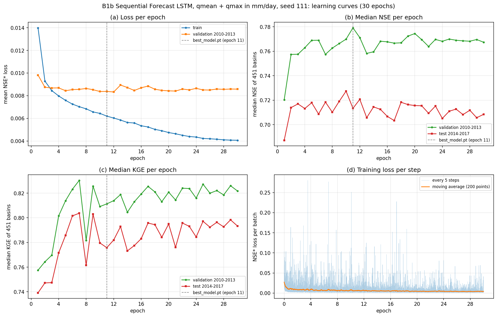
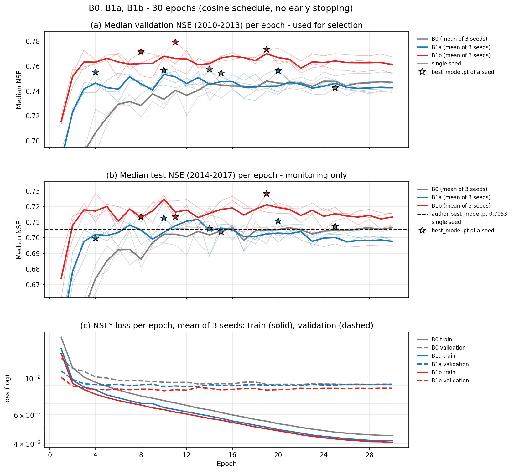

# B1b — thêm `qmax` quá khứ, 30 epoch, ba hạt giống

Tài liệu đi cùng mã của ba notebook huấn luyện [04_B1b_LamaHCEExt_Train_Seed111.py](04_B1b_LamaHCEExt_Train_Seed111.py), [_Seed222](04_B1b_LamaHCEExt_Train_Seed222.py), [_Seed333](04_B1b_LamaHCEExt_Train_Seed333.py). So sánh B0 => B1a => B1b và xuất dự báo cho bộ đánh giá nằm ở notebook chung [05_B1_LamaHCEExt_Compare.py](../05_B1_LamaHCEExt_Compare/05_B1_LamaHCEExt_Compare.py); cài đặt, các Phần và đầu ra của notebook đó mô tả ở [báo cáo B1a](../03_B1a_LamaHCEExt_Train/03_B1a_LamaHCEExt_Train.md#compare).

B1b = B1a + **lưu lượng đỉnh ngày quá khứ** (`Document/01_Plan/02_Pipeline.md` Mục 7, dòng B1b). BiasCast dự báo `qmax` (lưu lượng lớn nhất trong ngày) nhưng ở pha quá khứ chỉ đưa vào `qmean` (lưu lượng trung bình ngày); B1b thêm `qmax_mmd` — chính `qmax` của các ngày trước, theo mm/ngày như nhãn — ngay sau `qmean_mmd`. Ví dụ: ở một trận lũ ngắn, `qmean` của một ngày có thể chỉ bằng một nửa đỉnh trong ngày; mô hình chỉ thấy `qmean` phải tự đoán đỉnh, còn B1b thấy trực tiếp các đỉnh đã xảy ra. B1b là ứng viên đầu tiên của luật chọn B* (chọn trong B1b–B3); B2, B3 dựng trên cấu hình B1b.

B1b trả lời ba câu hỏi:

1. Thêm `qmax` quá khứ làm NSE trung vị validation thay đổi bao nhiêu so với B1a và B0, so với ngưỡng nhiễu hạt giống B* = 0,0079?
2. Cải thiện có đều trên các lưu vực không, hay tập trung ở một nhóm như B1a?
3. Đường học, độ ổn định giữa hạt giống khác B0, B1a thế nào?

**Kết luận.**

- **Tầng chọn: tốt hơn, vượt ngưỡng.** NSE trung vị validation trung bình 3 hạt giống 0,7745 ± 0,0041; hiệu B1b − B1a +0,0188 = 2,37 × B*, cả ba hạt giống cùng chiều (+0,0231 / +0,0164 / +0,0168); hiệu B1b − B0 +0,0233 = 2,93 × B*.
- **Test**: 0,7183 ± 0,0086 (B0 0,7056, B1a 0,7076, tác giả 0,7053); cả ba hạt giống cao hơn tác giả (+0,0081 / +0,0080 / +0,0229).
- **Theo lưu vực: cải thiện rộng, không phụ thuộc diện tích.** Trung bình 3 hạt giống, B1b tốt hơn B1a ở 302/450 lưu vực trên test (trung vị +0,0066, dz 0,09, p Holm 1,4 × 10⁻¹²) và 336/450 trên validation (dz 0,43); hiệu dương ở mọi nhóm diện tích (+0,0036 tới +0,0084, Spearman với log diện tích −0,04, p 0,44) và mọi mức NSE từ 0 trở lên.
- **Đường học: dẫn ở mọi epoch, nhưng validation theo dõi test kém nhất.** NSE validation dẫn hai bước kia từ epoch 1 (0,716) tới epoch 30 (0,761), loss validation thấp nhất (0,00867 ở epoch 30). Tương quan Spearman giữa NSE validation và test qua 30 epoch chỉ 0,48 (hạt giống 111: 0,22); chọn theo validation thấp hơn epoch test cao nhất 0,0097 NSE trung bình.
- **Nhiễu hạt giống khác dạng**: độ lớn chênh giữa hai hạt giống ở cùng lưu vực nhỏ hơn B0 (trung vị \|chênh\| 0,0190 so với 0,0221), nhưng hạt giống 111 kém hai hạt giống kia một cách có hệ thống theo lưu vực (trung vị −0,008, p Holm < 10⁻⁷) dù NSE trung vị test gần bằng hạt giống 222.
- **Thời gian**: 2,46–2,56 giờ/notebook, như B0, B1a.

## Mục lục

- [Cài đặt notebook và bản lưu chính thức](#setup)
- [Cấu hình: khác B1a đúng một biến](#config)
- [Notebook huấn luyện (Phần 1–8)](#train)
- [Thời gian](#time)
- [Kết quả ba hạt giống tại `best_model.pt`](#seeds)
- [So từng lưu vực](#basins)
- [Theo epoch](#epochs)
- [Dự báo theo hợp đồng của bộ đánh giá](#npz)
- [Hệ quả cho các bước sau](#next)

## Cài đặt notebook và bản lưu chính thức

| Notebook Kaggle (tài khoản `hunhngcthng`) | Cài đặt | Input | Bản lưu chính thức |
|---|---|---|---|
| `04_B1b_LamaHCEExt_Train_Seed111` | GPU T4 (dùng `cuda:0`), Internet On, Persistence Files only, Pin to original environment | Dataset `lamah-ce-ext` | Version 1 |
| `04_B1b_LamaHCEExt_Train_Seed222` | như trên | như trên | Version 1 |
| `04_B1b_LamaHCEExt_Train_Seed333` | như trên | như trên | Version 1 |

Ba bản lưu chính thức chạy dưới tên `05_B1b_LamaHCEExt_Train_Seed*`, sau đó notebook được đổi tên thành `04_B1b_…` (Output giữ nguyên); chú thích trong `.py`, `.ipynb` vì vậy còn ghi tên cũ và tên notebook so sánh dự kiến ban đầu `06_B1b_LamaHCEExt_Compare`. Ba tệp giống hệt nhau, chỉ khác dòng `RUN_SEED`. Môi trường như B0, B1a: ảnh Kaggle 22/10/2026, Python 3.13.15, torch 2.11.0+cu128, fork `f229e02`.

## Cấu hình: khác B1a đúng một biến

Config dựng như B1a ([báo cáo B1a](../03_B1a_LamaHCEExt_Train/03_B1a_LamaHCEExt_Train.md#config)); khác B1a đúng ở hai danh sách biến: thêm `qmax_mmd` ngay sau `qmean_mmd` (vị trí 33, cuối pha quá khứ, trước 5 biến ECMWF HRES của ngày dự báo) => 33 / 5 / 38 biến (quá khứ / ngày t / động). Notebook so sánh Phần 1 đọc lại `config.yml` thư viện ghi và xác nhận: cùng hạt giống thì B1b chỉ khác B1a ở khóa đường dẫn, tên thí nghiệm và hai danh sách biến.

| Hệ quả | Giá trị | Nguồn |
|---|---|---|
| Số tham số | 84.801 = 84.785 + 16: lớp nhúng biến động `fc [16]` có thêm một đầu vào => thêm 16 trọng số | Phần 4 notebook hạt giống |
| Số mẫu huấn luyện, bước/epoch | 1.094.272, 4.275 — bằng B0, B1a vì `qmax_mmd` và `qmean_mmd` có cùng ô trống (0 ô khác) | Phần 3, 4 |
| Trọng số khởi tạo cùng hạt giống | **Khác B1a**: số tham số khác nên dãy số ngẫu nhiên rút ra khác | – |

Vì khởi tạo khác, hiệu B1b − B1a cùng hạt giống gồm cả đóng góp của `qmax` quá khứ lẫn nhiễu khởi tạo; kết luận chính vì vậy dựa trên trung bình 3 hạt giống của mỗi bước, không dựa trên từng cặp cùng hạt giống như B1a − B0.

## Notebook huấn luyện (Phần 1–8)

Phần 1–3, 5–8 như B1a; Phần 4 đổi danh sách biến và các số kiểm.

| Phần | Việc | Kết quả ở bản lưu chính thức |
|---|---|---|
| 1–2 | Cài thư viện `f229e02`, kiểm môi trường; tìm dữ liệu, config tác giả | Đạt ở cả ba |
| 3 | Dựng thư mục `LamaH_q_mmd_input` với `qmean_mmd`, `qmax_mmd` như B1a | 451/451 tệp, 1,53 GB, 320 / 239 / 266 giây; `qmax_mmd` trùng nhãn (lệch tương đối lớn nhất 7,8 × 10⁻¹⁴), hai cột cùng ô trống với `qmean` của B0, không âm |
| 4 | Ghi config, nạp bằng `Config`; dựng dataset huấn luyện bằng thư viện | 33 / 5 / 38 biến, `qmean_mmd` ở vị trí 32, `qmax_mmd` ở 33, không còn `qmean`; 1.094.272 mẫu, 4.275 bước, 84.801 tham số |
| 5 | Huấn luyện 30 epoch | Mã thoát 0; đủ 30 epoch; `best_model.pt` epoch 11 / 8 / 19, trùng epoch NSE validation cao nhất; bộ nhớ GPU cao nhất 2.811 MiB |
| 6 | Kiểm `best_model.pt`, chấm test 30 epoch và `best_model.pt` | Đạt; 450 lưu vực có NSE |
| 7 | Hình đường học | `B1b_Curve_Seed<N>.png`, bảng `B1b_Curve_Seed<N>.csv` |
| 8 | `environment.json`, `manifest.csv`, xóa thư mục Q tạm | Output 0,54 GB mỗi hạt giống |

NSE trung vị validation và test theo epoch (bảng theo epoch ở [Tables/](Tables/)):

| Epoch | 1 | 4 | 5 | 8 | 10 | 11 | 15 | 19 | 25 | 30 |
|---|---|---|---|---|---|---|---|---|---|---|
| Hạt giống 111, validation | 0,7203 | 0,7629 | 0,7689 | 0,7626 | 0,7699 | **0,7791** | 0,7682 | 0,7724 | 0,7700 | 0,7674 |
| Hạt giống 111, test | 0,6872 | 0,7132 | 0,7179 | 0,7102 | 0,7274 | **0,7133** | 0,7124 | 0,7164 | 0,7110 | 0,7084 |
| Hạt giống 222, validation | 0,7132 | 0,7617 | 0,7647 | **0,7712** | 0,7659 | 0,7572 | 0,7674 | 0,7639 | 0,7568 | 0,7540 |
| Hạt giống 222, test | 0,6739 | 0,7283 | 0,7208 | **0,7133** | 0,7235 | 0,7125 | 0,7182 | 0,7189 | 0,7157 | 0,7158 |
| Hạt giống 333, validation | 0,7134 | 0,7645 | 0,7651 | 0,7521 | 0,7679 | 0,7616 | 0,7638 | **0,7732** | 0,7654 | 0,7619 |
| Hạt giống 333, test | 0,6606 | 0,7099 | 0,7216 | 0,7157 | 0,7235 | 0,7237 | 0,7238 | **0,7282** | 0,7195 | 0,7155 |

Số đậm là epoch lưu thành `best_model.pt`. NSE validation lên khoảng 0,76 từ epoch 4 rồi dao động trong khoảng hẹp 0,75–0,78; loss validation thấp nhất ở epoch 12 / 9 / 12, loss huấn luyện giảm tới epoch 30 (0,00407 / 0,00406 / 0,00410). Ở hạt giống 111, 222, epoch test cao nhất (10 và 4) không trùng epoch validation cao nhất (11 và 8), NSE test cách nhau 0,014–0,015; ở hạt giống 111 đó là hai epoch liền kề.

Hình 1. Đường học của hạt giống 111 (hai hạt giống còn lại: [222](Figures/B1b_Curve_Seed222.png), [333](Figures/B1b_Curve_Seed333.png)). (a) Loss NSE* trung bình mỗi epoch trên tập huấn luyện và validation; (b) NSE trung vị validation và test sau mỗi epoch; (c) KGE trung vị validation và test; (d) loss từng lô 256 mẫu, ghi mỗi 5 bước, kèm trung bình trượt 200 điểm. Vạch đứt là epoch lưu thành `best_model.pt`.

## Thời gian

| Hạng mục | Hạt giống 111 | Hạt giống 222 | Hạt giống 333 |
|---|---|---|---|
| Dựng thư mục Q (Phần 3) | 320 giây | 239 giây | 266 giây |
| Một epoch huấn luyện (trung vị) | 2,78 phút | 2,67 phút | 2,75 phút |
| Một lượt validation (trung vị từ epoch 2) | 0,85 phút | 0,84 phút | 0,84 phút |
| Huấn luyện 30 epoch (Phần 5) | 1,88 giờ | 1,82 giờ | 1,86 giờ |
| Chấm test 30 epoch (Phần 6) | 28,3 phút | 27,8 phút | 27,5 phút |
| Cả notebook (Save & Run All) | 2,56 giờ | 2,46 giờ | 2,50 giờ |

Thêm một biến (+16 tham số) không đổi chi phí so với B0 (2,36–2,58 giờ), B1a (2,42–2,54 giờ). Ba notebook chạy ngày 27/10/2026 (thư mục run `…_2710_154405`, `…_2710_153831`, `…_2710_182317`).

## Kết quả ba hạt giống tại `best_model.pt`

| Mô hình | Epoch `best_model.pt` | NSE trung vị validation | NSE trung vị test | KGE trung vị test | NSE test cao nhất trong 30 epoch (epoch) |
|---|---|---|---|---|---|
| B1b hạt giống 111 | 11 | 0,7791 | 0,7133 | 0,7758 | 0,7274 (10) |
| B1b hạt giống 222 | 8 | 0,7712 | 0,7133 | 0,7817 | 0,7283 (4) |
| B1b hạt giống 333 | 19 | 0,7732 | 0,7282 | 0,8051 | 0,7282 (19) |
| Tác giả (`best_model.pt`, Zenodo) | – | – | 0,7053 | 0,7671 | – |

| Qua 3 hạt giống (trung bình ± độ lệch chuẩn) | B0 | B1a | B1b |
|---|---|---|---|
| NSE trung vị validation | 0,7513 ± 0,0079 | 0,7558 ± 0,0008 | 0,7745 ± 0,0041 |
| NSE trung vị test | 0,7056 ± 0,0017 | 0,7076 ± 0,0069 | 0,7183 ± 0,0086 |
| KGE trung vị test | 0,7800 ± 0,0148 | 0,7818 ± 0,0058 | 0,7875 ± 0,0155 |

| Hiệu NSE trung vị (trung bình 3 hạt giống) | Validation | Validation / B* | Kết luận tầng chọn | Test | Test từng hạt giống |
|---|---|---|---|---|---|
| B1a − B0 (đơn vị Q) | +0,0045 | 0,56 | trong ngưỡng nhiễu | +0,0020 | +0,0034 / −0,0041 / +0,0066 |
| B1b − B1a (thêm `qmax` quá khứ) | +0,0188 | 2,37 | tốt hơn, vượt ngưỡng | +0,0106 | +0,0027 / +0,0136 / +0,0157 |
| B1b − B0 (cả hai) | +0,0233 | 2,93 | tốt hơn, vượt ngưỡng | +0,0126 | +0,0061 / +0,0095 / +0,0223 |

Hình 3 của [báo cáo B1a](../03_B1a_LamaHCEExt_Train/03_B1a_LamaHCEExt_Train.md#epochs) (`B1_Steps.png`) vẽ bảng này: cả ba chấm B1b nằm trên dải B0 ± B*. Trên test, ba hạt giống B1b trải rộng hơn B0 (0,7133–0,7282), chủ yếu do hạt giống 333.

## So từng lưu vực

Cách so như [báo cáo B1a](../03_B1a_LamaHCEExt_Train/03_B1a_LamaHCEExt_Train.md#basins): 450 lưu vực, Wilcoxon hai phía, Cohen's dz, Holm trong từng họ, hiệu dương = bên trái tốt hơn.

| Họ | Trái | Phải | Trái tốt hơn / kém hơn | Trung vị hiệu | Cohen's dz | p Holm |
|---|---|---|---|---|---|---|
| Bước, TB 3 hạt giống (test) | B1b | B1a | 302 / 148 | +0,0066 | 0,089 | 1,4 × 10⁻¹² |
| Bước, TB 3 hạt giống (test) | B1b | B0 | 309 / 141 | +0,0112 | 0,114 | 4,3 × 10⁻¹⁹ |
| Bước, TB 3 hạt giống (validation) | B1b | B1a | 336 / 114 | +0,0109 | 0,426 | 2,3 × 10⁻²⁸ |
| Bước, TB 3 hạt giống (validation) | B1b | B0 | 342 / 108 | +0,0158 | 0,453 | 3,9 × 10⁻³¹ |
| Cùng hạt giống (test) | B1b 111 | B1a 111 | 226 / 224 | 0,0000 | 0,067 | 0,38 |
| Cùng hạt giống (test) | B1b 222 | B1a 222 | 293 / 157 | +0,0099 | −0,052 | 3,9 × 10⁻¹¹ |
| Cùng hạt giống (test) | B1b 333 | B1a 333 | 302 / 148 | +0,0092 | 0,088 | 5,2 × 10⁻¹¹ |
| Cặp hạt giống B1b (test) | B1b 111 | B1b 222 | 170 / 280 | −0,0082 | 0,055 | 4,7 × 10⁻⁸ |
| Cặp hạt giống B1b (test) | B1b 111 | B1b 333 | 152 / 298 | −0,0087 | −0,168 | 2,5 × 10⁻¹² |
| Cặp hạt giống B1b (test) | B1b 222 | B1b 333 | 211 / 239 | −0,0013 | −0,067 | 1 |

Ba điều rút ra:

- **Trên validation, hiệu B1b − B1a lớn và rõ** (trung vị +0,0109, dz 0,43, 336/450 lưu vực tốt hơn), so với hiệu B1a − B0 tính cùng cách (trung vị +0,0042, dz 0,23, 258/450). Trên test, hiệu nhỏ hơn (dz 0,09) nhưng vẫn ở 2/3 số lưu vực.
- **Cặp cùng hạt giống không đồng đều**: hạt giống 111 không khác B1a theo trung vị lưu vực (p 0,38) dù NSE trung vị validation hơn B1a +0,0231; hai hạt giống còn lại hơn khoảng +0,009. Cặp 222 có trung vị dương nhưng dz âm vì vài lưu vực NSE thấp kéo trung bình hiệu xuống (−0,045).
- **Hạt giống 111 của B1b kém hai hạt giống kia một cách có hệ thống theo lưu vực** (trung vị −0,008, p Holm < 10⁻⁷), dù NSE trung vị test của nó (0,7133) bằng hạt giống 222. Ở B0, B1a, không cặp hạt giống nào khác nhau có ý nghĩa (p Holm ≥ 0,84). Hạt giống 111 cũng là run có validation theo dõi test kém nhất (Spearman 0,22, Mục [Theo epoch](#epochs)): epoch 11 được chọn vì NSE validation cao nhất (0,7791) nhưng NSE test thấp hơn epoch 10 liền trước 0,014. Nhiễu hạt giống của B1b vì vậy không chỉ nằm ở NSE trung vị mà ở phân bố theo lưu vực; độ lớn chênh từng lưu vực vẫn nhỏ hơn B0 (trung vị \|chênh\| giữa hai hạt giống 0,0190 so với 0,0221; trung vị độ lệch chuẩn qua 3 hạt giống 0,0161 so với 0,0197).

**Theo diện tích và mức NSE** (B1b − B1a, trung bình 3 hạt giống):

| Nhóm diện tích, trung vị (km²) | 24,4 | 60,4 | 101,3 | 181,8 | 446,0 |
|---|---|---|---|---|---|
| Trung vị hiệu B1b − B1a | +0,0046 | +0,0069 | +0,0084 | +0,0065 | +0,0036 |
| Trung vị hiệu B1b − B0 | +0,0236 | +0,0112 | +0,0090 | +0,0067 | +0,0111 |

| Mức NSE (trung bình 3 hạt giống B0) | < 0 (3) | 0–0,5 (64) | 0,5–0,7 (155) | 0,7–0,85 (153) | ≥ 0,85 (75) |
|---|---|---|---|---|---|
| Trung vị hiệu B1b − B1a | +0,1881 | +0,0069 | +0,0079 | +0,0090 | +0,0031 |

Spearman giữa hiệu B1b − B1a và log diện tích −0,04 (p 0,44): thêm `qmax` quá khứ cải thiện đều theo diện tích, khác đổi đơn vị Q (−0,18). Cộng hai bước (B1b − B0), lưu vực nhỏ nhất được lợi nhiều nhất (+0,0236) và Spearman −0,21 — phần lớn đến từ B1a. Phân phối hiệu và hiệu theo diện tích: Hình 2 của [báo cáo B1a](../03_B1a_LamaHCEExt_Train/03_B1a_LamaHCEExt_Train.md#basins) (`B1_Effect.png`, đường đỏ).

## Theo epoch

| Đại lượng (trung bình 3 hạt giống) | B0 | B1a | B1b |
|---|---|---|---|
| NSE validation epoch 1 | 0,6169 | 0,6839 | 0,7157 |
| Đỉnh đường trung bình validation (epoch) | 0,7479 (19) | 0,7533 (10) | 0,7698 (19) |
| NSE validation epoch 30 | 0,7469 | 0,7426 | 0,7611 |
| NSE test epoch 30 | 0,7065 | 0,6977 | 0,7133 |
| NSE validation giảm từ `best_model.pt` tới epoch 30 (từng hạt giống) | −0,0039 / −0,0067 / −0,0026 | −0,0107 / −0,0145 / −0,0143 | −0,0118 / −0,0173 / −0,0113 |
| NSE test tại `best_model.pt` thấp hơn test cao nhất (từng hạt giống) | 0,0035 / 0,0045 / 0,0019 | 0,0095 / 0,0168 / 0 | 0,0140 / 0,0150 / 0 |
| Spearman NSE validation – test qua 30 epoch (từng hạt giống) | 0,79 / 0,71 / 0,67 | 0,62 / 0,62 / 0,70 | 0,22 / 0,65 / 0,57 |
| Loss huấn luyện / validation epoch 30 | 0,00449 / 0,00915 | 0,00417 / 0,00917 | 0,00408 / 0,00867 |

Hình 2. Ba bước qua 30 epoch. Nét mảnh: từng hạt giống; nét đậm: trung bình 3 hạt giống; sao: epoch lưu thành `best_model.pt`. Trục dọc (a), (b) cắt ở phân vị 10% để thấy rõ đoạn sau (ở (a), 3 epoch đầu của B0 và epoch 1 của B1a nằm dưới khung). (a) NSE trung vị validation, dùng để chọn; (b) NSE trung vị test, chỉ theo dõi, nét đứt là tác giả 0,7053; (c) loss NSE* trung bình mỗi epoch, nét liền là huấn luyện, nét đứt là validation, trục log.

Đọc hình:

- Đường trung bình của B1b cao nhất trong ba bước ở cả 30 epoch, trên cả validation và test; đường validation phẳng từ khoảng epoch 3.
- Loss huấn luyện của B1a, B1b gần trùng nhau và thấp hơn B0 suốt 30 epoch. Loss validation của B1b thấp nhất ở mọi epoch; của B0 giảm chậm tới khoảng epoch 19 rồi gần bằng B1a. Với B1a, B1b, loss validation không còn giảm sau khoảng epoch 10 trong khi loss huấn luyện tiếp tục giảm: dấu hiệu quá khớp nhẹ sau đỉnh (NSE validation giảm 0,011–0,017 từ `best_model.pt` tới epoch 30); B0 gần như không giảm.
- Với B1b, chọn checkpoint theo validation mất nhiều nhất so với nhìn test (0,0097 trung bình) và validation theo dõi test kém nhất (Spearman 0,48). Đây là phát hiện về giai đoạn validation 2010–2013 so với test 2014–2017 khi đường đã phẳng, không đổi quy tắc chọn: chọn theo test là dùng tập test để chọn mô hình (`02_Pipeline.md` Mục 6.1).

## Dự báo theo hợp đồng của bộ đánh giá

Ba tệp `contracts/SeqLSTM_Q_B1b_seed{111,222,333}_test_S0_lead1.npz` trong Output `05_B1_LamaHCEExt_Compare` Version 1, dựng và kiểm như B1a ([báo cáo B1a](../03_B1a_LamaHCEExt_Train/03_B1a_LamaHCEExt_Train.md#npz)):

| Run | `selected_epoch` | Ngày–lưu vực dự báo âm trước khi chặn | Sai lệch NSE lớn nhất so với thư viện | NSE trung vị từ tệp |
|---|---|---|---|---|
| B1b 111 | 11 | 4.036 | 1,2 × 10⁻⁷ | 0,7133 |
| B1b 222 | 8 | 1.765 | 5,1 × 10⁻⁷ | 0,7133 |
| B1b 333 | 19 | 3.766 | 1,4 × 10⁻⁷ | 0,7282 |

Đọc ngược đạt mọi điều kiện của `read_contract` và `check_same_context`; quan trắc, persistence, ID, diện tích trùng từng bit với ba tệp B1a và ngữ cảnh A3.

## Hệ quả cho các bước sau

| Số đo ở B1b | Dùng ở |
|---|---|
| Thêm `qmax` quá khứ: +0,0188 NSE trung vị validation so với B1a (2,37 × B*), +0,0233 so với B0 | B1b là ứng viên đầu tiên của B*; B2 (nhúng theo nguồn, masked mean, sửa `_validate_samples`) và B3 (che dữ liệu) dựng trên cấu hình B1b (`02_Pipeline.md` Mục 7) |
| NSE trung vị validation 0,7745 ± 0,0041, test 0,7183 ± 0,0086 | Mốc để so B2, B3 cùng giao thức 30 epoch |
| Cải thiện đều theo diện tích và mức NSE | Biến đầu vào Q của các bước sau giữ `qmean_mmd`, `qmax_mmd` |
| Validation theo dõi test kém (Spearman 0,48), chọn theo validation thấp hơn test cao nhất 0,0097; một hạt giống kém hệ thống theo lưu vực | Đọc kết quả bước sau bằng trung bình 3 hạt giống và kiểm định theo lưu vực, không dựa vào một hạt giống hay một con số trung vị |
| Ba tệp NPZ `SeqLSTM_Q_B1b_seed*` | Bộ đánh giá chấm B1b cùng B0, B1a |
