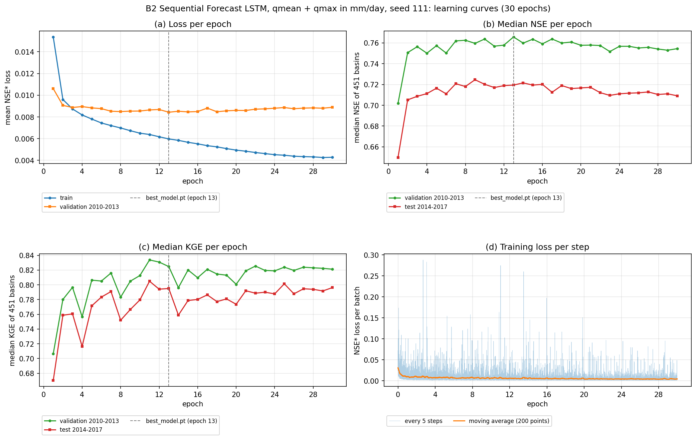
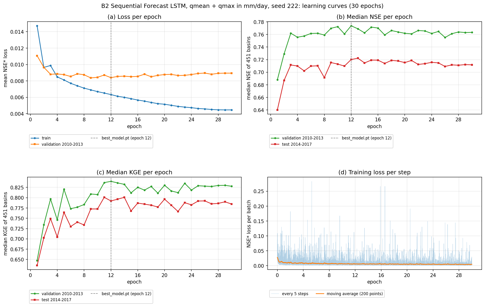
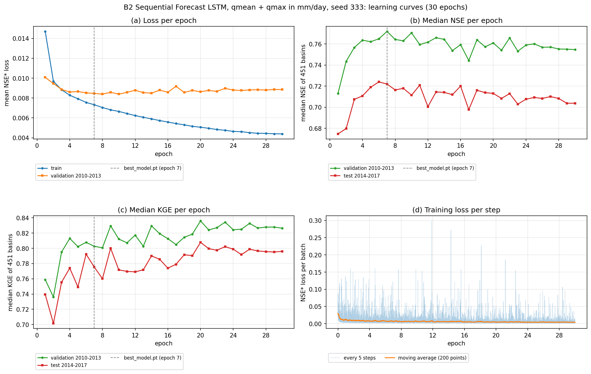

# B2 — Nhúng theo nguồn, masked mean và bộ nạp giữ mẫu thiếu đầu vào

Ba notebook `06_B2_LamaHCEExt_Train_Seed111/222/333` đã chạy đủ 30 epoch và Save Version 1; Compare B2 cũng đã Save Version 1 và đạt kiểm. Mục 7 giữ số trích log train đã làm tròn; số chính xác từ CSV/JSON Compare ở Mục 8. Chưa nhập các `.ipynb` có output tải từ bản Save hoặc nhận NPZ/environment/manifest gốc trên máy. Báo cáo này thuyết minh cả train và Compare theo quy ước mỗi bước một báo cáo.

## 1. Nguồn B1b và thư viện

B2 xây trên [B1b](../04_B1b_LamaHCEExt_Train/04_B1b_LamaHCEExt_Train.md) Version 1, thư viện nguồn `f229e02bf98cbd979835a4b6cd503d0e3adb8bc3`. Hai cột `qmean_mmd`, `qmax_mmd` được dựng lại từ raw bằng chính Phần 3 B1b: đổi Q m³/s sang mm/ngày theo `area_gov`, dùng phép đổi đơn vị của nhãn; giữ cột khí tượng và căn theo ngày. B1b đã xóa cây Q tạm khỏi Output, vì vậy B2 không yêu cầu cây này tồn tại trong bàn giao.

Các thí nghiệm B2 đã lưu pin commit **`2ccaa147a6ec87d0f56fa3e2f11b1bf38079253f`** trên nhánh `codex/b2-source-masked-mean`, kết hợp mã B2 `cac96c5` và `research` tại `fed53dc`. Nguồn, cấu hình và output Version 1 giữ nguyên. Bản tích hợp bàn giao cho C là `db6dc1ffcd8c14994cd80be3ed8ff417002c01a1`, kết hợp B2 và `research` tại `5844037` trên nhánh `codex/b2-c-ready`. `configure_lamah_b2` nhận thêm `sequential_forecast`; mặc định xác suất che bằng 0 như B2, còn `preserve_masking=True` giữ xác suất của cấu hình B3. Có 15 kiểm mới đạt; [biên bản tích hợp](../../04_Setup/Tables/B2_C_integration_checks.json) ghi kết quả kiểm hồi quy. Kiểm T4 57 + 4 của thí nghiệm thuộc 2ccaa14, không chứng minh bản tích hợp C mới đã chạy trên T4.

## 2. Kiểm T4 bắt buộc trước huấn luyện

Trên chính [notebook Setup B2 hiện có](../../04_Setup/01_B2_LamaHCEExt_DataLoader.ipynb), chạy Phần 9.3 bằng T4 rồi Save Version. Phần này dùng [B2_T4_Check.py](../../../Tools/B2_T4_Check.py), kiểm 57 ca B2 và mô hình chung, gồm kiểm CUDA, cùng bốn ca huấn luyện dài của `test_gpu_loader.py` với fixture `cuda:0`. Đầu ra có `b2_t4_check/B2_t4_check.json`, log, XML và `manifest.json`. Gắn Output bản Save này làm Input ba notebook train. Setup chạy CPU không thay kiểm T4.

Phần 1 train kiểm kết quả T4 thật: đúng commit, thiết bị T4, Python/PyTorch, hash mọi tệp, các số đếm trong JSON và XML: **57 + 4, không failure/error/skip**, fixture đã khôi phục. Thiếu hoặc chưa đạt thì dừng trước pip và huấn luyện. Không có cờ sửa tay hoặc receipt phê duyệt tự đặt.

Kiểm CPU sau gộp có **64 ca đạt, một CUDA bỏ qua**, gồm bộ kiểm B2, đủ 43 kiểm mô hình chung và tám ca B3. Output Setup xác nhận thêm **57+4 kiểm T4 đạt, không failure/error/skip**, commit `2ccaa14`, Tesla T4, Python 3.13.15, torch 2.11.0+cu128. Ba run train đã hoàn tất. Cổng train đọc JSON/XML/manifest gốc và kiểm dữ liệu/config trước epoch đầu; không cần lặp lại kiểm T4 đã đạt.

## 3. Cài đặt và Input train

Mỗi notebook: GPU T4, Internet On, Persistence Files only. Gắn dataset `lamah-ce-ext`, Output B1b **cùng seed** Version 1 và Output Setup B2 đã đạt T4. Không chuyển kết quả trung gian thành Dataset mới. Ba tệp cùng quy trình, chỉ khác `RUN_SEED`; mỗi seed có notebook riêng, không phải sửa công tắc trong mã.

| Notebook train B2 | Output B1b cần gắn, Version 1 |
|---|---|
| [Seed111](06_B2_LamaHCEExt_Train_Seed111.ipynb) | `04_B1b_LamaHCEExt_Train_Seed111` |
| [Seed222](06_B2_LamaHCEExt_Train_Seed222.ipynb) | `04_B1b_LamaHCEExt_Train_Seed222` |
| [Seed333](06_B2_LamaHCEExt_Train_Seed333.ipynb) | `04_B1b_LamaHCEExt_Train_Seed333` |

Cả ba cùng gắn `lamah-ce-ext` và Output `01_B2_LamaHCEExt_DataLoader` chứa thư mục `b2_t4_check` đã đạt 57+4 kiểm. Không dùng Output B1 Compare thay cho Output notebook train B1b. Chạy từ Phần 1 trong phiên mới; các Phần 1–4 kiểm nguồn và dữ liệu trước khi Phần 5 bắt đầu huấn luyện.

B2 đọc `b1b_output/environment.json` theo seed, kiểm giao thức 30 epoch, `q_inputs`, commit nguồn và SHA-256 config theo `manifest.csv`. Cấu hình B1b đã lưu là nguồn trực tiếp; các khóa khoa học được đối chiếu mốc tác giả cộng thay đổi Q. Không cần `B2_B1_review.json`, `B2_compare_review.json` hoặc manifest toàn cây forcing đã bị xóa ở B1b.

## 4. Các Phần train

| Phần | Công việc |
|---|---|
| 1 | Kiểm Output T4 bắt buộc, cài đúng commit bằng `--no-deps`, yêu cầu phiên sạch và kiểm GPU |
| 2 | Đọc dữ liệu/mốc tác giả, 451 ID, config và manifest Output B1b cùng seed Version 1 |
| 3 | Dựng lại hai cột Q bằng quy trình B1b; kiểm đủ các ID, ngày, đơn vị và mặt nạ |
| 4 | Tạo nhóm nguồn/masked mean; đếm dataset thật, kiểm tham số và mảng Q trước chuẩn hóa |
| 5 | Huấn luyện đủ 30 epoch, validation mỗi epoch; không dừng sớm |
| 6 | Chấm test mọi epoch, kiểm tensor `best_model.pt` trùng epoch có NSE validation cao nhất; kiểm tập ID có NSE theo nhãn thực, test chỉ theo dõi |
| 7 | Đường học và loss theo bước, kỳ ngày từ config, chú giải ngoài vùng vẽ |
| 8 | Lưu nguồn B1b, hash kiểm T4, môi trường, summary và manifest; xóa đúng cây Q tạm trong working |

B2 giữ các ID thiếu Q đầu vào, nên số ID có NSE test không cố định là 450 của B1b. Phần 6 đối chiếu tập ID có NSE hữu hạn với các ID có đủ nhãn test và mẫu số NSE dương, bao gồm ID 55 nếu đủ nhãn. Audit checkpoint/evaluation được lưu CSV riêng; Phần 8 chỉ đánh dấu `ready_for_evaluation=True` khi tất cả kiểm đạt. Nếu chưa đạt, vẫn lưu trọng số, log và manifest trước khi báo lỗi để có thể rà kết quả.

Năm nhóm hindcast 21/7/1/2/2 biến, một nhóm forecast năm ECMWF HRES; dùng `SequentialForecastLSTM`, masked mean, không che train, không counter. Lõi, kích thước ẩn, head, loss, scaler và giao thức B1b giữ nguyên. `qmax` nhãn tách khỏi `qmax_mmd` quá khứ; Q đầu vào kết thúc t−1.

Cấu hình có **84865 tham số**, so với B1b 84801: bốn bias nhúng hindcast bổ sung, mỗi bias 16 chiều. Kiểm tập mẫu dự kiến **1112307 mẫu train**, từ số đếm raw đã kiểm độc lập; batch 256 cho 4345 bước/epoch. Đây là điều kiện kiểm trước lần huấn luyện B2 thật, chưa phải kết quả một run B2 chính thức. Scaler vẫn tính theo mã nền B1b, kể cả warmup đầu vào, không dùng thay đổi chuẩn hóa của prototype.

Đầu ra: `b2_runs/`, `b2_output/`, `b2_configs/`. Manifest dùng đường dẫn tương đối từ `/kaggle/working`, bao phủ config, curve, summary, environment và các tệp run được Compare đọc.

## 5. Compare và NPZ

[07_B2_LamaHCEExt_Compare.ipynb](../07_B2_LamaHCEExt_Compare/07_B2_LamaHCEExt_Compare.ipynb) chạy CPU, Input gồm ba Output `06_B2_LamaHCEExt_Train_Seed111/222/333` **Version 1**, Output `05_B1_LamaHCEExt_Compare` Version 1 và `02_A3_LamaHCEExt_Benchmarks` Version 1. Không cần Input Setup hoặc dữ liệu raw cho Compare. Chạy nguyên Save & Run All trong phiên mới. Compare B2 đã có output đạt và được xác nhận Save Version 1; kết quả chính xác ở Mục 8.

Tên nhúng trong `environment.json` của lần chạy có thể vẫn là `07_B2_LamaHCEExt_Train_Seed…`, do notebook được sửa thứ tự thành 06. Compare chấp nhận đúng hai tên này, vẫn kiểm seed, bước, commit, config và manifest. Tên nguồn Kaggle đã xác nhận là 06 Version 1; `B2_input_sources.csv`, metadata NPZ và environment Compare giữ riêng tên nhúng thực tế, không sửa artifact đã Save hoặc yêu cầu chạy lại train.

| Phần | Công việc |
|---|---|
| 1 | Tự tìm ba environment B2, kiểm manifest/config/checkpoint/curve, commit, hash kiểm T4 và nguồn B1b; kiểm B1 Compare và hash A3 |
| 2 | Bảng seed, trung bình/độ lệch chuẩn mẫu; đặt cạnh validation B1b và ngưỡng B0, chưa chọn B* |
| 3 | Xuất ba NPZ test/S0/hạn 1, đọc ngược và đối chiếu NSE với thư viện |
| 4 | Hình đường học validation/test, dấu checkpoint chọn bằng validation |
| 5 | `b2_summary.json`, `environment.json`, audit hợp đồng và manifest |

Ba NPZ `SeqLSTM_Q_B2_seed{111,222,333}_test_S0_lead1.npz` theo đúng ngày, ID, diện tích, quan trắc và persistence A3; giữ dự báo thô riêng và chặn âm theo config. NSE tính lại với obs riêng của run được đối chiếu thư viện ở ngưỡng 10⁻⁵; NSE với obs canonical A3 trong NPZ được ghi riêng. Obs run và A3 phải trùng mặt nạ và khớp giá trị với `rtol=atol=10⁻⁵`, cho phép sai số chuẩn hóa/khôi phục float32. Chênh trung bình các median được báo riêng với kết quả trên giao ngày chung của bộ đánh giá. Ngưỡng B* vẫn lấy từ B0. Chưa xuất/chấm validation và S1–S4 trong Compare này; các dự báo đó còn cần để chọn B* sau B2/B3.

## 6. Kiểm cục bộ và giới hạn

Bộ kiểm chuẩn bị hiện có **36 ca đạt**: cú pháp, đồng bộ `.py`/`.ipynb`, hash nguồn, output rỗng; fixture Q ba ID; cấu hình nhóm và 84865 tham số; giữ mảng chuẩn hóa; từ chối fixture ba ID do chưa đủ tập raw451. Compare chạy trọn năm Phần bằng artifact giả 451 ID, tạo ba NPZ có NSE khớp fixture và manifest đúng hash; sai manifest nguồn bị từ chối. Kiểm schema cổng T4 bằng dữ liệu giả xác nhận cách đọc/đối chiếu JSON/XML và từ chối skip, không xác nhận GPU.

Phần 5–8 của từng notebook đã chạy bằng ba lượt CPU ngắn tương ứng seed 111/222/333, mỗi lượt hai epoch trên ba lưu vực giả và cấu hình nhỏ. Cả ba chọn đúng checkpoint theo validation, chấm test theo epoch, so Tester có/không cache, ghi audit và manifest khớp hash, dọn đúng cây Q tạm. Đây là kiểm luồng thực thi; metadata cài package Git được giả lập trong fixture cục bộ dùng source trực tiếp. Cấu hình gửi Kaggle vẫn đủ 30 epoch và 451 ID. Hai ca hồi quy bổ sung xác nhận ID 55 được tính nếu nhãn đủ điều kiện và run có audit chưa đạt vẫn lưu kết quả nhưng không được đánh dấu sẵn sàng cho Compare.

Rà soát trước chạy xác nhận cả ba notebook có tám cell mã, đúng cú pháp, đồng bộ nguồn và hash, chỉ khác `RUN_SEED`. Bảy hàm dựng Q trùng AST với B1b; năm phương thức nạp dữ liệu và chuẩn hóa được đối chiếu trực tiếp với source `f229e02`, không đổi AST. Không phát hiện lỗi chặn chạy trong phạm vi kiểm mã, fixture và log T4 đã nhận.

Sau khi nhận log train, bộ 36 kiểm chuẩn bị được chạy lại đạt, gồm trọn Compare tạo ba NPZ từ artifact giả. Ba hồi quy bổ sung đạt: nhận tên nhúng cũ nhưng ghi đúng nguồn Kaggle 06 Version 1, từ chối tên nguồn ngoài hợp đồng, từ chối obs run khác A3 ngay cả khi NSE native tự nhất quán. Các kiểm này xác nhận mã Compare, không phải kết quả chấm NPZ B2 thực tế.

Artifact giả chỉ ở scratch, không nằm trong Figures/Tables như kết quả B2. [Bằng chứng kiểm chuẩn bị](Tables/B2_preparation_checks.json) ghi các kiểm và hash source; [kết quả rà output Setup/Evaluation](Tables/B2_received_output_review.json) có phạm vi riêng với [rà log train B2](Tables/B2_received_train_review.json). Các `.ipynb` trong repo vẫn là bản nguồn không có execution count/output; ba bản train trên Kaggle đã Save Version 1, còn bản tải về có output chưa được nhập vào repo. B3 đã hoàn tất sáu run train Version 1, Compare Version 1 và chấm chung 32 run trong Evaluation Version 8 đã đạt; chưa chọn B*.

## 7. Kết quả ba run B2 Version 1

Nguồn là `SEED 111.txt`, `SEED 222.txt`, `SEED 333.txt` và ba PNG gốc. Bảng console có điểm số làm tròn năm chữ số thập phân, nên các số tổng hợp dưới đây là xấp xỉ, chưa thay `summary_*.json` hoặc bảng Compare đọc artifact gốc. [Bảng seed trích log](Tables/B2_received_seed_table.csv), [90 hàng đường học trích log](Tables/B2_received_curves.csv) và [biên bản kiểm có SHA-256 nguồn](Tables/B2_received_train_review.json).

| Seed | Epoch chọn | NSE validation | NSE test | KGE test | ID có NSE test | Giờ tiến trình train + validation |
|---:|---:|---:|---:|---:|---:|---:|
| 111 | 13 | 0,76573 | 0,71945 | 0,79501 | 451 | 2,06 |
| 222 | 12 | 0,77377 | 0,72014 | 0,79221 | 451 | 1,99 |
| 333 | 7 | 0,77189 | 0,72197 | 0,77534 | 451 | 2,13 |
| Trung bình ± SD mẫu | | 0,77046 ± 0,00421 | 0,72052 ± 0,00130 | 0,78752 ± 0,01064 | | |

Mỗi run có 30 cặp loss/metric train-validation và 18 kiểm hiển thị đều đạt, tổng 54 kiểm của ba log. Checkpoint trùng tensor đúng một epoch, trùng cực đại NSE trung vị validation và epoch ghi best cuối cùng. NSE test có/không cache lệch 0, mặt nạ NaN trùng; dataset test đủ 451 ID, không bỏ ID. Các CSV test của best và epoch tương ứng có cùng kích thước và tiền tố hash trong log. Hash tệp checkpoint không được dùng thay kiểm tensor vì định dạng lưu có thể khác dù trọng số bằng nhau.

Ba PNG được đối chiếu đúng số byte và tiền tố SHA-256 12 ký tự trong manifest in ra; đã lưu nguyên tệp tại Figures. Đây là kiểm ảnh với bảng manifest hiển thị, không phải kiểm toàn bộ manifest gốc. Bộ nhớ GPU lấy mẫu lớn nhất là 2897 MiB ở cả ba seed; trung vị sử dụng GPU 95–96%. Thời gian trong bảng chỉ gồm tiến trình train-validation; chấm test 31 lượt thêm khoảng 30,5–31,1 phút, chưa gồm mọi bước chuẩn bị và kiểm không cache.

*Seed 111: chọn epoch 13 theo NSE validation. Loss train tiếp tục giảm về cuối nhưng NSE validation không vượt đỉnh đã chọn.*

*Seed 222: chọn epoch 12; checkpoint không chọn theo cực đại test ở epoch 13.*

*Seed 333: chọn epoch 7. KGE có thể tiếp tục cải thiện ở epoch khác vì tiêu chí chọn checkpoint là NSE validation. Các đỉnh loss từng batch không đi kèm phân kỳ của loss trung bình.*

Các đường học cho thấy khoảng cách train-validation tăng về cuối, phù hợp quá khớp; không có dấu hiệu NaN hoặc mất ổn định kéo dài trong log. Không cần đổi epoch đã chọn hay huấn luyện lại theo đường test. Trung bình NSE validation B2 thấp hơn số báo cáo B1b khoảng 0,00408, nhỏ hơn mốc nhiễu B0 0,007932. Tuy nhiên B2 có 451 ID có NSE test, B1b có 450: chênh hai median báo cáo chưa phải hiệu trên cùng giao ngày–ID. Kết quả chấm chung và kiểm định theo lưu vực của Evaluation Version 7 được trình bày tại Mục 9; chưa chọn B*. [B3 hai mức che](../08_B3_LamaHCEExt_Train/08_B3_LamaHCEExt_Train.md) đã chạy đủ sáu run 30 epoch, Version 1 cả sáu; Compare Version 1 và chấm chung 32 run trong Evaluation Version 8 đã đạt.

## 8. Compare B2 Version 1 và bàn giao bộ đánh giá

`07_B2_LamaHCEExt_Compare` đã Save Version 1. Đã kiểm năm CSV, một JSON và một PNG gốc: **48 kiểm chéo đạt**, mọi tệp khớp số byte và tiền tố SHA-256 12 ký tự của manifest in trong log. Các tệp được giữ nguyên byte ở [Tables Compare](../07_B2_LamaHCEExt_Compare/Tables/) và [hình ba seed](../07_B2_LamaHCEExt_Compare/Figures/B2_Seeds.png); [phạm vi kiểm](../07_B2_LamaHCEExt_Compare/Tables/B2_received_Compare_review.json) phân biệt dữ liệu nhận trên máy với NPZ/environment/manifest gốc sẽ được đọc từ Kaggle.

| Seed | Epoch | NSE validation | NSE test thư viện | NSE test canonical A3 từ NPZ |
|---:|---:|---:|---:|---:|
| 111 | 13 | 0,765732304 | 0,719445211 | 0,719445181 |
| 222 | 12 | 0,773771503 | 0,720144381 | 0,720144356 |
| 333 | 7 | 0,771891836 | 0,721967728 | 0,721967734 |

Trung bình ± SD mẫu NSE trung vị validation là **0,770465215 ± 0,004205189**; test thư viện **0,720519107 ± 0,001302339**. Hiệu trung bình validation B2 − B1b là **−0,004078662**, có trị tuyệt đối nhỏ hơn mốc nhiễu B0 **0,007932303**. Đây vẫn là so hai số báo cáo, chưa phải kết quả trên giao ngày chung và không chọn B*.

Cả ba hợp đồng đạt: đúng 1461 ngày × 451 ID, **658911 dự báo hữu hạn** mỗi seed; chặn âm theo config. Có 1789/2021/1681 dự báo thô âm của seed 111/222/333. Sai lệch NSE tính lại lớn nhất là **7,215533×10⁻⁷**, nhỏ hơn 10⁻⁵. Mặt nạ obs trùng A3; max sai lệch obs khoảng **1,128066×10⁻⁵ mm/ngày** vẫn được chấp nhận theo tổng dung sai tuyệt đối và tương đối float32, không áp riêng atol cho mọi giá trị. Cột `metadata_name_matches_source=False` chỉ ghi khác tên 07 nhúng và tên Kaggle 06, không phải lỗi kiểm nguồn.

Bộ đánh giá hiện có đã tích hợp tự động Output B2 Version 1, dự kiến tổng 26 run; 179 kiểm và đường chấm giả 26 run/900 dòng kiểm định đạt. [Notebook Evaluation](../../06_Evaluation/01_Evaluation_LamaHCEExt/01_Evaluation_LamaHCEExt.ipynb) chỉ cần bổ sung Input Compare B2, giữ sáu nguồn cũ. Evaluation Version 7 đã chấm đủ 26 run; kết quả trên giao chung ở Mục 9. Chưa chấm validation/S1–S4 hoặc chọn B*; B3 là bước tiếp theo.

## 9. Chấm B2 trong Evaluation Version 7

Lần chấm trên Kaggle đã hoàn tất test/S0/hạn 1 với 26 run, giữ 451 ID; giao chính 652628 ngày–ID trên 450 ID. Có 179 kiểm giao thức đạt. Đã kiểm lại toàn bộ 32 tệp output bằng 118 kiểm chéo, gồm công thức chỉ số, summary, kiểm định, mức, sự kiện, CDF và hash nguồn; tất cả đạt. [Báo cáo Evaluation Version 7](../../06_Evaluation/01_Evaluation_LamaHCEExt/01_Evaluation_LamaHCEExt.md#11-kết-quả-chấm-chung-version-7).

| Bước | NSE, TB ± SD ba median | PNSE, TB ± SD ba median | KGE, TB ± SD ba median |
|---|---:|---:|---:|
| B0 | 0,705634 ± 0,001742 | 0,505886 ± 0,004263 | 0,780034 ± 0,014840 |
| B1a | 0,707611 ± 0,006915 | 0,517773 ± 0,010138 | 0,781793 ± 0,005794 |
| B1b | 0,718258 ± 0,008573 | 0,537460 ± 0,015621 | 0,787520 ± 0,015485 |
| B2 | 0,722606 ± 0,000970 | 0,539170 ± 0,005086 | 0,787669 ± 0,010174 |

Trên cùng giao ngày, B2 tăng khoảng 0,004348 về trung bình ba NSE trung vị so với B1b. Mức tăng không đồng đều qua seed:

| Seed | B2 tốt hơn / 450 ID | Median ΔNSE B2 − B1b | Cohen dz | p Holm, họ 300 cặp |
|---:|---:|---:|---:|---:|
| 111 | 276 | 0,006241 | -0,040266 | 2,15293e-05 |
| 222 | 227 | 0,000191 | 0,066907 | 1 |
| 333 | 213 | -0,001590 | -0,053538 | 1 |

Các p Holm dùng cả họ 300 cặp mỗi chỉ số của Version 7. Median hiệu theo lưu vực khác hiệu hai median toàn tập. Chỉ seed 111 có tăng NSE với p Holm < 0,05; seed 222/333 không phát hiện khác biệt NSE ở mức này. KGE seed 333 giảm rõ; số hit sự kiện chính USWRC/ngưỡng hai năm của B2 là 201/186/192, thấp hơn 203/198/208 của B1b. Do đó kết quả chưa chứng minh lợi ích đồng đều về mọi mặt của B2.

NSE 0,722606 ± 0,000970 ở giao chung không thay số 0,720519 ± 0,001302 theo độ phủ riêng trong Compare. B2/B3 đã hoàn tất train, Compare, NPZ, chấm test/S0 trong Evaluation Version 8 và [validation S0–S4 Version 1](../../06_Evaluation/03_B_LamaHCEExt_Validation/03_B_LamaHCEExt_Validation.md#9-kết-quả-validation-version-1). Thắng xác nhận B* và gắn `freeze-C`; trước khi khớp tham số C cần áp đầy đủ cấu hình B* đã đóng băng lên khuôn hiện lấy B1b làm nền. Nếu B* là B3, gọi builder với `preserve_masking=True`. Các pin 2ccaa14 của thí nghiệm đã lưu và output giữ nguyên; bản tích hợp C là `db6dc1ffcd8c14994cd80be3ed8ff417002c01a1`. Các bản ipynb có output tải từ Kaggle chưa được nhập vào repo.