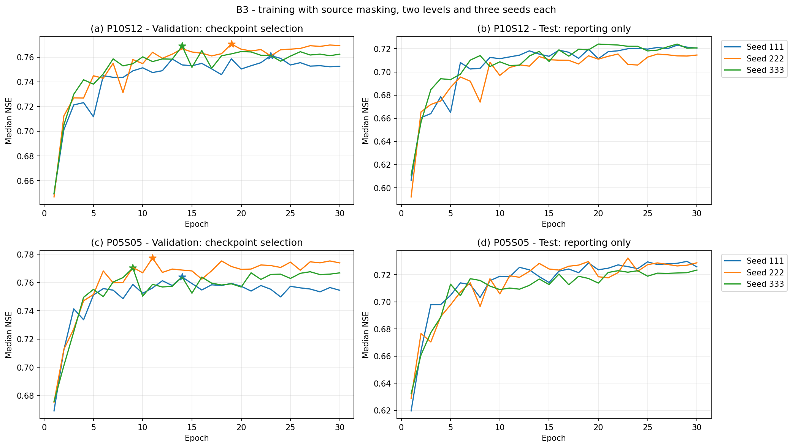

# B3 - Huấn luyện Sequential Forecast LSTM với che dữ liệu theo nguồn

B3 kiểm tra ảnh hưởng của che đầu vào khi huấn luyện trên mô hình B2. Hai mức che được chạy độc lập, mỗi mức ba hạt giống 111/222/333. Chỉ hai khóa `nan_step_probability`, `nan_sequence_probability` thay đổi; dữ liệu, bộ lọc mẫu, nhóm nguồn, nhúng, masked mean, chuẩn hóa và giao thức 30 epoch giữ nguyên B2. Thiết kế ở [Pipeline Mục 7](../../../Document/01_Plan/02_Pipeline.md#7-ma-trận-thí-nghiệm-theo-bước), mốc B2 ở [báo cáo B2](../06_B2_LamaHCEExt_Train/06_B2_LamaHCEExt_Train.md).

## 1. Cấu hình và trạng thái

| Mã mức che | p bước | p cả chuỗi | Hạt giống | Số lần train |
|---|---:|---:|---|---:|
| P10S12 | 0,10 | 0,12 | 111, 222, 333 | 3 |
| P05S05 | 0,05 | 0,05 | 111, 222, 333 | 3 |

Sáu run train đã hoàn tất 30 epoch, **Save Version 1 cả sáu**; đã nhận và kiểm sáu log Phần 5–8 cùng sáu hình nguyên gốc. Kết quả ở Mục 7. Compare Version 1 đã hoàn tất, sáu NPZ đạt audit; Evaluation Version 8 đã chấm chung đủ 32 run. Có 93 kiểm chéo Compare và 152 kiểm chéo Evaluation đạt; kết quả giao chung ở Mục 9. Validation S0–S4 Version 1 đã hoàn thành và kiểm 242 điều kiện chéo, trình bày tại Mục 10. Các `.ipynb` trong repo vẫn là bản nguồn chưa nhập output tải về; không tự điền output hoặc execution count từ tệp văn bản.

Thí nghiệm B3 được pin ở `2ccaa147a6ec87d0f56fa3e2f11b1bf38079253f`, cùng commit của B2. B3 dùng nhánh che trong `BaseDataset._add_nan_streaks` và `GpuBatchLoader._add_nan_streaks`, không thêm hoặc đổi thuật toán thư viện. Bản tích hợp bàn giao cho C là `db6dc1ffcd8c14994cd80be3ed8ff417002c01a1`, kết hợp B2 và `research` tại `5844037`; các pin, hash và output Version 1 của B3 giữ nguyên.

## 2. Notebook và Input

Mỗi tệp dưới đây tự đủ mã, chạy nguyên bằng Save & Run All. GPU **T4**, Internet **On** để cài đúng commit bằng `--no-deps`; không cài lại các gói nền.

| Mức | Seed | Notebook |
|---|---:|---|
| P10S12 | 111 | [08_B3_LamaHCEExt_Train_P10S12_Seed111](08_B3_LamaHCEExt_Train_P10S12_Seed111.ipynb) |
| P10S12 | 222 | [08_B3_LamaHCEExt_Train_P10S12_Seed222](08_B3_LamaHCEExt_Train_P10S12_Seed222.ipynb) |
| P10S12 | 333 | [08_B3_LamaHCEExt_Train_P10S12_Seed333](08_B3_LamaHCEExt_Train_P10S12_Seed333.ipynb) |
| P05S05 | 111 | [08_B3_LamaHCEExt_Train_P05S05_Seed111](08_B3_LamaHCEExt_Train_P05S05_Seed111.ipynb) |
| P05S05 | 222 | [08_B3_LamaHCEExt_Train_P05S05_Seed222](08_B3_LamaHCEExt_Train_P05S05_Seed222.ipynb) |
| P05S05 | 333 | [08_B3_LamaHCEExt_Train_P05S05_Seed333](08_B3_LamaHCEExt_Train_P05S05_Seed333.ipynb) |

Mỗi notebook train gắn ba Input:

| Input | Bản nguồn | Vai trò |
|---|---|---|
| Dataset `lamah-ce-ext` | Cùng dữ liệu của B2 | LamaH_extended, Experiments, danh sách 451 ID và cấu hình tác giả |
| Output `01_B2_LamaHCEExt_DataLoader` | Bản đã chạy T4 đạt Phần 9.3, 57 + 4 ca | JSON/XML/log/manifest gốc của kiểm T4; kiểm đúng commit, Python và torch |
| Output B2 theo bảng đối chiếu dưới đây | **Version 1** | Config, scaler, audit số mẫu, environment và manifest của mốc B2 |

Gắn nguyên Output của notebook nguồn bằng **Add Input**, không tải lên riêng từng JSON/CSV. Hai Input đầu giống nhau cho cả sáu run; Input thứ ba chọn đúng tên ở bảng sau:

| Notebook B3 cần chạy | Output notebook B2 cần gắn | Version B2 |
|---|---|---:|
| `08_B3_LamaHCEExt_Train_P10S12_Seed111` | `06_B2_LamaHCEExt_Train_Seed111` | 1 |
| `08_B3_LamaHCEExt_Train_P10S12_Seed222` | `06_B2_LamaHCEExt_Train_Seed222` | 1 |
| `08_B3_LamaHCEExt_Train_P10S12_Seed333` | `06_B2_LamaHCEExt_Train_Seed333` | 1 |
| `08_B3_LamaHCEExt_Train_P05S05_Seed111` | `06_B2_LamaHCEExt_Train_Seed111` | 1 |
| `08_B3_LamaHCEExt_Train_P05S05_Seed222` | `06_B2_LamaHCEExt_Train_Seed222` | 1 |
| `08_B3_LamaHCEExt_Train_P05S05_Seed333` | `06_B2_LamaHCEExt_Train_Seed333` | 1 |

Output `01_B2_LamaHCEExt_DataLoader` là cùng bản đã gắn khi chạy B2, có `b2_t4_check/B2_t4_check.json`, `manifest.json`, `b2_and_cores.xml`, `b2_and_cores.log`, `four_training_cuda.xml`, `four_training_cuda.log`. Mã kiểm đủ 57 + 4 ca và hash các tệp; số Save Version của nguồn Setup chưa được ghi nhận riêng nên không điền số suy đoán.

Hai mức che của cùng seed dùng cùng Output B2. Không cần gắn lại Output B1b, A3 hoặc Evaluation vào notebook train. Tên `07_B2…Train…` còn nhúng trong environment B2 được giữ nguyên; tên nguồn thực là `06_B2…Train…` Version 1. Phần 2 lưu cả hai tên cùng hash, không sửa artifact nguồn.

## 3. Quy tắc che và tính nhân quả

Hindcast gồm năm nhóm ERA5-Land/E-OBS/MSWEP/GLEAM/Q, lần lượt 21/7/1/2/2 biến. Hai biến `qmean_mmd`, `qmax_mmd` cùng nhóm Q và dùng chung lượt che thêm. Forecast có một nhóm gồm năm biến ECMWF HRES. Hai xác suất áp dụng cho tất cả nhóm, không đặt riêng cho Q.

Mỗi nhóm được lấy lượt che cả chuỗi và lượt che từng bước; mặt nạ cuối là phép OR của hai lượt. Nếu lượt che cả chuỗi chọn hết mọi nhóm trong một pha, thư viện khôi phục một nhóm. Quy tắc này không bảo đảm còn nguồn hữu hạn ở mọi bước: che từng bước hoặc thiếu tự nhiên vẫn có thể làm mọi nguồn thiếu tại một thời điểm; masked mean xử lý trường hợp đó. Forecast chỉ có một nhóm, nên lượt che cả chuỗi ECMWF HRES được khôi phục; che từng bước vẫn áp dụng. Không cộng hai xác suất để diễn giải thành tỷ lệ thiếu thực tế.

Che chỉ thực hiện khi `is_train=True`, sau khi scaler và lookup đã được dựng từ dữ liệu gốc. Validation/test S0 giữ thiếu tự nhiên và không che thêm, dù config vẫn ghi hai xác suất train. Nhãn, dữ liệu đã lưu trong dataset và scaler không bị sửa bởi lượt che. Q lịch sử dừng ở t−1; nhãn `qmax` tách khỏi hai cột đầu vào; forecast dùng ngày t, không thêm counter hoặc cách nhiều hạn của bước H. Nguồn: mã thư viện pin ở trên, `datasetzoo/basedataset.py`, `datautils/gpu_loader.py`, `modelzoo/inputlayer.py`.

## 4. Nội dung notebook train

| Phần | Nội dung và điều kiện |
|---|---|
| 1 | Kiểm receipt T4 57 + 4, hash và XML; cài đúng commit; xác nhận T4 và môi trường |
| 2 | Kiểm dữ liệu/config tác giả; đọc B2 cùng seed; kiểm manifest, config, scaler, số mẫu và giao thức nguồn |
| 3 | Dựng lại hai cột Q mm/ngày từ D_gauges theo area_gov, giữ quy trình B1b/B2, không đổi đơn vị lần hai |
| 4 | Đối chiếu config B2; xác nhận chỉ đổi hai xác suất; kiểm **1.112.307 mẫu**, **4.345 bước/epoch**, **84.865 tham số**; scaler khớp B2; probe che dữ liệu thật trên T4 |
| 5 | Train 30 epoch trong tiến trình riêng; validation mỗi epoch; không dừng sớm; lưu log và thời gian |
| 6 | Kiểm `best_model.pt` trùng đúng checkpoint có NSE trung vị validation cao nhất; chấm test mọi epoch để báo cáo; kiểm cache/không cache và ID có NSE |
| 7 | Hình loss, NSE/KGE và loss theo bước; đường chọn checkpoint chỉ dựa validation |
| 8 | Summary, environment và manifest bao phủ config, checkpoint, scaler, bảng và hình; dọn cây Q tạm |

Probe Phần 4 dùng tối đa 128 mẫu từ dataset thật, giữ nguyên cấu hình mô hình. Probe kiểm mặt nạ chung trong nguồn, không đổi giá trị còn giữ, không điền thiếu tự nhiên, không đổi nhãn/storage, forward/backward/optimizer hữu hạn, và tắt che khi đánh giá. Mô hình probe thực hiện một bước optimizer riêng rồi bỏ; train chính khởi tạo lại seed và trọng số trong tiến trình mới. Probe này là kiểm trước train, không được tính vào 30 epoch chính thức.

Output nằm ở `/kaggle/working/b3_output`, run ở `b3_runs/`, config ở `b3_configs/`. `B3_config_delta.csv` ghi đúng hai thay đổi; `B3_mask_preflight.csv` lưu kết quả kiểm T4 của chính run. Cuối notebook dừng nếu kiểm checkpoint/test không đạt; artifact lỗi không được nhận vào Compare.

## 5. Notebook Compare và hợp đồng NPZ

[09_B3_LamaHCEExt_Compare](../09_B3_LamaHCEExt_Compare/09_B3_LamaHCEExt_Compare.ipynb) chạy **CPU, Internet Off**, Input là **Version 1 đã lưu của cả sáu notebook B3**. Sáu nguồn đã được xác nhận; mã đọc JSON/CSV/pickle nguyên gốc từ Output, không dùng bảng chép từ log đã làm tròn để kiểm số chính xác.

Input Compare gồm sáu Output train B3, Output `07_B2_LamaHCEExt_Compare` **Version 1** và Output `02_A3_LamaHCEExt_Benchmarks` **Version 1**. Không cần gắn Dataset gốc hoặc Output train B2. Mã kiểm hash nối nguồn B2 của mỗi run với hash trong Compare B2; config khoa học của sáu run phải giống nhau ngoài seed và hai xác suất.

| Output notebook cần gắn vào Compare | Version |
|---|---|
| `08_B3_LamaHCEExt_Train_P10S12_Seed111` | 1 |
| `08_B3_LamaHCEExt_Train_P10S12_Seed222` | 1 |
| `08_B3_LamaHCEExt_Train_P10S12_Seed333` | 1 |
| `08_B3_LamaHCEExt_Train_P05S05_Seed111` | 1 |
| `08_B3_LamaHCEExt_Train_P05S05_Seed222` | 1 |
| `08_B3_LamaHCEExt_Train_P05S05_Seed333` | 1 |
| `07_B2_LamaHCEExt_Compare` | 1 |
| `02_A3_LamaHCEExt_Benchmarks` | 1 |

Compare có năm Phần: kiểm nguồn/config/checkpoint/probe; tổng hợp mean và SD mẫu qua ba seed của từng mức; xuất và kiểm sáu NPZ; vẽ đường học; ghi summary/environment/manifest. Các tệp NPZ có tên `SeqLSTM_Q_B3_P10S12_seed{111,222,333}_test_S0_lead1.npz` và tương tự cho P05S05, nằm trong `/kaggle/working/b3_compare/contracts/`.

Ngày, thứ tự 451 ID, diện tích, obs và persistence lấy canonical từ A3. Sim thô được giữ riêng; sim dùng chấm tuân chính sách chặn âm. Kiểm NSE tính lại dùng mặt nạ **obs/sim hữu hạn**, đúng phạm vi chỉ số của thư viện, không yêu cầu persistence cho audit này. So sánh chung nhiều run trong Evaluation dùng mặt nạ riêng có persistence và mọi dự báo hữu hạn. Sai lệch NSE tối đa cho audit là 10⁻⁵; obs native phải trùng mặt nạ và khớp A3 trong sai số float32 như B2.

`b3_summary.json` giữ riêng hai mức, các seed/epoch, hai xác suất, nguồn B2 và ngưỡng validation B0. `B3_B2_reported_summary.csv` so validation S0 với B2; không dùng test để chọn mức che, seed hoặc B*. Sau Compare cần chấm chung sáu NPZ và xuất/chấm validation S0–S4 theo luật B*; không cần huấn luyện lại chỉ để bổ sung chấm kịch bản.

## 6. Kiểm chuẩn bị và kết quả thực nghiệm

Bộ kiểm CPU của thư viện gồm `test_b3_masking.py`, `test_b2_source_inputs.py`, `test_sequential_forecast.py`: **64 ca đạt, một ca CUDA bỏ qua** tại máy không có CUDA. Tám ca B3 kiểm cả hai mức với bộ nạp thường/vectorized, mặt nạ Q chung, nhãn/storage giữ nguyên, finite forward/backward, đánh giá không che và fallback khi mọi nguồn thiếu. Kiểm T4 cũ 57 + 4 của B2 không được ghi thành kiểm CUDA B3; mỗi run phải qua probe T4 ở Phần 4.

Luồng notebook đã qua **77 kiểm chuẩn bị**: đồng bộ/hash/schema của bảy cặp nguồn, đúng mức che/seed, đọc đúng artifact B2, chỉ đổi hai khóa, kiểm Q/scaler từ dữ liệu giả qua bộ nạp thật, hai probe optimizer CPU, đủ sáu NPZ trên 451 ID × 1461 ngày giả và được bộ đọc hợp đồng Evaluation hiện tại nhận. Các kiểm nguồn B2 sai, giao thức test sai và metadata xác suất sai đều dừng đúng điều kiện. Hình Compare đã được xem để kiểm bố cục. [Bằng chứng và phạm vi kiểm](Tables/B3_preparation_checks.json).

Kiểm chuẩn bị dùng ba ID giả cho bộ nạp train và 451 ID giả cho hợp đồng Compare; không chạy train 451 ID hoặc CUDA tại máy. Receipt CUDA trong fixture Compare chỉ kiểm schema và không chứng minh đã chạy T4. Kết quả train thật được tách ở Mục 7; chưa chọn B*.

## 7. Kết quả sáu run B3 Version 1

Sáu log và sáu PNG đã được đọc, băm SHA-256 đầy đủ. Có **233 kiểm chéo đạt**, ngoài **108 dòng kiểm đạt do notebook in ra** (18 mỗi run). Mỗi run có đủ 30 epoch train/validation, 30 checkpoint, 30 bộ kết quả validation và 31 bảng chỉ số test (30 epoch + best). Không có dừng sớm hoặc lỗi trong phần log đã nhận. Epoch `best_model.pt` trùng epoch NSE trung vị validation cao nhất, lần lưu best cuối và đường đánh dấu trên hình; các kiểm tensor/checkpoint do Kaggle thực hiện đều báo đạt. [Biên bản rà log và hình](Tables/B3_received_train_review.json).

### 7.1. Chỉ số tại checkpoint chọn bằng validation

| Mức che | Seed | Epoch chọn | NSE validation | NSE test | KGE test | Train + validation (giờ) |
|---|---:|---:|---:|---:|---:|---:|
| P10S12 | 111 | 23 | 0,76120 | 0,71997 | 0,75492 | 2,21 |
| P10S12 | 222 | 19 | 0,77057 | 0,71390 | 0,76744 | 2,23 |
| P10S12 | 333 | 14 | 0,76895 | 0,71771 | 0,78167 | 2,17 |
| P05S05 | 111 | 14 | 0,76390 | 0,71862 | 0,76632 | 2,26 |
| P05S05 | 222 | 11 | 0,77736 | 0,71929 | 0,77300 | 2,11 |
| P05S05 | 333 | 9 | 0,77030 | 0,71166 | 0,78574 | 2,22 |

Các giá trị lấy từ log đã làm tròn năm chữ số thập phân, không phải CSV chỉ số đầy đủ. Mỗi run có 451 ID với NSE test; validation 2010–2013, test 2014–2017. Test chỉ dùng báo cáo, không chọn lại epoch hoặc seed. [Bảng trích log](Tables/B3_received_seed_table.csv), [đường học 180 epoch](Tables/B3_received_curves.csv).

| Mức che | NSE validation, TB ± SD | NSE test, TB ± SD | KGE test, TB ± SD |
|---|---:|---:|---:|
| P10S12 | 0,76691 ± 0,00501 | 0,71719 ± 0,00307 | 0,76801 ± 0,01338 |
| P05S05 | 0,77052 ± 0,00673 | 0,71652 ± 0,00423 | 0,77502 ± 0,00987 |

TB và SD mẫu (ddof=1) tính riêng qua ba seed của từng mức che, không gộp cả sáu run thành một cấu hình. Mức P05S05 có NSE validation trung bình xấp xỉ 0,77052, gần B2 0,770465; P10S12 xấp xỉ 0,766907, thấp hơn B2 khoảng 0,00356. Hai chênh lệch nhỏ hơn độ lệch chuẩn validation B0 0,007932, nhưng không phải kiểm định tương đương hoặc quyết định B*. Các median test ở đây theo độ phủ riêng của run; chưa thay kết quả B3 trên giao ngày chung của Evaluation. Nguồn đối chiếu: [B2 Compare Version 1](../07_B2_LamaHCEExt_Compare/Tables/b2_summary.json).

### 7.2. Kiểm kỹ thuật và hình

Các bảng test best/epoch có cùng trọng số khớp cả số byte và 12 ký tự SHA-256 in trong manifest. Kiểm cache/không cache báo lệch NSE lớn nhất từng lưu vực bằng 0, mặt nạ NaN trùng nhau. Cả sáu run có 4.345 bước/epoch, 26.070 điểm loss được ghi; tiến trình train kể cả validation mất khoảng 2,11–2,26 giờ, bộ nhớ GPU lớn nhất trong các lần đọc là 3.081 MiB. Thời gian này chưa gồm toàn bộ chấm test ở Phần 6.

Sáu PNG khớp kích thước byte và tiền tố SHA-256 12 ký tự trong log; bản lưu ở `Figures/` giữ nguyên byte. Tiền tố hash của scaler, audit số mẫu và audit Q giống nhau giữa sáu run; tiền tố config delta giống nhau trong cùng mức che và khác giữa hai mức. Đây là kiểm chéo thông tin được in, chưa phải băm lại các artifact gốc chưa nhận.

| Mức | Seed 111 | Seed 222 | Seed 333 |
|---|---|---|---|
| P10S12 | [Hình seed 111](Figures/B3_Curve_B3_P10S12_SeqLSTM_Q_seed111.png) | [Hình seed 222](Figures/B3_Curve_B3_P10S12_SeqLSTM_Q_seed222.png) | [Hình seed 333](Figures/B3_Curve_B3_P10S12_SeqLSTM_Q_seed333.png) |
| P05S05 | [Hình seed 111](Figures/B3_Curve_B3_P05S05_SeqLSTM_Q_seed111.png) | [Hình seed 222](Figures/B3_Curve_B3_P05S05_SeqLSTM_Q_seed222.png) | [Hình seed 333](Figures/B3_Curve_B3_P05S05_SeqLSTM_Q_seed333.png) |

Các hình có đủ bốn ô và chú giải ngoài vùng vẽ, vạch epoch chọn đúng log. Loss train giảm; NSE validation S0 nhìn chung đi ngang về cuối, không có dấu hiệu phân kỳ kéo dài. KGE dao động mạnh hơn ở các epoch đầu; các đỉnh loss từng batch không đồng nghĩa mất ổn định toàn quá trình. Một số điểm test cao hơn sau checkpoint đã chọn không được dùng để thay epoch.

### 7.3. Phạm vi xác nhận và bước tiếp theo

Tệp văn bản bắt đầu từ Phần 5, không chứa output Phần 1–4. Manifest in tên `B3_mask_preflight.csv`, `B3_config_delta.csv`, scaler, environment và các bảng kiểm; các tệp gốc đó chưa được cung cấp tại máy. Do đó chưa coi là đã đọc lại CSV probe T4 hoặc kiểm full hash của config/trọng số. Compare Version 1 đã kiểm manifest đầy đủ, nguồn B2, giao thức, probe và chỉ số từ artifact nguyên gốc trên Kaggle trước khi xuất NPZ; kết quả và giới hạn rà tại máy ở Mục 8.

Khối ghi JSON Phần 8 của cả sáu notebook train đã được thực thi riêng trên artifact giả rồi đọc bằng đúng Phần 1 Compare: sáu nguồn được nhận, đúng cấu trúc trường và Version nguồn. Phiên kiểm schema này dùng phiên bản gói/receipt CUDA giả, không chứng minh đã chạy CUDA hoặc thay thế việc kiểm sáu Output Kaggle thật.

`09_B3_LamaHCEExt_Compare` đã Save Version 1 với tám Input đúng tên trong Mục 5. Sáu NPZ đã được chấm chung trong Evaluation Version 8; validation S0–S4 Version 1 đã hoàn thành. Kết quả ở Mục 9–10 đủ để bàn giao Thắng xác nhận B* theo luật đã ghi trước và gắn `freeze-C`.

## 8. Compare B3 Version 1

Compare đã nhận đúng sáu run train Version 1, kiểm nguồn B2 cùng seed, config, probe che và checkpoint; ngữ cảnh A3 có 1461 ngày × 451 ID. Sáu NPZ đều đọc ngược đạt, có 658911 dự báo hữu hạn mỗi run, giữ sim thô và chặn âm theo config. Các epoch giữ nguyên 23/19/14 và 14/11/9. Max sai lệch NSE so thư viện khoảng 8,99×10⁻⁷, dưới ngưỡng 10⁻⁵. [Audit sáu hợp đồng](../09_B3_LamaHCEExt_Compare/Tables/B3_contract_check.csv).

| Mức che | NSE validation, TB ± SD | NSE test, TB ± SD | KGE test, TB ± SD |
|---|---:|---:|---:|
| P10S12 | 0,766905 ± 0,005010 | 0,717190 ± 0,003067 | 0,768010 ± 0,013383 |
| P05S05 | 0,770519 ± 0,006731 | 0,716523 ± 0,004225 | 0,775022 ± 0,009868 |

Các số này tính từ CSV nguyên gốc với đầy đủ độ chính xác, khác bảng trích log làm tròn tại Mục 7. TB/SD mẫu tính qua ba seed từng mức, test theo độ phủ riêng. Delta validation P10S12 − B2 khoảng −0,00356045; P05S05 − B2 khoảng +0,00005362, chưa đủ chọn B*. [Seed table](../09_B3_LamaHCEExt_Compare/Tables/B3_seed_table.csv), [mean/SD](../09_B3_LamaHCEExt_Compare/Tables/B3_seed_stats.csv), [đối chiếu B2](../09_B3_LamaHCEExt_Compare/Tables/B3_B2_reported_summary.csv).

Đã kiểm bảy tệp nhận được bằng 93 kiểm chéo; số byte và tiền tố SHA-256 in trong log đều khớp. Summary B3 nối đúng SHA-256 summary B2 và environment B2 đã có trong manifest Evaluation Version 7; bảng nguồn nối đúng hash environment của sáu log train. Stats, seed, summary, audit và delta nhất quán. [Biên bản rà Compare](../09_B3_LamaHCEExt_Compare/Tables/B3_received_Compare_review.json). Tệp gốc NPZ/environment/manifest chưa được cung cấp tại máy; các kiểm hợp đồng và full manifest đó do phiên Kaggle thực hiện.

Hình: mỗi hàng là một mức che; cột trái có sao tại checkpoint chọn theo validation, cột phải chỉ theo dõi test. Không đổi checkpoint theo đỉnh test hoặc KGE. Bản PNG lưu nguyên byte, khớp log xuất.

[Evaluation hiện có](../../06_Evaluation/01_Evaluation_LamaHCEExt/01_Evaluation_LamaHCEExt.ipynb) đã tự đọc Output `09_B3_LamaHCEExt_Compare` Version 1 và Save Version 8 với đủ 32 run. Mã qua 205 kiểm, giữ 179 kiểm cũ; đường chấm giả có 32 run/1395 dòng kiểm định, họ Holm 465 cặp mỗi chỉ số. Phần chấm giữ nguyên công thức/giao thức; audit NPZ dùng obs/sim, độc lập persistence. Kết quả test/S0 trên giao ngày chung ở Mục 9; validation S0–S4 Version 1 ở Mục 10.

## 9. B3 trên giao ngày chung - Evaluation Version 8

Version 8 đã chấm 32 run test/S0/hạn 1, giữ 451 ID; giao chính 652628 ngày–ID trên 450 ID. Có 205 kiểm giao thức và 152 kiểm chéo trên 34 tệp đều đạt. Các hợp đồng B3 khớp nguồn/metadata; công thức metrics, summary, 1395 kiểm định, mức, sự kiện và CDF được kiểm lại. [Kết quả đầy đủ](../../06_Evaluation/01_Evaluation_LamaHCEExt/01_Evaluation_LamaHCEExt.md#12-kết-quả-chấm-chung-version-8).

| Cấu hình | NSE, TB ± SD ba median | PNSE, TB ± SD ba median | KGE, TB ± SD ba median |
|---|---:|---:|---:|
| B0 | 0,705634 ± 0,001742 | 0,505886 ± 0,004263 | 0,780034 ± 0,014840 |
| B1a | 0,707611 ± 0,006915 | 0,517773 ± 0,010138 | 0,781793 ± 0,005794 |
| B1b | 0,718258 ± 0,008573 | 0,537460 ± 0,015621 | 0,787520 ± 0,015485 |
| B2 | 0,722606 ± 0,000970 | 0,539170 ± 0,005086 | 0,787669 ± 0,010174 |
| B3 P10S12 | 0,719340 ± 0,003997 | 0,532604 ± 0,006312 | 0,767693 ± 0,014228 |
| B3 P05S05 | 0,717636 ± 0,003227 | 0,526148 ± 0,008801 | 0,775517 ± 0,009770 |

Các ô là TB ± SD mẫu của ba median trên cùng giao ngày, khác điểm theo độ phủ riêng trong Compare Mục 8. B3 P10S12 có TB ba median NSE 0,719340, P05S05 0,717636; B2 0,722606. Hướng hiệu ghép cặp dưới đây là B3 trừ B2, không phải hiệu của hai median toàn tập.

| B3 trừ B2 cùng seed | Seed | ID tốt hơn / 450 | Median ΔNSE | Cohen dz | p Holm, họ 465 cặp |
|---|---:|---:|---:|---:|---:|
| P10S12 | 111 | 208 | -0,003035 | 0,004837 | 1 |
| P10S12 | 222 | 152 | -0,008681 | -0,072082 | 1,667e-08 |
| P10S12 | 333 | 188 | -0,005903 | 0,005551 | 4,463e-04 |
| P05S05 | 111 | 193 | -0,005886 | -0,067237 | 0,206726 |
| P05S05 | 222 | 190 | -0,004716 | -0,067954 | 0,001141 |
| P05S05 | 333 | 180 | -0,004906 | 0,045485 | 3,019e-04 |

Median hiệu NSE âm ở cả sáu cặp. Seed 222/333 của cả hai mức có p Holm < 0,05, seed 111 chưa phát hiện khác biệt; họ kiểm là 465 cặp mỗi chỉ số của Version 8. KGE giảm có ý nghĩa ở seed 111/222, chưa phát hiện ở seed 333. dz có thể khác dấu median vì dùng trung bình hiệu. Không loại điểm âm hoặc chọn lại seed theo test.

| Cấu hình | Hit seed 111 / 222 / 333 | FAR (%) seed 111 / 222 / 333 |
|---|---:|---:|
| B1b | 203 / 198 / 208 | 68,18 / 68,72 / 67,65 |
| B2 | 201 / 186 / 192 | 69,68 / 70,98 / 68,16 |
| B3 P10S12 | 155 / 172 / 155 | 65,86 / 68,27 / 69,25 |
| B3 P05S05 | 172 / 182 / 173 | 67,05 / 67,15 / 66,98 |

Sự kiện chính là ngưỡng hai năm/USWRC, cùng ngày khởi phát, 1066 cụm thật. B3 có ít hit hơn B2; P05S05 đồng thời giảm FAR ở cả ba seed. Kết quả thể hiện đánh đổi giữa bắt được và báo nhầm, chưa cho thấy cải thiện S0 đồng đều. Validation S0–S4 đã hoàn thành ở Mục 10; quyết định B* thuộc Thắng, không chọn lại seed theo test.

## 10. Validation S0–S4 Version 1

[Notebook 03_B_LamaHCEExt_Validation](../../06_Evaluation/03_B_LamaHCEExt_Validation/03_B_LamaHCEExt_Validation.md#9-kết-quả-validation-version-1) đã chạy và Save Version 1, dùng đủ 12 checkpoint của B1b/B2/hai mức B3. Có 84 NPZ, 5412 đối chiếu NSE S0 khớp nguồn và 242 kiểm chéo output đạt. Giao chung là 652489 ngày–ID/450 ID; S1 giữ riêng ba độ dài mất Q, sau đó cân đều theo bốn họ S1/S2/S3/S4.

| Cấu hình | S0 nguồn, TB ± SD | Hụt S0 so với tốt nhất | S1–S4 theo họ, TB ± SD |
|---|---:|---:|---:|
| B1b | 0,77454 ± 0,00411 | 0,00000 | 0,52668 ± 0,01011 |
| B2 | 0,77047 ± 0,00421 | 0,00408 | 0,23501 ± 0,02669 |
| B3 P05S05 | 0,77052 ± 0,00673 | 0,00403 | 0,66941 ± 0,01114 |
| B3 P10S12 | 0,76690 ± 0,00501 | 0,00764 | 0,70230 ± 0,00567 |

P10S12 qua cổng S0 (độ hụt 0,0076391 < ngưỡng B0 0,0079323) và có điểm S1–S4 cao nhất ở cả ba seed. Đây là kết quả bàn giao Thắng áp luật B*, chưa ghi quyết định chọn B* hoặc gắn `freeze-C`. Kết quả chỉ xét chính sách B1b điền nhân quả đã ghi trước; test/S0 giữ nguyên báo cáo ở Mục 9. [Nguồn kết quả validation](../../06_Evaluation/03_B_LamaHCEExt_Validation/Tables/B_validation_V1_output_review.json).

Bản tích hợp `db6dc1ffcd8c14994cd80be3ed8ff417002c01a1` hỗ trợ `configure_lamah_b2` cho mô hình chung `sequential_forecast`; nếu B* là B3, cần `preserve_masking=True` để giữ đúng xác suất che, vì mặc định builder đặt hai xác suất về 0 như B2. Cần áp đầy đủ cấu hình B* đã đóng băng trước khi khớp số tham số C. Có 15 kiểm mới đạt, kết quả hồi quy ghi ở [biên bản tích hợp](../../04_Setup/Tables/B2_C_integration_checks.json); bằng chứng T4 của B2/B3 chỉ thuộc 2ccaa14.