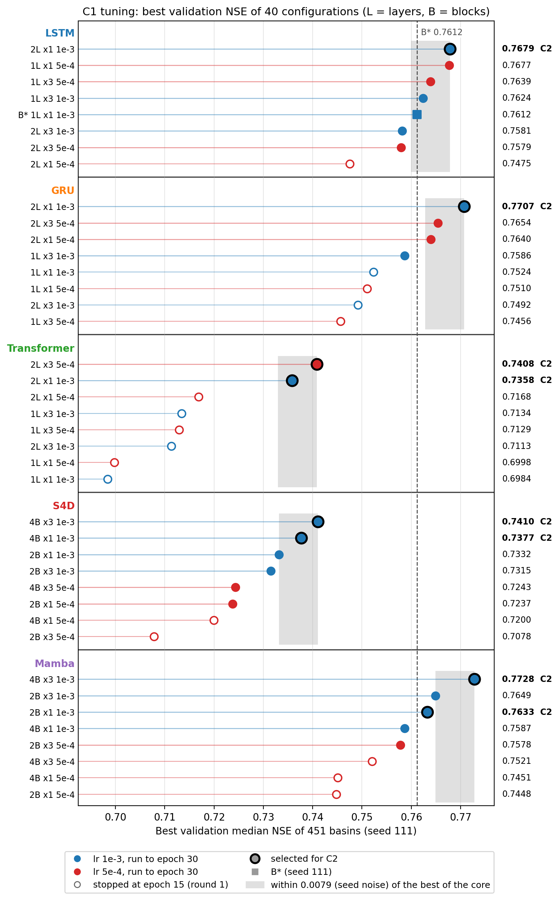
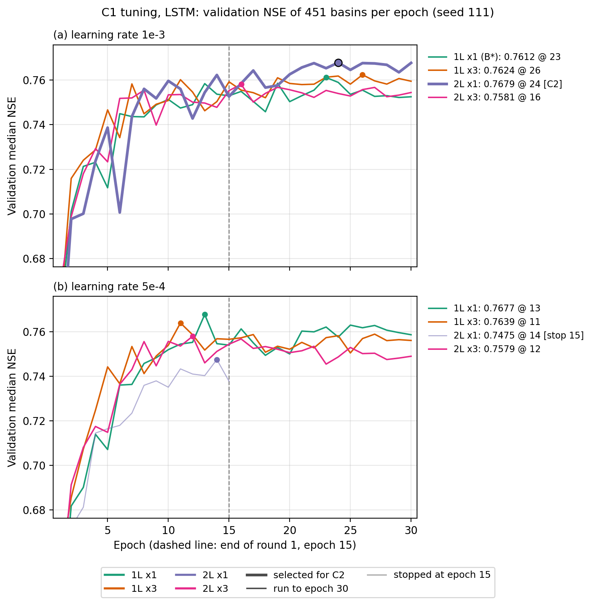
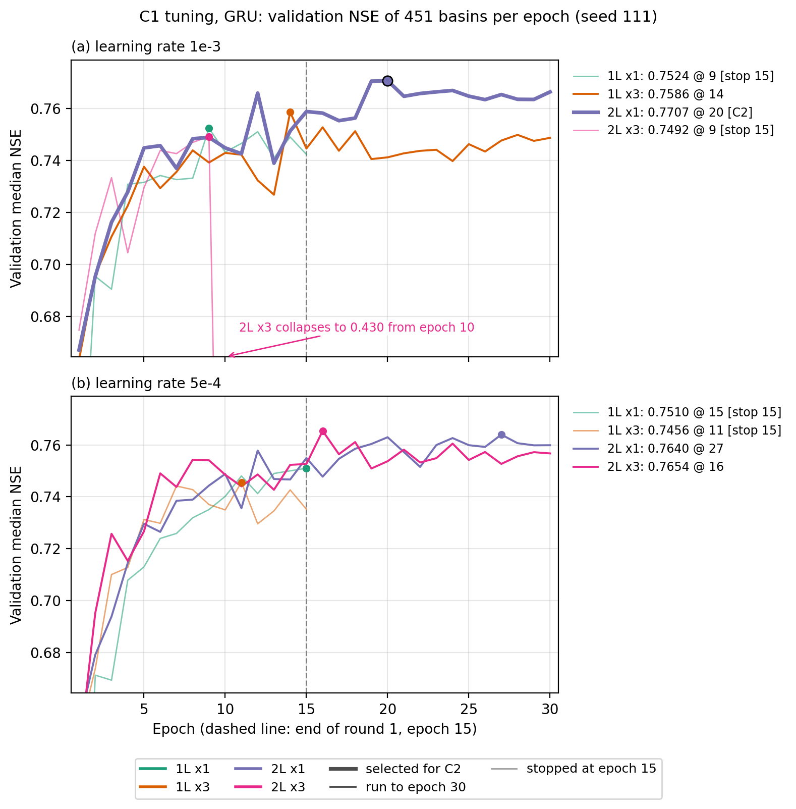
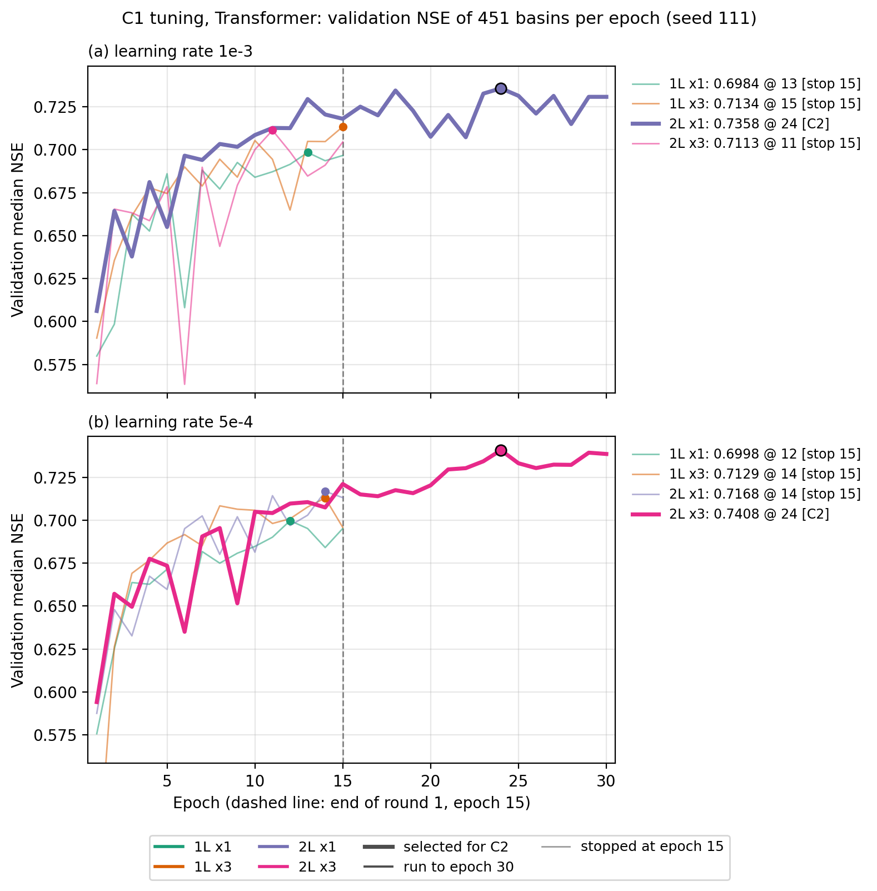
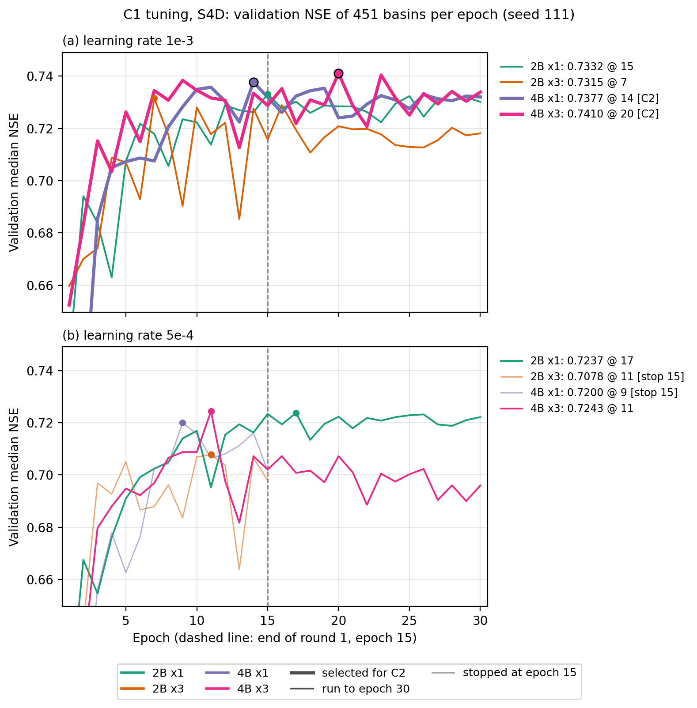
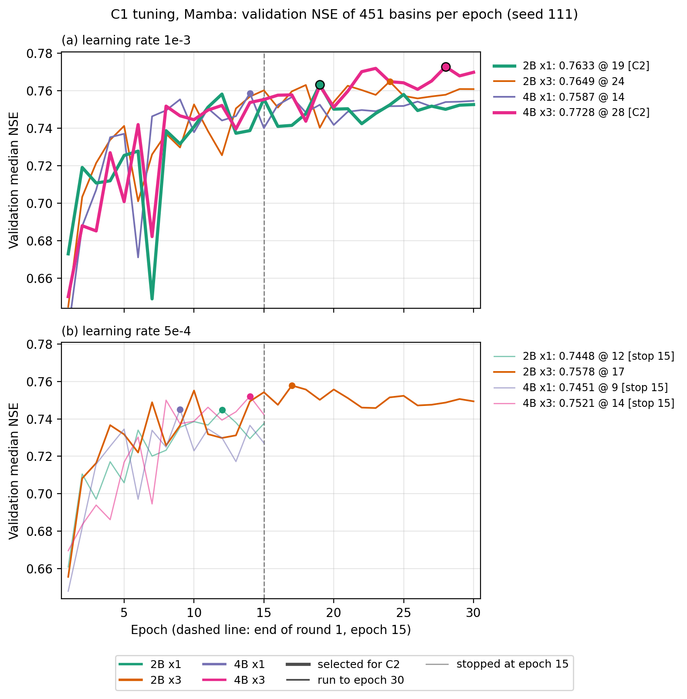
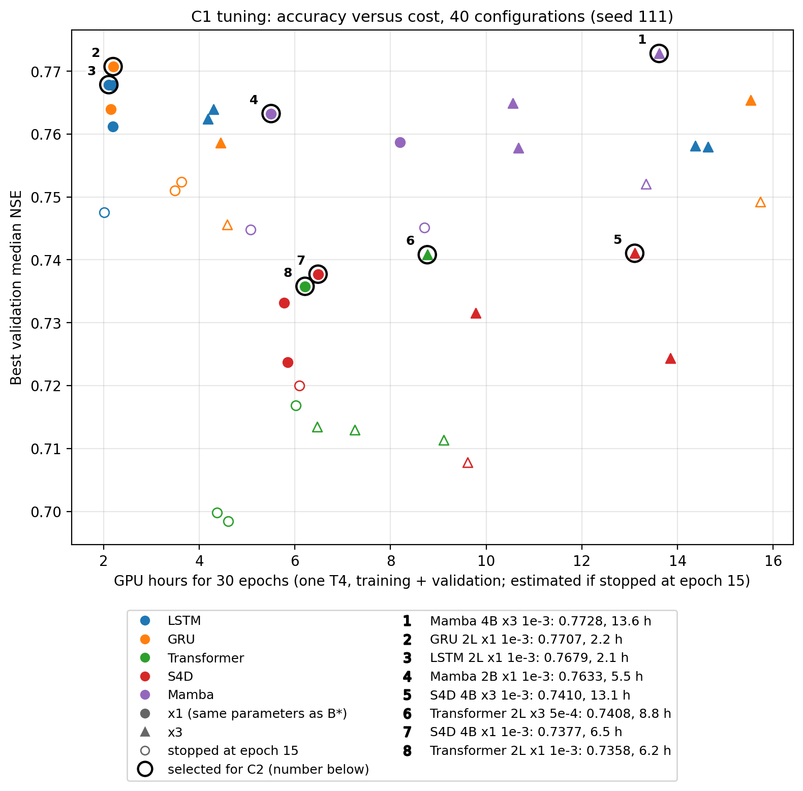
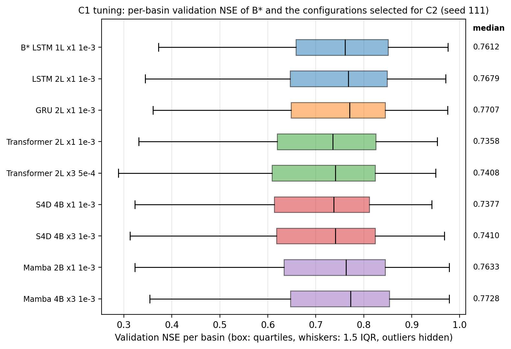

# C1 — Tinh chỉnh 5 lõi trong mô hình chung, chọn cấu hình cho C2

Tài liệu đi cùng [mã Python](11_C1_LamaHCEExt_Compare.py) và [notebook chính thức](11_C1_LamaHCEExt_Compare.ipynb) của notebook Kaggle `11_C1_LamaHCEExt_Compare`. Notebook gom 39 lần huấn luyện tinh chỉnh C1 (`Workspace/05_Training/10_C1_Tune/`) và B* hạt giống 111, tính NSE trung vị validation theo epoch, áp luật loại sớm hai vòng và luật chọn cấu hình cho C2 (`Document/01_Plan/02_Pipeline.md` Mục 5.2), rồi vẽ hình và lưu bảng. C1 chỉ dùng kỳ validation (2010–2013); kỳ test không được chấm ở C1 (`02_Pipeline.md` Mục 5.1).

## Mục lục

- [1. Câu hỏi cần trả lời](#1)
- [2. Cài đặt notebook và bản lưu chính thức](#2)
- [3. Lưới 40 cấu hình](#3)
- [4. Loại sớm hai vòng](#4)
- [5. Các Phần của notebook](#5)
- [6. Kết quả theo lõi](#6)
- [7. Đường học theo epoch](#7)
- [8. Chi phí](#8)
- [9. Cấu hình chọn cho C2](#9)
- [10. Giới hạn của kết quả C1](#10)
- [11. Nguồn](#11)

## 1. Câu hỏi cần trả lời

1. Với cùng ngân sách tinh chỉnh (8 cấu hình, một hạt giống), mỗi lõi LSTM, GRU, Transformer, S4D, Mamba đạt NSE trung vị validation bao nhiêu trong khung B* (B3 P10S12)?
2. Cấu hình nào của mỗi lõi được chạy chính thức ở C2 (30 epoch, ba hạt giống, chấm test mọi epoch)?
3. Mỗi cấu hình tốn bao nhiêu giờ GPU trên T4?

## 2. Cài đặt notebook và bản lưu chính thức

| Mục | Giá trị |
|---|---|
| Máy | Kaggle CPU, không Internet |
| Input (40) | Output 23 notebook `10_C1_Tune_<cấu hình>_Cont` (cấu hình chạy tới epoch 30), Output 16 notebook `10_C1_Tune_<cấu hình>` (cấu hình dừng ở epoch 15), Output `08_B3_LamaHCEExt_Train_P10S12_Seed111` (B*) |
| Mã thư viện của 39 lần C1 | fork `research` tại `db6dc1f` (`freeze-C`); B* chạy ở `2ccaa14` |
| Kiểm Input | 506/506 tệp khớp sha256 trong `manifest.csv` của nguồn; 40/40 config đúng cấu hình (lõi, độ sâu, learning rate, hạt giống) |
| Bản lưu chính thức | Version 6 (Save & Run All), 8 hình ở [Figures/](Figures/) |
| Đầu ra | `c1_table.csv`, `c1_curves.csv`, `c1_round1.csv`, `c1_selection.csv`, `c1_selection.json`, `Figures/`, `environment.json`, `manifest.csv` |

Notebook chạy ba lần trong quá trình C1, mỗi lần với Input khác: sau vòng 1 (39 notebook tới epoch 15 + B*, Version 2) để in danh sách cấu hình giữ; sau 16 `_Cont` của cấu hình giữ (Version 4) để in danh sách mở rộng; sau 7 `_Cont` mở rộng (Input như bảng trên) để chọn C2. Kết quả trong tài liệu này lấy từ lần cuối.

## 3. Lưới 40 cấu hình

Mỗi lõi 8 cấu hình = 2 mức dung lượng × 2 độ sâu × 2 learning rate (`02_Pipeline.md` Mục 5.2). Mức x1 có số tham số bằng B* (84.865), mức x3 gấp khoảng 3 lần (254.595); kích thước trong của lõi được dò để lệch không quá 1% (lệch lớn nhất 0,894%). Độ sâu: LSTM, GRU, Transformer 1 hoặc 2 lớp; S4D, Mamba 2 hoặc 4 khối (một lớp Transformer tương đương hai khối Mamba về tham số, Gu & Dao 2024 phụ lục). Learning rate 10⁻³ (của tác giả BiasCast) và 5×10⁻⁴. Các siêu tham số khác giữ như B* (365 ngày quá khứ, che dữ liệu 0,10/0,12, masked mean theo nguồn, lô 256, cosine T_max 30) và mặc định mã gốc từng kiến trúc (dropout trong khối Transformer 0,1, S4D 0,1, Mamba 0). Cấu hình `lstm_L1_x1_lr1e-3` chính là B*, dùng lại run B* hạt giống 111 (đã kiểm lõi LSTM chung trùng từng bit SeqLSTM của B* ở epoch 1, `.claude/rules/library.md`), nên chỉ chạy 39 lần mới. Mọi lần dùng hạt giống 111.

| Lõi | x1: độ sâu thấp / cao (kích thước) | x3: độ sâu thấp / cao (kích thước) |
|---|---|---|
| LSTM | 1 lớp 128 / 2 lớp 77 | 1 lớp 235 / 2 lớp 139 |
| GRU | 1 lớp 150 / 2 lớp 90 | 1 lớp 274 / 2 lớp 162 |
| Transformer | 1 lớp 80 / 2 lớp 56 | 1 lớp 144 / 2 lớp 100 |
| S4D | 2 khối 111 / 4 khối 72 | 2 khối 216 / 4 khối 146 |
| Mamba | 2 khối 72 / 4 khối 49 | 2 khối 132 / 4 khối 91 |

## 4. Loại sớm hai vòng

Chạy đủ 30 epoch cả 39 cấu hình mất khoảng 300 giờ GPU (đo ở `05_0_C_Configs_Check`). C1 chia hai vòng (`02_Pipeline.md` Mục 5.2):

- **Vòng 1:** cả 39 cấu hình chạy tới epoch 15 (khóa `epochs: 15`, lịch cosine giữ T_max 30 để giống chạy liền). Epoch 15 chọn theo 18 lần chạy B0–B3: tương quan hạng Spearman giữa NSE validation tốt nhất tới epoch 15 và tới epoch 30 là 0,99, tới epoch 10 chỉ 0,88.
- **Luật giữ:** trong từng lõi, giữ cấu hình có NSE trung vị validation tốt nhất tới epoch 15 cách cấu hình tốt nhất lõi không quá 0,0079 (độ lệch chuẩn giữa 3 hạt giống của B0, cũng là ngưỡng chọn B*), và luôn giữ cấu hình tốt nhất mức x1. Luật giữ 16 cấu hình (LSTM 4, GRU 2, Transformer 1, S4D 4, Mamba 5).
- **Vòng 2:** cấu hình giữ chạy tiếp từ epoch 15 tới 30 bằng notebook `_Cont` (khóa `resume_training_state` của fork, khôi phục lịch learning rate, NSE tốt nhất và bộ sinh số ngẫu nhiên).
- **Mở rộng vòng 2:** ở 16 `_Cont`, tương quan hạng giữa epoch 15 và 30 chỉ 0,81 và NSE tốt nhất tăng sau epoch 15 tới 0,0175 (`mamba_L4_x3_lr1e-3`), lớn hơn ngưỡng 0,0079. Vì vậy cấu hình bị loại được chạy tiếp nếu mức tăng cần để vượt cấu hình tốt nhất 30 epoch của lõi (cấu hình x1 so với tốt nhất x1) không lớn hơn mức tăng lớn nhất 0,0175 đã thấy. Luật này thêm 7 cấu hình: `lstm_L2_x3_lr5e-4`, `lstm_L2_x3_lr1e-3`, `gru_L2_x1_lr5e-4`, `gru_L2_x3_lr5e-4`, `transformer_L2_x3_lr5e-4`, `s4d_L2_x1_lr5e-4`, `s4d_L4_x3_lr5e-4`. B* (`lstm_L1_x1_lr1e-3`, cần +0,0094) cũng thuộc nhóm này nhưng đã có sẵn 30 epoch.

Cuối C1: 24 cấu hình có đủ 30 epoch (23 C1 + B*), 16 cấu hình dừng ở epoch 15. C2 chọn trong 24 cấu hình đủ 30 epoch. Luật vòng 1 và mức tăng cần của từng cấu hình ở `c1_round1.csv`.

Mở rộng vòng 2 đổi kết quả ở hai lõi: `transformer_L2_x3_lr5e-4` tăng 0,0197 sau epoch 15 (0,7211 => 0,7408), vượt cấu hình tốt nhất Transformer của luật cũ (0,7358); `mamba_L4_x3_lr1e-3` (giữ theo luật, đứng thứ 4 của Mamba ở epoch 15) tăng 0,0175 và thành cấu hình tốt nhất cả lưới. Ở 24 cấu hình đủ 30 epoch, 15 có epoch tốt nhất sau epoch 15; mức tăng sau epoch 15 trung vị 0,0026.

## 5. Các Phần của notebook

| Phần | Việc | Kiểm (đều đạt) |
|---|---|---|
| 1 | Tìm 40 run dưới `/kaggle/input` theo `environment.json`, kiểm sha256, đọc config, số tham số | 40 cấu hình; 506/506 tệp khớp; trạng thái khớp số epoch (15 = xong vòng 1, 30 = xong); `epochs` 15, `early_stopping_patience` 30, `data_on_gpu` cho 39 C1; một commit `db6dc1f`; lệch tham số ≤ 1% |
| 2 | Đọc `validation_metrics.csv` mọi epoch, thời gian từng epoch từ `output.log`, lập bảng 40 cấu hình | 451 lưu vực mỗi epoch; epoch chọn trùng `saved_epoch` của `best_model.pt` ở 39/39; đọc được 960 epoch |
| 3 | Luật vòng 1 và mở rộng vòng 2 | — |
| 4 | Chọn cấu hình C2, so với B* theo từng lưu vực, ước giờ C2 | — |
| 5 | 8 hình (mục 6–8) | — |
| 6 | Lưu bảng, lệnh sinh notebook C2, `environment.json`, `manifest.csv` | — |

## 6. Kết quả theo lõi

NSE trung vị 451 lưu vực ở kỳ validation, epoch có NSE trung vị validation cao nhất (epoch của `best_model.pt`), hạt giống 111:

| Lõi | Cao nhất | Cấu hình cao nhất | Thấp nhất | Cấu hình tốt nhất mức x1 |
|---|---|---|---|---|
| Mamba | 0,7728 | 4 khối x3, lr 10⁻³ | 0,7448 | 2 khối, lr 10⁻³: 0,7633 |
| GRU | 0,7707 | 2 lớp x1, lr 10⁻³ | 0,7456 | (cao nhất là x1) |
| LSTM | 0,7679 | 2 lớp x1, lr 10⁻³ | 0,7475 | (cao nhất là x1) |
| S4D | 0,7410 | 4 khối x3, lr 10⁻³ | 0,7078 | 4 khối, lr 10⁻³: 0,7377 |
| Transformer | 0,7408 | 2 lớp x3, lr 5×10⁻⁴ | 0,6984 | 2 lớp, lr 10⁻³: 0,7358 |

B* (LSTM 1 lớp x1, lr 10⁻³) đạt 0,7612, đứng thứ 5/8 trong lõi LSTM.

*Hình 1. NSE trung vị validation tốt nhất của 40 cấu hình C1, mỗi lõi một khối, trong khối xếp từ cao xuống; số ở cột phải, "C2" là cấu hình chọn chạy chính thức. Màu là learning rate; chấm đặc là cấu hình chạy tới epoch 30, chấm rỗng là cấu hình dừng ở epoch 15; ô vuông và đường gạch đứng là B*. Dải xám là khoảng 0,0079 (độ lệch chuẩn giữa 3 hạt giống của B0) dưới cấu hình tốt nhất của lõi: cấu hình trong dải chưa phân biệt được với cấu hình tốt nhất khi chỉ có 1 hạt giống.*

Nhận xét:

- Ba lõi hồi quy hoặc chọn lọc theo thời gian (Mamba, GRU, LSTM) nằm trong khoảng 0,0049 của nhau ở cấu hình tốt nhất (0,7679–0,7728), dưới ngưỡng nhiễu hạt giống 0,0079: với một hạt giống, C1 không phân biệt được ba lõi này. S4D và Transformer thấp hơn khoảng 0,03.
- Learning rate 10⁻³ cho cấu hình tốt nhất ở 4/5 lõi (trừ Transformer x3); trung vị 20 cấu hình lr 10⁻³ là 0,7553, của 20 cấu hình lr 5×10⁻⁴ là 0,7454. Một phần chênh lệch do cấu hình lr 5×10⁻⁴ dừng ở epoch 15 nhiều hơn (11/16 cấu hình dừng ở epoch 15 dùng lr 5×10⁻⁴).
- Mức x3 không hơn rõ mức x1: trung vị 0,7507 so với 0,7463; cấu hình tốt nhất là x3 ở Mamba, S4D, Transformer và x1 ở LSTM, GRU.
- Về độ sâu, ở mức x1 cấu hình 2 lớp tốt hơn 1 lớp cho cả LSTM, GRU, Transformer cùng learning rate 10⁻³; S4D 4 khối tốt hơn 2 khối; Mamba 2 khối x1 tốt hơn 4 khối x1.

## 7. Đường học theo epoch

*Hình 2–6. NSE trung vị validation theo epoch của 8 cấu hình mỗi lõi, ô (a) learning rate 10⁻³, ô (b) 5×10⁻⁴; màu là độ sâu và mức dung lượng, nét đậm là cấu hình chọn C2, nét nhạt mảnh là cấu hình dừng ở epoch 15; chấm là epoch tốt nhất, chú giải bên phải ghi NSE @ epoch. Đường gạch đứng là cuối vòng 1 (epoch 15). Trục dọc chung hai ô, bắt đầu gần giá trị thấp nhất từ epoch 3; cấu hình sụp hẳn ghi chú trong ô.*

**`gru_L2_x3_lr1e-3` mất ổn định:** NSE trung vị validation đạt 0,7492 ở epoch 9, rồi từ epoch 10 rơi xuống khoảng 0,430 và giữ đến epoch 15 (Hình 3). Cấu hình này bị loại ở vòng 1 (cách tốt nhất GRU 0,0167, mức tăng cần 0,0215 lớn hơn 0,0175) nên không chạy tiếp. Không chạy lại: cùng hạt giống và lõi GRU lặp lại từng bit trên T4 (`04_0_Cores_Check`) nên sẽ cho đúng kết quả này, còn đổi hạt giống là chọn hạt giống theo kết quả (góp ý GVHD họp 11/10/2026). Đây là GRU 2 lớp gấp 3 với learning rate cao hơn; bản lr 5×10⁻⁴ cùng kích thước ổn định (0,7654).

## 8. Chi phí

Giờ GPU của 30 epoch (huấn luyện + validation 451 lưu vực mỗi epoch, một T4; cấu hình dừng ở epoch 15 ước theo tốc độ vòng 1) từ 2,0 giờ (LSTM 2 lớp x1, lr 5×10⁻⁴) tới 15,7 giờ (GRU 2 lớp x3, lr 10⁻³). Trung vị phút huấn luyện mỗi epoch:

| Lõi | x1 | x3 |
|---|---|---|
| LSTM | 3,3 | 13,4 |
| GRU | 4,3 | 14,3 |
| Transformer | 8,0 | 12,5 |
| S4D | 9,4 | 18,4 |
| Mamba | 11,2 | 20,0 |

LSTM, GRU 2 lớp mức x3 chậm gấp khoảng 3 lần bản 1 lớp cùng tham số do nhân cuDNN của `nn.LSTM`, `nn.GRU` ở các kích thước này (`05_0_C_Configs_Check`); số giờ phản ánh cài đặt cụ thể trên T4, không phải độ phức tạp thuật toán. Tổng giờ GPU đã chạy của 39 lần C1 (huấn luyện + validation, không tính dựng dữ liệu) là 239,5 giờ, so với khoảng 300 giờ nếu chạy đủ 30 epoch cả 39 cấu hình.

*Hình 7. NSE trung vị validation tốt nhất theo giờ GPU của 30 epoch; màu theo lõi, tròn là mức x1, tam giác là mức x3, chấm rỗng là cấu hình dừng ở epoch 15; vòng đen đánh số là cấu hình chọn C2.*

## 9. Cấu hình chọn cho C2

Luật (`02_Pipeline.md` Mục 5.2): mỗi lõi chạy ở C2 cấu hình tốt nhất mức x1 (cùng tham số với B*, so các lõi công bằng về dung lượng) và cấu hình tốt nhất cả 8 (nếu khác); chỉ chọn trong cấu hình đủ 30 epoch. LSTM và GRU có cấu hình tốt nhất là x1 nên mỗi lõi một cấu hình; ba lõi còn lại hai cấu hình => 8 cấu hình × 3 hạt giống = 24 lần chạy.

| Lõi | Luật | Cấu hình | NSE val | Cấu hình đứng sau | Cách / nhiễu | Epoch chọn | Hiệu với B* (trung vị lưu vực) | Lưu vực hơn B* | Giờ C2 ước / lần |
|---|---|---|---|---|---|---|---|---|---|
| LSTM | x1 + cả 8 | `lstm_L2_x1_lr1e-3` | 0,7679 | `lstm_L1_x1_lr5e-4` | 0,02 | 24 | −0,0015 | 213/451 | 2,8 |
| GRU | x1 + cả 8 | `gru_L2_x1_lr1e-3` | 0,7707 | `gru_L2_x1_lr5e-4` | 0,85 | 20 | −0,0017 | 212/451 | 2,9 |
| Transformer | x1 | `transformer_L2_x1_lr1e-3` | 0,7358 | — | — | 24 | −0,0207 | 101/451 | 8,1 |
| Transformer | cả 8 | `transformer_L2_x3_lr5e-4` | 0,7408 | `transformer_L2_x1_lr1e-3` | 0,64 | 24 | −0,0239 | 97/451 | 11,0 |
| S4D | x1 | `s4d_L4_x1_lr1e-3` | 0,7377 | `s4d_L2_x1_lr1e-3` | 0,58 | 14 | −0,0307 | 78/451 | 8,0 |
| S4D | cả 8 | `s4d_L4_x3_lr1e-3` | 0,7410 | `s4d_L4_x1_lr1e-3` | 0,42 | 20 | −0,0233 | 89/451 | 16,0 |
| Mamba | x1 | `mamba_L2_x1_lr1e-3` | 0,7633 | `mamba_L4_x1_lr1e-3` | 0,58 | 19 | −0,0053 | 185/451 | 6,7 |
| Mamba | cả 8 | `mamba_L4_x3_lr1e-3` | 0,7728 | `mamba_L2_x3_lr1e-3` | 1,00 | 28 | +0,0004 | 227/451 | 16,2 |

"Cách / nhiễu" là khoảng cách tới cấu hình đứng sau chia cho 0,0079. "Hiệu với B*" là trung vị theo lưu vực của (NSE cấu hình − NSE B*), cùng kỳ validation; vì NSE từng lưu vực phân tán rộng, trung vị hiệu có thể âm dù NSE trung vị của cấu hình cao hơn B*. Ba cấu hình x3 (`transformer_L2_x3_lr5e-4`, `s4d_L4_x3_lr1e-3`, `mamba_L4_x3_lr1e-3`) vượt 12 giờ một phiên khi chấm test mọi epoch nên chạy qua hai phiên bằng `_Cont`. Tổng C2 ước 215 giờ GPU. 33 notebook C2 (24 + 9 `_Cont`) sinh bằng `Tools/C_Notebooks_Build.py` vào `Workspace/05_Training/12_C2_Train/`.

*Hình 8. Phân bố NSE validation từng lưu vực của B* và 8 cấu hình chọn C2 (epoch tốt nhất, hạt giống 111); hộp là tứ phân vị, vạch là trung vị (số ở cột phải), râu 1,5 lần khoảng tứ phân vị, ẩn điểm ngoại lai, NSE dưới −1 tính là −1.*

## 10. Giới hạn của kết quả C1

- **Một hạt giống:** 7/8 lựa chọn cách cấu hình đứng sau dưới 1 lần nhiễu hạt giống (riêng `mamba_L4_x3_lr1e-3` cách đúng 1,00 lần). Thứ hạng trong lõi ở C1 vì vậy chưa chắc; C1 chỉ dùng để chọn cấu hình, so sánh các lõi dựa trên C2 (3 hạt giống, chấm test).
- **Transformer và Mamba không lặp lại từng bit** trên GPU khi chạy lại cùng hạt giống (`04_0_Cores_Check` Phần 6), nên nhiễu C1 của hai lõi này gồm cả phần không tất định của GPU, ngoài hạt giống.
- **Loại sớm:** 16 cấu hình chỉ chạy tới epoch 15. Mức tăng sau epoch 15 lớn nhất quan sát được là 0,0197 (`transformer_L2_x3_lr5e-4`, cấu hình mở rộng), lớn hơn mức 0,0175 dùng cho luật mở rộng; cấu hình bị loại có mức tăng cần nhỏ nhất là `s4d_L4_x1_lr5e-4` (0,0177), nên không loại trừ được hoàn toàn khả năng một cấu hình bị loại vượt cấu hình được chọn nếu chạy đủ 30 epoch.
- **Lưới hẹp:** mỗi lõi chỉ 2 learning rate, 2 độ sâu, 2 mức dung lượng; các siêu tham số khác giữ theo B* hoặc mặc định mã gốc, vốn được chọn cho LSTM. Kết quả C1 là "mỗi lõi trong khung B* với cùng ngân sách tinh chỉnh", không phải cấu hình tối ưu của từng lõi.

## 11. Nguồn

- Konold và cs. (2026), BiasCast, HESS 30:5067–5096: khung Sequential Forecast LSTM, learning rate 10⁻³, cosine T_max 30.
- Gu & Dao (2024), Mamba, COLM: số tham số một lớp Transformer tương đương hai khối Mamba (phụ lục).
- `Document/01_Plan/02_Pipeline.md` Mục 5.1 (giao thức 30 epoch), 5.2 (lưới C1, loại sớm hai vòng, luật chọn C2), 5.3 (ngưỡng nhiễu 0,0079).
- `Workspace/04_Setup/05_0_C_Configs_Check/05_0_C_Configs_Check.md` (số tham số, thời gian 20 cấu hình), `Workspace/04_Setup/04_0_Cores_Check/04_0_Cores_Check.md` (tính lặp lại của 5 lõi trên T4), `Workspace/05_Training/01_B0_LamaHCEExt_Train/01_B0_LamaHCEExt_Train.md` (nhiễu hạt giống).
- Bảng số trong tài liệu lấy từ output của notebook (`c1_table.csv`, `c1_round1.csv`, `c1_selection.csv`).
