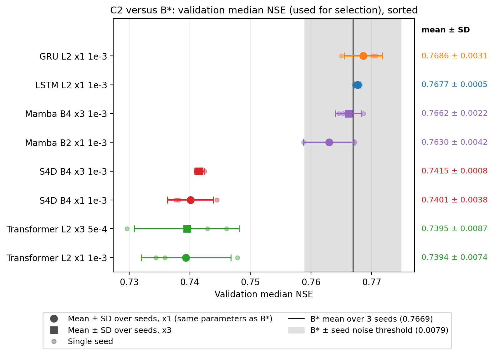
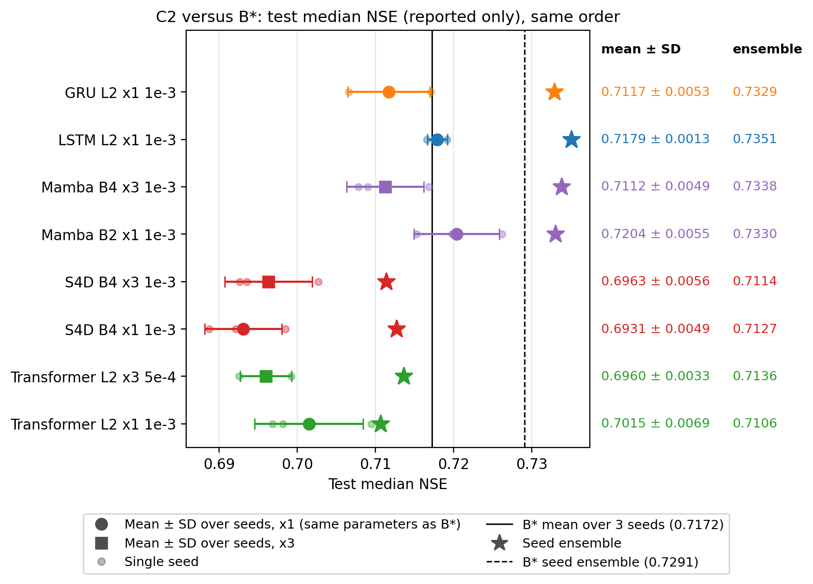
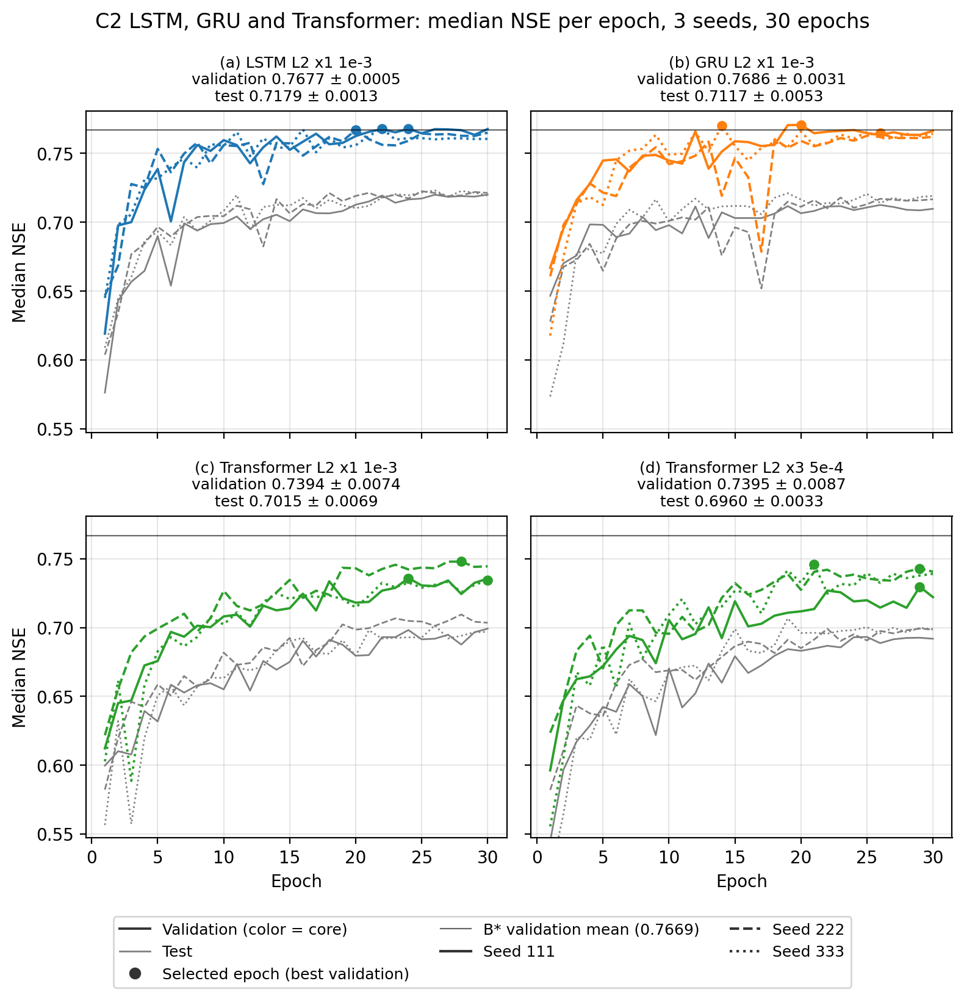
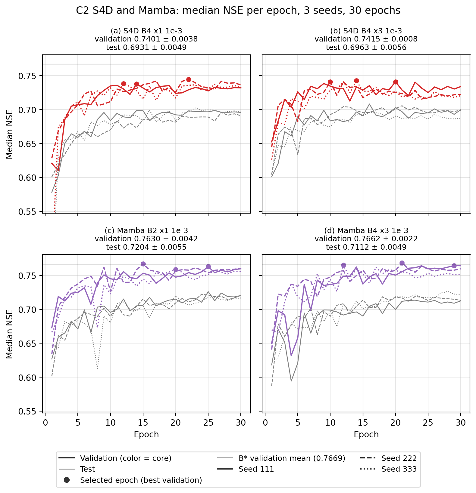
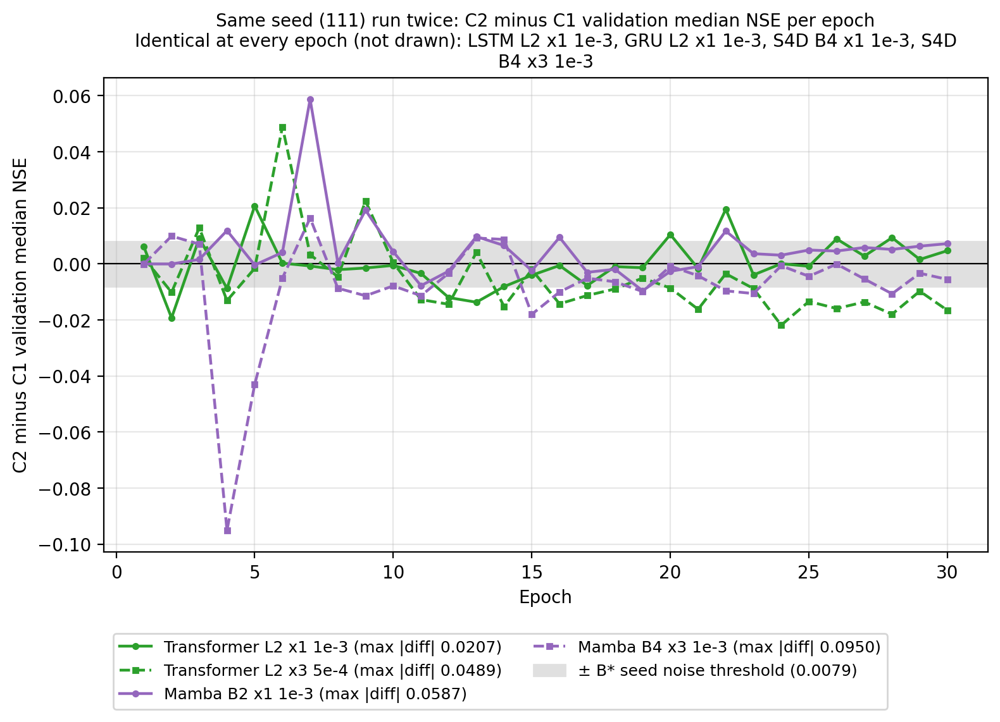
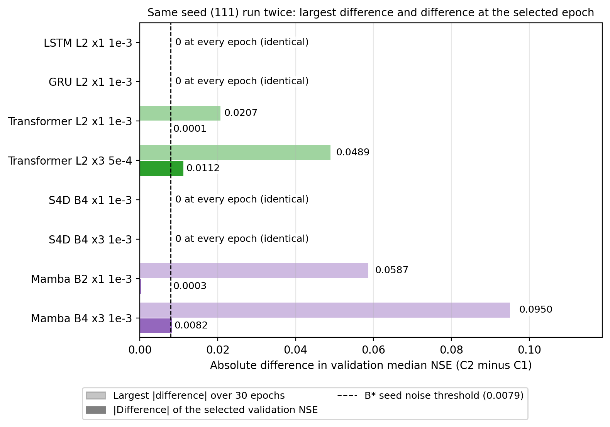
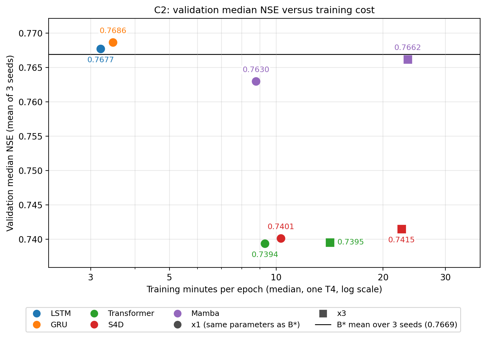
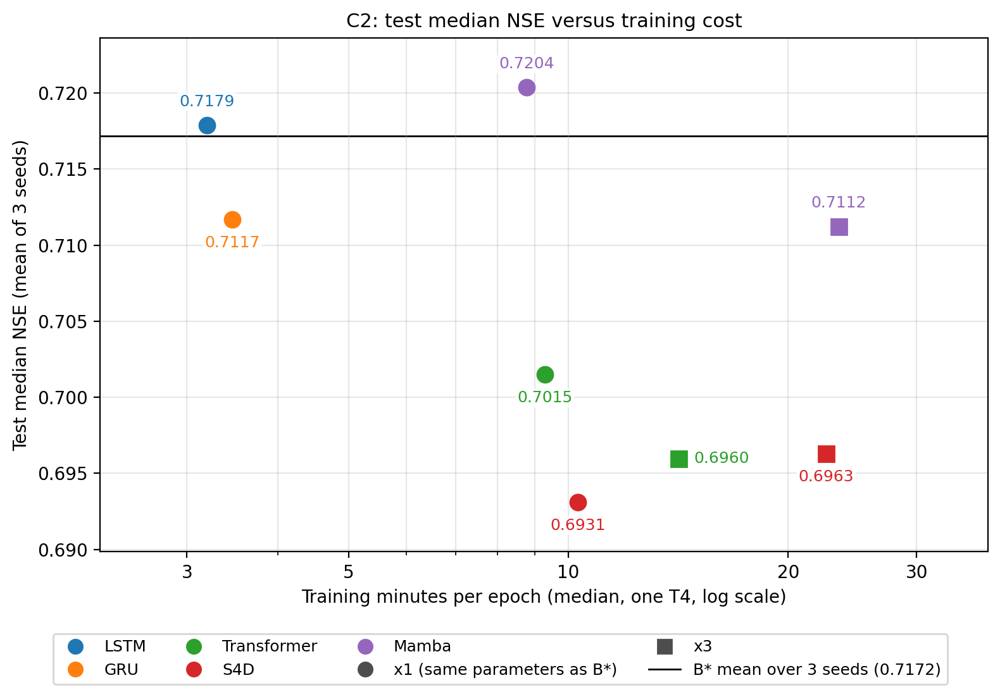

# C2 — 5 lõi trong mô hình chung, 8 cấu hình × 3 hạt giống

Tài liệu đi cùng [mã Python](13_C2_LamaHCEExt_Compare.py) và [notebook chính thức](13_C2_LamaHCEExt_Compare.ipynb) của notebook Kaggle `13_C2_LamaHCEExt_Compare`. C2 là lần chạy chính thức của bước C (`Document/01_Plan/02_Pipeline.md` Mục 5.2): 8 cấu hình chọn ở C1 ([báo cáo C1](../11_C1_LamaHCEExt_Compare/11_C1_LamaHCEExt_Compare.md) Mục 9), mỗi cấu hình 3 hạt giống (111, 222, 333), 30 epoch, `best_model.pt` theo NSE trung vị validation, chấm test mọi epoch để theo dõi. Notebook gom 24 run, so 5 lõi với B* (B3 P10S12) và với nhiễu hạt giống, xuất 24 tệp NPZ cho bộ đánh giá, chọn cấu hình cho bước H và mô hình demo.

## Mục lục

- [1. Câu hỏi cần trả lời](#1)
- [2. 24 lần huấn luyện](#2)
- [3. Cài đặt notebook và bản lưu chính thức](#3)
- [4. Các Phần của notebook](#4)
- [5. Kết quả: validation và test](#5)
- [6. Đường học theo epoch](#6)
- [7. Tổ hợp 3 hạt giống](#7)
- [8. Chạy lại cùng hạt giống: C1 so với C2](#8)
- [9. Chi phí](#9)
- [10. Lựa chọn cho bước H và demo](#10)
- [11. Bàn giao](#11)
- [12. Giới hạn](#12)
- [13. Nguồn](#13)

## 1. Câu hỏi cần trả lời

1. Trong cùng khung B* và cùng ngân sách tinh chỉnh, mỗi lõi (LSTM, GRU, Transformer, S4D, Mamba) đạt NSE trung vị validation và test bao nhiêu, so với B* và với nhiễu giữa các hạt giống?
2. Chi phí huấn luyện của mỗi lõi trên T4 là bao nhiêu?
3. Cấu hình nào đi tiếp vào bước H (dự báo 1–7 ngày), run nào làm mô hình demo?

## 2. 24 lần huấn luyện

Mỗi lần là một notebook `12_C2_Train_<cấu hình>_Seed<N>` sinh từ khuôn `Tools/C_Notebook_Template.py` (thư mục [`12_C2_Train/`](../12_C2_Train/)), thư viện fork `research` tại `db6dc1f` (`freeze-C`), config như B* ngoài các khóa `sf_*`, `learning_rate`, `seed`. Ba cấu hình mức x3 (`transformer_L2_x3_lr5e-4`, `s4d_L4_x3_lr1e-3`, `mamba_L4_x3_lr1e-3`) vượt 12 giờ một phiên Kaggle khi chấm test mọi epoch nên chạy qua hai phiên: phiên 1 dừng gọn bằng khóa `max_training_hours`, notebook `_Cont` chạy tiếp tới epoch 30 bằng `resume_training_state` (`.claude/rules/library.md`, mục Huấn luyện). Tổng 33 notebook (24 + 9 `_Cont`), Version 1 cả 33.

**GRU `L2_x1_lr1e-3` hạt giống 222 chạy lại có chốt chặn gradient.** Lần chạy đầu dừng vì loss NaN: từ epoch 14, chuẩn gradient của vài bước lên khoảng 10²⁴–10³⁶, tổng chuẩn tràn float32 nên hệ số cắt gradient (`clip_grad_norm_`) thành 0 rồi NaN, trọng số thành NaN. Notebook chạy lại sinh bằng `Tools/C_Notebooks_Build.py c2 gru_L2_x1_lr1e-3 --grad-guard gru_L2_x1_lr1e-3:222`: tiến trình huấn luyện bỏ hẳn bước có gradient NaN/Inf (không cập nhật trọng số, không cập nhật trạng thái Adam) và đếm số bước bỏ; run không có gradient NaN/Inf thì không đổi gì. Lần chạy lại bỏ đúng 1 bước (ở epoch 14, loss huấn luyện epoch đó tăng từ 0,0082 lên 0,0144 rồi giảm lại), đủ 30 epoch, `best_model.pt` ở epoch 26. Số bước bỏ ghi ở `protocol.grad_guard_skipped_steps` của `environment.json` và trong NPZ. 23 run còn lại chạy không có chốt chặn. Không đổi hạt giống: đổi hạt giống khi run hỏng là chọn hạt giống theo kết quả.

**Kiểm "Lưu vực có NSE test (best_model.pt)" ở Phần 6 notebook huấn luyện** báo 451 so với mong đợi 450 ở cả 33 notebook. Mong đợi 450 lấy từ các bước trước B2 (lưu vực 55 không có `qmean` => không có dự báo); từ B2, nhúng theo nguồn và masked mean cho phép dự báo khi thiếu nhóm Q, nên lưu vực 55 có dự báo và 451 là đúng. Kiểm này lỗi thời trong khuôn, không ảnh hưởng kết quả; bộ đánh giá so trên giao chung các mô hình.

## 3. Cài đặt notebook và bản lưu chính thức

| Mục | Giá trị |
|---|---|
| Máy | Kaggle CPU, không Internet, không cần NeuralHydrology |
| Input (34) | Output 24 run C2 (15 notebook phiên 1 của mức x1, 9 notebook `_Cont` của mức x3); Output 8 notebook C1 `10_C1_Tune_<cấu hình>_Cont` của đúng 8 cấu hình (so sánh Mục 8); `09_B3_LamaHCEExt_Compare` Version 1 (B* ba hạt giống); `02_A3_LamaHCEExt_Benchmarks` Version 1 (lịch, ID, diện tích, quan trắc, persistence cho NPZ) |
| Bản lưu chính thức | Version 1 (Save & Run All); 8 hình ở [Figures/](Figures/), 8 bảng ở [Tables/](Tables/) |
| Đầu ra | 24 NPZ ở `c2_compare/contracts/`, `c2_summary.json`, `Tables/C2_handoff.csv`, `environment.json`, `manifest.csv` (42 tệp) |

## 4. Các Phần của notebook

| Phần | Việc | Kiểm (đều đạt) |
|---|---|---|
| 1 | Nhận 24 run C2, 8 run C1, B3 Compare, A3 theo `environment.json`; kiểm sha256 theo `manifest.csv` của nguồn | đủ 8 × 3; commit `db6dc1f`; trạng thái "xong"; 30 epoch huấn luyện và test; `best_model.pt` = epoch NSE validation cao nhất; config đúng cấu hình, giao thức, số tham số lệch ≤ 1%, 24 config giống nhau ngoài khóa riêng; tệp chuẩn hóa `train_data_scaler.yml` trùng nhau ở cả 24 run; chốt chặn chỉ ở GRU 222 |
| 2 | Bảng 24 run, bảng 8 cấu hình (trung bình ± độ lệch chuẩn 3 hạt giống), hiệu với B* theo bội ngưỡng nhiễu 0,0079 | — |
| 3 | C1 hạt giống 111 so với C2 hạt giống 111 (Mục 8) | mọi cặp đúng kỳ vọng: lõi tất định trùng từng bit, Transformer/Mamba lệch |
| 4 | 24 NPZ test/S0/hạn 1 theo hợp đồng bộ đánh giá (`Workspace/06_Evaluation/01_Evaluation_LamaHCEExt/01_Evaluation_LamaHCEExt.md` Mục 7) | đọc ngược đạt; NSE tính lại lệch thư viện ≤ 1,8×10⁻⁶; NaN NSE trùng thư viện; 658.911 ngày–lưu vực mỗi tệp |
| 5 | Tổ hợp 3 hạt giống (Mục 7) | — |
| 6 | Chi phí (Mục 9) | — |
| 7 | 8 hình | — |
| 8 | Chọn cấu hình H và demo, bảng bàn giao, `c2_summary.json` | đủ 24/24; đúng 1 cấu hình LSTM; ứng viên SSM đủ 3 hạt giống; run demo không hòa; manifest khớp |

## 5. Kết quả: validation và test

NSE trung vị 451 lưu vực ở epoch của `best_model.pt`, trung bình ± độ lệch chuẩn 3 hạt giống; xếp theo validation (chỉ validation dùng để chọn, `02_Pipeline.md` Mục 6.1). B*: validation 0,7669, test 0,7172 (`09_B3_LamaHCEExt_Compare` Version 1).

| Hạng | Cấu hình | Tham số | NSE validation | Hiệu với B* / nhiễu | NSE test | KGE test | Epoch chọn |
|---|---|---|---|---|---|---|---|
| 1 | GRU 2 lớp x1, lr 10⁻³ | 84.503 | 0,7686 ± 0,0031 | +0,22 | 0,7117 ± 0,0053 | 0,782 | 14–26 |
| 2 | LSTM 2 lớp x1, lr 10⁻³ | 84.106 | 0,7677 ± 0,0005 | +0,10 | 0,7179 ± 0,0013 | 0,772 | 20–24 |
| 3 | Mamba 4 khối x3, lr 10⁻³ | 254.677 | 0,7662 ± 0,0022 | −0,09 | 0,7112 ± 0,0049 | 0,772 | 12–29 |
| 4 | Mamba 2 khối x1, lr 10⁻³ | 85.039 | 0,7630 ± 0,0042 | −0,49 | 0,7204 ± 0,0055 | 0,764 | 15–25 |
| 5 | S4D 4 khối x3, lr 10⁻³ | 255.833 | 0,7415 ± 0,0008 | −3,20 | 0,6963 ± 0,0056 | 0,737 | 10–20 |
| 6 | S4D 4 khối x1, lr 10⁻³ | 84.449 | 0,7401 ± 0,0038 | −3,38 | 0,6931 ± 0,0049 | 0,728 | 12–22 |
| 7 | Transformer 2 lớp x3, lr 5×10⁻⁴ | 254.425 | 0,7395 ± 0,0087 | −3,45 | 0,6960 ± 0,0033 | 0,753 | 21–29 |
| 8 | Transformer 2 lớp x1, lr 10⁻³ | 84.823 | 0,7394 ± 0,0074 | −3,47 | 0,7015 ± 0,0069 | 0,775 | 24–30 |

"Hiệu với B* / nhiễu" = (NSE validation trung bình − 0,7669) / 0,0079. Bảng từng run: `Tables/C2_seed_table.csv`; bảng cấu hình: `Tables/C2_config_table.csv`.

*Hình 1. NSE trung vị validation của 8 cấu hình, xếp từ cao xuống; điểm đậm và thanh ngang là trung bình ± độ lệch chuẩn 3 hạt giống (số ở cột phải), chấm mờ là từng hạt giống; vạch đen là B*, dải xám là B* ± 0,0079.*

*Hình 2. NSE trung vị test, cùng thứ tự với Hình 1 (test chỉ báo cáo); sao là dự báo tổ hợp 3 hạt giống; vạch đen là B*, vạch đứt là tổ hợp B*.*

Nhận xét:

- **Hai nhóm rõ ràng.** GRU, LSTM, cả hai cấu hình Mamba nằm trong 1 lần nhiễu hạt giống của B* ở validation (−0,49 tới +0,22 lần). S4D và Transformer thấp hơn B* khoảng 3,2–3,5 lần nhiễu (khoảng 0,026 NSE), cùng chiều ở test (0,016–0,024 thấp hơn B*).
- **Trong nhóm đầu, thứ tự validation và test không trùng.** Mamba 2 khối x1 đứng thứ 4 ở validation nhưng cao nhất ở test (0,7204); GRU đứng đầu validation nhưng test 0,7117. Các khoảng cách trong nhóm (dưới 0,006 ở validation, dưới 0,01 ở test) cỡ nhiễu hạt giống, nên C2 không xếp hạng được bốn cấu hình này; kiểm định từng lưu vực (Wilcoxon, Cohen's d, Holm) làm ở bộ đánh giá (`02_Pipeline.md` Mục 6.1).
- **Mức x3 không hơn mức x1 rõ** ở lõi nào: Mamba x3 hơn x1 0,0032 ở validation nhưng kém 0,0091 ở test; S4D x3 hơn x1 0,0014; Transformer hai mức gần bằng nhau.
- **So với C1 (một hạt giống):** thứ hạng giữa các lõi giữ nguyên; trung bình 3 hạt giống thấp hơn giá trị C1 hạt giống 111 ở cấu hình C1 đứng đầu lõi (Mamba x3: 0,7728 ở C1 so với 0,7662 ở C2; GRU: 0,7707 so với 0,7686), đúng chiều của việc chọn giá trị lớn nhất trong một lần đo nhiễu.

## 6. Đường học theo epoch

*Hình 3–4. NSE trung vị validation (màu) và test (xám) theo epoch, mỗi ô một cấu hình, kiểu nét phân biệt hạt giống; chấm tròn là epoch chọn theo validation; đường ngang xám là NSE validation trung bình của B* (0,7669). Nhãn "B2", "B4" trong hình là số khối của S4D, Mamba.*

Epoch chọn trải từ 10 tới 30. 5 run chọn epoch ≥ 28 (Transformer x1 hạt giống 222 và 333, Transformer x3 hạt giống 111 và 222, Mamba x3 hạt giống 111), tức validation còn tăng khi lịch cosine (T_max 30) kết thúc; với các run này, chạy thêm epoch có thể tăng NSE nhưng giao thức giữ 30 epoch cho mọi mô hình (`02_Pipeline.md` Mục 5.1).

## 7. Tổ hợp 3 hạt giống

Dự báo tổ hợp là trung bình dự báo của 3 hạt giống (mm/ngày) mỗi cấu hình, chấm trên test (`Tables/C2_ensemble_table.csv`):

| Cấu hình | NSE test trung bình hạt giống | NSE test tổ hợp | Tăng |
|---|---|---|---|
| LSTM 2 lớp x1 | 0,7179 | 0,7351 | +0,0171 |
| Mamba 4 khối x3 | 0,7112 | 0,7338 | +0,0225 |
| Mamba 2 khối x1 | 0,7204 | 0,7330 | +0,0126 |
| GRU 2 lớp x1 | 0,7117 | 0,7329 | +0,0212 |
| B* | 0,7172 | 0,7291 | +0,0119 |
| Transformer 2 lớp x3 | 0,6960 | 0,7136 | +0,0176 |
| S4D 4 khối x1 | 0,6931 | 0,7127 | +0,0196 |
| S4D 4 khối x3 | 0,6963 | 0,7114 | +0,0151 |
| Transformer 2 lớp x1 | 0,7015 | 0,7106 | +0,0092 |

Tổ hợp tăng NSE test 0,009–0,023 ở mọi cấu hình, lớn hơn khoảng cách giữa các cấu hình nhóm đầu. Tổ hợp chỉ báo cáo trong notebook, không xuất NPZ (hợp đồng NPZ cần một hạt giống số nguyên).

## 8. Chạy lại cùng hạt giống: C1 so với C2

Hạt giống 111 của mỗi cấu hình C2 đã chạy ở C1 với cùng mã và cùng config (C1: epoch 1–15 rồi `_Cont` tới 30; C2: liền 30 epoch, hoặc qua hai phiên với mức x3). So hai lần chạy (`Tables/C2_C1_vs_C2_seed111.csv`):

| Lõi | Trọng số trùng từng bit | Lệch NSE validation lớn nhất qua 30 epoch | Lệch NSE validation được chọn |
|---|---|---|---|
| LSTM, GRU, S4D x1, S4D x3 | 30/30 epoch | 0 | 0 |
| Transformer x1 | 0/30 (lệch từ epoch 1) | 0,021 | 0,0001 |
| Transformer x3 | 0/30 | 0,049 | 0,0112 |
| Mamba x1 | 0/30 | 0,059 | 0,0003 |
| Mamba x3 | 0/30 | 0,095 | 0,0082 |

*Hình 5–6. Hiệu NSE trung vị validation C2 − C1 theo epoch (hạt giống 111) và lệch lớn nhất / lệch ở NSE được chọn; dải xám và vạch đứt là ngưỡng nhiễu 0,0079.*

Hai kết luận:

- Chạy tiếp qua hai phiên (`resume_training_state`) không đổi kết quả: với LSTM, GRU, S4D, chạy C1 hai phiên và C2 một phiên (hoặc hai phiên ở S4D x3) cho trọng số trùng từng bit ở mọi epoch.
- Transformer và Mamba không lặp lại trên GPU khi chạy lại cùng hạt giống (phép cộng nguyên tử trong đạo hàm, `04_0_Cores_Check`): NSE validation từng epoch lệch tới 0,021–0,095, NSE được chọn lệch tới 0,011, cỡ ngưỡng nhiễu. Với hai lõi này, độ lệch chuẩn giữa 3 hạt giống gồm cả phần không tất định của GPU.

## 9. Chi phí

Trung vị qua epoch và hạt giống, một T4, `data_on_gpu` (`Tables/C2_cost_table.csv`):

| Cấu hình | Phút huấn luyện / epoch | × LSTM | Phút validation / epoch | Phút chấm test / epoch | Giờ 30 epoch (huấn luyện + validation) | GPU đỉnh (MiB) |
|---|---|---|---|---|---|---|
| LSTM 2 lớp x1 | 3,20 | 1,00 | 0,80 | 0,79 | 2,1 | 2.381 |
| GRU 2 lớp x1 | 3,46 | 1,08 | 0,88 | 0,88 | 2,2 | 2.585 |
| Mamba 2 khối x1 | 8,76 | 2,74 | 1,70 | 1,70 | 5,3 | 1.815 |
| Transformer 2 lớp x1 | 9,28 | 2,91 | 3,04 | 3,05 | 6,2 | 3.043 |
| S4D 4 khối x1 | 10,30 | 3,22 | 2,42 | 2,42 | 6,4 | 2.419 |
| Transformer 2 lớp x3 | 14,14 | 4,43 | 4,04 | 4,31 | 9,1 | 3.545 |
| S4D 4 khối x3 | 22,55 | 7,06 | 5,48 | 5,25 | 13,8 | 4.147 |
| Mamba 4 khối x3 | 23,46 | 7,34 | 4,53 | 4,57 | 14,3 | 2.709 |

Tổng giờ huấn luyện + validation của 24 run là 178,4 giờ (chưa tính chấm test mọi epoch và dựng dữ liệu). Số đo phản ánh cài đặt cụ thể trên T4 (cuDNN cho LSTM/GRU, nhân `mamba-ssm` cho Mamba), không phải độ phức tạp thuật toán (`02_Pipeline.md` Mục 6.5).

*Hình 7–8. NSE trung vị validation (Hình 7) và test (Hình 8) trung bình 3 hạt giống theo phút huấn luyện mỗi epoch trung vị (thang log); màu theo lõi, tròn là mức x1, vuông là mức x3; vạch đen là B*.*

Trong nhóm đầu, LSTM và GRU rẻ nhất (khoảng 2 giờ một lần); Mamba x1 tốn 2,7 lần, Mamba x3 7,3 lần LSTM cho cùng mức NSE trong nhiễu.

## 10. Lựa chọn cho bước H và demo

Mọi lựa chọn chỉ dùng NSE trung vị validation, không dùng test:

| Việc | Luật | Chọn | NSE validation | NSE test (báo cáo) |
|---|---|---|---|---|
| LSTM bước H | cấu hình LSTM duy nhất của C2 (LSTM trong khung B*, qua cùng ngân sách tinh chỉnh C1 như lõi SSM) | `lstm_L2_x1_lr1e-3` | 0,7677 ± 0,0005 | 0,7179 ± 0,0013 |
| Lõi SSM bước H | cấu hình S4D/Mamba mức cùng tham số có validation trung bình 3 hạt giống cao nhất | `mamba_L2_x1_lr1e-3` | 0,7630 ± 0,0042 | 0,7204 ± 0,0055 |
| Mô hình demo | run có NSE validation cao nhất trong 24 (`02_Pipeline.md` Mục 9.6) | `gru_L2_x1_lr1e-3` hạt giống 111 | 0,7707 | 0,7065 |

**Lõi SSM cho bước H lấy ở mức cùng tham số** (lựa chọn của đề tài), vì ba lý do không dùng tới test:

- Bước H so LSTM và lõi SSM theo hạn dự báo (RQ6) trong giao thức cùng tham số của đề tài (RQ3, `02_Pipeline.md` Mục 1.1, 5.2; hai mô hình bước H ghi ở Mục 4.4); LSTM bước H ở mức x1 (84.106 tham số), nên lõi SSM cũng ở mức x1 (85.039) để khác biệt giữa hai mô hình chỉ do lõi, không lẫn dung lượng.
- Ở validation, Mamba 4 khối x3 (0,7662) hơn Mamba 2 khối x1 (0,7630) 0,0032, bằng 0,40 lần ngưỡng nhiễu, và nhỏ hơn mức lệch của chính Mamba x3 khi chạy lại cùng hạt giống 111 (NSE validation được chọn lệch 0,0082, Mục 8): hai cấu hình không phân biệt được.
- Mamba x3 tốn 7,3 lần LSTM mỗi epoch và phải chạy hai phiên Kaggle; Mamba x1 tốn 2,7 lần, chạy trong một phiên (Mục 9).

Nếu chọn theo validation cao nhất trong cả 4 cấu hình S4D/Mamba thì kết quả là `mamba_L4_x3_lr1e-3`; `c2_summary.json` của notebook (Version 1) ghi lựa chọn theo luật đó ở khóa cấu hình bước H, còn bước H dùng `mamba_L2_x1_lr1e-3` theo luật cùng tham số ở trên. Mamba x1 cũng cao hơn ở test (0,7204 so với 0,7112), nhưng test không tham gia lựa chọn. Kết quả Mamba x3 giữ trong C2 cho câu hỏi tăng dung lượng. Run demo không hòa với run nào khác.

## 11. Bàn giao

- **24 NPZ** `c2_compare/contracts/SF_<cấu hình>_C2_seed<N>_test_S0_lead1.npz` (khoảng 10 MB mỗi tệp): bộ đánh giá đọc bằng `--extra-contract`; metadata có bước C2, lõi, độ sâu, mức, lr, epoch chọn, số bước chốt chặn bỏ.
- **24 checkpoint** cho kịch bản vận hành S1–S4 (người 1): `Tables/C2_handoff.csv` ghi notebook nguồn, thư mục run, epoch chọn, NSE, sha256 của `best_model.pt`, `config.yml`, `train_data_scaler.yml` (trùng nhau ở cả 24 run) và tên NPZ.
- **`c2_summary.json`**: cấu hình bước H, mô hình demo, số liệu từng cấu hình và từng hạt giống, `operational_scenarios_run: false`, `multi_lead_run: false`.

## 12. Giới hạn

- Ba hạt giống cho độ lệch chuẩn ước lượng thô; khoảng cách trong nhóm đầu (GRU, LSTM, Mamba) dưới ngưỡng nhiễu nên C2 không kết luận lõi nào trong nhóm này tốt hơn.
- Chỉ kịch bản S0 (mọi nguồn đủ), hạn 1 ngày; kịch bản vận hành S1–S4 và kiểm định từng lưu vực làm ở bộ đánh giá.
- Cấu hình mỗi lõi là kết quả của lưới C1 hẹp (2 learning rate, 2 độ sâu, 2 mức) trong khung B* vốn chọn cho LSTM; S4D, Transformer kém có thể một phần do khung và lưới này.
- GRU hạt giống 222 chạy có chốt chặn gradient, bỏ 1 bước; 23 run khác không có chốt chặn.

## 13. Nguồn

- Konold và cs. (2026), BiasCast, HESS 30:5067–5096: khung Sequential Forecast LSTM, kỳ dữ liệu, cosine T_max 30.
- `Document/01_Plan/02_Pipeline.md` Mục 5.1 (giao thức 30 epoch), 5.2 (C1, C2, luật chọn H), 5.3 (ngưỡng nhiễu 0,0079), 6.1 (ba tầng chỉ số), 6.5 (chi phí), 9.6 (demo).
- [Báo cáo C1](../11_C1_LamaHCEExt_Compare/11_C1_LamaHCEExt_Compare.md); `Workspace/05_Training/08_B3_LamaHCEExt_Train/08_B3_LamaHCEExt_Train.md` (B*); `Workspace/04_Setup/04_0_Cores_Check/04_0_Cores_Check.md` (tính lặp lại của 5 lõi); `.claude/rules/library.md` (chạy tiếp qua hai phiên).
- Số liệu trong tài liệu lấy từ output notebook Version 1 (`Tables/`, `c2_summary.json`).
