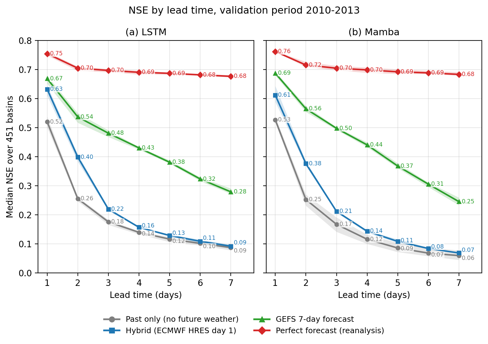
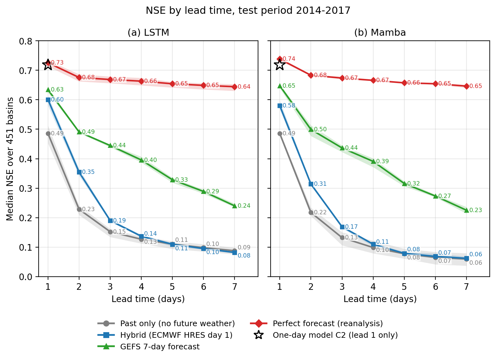
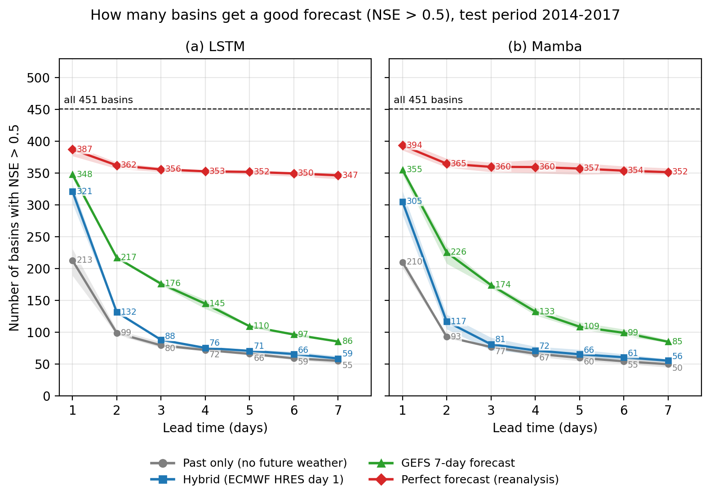
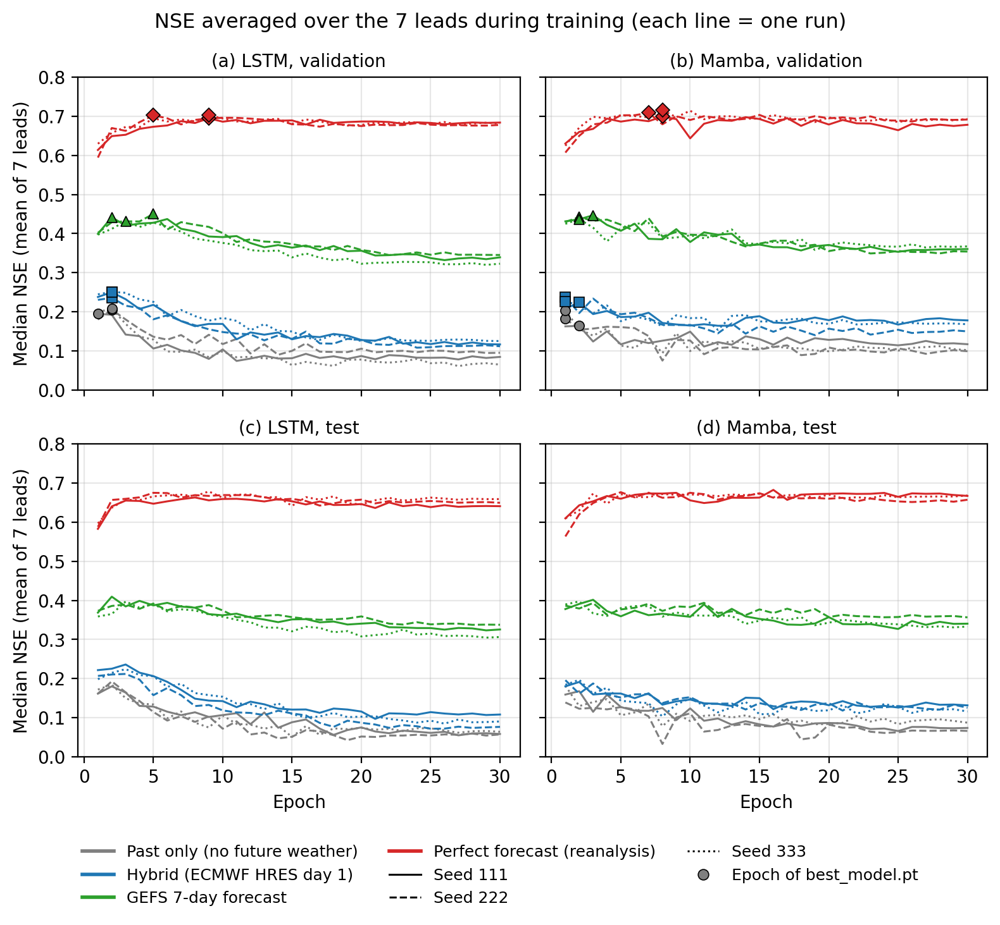
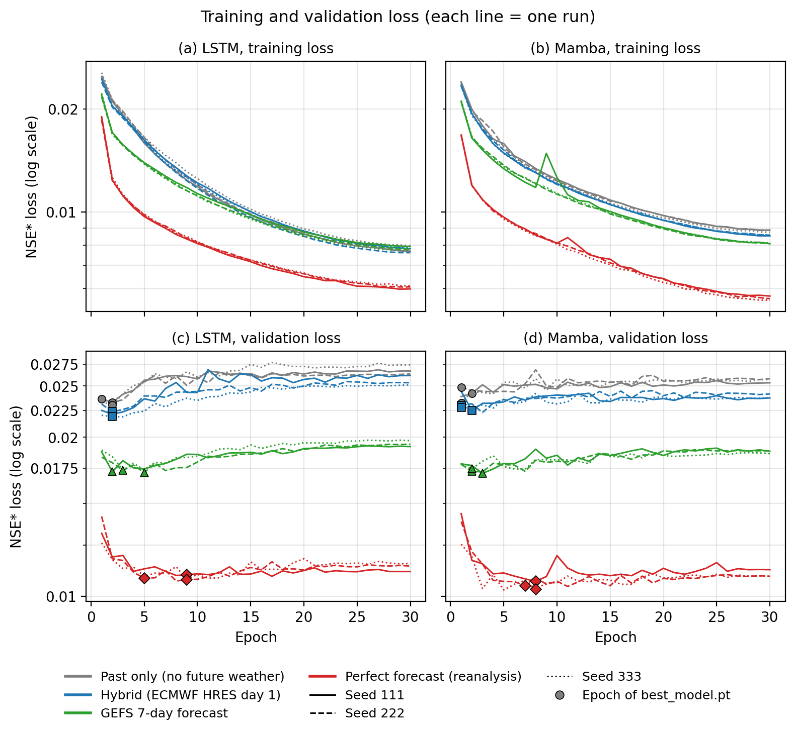

# H — dự báo 1–7 ngày, 2 lõi × 4 cách × 3 hạt giống

Tài liệu đi cùng [mã Python](15_H_LamaHCEExt_Compare.py) và [notebook chính thức](15_H_LamaHCEExt_Compare.ipynb) của notebook Kaggle `15_H_LamaHCEExt_Compare`. Bước H mở rộng mô hình chung Sequential Forecast từ dự báo `qmax` 1 ngày sang 7 ngày (ngày t đến t+6) và so bốn cách cấp thông tin thời tiết cho các ngày tới (`Document/01_Plan/02_Pipeline.md` Mục 4.4) với hai lõi: LSTM `lstm_L2_x1_lr1e-3` và Mamba `mamba_L2_x1_lr1e-3` (mức cùng tham số của C2, [báo cáo C2](../13_C2_LamaHCEExt_Compare/13_C2_LamaHCEExt_Compare.md) Mục 10). Notebook gom 24 run, so các cách và hai lõi theo hạn, so hạn 1 với mô hình một ngày C2, xuất 168 tệp NPZ cho bộ đánh giá và chọn run cho demo.

## Mục lục

- [1. Câu hỏi cần trả lời](#1)
- [2. Bốn cách cấp thông tin thời tiết](#2)
- [3. 24 lần huấn luyện](#3)
- [4. Cài đặt notebook và bản lưu chính thức](#4)
- [5. Các Phần của notebook](#5)
- [6. Kết quả validation theo hạn](#6)
- [7. Kết quả test theo hạn](#7)
- [8. Số lưu vực có dự báo tốt](#8)
- [9. Hạn 1 so với mô hình một ngày C2](#9)
- [10. Mamba so với LSTM](#10)
- [11. Đường học theo epoch và quá khớp](#11)
- [12. Chi phí](#12)
- [13. Run cho demo và bàn giao](#13)
- [14. Giới hạn](#14)
- [15. Nguồn](#15)

## 1. Câu hỏi cần trả lời

RQ6 (`02_Pipeline.md` Mục 1.1): khi dự báo Q 1–7 ngày, kỹ năng của LSTM và lõi SSM suy giảm theo hạn ra sao, và dự báo thời tiết đóng góp bao nhiêu ở từng hạn? Cụ thể:

1. Mỗi cách cấp thông tin thời tiết đạt NSE bao nhiêu ở từng hạn 1–7, so với persistence và với nhiễu giữa các hạt giống?
2. Phần nào của kỹ năng đến từ dự báo ECMWF HRES ngày đầu, phần nào từ dự báo nhiều ngày thật (GEFSv12), còn cách dự báo hoàn hảo bao xa?
3. Ở hạn 1, mô hình 7 ngày có giữ được mức của mô hình một ngày C2 không?
4. Mamba có suy giảm theo hạn khác LSTM không?

## 2. Bốn cách cấp thông tin thời tiết

"Hạn k" là ngày đích t+k−1 của một lần phát dự báo vào ngày t (hạn 1 = ngày t, như dự báo một ngày của BiasCast). Pha quá khứ (364 ngày trước ngày t) giống nhau ở cả bốn cách; chỉ pha dự báo (7 ngày) khác:

| Cách | Tên trong hình | Pha dự báo nhận gì | Vận hành được? |
|---|---|---|---|
| Chỉ quá khứ | Past only | Không có biến thời tiết nào (nhóm ECMWF HRES bị che cả 7 ngày) | Có |
| Lai | Hybrid | Ngày t: 5 biến ECMWF HRES thật; ngày t+1 đến t+6: để trống | Có |
| GEFS | GEFS 7-day forecast | Ngày t: ECMWF HRES và GEFSv12 hạn 1; ngày t+k−1: GEFSv12 reforecast hạn k cùng lần phát 00 UTC ngày t | Có |
| Dự báo hoàn hảo | Perfect forecast | 5 biến tái phân tích (thời tiết đã xảy ra) cho cả 7 ngày | Không, là cận trên |

Chi tiết cài đặt (che nhóm, masked mean, bộ đếm hạn): `02_Pipeline.md` Mục 4.4; dữ liệu GEFSv12 reforecast: `Document/03_Data/01_LamaHCE.md` Mục 7. Persistence hạn k là `qmax` quan trắc của ngày trước ngày phát (ngày đích − k), tức "ngày mai giống hôm qua" kéo dài cho mọi hạn.

## 3. 24 lần huấn luyện

Mỗi lần là một notebook `14_H_Train_<lõi>_L2_x1_lr1e-3_<cách>_Seed<N>` (thư mục [`14_H_Train/`](../14_H_Train/)), sinh bằng `Tools/H_Notebooks_Build.py` từ khuôn `Tools/H_Notebook_Template.py` (ba cách past, hybrid, perfect; fork `research` mốc `freeze-H` = `6f68f47`) và `Tools/H_GEFS_Notebook_Template.py` (cách gefs, `--gefs`; mốc `freeze-H2` = `840450f`, thêm Input `04_GEFS_Download` Version 6). Sinh lại cả 24 tệp `.py` trùng từng byte tệp đã chạy; mã trong mỗi `.ipynb` trùng `.py` của nó.

- Version 1 cả 24 notebook, mỗi lần trọn một phiên Kaggle T4, 30 epoch (cosine T_max 30), `best_model.pt` theo NSE_lead_mean trung vị validation, chấm test mọi epoch để theo dõi.
- Mọi kiểm Phần 1–8 của 24 notebook đạt.
- Chốt chặn gradient luôn bật ở khuôn H: không run nào phải bỏ bước (0 bước bỏ ở cả 24).
- Số tham số: LSTM 84.414, Mamba 85.111 ở ba cách; cách gefs thêm 7 lớp nhúng nhóm GEFS (+672): LSTM 85.086, Mamba 85.783. Mọi so sánh trong bước H (giữa các cách cùng lõi, giữa hai lõi cùng cách) lệch tham số dưới 1%.

## 4. Cài đặt notebook và bản lưu chính thức

| Mục | Giá trị |
|---|---|
| Máy | Kaggle CPU; không cần GPU, không cần NeuralHydrology (đọc `config.yml`, csv chỉ số, `test_results.p`) |
| Input | Output 24 notebook `14_H_Train_*` Version 1; `13_C2_LamaHCEExt_Compare` Version 1 (nhiễu B*, NSE C2 từng hạt giống, NPZ hạn 1 của C2 cùng cấu hình); `02_A3_LamaHCEExt_Benchmarks` Version 1 (lịch, ID, diện tích, quan trắc, persistence). Run nhận theo `h_output/environment.json`, không theo tên thư mục Input |
| Bản lưu chính thức | Version 1 (Save & Run All); 5 hình ở [Figures/](Figures/), bảng ở [Tables/](Tables/) |
| Đầu ra | 168 NPZ ở `h_compare/contracts/` (2,35 GB), `h_summary.json`, `environment.json`, `manifest.csv` (191 tệp, 2,36 GB) |

Bảng `H_test_basin_lead.csv` (chỉ số từng lưu vực × hạn × run, 9,8 MB) chỉ có ở Output Kaggle, không đưa vào repo; các bảng khác ở `Tables/`.

## 5. Các Phần của notebook

| Phần | Việc | Kiểm (đều đạt) |
|---|---|---|
| 1 | Nhận 24 run, C2 Compare, A3; kiểm sha256 theo `manifest.csv` của nguồn | đủ 2 × 4 × 3; trạng thái "xong"; 30 epoch huấn luyện, validation, test; `best_model.pt` = epoch NSE_lead_mean validation cao nhất; mốc thư viện theo cách; 1 nhóm pha dự báo ở ba cách, 8 nhóm ở gefs; config giống nhau ngoài khóa riêng của cách và hạt giống; số tham số đúng |
| 2 | Validation của `best_model.pt` theo hạn; hiệu giữa các cách và hai lõi theo bội nhiễu 0,0079 | 451 lưu vực mỗi run; NSE_lead_mean tính lại khớp `summary.json` |
| 3 | Test theo hạn từ `test_results.p`: ngày đích chung 2014-01-07..2017-12-25 (1.449 ngày), NSE, KGE, PNSE từng lưu vực | NSE, KGE tính lại khớp `test_metrics.csv` của thư viện (lệch ≤ 5×10⁻¹⁴); quan trắc của run trùng A3; chặn âm `qmax` ở mọi run |
| 4 | Hạn 1 so với C2 cùng cấu hình, cùng hạt giống, cùng ngày đích (Mục 9) | 6 NPZ C2 đúng hợp đồng, NSE khớp `c2_summary.json` |
| 5 | 168 NPZ test/S0 theo hạn (hợp đồng bộ đánh giá, `Workspace/06_Evaluation/01_Evaluation_LamaHCEExt/01_Evaluation_LamaHCEExt.md` Mục 7) | tên đúng mẫu; đọc ngược đạt; dự báo đọc lại trùng từng bit Phần 3; NSE, PNSE từ NPZ bằng Phần 3 |
| 6 | Quá khớp theo epoch, chi phí (Mục 11, 12) | 30 epoch × 24 run, không NaN |
| 7 | 5 hình | — |
| 8 | Run demo, bảng bàn giao, `h_summary.json`, manifest | run demo không hòa; manifest 191/191 |

## 6. Kết quả validation theo hạn

NSE trung vị 451 lưu vực trên validation 2010–2013 ở epoch của `best_model.pt`, trung bình 3 hạt giống (`Tables/H_validation_summary.csv`). Chỉ validation dùng để chọn và so mô hình (`02_Pipeline.md` Mục 6.1). NSE_lead_mean là trung bình NSE 7 hạn của từng lưu vực, lấy trung vị qua lưu vực (Mục 6.6).

| Cách | Lõi | Epoch chọn | NSE_lead_mean | Hạn 1 | Hạn 2 | Hạn 3 | Hạn 4 | Hạn 5 | Hạn 6 | Hạn 7 |
|---|---|---|---|---|---|---|---|---|---|---|
| Chỉ quá khứ | LSTM | 1/2/2 | 0,2028 ± 0,0070 | 0,520 | 0,256 | 0,176 | 0,140 | 0,117 | 0,102 | 0,088 |
| Chỉ quá khứ | Mamba | 2/1/1 | 0,1833 ± 0,0196 | 0,527 | 0,253 | 0,168 | 0,116 | 0,086 | 0,069 | 0,060 |
| Lai | LSTM | 2/2/2 | 0,2455 ± 0,0085 | 0,632 | 0,399 | 0,219 | 0,157 | 0,129 | 0,109 | 0,092 |
| Lai | Mamba | 2/1/1 | 0,2292 ± 0,0072 | 0,612 | 0,377 | 0,212 | 0,144 | 0,109 | 0,084 | 0,069 |
| GEFS | LSTM | 2/5/3 | 0,4414 ± 0,0092 | 0,669 | 0,537 | 0,481 | 0,430 | 0,381 | 0,323 | 0,279 |
| GEFS | Mamba | 3/2/2 | 0,4421 ± 0,0049 | 0,687 | 0,565 | 0,498 | 0,441 | 0,368 | 0,306 | 0,246 |
| Hoàn hảo | LSTM | 9/5/9 | 0,7000 ± 0,0043 | 0,754 | 0,705 | 0,697 | 0,690 | 0,687 | 0,682 | 0,676 |
| Hoàn hảo | Mamba | 8/7/8 | 0,7082 ± 0,0085 | 0,762 | 0,715 | 0,704 | 0,699 | 0,692 | 0,688 | 0,683 |

"Epoch chọn" là epoch của `best_model.pt` ở hạt giống 111/222/333. Hiệu giữa các cách, tính theo bội nhiễu hạt giống 0,0079 (`Tables/H_validation_diffs.csv`, NSE_lead_mean):

| So sánh | LSTM | Mamba | Hạt giống cùng dấu |
|---|---|---|---|
| Lai − chỉ quá khứ | +0,043 (5,4 nhiễu) | +0,046 (5,8) | 3/3 |
| GEFS − lai | +0,196 (24,7) | +0,213 (26,8) | 3/3 |
| Hoàn hảo − GEFS | +0,259 (32,6) | +0,266 (33,5) | 3/3 |

*Hình 1. NSE trung vị qua 451 lưu vực trên validation theo hạn, (a) LSTM, (b) Mamba; mỗi đường là một cách, trung bình 3 hạt giống, dải mờ là khoảng 3 hạt giống; số cạnh điểm là giá trị đó. Cùng thang trục dọc với Hình 2 và Hình 4.*

Thứ tự bốn cách giống nhau ở mọi hạn và cả hai lõi, mọi hiệu giữa hai cách liền kề vượt 5 lần nhiễu. Ở validation, lai hơn chỉ quá khứ rõ ở hạn 1–2 (LSTM +0,112 và +0,143), nhỏ dần và còn +0,005 ở hạn 7 (0,58 nhiễu, trong nhiễu).

## 7. Kết quả test theo hạn

NSE trung vị test 2014–2017 (chỉ báo cáo; `Tables/H_test_summary.csv`):

| Cách | Lõi | NSE_lead_mean | Hạn 1 | Hạn 2 | Hạn 3 | Hạn 4 | Hạn 5 | Hạn 6 | Hạn 7 |
|---|---|---|---|---|---|---|---|---|---|
| Chỉ quá khứ | LSTM | 0,180 | 0,486 | 0,229 | 0,152 | 0,127 | 0,110 | 0,098 | 0,088 |
| Chỉ quá khứ | Mamba | 0,163 | 0,485 | 0,218 | 0,132 | 0,099 | 0,078 | 0,065 | 0,060 |
| Lai | LSTM | 0,217 | 0,601 | 0,355 | 0,190 | 0,137 | 0,110 | 0,095 | 0,082 |
| Lai | Mamba | 0,191 | 0,580 | 0,314 | 0,169 | 0,110 | 0,079 | 0,069 | 0,062 |
| GEFS | LSTM | 0,400 | 0,634 | 0,491 | 0,445 | 0,396 | 0,329 | 0,289 | 0,240 |
| GEFS | Mamba | 0,393 | 0,648 | 0,499 | 0,437 | 0,391 | 0,316 | 0,273 | 0,225 |
| Hoàn hảo | LSTM | 0,670 | 0,726 | 0,676 | 0,669 | 0,663 | 0,654 | 0,649 | 0,644 |
| Hoàn hảo | Mamba | 0,674 | 0,738 | 0,683 | 0,674 | 0,666 | 0,657 | 0,654 | 0,646 |
| Persistence | — | — | 0,345 | −0,145 | −0,307 | −0,363 | −0,410 | −0,477 | −0,510 |

*Hình 2. Như Hình 1 trên test; sao rỗng là mô hình một ngày C2 cùng cấu hình ở hạn 1 (Mục 9). Persistence không vẽ vì âm từ hạn 2.*

**Đọc NSE.** NSE = 1 nghĩa là dự báo trùng quan trắc; NSE = 0 nghĩa là dự báo không hơn việc luôn đoán bằng lưu lượng trung bình của cả kỳ; NSE âm là kém hơn đoán trung bình. Ví dụ, cách chỉ quá khứ ở hạn 7 có NSE 0,09: sai số bình phương của mô hình bằng 91% sai số khi đoán trung bình.

**Phân tách đóng góp theo hạn (LSTM, test).** Lấy hiệu giữa các cách liền kề:

| Hạn | Lai − chỉ quá khứ (ECMWF HRES ngày đầu) | GEFS − lai (dự báo nhiều ngày thật) | Hoàn hảo − GEFS (còn thiếu so với thời tiết đã xảy ra) |
|---|---|---|---|
| 1 | +0,115 | +0,034 | +0,091 |
| 2 | +0,126 | +0,136 | +0,185 |
| 4 | +0,010 | +0,259 | +0,267 |
| 7 | −0,006 | +0,158 | +0,404 |

Mamba cùng chiều (hạn 7: +0,002, +0,163, +0,421). Nhận xét:

- **Không có thông tin thời tiết các ngày tới, kỹ năng mất rất nhanh.** Chỉ quá khứ giảm từ 0,49 ở hạn 1 còn 0,23 ở hạn 2 và 0,09 ở hạn 7. Mô hình vẫn hơn persistence ở mọi hạn (persistence âm từ hạn 2); PNSE > 0 (mô hình hơn persistence) ở 79% lưu vực hạn 1 và 96% ở hạn 7 (`Tables/H_test_summary.csv`).
- **ECMWF HRES ngày đầu chỉ giúp hạn 1–2.** Lai hơn chỉ quá khứ ở hạn 1 (90% lưu vực, LSTM) và hạn 2 (mưa ngày t chảy ra sông ngày t+1), từ hạn 4 gần bằng chỉ quá khứ; ở hạn 7 lai chỉ hơn ở 56% lưu vực (LSTM), 65% (Mamba).
- **Dự báo nhiều ngày GEFSv12 là phần đóng góp lớn nhất từ hạn 2.** GEFS hơn lai ở 95–97% lưu vực ở hạn 2, 4, 7 (LSTM), 97–99% (Mamba); ở hạn 7 NSE 0,24 so với 0,08. Ở hạn 1, GEFS hơn lai 0,034 (81% lưu vực) vì ngày t có thêm GEFS hạn 1 cạnh ECMWF HRES.
- **Khoảng cách tới dự báo hoàn hảo tăng theo hạn** (0,09 ở hạn 1 => 0,40 ở hạn 7), cùng chiều với chất lượng dự báo mưa GEFSv12: tương quan theo ngày giữa mưa GEFSv12 gộp lưu vực và mưa MSWEP trên validation (trung vị 451 lưu vực) là 0,825 ở hạn 1 (ECMWF HRES 0,829), 0,378 ở hạn 7 (`Document/03_Data/01_LamaHCE.md` Mục 7). Với thời tiết đã biết, mô hình gần như giữ kỹ năng qua 7 ngày (0,73 => 0,64): phần lớn mức suy giảm theo hạn đến từ việc không biết thời tiết tương lai, không phải từ việc dự báo xa hơn.
- **Test thấp hơn validation** ở mọi cách (NSE_lead_mean LSTM: 0,180 so với 0,203; 0,217 so với 0,246; 0,400 so với 0,441; 0,670 so với 0,700), như ở C2 (validation 0,768, test 0,718).

## 8. Số lưu vực có dự báo tốt

NSE trung vị chỉ cho biết lưu vực đứng giữa. Hình 3 đếm số lưu vực (trong 451) có NSE test > 0,5, mức "đạt" (satisfactory) cho mô phỏng dòng chảy theo Moriasi và cs. (2007). Mức này được đề xuất cho bước thời gian tháng, và các tác giả cho rằng ở bước thời gian ngắn hơn có thể nới tiêu chí; vì vậy với dự báo ngày, đạt NSE > 0,5 không phải yêu cầu thấp. Ở đây mốc chỉ dùng để đếm số lưu vực.

*Hình 3. Số lưu vực có NSE test > 0,5 theo hạn, (a) LSTM, (b) Mamba; đường là trung bình 3 hạt giống, dải là khoảng 3 hạt giống; đường đứt là 451 lưu vực.*

| Cách | LSTM hạn 1 | LSTM hạn 7 | Mamba hạn 1 | Mamba hạn 7 |
|---|---|---|---|---|
| Chỉ quá khứ | 213 | 55 | 210 | 50 |
| Lai | 321 | 59 | 305 | 56 |
| GEFS | 348 | 86 | 355 | 85 |
| Hoàn hảo | 387 | 347 | 394 | 352 |

Từ hạn 2, cách lai còn dưới 30% lưu vực đạt mức này (132 ở LSTM); GEFS giữ khoảng 1/2 ở hạn 2 (217) và 1/5 ở hạn 7 (86); với thời tiết đã biết vẫn còn 77% ở hạn 7.

## 9. Hạn 1 so với mô hình một ngày C2

C2 là cùng cấu hình (`lstm_L2_x1_lr1e-3`, `mamba_L2_x1_lr1e-3`), cùng hạt giống, chỉ dự báo một ngày với ECMWF HRES ngày t. So trên cùng ngày đích test (`Tables/H_lead1_vs_C2_summary.csv`):

| Cách | Lõi | NSE H hạn 1 | NSE C2 | H − C2 (bội nhiễu) | Lưu vực H > C2 |
|---|---|---|---|---|---|
| Chỉ quá khứ | LSTM | 0,486 | 0,718 | −0,232 (−29,2) | 0,4% |
| Chỉ quá khứ | Mamba | 0,485 | 0,719 | −0,233 (−29,4) | 0,7% |
| Lai | LSTM | 0,601 | 0,718 | −0,117 (−14,8) | 3,3% |
| Lai | Mamba | 0,580 | 0,719 | −0,139 (−17,5) | 2,4% |
| GEFS | LSTM | 0,634 | 0,718 | −0,084 (−10,5) | 7,5% |
| GEFS | Mamba | 0,648 | 0,719 | −0,071 (−9,0) | 9,5% |
| Hoàn hảo | LSTM | 0,726 | 0,718 | +0,008 (+1,0) | 48,7% |
| Hoàn hảo | Mamba | 0,738 | 0,719 | +0,019 (+2,4) | 57,7% |

Cách lai có cùng đầu vào ngày t với C2 (ECMWF HRES) nhưng thấp hơn 0,12–0,14 ở hạn 1, kém C2 ở 97% lưu vực; GEFS cũng thấp hơn C2 dù có thêm GEFS hạn 1. Như vậy một mô hình 7 ngày chưa thay được mô hình một ngày ở hạn 1. Hai yếu tố khác nhau giữa H và C2 có thể giải thích, chưa tách riêng:

- `best_model.pt` của H chọn theo trung bình 7 hạn, rơi vào epoch 1–5 ở ba cách vận hành được (Mục 11), trong khi C2 chọn ở epoch 15–25 theo NSE hạn 1; NSE hạn 1 ở các epoch sau của H chưa được báo trong notebook này (có trong `validation_metrics.csv` của từng run).
- Loss NSE* của H lấy trung bình trên 7 hạn, các hạn xa có sai số lớn chi phối gradient.

Cách hoàn hảo hơn C2 ở hạn 1 không phải do mô hình 7 ngày tốt hơn: ngày t của nó dùng tái phân tích (thời tiết đã xảy ra) thay cho dự báo ECMWF HRES.

## 10. Mamba so với LSTM

Hiệu Mamba − LSTM ở validation (dương là Mamba tốt hơn; bội nhiễu 0,0079; `Tables/H_validation_diffs.csv`):

| Cách | NSE_lead_mean | Hạn 1 | Hạn 7 |
|---|---|---|---|
| Chỉ quá khứ | −0,020 (−2,5) | +0,007 (+0,9) | −0,028 (−3,5) |
| Lai | −0,016 (−2,1) | −0,020 (−2,6) | −0,023 (−2,9) |
| GEFS | +0,001 (+0,1) | +0,019 (+2,4) | −0,034 (−4,2) |
| Hoàn hảo | +0,008 (+1,0) | +0,008 (+0,9) | +0,007 (+0,8) |

Tỉ lệ lưu vực Mamba hơn LSTM trên test (NSE trung bình 3 hạt giống mỗi lưu vực), hạn 1 => hạn 7: chỉ quá khứ 53% => 30%, lai 33% => 31% (thấp nhất 19% ở hạn 2), GEFS 55% => 44%, hoàn hảo 66% => 56%.

- **Khi thiếu thông tin thời tiết các ngày tới, LSTM suy giảm chậm hơn Mamba ở hạn xa**: ở hạn 7, Mamba kém 2,9–4,2 lần nhiễu ở cả ba cách vận hành được, cùng dấu ở 3/3 hạt giống.
- **Với thời tiết đã biết (hoàn hảo), Mamba nhỉnh hơn** ở mọi hạn nhưng trong khoảng 1 lần nhiễu (hạn 1 test: 66% lưu vực).
- **Trung bình 7 hạn, hai lõi cách nhau tối đa 2,5 lần nhiễu**, nhỏ so với khoảng cách giữa các cách (5–34 lần), nên trong Hình 1–3 hai lõi gần như trùng đường.
- Mamba không lặp lại từng bit trên GPU khi chạy lại cùng hạt giống (C2, mức x1: NSE validation từng epoch lệch tới 0,059, NSE được chọn lệch 0,0003; [báo cáo C2](../13_C2_LamaHCEExt_Compare/13_C2_LamaHCEExt_Compare.md) Mục 8), nên độ lệch chuẩn của Mamba gồm cả phần này. Kiểm định từng lưu vực (Wilcoxon, Cohen's d, Holm) làm ở bộ đánh giá.

## 11. Đường học theo epoch và quá khớp

*Hình 4. NSE_lead_mean trung vị theo epoch; hàng trên validation, hàng dưới test; cột trái LSTM, cột phải Mamba; màu theo cách, kiểu nét theo hạt giống; ký hiệu viền đen là epoch của `best_model.pt`.*

*Hình 5. Loss NSE* (trung bình 7 hạn) theo epoch, trục log; hàng trên kỳ huấn luyện, hàng dưới validation; ký hiệu viền đen là epoch của `best_model.pt` (chọn theo NSE validation, không theo loss).*

Trung bình 3 hạt giống (`Tables/H_overfit_cost_summary.csv`):

| Cách | Lõi | Epoch chọn | Validation: epoch chọn => 30 | Test: epoch chọn => 30 | Loss huấn luyện epoch 30 / epoch chọn | Loss validation epoch 30 / epoch chọn |
|---|---|---|---|---|---|---|
| Chỉ quá khứ | LSTM | 1/2/2 | 0,203 => 0,081 | 0,180 => 0,060 | 0,35 | 1,15 |
| Chỉ quá khứ | Mamba | 2/1/1 | 0,183 => 0,106 | 0,163 => 0,076 | 0,39 | 1,06 |
| Lai | LSTM | 2/2/2 | 0,246 => 0,118 | 0,217 => 0,092 | 0,38 | 1,16 |
| Lai | Mamba | 2/1/1 | 0,229 => 0,165 | 0,191 => 0,124 | 0,39 | 1,05 |
| GEFS | LSTM | 2/5/3 | 0,441 => 0,336 | 0,400 => 0,323 | 0,51 | 1,13 |
| GEFS | Mamba | 3/2/2 | 0,442 => 0,361 | 0,393 => 0,344 | 0,50 | 1,09 |
| Hoàn hảo | LSTM | 9/5/9 | 0,700 => 0,681 | 0,670 => 0,650 | 0,68 | 1,05 |
| Hoàn hảo | Mamba | 8/7/8 | 0,708 => 0,688 | 0,674 => 0,665 | 0,65 | 1,05 |

- **Ba cách vận hành được quá khớp rất sớm.** NSE validation cao nhất ở epoch 1–5 rồi giảm 0,06–0,13 tới epoch 30, trong khi loss huấn luyện còn giảm 2–3 lần và loss validation tăng 5–16%. Với dự báo hoàn hảo, đỉnh ở epoch 5–9 và chỉ giảm khoảng 0,02. Một giải thích khả dĩ (chưa kiểm): khi không có thời tiết tương lai, Q các ngày tới phụ thuộc vào mưa mô hình không thấy, nên phần mô hình học thêm sau vài epoch là nhiễu riêng của kỳ huấn luyện.
- **Chọn theo validation không mất nhiều trên test**: NSE_lead_mean test của `best_model.pt` thấp hơn epoch test cao nhất tối đa 0,007 (chỉ đọc, không dùng để chọn); validation và test đi cùng nhau qua 30 epoch (Hình 4).
- **Dao động**: NSE validation giữa hai epoch liền nhau dao động khoảng 0,004–0,007 (trung vị), cỡ nhiễu hạt giống; chênh lớn nhất giữa 3 hạt giống ở cùng epoch 0,035–0,071 (chú thích hình trong notebook).
- Giao thức giữ 30 epoch cho mọi mô hình như các bước trước (`02_Pipeline.md` Mục 5.1); `best_model.pt` theo validation nên không chịu phần giảm sau đỉnh.

## 12. Chi phí

Trung bình 3 hạt giống, một T4, `data_on_gpu` (`Tables/H_overfit_cost_summary.csv`):

| Cách | Lõi | Giờ huấn luyện | Phút huấn luyện / epoch | Phút validation / lượt | Phút test / lượt | GPU đỉnh (MiB) | Giờ phiên |
|---|---|---|---|---|---|---|---|
| Chỉ quá khứ | LSTM | 2,36 | 3,39 | 1,23 | 1,23 | 2.387 | 3,17 |
| Chỉ quá khứ | Mamba | 5,64 | 8,95 | 2,21 | 2,23 | 1.851 | 6,99 |
| Lai | LSTM | 2,54 | 3,60 | 1,35 | 1,35 | 2.388 | 3,42 |
| Lai | Mamba | 5,71 | 9,09 | 2,22 | 2,20 | 1.851 | 7,04 |
| GEFS | LSTM | 2,58 | 3,59 | 1,40 | 1,40 | 2.675 | 3,63 |
| GEFS | Mamba | 5,87 | 9,33 | 2,24 | 2,23 | 2.137 | 7,34 |
| Hoàn hảo | LSTM | 2,42 | 3,48 | 1,24 | 1,31 | 2.388 | 3,27 |
| Hoàn hảo | Mamba | 5,57 | 8,84 | 2,20 | 2,18 | 1.851 | 6,90 |

Tổng 24 run: 98,1 giờ huấn luyện (LSTM 29,7; Mamba 68,4), 125,3 giờ phiên Kaggle (kể cả dựng dữ liệu và chấm test mọi epoch). Mamba tốn 2,3–2,4 lần LSTM về giờ huấn luyện, 2,5–2,6 lần mỗi epoch, như ở C2 (2,7 lần). Cách gefs (thêm 35 cột đầu vào) chậm hơn ba cách kia khoảng 2–4% mỗi epoch.

## 13. Run cho demo và bàn giao

**Run demo**: mỗi (lõi, cách) lấy run có NSE_lead_mean validation cao nhất trong 3 hạt giống (`02_Pipeline.md` Mục 9.6; `Tables/H_demo_runs.csv`):

| Cách | LSTM | Mamba |
|---|---|---|
| Chỉ quá khứ | hạt giống 333 (0,2083) | 333 (0,2031) |
| Lai | 333 (0,2508) | 222 (0,2375) |
| GEFS | 222 (0,4504) | 111 (0,4468) |
| Hoàn hảo | 222 (0,7026) | 333 (0,7163) |

Không có hòa; khoảng cách tới hạt giống thứ hai nhỏ nhất là 0,0001 (LSTM hoàn hảo), dưới nhiễu, nên chọn hạt giống nào trong cặp đó không đổi kết luận.

**Bàn giao:**

- **168 NPZ** `h_compare/contracts/SF_<cấu hình>_H<cách>_seed<N>_test_S0_lead<k>.npz` (khoảng 14 MB mỗi tệp): ngày đích là lịch A3 bỏ 6 ngày đầu và 6 ngày cuối kỳ test; persistence hạn k là Q ngày đích − k; `library_commit` theo mốc của run (`6f68f47…` cho past, hybrid, perfect; `840450f…` cho gefs). Bộ đánh giá tìm `manifest.csv` ở thư mục cha của NPZ.
- **24 checkpoint**: `Tables/H_handoff.csv` ghi notebook nguồn, thư mục run, epoch chọn, mốc thư viện, `forecast_input_mode`, số tham số, sha256 của `best_model.pt`, `config.yml`, `train_data_scaler.yml` và tên NPZ. Tệp chuẩn hóa giống nhau trong cùng cách (ba nhóm sha256: past/hybrid, gefs, perfect).
- **`h_summary.json`**: giao thức, chỉ số validation/test theo hạn từng nhóm và từng hạt giống, hạn 1 so với C2, quá khớp, chi phí, run demo, đường dẫn NPZ.

## 14. Giới hạn

- Ba hạt giống cho độ lệch chuẩn ước lượng thô; hiệu giữa hai lõi ở trung bình 7 hạn tối đa 2,5 lần nhiễu nên bước H không kết luận lõi nào tốt hơn nói chung, chỉ kết luận theo hạn và theo cách (Mục 10).
- Mô hình 7 ngày thấp hơn mô hình một ngày C2 ở hạn 1 khi dùng cùng ECMWF HRES (Mục 9); nguyên nhân (chọn epoch theo trung bình 7 hạn hay loss trung bình 7 hạn) chưa tách riêng.
- Ba cách vận hành được quá khớp từ epoch 1–5; giao thức 30 epoch và lịch học giữ như C2, không tinh chỉnh lại cho bài toán 7 ngày.
- Chỉ kịch bản S0 (mọi nguồn đủ); dự báo GEFSv12 là reforecast (một phiên bản mô hình FV3 chạy lại cho cả kỳ 2000–2019; mưa trung bình 5 thành viên, các biến khác chỉ thành viên điều khiển c00), không phải dự báo đã phát hành ở thời điểm đó, và khác nguồn với ECMWF HRES mà bài toán một ngày dùng (`Document/03_Data/01_LamaHCE.md` Mục 7).
- Persistence hạn k dùng Q ngày trước ngày phát; chưa so với các mốc dự báo nhiều ngày khác.

## 15. Nguồn

- Konold và cs. (2026), BiasCast, HESS 30:5067–5096: khung Sequential Forecast LSTM, kỳ dữ liệu, cosine T_max 30.
- Moriasi, D. N. và cs. (2007), Model evaluation guidelines for systematic quantification of accuracy in watershed simulations, Transactions of the ASABE 50(3): 885–900: mức NSE > 0,5 "đạt".
- `Document/01_Plan/02_Pipeline.md` Mục 1.1 (RQ6), 4.4 (bốn cách, mốc `freeze-H`, `freeze-H2`), 5.1 (giao thức 30 epoch), 5.3 (ngưỡng nhiễu 0,0079), 6.1 (ba tầng chỉ số), 6.6 (chỉ số theo hạn), 9.6 (demo).
- `Document/03_Data/01_LamaHCE.md` Mục 7 (GEFSv12 reforecast gộp về 451 lưu vực).
- [Báo cáo C2](../13_C2_LamaHCEExt_Compare/13_C2_LamaHCEExt_Compare.md) (cấu hình, mô hình một ngày, tính lặp lại của Mamba); `Workspace/06_Evaluation/01_Evaluation_LamaHCEExt/01_Evaluation_LamaHCEExt.md` Mục 7 (hợp đồng NPZ).
- Số liệu trong tài liệu lấy từ output notebook Version 1 (`Tables/`, `h_summary.json`) và 24 notebook `14_H_Train_*` Version 1; tỉ lệ lưu vực ở Mục 7, 10 tính từ `H_test_basin_lead.csv` của Output Version 1.
