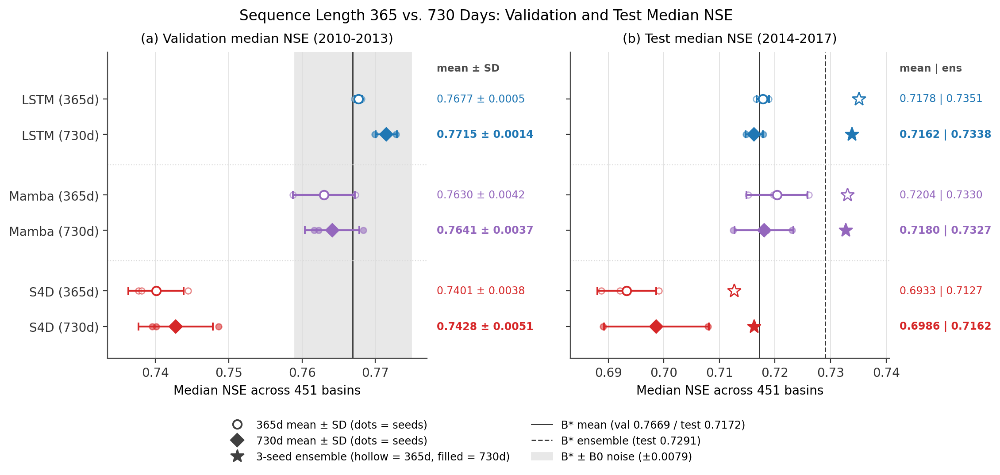
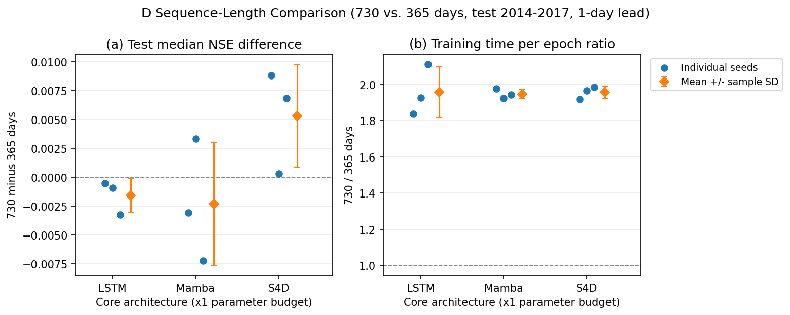
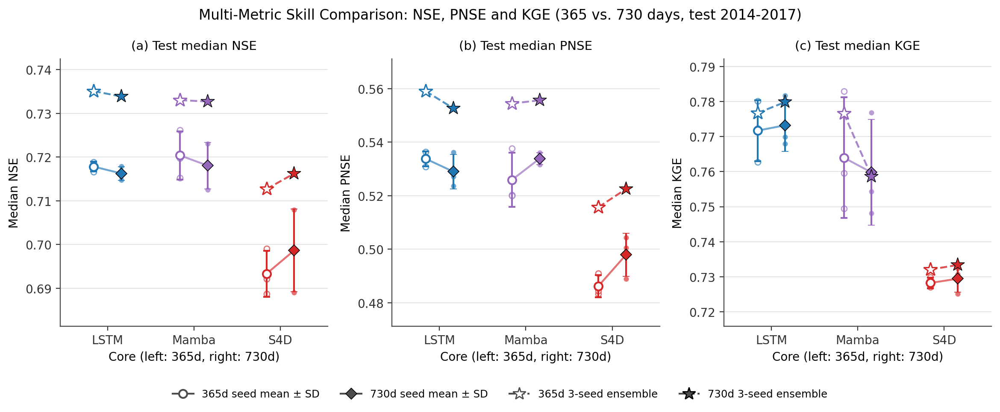
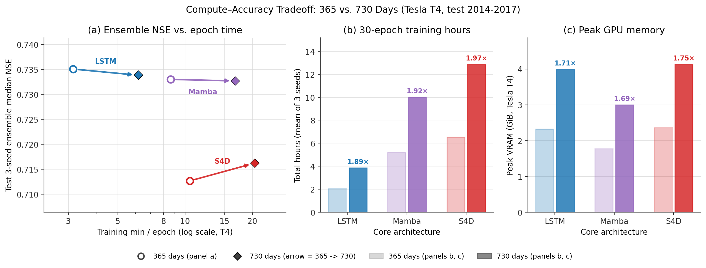
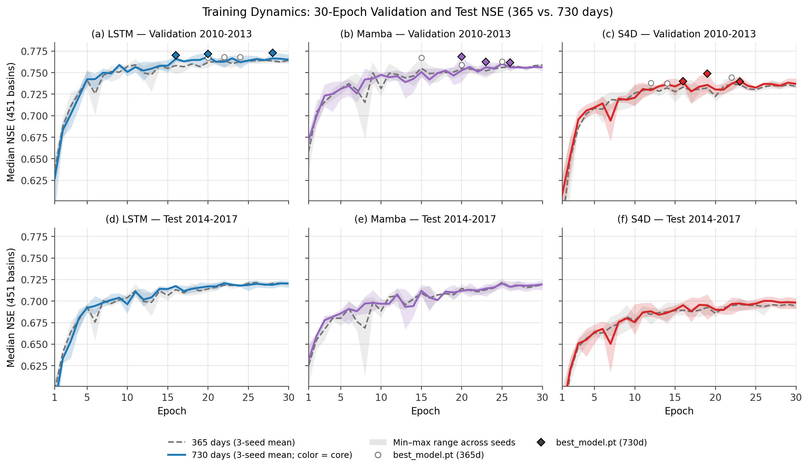
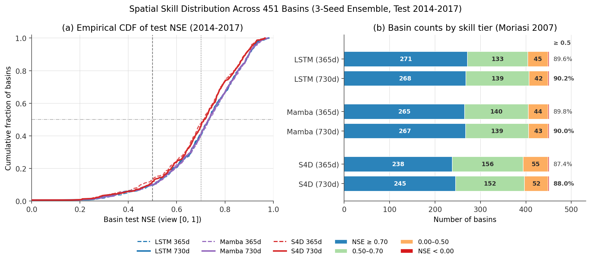
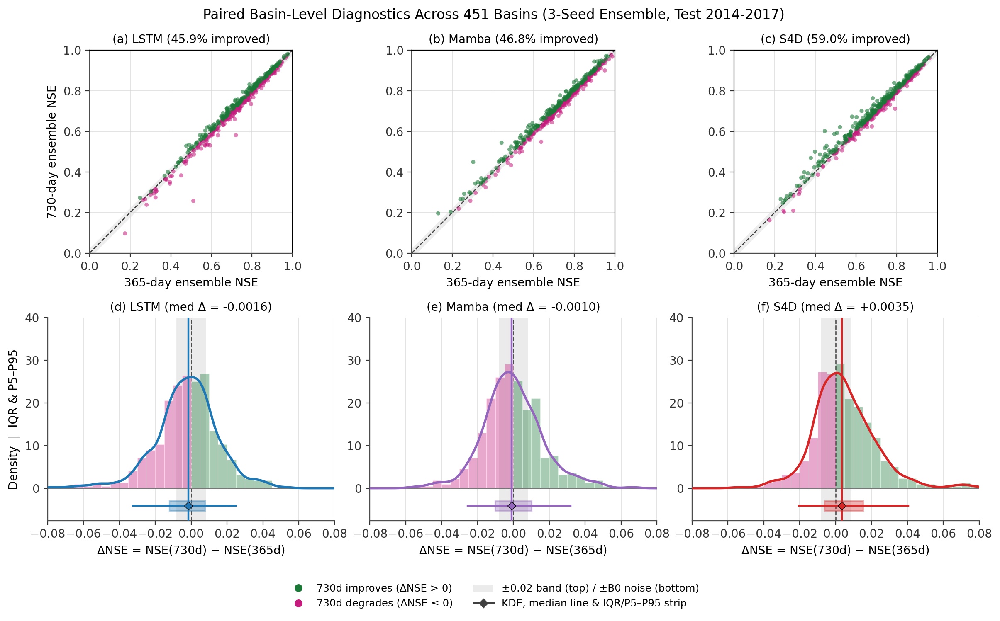
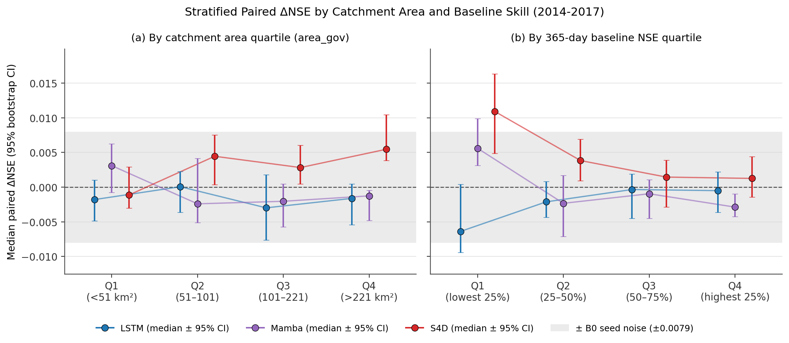
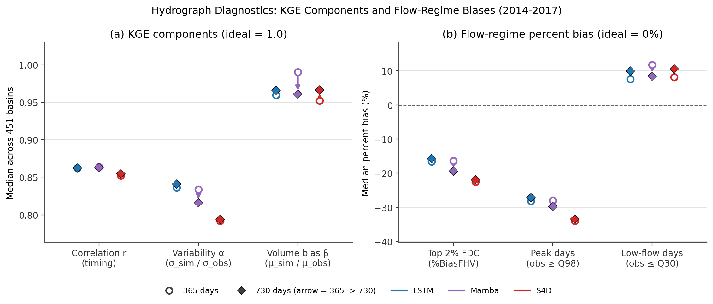

# D — So sánh độ dài 365 và 730 bước

Bước D kiểm lợi ích của kéo dài lịch sử trên ba cấu hình cùng mức tham số. Thứ tự chạy là LSTM, Mamba, S4D. Theo Mục 8.3 của Pipeline, khi thiếu thời gian, chạy đủ ba seed LSTM và ba seed Mamba trước, có thể bỏ toàn nhóm S4D.

| Cấu hình | Seed | Số tham số của C2 |
|---|---|---:|
| `lstm_L2_x1_lr1e-3` | 111, 222, 333 | 84.106 |
| `mamba_L2_x1_lr1e-3` | 111, 222, 333 | 85.039 |
| `s4d_L4_x1_lr1e-3` | 111, 222, 333 | 84.449 |

Số 365/730 là `seq_length` của NeuralHydrology. Mẫu gồm 364/729 bước quá khứ đến t−1 và một ngày ECMWF HRES tại ngày đích t. Hai phía dùng `freeze-C`, cùng phiên bản bộ lọc, cùng cấu hình, seed và ngân sách 30 epoch. Bộ chuẩn hóa được fit theo cùng quy trình train của thư viện. Vì khoảng warmup thay đổi theo seq_length, thống kê scaler có thể thay đổi, nên bảng đối chiếu ghi riêng hash scaler hai phía.

## 1. Input và thứ tự

Notebook CPU, Internet Off. Tên notebook `17_D_LamaHCEExt_Compare`, đặt sau `14_H_Train`, `15_H_LamaHCEExt_Compare` và `16_D_Train`.

Với LSTM và Mamba, gắn đủ 14 Output cho Compare, gồm hai nguồn chung, sáu Output C2 365 bước và sáu Output D 730 bước. Khi chạy thêm S4D, gắn đủ ba cặp S4D để tổng số nguồn là 20. Hai nguồn chung là `13_C2_LamaHCEExt_Compare` Version 1 và `02_A3_LamaHCEExt_Benchmarks` Version 1.

| Mô hình | Seed | Notebook C2 365 bước (Version 1) | Notebook D 730 bước (`16_D_Train/`) |
|---|---:|---|---|
| LSTM | 111 | `12_C2_Train_lstm_L2_x1_lr1e-3_Seed111` | `16_D_Train_lstm_L2_x1_lr1e-3_Seed111` |
| LSTM | 222 | `12_C2_Train_lstm_L2_x1_lr1e-3_Seed222` | `16_D_Train_lstm_L2_x1_lr1e-3_Seed222` |
| LSTM | 333 | `12_C2_Train_lstm_L2_x1_lr1e-3_Seed333` | `16_D_Train_lstm_L2_x1_lr1e-3_Seed333` |
| Mamba | 111 | `12_C2_Train_mamba_L2_x1_lr1e-3_Seed111` | `16_D_Train_mamba_L2_x1_lr1e-3_Seed111` + `_Cont` |
| Mamba | 222 | `12_C2_Train_mamba_L2_x1_lr1e-3_Seed222` | `16_D_Train_mamba_L2_x1_lr1e-3_Seed222` + `_Cont` |
| Mamba | 333 | `12_C2_Train_mamba_L2_x1_lr1e-3_Seed333` | `16_D_Train_mamba_L2_x1_lr1e-3_Seed333` + `_Cont` |
| S4D | 111 | `12_C2_Train_s4d_L4_x1_lr1e-3_Seed111` | `16_D_Train_s4d_L4_x1_lr1e-3_Seed111` + `_Cont` |
| S4D | 222 | `12_C2_Train_s4d_L4_x1_lr1e-3_Seed222` | `16_D_Train_s4d_L4_x1_lr1e-3_Seed222` + `_Cont` |
| S4D | 333 | `12_C2_Train_s4d_L4_x1_lr1e-3_Seed333` | `16_D_Train_s4d_L4_x1_lr1e-3_Seed333` + `_Cont` |

Với mỗi dòng được chọn, gắn Output hoàn thành (`status = "xong"`): nếu phiên 1 hoàn tất 30 epoch và chấm xong test thì gắn bản thường; nếu phiên 1 tạm dừng và chạy tiếp ở phiên 2 thì chỉ gắn bản `_Cont`. Các tên của nguồn 365 bước lấy từ [C2_handoff.csv](../13_C2_LamaHCEExt_Compare/Tables/C2_handoff.csv).

Compare dùng cấu trúc Output huấn luyện từ `Tools/C_Notebooks_Build.py d` (khuôn `Tools/C_Notebook_Template.py` giữ nguyên từng byte). Cổng đọc nhận `c_output` hoặc `d_output`, chứa `environment.json`, `summary.json` và `manifest.csv`, với `experiment_name = D_<cấu hình>_seed<N>`. Tệp dự báo gốc nằm ở `test/best_model/test_results.p` của thư mục run. Chốt chặn gradient mặc định tắt cho cả chín run D (trùng với chín run C2 đối chứng); nếu một run riêng lẻ phải bật `--grad-guard`, `D_config_check.csv`, `D_contract_check.csv` và `d_summary.json` ghi rõ cờ bật, số bước bỏ và trạng thái tương đương nghiêm ngặt (`strict_pair_equivalent`).

Đã đối chiếu chín NPZ 365 bước trong C2 Compare với ngữ cảnh A3 thật. Sai số lớn nhất giữa NSE trung vị ghi trong bàn giao và NSE tính từ NPZ là `3,56 × 10⁻⁸`. Các bản train 365 bước đang giữ trên laptop là bản rút gọn cho demo hoặc bản có hash môi trường khác C2 Compare. Khi chấm D trên Kaggle, gắn nguyên Notebook Output Version 1 theo bảng trên để kiểm cấu hình và manifest. Các lượt C2 đã lưu được dùng lại.

## 2. Đối chiếu và chấm

Phần 2 đối chiếu hai config đã lưu, loại các khóa đường dẫn và quản lý phiên, kiểm phần khác biệt khoa học đúng `seq_length` (`365` so với `730`). Mỗi run phải có checkpoint chọn bằng validation, đủ 30 epoch, bảng đường học `curve_<experiment>.csv` khớp `summary.json` và test hoàn thành. Hash scaler của từng run và thông tin `grad_guard` được giữ trong audit. Nếu Output huấn luyện có trường `train_samples`, kiểm số mẫu cùng mốc 1.112.307 theo audit B2; khi thiếu số từ Output, audit ghi rõ chưa xác nhận số mẫu từng run.

Phần 3 đọc kết quả đã kiểm byte, đối chiếu quan trắc A3, dựng NPZ theo hợp đồng Evaluation và tính lại NSE nguồn với quan trắc native. Phần 4 chấm NSE, PNSE và KGE trên giao ngày của các run D và C2 cùng cấu hình; kết quả giữ từng seed, từng lưu vực, bảng đường học 30 epoch (`D_curves.csv`), chẩn đoán từng lưu vực của tổ hợp 3 hạt giống (`D_ensemble_basin_scores.csv`: `NSE`, `PNSE`, `KGE`, `r`, `alpha`, `beta`, `%BiasFHV`, thiên lệch đỉnh `>= Q98` và dòng chảy thấp `<= Q30` kèm `area_gov_km2`) và bảng tóm tắt tổ hợp 3 hạt giống (`D_ensemble_scores.csv`, chỉ tính trong notebook, không xuất NPZ), ghi riêng hiệu hai trung vị, trung vị hiệu ghép cặp và bội ngưỡng nhiễu B0 (`noise_sd`). Bảng bàn giao `D_handoff.csv` và bảng chọn mô hình demo theo validation `D_demo_runs.csv` ghi đủ mã băm SHA-256 của `environment.json`, `best_model.pt`, `config.yml`, `train_data_scaler.yml` và NPZ. Chi phí gộp cả phiên 1 (`previous_session`) khi run chạy qua hai phiên (`_Cont`), kể cả khi phiên 2 chỉ chấm test (`SKIP_TRAIN`), rồi so trung vị phút/epoch train, phút validation/test, tổng giờ train và đỉnh bộ nhớ GPU theo cặp C2/D. Nếu GPU hai phía khác nhau, cần đọc cột GPU trước khi diễn giải tỷ số thời gian.

Phần 5 xuất **bộ 9 hình trực quan hóa đa tiêu chí** (Version 3, dùng nguyên 20 Input của Version 1; tự rút gọn sạch khi bỏ S4D) theo phong cách tối giản chuẩn tạp chí HESS/Nature (bảng màu thống nhất với C2/H/XAI: `LSTM = C0`, `Mamba = C4`, `S4D = C3`; chú giải đặt ngoài vùng vẽ; chữ trong hình tiếng Anh 200 dpi; không chèn hộp ghi chú rậm lên vùng dữ liệu; mỗi hình gọi `plt.show()` và in chú thích tiếng Việt tính động từ số liệu thực ngay bên dưới), sắp xếp tuần tự từ **đơn giản (tổng quan)** đến **nâng cao (chẩn đoán lưu vực và vật lý thủy văn)**:

1. `D_Overview_Accuracy.png` *(Tổng quan đơn giản)*: đồ thị điểm Cleveland cho NSE trung vị validation (2010–2013) và test (2014–2017) của 365 vs 730 ngày kèm hạt giống, tổ hợp 3 hạt giống, mốc `B*` và dải nhiễu `B0`.
2. `D_Length_Comparison.png` *(Cốt lõi RQ5 — tên tệp bắt buộc cho Evaluation)*: hiệu `ΔNSE (730 − 365)` kèm dải nhiễu `±B0` đặt cạnh tỷ số thời gian huấn luyện mỗi epoch `730 / 365` và vạch tỉ lệ tuyến tính `2,0×`.
3. `D_MultiMetric_Ensemble.png` *(Đa tiêu chí)*: cặp điểm nối `365 → 730` cho đồng thời ba chỉ số chuẩn thủy văn **NSE, PNSE, KGE** (trung bình ± SD hạt giống và tổ hợp 3 hạt giống).
4. `D_Cost_Tradeoff.png` *(Đánh đổi hiệu năng – chi phí)*: quỹ đạo `365 → 730` theo NSE tổ hợp vs phút/epoch (thang log), đặt cạnh hai biểu đồ cột gốc 0 cho tổng giờ huấn luyện 30 epoch và đỉnh bộ nhớ GPU VRAM (`GiB`).
5. `D_Curves_365_vs_730.png` *(Động học huấn luyện 30 epoch)*: đường học NSE validation và test theo epoch (trung bình + dải min–max 3 hạt giống) kèm dấu `best_model.pt` của hai độ dài chuỗi.
6. `D_Basin_CDF_And_Thresholds.png` *(Phân phối không gian 451 lưu vực — chuẩn HESS)*: đường phân phối tích lũy thực nghiệm (ECDF) của NSE tổ hợp và biểu đồ thanh chồng 4 bậc chất lượng Moriasi và cs. (2007) (`≥ 0,70`, `0,50–0,70`, `0,00–0,50`, `< 0`).
7. `D_Basin_Paired_Delta.png` *(Chẩn đoán ghép cặp từng lưu vực)*: đồ thị tán xạ `1:1` (`NSE_365` vs `NSE_730`) phía trên và phân phối mật độ `ΔNSE` (histogram + KDE + thanh hộp `IQR` & `P5–P95` kiểu Raincloud chung trục tung) phía dưới.
8. `D_Basin_Stratification.png` *(Phân tầng theo đặc trưng lưu vực)*: trung vị `ΔNSE` và khoảng tin cậy bootstrap 95% theo 4 tứ phân vị diện tích `area_gov` và 4 tứ phân vị kỹ năng nền `NSE_365`.
9. `D_Hydrograph_Diagnostics.png` *(Chẩn đoán vật lý đường quá trình)*: biểu đồ quả tạ có hướng `365 → 730` cho ba thành phần KGE (`r`, `α`, `β`, mốc `1,0`) và sai số thiên lệch theo chế độ dòng chảy (`%BiasFHV` top 2%, ngày đỉnh `≥ Q98`, ngày kiệt `≤ Q30`, mốc `0%`).

## 3. Đầu ra và nối tiếp

Thư mục `/kaggle/working/d_compare`. Hợp đồng dự báo tên `contracts/SF_<cấu hình>_D_seed<N>_test_S0_lead1.npz`. Output của notebook này được gắn tiếp vào `01_Evaluation_LamaHCEExt` để chấm riêng phân vùng `evaluation_output/D/` (sáu chỉ số thủy văn, mức lưu lượng và sự kiện lũ USWRC trên giao chung giữa D, C2 cùng cấu hình/seed và `Persistence_qmax`), sau đó nối vào trang **So sánh** và **Cảnh báo lũ** của `03_D3_LamaHCEExt_Demo`.

Gửi lại `d_summary.json`, `D_config_check.csv`, `D_contract_check.csv`, `D_seed_scores.csv`, `D_score_stats.csv`, `D_ensemble_scores.csv`, `D_curves.csv`, `D_cost.csv`, `D_cost_ratios.csv`, `D_demo_runs.csv`, `D_handoff.csv`, toàn bộ 9 hình `D_*.png` và `manifest.csv`. Giữ `D_input_sources.csv`, `D_basin_scores.csv`, `D_ensemble_basin_scores.csv`, `D_common_mask.npz` và toàn bộ contracts trong Output Kaggle.

## 4. Kết quả đã xác minh: `lstm_L2_x1_lr1e-3` (Version 1, 3 hạt giống)

Ba lượt `16_D_Train_lstm_L2_x1_lr1e-3_Seed111/222/333` (Version 1, Tesla T4, `freeze-C = db6dc1f`, 84.106 tham số, `seq_length = 730`, tắt `grad_guard`, 0 bước cập nhật bị bỏ) đã hoàn tất đủ 30 epoch trong một phiên mỗi lượt. Toàn bộ 30/30 mục `manifest.csv` khớp SHA-256, `best_model.pt` trùng từng tensor với `model_epoch<saved_epoch>.pt`, cấu hình chỉ khác C2 đúng khóa `seq_length` (`365 → 730`) và `train_data_scaler.yml` trùng nhau ở cả ba hạt giống (`f6d8ffa6...`, khác bản 365 bước `baae107d...` do khoảng warmup đầu kỳ train thay đổi).

| Hạt giống | Epoch chọn (365 / 730) | NSE val (365 / 730) | NSE test giao chung (365 / 730) | KGE test giao chung (365 / 730) | Phút train/epoch (730) | Tổng giờ train (730) | VRAM đỉnh (MiB) |
|---:|---|---:|---:|---:|---:|---:|---:|
| 111 | 24 / 20 | 0,7679 / 0,7717 (+0,0039) | 0,7166 / 0,7161 (−0,0005) | 0,7801 / 0,7818 (+0,0017) | 5,90 | 3,71 | 4.083 |
| 222 | 20 / 16 | 0,7672 / 0,7699 (+0,0028) | 0,7188 / 0,7179 (−0,0009) | 0,7724 / 0,7699 (−0,0024) | 5,89 | 3,70 | 4.083 |
| 333 | 22 / 28 | 0,7681 / 0,7728 (+0,0047) | 0,7180 / 0,7148 (−0,0032) | 0,7627 / 0,7680 (+0,0053) | 6,75 | 4,17 | 4.083 |
| **TB ± SD** | — | **0,7677 ± 0,0005 / 0,7715 ± 0,0014** | **0,7178 ± 0,0011 / 0,7162 ± 0,0016** | **0,7717 ± 0,0087 / 0,7732 ± 0,0075** | **6,18 ± 0,49** | **3,86 ± 0,27** | **4.083** |

*Ghi chú phạm vi:* Số liệu test trên chấm sơ bộ trên giao chung 657.347 cặp ngày–lưu vực (451 lưu vực) của sáu run LSTM 365/730 bước; giao chung khi chấm đủ cả chín cặp (Mục 5) vẫn giữ nguyên đúng 657.347 cặp ngày–lưu vực trên 451 lưu vực nên trị số từng run LSTM giữ nguyên.

- **Độ chính xác và kiểm định:** NSE trung vị validation tăng nhẹ ở cả ba hạt giống (+0,0028 đến +0,0047, tương ứng +0,35 đến +0,59 lần ngưỡng nhiễu B0 0,0079), chọn hạt giống **333** (epoch 28, NSE val 0,7728) cho demo D. Trên tập test, chênh lệch NSE trung vị từng hạt giống (−0,0005 đến −0,0032) và tổ hợp 3 hạt giống (`0,7351` ở 365 bước so với `0,7338` ở 730 bước; `ΔNSE = −0,0012`, bằng −0,16 lần nhiễu B0) đều không có ý nghĩa thống kê sau hiệu chỉnh Holm (`p_Holm ≥ 0,075`). Tổ hợp 3 hạt giống đạt `KGE = 0,7799` ở 730 bước so với `0,7767` ở 365 bước (`+0,0031`).
- **Dòng chảy rất cao, sự kiện lũ và đặc trưng lưu vực:** Recall nhóm lưu lượng rất cao (`> Q98`, 11.871 ngày–lưu vực) tăng nhẹ ở cả ba hạt giống (từ `0,4471–0,4743` lên `0,4562–0,4797`), và sai số tuyệt đối trung bình thời điểm đỉnh lũ USWRC chu kỳ 2 năm giảm từ `0,37–0,57` ngày xuống `0,24–0,39` ngày. Xét hiệu `ΔNSE (730 − 365)` trung bình ba hạt giống theo 451 lưu vực (kiểm định hoán vị hai phía 9.999 lần), cửa sổ hai năm cải thiện có ý nghĩa thống kê tại các lưu vực có băng hà và tuyết tích lũy nhiều năm: `glac_fra` (`ρ = +0,1405`, `p = 0,0026`), `frac_snow` (`ρ = +0,1394`, `p = 0,0034`) và độ cao trung bình `elev_mean` (`ρ = +0,1057`, `p = 0,0251`).
- **Chi phí huấn luyện và suy luận CPU:** Trên Tesla T4, trung vị thời gian huấn luyện mỗi epoch tăng từ `3,20` phút (C2) lên `6,18` phút (`1,93×`, sát tỉ lệ tuyến tính `730 / 365 = 2,00×`), tổng giờ huấn luyện tăng từ `2,06` lên `3,86` giờ (`1,87×`) và đỉnh bộ nhớ GPU tăng từ `2.381` lên `4.083` MiB (`1,71×`). Kiểm thử suy luận CPU theo giao thức D2 (36 lượt trên ba lưu vực đại diện diện tích nhỏ/trung vị/lớn, 4 luồng CPU) cho hạt giống 333 đạt 36/36 lượt khớp NPZ trong dung sai `2 × 10⁻⁵ + 10⁻⁶|y|` mm/ngày (sai số tuyệt đối lớn nhất `2,19 × 10⁻⁵` mm/ngày), với độ trễ ấm `p50` tăng `2,03×` (`7,15 → 14,53` ms) và `p95 = 32,59` ms.

## 5. Kết quả đã xác minh: toàn bộ 9/9 run Bước D và `17_D_LamaHCEExt_Compare` Version 3

Toàn bộ **9/9 run Bước D** (`3/3 lstm_L2_x1_lr1e-3`, `3/3 mamba_L2_x1_lr1e-3 _Cont`, `3/3 s4d_L4_x1_lr1e-3 _Cont`) đã hoàn thành đủ 30 epoch huấn luyện và 30 epoch test trên Tesla T4 (`freeze-C`, tắt `grad_guard`, 0 bước cập nhật bị bỏ), khớp 100% SHA-256 `manifest.csv`, `best_model.pt` trùng từng tensor với epoch chọn và `train_data_scaler.yml` trùng byte chuẩn 730 bước `f6d8ffa6...`.

**Notebook `17_D_LamaHCEExt_Compare` Version 3** (Kaggle CPU, Internet Off, giữ nguyên 20 Input) đã hoàn tất (`complete = true`, `S4D_included = true`, `contracts = 9`, `all_pairs_strictly_equivalent = true`, **`34/34` tệp** trong [manifest.csv](Tables/manifest.csv) khớp SHA-256 và dung lượng; toàn bộ 9 NPZ dự báo và 11 bảng cốt lõi **trùng từng byte** với Version 1 nên không cần chạy lại `01_Evaluation_LamaHCEExt`, `02_Evaluation_LamaHCEExt_ByBasin`, `01_D1` hay `02_D2`). Bảng tổng hợp và đường học (`D_curves.csv`: 540 dòng đủ 18 run × 30 epoch, 0 NaN) lưu tại [Tables/](Tables/); trọn bộ **9 hình chính thức** lưu tại [Figures/](Figures/).

| Cấu hình & hạt giống | Epoch chọn (365 / 730) | NSE val (365 / 730) | NSE test giao 9 cặp (365 / 730) | KGE test giao 9 cặp (365 / 730) | Phút train/ep (730 / tỷ số cặp C2) | Giờ train (730) | VRAM đỉnh (MiB) |
|---|---|---:|---:|---:|---:|---:|---:|
| Mamba Seed 111 (`_Cont`) | 25 / 26 | 0,7630 / 0,7617 (−0,0013) | 0,7261 / 0,7230 (−0,0031) | 0,7596 / 0,7543 (−0,0052) | 16,35 (`1,98×`) | 9,75 | 3.065 |
| Mamba Seed 222 (`_Cont`) | 15 / 23 | 0,7672 / 0,7622 (−0,0050) | 0,7152 / 0,7185 (+0,0033) | 0,7830 / 0,7769 (−0,0062) | 16,95 (`1,92×`) | 10,12 | 3.065 |
| **Mamba Seed 333 (`_Cont`, Demo)** | 20 / **20** | 0,7588 / **0,7684** (+0,0096) | 0,7197 / 0,7125 (−0,0072) | 0,7494 / 0,7481 (−0,0012) | 17,02 (`1,94×`) | 10,16 | 3.065 |
| **Mamba TB ± SD (3 hạt giống)** | — | **0,7630 ± 0,0042 / 0,7641 ± 0,0037** | **0,7204 ± 0,0055 / 0,7180 ± 0,0053** | **0,7640 ± 0,0172 / 0,7598 ± 0,0151** | **16,77 (`1,95×`)** | **10,01** | **3.065** |
| **S4D Seed 111 (`_Cont`, Demo)** | 14 / **19** | 0,7377 / **0,7486** (+0,0109) | 0,6991 / **0,7079** (+0,0088) | 0,7299 / 0,7307 (+0,0009) | 21,12 (`1,92×`) | 13,10 | 4.227 |
| S4D Seed 222 (`_Cont`) | 22 / 23 | 0,7445 / 0,7396 (−0,0049) | 0,6887 / 0,6890 (+0,0003) | 0,7270 / 0,7251 (−0,0019) | 20,24 (`1,97×`) | 12,82 | 4.227 |
| S4D Seed 333 (`_Cont`) | 12 / 16 | 0,7381 / 0,7401 (+0,0020) | 0,6921 / 0,6990 (+0,0068) | 0,7277 / 0,7324 (+0,0047) | 20,24 (`1,99×`) | 12,67 | 4.227 |
| **S4D TB ± SD (3 hạt giống)** | — | **0,7401 ± 0,0038 / 0,7428 ± 0,0051** | **0,6933 ± 0,0053 / 0,6986 ± 0,0095** | **0,7282 ± 0,0015 / 0,7294 ± 0,0038** | **20,53 (`1,96×`)** | **12,86** | **4.227** |

- **Tỷ số chi phí ghép cặp cùng seed (`D_cost_ratios.csv`, Tesla T4):** khi so từng hạt giống `730 / 365`, tốc độ huấn luyện mỗi epoch tăng đồng đều xấp xỉ hai lần ở cả ba lõi — **LSTM `1,96×`** (`1,84× / 1,93× / 2,11×`; tổng giờ train `1,80× / 1,86× / 2,02×`; VRAM `1,71×`), **Mamba `1,95×`** (`1,98× / 1,92× / 1,94×`; tổng giờ `1,94× / 1,89× / 1,92×`; VRAM `1,69×`), **S4D `1,96×`** (`1,92× / 1,97× / 1,99×`; tổng giờ `1,92× / 2,00× / 1,99×`; VRAM `1,75×`).

### Bộ 9 hình trực quan chính thức (Version 3 — từ tổng quan đến chẩn đoán nâng cao)

*Hình 1 (Tổng quan):* NSE trung vị trên kỳ validation 2010–2013 (a) và test 2014–2017 (b, 451 lưu vực) của 365 ngày (rỗng) và 730 ngày (đặc) cùng tổ hợp 3 hạt giống (sao), mốc `B*` và dải nhiễu `B0` (`±0,0079`).

*Hình 2 (Cốt lõi RQ5):* (a) Hiệu NSE trung vị test `730 − 365` (LSTM `−0,0016 ± 0,0015`, tổ hợp `−0,0012`; Mamba `−0,0023 ± 0,0053`, tổ hợp `−0,0003`; S4D `+0,0053 ± 0,0045`, tổ hợp `+0,0036`; dải xám `±0,0079`) và (b) tỷ số thời gian huấn luyện mỗi epoch `730 / 365` (`1,96×`, `1,95×`, `1,96×`, sát mốc tuyến tính `2,0×`).

*Hình 3 (Đa tiêu chí):* Chuyển dịch `365 → 730` trên NSE, PNSE và KGE (trung bình ± SD hạt giống và tổ hợp 3 hạt giống). Tổ hợp vượt trung bình hạt giống đơn trên NSE/PNSE; Mamba giảm rõ ở KGE tổ hợp (`−0,0180`) trong khi LSTM (`+0,0031`) và S4D (`+0,0013`) tăng nhẹ.

*Hình 4 (Hiệu năng – chi phí):* (a) Quỹ đạo `365 → 730` theo phút/epoch (thang log) và NSE tổ hợp test; (b) tổng giờ huấn luyện 30 epoch (`1,89×`, `1,92×`, `1,97×`); (c) đỉnh VRAM Tesla T4 (`1,71×`, `1,69×`, `1,75×`).

*Hình 5 (Động học 30 epoch):* Đường học NSE trung vị validation và test của đủ 18 run (`9 C2` nét đứt xám + `9 D` nét liền màu lõi, dải min–max 3 hạt giống, dấu `best_model.pt`). Epoch chọn `365d / 730d`: LSTM `20/22/24` vs `16/20/28`; Mamba `15/20/25` vs `20/23/26`; S4D `12/14/22` vs `16/19/23`. Nguồn: [D_curves.csv](Tables/D_curves.csv).

*Hình 6 (Phân phối 451 lưu vực):* (a) Đường phân phối tích lũy thực nghiệm (ECDF) NSE tổ hợp test; (b) số lưu vực đạt các bậc Moriasi và cs. (2007) — tỷ lệ đạt `NSE ≥ 0,5` nhích nhẹ ở cả ba lõi (`LSTM 404 → 407`, `Mamba 405 → 406`, `S4D 394 → 397/451`).

*Hình 7 (Ghép cặp 451 lưu vực):* Scatter `1:1` (hàng trên) và mật độ ghép cặp `ΔNSE` kèm thanh hộp `IQR` & `P5–P95` chung trục tung (hàng dưới). S4D cải thiện **59,0%** lưu vực (`266/451`, trung vị `+0,0035`, `80` lưu vực tăng `> 0,02` so với `26` giảm), còn LSTM (`45,9%`, `−0,0016`) và Mamba (`46,8%`, `−0,0010`) cân bằng quanh 0.

*Hình 8 (Phân tầng chế độ):* Trung vị ghép cặp `ΔNSE` (± KTC bootstrap 95%) theo 4 tứ phân vị diện tích `area_gov` (a) và 4 tứ phân vị kỹ năng nền `NSE_365` (b): S4D hưởng lợi mạnh nhất ở lưu vực lớn (`Q4 +0,0055`) và nhóm lưu vực khó nhất (`Q1 +0,0109`), còn nhóm lưu vực vốn tốt (`Q3–Q4`) hầu như bất biến.

*Hình 9 (Vật lý đường quá trình):* Quả tạ có hướng `365 → 730` cho (a) thành phần KGE (`r`, `α`, `β`, mốc `1,0`) và (b) thiên lệch theo chế độ dòng chảy (`%BiasFHV` top 2%, ngày đỉnh `≥ Q98`, ngày kiệt `≤ Q30`, mốc `0%`). Lý giải trực tiếp KGE giảm của Mamba 730 (`α: 0,834 → 0,816`, `β: 0,990 → 0,961`, `FHV: −16,3% → −19,4%`), đối lập với LSTM cải thiện đỉnh (`FHV: −16,6% → −15,8%`) và S4D cải thiện đồng đều (`r, α, β, FHV`).

- **Tổ hợp 3 hạt giống trên giao chung đủ 9 cặp (`657.347` ngày–lưu vực, `451` lưu vực; [D_ensemble_scores.csv](Tables/D_ensemble_scores.csv)):**
  - `LSTM`: NSE tổ hợp `0,7351 → 0,7338` (`Δ = −0,0012`, `−0,16×` nhiễu B0), PNSE tổ hợp `0,5591 → 0,5527` (`−0,0064`), KGE tổ hợp `0,7767 → 0,7799` (`+0,0031`). Demo D ([D_demo_runs.csv](Tables/D_demo_runs.csv)): **Seed 333** (`val = 0,7728`).
  - `Mamba`: NSE tổ hợp `0,7330 → 0,7327` (`Δ = −0,0003`, `−0,04×` nhiễu B0), PNSE tổ hợp `0,5545 → 0,5556` (`+0,0012`), KGE tổ hợp `0,7766 → 0,7586` (`−0,0180`). Demo D: **Seed 333 (`_Cont`)** (`val = 0,7684`).
  - `S4D`: NSE tổ hợp `0,7127 → 0,7162` (`Δ = +0,0036`, `+0,45×` nhiễu B0), PNSE tổ hợp `0,5157 → 0,5225` (`+0,0068`), KGE tổ hợp `0,7320 → 0,7333` (`+0,0013`). Demo D: **Seed 111 (`_Cont`)** (`val = 0,7486`, hơn Seed 333 `+0,0085`).
- **Kiểm định cặp, dòng chảy rất cao (`> Q98`), lũ 2 năm USWRC và đặc trưng lưu vực (đủ 3 lõi × 3 seed):**
  - **Wilcoxon + Holm (451 lưu vực):** ở họ 9 cặp của S4D, hai seed `111` (`+0,0088`, `283/168`, `p_Holm = 7,36 × 10⁻⁸`) và `333` (`+0,0068`, `288/163`, `p_Holm = 1,03 × 10⁻¹⁰`) tăng NSE có ý nghĩa thống kê (và tăng đồng thời PNSE `p_Holm ≤ 2,14 × 10⁻⁶`), còn seed `222` trung tính (`+0,0003`, `p_Holm = 0,297`). Ở Mamba, seed `222` tăng (`+0,0033`, `p_Holm = 1,16 × 10⁻⁶`), seed `111/333` không có ý nghĩa (`p_Holm ≥ 0,598`). Ở LSTM, cả 3 seed không đạt ý nghĩa Holm trên NSE (`p_Holm ≥ 0,149`).
  - **Cực trị ở S4D:** `> Q98` giữ precision `70,3–70,8%` (C2 `68,9–71,9%`) và recall `39,1–42,1%`; ở lũ USWRC chu kỳ 2 năm, POD tăng ở Seed 111 (`11,18% → 12,49%`) và Seed 333 (`8,11% → 9,88%`), sai số định thời đỉnh giảm ở Seed 222 (`0,59 → 0,40` ngày) và Seed 333 (`0,34 → 0,28` ngày).
  - **Tương quan Spearman với 31 thuộc tính (trung bình 3 hạt giống, 9.999 hoán vị hai phía):** **LSTM** cải thiện có ý nghĩa ở lưu vực băng hà/tuyết/vùng cao (`glac_fra ρ = +0,1405, p = 0,0025`; `frac_snow ρ = +0,1394, p = 0,0035`; `elev_mean ρ = +0,1057, p = 0,0267`); **Mamba** gần như trung tính qua các thuộc tính (`frac_snow ρ = −0,0907, p = 0,0529`; `arid_1 ρ = +0,0921, p = 0,0510`); còn **S4D** phân cực ngược dấu với LSTM — cải thiện rõ ở lưu vực khô hạn/xốp/vùng thấp/diện tích lớn (`arid_1 ρ = +0,3209`, `soil_poros ρ = +0,1878`, đều `p = 0,0001`; `area_calc ρ = +0,1416, p = 0,0025`) và giảm tương đối ở lưu vực tuyết/núi cao/băng hà (`frac_snow ρ = −0,2545`, `elev_mean ρ = −0,2536`, `glac_fra ρ = −0,1932`, đều `p = 0,0001`).
- **Suy luận CPU (giao thức D2, 36 lượt, 4 luồng CPU):**
  - **Mamba Seed 333 (`mambapy`):** đạt **36/36** trong dung sai `2 × 10⁻⁵ + 10⁻⁶|y|` mm/ngày (`max_abs = 5,72 × 10⁻⁶` mm/ngày), độ trễ ấm `p50 = 46,18` ms (`1,29×` bản 365 bước `35,82` ms) và `p95 = 66,61` ms (`1,48×` bản 365 bước `45,02` ms).
  - **S4D Seed 111, 222 và 333 (FFT trên CPU):** đạt độ trễ ấm `p50 = 123,87`, `114,50` và `119,58` ms (`1,64×`, `1,52×` và `1,59×` so với C2 `75,32` ms; `p95 = 148,41`, `122,21` và `160,34` ms); Seed 222 đạt **36/36** (`max_abs = 1,19 × 10⁻⁵`), Seed 333 đạt **36/36** (`max_abs = 2,67 × 10⁻⁵`), còn Seed 111 đạt **35/36** với đúng 1 điểm (`ID 101`, `2017-08-20`, `15,47` mm/ngày) lệch `5,63 × 10⁻⁵` mm/ngày (`3,64 × 10⁻⁶` tương đối) do sai số làm tròn float32 giữa FFT CPU và cuFFT 730 bước.
- **Triển khai kế tiếp trên Kaggle:** `01_Evaluation_LamaHCEExt` (`evaluation_output/D/`, 12 Input) → `02_Evaluation_LamaHCEExt_ByBasin` (4 Input) → `01_D1_LamaHCEExt_Inference` (T4, 32 Input) → `02_D2_LamaHCEExt_CPU` (CPU), sau đó đóng gói `03_D3_LamaHCEExt_Demo`. Bảng bàn giao: [d_summary.json](Tables/d_summary.json), [D_handoff.csv](Tables/D_handoff.csv).

Nguồn: [Pipeline Mục 7 và 8.3](../../../Document/01_Plan/02_Pipeline.md), [C2 Compare](../13_C2_LamaHCEExt_Compare/13_C2_LamaHCEExt_Compare.md).
