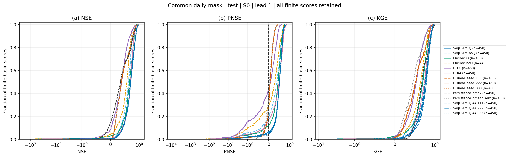

# Bộ đánh giá dự báo lưu lượng — Extended LamaH-CE

Tài liệu đi cùng [mã Python](01_Evaluation_LamaHCEExt.py) và [notebook nguồn](01_Evaluation_LamaHCEExt.ipynb). **Kaggle Version 13 đã chấm bổ sung bước D (730 vs 365 bước) trong phân vùng `evaluation_output/D/`**, đồng thời giữ nguyên 56 run S0, 168 trường hợp kịch bản C2 và 168 NPZ bước H (từ Version 12). Xem [biên bản Version 13](#kết-quả-kaggle-version-13) và [Version 12](#kết-quả-kaggle-version-12). Bảng chính của Version 9 gồm 56 run test/S0/hạn một ngày, trong đó có 32 run A–B và 24 run C2. [Biên bản Version 9](Archive/Version9/Tables/Evaluation_V9_output_review.json). `Tables/` và `Figures/` ở thư mục chính lưu kết quả Version 8. Version 7 và Version 4 có thư mục lưu riêng.

**S0** là kịch bản không che thêm đầu vào; dữ liệu gốc vẫn có thể thiếu. **Hạn một ngày** là dự báo ngày kế tiếp sau ngày cuối của lịch sử quan trắc. Một **ngày–lưu vực** là một ngày tại một ID; **mặt nạ** là bảng True/False chọn các cặp đó để chấm. **Giao chung** chỉ giữ ngày–lưu vực có quan trắc, persistence và dự báo của mọi run cùng hữu hạn.

**Version 4 chấm 14 run trên test 2014–2017, S0, hạn một ngày: sáu A2, ba DLinear, hai persistence và ba LSTM A4; 129 kiểm thử đạt, khớp A3 và ba hợp đồng A4.** Sáu chỉ số và số ngày chấm khớp A3 ở 4.961 cặp run–lưu vực; giao chung có 652.628 ngày–lưu vực trên 450 ID có cặp hợp lệ. Bảng lũ chính yêu cầu **cùng ngày bắt đầu**, bảng phụ cho phép **±1 ngày**, Holm chỉ đếm p hữu hạn. Ở ngưỡng lũ hai năm, SeqLSTM_Q có POD 19,51%, ba A4 16,89–20,26%, D_RA 20,54%, DLinear 0,19% và persistence qmax 0%. Kết quả chi tiết ở [Mục 10](#10-kết-quả-tham-chiếu-version-4). Bộ đánh giá chỉ đọc dự báo đã lưu, không gọi mô hình hoặc huấn luyện lại.

Mã dùng **giao thức 3**. Dung sai chính cho việc ghép sự kiện là ±⌊hạn/3⌋ ngày, từ 0 ngày ở hạn một đến 2 ngày ở hạn bảy. Bảng phụ dùng dung sai ±1 ngày.

## 1. Đầu vào và cách chạy

**Version 8 đã hoàn tất 32 run**, `complete=true`, toàn bộ hợp đồng A3/A4/B0/B1/B2/B3 đạt. Đã kiểm đủ **34 tệp (30 CSV, 3 JSON, 1 PNG)** bằng 152 kiểm chéo; kết quả tại Mục 12. Giao chính giữ **652628 ngày–ID trên 450 ID có ngày hợp lệ**, danh sách vẫn đủ 451 ID. Phạm vi của Version 8 là test/S0/hạn 1. Validation bước B Version 1 đã hoàn thành và Pipeline chọn B3 P10S12 làm B*.

`Tables/` và `Figures/` giữ 25 tệp kết quả nhỏ/hình Version 8 nguyên byte. Chín bảng chi tiết/khung kịch bản còn ở Output Kaggle và thư mục đã tải về. `Archive/Version7/` giữ 23 tệp nhỏ/hình Version 7 để các p Holm của họ 300 cặp tại Mục 11 không đổi nguồn; `Archive/Version4/` giữ dữ liệu của Mục 10 và báo cáo theo lưu vực. [Biên bản Version 8](Tables/Evaluation_32run_output_review.json).

Chạy **CPU, Internet Off** và dùng **Save & Run All** trong notebook `01_Evaluation_LamaHCEExt`. Version 12 dùng đủ 11 Notebook Output sau. Mười nguồn đầu cũng được dùng cho Version 10.

| Output notebook | Version | Vai trò |
|---|---:|---|
| `01_A1_LamaHCEExt_Explore` | 3 | Ngưỡng mức và sự kiện |
| `01_A2_LamaHCEExt_Reproduce` | 2 | Sáu mốc từ trọng số tác giả |
| `02_A3_LamaHCEExt_Benchmarks` | 1 | Ngữ cảnh canonical, persistence, DLinear |
| `04_A4_LamaHCEExt_Compare` | 2 | Ba A4 |
| `02_B0_LamaHCEExt_Compare` | 1 | Ba B0 và ngưỡng B* |
| `05_B1_LamaHCEExt_Compare` | 1 | Sáu B1a/B1b |
| `07_B2_LamaHCEExt_Compare` | 1 | Ba B2, bảng nguồn, audit, summary và manifest |
| `09_B3_LamaHCEExt_Compare` | 1 | P10S12/P05S05, mỗi mức ba seed; sáu NPZ và toàn bộ bảng kiểm |
| `13_C2_LamaHCEExt_Compare` | 1 | 24 NPZ, manifest, summary, environment và audit C2 |
| `04_C2_LamaHCEExt_Scenarios` | 1 | 144 NPZ kịch bản, mặt nạ chung, summary, audit tái lập S0 và manifest |
| `15_H_LamaHCEExt_Compare` | 1 | 168 NPZ dự báo H và manifest, kèm bảng chọn run demo và bàn giao checkpoint |

Lần chấm C2 dùng các Output đã xuất dự báo. Mã tự tìm summary dưới `/kaggle/input`, kiểm hash toàn bộ manifest và xuất trực tiếp `/kaggle/working/evaluation_output`. Notebook chạy Save & Run All. Script có tham số chỉ định nguồn khi dùng CLI. Hướng dẫn và tiêu chí nghiệm thu C2, H ở Mục 13.

Phần 8.4 giữ các kiểm A4/B0/B1 và bổ sung B2: manifest `file/bytes/sha256`, commit `2ccaa147a6ec87d0f56fa3e2f11b1bf38079253f`, A3 Version 1 trùng hash/giá trị, đúng B1 Compare hiện gắn, ngưỡng validation B0, ba seed/epoch/clip, bảng audit và NSE canonical tính lại. Tên nguồn thực là `06_B2…Train_Seed…` Version 1; tên cũ `07_B2…` nhúng trong metadata được giữ riêng, không sửa artifact đã Save.

Kaggle Version 7 có 179 kiểm đạt. Mã mở rộng B3 có **205/205 kiểm cục bộ và Kaggle đạt**, giữ đủ 179 kiểm cũ, đường chạy giả **32 run, 1395 dòng kiểm định**, họ Holm tối đa **465 cặp mỗi chỉ số**, bỏ persistence qmean phụ. Đối chiếu A3 vẫn tính riêng trên 11 run gốc; 38 hàm đọc/chấm hiện có giữ nguyên AST, ngoài các hàm điều phối, kiểm thử và vẽ hình. Bằng chứng kiểm mã được tách khỏi lần chấm B3 thật ở Mục 12. [Bằng chứng mở rộng B3](Tables/Evaluation_B3_preparation_checks.json); kết quả thật Version 7 ở Mục 11.

Khi tái lập lần chấm C2, kiểm `complete=true`, toàn bộ cờ khớp nguồn A3/A4/B0/B1/B2/B3/C2 bằng true, sáu `B3_runs`, 24 `C2_runs` và coverage 56 run test/S0/hạn 1. Giữ toàn bộ Output theo Mục 13.1.

Notebook nguồn có 18 ô mã đồng bộ với `.py`. Môi trường cần NumPy, pandas, SciPy, xarray, PyYAML và matplotlib có sẵn trong phiên chấm Kaggle. Biên bản Version 12 dẫn đến các tệp nguyên gốc từ Output đã lưu trên Kaggle.

### 1.1. Kiểm output phiên tương tác trước Save Version 5

Lô output 17 run trước khi bổ sung B1 đã được kiểm. Đã đọc toàn bộ 26 tệp được cung cấp: 22 CSV, 3 JSON và 1 PNG. Có **84 kiểm chéo** về schema, danh tính run, seed/epoch/commit, số ngày, các phép tổng hợp và công thức; tất cả đạt. Sáu chỉ số liên tục và ba chữ ký được đối chiếu với bảng chi tiết; NSE/PNSE được tính lại từ các tổng bình phương, KGE từ r/alpha/beta. Bảng tổng hợp 459 dòng, 360 dòng kiểm định, 30.668 dòng phân mức, hai bảng sự kiện 61.336 dòng và 22.948 điểm CDF khớp dữ liệu chi tiết tương ứng.

Cả ba NPZ B0 có đúng seed 111/222/333, checkpoint epoch 25/15/14, notebook huấn luyện Version 1 và commit `f229e02`. Giao chung giữ **652.628 ngày–lưu vực, 450 ID có ngày hợp lệ**. NSE trung vị B0 lần lượt là **0,707234; 0,703778; 0,705890**. Ngưỡng B* trong summary/protocol cùng bằng **0,007932303438926078**.

Bảng kịch bản rỗng có header vì chỉ có S0. KGE của `EncDec_noQ` không xác định tại ID 742/758 do r không xác định, nên hình có n=448 cho đường đó; các đường NSE/PNSE tương ứng vẫn có n=450. Hai seed 222/333 của B0 khớp A4 ở toàn bộ bảng chỉ số, phù hợp checkpoint giữ nguyên. Hình CDF có đủ ba ô, chú giải ngoài vùng vẽ, giữ đuôi âm và n riêng theo từng chỉ số.

Kiểm hash cục bộ bao phủ 26 tệp output nhận được. Hash của NPZ/pickle nguồn được đối chiếu giữa các bảng manifest và kiểm đầu vào do Kaggle xuất; không tính lại trực tiếp vì các tệp nguồn đó không nằm trong lô output được cung cấp.

Các bằng chứng 84 kiểm chéo và 144 kiểm giao thức ở trên thuộc lô 17 run chỉ bổ sung B0. Lô mã bổ sung B1 có 160 kiểm độc lập; kết quả B1 không thuộc lô 17 run này. Mã B2 có 179 kiểm; mã B3 hiện có 205 kiểm và đã chấm thật Version 8 ở Mục 12.

### 1.2. Output chấm chung B0/B1 đã nhận

Log phiên Kaggle và JSON tổng kết trong nội dung được cung cấp có `complete=True`, `fixture_checks=160`, `B0_contracts_matched=True`, `B1_contracts_matched=True`, đồng thời A3/A4 đều khớp. Chín NPZ B0/B1a/B1b được đọc đúng ba seed mỗi bước; epoch được chọn lần lượt **25/15/14**, **20/4/10**, **11/8/19**. Các run có 451 ID, 1461 ngày đích, 652644 dự báo hữu hạn và ngữ cảnh A3 khớp. B0 Compare và B1 Compare đều Version 1; ngưỡng B* giữ **0,007932303438926078**.

Phiên lịch sử này chạy test/S0/hạn 1, 23 run; giao chung không thay đổi so với phiên 17 run: 652628 ngày–ID, 450 ID có ngày chấm. Các bảng manifest/hợp đồng trong log đều đạt; khi đó chưa nhận riêng CSV chi tiết hoặc xác nhận số Save Version. Lô 26 run có B2 tại Version 7 được giữ ở Mục 11; kết quả hiện hành 32 run có B3 tại Version 8 được kiểm ở Mục 12. Chưa chạy các kịch bản vận hành hoặc nhiều hạn.

### 1.3. Mở rộng sáu B3 từ Compare Version 1

Compare B3 Version 1 đã nhận đủ năm CSV, một JSON và một PNG, 93 kiểm chéo đạt; sáu hợp đồng đều báo đạt, đúng nguồn B2 cùng seed. Bộ đọc B3 kiểm toàn bộ byte/SHA-256 trong manifest, exact sáu NPZ, mask P10S12/P05S05, seed/epoch/Version/commit, hai nguồn A3/B2 và ngưỡng B0. Bảng mean/SD được tính lại riêng từng mức; delta validation đối chiếu B2; không gộp sáu seed thành một cấu hình.

Audit NSE tính lại từ NPZ dùng **obs/sim hữu hạn**, đúng phạm vi Compare; mặt nạ chấm chung có persistence và mọi run vẫn được áp riêng. Hai kiểm producer/consumer chạy trực tiếp khối ghi JSON Phần 5 của `09_B3_LamaHCEExt_Compare`, gồm nhận schema thật và từ chối hash A3 sai. Các ca thiếu/thừa seed, sai mask/Version/nguồn/audit/metadata và giả mạo manifest đều bị từ chối.

Luồng giả dùng hai ID, không có tệp NPZ B3 Kaggle được chấm cục bộ. Hình CDF 32 run đã kiểm bố cục bằng fixture và giữ điểm âm; màu/nhãn phân biệt hai mức B3, seed theo kiểu nét. Các CSV/hình trong `Tables/`, `Figures/` hiện thuộc Version 8 thật; output giả chỉ giữ ở scratch. [Báo cáo B3](../../05_Training/08_B3_LamaHCEExt_Train/08_B3_LamaHCEExt_Train.md#8-compare-b3-version-1).

## 2. Hợp đồng dữ liệu và phạm vi chấm

Mỗi dự báo có tên run phân biệt seed, kỳ, kịch bản, hạn; lịch ngày đích; danh sách ID; diện tích; obs canonical; sim trước/sau chính sách chặn âm; và persistence. Các ma trận đều có thứ tự `[ngày đích, lưu vực]`. Lịch phải liên tục và duy nhất; thiếu dự báo được giữ bằng NaN trên lịch đó. Danh sách chính thức giữ đủ 451 ID.

Các run cùng nhóm kỳ/kịch bản/hạn phải có cùng lịch, ID, diện tích, obs canonical và persistence. Bộ đọc A2 giữ thêm obs native. Bộ đọc DLinear kiểm ngày, seed, kỳ, diện tích, obs và chính sách chặn âm theo export A3. Nguồn Q của A3 được đổi lại từ m³/s theo area_gov để kiểm obs và persistence; ngày nguồn persistence kỳ test phải là ngày đích trừ một.

| Scope | Quan trắc | Ngày được chấm | Mục đích |
|---|---|---|---|
| `native` | Obs của chính A2; DLinear dùng obs nguồn | Obs/sim hữu hạn | Đọc độ phủ riêng; PNSE có trạng thái không cấp persistence |
| `paired_source` | qmax canonical | Obs/sim/persistence hữu hạn | So từng run với persistence trên cùng ngày |
| `common_source_all` | qmax canonical | Giao hữu hạn của toàn bộ run trong nhóm và persistence | Bảng so sánh chính, phân mức và sự kiện |

Thêm mô hình có thể làm giao chung thay đổi. Phép đối chiếu A3 luôn kiểm riêng tập run gốc A3, còn bảng mở rộng tính lại giao của tập mô hình được đánh giá. Điểm âm, ID không có ngày chấm và trạng thái không xác định được giữ trong CSV.

Với A4, ba NPZ phải có cùng ngày, thứ tự ID, diện tích, obs canonical và persistence với A3, bằng nhau từng giá trị kể cả vị trí NaN. Dự báo A4 trước chặn âm được giữ ở `sim_raw_mm_day`; bảng chấm dùng `sim_mm_day` theo chính sách clip đã khai báo. NPZ A4 chỉ có obs canonical, nên scope `native` của A4 là phạm vi obs canonical/sim hữu hạn; không được coi là đối chiếu từng bit với obs float32 riêng trong pickle huấn luyện.

## 3. Chỉ số liên tục và đường duy trì lưu lượng

NSE, PNSE, KGE dạng 2009 và r/α/β dùng float64, cùng mặt nạ trong một scope, độ lệch chuẩn ddof=0. PNSE lấy qmax hôm trước làm mốc cho dự báo một ngày. Mẫu số bằng 0 có giá trị NaN và trạng thái giải thích; các hàm không tự thêm epsilon hoặc thu hẹp mask đã truyền. [Công thức và ví dụ A3](../../03_Baseline/02_A3_LamaHCEExt_Benchmarks/02_A3_LamaHCEExt_Benchmarks.md#report-part-5).

Ba chỉ số đường duy trì được tính trên cùng cặp ngày nhưng xếp riêng obs và sim. Quy ước rời rạc của bộ đánh giá được cố định trước khi chạy:

| Chỉ số | Quy ước |
|---|---|
| %BiasFHV | Lấy ceil(0,02 × n), tối thiểu một ngày lớn nhất; 100 × (tổng sim − tổng obs) / tổng obs |
| %BiasFMS | So độ dốc log giữa phân vị 0,8 và 0,3, nội suy tuyến tính trên log lưu lượng đã xếp; 100 × (dốc sim − dốc obs) / dốc obs |
| %BiasFLV | Lấy ceil(0,3 × n) ngày thấp nhất; so tổng khoảng cách log tới log cực tiểu của từng chuỗi, với dấu âm theo quy ước FLV |

Chỉ phép log của FMS/FLV dùng sàn **10⁻⁶ mm/ngày**, đồng thời báo số giá trị nằm dưới sàn. Mẫu số bằng 0 vẫn trả NaN. Đây là phép xử lý riêng của chữ ký đường duy trì; NSE/KGE và chuỗi Q không bị thay đổi. Các lựa chọn nội suy/lấy số ngày này được ghi trong `Evaluation_protocol.json`; không xem chúng là đối chiếu từng bit với cách lấy hạng rời rạc của NeuralHydrology.

Mỗi chỉ số được tổng hợp qua lưu vực bằng trung vị, trung bình và P10/P25/P75/P90, kèm số ID hữu hạn. Chữ ký FDC có cả trung vị có dấu và trung vị trị tuyệt đối để tránh triệt tiêu hai hướng lệch.

## 4. Bốn mức lưu lượng

Dùng q30/q80/q98 A1 trên tham chiếu 1981–2013: thấp khi q < q30, trung bình khi q30 ≤ q < q80, cao khi q80 ≤ q < q98, rất cao khi q ≥ q98. Ba ngưỡng phải hữu hạn, tăng nghiêm ngặt và đúng danh sách ID.

Ma trận nhầm lẫn có hàng là mức quan trắc, cột là mức dự báo. Xuất số ngày của cả 16 ô, recall, precision, F1 từng mức và accuracy, cả theo lưu vực và cộng dồn. Mức không có ngày quan trắc có recall NaN; mức không có lần báo có precision NaN. Ví dụ, 10 ngày rất cao thật được báo đúng 7 ngày cho recall 0,7; nếu mô hình báo rất cao 14 ngày thì precision là 0,5.

## 5. Sự kiện lũ và cờ kiểm duyệt

Ngưỡng lấy từ `half_calendar_primary` của A1 cho T = 1,5; 2; 5; 10 năm, giữ số năm fit theo từng lưu vực. Bộ đánh giá áp cùng ngưỡng và quy tắc cho obs/sim; xuất cả đoạn liên tiếp và cụm USWRC. [Giao thức đã chốt](../../../Document/01_Plan/02_Pipeline.md#62-theo-mức-lưu-lượng-và-theo-sự-kiện-yêu-cầu-gvhd).

Một đoạn gồm các ngày liên tiếp có Q **lớn hơn** ngưỡng. Quy tắc gộp xét khoảng cách đỉnh tối thiểu ceil[5 + ln(A dặm vuông)] và yêu cầu đáy giữa hai đỉnh thấp hơn 0,75 lần đỉnh nhỏ hơn; chưa đủ một trong hai điều kiện thì gộp. Sau gộp, kiểm lại cụm kề. Đồng đỉnh dùng ngày đỉnh cuối bên trái và đầu bên phải để tính khoảng cách gần nhất. [HEC-USACE giải thích khoảng cách theo diện tích](https://www.hec.usace.army.mil/confluence/sspdocs/sspum/latest/peaks-over-threshold-analysis/peaks-over-threshold-filtering).

Ngày thiếu ngăn việc nối cụm. Đoạn chạm biên kỳ hoặc có ngày trống ngay trước/sau giữ cờ onset/ending không quan sát được. Điểm sự kiện chính chỉ dùng cụm có cả hai biên được quan sát và đủ ngày hợp lệ trong bán kính ghép quanh onset; số cụm bị kiểm duyệt được báo riêng. Đây là quy ước đánh giá trên lịch có thiếu của đề tài; dữ liệu mất quanh một trận có thể khiến trận đó nằm ngoài phạm vi chấm.

Ghép sự kiện theo **ngày bắt đầu (onset)**, một–một, tối đa hóa số cặp trước, rồi tối thiểu hóa tổng sai lệch ngày. **Bảng chính dùng ±⌊hạn đang chấm/3⌋ ngày; bảng phụ luôn dùng ±1 ngày**, xuất riêng với hậu tố `_tolerance1`. Dung sai áp dụng như nhau cho mọi run cùng hạn. `forecast_horizon` chỉ kiểm hợp đồng tổng số hạn, không thay dung sai của hạn đang chấm: hạn 1 trong mô hình bảy hạn vẫn yêu cầu bắt đầu cùng ngày. Sai số thời điểm đỉnh dùng ngày đầu trong trường hợp đồng đỉnh, sau khi cặp sự kiện đã được xác định.

| Hạn dự báo (ngày) | 1 | 2 | 3 | 4 | 5 | 6 | 7 |
|---|---:|---:|---:|---:|---:|---:|---:|
| Dung sai chính (±ngày) | 0 | 0 | 1 | 1 | 1 | 2 | 2 |
| Dung sai phụ (±ngày) | 1 | 1 | 1 | 1 | 1 | 1 | 1 |

Ở hạn 3–5, hai bảng có cùng dung sai nhưng vẫn xuất riêng theo vai trò và không nhân đôi số trận. Ví dụ, trận thật bắt đầu ngày 10, dự báo bắt đầu ngày 12: không khớp ở hạn 1–5; khớp ở hạn 6–7 nếu hai trận đủ điều kiện chấm. Cửa sổ đối xứng cũng chấp nhận lệch sớm cùng độ lớn.

[NOAA CR TA 98-03, Mục III.B](https://repository.library.noaa.gov/view/noaa/30340/noaa_30340_DS1.pdf) dùng cửa sổ ±1/3 thời gian từ phát hành đến thời điểm vượt ngưỡng dự báo; 24 giờ tương ứng ±8 giờ. Yêu cầu cùng ngày là cách áp dụng cho lịch ngày của đề tài, không phải kiểm chứng sai số trong tám giờ. [Nearing và cs. (2024), Methods–Metrics](https://www.nature.com/articles/s41586-024-07145-1) dùng cửa sổ **±2 ngày**; bảng phụ ±1 phục vụ phân tích độ nhạy khi đối chiếu, không phải tái lập nguyên giao thức Nearing.

Mỗi bảng áp bán kính kiểm duyệt tương ứng với dung sai của mình. Vì vậy số trận đủ điều kiện có thể khác giữa bảng chính và phụ; mỗi bảng giữ riêng số bắt được, bỏ sót, báo nhầm và số bị kiểm duyệt. Ở hạn một và hai ngày, trận trễ một ngày không được tính là bắt đúng trong bảng chính, kể cả khi hai trận còn chồng lấn.

Quy tắc lấy phần nguyên ±⌊hạn/3⌋ là cách rời rạc hóa trên lịch ngày của đề tài, thống nhất với kế hoạch bước H. Đây không phải xác minh sai số theo giờ của NOAA; hạn một ngày tương ứng ±8 giờ ở quy tắc thời gian liên tục, còn dữ liệu hiện tại chỉ cho phép phân biệt ngày lịch.

Từ số bắt được h, bỏ sót m, báo nhầm f, tính POD = h/(h+m), FAR = f/(h+f), precision = h/(h+f), F1 = 2h/(2h+m+f), CSI = h/(h+m+f). Khi mẫu số bằng 0, kết quả là NaN. Bảng chính cộng số trận trước khi chia, tách riêng từng T và cách gộp; đồng thời có kết quả cho tất cả ID, nhóm fit ≥10 năm và nhóm fit <10 năm. Các nhóm này là các cách trình bày song song, không cộng với nhau.

## 6. Kiểm định và kịch bản

Wilcoxon signed-rank hai phía ghép theo ID trên điểm `common_source_all`, kèm Cohen's dz = trung bình hiệu / std mẫu của hiệu. Dấu hiệu là **run bên trái trừ run bên phải**. Các ID có một trong hai chỉ số không xác định được loại khỏi đúng phép kiểm đó và được phản ánh trong số cặp. Nếu mọi hiệu bằng 0, p = 1 theo quy ước; std hiệu bằng 0 làm dz không xác định. [Tài liệu SciPy Wilcoxon](https://docs.scipy.org/doc/scipy/reference/generated/scipy.stats.wilcoxon.html).

Họ Holm mặc định gồm mọi cặp run không thứ tự, bỏ mốc qmean phụ, riêng theo chỉ số NSE/PNSE/KGE và từng nhóm kỳ/kịch bản/hạn. Với sáu A2, ba DLinear và persistence qmax, mỗi họ dự kiến có 45 phép so. **Chỉ p-value hữu hạn được tính vào kích thước họ hiệu chỉnh** (`family_size`); p = NaN được giữ NaN và không tăng hệ số nhân. `planned_family_size` ghi số phép so dự kiến. Ví dụ, p = [0,01; NaN; 0,03] cho p sau Holm = [0,02; NaN; 0,03]. Báo p gốc, p hiệu chỉnh, số cặp hữu hạn, số lưu vực tốt lên/kém đi/hòa và cỡ hiệu ứng. Các lưu vực lồng nhau có thể phụ thuộc không gian, nên p cần được đọc cùng cỡ hiệu ứng và phân phối chênh lệch.

Bộ đánh giá nhận dự báo S0–S4 đã được bên mô hình tạo ra; không tạo kịch bản bằng cách làm nhiễu dự báo. Chênh lệch với S0 được **tính lại trên giao ngày của S0 và đúng kịch bản**, thay vì trừ hai median khác phạm vi. Từng hạn được chấm riêng. Với hạn k, persistence giữ qmax ở origin−1 cho mọi hạn, không lấy số đo đã xuất hiện sau origin. Persistence trong các kịch bản mất Q là mốc quan trắc để diễn giải điểm, không được xem là mô hình vận hành có số đo sẵn.

Khi thêm ba A4, nhóm test/S0/hạn một ngày có 14 run; bỏ qmean phụ còn 13 run, tương ứng **78 cặp dự kiến mỗi chỉ số và 234 hàng kiểm định cho ba chỉ số**. Các p Holm được tính lại theo họ mở rộng, không chép p đã điều chỉnh từ họ 45 cặp. Tập ID vẫn giữ đủ 451; số cặp có chỉ số hợp lệ được ghi riêng.

## 7. Hợp đồng NPZ cho dự báo bước A4/B/C/H

Mỗi NPZ mở rộng chứa một run/seed/kỳ/kịch bản/hạn. Truyền tệp bằng `--extra-contract`; có thể lặp tham số cho nhiều tệp. Tên run cần chứa seed để phân biệt ba lần chạy. Mỗi nhóm phải có cùng lịch và thứ tự 451 ID.

| Trường NPZ | Nội dung |
|---|---|
| `dates` | Ngày đích, lịch liên tục |
| `origin_dates` | Ngày đích đầu của đợt dự báo: dates − (lead−1) |
| `persistence_source_dates` | dates − lead, tức origin−1 |
| `basin_ids`, `area_gov_km2` | Thứ tự lưu vực và diện tích trạm |
| `obs_mm_day`, `persistence_mm_day` | Quan trắc canonical và mốc persistence từ nguồn Q |
| `sim_raw_mm_day`, `sim_mm_day` | Dự báo trước/sau chính sách chặn âm đã khai báo |
| `metadata_json` | Chuỗi JSON: run, period, scenario, lead, forecast_horizon, seed, unit, config_sha256, library_commit, clip_to_zero |

Đơn vị bắt buộc là `mm/day_area_gov`; m³/s khôi phục bằng q × area_gov / 86,4. Metadata có thể lưu thêm ngày phát hành thực tế và đường dẫn nguồn. `origin_dates` là quy ước cửa sổ của mô hình, không tự xác nhận giờ/ngày sản phẩm khí tượng được phát hành. Bên xuất chịu trách nhiệm lấy persistence đúng giá trị quan trắc ở ngày nguồn; bên đánh giá kiểm quan hệ ngày và sự nhất quán giữa các run.

### 7.1. Nhận tự động ba hợp đồng A4

Phần 8.4 đọc `manifest.csv` của `a4_compare` với các cột `tệp`, `sha256`, kiểm mọi tệp được liệt kê, từ chối đường dẫn ra ngoài thư mục và tên trùng. Cần đủ ba NPZ, summary và environment; ba seed không được bỏ qua khi thiếu tệp. Hash hai nguồn `A3_persistence_predictions.npz`, `A3_Q_source_window.npz` trong metadata A4 phải khớp đúng Input A3 đang dùng.

Các trường run, seed, kỳ, hạn, đơn vị, config SHA-256, commit thư viện, chính sách clip và epoch được kiểm trước khi gọi `check_same_context`. Epoch phải trùng `saved_epoch` trong summary. Version nguồn huấn luyện được đối chiếu với bản bàn giao: seed 111 Version 1, seed 222/333 Version 2, A3 Version 1. Version 2 của notebook Compare là phiên bản yêu cầu theo [báo cáo A4](../../03_Baseline/03_A4_LamaHCEExt_Retrain/03_A4_LamaHCEExt_Retrain.md#p5); giá trị băm ghi danh tính tệp thực tế, không gọi đây là truy vấn xác nhận Version trực tiếp từ Kaggle.

Ba run có tên `SeqLSTM_Q_A4_seed111`, `SeqLSTM_Q_A4_seed222`, `SeqLSTM_Q_A4_seed333`. Các tệp này được nhận tự động, không cần truyền `--extra-contract` cho A4. Tham số đó vẫn dùng cho dự báo mở rộng khác; trùng tên run/kỳ/kịch bản/hạn làm chương trình dừng.

### 7.2. Nhận tự động B0, B1a và B1b

B0 dùng `b0_summary.json` và một manifest có ba NPZ. B1a/B1b dùng chung `b1_summary.json` và manifest của `05_B1_LamaHCEExt_Compare` Version 1, phải có đúng sáu NPZ của cả hai bước. Mỗi bước được đọc đủ ba seed, kiểm danh tính notebook nguồn, Version 1, epoch được chọn, commit và ngữ cảnh A3; xuất audit riêng. Tên notebook nguồn B1a là `03_B1a_LamaHCEExt_Train_Seed<N>`, B1b là `04_B1b_LamaHCEExt_Train_Seed<N>`. Hash của mọi tệp được liệt kê đều được tính lại, không chỉ hash NPZ.

Sáu NPZ này cộng ba B0 thành chín hợp đồng bước B trong cùng lần chấm. Summary B1 dùng B0 làm mốc nhiễu nên bộ đánh giá kiểm cả std validation, danh tính seed validation và checkpoint B0 giữa hai Compare. Các phép kiểm không chọn B* bằng test; B* vẫn cần validation và các kịch bản vận hành theo pipeline.

## 8. Các phép kiểm đã thực hiện cục bộ

Đối chiếu NSE với Compare dùng mask **obs và sim hữu hạn**, không yêu cầu persistence. Ca hồi quy B2 seed 222 có sai số dự báo ở ngày có obs nhưng thiếu Q hôm trước xác nhận audit vẫn giữ ngày đó. Phép chấm chính giữa các run tiếp tục dùng giao obs, persistence và mọi sim; ngưỡng audit NSE giữ `atol=rtol=10⁻⁹`. Bảng kiểm B2 ghi mask, median tính lại, median nguồn và độ lệch tuyệt đối. Nếu kiểm chưa khớp, lỗi nêu tên trường cùng giá trị nhận/cần, không chỉ thông báo gộp.

B2 Compare Version 1 ghi `environment.inputs.A3.files` theo dạng `{tên_tệp: chuỗi_sha256}`. Bộ đọc kiểm chuỗi 64 ký tự hex và đối chiếu hash tệp gốc. Kiểm liên thông chạy trực tiếp Phần 5 của `07_B2_LamaHCEExt_Compare.py` để tạo summary/environment/manifest, rồi đọc và chấm đủ 26 run; hash A3 sai và giá trị hash sai kiểu đều bị từ chối.

Phép kiểm độc lập bao gồm ví dụ NSE/PNSE/KGE và tham chiếu Pearson từ SciPy; chuỗi hằng, phương sai nhỏ, zero-SSE, NaN/mask/vô cực; tính bất biến đổi đơn vị; ngưỡng bằng biên; USWRC với đáy bằng 0,75 và khoảng thiếu; ghép sự kiện không tái sử dụng; persistence trễ một ngày bị loại ở bảng chính hạn 1 nhưng được bắt ở bảng phụ; Holm bỏ NaN và dz với số biết trước; kịch bản cùng ngày chấm. Kiểm nhiều hạn bao phủ cả bảy hạn, biên lệch sớm/trễ trong và ngoài dung sai, kiểm duyệt quanh ngày thiếu/biên lịch, tách bảng chính/phụ khi cùng dung sai, cùng kiểm ngày nguồn persistence tại origin−1.

**179 kiểm thử độc lập của mã hiện tại dùng giao thức 3 đều đạt.** Lô mã B0/B1 có 160 kiểm; các kiểm B2 bổ sung bao phủ schema mới, nguồn A3/B1/B0, tên nhúng, audit và đường chấm chung 26 run. Bản Save Version 4 có 129 kiểm, lô chuẩn bị bổ sung B0 có 144 kiểm; số kiểm mới bao phủ thêm schema chung B1 và đối chiếu nguồn B0 giữa hai Compare. Đầu vào hạn, tổng số hạn và dung sai sai kiểu hoặc ngoài phạm vi được từ chối; bool không được xem là số nguyên. Môi trường kiểm cục bộ: Python 3.12.6, NumPy 1.26.4, pandas 2.3.3, SciPy 1.16.3 và xarray 2025.12.0. Kiểm hồi quy thêm 400 ca sự kiện hạn 1, gồm hai cách gộp, dung sai 0/1 và ngày thiếu, khớp chính xác cách ghép của giao thức 2. Đã đối chiếu thêm 120 ca chỉ số với hàm A3 giữ nguyên, 60 ca gộp cụm với hàm A1 giữ nguyên và 80 ca ghép sự kiện với lời giải duyệt hết các cách ghép; tất cả đều khớp.

Fixture I/O dùng hai ID và lịch test đầy đủ, tạo tệp đúng cấu trúc CSV A1, pickle xarray A2, NPZ DLinear và hợp đồng nhiều hạn; sau đó đi qua bộ đọc, chấm, cộng dồn, ghép bảng tham chiếu và kiểm ngày nguồn persistence. Mọi số liệu fixture được tạo trong thư mục tạm và không được xuất thành kết quả LamaH-CE trong repo.

Các kiểm nhiều hạn bao phủ cả hạn 1–7, gồm phân luồng hai bảng chính/phụ khi cùng dung sai và giữ schema bảng ghép rỗng. Hàm chạy nhận `expected_ids` riêng cho fixture; cách chạy chính thức mặc định yêu cầu 451 ID. Trạng thái hoàn thành của fixture chỉ xác nhận đường chạy dữ liệu giả.

**36 kiểm tích hợp A4 cục bộ đạt**, bổ sung cho 129 kiểm hồi quy của giao thức. Fixture gồm ba ID và đủ lịch test, có ID không được chấm ở giao chung, các tên `environment.json` ở cả A2/A4 và một ngày A4 thiếu thêm. Đã kiểm các trường hợp thiếu seed, sai hash, nguồn A3 khác, sai Version/epoch/seed/đơn vị/commit, sai chính sách clip, đảo ID, sai ngày persistence, trùng nguồn và đường dẫn manifest ra ngoài thư mục.

Đường chạy tự đọc A4 chấm đủ 14 run và xuất **24 tệp** cho test/S0/hạn một ngày, gồm hai bảng kiểm A4 mới. Toàn bộ 16 bảng tính toán đã có khớp cách truyền cùng ba NPZ bằng bộ đọc hợp đồng trước đó. Fixture giảm giao chung đúng một ngày do A4 thiếu thêm, trong khi bảy phép đối chiếu A3 vẫn đạt trên giao riêng của 11 run gốc. Họ Holm có 78 cặp dự kiến mỗi chỉ số, tổng 234 hàng; bảng lũ giữ tolerance chính 0 và phụ 1. Cờ `complete` được đặt false trước khi kiểm nguồn, nên một lần chạy dừng không để lại cờ hoàn thành của lần cũ.

Khi chạy trên Input thật, bảy kiểm đối chiếu A3 gồm sáu chỉ số và số ngày cho từng run–ID ở giao chung, với rtol/atol = 10⁻¹⁰ cho giá trị số; NaN phải cùng vị trí. Sai khác làm chương trình dừng trước cờ hoàn thành. Đây là đối chiếu float64 A3; số KGE CSV A2 float32 được diễn giải trong thuyết minh A3.

## 9. Đầu ra cần giữ và gửi lại

| Nhóm | Tệp chính |
|---|---|
| Kiểm và nguồn | `Evaluation_checks.csv`, `Evaluation_input_manifest.csv`, `Evaluation_A3_reference_check.csv` |
| Bàn giao A4 và bước B | `Evaluation_{A4,B0,B1a,B1b,B2}_input_check.csv` (manifest và hai nguồn A3), `Evaluation_{A4,B0,B1a,B1b,B2}_contract_check.csv` (seed, epoch, độ phủ, số dự báo âm và ngữ cảnh) |
| Chỉ số và độ phủ | `Evaluation_metrics.csv`, `Evaluation_summary.csv`, `Evaluation_coverage.csv`, `Evaluation_paired_tests.csv` |
| Bốn mức | `Evaluation_confusion.csv`, `Evaluation_levels.csv`, `Evaluation_levels_pooled.csv` |
| Sự kiện chính, ±⌊hạn/3⌋ ngày | `Evaluation_events.csv`, `Evaluation_event_matches.csv`, `Evaluation_events_pooled.csv` |
| Sự kiện phụ, ±1 ngày | `Evaluation_events_tolerance1.csv`, `Evaluation_event_matches_tolerance1.csv`, `Evaluation_events_pooled_tolerance1.csv` |
| Kịch bản và hình | `Evaluation_scenario_changes.csv`, `Evaluation_CDF_points.csv`, PNG CDF từng nhóm |
| Quy ước và kết luận | `Evaluation_protocol.json`, `Evaluation_run_index.json`, `Evaluation_summary.json` |

Với đầu vào A2/DLinear/A4/B0/B1/B2, phạm vi là test/S0/hạn một ngày. JSON kết luận ghi trạng thái hợp đồng A4/B0/B1/B2, danh sách run từng bước và Version Compare yêu cầu; chỉ đặt hoàn thành sau khi đọc/chấm đủ và đối chiếu A3 thành công.

JSON ghi `protocol_version = 3`, tên chính sách `event_tolerance` và `event_tolerance_days_by_lead` cho các hạn thực sự được chấm. Chấm đúng một hạn giữ thêm `event_tolerance_days` là số nguyên; chấm nhiều hạn để trường scalar này là null và dùng bản đồ theo hạn. `matching_tolerance_days` trong từng dòng sự kiện và cặp ghép ghi dung sai đã áp dụng.

[Notebook phân tích thuộc tính 02](../02_Evaluation_LamaHCEExt_ByBasin/02_Evaluation_LamaHCEExt_ByBasin.md) đọc Output Version 4 này, chạy 18 phép so trên 14 run. Khi bổ sung dự báo của bước B/C/H, giữ cùng các tệp đầu ra để đối chiếu thêm theo kịch bản và hạn. Bảng chênh lệch kịch bản có đầy đủ tên cột ngay cả khi chưa có dòng dữ liệu ngoài S0.

## 10. Kết quả tham chiếu Version 4

### 10.1. Phạm vi và tính nhất quán

Kết quả dưới đây là Output của **Version 4**, Save & Run All trên CPU (72 giây), giao thức 3, test/S0/hạn một ngày. Input là Output A1 `01-a1-lamahceext-explore`, A2 `01-a2-lamahceext-reproduce`, A3 `02-a3-lamahceext-benchmarks` và A4 `04-a4-lamahceext-compare` Version 2. Môi trường Kaggle: Python 3.13.15, NumPy 2.1.3, pandas 2.3.3, SciPy 1.16.3. [Kết luận chạy](Archive/Version4/Tables/Evaluation_summary.json), [nguồn đầu vào](Archive/Version4/Tables/Evaluation_input_manifest.csv).

| Kiểm tra | Kết quả |
|---|---|
| Kiểm thử trước khi chấm | 129/129 đạt |
| Đối chiếu A3 | 7/7 kiểm đạt; mỗi kiểm gồm 4.961 cặp run–ID: NSE, PNSE, KGE, r, α, β và n |
| Nguồn A4 | Manifest 11 tệp và hai nguồn ngữ cảnh A3 đạt kiểm hash; ba hợp đồng có cùng lịch, ID, diện tích, obs canonical và persistence với A3 |
| Giao ngày chung | 652.628 ngày–ID; 450 ID có ngày chấm, giữ ID 55 với n = 0 |
| Chỉ số liên tục | 18.942 dòng = 14 run × 451 ID × 3 scope |
| Ma trận bốn mức | 101.024 dòng = 14 run × 451 ID × 16 ô; tổng mỗi ma trận khớp số ngày chấm |
| Sự kiện chính, dung sai 0 | 50.512 dòng theo run/ID/T/cách gộp; 10.823 cặp ghép một–một |
| Sự kiện phụ, ±1 ngày | 50.512 dòng; 30.074 cặp ghép một–một |
| Kiểm định | 234 phép so = 78 cặp × 3 chỉ số; Holm tách theo từng chỉ số, mọi p hữu hạn |

NSE/PNSE có 450 ID hữu hạn trên giao chung cho mọi run. KGE/r của EncDec_noQ có 448 ID hữu hạn do đầu ra hằng tại 742 và 758. ID 55 có trạng thái không có cặp hợp lệ ở mọi run trên giao chung. [Kiểm thử](Archive/Version4/Tables/Evaluation_checks.csv), [đối chiếu A3](Archive/Version4/Tables/Evaluation_A3_reference_check.csv), [kiểm nguồn A4](Archive/Version4/Tables/Evaluation_A4_input_check.csv).

| Run A4 | Epoch chọn | Ngày–ID có dự báo | Ngày–ID có obs/sim hữu hạn | Dự báo âm trước clip |
|---|---:|---:|---:|---:|
| Seed 111 | 11 | 652.644 | 652.636 | 1.660 |
| Seed 222 | 15 | 652.644 | 652.636 | 2.261 |
| Seed 333 | 14 | 652.644 | 652.636 | 1.978 |

Mỗi hợp đồng A4 giữ 451 ID trên 1.461 ngày đích. Số 652.644 mô tả các dự báo hữu hạn trước khi yêu cầu có obs; 652.636 là số cặp obs/sim của riêng mỗi A4, còn 652.628 là giao để so toàn bộ 14 run. Thêm A4 không làm giảm giao chung so với giao của 11 run gốc. [Bảng hợp đồng A4](Archive/Version4/Tables/Evaluation_A4_contract_check.csv).

*Hình 1. Mỗi điểm là chỉ số của một lưu vực; giữ toàn bộ giá trị hữu hạn, kể cả phần đuôi âm. Các trục dùng symlog, tuyến tính trong [−1, 1]. Ba đường A4 màu xanh dùng kiểu nét khác nhau cho từng seed; đường SeqLSTM_Q liền là trọng số tác giả. Số n trong chú giải là số ID có chỉ số hữu hạn. Đường persistence PNSE nằm tại 0 theo định nghĩa.*

### 10.2. Kết quả liên tục và bốn mức

| Run | NSE trung vị | PNSE trung vị | KGE trung vị | %BiasFHV trung vị |
|---|---:|---:|---:|---:|
| SeqLSTM_Q, trọng số tác giả | 0,705259 | 0,495584 | 0,767074 | −13,01 |
| SeqLSTM_noQ | 0,622922 | 0,375311 | 0,688235 | −17,88 |
| EncDec_Q | 0,662155 | 0,435417 | 0,698093 | −17,31 |
| EncDec_noQ | 0,567347 | 0,285036 | 0,640148 | −17,13 |
| D_FC | 0,385892 | 0,076250 | 0,533138 | −22,63 |
| D_RA | 0,692511 | 0,485222 | 0,737006 | −14,08 |
| DLinear 111 | 0,382799 | 0,066592 | 0,519476 | −31,35 |
| DLinear 222 | 0,378069 | 0,055647 | 0,520644 | −30,78 |
| DLinear 333 | 0,379588 | 0,059714 | 0,513177 | −31,91 |
| LSTM A4 seed 111 | 0,695242 | 0,495352 | 0,758090 | −15,70 |
| LSTM A4 seed 222 | 0,703778 | 0,505573 | 0,790977 | −11,71 |
| LSTM A4 seed 333 | 0,705890 | 0,501788 | 0,785984 | −11,56 |
| Persistence qmax | 0,350031 | 0 | 0,674939 | 0,00 |
| Persistence qmean, phụ | 0,366131 | 0,034721 | 0,457145 | −37,15 |

Giá trị A2, DLinear và persistence khớp A3. KGE trung vị của ba DLinear khoảng 0,513–0,521, thấp hơn persistence 0,674939. [Bảng đầy đủ](Archive/Version4/Tables/Evaluation_summary.csv).

Trung bình ± độ lệch chuẩn mẫu của ba NSE trung vị A4 là **0,701636 ± 0,005638**; khoảng [0,695242; 0,705890] bao quanh mốc tác giả 0,705259. Đây là biến thiên của ba lần huấn luyện, không phải khoảng tin cậy hay chỉ số của một ensemble. Ba seed đều giữ riêng; không chọn seed theo test. NSE của A4 tương đối sát mốc tác giả nhưng KGE thay đổi theo seed: 111 thấp hơn mốc về trung vị, 222 và 333 cao hơn. Với PNSE, cả ba median dương nhưng mean lần lượt **−1,189; −0,508; −0,355**; cần giữ phần đuôi các lưu vực mà persistence mạnh khi đọc kết quả.

Trên giao chung có **194.703 ngày–ID mức thấp** và **11.759 ngày–ID mức rất cao**. Các tỷ lệ dưới đây cộng ô đếm trước khi chia, không phải trung vị chỉ số theo lưu vực.

| Run | Recall mức thấp (%) | Recall mức rất cao (%) | Precision mức rất cao (%) |
|---|---:|---:|---:|
| SeqLSTM_Q, trọng số tác giả | 66,93 | 47,58 | 67,58 |
| SeqLSTM_noQ | 65,79 | 36,17 | 63,73 |
| EncDec_Q | 53,67 | 41,31 | 62,22 |
| EncDec_noQ | 54,95 | 38,50 | 51,30 |
| D_FC | 47,23 | 21,49 | 41,75 |
| D_RA | 65,06 | 47,27 | 63,78 |
| DLinear 111 | 61,83 | 22,18 | 53,33 |
| DLinear 222 | 67,61 | 22,30 | 53,72 |
| DLinear 333 | 69,52 | 21,80 | 54,86 |
| LSTM A4 seed 111 | 71,53 | 43,84 | 69,63 |
| LSTM A4 seed 222 | 76,29 | 48,39 | 66,53 |
| LSTM A4 seed 333 | 73,17 | 47,79 | 65,68 |
| Persistence qmax | 88,07 | 40,11 | 40,28 |
| Persistence qmean, phụ | 96,27 | 18,40 | 61,53 |

SeqLSTM_Q bắt được 5.595/11.759 ngày rất cao, nhiều hơn persistence qmax 4.716 ngày; precision cũng cao hơn. Ba A4 bắt được 5.155/5.690/5.620 ngày rất cao, quanh mức của trọng số tác giả. DLinear đạt khoảng 22% recall mức rất cao, phù hợp với độ co biên độ và hụt dải cao đã thấy ở A3. Accuracy tổng thể của persistence qmax là 82,90%, cao hơn SeqLSTM_Q 77,62% và ba A4 79,34/80,54/79,77%; tỷ lệ đúng chung chịu ảnh hưởng lớn của các mức phổ biến, vì vậy phải đọc riêng recall ở hai đầu dải lưu lượng. [Bảng phân mức](Archive/Version4/Tables/Evaluation_levels_pooled.csv).

%BiasFHV âm ở mọi mô hình học, thể hiện hụt tổng của dải 2% lưu lượng cao nhất theo định nghĩa FHV; DLinear hụt nhiều nhất, khoảng −31%. FLV của DLinear có trị tuyệt đối trung vị lớn, khoảng 597–754%; chỉ số này đo hình dạng đuôi log, không phải phần trăm thiếu thể tích nước. Trên giao chấm, ba seed DLinear có 9.197/12.134/13.218 giá trị sim dưới sàn log, chủ yếu do chặn các dự báo âm về 0. Khi đọc FLV cần giữ cùng sàn 10⁻⁶ mm/ngày và số ngày chịu phép log này.

### 10.3. Sự kiện lũ chu kỳ hai năm

#### 10.3.1. Bảng chính: cùng ngày bắt đầu

Theo quy tắc USWRC, có **1.066 cụm quan trắc đủ điều kiện trên 366 lưu vực**. Bảng cộng số trận trước khi tính tỷ lệ, gồm cả nhóm ngưỡng fit dưới 10 năm; CSV có bảng tách riêng nhóm đó.

| Run | Bắt được | Bỏ sót | Báo nhầm | POD (%) | FAR (%) |
|---|---:|---:|---:|---:|---:|
| SeqLSTM_Q, trọng số tác giả | 208 | 858 | 431 | 19,51 | 67,45 |
| SeqLSTM_noQ | 188 | 878 | 304 | 17,64 | 61,79 |
| EncDec_Q | 126 | 940 | 289 | 11,82 | 69,64 |
| EncDec_noQ | 174 | 892 | 445 | 16,32 | 71,89 |
| D_FC | 63 | 1.003 | 286 | 5,91 | 81,95 |
| D_RA | 219 | 847 | 377 | 20,54 | 63,26 |
| DLinear 111 | 2 | 1.064 | 327 | 0,19 | 99,39 |
| DLinear 222 | 2 | 1.064 | 340 | 0,19 | 99,42 |
| DLinear 333 | 2 | 1.064 | 322 | 0,19 | 99,38 |
| LSTM A4 seed 111 | 180 | 886 | 372 | 16,89 | 67,39 |
| LSTM A4 seed 222 | 216 | 850 | 446 | 20,26 | 67,37 |
| LSTM A4 seed 333 | 191 | 875 | 446 | 17,92 | 70,02 |
| Persistence qmax | 0 | 1.066 | 1.066 | 0,00 | 100,00 |
| Persistence qmean, phụ | 0 | 1.066 | 201 | 0,00 | 100,00 |

Nguồn: [bảng chính](Archive/Version4/Tables/Evaluation_events_pooled.csv). D_RA dùng tái phân tích ở ngày đích nên là mốc tham chiếu về nguồn thông tin. SeqLSTM_Q bắt được nhiều trận hơn các cấu hình DLinear, nhưng vẫn bỏ sót 858/1.066 trận. Ba seed DLinear chỉ bắt đúng ngày khởi phát ở hai trận dù NSE trung vị nhỉnh hơn persistence; cải thiện sai số cả chuỗi không bảo đảm cải thiện thời điểm khởi phát lũ. Seed 333 có NSE trung vị cao nhất trong ba A4, còn seed 222 bắt đúng ngày nhiều trận nhất, nên xếp theo NSE không tự xác định thứ tự về bắt lũ. Cả ba A4 bỏ sót 850–886/1.066 trận, FAR khoảng 67–70%. Cùng ngày bắt đầu vẫn có thể khác ngày đỉnh, nên sai số thời điểm đỉnh được báo riêng.

#### 10.3.2. Bảng phụ: ±1 ngày

Giữ cùng ngưỡng và quy tắc gộp, cho phép onset lệch tối đa một ngày. Ở T = 2 năm, mẫu số cũng là 1.066 cụm trên 366 lưu vực; tại ngưỡng khác cần đọc số kiểm duyệt của từng bảng.

| Run | Bắt được | Bỏ sót | Báo nhầm | POD (%) | FAR (%) |
|---|---:|---:|---:|---:|---:|
| SeqLSTM_Q, trọng số tác giả | 348 | 718 | 291 | 32,65 | 45,54 |
| SeqLSTM_noQ | 256 | 810 | 236 | 24,02 | 47,97 |
| EncDec_Q | 218 | 848 | 197 | 20,45 | 47,47 |
| EncDec_noQ | 226 | 840 | 393 | 21,20 | 63,49 |
| D_FC | 94 | 972 | 255 | 8,82 | 73,07 |
| D_RA | 325 | 741 | 271 | 30,49 | 45,47 |
| DLinear 111 | 222 | 844 | 107 | 20,83 | 32,52 |
| DLinear 222 | 237 | 829 | 105 | 22,23 | 30,70 |
| DLinear 333 | 222 | 844 | 102 | 20,83 | 31,48 |
| LSTM A4 seed 111 | 306 | 760 | 246 | 28,71 | 44,57 |
| LSTM A4 seed 222 | 363 | 703 | 299 | 34,05 | 45,17 |
| LSTM A4 seed 333 | 333 | 733 | 304 | 31,24 | 47,72 |
| Persistence qmax | 1.066 | 0 | 0 | 100,00 | 0,00 |
| Persistence qmean, phụ | 117 | 949 | 84 | 10,98 | 41,79 |

**POD = 1 của persistence phản ánh dung sai ghép ±1 ngày trong bảng phụ.** Chuỗi chép qmax hôm qua dịch sự kiện sang hôm sau; độ lệch onset một ngày vẫn được tính là bắt được ở bảng này. Sai số tuyệt đối thời điểm đỉnh trung bình là đúng **1 ngày**. Bảng chính cùng ngày bắt đầu loại các cặp trễ như vậy. Bảng phân mức đúng ngày cho recall mức rất cao của persistence là 40,11%.

Ở bảng phụ, persistence cũng đạt POD = 1 tại T = 5 và 10 năm; T = 1,5 năm đạt 1.849/1.850 ≈ 99,95%. Ở bảng chính, persistence không có cặp đúng ngày tại cả bốn ngưỡng và cả hai cách gộp. Các mẫu số và nhóm fit ngắn được giữ trong [bảng phụ](Archive/Version4/Tables/Evaluation_events_pooled_tolerance1.csv).

### 10.4. So sánh ghép cặp

Mỗi chỉ số có một họ Holm gồm 78 cặp của 13 run (bỏ mốc qmean phụ). Trên NSE, DLinear 111/222/333 hơn persistence ở **318/450, 309/450, 317/450** ID; median chênh lệch tương ứng **0,035019/0,031839/0,031465**. p sau Holm lần lượt khoảng 8,85×10⁻²⁹; 4,27×10⁻²⁶; 3,22×10⁻²⁷. Cỡ hiệu ứng dz lần lượt **0,0506/0,4480/0,3933**; khác biệt giữa seed cần được đọc cùng các lưu vực ở phần đuôi âm.

Trên KGE, mỗi seed DLinear thấp hơn persistence ở **449/450** ID. Trên PNSE, median của ba seed dương nhưng mean âm; một số lưu vực có persistence rất mạnh làm tỷ số sai số lớn. Vì vậy, p nhỏ hoặc đa số lưu vực tốt lên không thay thế việc kiểm mức thiệt hại ở các lưu vực dự báo kém.

| A4 trừ SeqLSTM_Q tác giả, trên NSE | ID A4 tốt hơn | Median hiệu | p sau Holm |
|---|---:|---:|---:|
| Seed 111 | 209/450 | −0,002327 | 0,481862 |
| Seed 222 | 249/450 | 0,003656 | 0,288877 |
| Seed 333 | 254/450 | 0,004786 | 0,530678 |

Hướng hiệu trong bảng được đổi từ CSV để thống nhất **A4 trừ tác giả**; p hai phía giữ nguyên. Không phát hiện khác biệt NSE ở mức 0,05 trong họ 78 cặp này; kết quả đó không phải phép thử tương đương. So persistence, ba A4 tốt hơn về NSE ở **418/424/428 trên 450 ID**, với median hiệu **0,327901/0,339101/0,329561**.

NSE seed 111 so 222 có p Holm **0,025099**, seed 111 so 333 có p Holm **0,051454**, trong khi median hiệu chỉ khoảng −0,00384 và −0,00444. Họ kiểm ở đây có 78 cặp mỗi chỉ số, khác họ ba cặp seed trong báo cáo A4; vì vậy không dùng hoán đổi p đã điều chỉnh của hai bảng. Quyết định về một cải tiến cần đọc cả độ lớn hiệu, biến thiên nhiều seed và phạm vi dữ liệu, không chỉ p < 0,05. [Toàn bộ 234 phép so](Archive/Version4/Tables/Evaluation_paired_tests.csv).

### 10.5. Phạm vi xác nhận và tệp lưu

Lần chạy xác nhận bộ đánh giá trên dự báo thực nghiệm **test/S0/hạn một ngày**, gồm chỉ số liên tục, phân mức, sự kiện và kiểm định. Các kịch bản S1–S4, nhiều hạn và tập validation sẽ được chấm khi có dự báo tương ứng từ luồng mô hình; hai cờ `operational_scenarios_run` và `multi_lead_run` trong JSON giữ false đúng phạm vi này.

`Archive/Version4/Tables/` và `Archive/Version4/Figures/` giữ nguyên byte 15 trong 24 tệp Output Version 4: các bảng kiểm, bảng tổng hợp, JSON và hình CDF. Chín bảng chi tiết theo từng ID hoặc từng cặp ghép (`Evaluation_metrics.csv`, `Evaluation_confusion.csv`, `Evaluation_levels.csv`, `Evaluation_events.csv`, `Evaluation_event_matches.csv`, hai bản `_tolerance1`, `Evaluation_CDF_points.csv`, `Evaluation_scenario_changes.csv`; khoảng 36 MB) nằm trong Output Kaggle; notebook 02 và các bước sau gắn thẳng Output đó làm Input.

## 11. Kết quả chấm chung Version 7

### 11.1. Phạm vi và kiểm output

Version 7 chấm sáu A2, ba DLinear, hai persistence, ba A4, ba B0, ba B1a, ba B1b và ba B2: tổng 26 run. JSON hoàn tất và coverage khớp CSV; toàn bộ 179 kiểm giao thức đạt. A3 đối chiếu bảy đại lượng, mỗi đại lượng 4961 cặp run–ID, đều khớp. Mười lăm hợp đồng LSTM có đúng seed/epoch/Version/commit và ngữ cảnh canonical; B2 chọn epoch 13/12/7, mỗi seed có 658911 dự báo hữu hạn và 657366 cặp obs–sim hữu hạn. Audit NSE B2 dùng obs/sim, sai lệch giữa số tính lại và số Compare bằng 0 trong CSV nhận được; giao chấm chính vẫn yêu cầu thêm persistence và mọi run.

118 kiểm chéo đọc toàn bộ 32 tệp, kiểm 85 đường dẫn nguồn/digest hợp lệ, nối các audit nguồn với manifest, tính lại NSE/PNSE từ SSE, KGE từ r/alpha/beta, 702 hàng summary, 900 hàng kiểm định, 46904 hàng phân mức, các bảng cộng dồn/sự kiện và 35098 điểm CDF. Mỗi bảng sự kiện chính/phụ có 93808 hàng. Đếm hit/miss/false alarm, cờ kiểm duyệt, ghép một–một, tổng sai số thời điểm đỉnh và các tỷ lệ đều khớp. Bảy tệp Compare B2 đã nhận trước đó còn khớp SHA-256 đầy đủ trong input manifest Evaluation, nối được đúng hai giai đoạn.

PNG có đủ 26 chú giải và giữ các điểm âm; EncDec_noQ chỉ có 448 KGE hữu hạn do ID 742/758 có sim hằng, phù hợp status trong metrics. Việc kiểm tại máy dựa trên các output đã nhận; NPZ/pickle đầu vào gốc đã được bộ đánh giá băm trên Kaggle, không được coi là đã băm lại tại máy.

### 11.2. B0–B2 trên cùng giao ngày

| Bước | NSE, TB ± SD ba median | PNSE, TB ± SD ba median | KGE, TB ± SD ba median |
|---|---:|---:|---:|
| B0 | 0,705634 ± 0,001742 | 0,505886 ± 0,004263 | 0,780034 ± 0,014840 |
| B1a | 0,707611 ± 0,006915 | 0,517773 ± 0,010138 | 0,781793 ± 0,005794 |
| B1b | 0,718258 ± 0,008573 | 0,537460 ± 0,015621 | 0,787520 ± 0,015485 |
| B2 | 0,722606 ± 0,000970 | 0,539170 ± 0,005086 | 0,787669 ± 0,010174 |

Mỗi ô tổng hợp là trung bình và SD mẫu (ddof=1) của ba median theo lưu vực. B2 đạt NSE trung bình ba median 0,722606 ± 0,000970 trên giao chung; số 0,720519 ± 0,001302 của Compare là điểm theo độ phủ riêng của run, nên không dùng thay thế hai phạm vi. So B1b trên giao chung, B2 tăng khoảng 0,004348 về trung bình ba median NSE, PNSE tăng khoảng 0,001710, KGE gần như ngang nhau. Đây không phải trung bình hiệu theo từng lưu vực và không phải kết quả lựa chọn B*.

### 11.3. Hiệu theo lưu vực và hạt giống

| Seed | B2 tốt hơn / 450 ID | Median ΔNSE B2 − B1b | Cohen dz | p Holm, họ 300 cặp |
|---:|---:|---:|---:|---:|
| 111 | 276 | 0,006241 | -0,040266 | 2,15293e-05 |
| 222 | 227 | 0,000191 | 0,066907 | 1 |
| 333 | 213 | -0,001590 | -0,053538 | 1 |

Hướng hiệu trong bảng là B2 − B1b, cùng seed, 450 cặp lưu vực. p Holm được lấy từ toàn họ 300 cặp mỗi chỉ số của Version 7, không điều chỉnh lại trên ba cặp được chọn để diễn giải. Seed 111 có median hiệu NSE dương và p Holm < 0,05; seed 222/333 không phát hiện khác biệt NSE trong họ này. Cohen dz seed 111 âm vì dùng trung bình hiệu, nhạy với đuôi âm: ID 758/742 lần lượt có ΔNSE khoảng −7,920/−4,189; median hiệu vẫn dương. Không loại các ID đó khỏi báo cáo. KGE seed 333 giảm với median hiệu khoảng −0,018120, p Holm khoảng 1,35×10⁻¹⁵, nên không kết luận cải thiện đồng đều.

Với cụm USWRC tại ngưỡng hai năm, bảng chính cùng ngày khởi phát có 1066 cụm quan trắc. Số hit B1b là 203/198/208, B2 là 201/186/192 theo seed 111/222/333; POD B2 tương ứng khoảng 18,86%/17,45%/18,01%, FAR khoảng 69,68%/70,98%/68,16%. Cải thiện NSE trung vị không đi kèm cải thiện bắt sự kiện chính ở cả ba seed. Bảng phụ ±1 ngày có kết quả khác và được giữ riêng.

Nguồn: [summary](Archive/Version7/Tables/Evaluation_summary.csv), [kiểm định](Archive/Version7/Tables/Evaluation_paired_tests.csv), [bốn mức](Archive/Version7/Tables/Evaluation_levels_pooled.csv), [sự kiện chính](Archive/Version7/Tables/Evaluation_events_pooled.csv), [sự kiện phụ](Archive/Version7/Tables/Evaluation_events_pooled_tolerance1.csv), [audit B2](Archive/Version7/Tables/Evaluation_B2_contract_check.csv). B2 test/S0/hạn 1 đã được chấm; tiếp theo là B3 hai mức che, rồi validation/S1–S4 theo luật B*. Test không dùng chọn B*.

## 12. Kết quả chấm chung Version 8

### 12.1. Phạm vi và kiểm output

Version 8 gồm sáu A2, ba DLinear, hai persistence, ba A4 và 18 run B0/B1a/B1b/B2/B3: tổng **32 run**. Có 205 kiểm giao thức đạt; A3 và toàn bộ 21 hợp đồng LSTM đều khớp. Sáu B3 có hai mức, mỗi mức ba seed Version 1, đúng commit/epoch/nhóm nguồn; audit NSE dùng obs/sim hữu hạn, sai lệch trong CSV so số Compare dưới 10⁻⁹. Giao chấm chung **652628 ngày–ID/450 ID** giữ nguyên so Version 7; danh sách chính thức giữ đủ 451 ID.

152 kiểm chéo bao phủ đủ 34 tệp: 100 đường dẫn đầu vào, 43296 hàng metrics, 864 hàng summary, 1395 kiểm định, 230912 ô confusion, 57728 hàng phân mức, hai bảng sự kiện mỗi bảng 115456 hàng và 43198 điểm CDF. Các phép tổng hợp, NSE/PNSE từ SSE, KGE từ r/alpha/beta, Wilcoxon hai phía, Cohen dz và Holm được tính lại và khớp. Ghép sự kiện một–một, hit/miss/false alarm, kiểm duyệt và tổng sai số đỉnh khớp các bảng chi tiết. Các tệp Compare B2 và B3 đã nhận trước đó khớp SHA-256 đầy đủ trong input manifest của Version 8. [Biên bản kiểm](Tables/Evaluation_32run_output_review.json).

Hash đầy đủ được tính lại cho 34 tệp output đã nhận. NPZ/pickle đầu vào gốc không được cung cấp tại máy; các hash và audit nguồn được kiểm chéo từ kết quả do Kaggle xuất. Notebook thực thi có output chưa được tải vào repo; bản nguồn không tự điền output giả. Hình có đủ 32 chú giải, không che vùng vẽ, giữ điểm âm; riêng EncDec_noQ có 448 KGE hữu hạn do sim hằng ở ID 742/758.

### 12.2. B0–B3 trên cùng ngày chấm

| Cấu hình | NSE, TB ± SD ba median | PNSE, TB ± SD ba median | KGE, TB ± SD ba median |
|---|---:|---:|---:|
| B0 | 0,705634 ± 0,001742 | 0,505886 ± 0,004263 | 0,780034 ± 0,014840 |
| B1a | 0,707611 ± 0,006915 | 0,517773 ± 0,010138 | 0,781793 ± 0,005794 |
| B1b | 0,718258 ± 0,008573 | 0,537460 ± 0,015621 | 0,787520 ± 0,015485 |
| B2 | 0,722606 ± 0,000970 | 0,539170 ± 0,005086 | 0,787669 ± 0,010174 |
| B3 P10S12 | 0,719340 ± 0,003997 | 0,532604 ± 0,006312 | 0,767693 ± 0,014228 |
| B3 P05S05 | 0,717636 ± 0,003227 | 0,526148 ± 0,008801 | 0,775517 ± 0,009770 |

Mỗi ô là TB và SD mẫu (ddof=1) của ba median theo lưu vực, cùng 450 ID có ngày chấm. Trên test/S0/hạn 1, P10S12 thấp hơn B2 khoảng **0,003266** về TB ba median NSE, P05S05 thấp hơn khoảng **0,004971**; PNSE và KGE cũng thấp hơn B2 ở bảng tổng hợp này. Các số này khác điểm theo độ phủ riêng của Compare và không phải điểm ensemble hoặc trung bình hiệu từng lưu vực.

### 12.3. Hiệu theo lưu vực, B3 trừ B2 cùng seed

| B3 trừ B2 cùng seed | Seed | ID tốt hơn / 450 | Median ΔNSE | Cohen dz | p Holm, họ 465 cặp |
|---|---:|---:|---:|---:|---:|
| P10S12 | 111 | 208 | -0,003035 | 0,004837 | 1 |
| P10S12 | 222 | 152 | -0,008681 | -0,072082 | 1,667e-08 |
| P10S12 | 333 | 188 | -0,005903 | 0,005551 | 4,463e-04 |
| P05S05 | 111 | 193 | -0,005886 | -0,067237 | 0,206726 |
| P05S05 | 222 | 190 | -0,004716 | -0,067954 | 0,001141 |
| P05S05 | 333 | 180 | -0,004906 | 0,045485 | 3,019e-04 |

Mỗi cặp có 450 lưu vực; p Holm thuộc toàn họ **465 cặp mỗi chỉ số** của Version 8. Median ΔNSE âm ở cả sáu cặp. Seed 222/333 của cả hai mức có p Holm < 0,05; seed 111 không phát hiện khác biệt NSE trong họ này. dz dựa trên trung bình hiệu nên có thể khác dấu median khi đuôi phân phối chi phối; không loại các ID đó.

Trên KGE, cả hai mức B3 giảm có ý nghĩa ở seed 111/222: P10S12 có median hiệu khoảng −0,039401/−0,021702, P05S05 −0,034439/−0,016705. Seed 333 không phát hiện khác biệt KGE trong họ này. Họ kiểm tăng từ 300 cặp ở Version 7 lên 465 cặp ở Version 8, nên không chép các p đã điều chỉnh cũ vào bảng mới. [Toàn bộ kiểm định Version 8](Tables/Evaluation_paired_tests.csv).

### 12.4. Ngày rất cao và sự kiện lũ

Ở ngưỡng hai năm theo USWRC, bảng chính cùng ngày khởi phát có **1066 cụm quan trắc đủ điều kiện**. B3 có ít hit hơn B2 ở cả sáu cặp cùng seed.

| Cấu hình | Hit seed 111 / 222 / 333 | FAR (%) seed 111 / 222 / 333 |
|---|---:|---:|
| B1b | 203 / 198 / 208 | 68,18 / 68,72 / 67,65 |
| B2 | 201 / 186 / 192 | 69,68 / 70,98 / 68,16 |
| B3 P10S12 | 155 / 172 / 155 | 65,86 / 68,27 / 69,25 |
| B3 P05S05 | 172 / 182 / 173 | 67,05 / 67,15 / 66,98 |

P05S05 giảm FAR ở cả ba seed, đồng thời tăng số bỏ sót so B2. P10S12 giảm FAR ở seed 111/222 nhưng tăng ở seed 333. Đây là đánh đổi POD/FAR; không kết luận mọi chỉ số sự kiện đều tốt hơn hoặc kém hơn chỉ từ NSE. Bảng phụ ±1 ngày giữ riêng, không thay tiêu chí đúng ngày của bảng chính. [Sự kiện chính](Tables/Evaluation_events_pooled.csv), [bảng phụ](Tables/Evaluation_events_pooled_tolerance1.csv).

| Cấu hình | Recall rất cao (%) seed 111 / 222 / 333 |
|---|---:|
| B2 | 49,56 / 48,52 / 47,85 |
| B3 P10S12 | 45,00 / 46,80 / 47,26 |
| B3 P05S05 | 45,21 / 47,25 / 48,24 |

Mức rất cao có 11759 ngày–ID thật; tỷ lệ được cộng ô đếm trước khi chia. Recall P10S12 thấp hơn B2 ở cả ba seed; P05S05 thấp hơn ở seed 111/222 và nhỉnh hơn ở seed 333. Không suy kết quả mức/sự kiện từ thứ tự NSE trung vị. [Bốn mức cộng dồn](Tables/Evaluation_levels_pooled.csv).

### 12.5. Kết luận và điểm bàn giao

B3 đã hoàn tất train, Compare Version 1 và chấm test/S0/hạn 1 trong Evaluation Version 8. Kết quả hiện có chưa cho thấy lợi ích S0 đồng đều so B2; đây chưa phải kết quả về chịu thiếu dữ liệu trong S1–S4. Validation S0–S4 Version 1 đã hoàn tất. B3 P10S12 được chọn làm B* theo luật ở Pipeline Mục 7. Không dùng test để chọn mức che, seed hoặc B*.

Nguồn hiện hành: [summary](Tables/Evaluation_summary.csv), [coverage](Tables/Evaluation_coverage.csv), [audit B3](Tables/Evaluation_B3_contract_check.csv), [nguồn B3](Tables/Evaluation_B3_input_check.csv), [protocol](Tables/Evaluation_protocol.json), [run index](Tables/Evaluation_run_index.json).

## 13. C2 Compare Version 1, kịch bản C2 và nhiều hạn H

### 13.1. Chấm C2 test S0

Giữ tám Input Version 8 ở Mục 1 và gắn Output C2 Compare Version 1 trong thư mục đầu vào Kaggle. Bộ đọc dùng đúng schema đã xuất với 24 tệp `contracts/SF_<cấu hình>_C2_seed<N>_test_S0_lead1.npz`, `c2_summary.json`, `environment.json`, `Tables/C2_handoff.csv`, `Tables/C2_contract_check.csv` và `manifest.csv`. Mọi mục được kiểm dung lượng và SHA-256. Đối chiếu tập tám cấu hình × ba seed, epoch chọn, số tham số, `freeze-C`, metadata, chính sách chặn âm, A3, B3 Compare và ngưỡng B0. NSE từ NPZ được tính lại rồi đối chiếu bảng nguồn. SHA-256 checkpoint lấy từ bảng bàn giao. Tái lập checkpoint thật thực hiện ở notebook suy luận.

Phạm vi chính có 56 run trên test/S0/hạn 1, giữ 451 ID. Mặt nạ chấm tính từ cả 56 run. Họ Holm gồm 1.485 cặp dự kiến mỗi chỉ số vì loại persistence qmean phụ. Đối chiếu A3 tính riêng trên 11 run nguồn.

Tái lập bằng CPU, Internet Off, Save & Run All. Kiểm `complete=true`, `C2_contracts_matched=true`, danh sách 24 tên và coverage 56 run. Giữ `Evaluation_summary.json`, `Evaluation_protocol.json`, `Evaluation_run_index.json`, `Evaluation_coverage.csv`, `Evaluation_summary.csv`, `Evaluation_metrics.csv`, `Evaluation_paired_tests.csv`, `Evaluation_C2_input_check.csv`, `Evaluation_C2_contract_check.csv`, `Evaluation_events_pooled.csv`, `Evaluation_event_cases.csv` và `Evaluation_CDF_test_S0_lead1.png`.

`Evaluation_event_cases.csv` lưu từng sự kiện USWRC được chấm theo dung sai chính và cùng mặt nạ của bảng sự kiện. Trường `status` nhận `hit`, `missed` hoặc `false_alarm`. Hạn nào có bảng H tương ứng ở `H/Evaluation_H_event_cases_lead<k>.csv`. Sự kiện bị kiểm duyệt vẫn được đếm riêng trong bảng tổng hợp. Demo đọc các bản ghi này cùng `Evaluation_events.csv` và `Evaluation_levels.csv`.

#### Kết quả Kaggle Version 9

Version 9 chạy trên Kaggle CPU, dùng A1 Version 3, C2 Compare Version 1 và các nguồn tại Mục 1. Giao thức 3 dùng dung sai sự kiện chính bằng 0 ngày cho hạn 1 và bảng phụ ±1 ngày. Có **56 run** trên test 2014–2017, S0, hạn 1. Giao chung giữ **652.628 cặp ngày–lưu vực trên 450 lưu vực**. Danh sách có đủ 451 ID và ID 55 có 0 ngày trên giao chung. Các kết quả tổng hợp của 32 run trước khớp Version 8 khi chấm lại với C2. [Kết luận chạy](Archive/Version9/Tables/Evaluation_summary.json), [giao chấm](Archive/Version9/Tables/Evaluation_coverage.csv).

Kaggle ghi **205/205 kiểm thử đạt**. Đối chiếu A3 khớp cả sáu chỉ số và số ngày trên 4.961 cặp run–ID cho mỗi trường. Cả 24 hợp đồng C2 khớp ngày, ID, seed và checkpoint được chọn. Sai khác tuyệt đối lớn nhất giữa hai giá trị NSE trung vị test trong bảng audit C2 là **3,82 × 10⁻⁸**. Manifest C2 có 42 mục, gồm 24 NPZ. Tám CSV đã lưu trong repo của C2 Compare khớp SHA-256 byte gốc. [Bảng kiểm C2](Archive/Version9/Tables/Evaluation_C2_contract_check.csv), [manifest đầu vào](Archive/Version9/Tables/Evaluation_input_manifest.csv).

Bộ **86 kiểm chéo trên 37 tệp tải về** đối chiếu 75.768 dòng chỉ số, 1.512 dòng tổng hợp, **4.455 kiểm định theo cặp** và 75.598 điểm CDF. Bảng từng trận USWRC có **260.797 dòng**, gồm 27.319 lượt bắt đúng, 165.153 lượt bỏ sót và 68.325 lượt báo nhầm cộng qua run, lưu vực và bốn ngưỡng. Cộng theo từng nhóm khớp bảng sự kiện. Vòng kiểm cục bộ dùng các bảng đã tải và thông tin nguồn đã lưu, còn việc đối chiếu dự báo khi nạp byte checkpoint thuộc D1. [Biên bản và SHA-256 đủ 37 tệp](Archive/Version9/Tables/Evaluation_V9_output_review.json), [hình CDF](Archive/Version9/Figures/Evaluation_CDF_test_S0_lead1.png).

Thư mục Version 9 lưu 15 tệp Output nguyên byte. CSV chi tiết, gồm `Evaluation_event_cases.csv` dùng cho demo, nằm ở Kaggle và bản tải về. Bản `.ipynb` có output của Version 9 chưa được lưu trong repo.

### 13.2. Kịch bản C2

Sau khi `04_C2_LamaHCEExt_Scenarios` lưu xong Version 1, kiểm `complete=true`, `S0_reproduced=24`, `S0_basin_checks=10824` và `new_contracts=144` rồi gắn Output. Bản Evaluation chạy trong notebook sẽ dừng nếu thiếu nguồn này. Khi gọi từ CLI, dùng `--require-c2-scenarios` để bật cùng điều kiện.

Manifest 04_C2 liệt kê 144 NPZ dự báo trong `contracts/` và `C2_scenarios_common_mask.npz` ở thư mục gốc của Output. Bộ đọc kiểm đúng hai loại tệp, tính lại giao chung để đối chiếu mặt nạ, kiểm audit tái lập S0 theo từng ID và đối chiếu checkpoint với C2 Compare. `Evaluation_input_manifest.csv` ghi cả manifest 04_C2 và các tệp đã kiểm. Dự báo S0 dùng để đối chiếu lấy từ C2 Compare.

| Nơi xuất | Kết quả cần kiểm ở Version 10 |
|---|---|
| `evaluation_output/` | `Evaluation_summary.json` có `complete=true`, `C2_new_scenario_contracts=144` và `operational_scenarios_run=true`. Bảng chính chấm đúng 56 run S0/hạn 1; với cùng nguồn, đối chiếu 652.628 ngày–lưu vực và 450 ID có ngày hợp lệ như Version 9. |
| `evaluation_output/C2_scenarios/` | `Evaluation_C2_scenarios_summary.json` có `complete=true`, `contracts=168`. Coverage có bảy dòng, mỗi dòng 24 run C2 và cùng giao chung. Bảng chấm mỗi kịch bản có thêm mốc persistence, dung sai sự kiện chính 0 ngày và bảng phụ ±1 ngày. |

Gửi `Evaluation_summary.json`, `Evaluation_coverage.csv`, `Evaluation_input_manifest.csv` và toàn bộ thư mục `C2_scenarios/`. Các tệp mức lưu lượng và sự kiện có dạng `Evaluation_C2_scenarios_levels_pooled_<kịch_bản>.csv`, `Evaluation_C2_scenarios_events_pooled_<kịch_bản>.csv` và `Evaluation_C2_scenarios_event_cases_<kịch_bản>.csv`. Phạm vi Version 10 là C2 S0–S4. Bước chấm H dùng Output H Compare khi có.

### 13.3. H với lịch ngày đích chung

Gắn toàn bộ Notebook Output `15_H_LamaHCEExt_Compare` Version 1 để chấm H. Trong `h_compare/`, manifest bao phủ 168 NPZ tại `contracts/`, tương ứng hai lõi × bốn cách × ba seed × bảy hạn. Tệp có tên `SF_<cấu hình>_H<past|hybrid|gefs|perfect>_seed<N>_test_S0_lead<k>.npz` và giữ cùng định danh run xuyên suốt bảy hạn. Đơn vị dự báo là mm/ngày theo area_gov, có cả giá trị trước và sau chặn âm.

| Cách dự báo | `library_commit` bắt buộc |
|---|---|
| `past`, `hybrid`, `perfect` | `6f68f471bec255f67d446acd6c6556358ff9bfea` |
| `gefs` | `840450f85958538903b16f281ca432d40e0a88e1` |

Notebook tự tìm `h_summary.json` trong Output đã gắn. Khi chạy từ dòng lệnh, `--h <thư_mục_h_compare>` chọn thư mục cụ thể và `--require-h` yêu cầu phải có nguồn H.

Ở kết quả Tester, `date` là ngày đích hạn 7, `time_step` đi từ −6 đến 0. Khi xuất hạn k, lấy cột `time_step=k−7` và `dates = date + (k−7) ngày`. Cắt lịch mục tiêu sau khi dịch. Từ test 2014-01-01–2017-12-31 giữ **2014-01-07–2017-12-25**, 1.449 ngày mỗi hạn. `origin_dates = dates − (k−1) ngày`, `persistence_source_dates = dates − k ngày`, `persistence_mm_day = qmax quan trắc tại persistence_source_dates`. Canonical obs, ID và area lấy từ A3 ở ngày tương ứng. Metadata ghi `lead=k`, `forecast_horizon=7`, `scenario=S0`, `period=test`, seed, hash config và clip. Giữ nguyên mọi NaN.

Evaluator chấm H riêng trong `evaluation_output/H/`. Điểm chính dùng giao ngày–lưu vực qua cả 24 run và bảy hạn, gồm quan trắc và persistence theo từng hạn. Dung sai sự kiện chính là 0, 0, 1, 1, 1, 2, 2 ngày. Kết quả test native của Trainer H dùng lịch và mặt nạ riêng của từng run. H Compare tính lại trên lịch đã cắt và giao bảy hạn của từng run. Khi đối chiếu số giữa H Compare và Evaluation, cần dùng cùng mặt nạ.

JSON chính ghi `coverage`, `scenarios` và `leads` của các bảng tại thư mục gốc. Với Output bổ sung, `C2_scenarios` và `H_leads` ghi phạm vi tương ứng. Hai cờ `operational_scenarios_run` và `multi_lead_run` tính cả các thư mục bổ sung.

Sau khi chạy, kiểm `H_evaluated=true`, `H_contracts=168` và đủ bốn cách trong `H_modes` ở `Evaluation_summary.json`. Thư mục `H/` có `Evaluation_H_summary.json` ghi hoàn thành, `Evaluation_H_coverage.csv` có bảy dòng với 24 run mỗi hạn và `Evaluation_H_input_check.csv` ghi run, cách, hạn và commit của từng NPZ đã kiểm.

Demo phát lại dùng `Tables/H_demo_runs.csv` để lấy tám seed được chọn theo NSE_lead_mean trung vị trên validation. `Tables/H_handoff.csv` ghi nguồn và mã băm của 24 checkpoint. Hai bảng được đối chiếu với metadata NPZ trước khi tạo gói demo.

#### Kết quả Kaggle Version 12

Version 12 chấm H Compare Version 1 trên 168 NPZ. Cả 191 mục trong bảng kiểm nguồn đạt và 205 kiểm tra của notebook đạt. Sau khi tải H Compare, SHA-256 của toàn bộ 191 mục trong manifest khớp bảng kiểm nguồn trên Kaggle. Giao chung đủ 24 run mỗi hạn, 651.841 cặp ngày–lưu vực trên 451 lưu vực. Trung vị NSE, PNSE và KGE ở mỗi hạn khớp phép tổng hợp từ bảng chi tiết. Bốn bảng S0 mà D3 dùng cho bản đồ và cảnh báo trùng SHA-256 với Version 10. [Tóm tắt Version 12](Archive/Version12/Tables/Evaluation_summary.json) · [Kiểm tra notebook](Archive/Version12/Tables/Evaluation_checks.csv) · [Phạm vi chấm H](Archive/Version12/H/Evaluation_H_coverage.csv) · [Bảng kiểm đầu vào H](Archive/Version12/H/Evaluation_H_input_check.csv).

Ở hạn 7, trung bình qua ba hạt giống của NSE trung vị theo lưu vực là 0,240 với LSTM và 0,225 với Mamba khi dùng GEFS. Với ECMWF HRES ngày đầu, các giá trị tương ứng là 0,082 và 0,062. Với thời tiết tái phân tích của cả bảy ngày, giá trị tham chiếu là 0,644 và 0,646. Các số trên cùng kỳ test và mặt nạ chung. [Bảng chỉ số hạn 7](Archive/Version12/H/Evaluation_H_summary_lead7.csv).

[Archive/Version12](Archive/Version12/) giữ nguyên byte các bảng kiểm, tóm tắt chỉ số và bảng cộng dồn phân mức, sự kiện theo dung sai chính của cả bảy hạn. Bản tải đầy đủ, gồm mặt nạ và các bảng chi tiết D3 cần, nằm tại `downloads/Evaluation_V12/evaluation_output/` trên máy kiểm thử. Output H Compare chứa các NPZ dùng để vẽ đường qmax. Tệp `.ipynb` trong Git là bản Version 13 đã thực thi, có output; bản có đầu ra của Version 12 nằm trong phiên Kaggle Version 12.

### 13.4. Chấm bước D (cửa sổ 730 bước) trong `evaluation_output/D/`

Gắn toàn bộ Notebook Output `17_D_LamaHCEExt_Compare` để chấm bước D theo phương án tách riêng phân vùng `evaluation_output/D/`. Notebook tự phát hiện `d_summary.json` trong `/kaggle/input`; khi gọi từ CLI, dùng `--d <thư_mục_d_compare>` để chỉ định đường dẫn cụ thể và `--require-d` để bắt buộc có nguồn D. Bộ đọc từ chối tệp NPZ `step = "D"` truyền lẻ qua `--extra-contract` nhằm giữ nguyên 56 run trong bốn bảng S0 ở thư mục gốc.

`read_d_compare` kiểm đầy đủ dung lượng và SHA-256 theo `manifest.csv` của `d_compare/`, đối chiếu mã băm `manifest.csv` của C2 Compare Version 1 và hai tệp ngữ cảnh A3 Version 1, kiểm `freeze-C` (`db6dc1ffcd8c14994cd80be3ed8ff417002c01a1`), kiểm 6 hợp đồng (khi cắt S4D theo Mục 8.3) hoặc đủ 9 hợp đồng `contracts/SF_<cấu hình>_D_seed<N>_test_S0_lead1.npz`, đối chiếu `D_config_check.csv`, `D_contract_check.csv`, `D_handoff.csv`, `D_demo_runs.csv`, thông tin `grad_guard` (`strict_pair_equivalent`) và tính lại giao ngày–lưu vực để xác nhận khớp từng phần tử với `D_common_mask.npz`.

Trong `evaluation_output/D/`, `score_d` chấm các run D (730 bước), các run C2 đối chứng cùng cấu hình và seed (365 bước) cùng `Persistence_qmax` trên cùng giao ngày–lưu vực chung (`Evaluation_D_common_mask.npz`). Các tệp xuất ra gồm `Evaluation_D_{metrics,summary,paired_tests,length_pairs,levels,confusion,levels_pooled,events,event_matches,event_cases,events_pooled,events_tolerance1,event_matches_tolerance1,events_pooled_tolerance1,coverage,input_check,contract_check}.csv` và `Evaluation_D_summary.json`. Bảng `Evaluation_D_length_pairs.csv` ghi riêng phép kiểm định ghép cặp 730 trừ 365 theo cùng cấu hình và cùng seed trên cả sáu chỉ số liên tục và ba chữ ký FDC (kèm hiệu chỉnh Holm). Trang **Cảnh báo lũ** của D3 đọc trực tiếp `Evaluation_D_events.csv`, `Evaluation_D_levels.csv` và `Evaluation_D_event_cases.csv` cho các run thuộc bước D.

Tiêu chí nghiệm thu bất biến đối với bốn bảng S0 56 run ở thư mục gốc (trùng SHA-256 với Version 10 và Version 12):

| Tệp S0 56 run | SHA-256 chuẩn (Version 10 / Version 12) |
|---|---|
| `Evaluation_metrics.csv` | `8fe82523bf5579207fafcc1af7f8b323b1c72220196dd321f143032f2fd9dfbd` |
| `Evaluation_levels.csv` | `d0cd38cb927d26fb526381716f9958dafb4cb8cea4a93203c18e125de996a17e` |
| `Evaluation_events.csv` | `c7a743c312956cb5b27e24c090e995e3f57dd6e6ae43e51c4a1e00bc0fa88bb2` |
| `Evaluation_event_cases.csv` | `9d9de824be42497845ce94e305b3aedb452dc199ee269f7eb5a50f9349006a12` |

#### Kết quả Kaggle Version 13

Version 13 (12 Input: 11 nguồn của Version 12 + `17_D_LamaHCEExt_Compare` Version 1) đạt trọn **212/212** kiểm tra nội bộ (`complete = true`, `D_evaluated = true`, `D_contracts = 9`, `D_S4D_included = true`, `D_all_pairs_strictly_equivalent = true`, `D_grad_guard_runs_with_skips = []`), giữ nguyên `100%` SHA-256 bốn bảng S0 56 run ở bảng trên. Phân vùng `D/` chấm đủ **19 chuỗi** (`9` D 730 bước + `9` C2 365 bước + `Persistence_qmax`) trên giao chung `657.347` cặp ngày–lưu vực và `451` lưu vực.

- **Kiểm định cặp và thiên lệch đỉnh (`Evaluation_D_length_pairs.csv`):** theo tiêu chí Holm trong từng cặp chỉ số–lõi (`p_holm < 0,05`), hai seed S4D (`111`: NSE `+0,0088`, PNSE `+0,0172`; `333`: NSE `+0,0068`, PNSE `+0,0134`) và một seed Mamba (`222`: NSE `+0,0033`, PNSE `+0,0158`) cải thiện có ý nghĩa thống kê; ba seed LSTM không đạt ngưỡng Holm trên NSE (`p_holm ≥ 0,149`). Ngược lại, trên chữ ký thiên lệch đỉnh lưu lượng rất cao `BiasFHV`, **Mamba 730** bị âm nặng hơn ở cả ba seed (`−17,2% → −19,2%`, `−11,7% → −15,8%`, `−19,3% → −19,7%`, đều `p_holm ≤ 6,4 × 10⁻⁷`), còn **LSTM 730** giảm thiên lệch âm ở `Seed111` (`−14,68% → −13,61%`) và `Seed333` (`−17,24% → −15,74%`).
- **Mức lưu lượng rất cao (`> Q98`, 11.871 ngày–lưu vực) và lũ 2 năm USWRC:** LSTM 730 nâng recall `> Q98` ở cả ba seed (`0,4471–0,4743 → 0,4562–0,4797`) và giảm sai số định thời đỉnh lũ 2 năm (`0,37–0,57 → 0,24–0,39` ngày); Mamba 730 tăng precision `> Q98` (`64,9–71,1% → 70,0–72,6%`) nhưng giảm POD lũ 2 năm (`12,0–15,4% → 9,8–12,2%`); S4D 730 tăng POD lũ 2 năm ở Seed `111` (`11,18% → 12,49%`) và Seed `333` (`8,11% → 9,88%`).
- [Archive/Version13](Archive/Version13/) lưu tóm tắt, kiểm tra và các bảng tổng hợp phân vùng D nguyên byte; bản tải đầy đủ (gồm `metrics`, `levels`, `events`, `event_cases` của D để ghép D3 và `02_Evaluation_LamaHCEExt_ByBasin`) đặt tại `downloads/Evaluation_V13/evaluation_output/`. [Tóm tắt Version 13](Archive/Version13/Tables/Evaluation_summary.json) · [Tóm tắt D](Archive/Version13/D/Evaluation_D_summary.json) · [Kiểm định cặp 730 vs 365](Archive/Version13/D/Evaluation_D_length_pairs.csv) · [Mức lưu lượng D](Archive/Version13/D/Evaluation_D_levels_pooled.csv) · [Sự kiện lũ D](Archive/Version13/D/Evaluation_D_events_pooled.csv).
