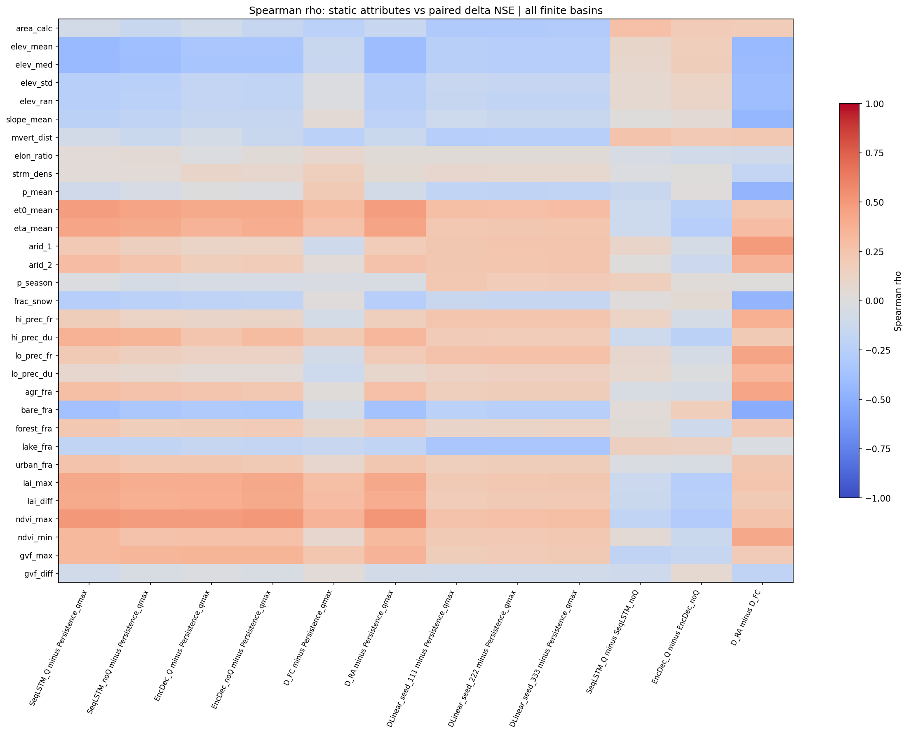
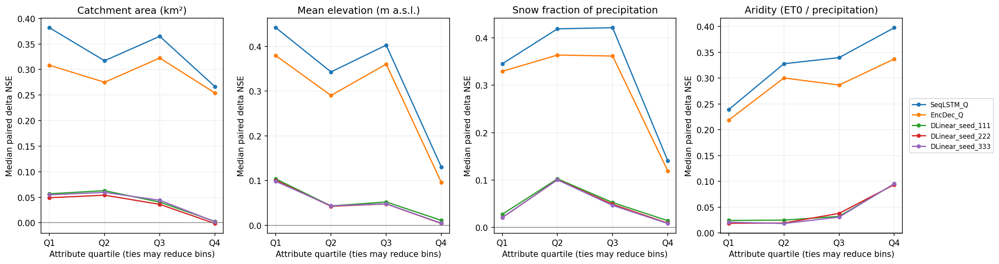
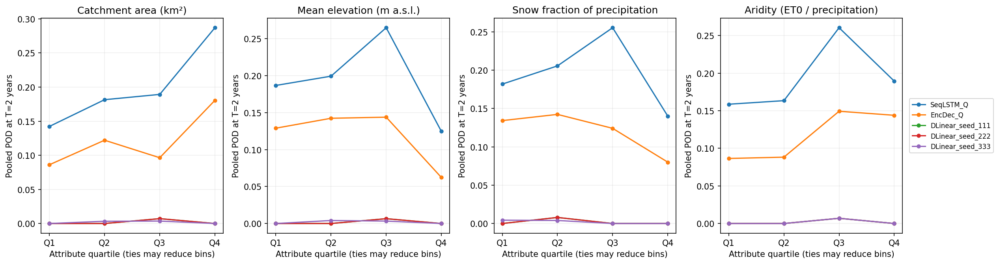

# Quan hệ giữa đặc điểm lưu vực và kết quả dự báo — Extended LamaH-CE

Tài liệu đi cùng [mã Python](02_Evaluation_LamaHCEExt_ByBasin.py) và [notebook Kaggle](02_Evaluation_LamaHCEExt_ByBasin.ipynb), mở rộng phân tích theo lưu vực ở [pipeline Mục 6.4](../../Document/01_Plan/03_Pipeline.md#64-theo-lưu-vực). Phân tích sử dụng các dự báo A2, DLinear và persistence đã lưu để trả lời: **mức cải thiện dự báo thay đổi thế nào theo diện tích, độ cao, tỷ phần tuyết, độ khô hạn và mức đầy đủ dữ liệu?**

Trên 450 lưu vực có ngày chấm, **mức cải thiện NSE của SeqLSTM_Q so persistence có liên hệ âm với độ cao trung bình (ρ = −0,422) và tỷ phần tuyết (ρ = −0,263), liên hệ dương với chỉ số khô hạn (ρ = 0,211)**. Diện tích có liên hệ yếu trong phép so này (ρ = −0,075), nhưng liên hệ dương rõ hơn với chênh lệch SeqLSTM có Q so không Q (ρ = 0,274). Kết luận phụ thuộc vào mô hình, mốc tham chiếu và chỉ số đang xét. [Kết quả thực nghiệm](#11-kết-quả-thực-nghiệm-và-kiểm-chứng) trình bày hệ số, phân nhóm, số trận và độ nhạy.

Các hệ số mô tả mối liên hệ giữa các lưu vực. Những thuộc tính như độ cao, tuyết và thực vật có thể cùng biến đổi theo vùng, nên hệ số riêng lẻ chưa xác định đóng góp nhân quả của một đầu vào. Thí nghiệm che nguồn và giải thích mô hình cung cấp bằng chứng bổ sung ở các bước tiếp theo.

## 1. Phạm vi và thuật ngữ

**S0** là kịch bản không che thêm đầu vào; dữ liệu nguồn vẫn có thể thiếu. **Hạn một ngày** là dự báo ngày kế tiếp sau ngày cuối của lịch sử quan trắc. Một **ngày–lưu vực** là một ngày tại một ID. **Mặt nạ** là ma trận True/False chọn các ngày–lưu vực được chấm; **giao chung** chỉ giữ những vị trí có quan trắc, persistence và dự báo của mọi run cùng hữu hạn.

Bảng chính dùng test 2014–2017, S0, hạn một ngày và phạm vi `common_source_all` của bộ đánh giá. Tập chính thức giữ đủ 451 ID, kể cả ID không có ngày chấm hoặc chỉ số không xác định. Với nguồn A3 đã kiểm, giao chung có 652.628 ngày–lưu vực trên 450 ID có ngày hợp lệ. Khi chạy, các số này được đối chiếu với đầu vào thực tế thay vì dùng thay cho phép kiểm.

Mỗi hàng tương quan sử dụng các ID có đủ thuộc tính và outcome tương ứng, kèm số lượng được dùng. Không loại NSE âm, không chọn riêng các lưu vực được cải thiện cho bảng chính và không đổi tập ID để làm hệ số lớn hơn.

## 2. Bốn nguồn Input và cách chạy

Notebook chạy bằng CPU, đọc đầu vào dưới `/kaggle/input` và ghi trực tiếp vào `/kaggle/working/basin_analysis_output`. Gắn dataset gốc và Output của các notebook đã Save Version làm Input:

| Nguồn | Nội dung dùng trong phân tích |
|---|---|
| Dataset `lamah-ce-ext` | `A_basins_total_upstrm/1_attributes/Catchment_attributes.csv` và `D_gauges/1_attributes/Gauge_attributes.csv` |
| Output A1 | `A1_P3_static_attribute_sources.csv`; bảng topology nếu có |
| Output A3 | `A3_DLinear_data_audit.npz`, `A3_final_evaluation_masks.npz`, `A3_DLinear_loss_stats.csv` |
| Output bộ đánh giá | `Evaluation_summary.json`, `Evaluation_protocol.json`, `Evaluation_metrics.csv`, `Evaluation_events.csv` |

Output A1 xác nhận ánh xạ 33 thuộc tính đã dùng; giá trị thuộc tính được đọc từ bảng gốc. Output A3 cung cấp lịch, ID, diện tích, Q số thô và mặt nạ đánh giá. Output bộ đánh giá cung cấp chỉ số theo lưu vực và số trận đã chấm bằng giao thức cùng ngày bắt đầu. Không cần gắn lại Output A2 hoặc chạy lại mô hình.

Các phiên bản giao thức đánh giá từ 2 trở lên được nhận khi thỏa hợp đồng dữ liệu cần dùng: test/S0/hạn một ngày, cùng giao chung và dung sai khớp trận chính bằng 0. Phiên bản mới hơn không tự làm thay đổi phạm vi phân tích. Nguồn trùng tên cần được chỉ rõ; không tự chọn một phiên bản giữa nhiều ứng viên.

Mã `.py` là nguồn chỉnh sửa chính; `.ipynb` được sinh để nhập vào Kaggle. Notebook trình bày theo phần, đề mục Markdown và cell code theo chức năng. Chạy Run All theo thứ tự, rồi giữ Output bằng Save Version. Kết quả ghi trực tiếp, không đóng ZIP.

## 3. Ghép dữ liệu và kiểm tính nhất quán

Các bảng ghép theo khóa ID, không theo vị trí dòng. Danh sách ID, lịch ngày và thứ tự các trục trong NPZ phải khớp trước khi tính thống kê. Khóa trùng, ID thiếu/thừa, dữ liệu vô cực hoặc schema không rõ được báo ở bước kiểm nguồn.

Mặt nạ `common_source_all` đọc từ A3 được dùng để đối chiếu số ngày đánh giá của từng run. Các hàng NSE/PNSE dùng đúng cùng phạm vi; không lấy NSE native của hai run có ngày chấm khác nhau rồi trừ. Các run phải có cùng quan trắc canonical, số ngày và mẫu số đánh giá trong phép so.

Ngưỡng lũ và sự kiện được giữ theo Output bộ đánh giá. Phân tích này không fit lại ngưỡng, không đổi quy tắc gộp cụm và không nới dung sai để tăng số trận bắt được. Bảng chính chỉ lấy cụm USWRC, chu kỳ lặp lại hai năm và dung sai 0.

## 4. Thuộc tính tĩnh và đơn vị

Danh sách 33 trường là hợp đồng đầu vào đã kiểm tại [A1 Mục 17.4–17.6](../02_Exploration/01_A1_LamaHCEExt_Explore.md#174-xác-nhận-33-thuộc-tính-từ-24-cấu-hình). Toàn bộ giá trị lấy từ `Catchment_attributes.csv`:

| Nhóm | Thuộc tính |
|---|---|
| Địa hình và hình dạng, 10 trường | area_calc, elev_mean, elev_med, elev_std, elev_ran, slope_mean, mvert_dist, mvert_ang, elon_ratio, strm_dens |
| Khí hậu, 11 trường | p_mean, et0_mean, eta_mean, arid_1, arid_2, p_season, frac_snow, hi_prec_fr, hi_prec_du, lo_prec_fr, lo_prec_du |
| Lớp phủ, 6 trường | lc_dom, agr_fra, bare_fra, forest_fra, lake_fra, urban_fra |
| Thực vật, 6 trường | lai_max, lai_diff, ndvi_max, ndvi_min, gvf_max, gvf_diff |

Bảng tương quan chính dùng **31 trường**, loại mã phân loại `lc_dom` và góc vòng `mvert_ang` khỏi phép tương quan theo thứ tự số thông thường. Đây là lựa chọn phương pháp phân tích; hợp đồng 33 đầu vào của các mô hình tái lập được giữ nguyên.

| Trường | Ý nghĩa và đơn vị |
|---|---|
| area_calc | Diện tích tính từ ranh giới lưu vực, km² |
| area_gov | Diện tích cơ quan cung cấp tại trạm, km²; lấy từ bảng Gauge, dùng đổi Q |
| elev_mean, elev_med, elev_std, elev_ran | Trung bình, trung vị, độ lệch chuẩn và khoảng độ cao, m |
| slope_mean | Độ dốc trung bình, m/km |
| mvert_dist | Chiều dài trục từ điểm xa nhất tới trạm, km |
| mvert_ang | Hướng trục dài lưu vực so với Bắc, độ |
| elon_ratio, strm_dens | Chỉ số hình dạng không thứ nguyên; mật độ mạng sông km/km² |
| p_mean, et0_mean, eta_mean | Lượng mưa, bốc thoát hơi tham chiếu và bốc thoát hơi thực tế trung bình, mm/ngày |
| arid_1 | ET0 từ GCD v2 chia mưa ERA5-Land, không thứ nguyên |
| arid_2 | Nghịch đảo chỉ số khô hạn từ GCD v2, không thứ nguyên |
| p_season | Chỉ số mùa mưa không thứ nguyên; dấu mang ý nghĩa mùa |
| frac_snow | Tỷ phần lượng mưa rơi dưới dạng tuyết, không phải tỷ lệ ngày có tuyết |
| hi_prec_fr, lo_prec_fr | Tần số ngày mưa lớn/ngày khô, ngày/năm |
| hi_prec_du, lo_prec_du | Thời lượng trung bình các đợt tương ứng, ngày |
| Các trường hậu tố fra thuộc lớp phủ | Tỷ phần diện tích, không phải phần trăm |
| Các chỉ số LAI, NDVI và GVF | Chỉ số thực vật không thứ nguyên từ các trung bình tháng dài hạn |

`area_calc` và `area_gov` có nguồn và mục đích khác nhau. Q số thô được đổi theo q(mm/ngày) = Q(m³/s) × 86,4 / area_gov(km²), cùng quy ước A3. Không thay diện tích đổi đơn vị bằng diện tích dùng làm predictor.

Theo [LamaH-CE Mục 5](https://essd.copernicus.org/articles/13/4529/2021/#section5), nhiều chỉ số khí hậu được tính trên 1989–2009, ET0 từ GCD v2 có kỳ 1970–2000 và các chỉ số thực vật dùng kỳ nguồn dài hạn có thể tới 2020. Đây là metadata có sẵn của dataset, không phải toàn bộ thống kê chỉ fit từ train của thí nghiệm. Phạm vi nguồn được giữ khi diễn giải; các diagnostics mới từ chuỗi Q được tách riêng theo kỳ.

## 5. Mười hai phép so sánh và ba outcome

Mỗi phép so có hướng cố định: **run bên trái trừ run tham chiếu**. Giá trị dương biểu thị cải thiện theo outcome đang xét.

| Nhóm | Các phép so |
|---|---|
| Sáu run A2 so persistence qmax | SeqLSTM_Q, SeqLSTM_noQ, EncDec_Q, EncDec_noQ, D_FC và D_RA; mỗi run trừ Persistence_qmax |
| Ba seed DLinear so persistence qmax | DLinear_seed_111, DLinear_seed_222 và DLinear_seed_333; mỗi run trừ Persistence_qmax |
| Có/không Q trong cùng kiến trúc | SeqLSTM_Q − SeqLSTM_noQ; EncDec_Q − EncDec_noQ |
| Hai miền khí tượng tham chiếu | D_RA − D_FC |

D_RA dùng tái phân tích ở ngày đích, nên đây là mốc tham chiếu về nguồn thông tin. Các cặp A2 có/không Q cũng chỉ mô tả những run đã có, chưa tách riêng tác động của đầu vào khỏi nhiễu hạt giống và những khác biệt cấu hình đi kèm.

**ΔNSE** là NSE của run trừ NSE tham chiếu trên cùng ngày. Ví dụ NSE 0,60 so 0,40 cho ΔNSE = 0,20. Đây là chênh lệch điểm, không phải cải thiện 20%.

**ΔPNSE** là PNSE của run trừ PNSE tham chiếu. PNSE = 1 − SSE mô hình / SSE persistence, trong đó SSE là tổng bình phương sai số trên mặt nạ đã cố định. PNSE của persistence qmax bằng 0 khi mẫu số dương, nên với chín phép so persistence, ΔPNSE bằng PNSE của run. Các phép so Q/noQ và D_RA/D_FC vẫn cần lấy chênh hai PNSE. Mẫu số bằng 0 cho trạng thái không xác định, không thêm epsilon.

**ΔPOD hai năm** là POD của run trừ POD tham chiếu ở ngưỡng lũ hai năm, cụm USWRC và dung sai 0. POD = h/(h+m), với h là số trận bắt đúng và m là số trận bỏ sót. Phép so kiểm cùng số trận thật đủ điều kiện trước khi trừ. Lưu vực không có trận thật đủ điều kiện có POD không xác định, không được gán POD bằng 0 để đưa vào tương quan.

Tại hạn một ngày, dung sai 0 yêu cầu trận dự báo bắt đầu cùng ngày trận thật. Bảng ±1 ngày của bộ đánh giá là phân tích phụ riêng. Không trộn hai mức dung sai vào cùng outcome.

## 6. Tương quan, permutation và Holm

Spearman đo xu hướng đơn điệu giữa một thuộc tính và một outcome theo ID. Hệ số ρ gần 1 biểu thị hai đại lượng thường tăng cùng nhau; gần −1 biểu thị xu hướng ngược chiều. Hệ số gần 0 không loại trừ quan hệ phi tuyến hoặc tác động có điều kiện.

Tất cả điểm hữu hạn được giữ, kể cả NSE âm lớn và mức cải thiện âm. Mỗi cặp thuộc tính–outcome có số ID, số giá trị khác nhau và trạng thái tương ứng. Chuỗi hằng hoặc không đủ dữ liệu không có hệ số/p-value hợp lệ.

Kiểm định permutation dùng 9.999 lần hoán vị, seed 20261023. Trong mỗi lần, outcome được ghép lại ngẫu nhiên với các ID, giữ nguyên giá trị thuộc tính. P-value hai phía theo trị tuyệt đối là (1 + số lần |ρ hoán vị| ≥ |ρ quan sát|) / (9.999 + 1). Quy ước cộng 1 giữ p-value Monte Carlo dương; đây là kiểm định theo |ρ|, không mặc định đồng nhất với mọi quy ước p hai phía của thư viện.

[SciPy về Spearman](https://docs.scipy.org/doc/scipy/reference/generated/scipy.stats.spearmanr.html) lưu ý độ chính xác của p-value xấp xỉ khi mẫu nhỏ; [tài liệu permutation](https://docs.scipy.org/doc/scipy/reference/generated/scipy.stats.permutation_test.html) mô tả hoán vị cách ghép cặp cho các phép tương quan. Với 451 lưu vực, phép hoán vị cung cấp tham chiếu bổ sung cho hệ số, trong khi hạn chế phụ thuộc không gian vẫn cần được giữ khi diễn giải.

Holm điều chỉnh trong từng **contrast × outcome**, gồm 31 phép thử thuộc tính tĩnh đã định trước. Chỉ p-value hữu hạn tham gia số lượng phép thử; hàng NaN giữ trạng thái và không làm tăng m. Bảng xuất ghi family, m và p đã điều chỉnh. Các family khác nhau được trình bày riêng; mức ý nghĩa trong một family không có nghĩa đã kiểm soát đồng thời mọi kết luận của toàn notebook.

Các lưu vực có thể lồng nhau và cùng chịu điều kiện khí hậu vùng. Hoán vị độc lập theo ID không mô hình hóa cấu trúc phụ thuộc này. **ρ, hướng liên hệ và số ID là kết quả mô tả chính; p-value là bằng chứng thăm dò theo giả định trao đổi được giữa ID.** Không dùng thứ hạng p-value làm thứ hạng đóng góp nhân quả của đầu vào.

## 7. Diagnostics từ chuỗi Q và độ phủ train

NPZ audit A3 cung cấp qmean/qmax số thô trên lịch đầy đủ. Các thống kê train được tính trong 2003–2009, không gồm năm ngữ cảnh 2002. Giá trị Q được đổi sang mm/ngày bằng area_gov; số 0 và các khoảng thiếu được giữ đúng lịch.

Nhóm diagnostics gồm độ phủ nhãn và lịch sử đầu vào, số cửa sổ DLinear đủ điều kiện, phân phối Q và mức thay đổi giữa train/test. Số ngày có nhãn, số cửa sổ hoàn chỉnh và số ngày chấm test là ba đại lượng khác nhau; lưu vực có nhãn train không nhất thiết có đủ 365 ngày qmean liên tục trước nhãn để tham gia DLinear.

Các thống kê từ Q có thể gồm trung bình, độ lệch chuẩn, biến thiên tương đối, tỷ lệ bằng 0 và tương quan trễ một ngày. Tương quan trễ chỉ dùng cặp ngày liền nhau trên lịch gốc; không nối hai phía khoảng thiếu sau khi bỏ NaN. Thống kê có mẫu số bằng 0 hoặc không đủ mẫu giữ trạng thái không xác định.

Diagnostics test và chênh train→test giúp đọc các trường hợp như ít nhãn train hoặc phương sai test rất nhỏ. Chúng được tính để mô tả kết quả, không dùng fit scaler, chọn checkpoint, sửa cấu hình hoặc đổi ngưỡng. Riêng liên hệ giữa NSE và phương sai Q test còn có thành phần toán học vì phương sai nằm trong mẫu số NSE.

Bảng liên hệ với diagnostics chỉ báo ρ và số ID, **không thêm p-value** vào family 31 thuộc tính tĩnh. Bảng độ lệch chuẩn loss A3 và số cửa sổ đã lưu được dùng để kiểm lại các phép tính có cùng định nghĩa.

## 8. Nhóm thuộc tính, biến phân loại và nhiễu seed

Bốn thuộc tính ưu tiên cho hình và bảng nhóm là `area_calc`, `elev_mean`, `frac_snow`, `arid_1`. Các mốc tứ phân vị được tính một lần trên toàn bộ 451 giá trị thuộc tính trước khi ghép outcome. Ties có thể làm các mốc trùng; khi đó số khoảng thực tế giảm và được ghi rõ. Các run dùng cùng biên nhóm, kèm số ID có outcome hữu hạn trong từng nhóm.

`lc_dom` được mô tả theo lớp CORINE, giữ mã và số lượng từng lớp. `mvert_ang` được chia thành bốn cung [0°, 90°), [90°, 180°), [180°, 270°), [270°, 360°); 360° cùng nhóm với 0°. Góc thiếu hoặc ngoài [0°, 360°] có nhóm báo riêng. Các bảng này mô tả phân phối outcome trong nhóm; không áp thứ tự lớn–nhỏ vật lý cho mã lớp hoặc bỏ qua tính vòng của góc.

Ba seed DLinear được giữ thành ba run riêng. Bảng độ phân tán seed tính trung bình và độ lệch chuẩn mẫu của các chỉ số theo cùng lưu vực khi đủ ba giá trị hợp lệ. Ba seed không tạo thêm ba lưu vực độc lập. Trung bình ba chỉ số cũng không phải chỉ số của một dự báo ensemble; notebook không tạo chuỗi dự báo ensemble từ các score.

## 9. Kiểm độ nhạy với lưu vực lồng nhau

Nếu Output A1 có `A1_P3_final_selected_topology.csv`, phân tích đọc cột `has_known_selected_upstream` sau khi kiểm ID, kiểu boolean và trạng thái đường đi mạng sông. Giá trị thiếu không được tự chuyển thành False.

Nhóm đầu nguồn trong tập chọn gồm các ID không có lưu vực được chọn khác ở thượng lưu. Định nghĩa này khác `HIERARCHY = 1` trên toàn bộ mạng gốc. A1 đã kiểm 322 ID đầu nguồn theo tập chọn; con số khi chạy được đối chiếu với bảng nguồn, không ép bằng giá trị đã biết.

Phân tích độ nhạy báo lại ρ và số ID của bốn thuộc tính ưu tiên trên nhóm này. Việc giảm lồng nhau giúp đánh giá mức ổn định của xu hướng, nhưng các lưu vực còn có thể cùng vùng khí hậu và gần nhau trong không gian. Bảng độ nhạy không được diễn giải là mẫu hoàn toàn độc lập.

## 10. Output và cách trình bày kết quả

Các bảng dùng tiền tố `BasinAnalysis_`; hình nằm trong `Figures/` với cùng tiền tố. Output gồm các nhóm:

| Nhóm đầu ra | Nội dung |
|---|---|
| Nguồn và kiểm thử | Thông tin nguồn, kiểm ID/lịch/mặt nạ, kiểm thử ví dụ số và trạng thái thực thi |
| Thuộc tính và diagnostics | Giá trị 451 ID, đơn vị, độ phủ, thống kê train/test và cờ không xác định |
| Contrast | Các chênh lệch theo lưu vực, số ngày và số trận dùng trong phép so |
| Tương quan tĩnh | 31 thuộc tính × 12 contrast × 3 outcome, kèm n, ρ, permutation p và Holm |
| Mô tả nhóm | Biên tứ phân vị, số lượng và phân phối outcome; lớp CORINE và cung góc |
| Diagnostics và độ nhạy | Tương quan mô tả, độ phân tán ba seed và nhóm đầu nguồn nếu nguồn hợp lệ |
| Hình | Heatmap hệ số, biểu đồ bốn thuộc tính ưu tiên và phân phối theo nhóm |

Các tệp CSV cần giữ gồm `BasinAnalysis_checks.csv`, `BasinAnalysis_attributes_and_diagnostics.csv`, `BasinAnalysis_attribute_quality.csv`, `BasinAnalysis_paired_contrasts.csv`, `BasinAnalysis_static_associations.csv`, `BasinAnalysis_diagnostic_associations.csv`, `BasinAnalysis_quartile_definitions.csv`, `BasinAnalysis_grouped_skill.csv`, `BasinAnalysis_categorical_summary.csv`, `BasinAnalysis_DLinear_seed_spread.csv`, `BasinAnalysis_topology_sensitivity.csv` và `BasinAnalysis_input_manifest.csv`. Hai JSON là `BasinAnalysis_protocol.json` và `BasinAnalysis_summary.json`.

| Hình PNG trong Figures | Nội dung |
|---|---|
| BasinAnalysis_static_delta_NSE_rho.png | Hệ số Spearman của 31 thuộc tính với ΔNSE ở 12 phép so |
| BasinAnalysis_priority_scatter.png | Bốn thuộc tính ưu tiên và ΔNSE, giữ mọi điểm âm; ba cặp hiển thị được chọn trước |
| BasinAnalysis_quartile_delta_NSE.png | ΔNSE trung vị theo nhóm thuộc tính, giữ riêng ba seed DLinear |
| BasinAnalysis_quartile_flood_POD.png | POD cộng dồn số trận theo cùng nhóm thuộc tính; đọc cùng mẫu số trong CSV |

Khi trình bày kết quả cần nêu tên contrast, outcome, hướng và độ lớn hệ số, số ID, khoảng đặc điểm và độ ổn định giữa các seed/nhóm. Chẳng hạn, “mức cải thiện NSE của SeqLSTM_Q so persistence có xu hướng lớn hơn ở các lưu vực có chỉ số khô hạn cao hơn” mô tả đúng đại lượng đã đo. Khẳng định “độ khô hạn làm NSE cao” đòi hỏi bằng chứng khác.

## 11. Kết quả thực nghiệm và kiểm chứng

### 11.1. Phạm vi thực nghiệm

Notebook đã chạy trên Kaggle với Output bộ đánh giá giao thức 2, A1, A3 và dataset gốc. Có **30 kiểm thử đạt**, giữ 451 ID, trong đó 450 ID có **652.628 ngày–lưu vực** trên giao chung test/S0/hạn một ngày. ID 55 vẫn có mặt với số ngày chấm bằng 0. Kiểm train, mặt nạ và mẫu số quan trắc đạt trước khi tính tương quan.

Phân tích có **1.116 hàng = 31 thuộc tính × 12 phép so × 3 outcome**; toàn bộ 1.116 hệ số chính hữu hạn. ΔNSE và ΔPNSE dùng 450 ID; ΔPOD dùng 366 ID có trận thật đủ điều kiện. Cả 33 thuộc tính đều đủ giá trị trên 451 ID, với 31 trường dùng cho tương quan. Thời gian chạy Kaggle khoảng 75,6 giây. [Thông tin lần chạy](Tables/BasinAnalysis_summary.json), [giao thức](Tables/BasinAnalysis_protocol.json), [độ phủ thuộc tính](Tables/BasinAnalysis_attribute_quality.csv).

### 11.2. Đặc điểm liên hệ với mức cải thiện NSE

Các hệ số dưới đây đều là Spearman giữa thuộc tính và **NSE bên trái trừ NSE bên phải**, mỗi hệ số dùng 450 lưu vực.

| Phép so | Diện tích | Độ cao trung bình | Tỷ phần tuyết | Chỉ số khô hạn arid_1 |
|---|---:|---:|---:|---:|
| SeqLSTM_Q − persistence qmax | −0,075 | −0,422 | −0,263 | 0,211 |
| EncDec_Q − persistence qmax | −0,092 | −0,331 | −0,209 | 0,111 |
| DLinear 111 − persistence qmax | −0,297 | −0,246 | −0,133 | 0,226 |
| DLinear 222 − persistence qmax | −0,290 | −0,262 | −0,157 | 0,238 |
| DLinear 333 − persistence qmax | −0,287 | −0,263 | −0,159 | 0,236 |
| SeqLSTM_Q − SeqLSTM_noQ | 0,274 | 0,096 | 0,008 | 0,105 |
| EncDec_Q − EncDec_noQ | 0,194 | 0,170 | 0,053 | −0,058 |
| D_RA − D_FC | 0,184 | −0,426 | −0,453 | 0,491 |

SeqLSTM_Q và EncDec_Q có mức cải thiện so persistence thấp hơn ở các lưu vực cao hơn hoặc có tỷ phần tuyết lớn hơn. Riêng lợi ích của run có Q so run không Q tăng theo diện tích: ρ = 0,274 với SeqLSTM và 0,194 với EncDec. Đổi mốc tham chiếu làm thay đổi câu hỏi và hướng liên hệ; vì vậy không thể gán một dấu chung cho “ảnh hưởng của diện tích”. Các run A2 có/không Q hiện có một seed, nên phép so còn chứa biến thiên giữa các lần huấn luyện.

Trong 31 thuộc tính, `ndvi_max` có |ρ| lớn nhất với ΔNSE của SeqLSTM_Q so persistence, **ρ = 0,500**, tiếp theo là `et0_mean` **0,474** và `eta_mean` **0,434**. Đây là các mối liên hệ đơn biến với mức cải thiện, không phải thứ hạng đóng góp của đầu vào trong mô hình. Với D_RA − D_FC, `bare_fra` có ρ = −0,520 và `arid_1` có ρ = 0,491; D_RA dùng tái phân tích tại ngày đích nên chỉ dùng làm mốc tham chiếu về nguồn thông tin.

Các p-value của những liên hệ mạnh thường chạm sàn Monte Carlo 0,0001; p sau Holm được lưu theo từng family. Những giá trị bằng nhau ở sàn không cho phép xếp thứ hạng độ mạnh bằng p. [Toàn bộ hệ số, n và p](Tables/BasinAnalysis_static_associations.csv).

Màu thể hiện hướng và độ lớn hệ số. Mỗi cột là một phép so cụ thể; toàn bộ các mức cải thiện âm vẫn được giữ.

### 11.3. Khoảng đặc điểm và mức cải thiện theo nhóm

Biên nhóm tính trên thuộc tính của cả 451 ID trước khi ghép điểm số. Q1 là khoảng thấp nhất, Q4 là khoảng cao nhất; số ID giữa các nhóm có thể khác nhau do giá trị bằng nhau ở biên. Bảng dưới chỉ trình bày Q1/Q4; CSV giữ đủ bốn nhóm, số ID, khoảng tứ phân vị và ba seed.

| Thuộc tính và khoảng | ID có ΔNSE | Median ΔNSE SeqLSTM_Q − persistence | Median ΔNSE DLinear 111 − persistence |
|---|---:|---:|---:|
| Diện tích Q1: [3,972; 51,4725) km² | 112 | 0,3819 | 0,0567 |
| Diện tích Q4: [219,95; 15.025,609] km² | 113 | 0,2666 | 0,0027 |
| Độ cao Q1: [221; 591,5) m | 113 | 0,4420 | 0,1037 |
| Độ cao Q4: [1.294; 3.122] m | 112 | 0,1302 | 0,0110 |
| Tỷ phần tuyết Q1: [0,05; 0,09) | 106 | 0,3455 | 0,0274 |
| Tỷ phần tuyết Q4: [0,25; 0,61] | 117 | 0,1403 | 0,0137 |
| Khô hạn Q1: [0,37; 0,49) | 106 | 0,2392 | 0,0244 |
| Khô hạn Q4: [0,81; 1,51] | 118 | 0,3977 | 0,0949 |

Ví dụ, ở nhóm cao từ 1.294 m, SeqLSTM_Q vẫn có median cải thiện dương 0,1302 điểm so persistence, nhưng thấp hơn 0,4420 ở nhóm thấp dưới 591,5 m. Các nhóm trung gian không nhất thiết tạo xu hướng đơn điệu: ΔNSE của SeqLSTM_Q theo nhóm tuyết lần lượt 0,3455; 0,4194; 0,4217; 0,1403. Hệ số âm tổng thể không có nghĩa mỗi lần tăng nhóm tuyết đều làm điểm giảm.

Trong phép so SeqLSTM có Q − không Q, median ΔNSE theo bốn nhóm diện tích là **0,0417; 0,0533; 0,0912; 0,0876**. Đây là bằng chứng cụ thể cho mức chênh lớn hơn ở nhóm diện tích lớn trong các run đã có. [Biên nhóm](Tables/BasinAnalysis_quartile_definitions.csv), [bảng nhóm đầy đủ](Tables/BasinAnalysis_grouped_skill.csv).

Ba seed DLinear có đường mô tả gần nhau ở cấp nhóm; từng lưu vực vẫn có thể biến thiên lớn.

Biểu đồ giữ các điểm âm lớn và dùng cùng 450 ID ở mỗi cặp. Độ phân tán cho thấy một thuộc tính riêng lẻ chưa giải thích toàn bộ khác biệt giữa các lưu vực.

### 11.4. Kết quả bắt đúng ngày khởi phát lũ

Với lũ hai năm, cụm USWRC và dung sai 0, POD cộng dồn của SeqLSTM_Q theo bốn nhóm diện tích tăng từ **14,23% lên 28,70%**. Các mẫu số là số trận, khác với số ID dùng để tính median ΔNSE.

| Nhóm diện tích | Trận thật đủ điều kiện | SeqLSTM_Q: bắt đúng / POD | EncDec_Q: bắt đúng / POD |
|---|---:|---:|---:|
| Q1 | 267 | 38 / 14,23% | 23 / 8,61% |
| Q2 | 303 | 55 / 18,15% | 37 / 12,21% |
| Q3 | 280 | 53 / 18,93% | 27 / 9,64% |
| Q4 | 216 | 62 / 28,70% | 39 / 18,06% |

Trong khi median ΔNSE của SeqLSTM_Q so persistence thấp hơn ở Q4 diện tích so Q1, POD khởi phát lũ lại cao hơn ở Q4. Hai chỉ số mô tả hai khía cạnh khác nhau của dự báo. Với nhóm độ cao Q4, POD của SeqLSTM_Q là **36/289 = 12,46%**, thấp hơn **81/306 = 26,47%** ở Q3; quan hệ theo độ cao cũng không đơn điệu qua mọi nhóm.

Mỗi seed DLinear chỉ có hai trận khớp đúng ngày trong toàn bộ 1.066 trận, nên POD theo nhóm gần 0. Số lượng này quá ít để dùng riêng hình nhóm nhằm khẳng định một loại lưu vực nào phù hợp cho cảnh báo bằng DLinear. [Số đếm và tỷ lệ từng nhóm](Tables/BasinAnalysis_grouped_skill.csv).

### 11.5. Độ nhạy theo topology, seed và độ phủ dữ liệu

Nhóm không có lưu vực được chọn khác ở thượng lưu gồm **322 ID**, trong đó **321 ID có ΔNSE**. Với SeqLSTM_Q so persistence, các hệ số độ cao, tuyết và khô hạn lần lượt là **−0,437; −0,313; 0,266**, cùng hướng với kết quả toàn bộ 450 ID. Hệ số diện tích của phép so có Q − không Q là **0,325** với SeqLSTM và **0,293** với EncDec. Các xu hướng này còn hiện diện sau khi giảm lồng nhau trong tập chọn; các nhóm vẫn có thể phụ thuộc khí hậu và không gian. Bảng topology có tám hàng outcome hằng nên ρ không xác định, giữ đúng trạng thái. [Độ nhạy topology](Tables/BasinAnalysis_topology_sensitivity.csv).

Ba seed DLinear giữ cùng hướng liên hệ với bốn thuộc tính ưu tiên. Median độ lệch chuẩn mẫu của ΔNSE qua ba seed theo lưu vực là **0,00383 điểm**, nhưng tại 742 và 758 lần lượt là **2,753 và 6,477 điểm**. Cần đọc cả phần đuôi này thay vì dùng sự gần nhau của các đường nhóm để kết luận mọi lưu vực ổn định. [Độ phân tán seed](Tables/BasinAnalysis_DLinear_seed_spread.csv).

Tỷ lệ thiếu nhãn train có liên hệ rất yếu với ΔNSE của SeqLSTM_Q so persistence, **ρ = −0,048**, và số cửa sổ train DLinear có **ρ = 0,037**. Vì vậy, trong tập đã chấm, hai thống kê độ phủ này chưa giải thích rõ thứ hạng cải thiện của SeqLSTM_Q. Kiểm độ phủ vẫn cần để xác định các ngày và ID được phép chấm. [Liên hệ diagnostics](Tables/BasinAnalysis_diagnostic_associations.csv).

### 11.6. Kết luận dùng khi trình bày với giảng viên

**Đặc điểm lưu vực có liên hệ với mức cải thiện, và mối liên hệ thay đổi theo phép so.** Trên Extended LamaH-CE, SeqLSTM_Q cải thiện so persistence ít hơn ở nhóm độ cao và tỷ phần tuyết cao; lợi ích của run có Q so không Q có xu hướng lớn hơn ở lưu vực diện tích lớn. Các xu hướng chính còn giữ khi chỉ xét nhóm không có lưu vực được chọn ở thượng lưu. Riêng khả năng bắt đúng ngày khởi phát lũ phải đọc bằng POD và số trận, vì kết luận từ NSE không tự chuyển sang kết luận về sự kiện.

Những kết quả này xác định được các nhóm cần phân tích và kiểm chứng tiếp. Để xác định mô hình thực sự sử dụng đầu vào nào cần kết hợp che nguồn, giải thích mô hình và thí nghiệm có kiểm soát. Khẳng định hiệu quả trên dataset khác cần đánh giá trên dataset đó; tương quan trong một dataset chưa cung cấp bằng chứng chuyển miền.

### 11.7. Bằng chứng kiểm kết quả

Đã giữ nguyên **18 tệp thực nghiệm** gồm 12 CSV, hai JSON và bốn PNG, tổng 4.408.277 byte. **143 kiểm cục bộ đạt**, gồm đối chiếu hai phía của toàn bộ 5.412 hàng contrast với CSV bộ đánh giá, tính lại 1.116 hệ số bằng SciPy, 1.116 p-value với 9.999 hoán vị mỗi phép thử và Holm, 180 hệ số diagnostics, biên nhóm, 240 hàng thống kê nhóm, bảng phân loại và 1.353 hàng phân tán seed. Sai khác |ρ| tối đa khoảng 4,44×10⁻¹⁶; p hoán vị khớp hoàn toàn. Đọc CSV bằng chế độ round-trip để giữ nguyên các số thực dùng xác định thứ hạng và ties.

[Manifest tệp nhận](Tables/BasinAnalysis_received_manifest.csv), [bảng kiểm](Tables/BasinAnalysis_output_audit.csv) và [biên nhận kiểm tra](Tables/BasinAnalysis_output_verification.json) ghi phạm vi đối chiếu. SHA-256 của bốn đầu vào bộ đánh giá được kiểm bằng các tệp cục bộ tương ứng. Giá trị thuộc tính gốc, NPZ A3 và thành viên nhóm topology được kiểm trong lần chạy Kaggle; kiểm cục bộ sử dụng CSV đã xuất, không nạp lại các nguồn đầy đủ đó hoặc huấn luyện lại mô hình.

## 12. Nguồn tham khảo

- [A1 — cấu trúc, ý nghĩa và kiểm thuộc tính](../02_Exploration/01_A1_LamaHCEExt_Explore.md), đặc biệt Mục 17.4–17.6, 17.17–17.19.
- [A3 — dữ liệu DLinear, mặt nạ và chẩn đoán sai số](../03_Baseline/02_A3_LamaHCEExt_Benchmarks.md).
- [Bộ đánh giá — chỉ số, mức lưu lượng và sự kiện](01_Evaluation_LamaHCEExt.md).
- [Klingler và cs. (2021), LamaH-CE](https://essd.copernicus.org/articles/13/4529/2021/), Mục 5 và Phụ lục A: định nghĩa, đơn vị và nguồn thuộc tính.
- [Konold và cs. (2026), BiasCast](https://hess.copernicus.org/articles/30/5067/2026/index.html), phân tích theo lưu vực và liên hệ đặc điểm với mức cải thiện; phần phân tích chọn riêng ΔNSE dương của bài được phân biệt với tập đầy đủ dùng ở đây.
- [SciPy — Spearman](https://docs.scipy.org/doc/scipy/reference/generated/scipy.stats.spearmanr.html) và [permutation test](https://docs.scipy.org/doc/scipy/reference/generated/scipy.stats.permutation_test.html): hệ số thứ hạng và phép thử bằng hoán vị.
