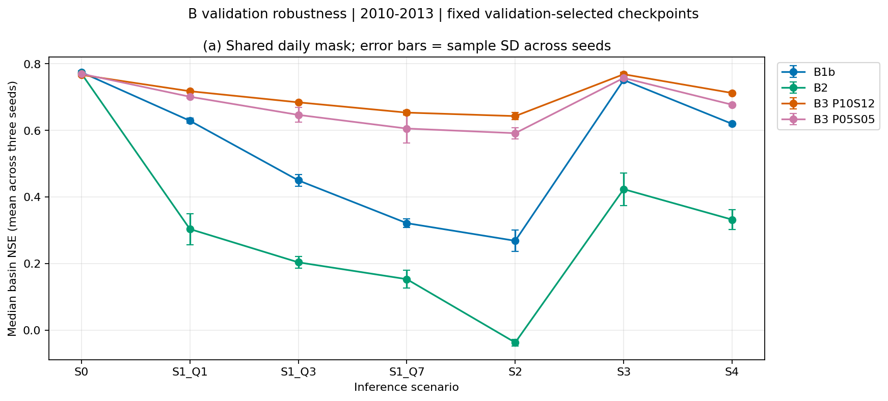

# Validation bước B - Extended LamaH-CE

## 1. Mục đích và phạm vi

Notebook `03_B_LamaHCEExt_Validation` suy luận lại từ 12 checkpoint đã lưu: B1b, B2 và hai mức B3 P10S12/P05S05, mỗi cấu hình ba seed 111/222/333. Mỗi run xuất bảy trường hợp: S0, S1 mất Q 1/3/7 ngày, S2, S3, S4. Tổng cộng 84 NPZ trên kỳ validation lấy từ cấu hình nguồn, hiện là 2010–2013. Không huấn luyện lại hoặc chọn lại checkpoint.

Đây là bước chuẩn bị dữ liệu bàn giao cho người phụ trách B*, theo [Pipeline Mục 6.3 và 7](../../../Document/01_Plan/02_Pipeline.md). Notebook không chọn cấu hình, seed hoặc gắn `freeze-C`. Các kết quả test/S0 đã chấm trong Evaluation Version 8 không dùng để quyết định ở bước này.

Notebook đã chạy trên Kaggle và **Save Version 1**, hoàn thành 12 checkpoint và 84 NPZ validation. Có 5412 đối chiếu S0 từng run–ID khớp nguồn; 242 kiểm chéo trên 17 tệp và ba log nhận được đạt. Kết quả và giới hạn kiểm ở Mục 9. Các tệp `.py`/`.ipynb` trong repo cùng mã nguồn; bản `.ipynb` có output tải từ Kaggle chưa được nhập, nên không tự điền execution count hoặc output từ log.

## 2. Cài đặt Kaggle và Input

- Tên: **`03_B_LamaHCEExt_Validation`**.
- Accelerator: **GPU T4**; Internet **On** để cài fork đúng commit.
- Dùng phiên sạch, chạy toàn bộ từ Phần 1 đến Phần 8 bằng Save & Run All.
- Output: **`/kaggle/working/b_validation`**.
- Không cần gắn Output Evaluation Version 8 hoặc A3; notebook dựng ngữ cảnh validation từ Q gốc và diện tích `area_gov`.

Gắn nguyên Output của đúng 15 notebook dưới đây, tất cả **Version 1**, và Dataset `lamah-ce-ext`:

| Input notebook | Version |
|---|---:|
| `04_B1b_LamaHCEExt_Train_Seed111` | 1 |
| `04_B1b_LamaHCEExt_Train_Seed222` | 1 |
| `04_B1b_LamaHCEExt_Train_Seed333` | 1 |
| `06_B2_LamaHCEExt_Train_Seed111` | 1 |
| `06_B2_LamaHCEExt_Train_Seed222` | 1 |
| `06_B2_LamaHCEExt_Train_Seed333` | 1 |
| `08_B3_LamaHCEExt_Train_P10S12_Seed111` | 1 |
| `08_B3_LamaHCEExt_Train_P10S12_Seed222` | 1 |
| `08_B3_LamaHCEExt_Train_P10S12_Seed333` | 1 |
| `08_B3_LamaHCEExt_Train_P05S05_Seed111` | 1 |
| `08_B3_LamaHCEExt_Train_P05S05_Seed222` | 1 |
| `08_B3_LamaHCEExt_Train_P05S05_Seed333` | 1 |
| `05_B1_LamaHCEExt_Compare` | 1 |
| `07_B2_LamaHCEExt_Compare` | 1 |
| `09_B3_LamaHCEExt_Compare` | 1 |

Các summary và environment của ba Compare được khóa bằng SHA-256 đầy đủ từ nguồn đã đối chiếu trong [Evaluation Version 8](../01_Evaluation_LamaHCEExt/Tables/Evaluation_32run_output_review.json). Nguồn train kiểm theo manifest, hash config/scaler/checkpoint và hash environment trong chuỗi bàn giao. B1 Compare Version 1 không xuất cờ `complete`/`step`; điều kiện đọc dùng đúng schema epoch, NSE validation ba seed, sáu hợp đồng và danh tính nguồn. B2/B3 yêu cầu `complete=true` cùng mã bước tương ứng. B1 Compare Version 1 không chứa hash environment từng run; hash này lấy từ `B1b_source` của environment B2 đã được xác thực. Tên B2 nhúng cũ `07_B2…Train` giữ nguyên trong artifact; Input thực tế là `06_B2…Train`.

## 3. Nội dung từng Phần

| Phần | Nội dung và điều kiện kiểm |
|---|---|
| 1 | Cài NeuralHydrology tại `2ccaa147a6ec87d0f56fa3e2f11b1bf38079253f`, kiểm môi trường T4 và phiên sạch |
| 2 | Kiểm đủ 12 nguồn; `best_model.pt` trùng tensor với epoch cực đại NSE validation trong 30 epoch; giữ nguyên hash nguồn |
| 3 | Dựng lịch validation, 451 ID, Q gốc mm/ngày, persistence ngày trước và diện tích; không dùng ngày test |
| 4 | Định nghĩa che trên từng mẫu/batch sau chuẩn hóa, thời điểm kết thúc hindcast là t−1; chỉ B1b cần điền ô bị che |
| 5 | Suy luận bảy trường hợp/run; đối chiếu NSE S0 của từng ID với CSV validation ở checkpoint nguồn; xuất và đọc ngược 84 NPZ |
| 6 | Tính NSE riêng từng trường hợp trên lịch native và một giao chung cố định cho cả 84 NPZ; bảng ba seed, độ suy giảm và dữ liệu bàn giao |
| 7 | Vẽ trung bình ba median NSE và SD mẫu qua seed; chú giải ngoài hình, giữ giá trị âm |
| 8 | Kiểm đủ 5412 đối chiếu S0 và 84 hợp đồng; ghi summary, môi trường, config suy luận và manifest đầy đủ |

## 4. Bộ nạp, chuẩn hóa và kiểm tái lập

Suy luận dùng nguyên `LamaH`/`BaseDataset`, mô hình và `GpuBatchLoader` ở commit B2/B3. Lớp dẫn xuất chỉ bổ sung `qmean_mmd`, `qmax_mmd` từ `D_gauges` bằng `load_lamah_discharge` và `_normalize_discharge`, trước khi `BaseDataset` chọn cột. Hai cột đã là mm/ngày nên không đổi đơn vị lần hai. Nhãn `qmax` giữ riêng; bản gốc của các phương thức chuẩn hóa và lập lookup không đổi.

Scaler đọc từ `train_data/train_data_scaler.yml` của từng run, luôn `is_train=False`; không fit lại mean/std hoặc thuộc tính tĩnh. Xác suất che ngẫu nhiên B3 đặt về zero trong config suy luận; `model.eval()` và `torch.no_grad()` được dùng. Các thay đổi runtime chỉ ở đường dẫn, thiết bị, bộ nhớ đệm, mức log và xác suất che khi suy luận; config nguồn không bị ghi đè. Mỗi runtime config được lưu trong `b_validation/configs/`.

Nguồn huấn luyện B1b ở `f229e02`, B2/B3 ở `2ccaa14`. Khi nạp B1b bằng thư viện mới, checkpoint nạp `strict=True`; điều kiện bắt buộc là NSE S0 của **từng lưu vực** tái lập chỉ số validation nguồn với sai số tuyệt đối ≤10⁻⁵ và cùng trạng thái NaN. Bước đối chiếu dùng nguyên hàm NSE và dtype của thư viện để tái lập CSV nguồn. CSV kiểm lưu thêm NSE float64 độc lập và dtype đầu vào; không áp ngưỡng sai số tuyệt đối của phép tính native cho chênh lệch chỉ do chuyển float32 sang float64 khi NSE rất âm. Phần 6 vẫn chấm độc lập bằng float64. Nhãn sau khôi phục scaler phải khớp Q gốc với `atol=rtol=10⁻⁵`, như hợp đồng Compare. Không chỉ kiểm trung vị toàn tập.

## 5. Kịch bản và cách điền B1b

| Trường hợp | Ô đầu vào bị che ở hindcast 364 ngày |
|---|---|
| `S0` | Không che thêm; giữ thiếu gốc |
| `S1_Q1` | Cả hai biến Q ở ngày t−1 |
| `S1_Q3` | Cả hai biến Q ở t−3 đến t−1 |
| `S1_Q7` | Cả hai biến Q ở t−7 đến t−1 |
| `S2` | Cả hai biến Q toàn cửa sổ quá khứ |
| `S3` | 21 biến ERA5-Land ở năm ngày cuối; hai biến GLEAM toàn cửa sổ |
| `S4` | S3 cộng mất cả hai biến Q ở t−1 |

E-OBS, MSWEP và năm biến ECMWF HRES ngày t không che thêm. Các kịch bản S3/S4 là giả định độ trễ trong Pipeline; không khẳng định chuỗi lịch sử đã trở thành bản NRT thực tế. Nhãn và thuộc tính tĩnh không bị che. B2/B3 giữ NaN để masked mean xử lý.

Với B1b, chính sách điền cố định trước khi chạy gồm:

1. Chỉ sửa các ô thuộc mặt nạ kịch bản; ô thiếu gốc ngoài mặt nạ vẫn giữ nguyên.
2. Dùng giá trị hữu hạn gần nhất trong phần lịch sử **còn nhìn thấy của cùng mẫu**, tại hoặc trước ô đang điền. Không lấy giá trị nằm sau ô đó, không dùng ô bị che làm nguồn.
3. Nếu không có giá trị quá khứ, dùng trung bình cùng tháng-ngày của lưu vực/biến đó, chỉ tính trên kỳ train trong config. Lịch quy về năm nhuận để 1/3 không lệch vị trí giữa các năm; 29/2 thiếu dữ liệu train dùng bước dự phòng tiếp theo.
4. Nếu khí hậu tháng-ngày không xác định, dùng trung bình feature train đã lưu trong scaler, tương đương zero ở thang chuẩn hóa.

Đây là mốc điền đơn giản phục vụ so với mô hình masked mean, không phải giá trị quan trắc được khôi phục. Khi toàn bộ Q hoặc GLEAM bị che, không dùng số đo thật trong cửa sổ đó để điền. Chính sách được ghi trong metadata từng NPZ. Người phụ trách B* cần rà soát chính sách này khi nhận bàn giao; không chọn lại cách điền dựa trên test.

## 6. Tổng hợp và ranh giới quyết định B*

`native` tính NSE từ các ngày quan trắc/dự báo hữu hạn riêng của mỗi run/trường hợp. `common_all_runs_and_scenarios` dùng đúng một mặt nạ giao của quan trắc, persistence và toàn bộ 84 dự báo; do đó mọi cấu hình, seed và trường hợp được so trên cùng ngày–ID. Danh sách giữ đủ 451 ID; ID không có NSE hợp lệ vẫn có hàng NaN và số ngày tương ứng.

Bảng `B_validation_S0_gate.csv` dùng **trung bình ba median NSE validation nguồn** đã tái lập, cùng SD mẫu và độ hụt so với cấu hình tốt nhất; đối chiếu với ngưỡng nhiễu B0 `0,007932303438926078`. Bảng này chỉ đánh dấu điều kiện S0, không gán cấu hình B*.

Ba mức S1 được xuất riêng. Bảng tổng hợp theo họ lấy trung bình S1_Q1/Q3/Q7 trước, sau đó cân đều bốn họ S1/S2/S3/S4. Cách này tránh làm S1 có trọng số gấp ba chỉ vì có ba độ dài mất Q. Các bảng riêng giữ đủ để người phụ trách B* kiểm trọng số và áp luật đã ghi trong Pipeline: nằm trong nhiễu S0, rồi so độ bền S1–S4, hòa ưu tiên cấu hình đơn giản hơn. Không chọn seed, ensemble hoặc checkpoint theo kết quả kịch bản/test.

## 7. Tệp cần gửi sau khi chạy

Gửi log hoàn thành Phần 8, hình và đúng các tệp nhỏ dưới đây từ `b_validation/`:

| Tệp | Nội dung |
|---|---|
| `b_validation_summary.json` | Hoàn thành, phạm vi, số hợp đồng/kiểm S0, giao ngày, chính sách; `Bstar_selected=false` |
| `B_validation_sources.csv` | 12 checkpoint, epoch, hash nguồn, NSE validation gốc |
| `B_validation_S0_reproduction.csv` | 5412 đối chiếu NSE S0 từng run–ID |
| `B_validation_contract_check.csv` | 84 NPZ, số dự báo hữu hạn/âm và hash checkpoint |
| `B_validation_coverage.csv` | Số run, trường hợp, giao ngày–ID và ID có ngày |
| `B_validation_seed_table.csv` | NSE từng seed/trường hợp, hai phạm vi native/common |
| `B_validation_seed_stats.csv` | Trung bình và SD mẫu qua ba seed |
| `B_validation_changes.csv` | Độ thay đổi so S0 trên cùng phạm vi |
| `B_validation_family_scores.csv` | Điểm từng họ S0/S1/S2/S3/S4 theo seed |
| `B_validation_robustness_by_seed.csv` | Trung bình cân theo bốn họ S1–S4 |
| `B_validation_S0_gate.csv` | Điều kiện nằm trong nhiễu B0; không chọn B* |
| `B_validation_timing.csv` | Thời gian suy luận từng run |
| `environment.json` | Phiên bản thư viện, commit và chính sách |
| `manifest.csv` | SHA-256 và số byte của các output |
| `B_validation_Scenarios.png` | Hình độ bền validation |

Giữ nguyên toàn bộ Output đã Save Version để kiểm độc lập, gồm `contracts/` (84 NPZ), `configs/` (12 runtime config), `B_validation_context.npz`, `B_validation_common_mask.npz`, `B_validation_basin_NSE.csv` và `B_validation_input_manifest.csv`. Các NPZ theo cùng schema `read_contract` của bộ đánh giá; ngữ cảnh là validation nên không ghép với ngữ cảnh A3 kỳ test. Trước khi chấm chỉ số mức/sự kiện trên validation phải xử lý riêng việc ngưỡng A1 có dùng dữ liệu 2010–2013; notebook này chỉ xuất NSE để chọn B*.

## 8. Kiểm cục bộ trước khi chạy

Đạt **226 kiểm chức năng/nguồn/hợp đồng trên CPU**: mặt nạ từng biến/ngày; giữ nguyên nhãn và dữ liệu nguồn; LOCF không đọc ô bị che hoặc ngày sau; khí hậu không đổi khi can thiệp ngoài kỳ train; lịch nhuận; S0 khớp từng giá trị với Tester gốc; dự báo bất biến khi can thiệp ô bị che; chuỗi nguồn 12 run theo hai schema manifest; xử lý đường dẫn `None` theo Config; 84 NPZ được bộ đánh giá hiện có đọc thành công; giao ngày chung và cân theo họ S1; hash pin đối chiếu output đã nhận. [Biên bản kiểm chức năng](Tables/B_validation_preparation_checks.json) ghi SHA mã nguồn và giới hạn.

Đạt thêm **38 kiểm luồng/hồi quy**: chạy nối Phần 2–8 với 12 mô hình trọng số giả cố định, hai lưu vực, 84 NPZ, 24 đối chiếu S0, đầy đủ 12 runtime config, bảng tổng hợp, hình và manifest. Summary/environment B1 được tạo bằng chính các câu lệnh xuất của notebook B1 Compare hiện có, gồm trường hợp không có `complete`; bộ kiểm tái hiện lỗi đọc cũ rồi xác nhận reader theo schema riêng hoạt động. Các ca âm vẫn từ chối B2 chưa hoàn thành, B3 thiếu seed, B1 thiếu hợp đồng và NSE nguồn khác Compare. Ca NSE float32 rất âm kiểm đúng sai số native ≤10⁻⁵, đồng thời ghi nhận khác biệt với phép tính float64 độc lập. Input vẫn giữ nguyên hash sau suy luận dù cấu hình nguồn có `save_train_data=true`.

[Biên bản kiểm luồng](Tables/B_validation_full_flow_checks.json) ghi rõ các thích nghi chỉ trong bản kiểm: CPU thay CUDA, hai ID thay 451 ID và hash fixture thay hash Input thật. Bỏ qua bước cài đặt/gate T4 của Phần 1 khi kiểm trên máy. Không dùng output giả làm số liệu nghiên cứu; chúng chỉ nằm trong cache. Các kiểm cục bộ này không đánh giá CUDA hoặc chạy đủ 451 ID. Kết quả suy luận Kaggle thật, Save Version 1, được đối chiếu riêng ở Mục 9.

## 9. Kết quả validation Version 1

### 9.1. Nguồn và kiểm hoàn thành

Output `03_B_LamaHCEExt_Validation` **Version 1** dùng 12 checkpoint Version 1 của B1b, B2 và hai mức B3; epoch lần lượt là B1b 11/8/19, B2 13/12/7, P10S12 23/19/14, P05S05 14/11/9. Không huấn luyện hoặc chọn lại checkpoint. Các hash environment/config/epoch được đối chiếu với Compare và Evaluation Version 8; cả 12 scaler có cùng SHA-256 `baae107de375cdc90a6eeb59a878640c43eb5d42f0ae99f31c52ef4375d0464f`.

Đã đọc đủ **17 tệp và ba log**, **242 kiểm chéo đạt**. Bảng S0 có đủ 5412 run–ID, mọi giá trị NSE native khớp CSV nguồn, sai lệch lớn nhất bằng 0; cả 5412 hàng ghi dtype float32. NSE float64 độc lập lệch native nhiều nhất 2,08×10⁻⁷; trung vị S0 dùng quan trắc Q gốc trong bảng chấm lệch nguồn nhiều nhất 2,91×10⁻⁸. Các chênh lệch này không làm thay điều kiện S0. [Nguồn checkpoint](Tables/B_validation_sources.csv), [đối chiếu S0](Tables/B_validation_S0_reproduction.csv), [biên bản kiểm output](Tables/B_validation_V1_output_review.json).

Lịch validation 2010–2013 có 1461 ngày × 451 ID, 656281 ô quan trắc hữu hạn và 656268 cặp quan trắc–persistence. Giao chung cố định của cả 84 trường hợp có **652489 ngày–ID trên 450 ID**; ID 55 không có ngày trong giao chung. Danh sách vẫn giữ đủ 451 ID, hàng không đủ dữ liệu mang NaN. Mặt nạ và số ngày của toàn bộ 75768 hàng chấm theo lưu vực nhất quán. [Độ phủ](Tables/B_validation_coverage.csv), [mặt nạ](Tables/B_validation_common_mask.npz).

Môi trường từ [environment nguồn](Tables/environment.json): Python 3.13.15, Tesla T4, PyTorch 2.11.0+cu128, NumPy 2.1.3, pandas 2.3.3, xarray 2025.12.0 và SciPy 1.16.3. Nội dung JSON nhận được khôi phục đúng 2215 byte và SHA-256 đầy đủ `6897d0feea1716df363d64cc54ea57ae229c98ca3092c345e09ca49679d5a1c1`; protocol và ba pin Compare khớp summary/mã nguồn.

### 9.2. Điều kiện S0 và độ bền khi thiếu dữ liệu

Cổng S0 dùng trung bình ba median NSE validation nguồn. Điểm S1–S4 dùng một mặt nạ chung cho cả 84 dự báo: trung bình ba mức S1 trước, rồi cân đều bốn họ S1/S2/S3/S4; sau đó báo trung bình và SD mẫu qua ba seed. Hai cột phục vụ hai điều kiện khác nhau, không lấy hiệu giữa chúng để đo suy giảm.

| Cấu hình | S0 nguồn, TB ± SD | Hụt S0 so với tốt nhất | S1–S4 theo họ, TB ± SD |
|---|---:|---:|---:|
| B1b | 0,77454 ± 0,00411 | 0,00000 | 0,52668 ± 0,01011 |
| B2 | 0,77047 ± 0,00421 | 0,00408 | 0,23501 ± 0,02669 |
| B3 P05S05 | 0,77052 ± 0,00673 | 0,00403 | 0,66941 ± 0,01114 |
| B3 P10S12 | 0,76690 ± 0,00501 | 0,00764 | 0,70230 ± 0,00567 |

Cả bốn cấu hình qua cổng S0. P10S12 hụt **0,0076391101**, nhỏ hơn ngưỡng B0 **0,0079323034**, với khoảng cách tới giới hạn khoảng 0,0002932. P10S12 có điểm S1–S4 cao nhất, cao hơn P05S05 ở cả ba seed tương ứng; trung bình qua seed cũng cao hơn từng cấu hình còn lại ở cả sáu trường hợp gây thiếu. Theo luật và cách tổng hợp đã ghi trước (`02_Pipeline.md` Mục 7), **B\* = B3 P10S12**. P10S12 cũng có trung bình ba seed cao nhất ở từng kịch bản thiếu S1_Q1, S1_Q3, S1_Q7, S2, S3, S4 (tính lại từ [bảng từng seed](Tables/B_validation_seed_table.csv)). `Bstar_selected` trong output là `false` vì notebook chỉ chấm điểm, việc chọn áp luật ngoài notebook. [Cổng S0](Tables/B_validation_S0_gate.csv), [điểm theo họ](Tables/B_validation_family_scores.csv), [điểm S1–S4 từng seed](Tables/B_validation_robustness_by_seed.csv).

### 9.3. NSE trên cùng giao ngày theo từng trường hợp

Các giá trị dưới đây là trung bình ba median NSE lưu vực, giữ cả điểm âm. SD mẫu từng trường hợp nằm trong bảng nguồn.

| Cấu hình | S0 | S1_Q1 | S1_Q3 | S1_Q7 | S2 | S3 | S4 |
|---|---:|---:|---:|---:|---:|---:|---:|
| B1b | 0,77454 | 0,62905 | 0,45009 | 0,32175 | 0,26879 | 0,75124 | 0,61973 |
| B2 | 0,77078 | 0,30406 | 0,20417 | 0,15362 | -0,03656 | 0,42370 | 0,33230 |
| B3 P05S05 | 0,76993 | 0,70116 | 0,64666 | 0,60569 | 0,59176 | 0,75754 | 0,67720 |
| B3 P10S12 | 0,76678 | 0,71773 | 0,68437 | 0,65353 | 0,64305 | 0,76861 | 0,71232 |

B2 không có che dữ liệu khi huấn luyện suy giảm mạnh khi mất Q; S2 có trung bình median NSE âm. B3, đặc biệt P10S12, giữ kỹ năng tốt hơn ở các điều kiện thiếu. B1b sử dụng LOCF và khí hậu train theo chính sách Mục 5, nên đây là so sánh với mốc điền cụ thể đó. Kết quả không chứng minh mọi cách điền đều kém masked mean hoặc che khi huấn luyện. [Thống kê từng trường hợp](Tables/B_validation_seed_stats.csv), [độ thay đổi so S0](Tables/B_validation_changes.csv).

Hình: điểm là trung bình ba median NSE trên cùng 652489 ngày–ID; thanh sai số là SD mẫu qua seed. S1_Q1/Q3/Q7 là ba độ dài mất Q; S3/S4 dùng giả định độ trễ trong Pipeline. Kết quả validation phục vụ chọn cấu hình, không thay kết quả test/S0 của Evaluation Version 8. Bảng thời gian nhận ban đầu thuộc lần thực thi khác với manifest bổ sung, nên được [giữ riêng](Archive/TimingBeforeManifest/B_validation_timing.csv), không dùng làm số đo thời gian của Save Version 1. Chênh lệch này không tác động các kết quả NSE hoặc điều kiện B*.

### 9.4. Phạm vi kiểm và bàn giao

Repo giữ các bảng nhỏ/hình, metadata và ba log. `B_validation_context.npz` cùng CSV chi tiết `B_validation_basin_NSE.csv` đã được đọc/kiểm, giữ ở thư mục nhận và Output Kaggle để tránh chép dữ liệu lớn vào repo. Bản kiểm không đọc lại 84 NPZ dự báo hoặc 12 runtime config trên máy; việc xuất/đọc ngược đã thực hiện trong notebook Kaggle.

[Manifest đầy đủ](Tables/manifest.csv) có **114 mục**, gồm 84 NPZ, 12 config và 18 output khác. Toàn bộ 16 tệp kết quả khoa học đã gửi khớp đủ số byte và SHA-256 đầy đủ; environment cũng khớp đúng fingerprint. Chỉ CSV thời gian ban đầu khác vì thuộc lần chạy khác, được giữ riêng và không là điều kiện nhận kết quả khoa học. Manifest giữ đúng nội dung CSV đã cung cấp, với đường dẫn tương đối của `b_validation/` trên Kaggle; không đổi các đường dẫn thành cấu trúc Tables/Figures trong repo. Bản `.ipynb` đã thực thi và các tệp dự báo lớn vẫn ở Output Kaggle. [Biên bản kiểm metadata](Tables/B_validation_V1_metadata_review.json).

Áp luật B* trên các bảng này cho **B\* = B3 P10S12** (84.865 tham số; che 0,1 từng bước, 0,12 cả chuỗi). Bản tích hợp thư viện bàn giao `db6dc1ffcd8c14994cd80be3ed8ff417002c01a1` kết hợp B2 với `research` tại `5844037`; `configure_lamah_b2` nhận cả `sequential_forecast_lstm` và `sequential_forecast`. Mặc định builder đặt xác suất che về 0 như B2; B3 cần `preserve_masking=True`. Có 15 kiểm mới đạt, kết quả hồi quy ghi ở [biên bản tích hợp](../../04_Setup/01_B2_LamaHCEExt_DataLoader/Tables/B2_C_integration_checks.json); kiểm T4 57 + 4 chỉ thuộc 2ccaa14. Khuôn C hiện lấy B1b làm nền, cần áp đầy đủ cấu hình B* đã đóng băng trước khi khớp số tham số và kiểm cấu hình sinh ra. Bộ output validation này không chứa kết quả huấn luyện năm lõi C hoặc test/S1–S4.