# G — giải thích mô hình C2 và H bằng Integrated Gradients và dò trạng thái ẩn

Tài liệu đi cùng hai notebook Kaggle của bước G: `01_G_C2_XAI` ([mã Python](01_G_C2_XAI.py), [notebook chính thức](01_G_C2_XAI.ipynb)) giải thích 15 run C2 (5 lõi mức cùng tham số × 3 hạt giống, dự báo `qmax` 1 ngày), và `02_G_H_XAI` ([mã Python](../02_G_H_XAI/02_G_H_XAI.py), [notebook chính thức](../02_G_H_XAI/02_G_H_XAI.ipynb)) giải thích 24 run H (LSTM, Mamba × 4 cách cấp thông tin thời tiết × 3 hạt giống, riêng từng hạn 1–7). Bước G không huấn luyện: chỉ suy luận và tính đạo hàm trên `best_model.pt` đã có. Kết quả trả lời phần giải thích của đóng góp C5 (`Document/01_Plan/02_Pipeline.md` Mục 1, 6.7) và cấp số liệu cho trang Giải thích của demo.

## Mục lục

- [1. Câu hỏi cần trả lời](#1)
- [2. Phương pháp](#2)
- [3. Cài đặt notebook và bản lưu chính thức](#3)
- [4. Các Phần của notebook](#4)
- [5. Kiểm tra trước khi đọc kết quả](#5)
- [6. C2 — mô hình dựa vào ngày nào](#6)
- [7. C2 — mô hình dựa vào nguồn nào](#7)
- [8. C2 — theo mức lưu lượng, mùa và thuộc tính lưu vực](#8)
- [9. C2 — dò trạng thái ẩn](#9)
- [10. C2 — ví dụ một ngày lũ](#10)
- [11. H — thông tin tương lai theo hạn](#11)
- [12. H — nguồn, ngày dự báo và độ dài nhớ theo hạn](#12)
- [13. H — theo mức lưu lượng](#13)
- [14. Mamba so với LSTM](#14)
- [15. Chi phí](#15)
- [16. Bàn giao cho demo](#16)
- [17. Giới hạn](#17)
- [18. Nguồn](#18)

## 1. Câu hỏi cần trả lời

1. Khi dự báo `qmax` ngày t, mỗi lõi dựa vào **ngày nào** trong cửa sổ 365 ngày (ngày t và 364 ngày trước) và **nguồn nào**: ERA5-Land (ERA5L), E-OBS (EOBS), MSWEP, GLEAM, Q quan trắc (`qmean_mmd`, `qmax_mmd`), dự báo ECMWF HRES ngày t, thuộc tính tĩnh của lưu vực?
2. **Độ dài nhớ hiệu dụng** của 5 lõi khác nhau bao nhiêu so với nhiễu giữa các hạt giống? S4D (SSM không chọn lọc) là đối chứng cho Mamba (SSM chọn lọc).
3. Trạng thái ẩn của lõi có mã hóa tuyết, ẩm đất, mưa tích lũy hơn những gì đầu vào đã có sẵn không (ý tưởng Y4)?
4. Ở bước H, thông tin thời tiết tương lai (ECMWF HRES ngày đầu, GEFS, tái phân tích ở cách hoàn hảo) đóng góp bao nhiêu ở từng hạn 1–7, và vì sao ba cách vận hành được mất kỹ năng nhanh theo hạn ([báo cáo H](../../05_Training/15_H_LamaHCEExt_Compare/15_H_LamaHCEExt_Compare.md) Mục 7)?

## 2. Phương pháp

### 2.1 Integrated Gradients

Integrated Gradients (IG; Sundararajan, Taly và Yan, ICML 2017) gán cho mỗi ô đầu vào (một biến ở một ngày) một phần của hiệu giữa dự báo tại đầu vào thật và dự báo tại một **đường gốc** (baseline): đi theo đường thẳng từ đường gốc tới đầu vào thật, cộng đạo hàm của dự báo theo ô đó dọc đường, nhân với (đầu vào − đường gốc). Ví dụ: dự báo một ngày là 2,0 (đơn vị chuẩn hóa), dự báo ở đường gốc là 0,3; IG chia hiệu 1,7 cho mọi ô, có ô dương (đẩy dự báo lên), có ô âm. Tính chất **completeness**: tổng IG mọi ô bằng đúng hiệu đó khi tích phân đủ chính xác, nên kiểm được sai số tích phân trên từng mẫu.

- Thư viện Captum 0.9.0 (Kokhlikyan và cs., arXiv 2009.07896), `IntegratedGradients` với cầu phương Gauss–Legendre.
- Đích: dự báo `qmax` chuẩn hóa ở bước cuối (C2) hoặc ở từng hạn k = 1…7 (H). Đổi sang mm/ngày chỉ nhân hằng số nên tỉ phần không đổi.
- Đường gốc: 0 trong không gian chuẩn hóa, tức trung bình kỳ train của từng cột (lựa chọn của đề tài; IG phụ thuộc đường gốc, Mục 17).
- Ô trống (NaN, gồm ô bị che theo cách cấp thông tin ở H) có IG = 0: truyền dưới dạng 0 kèm mặt nạ, hàm bọc đặt lại NaN trước khi gọi mô hình, đúng như mô hình thấy khi dự báo (masked mean của `InputLayer` bỏ nhóm có ô NaN).
- Completeness đạt khi |tổng IG − (f(x) − f(gốc))| ≤ max(1% × |f(x) − f(gốc)|; 0,005). Số bước tích phân tăng dần theo mẫu: C2 64 → 256 → 1.024 bước, H 32 → 128 → 512 → 2.048 bước; mẫu chưa đạt sau bước cuối bị bỏ khỏi mọi run của notebook (để giữ so ghép cặp), độ nhạy khi bỏ mẫu kiểm ở Mục 5.

### 2.2 Mẫu phân tích

- Kỳ test 2014–2017, 451 lưu vực. Ngày được rút **phân tầng theo 4 mức lưu lượng** của `qmax` quan trắc ngày đích, ngưỡng riêng từng lưu vực trên `qmax` 1981–2013 (`02_Pipeline.md` Mục 6.2): rất cao (xác suất vượt 0–0,02), cao (0,02–0,2), trung bình (0,2–0,7), thấp (0,7–1). Rút đều thì hơn nửa mẫu là dòng chảy thấp; câu hỏi chính là mô hình dựa vào gì khi có lũ.
- C2: 6 ngày mỗi mức mỗi lưu vực => 10.696 mẫu (mức thiếu ngày thì lấy hết); giữ 10.511 mẫu đạt completeness ở cả 15 run.
- H: 3 ngày mỗi mức, phân tầng theo `qmax` lớn nhất trong 7 ngày đích (đảm bảo đủ mẫu "tuần tới có lũ") => 5.379 lần phát dự báo = 37.653 lượt mẫu–hạn; giữ 36.905 lượt. Bảng theo mức tách mức theo ngày đích của chính hạn đó.
- Cùng tập mẫu cho mọi run của một notebook; hạt giống rút mẫu cố định, không chọn gì theo kết quả G.

### 2.3 Chỉ số từ IG

- **Tỉ phần theo ngày trễ**: |IG| cộng qua mọi cột ở mỗi ngày trễ (ngày trễ 0 = ngày t), chia cho tổng |IG| của mẫu.
- **Độ dài nhớ hiệu dụng L50, L90**: số ngày trễ tích lũy 50% và 90% |IG| của pha quá khứ. Ví dụ L90 = 30 nghĩa là 90% ảnh hưởng của pha quá khứ nằm trong 30 ngày gần nhất. Mỗi mẫu một giá trị => trung vị theo lưu vực => trung vị theo run.
- **Tỉ phần theo nhóm nguồn**: |IG| của ERA5L, EOBS, MSWEP, GLEAM, Q, ECMWF HRES, thuộc tính tĩnh (H thêm GEFS hạn k và tái phân tích tương lai ở cách hoàn hảo).
- **Theo mức lưu lượng, mùa** (DJF, MAM, JJA, SON) và **thuộc tính lưu vực** (Spearman giữa L90 và diện tích, độ cao, lượng mưa trung bình, tỉ lệ tuyết).
- So hai lõi bằng hiệu trung bình 3 hạt giống chia cho độ lệch chuẩn 3 hạt giống lớn hơn của hai lõi ("× nhiễu"); không dùng p một mình (`02_Pipeline.md` Mục 6.1).

### 2.4 Kiểm độ tin cậy (deletion test)

Thay một phần nhỏ ô bằng đường gốc rồi đo dự báo đổi bao nhiêu (tính bằng phần của |f(x) − f(gốc)|), theo ba cách chọn ô: (a) |IG| lớn nhất; (b) ngẫu nhiên; (c) ngẫu nhiên nhưng cùng ngày trễ với các ô ở (a), tách phần "IG chọn đúng ngày" khỏi "IG chọn đúng biến". IG đáng tin khi (a) làm dự báo đổi nhiều hơn hẳn (b) và (c).

### 2.5 Dò trạng thái ẩn (chỉ C2)

Hồi quy ridge (chung 451 lưu vực, alpha chọn bằng kiểm chéo trên mẫu kỳ train 2003–2009, R² đo trên mẫu test) từ đầu ra lõi tại ngày t−1, với LSTM thêm trạng thái ô nhớ c (cách dò của Hu và cs., Environmental Modelling & Software 2025), sang sáu đích ngày t−1: tuyết `ERA5L_swe`, ẩm đất `ERA5L_volsw_123` (0–100 cm) và `ERA5L_volsw_4` (100–289 cm), mưa MSWEP cộng dồn 30, 90, 180 ngày. Hai đối chứng: (a) ridge từ đầu vào thô ngày t−1; (b) cùng kiến trúc với trọng số khởi tạo ngẫu nhiên. Chỉ phần R² vượt **cả hai** đối chứng mới là bằng chứng mô hình đã học được trạng thái; "vượt" khi trung bình 3 hạt giống của phần vượt lớn hơn độ lệch chuẩn 3 hạt giống.

## 3. Cài đặt notebook và bản lưu chính thức

| | `01_G_C2_XAI` | `02_G_H_XAI` |
|---|---|---|
| Bản chính thức | Version 1 | Version 1 |
| Run | 15 run C2: `lstm_L2_x1_lr1e-3`, `gru_L2_x1_lr1e-3`, `transformer_L2_x1_lr1e-3`, `s4d_L4_x1_lr1e-3`, `mamba_L2_x1_lr1e-3` × hạt giống 111, 222, 333 | 24 run H: `lstm_L2_x1_lr1e-3`, `mamba_L2_x1_lr1e-3` × past, hybrid, gefs, perfect × 3 hạt giống |
| Input | Output 15 notebook `12_C2_Train_*` V1, `13_C2_LamaHCEExt_Compare` V1, `02_A3_LamaHCEExt_Benchmarks` V1, `lamah-ce-ext`, `01_0_MambaSSM_Build` V1 | Output 24 notebook `14_H_Train_*` V1, `15_H_LamaHCEExt_Compare` V1, A3 V1, `lamah-ce-ext`, `01_0_MambaSSM_Build` V1, `04_GEFS_Download` V6 |
| Thời gian, GPU đỉnh | 1,47 giờ; 5,38 GB | 4,45 giờ; 4,31 GB |

- Kaggle GPU T4 (dùng GPU 0), Internet On, Persistence Files only. Notebook tạo bằng Copy & Edit một notebook huấn luyện đã chạy để giữ môi trường torch 2.11.0+cu128 của wheel `mamba-ssm`; Captum 0.9.0 cài `--no-deps`.
- Thư viện: fork `Ticasslo/neuralhydrology` tag `freeze-H2` = `840450f` cho cả hai notebook. `modelzoo/` không đổi từ `freeze-C` (nơi C2 huấn luyện); Phần 3 kiểm lại bằng dự báo trùng NPZ của cả 39 run (Mục 5).
- Run nhận theo `environment.json` của từng Output; sha256 `best_model.pt`, `config.yml`, `train_data_scaler.yml` kiểm theo `C2_handoff.csv`, `H_handoff.csv`.
- LSTM, GRU: cuDNN không cho backward ở chế độ eval, nên riêng module RNN đặt ở `train()`; module này không có dropout trong (`sf_cores.py` dòng 84–85 ở `840450f`) nên kết quả như eval, Phần 3 kiểm dự báo trùng chế độ eval.

## 4. Các Phần của notebook

`01_G_C2_XAI`:

| Phần | Nội dung |
|---|---|
| 1 | Cài fork, `mamba-ssm`, Captum; kiểm môi trường |
| 2 | Tìm và kiểm Input; dựng thư mục dữ liệu `qmean_mmd`, `qmax_mmd` (như khuôn H Phần 3.1) |
| 3 | Nạp 15 mô hình, rút mẫu, kiểm dự báo trùng NPZ C2 và đường tính đạo hàm |
| 4 | IG cho 15 run, completeness, lưu attribution gộp (ngày trễ × nhóm mỗi mẫu) |
| 5 | Chỉ số theo ngày trễ, độ dài nhớ, nhóm nguồn, mức lưu lượng, mùa, thuộc tính |
| 6 | Deletion test |
| 7 | Dò trạng thái ẩn và hai đối chứng |
| 8 | 6 hình |
| 9 | Bàn giao demo, `g_summary.json`, `environment.json`, `manifest.csv` |

`02_G_H_XAI`: Phần 1 như trên; Phần 2.1 tìm và kiểm 24 run, dựng thư mục dữ liệu; Phần 2.2 thêm 35 cột GEFS (như khuôn H GEFS Phần 3.2, kiểm sha256 Output `04_GEFS_Download` V6); Phần 3 nạp 24 mô hình và dataset test của 4 cách, rút mẫu, kiểm dự báo 7 hạn trùng 168 NPZ H; Phần 4 IG riêng từng hạn (bộ đếm hạn giữ cố định, không giải thích); Phần 5 chỉ số theo hạn; Phần 6 deletion test ở hạn 1, 4, 7; Phần 7 6 hình; Phần 8 bàn giao. Không có dò trạng thái ẩn.

Đầu ra: `Tables/`, `Figures/` cạnh từng notebook trong repo; thư mục `ig/` (attribution gộp) và `demo/` chỉ ở Output Kaggle.

## 5. Kiểm tra trước khi đọc kết quả

- Cả hai notebook ghi `complete: True`; manifest khớp 38/38 tệp (notebook 1) và 44/44 tệp (notebook 2).
- Dự báo của mọi run trùng NPZ đã bàn giao trong dung sai của demo (2e-5 tuyệt đối, 1e-6 tương đối): 15 run C2 và 24 run H × 7 hạn (hạn k của lần phát ngày i trùng NPZ hạn k ngày i+k−1).
- **Completeness:**
  - C2: Mamba, S4D đạt mọi mẫu ở 64 bước; Transformer sai số tương đối trung vị khoảng 0,001. Sau 1.024 bước còn LSTM 111: 109 mẫu, LSTM 222: 4, GRU 222: 38, GRU 333: 41 chưa đạt, các run khác 0 => bỏ hợp 185 mẫu, giữ 10.511.
  - H: Mamba đạt hết; sau 2.048 bước còn 793 lượt mẫu–hạn chưa đạt, đều ở LSTM (perfect 222: 681, perfect 333: 69, perfect 111: 29, gefs 111: 14) => giữ 36.905/37.653 lượt.
  - Bỏ mẫu không đổi kết luận: chỉ số tính trên tập đầy đủ so với tập đã bỏ lệch tối đa khoảng 0,22 × độ lệch chuẩn 3 hạt giống (`Tables/G_drop_sensitivity.csv`, `GH_drop_sensitivity.csv`).
- **Deletion test đạt ở mọi trường hợp:**
  - C2 (2.000 mẫu, 0,1% ô = 12 ô): xóa ô theo |IG| làm mất 0,708–0,828 tín hiệu, ngẫu nhiên cùng ngày 0,163–0,250, ngẫu nhiên khoảng 0,001 (Hình 4).
  - H (hạn 1, 4, 7, 0,1% ô): theo |IG| mất 0,21–0,55, ngẫu nhiên cùng ngày 0,04–0,21, ngẫu nhiên khoảng 0,001; 360/360 trường hợp theo |IG| hơn cả hai cách kia (`Tables/GH_deletion.csv`).
  - Như vậy IG chọn đúng cả ngày lẫn biến: ngẫu nhiên cùng ngày chỉ làm mất một phần nhỏ so với chọn theo IG.

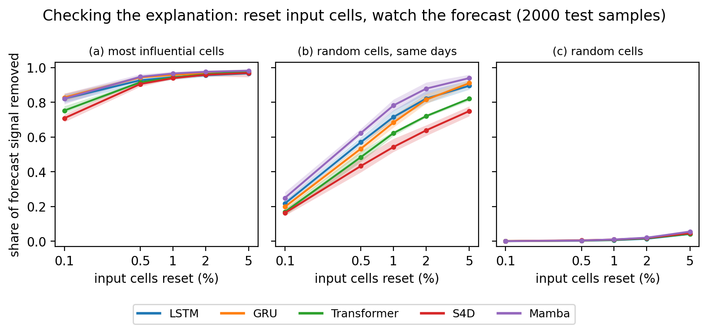

*Hình 4. Deletion test C2: phần tín hiệu |f(x) − f(gốc)| mất khi thay một tỉ lệ ô bằng đường gốc, theo ba cách chọn ô; dải là 3 hạt giống.*

## 6. C2 — mô hình dựa vào ngày nào

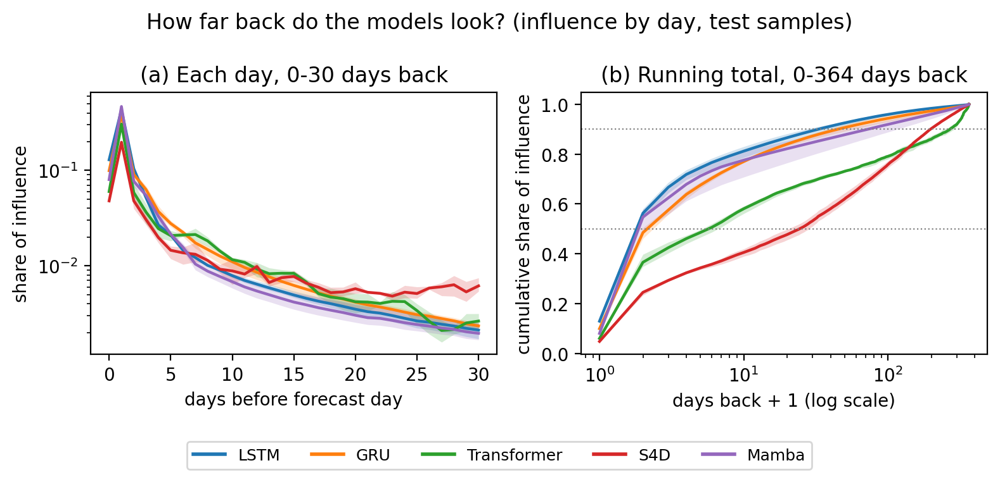

*Hình 1. Tỉ phần |IG| theo ngày trễ (trục log) của 5 lõi; dải là 3 hạt giống.*

| Lõi | Tỉ phần ngày trễ 0 và 1 | L50 (ngày) | L90 (ngày) | L90 so với LSTM |
|---|---|---|---|---|
| LSTM | 0,563 | 1,7 ± 0,6 | 34,0 ± 8,2 | — |
| GRU | 0,485 | 2,0 ± 0 | 44,7 ± 7,4 | dưới 1,7 × nhiễu |
| Transformer | 0,366 | 6,3 ± 0,6 | 265,7 ± 23,5 | 9,9 × nhiễu |
| S4D | 0,245 | 27,3 ± 3,5 | 200,3 ± 1,2 | 20,3 × nhiễu (L50 7,3 ×) |
| Mamba | 0,547 | 1,3 ± 0,6 | 65,3 ± 36,7 | 0,86 × nhiễu |

(Trung bình ± độ lệch chuẩn 3 hạt giống; `Tables/G_run_metrics.csv`, `G_core_diffs.csv`.)

- Ba lõi hồi quy theo trạng thái chọn lọc (LSTM, GRU, Mamba) dồn khoảng một nửa ảnh hưởng vào ngày t và t−1 (ECMWF HRES ngày t, Q quan trắc hôm qua) và 90% ảnh hưởng của pha quá khứ trong khoảng 1–2 tháng.
- Transformer và S4D trải ảnh hưởng ra gần cả cửa sổ (L90 200–266 ngày), khác LSTM rất xa nhiễu. Hai lõi này cũng có NSE validation thấp nhất ở C2 (khoảng −3,3 nhiễu so với B*, [báo cáo C2](../../05_Training/13_C2_LamaHCEExt_Compare/13_C2_LamaHCEExt_Compare.md)); G không kiểm được quan hệ nhân quả giữa hai điều này.
- Mamba khác LSTM ở L90 +31 ngày nhưng chỉ 0,86 × nhiễu: độ lệch chuẩn giữa 3 hạt giống của Mamba (36,7 ngày) lớn hơn chính hiệu đó, nên **không phân biệt được độ dài nhớ của Mamba với LSTM**. S4D — SSM không chọn lọc cùng họ với Mamba — nhớ dài hơn hẳn, phù hợp với giả thuyết cơ chế chọn lọc làm Mamba hành xử giống LSTM hơn giống S4D (G không tách riêng cơ chế này).

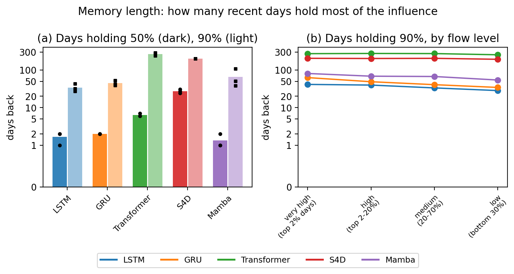

*Hình 2. L50, L90 của 5 lõi theo mức lưu lượng; điểm là từng hạt giống.*

## 7. C2 — mô hình dựa vào nguồn nào

| Lõi | ERA5L | EOBS | MSWEP | GLEAM | Q | ECMWF HRES | Tĩnh |
|---|---|---|---|---|---|---|---|
| LSTM | 0,192 | 0,145 | 0,020 | 0,039 | 0,278 | 0,097 | 0,229 |
| GRU | 0,226 | 0,147 | 0,021 | 0,035 | 0,291 | 0,078 | 0,204 |
| Transformer | 0,305 | 0,172 | 0,020 | 0,040 | 0,247 | 0,050 | 0,166 |
| S4D | 0,303 | 0,177 | 0,027 | 0,061 | 0,228 | 0,040 | 0,166 |
| Mamba | 0,239 | 0,154 | 0,018 | 0,037 | 0,299 | 0,065 | 0,189 |

(Tỉ phần |IG| trung bình 3 hạt giống trên 10.511 mẫu; `Tables/G_run_metrics.csv`.)

- Q quan trắc là nhóm lớn nhất ở LSTM, GRU, Mamba (0,28–0,30), như kết quả ablation B1b (thêm `qmax` quá khứ tăng NSE validation 2,4 × nhiễu, [báo cáo B1b](../../05_Training/04_B1b_LamaHCEExt_Train/04_B1b_LamaHCEExt_Train.md)).
- So với LSTM, Transformer và S4D dựa vào ERA5L nhiều hơn (+10,8 và +10,6 × nhiễu) và vào ECMWF HRES ít hơn (−3,9 và −4,7 × nhiễu); Transformer dựa vào thuộc tính tĩnh ít hơn (−6,6 × nhiễu). Phù hợp với việc hai lõi này trải ảnh hưởng ra quá khứ xa (ERA5L, EOBS là nguồn trải đều cả cửa sổ).
- Mamba so với LSTM: ERA5L +4,5 ×, tĩnh −4,7 ×, ECMWF HRES −2,7 ×, Q +1,6 × nhiễu. GRU so với LSTM chỉ khác ở ERA5L (+3,2 ×), các nhóm khác dưới 1,7 × nhiễu.
- MSWEP chỉ khoảng 2% ở mọi lõi dù là nguồn mưa: thông tin mưa trùng với EOBS, ERA5L nên IG chia cho các nguồn khác (IG không tách được thông tin trùng lặp giữa các biến tương quan, Mục 17).

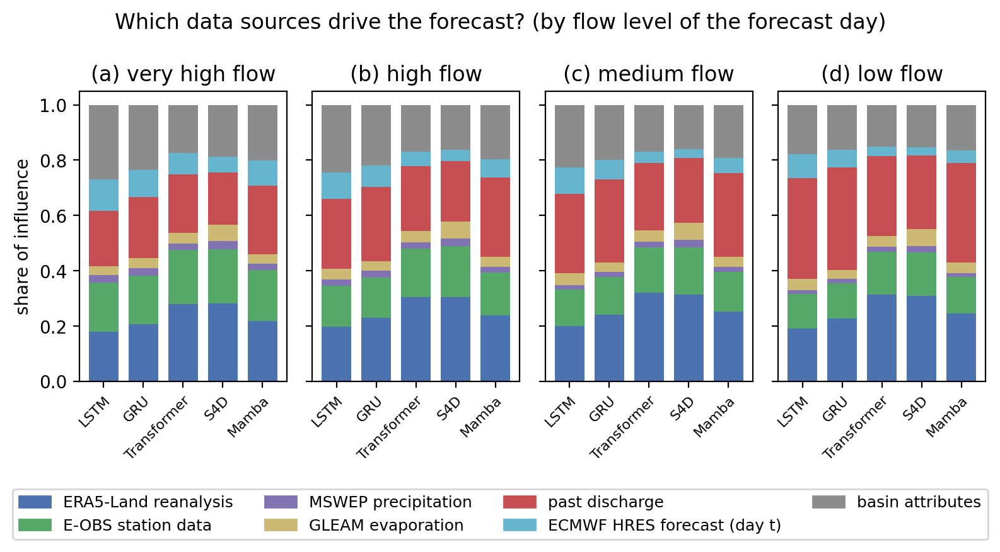

*Hình 3. Tỉ phần |IG| theo nhóm nguồn × mức lưu lượng của 5 lõi.*

## 8. C2 — theo mức lưu lượng, mùa và thuộc tính lưu vực

- **Mức lưu lượng:** khi lũ (mức rất cao), mọi lõi nhớ dài hơn và dựa ít hơn vào Q hôm qua. L90 từ rất cao tới thấp: LSTM 41,3 → 28,3 ngày, GRU 62,7 → 34,3, Mamba 80,7 → 54. Tỉ phần Q: LSTM 0,20 → 0,36, GRU 0,22 → 0,37, Transformer 0,21 → 0,29, S4D 0,19 → 0,27, Mamba 0,25 → 0,36. Cách hiểu phù hợp (chưa kiểm riêng): khi lũ, Q hôm qua kém đại diện cho Q hôm nay nên mô hình dựa nhiều hơn vào mưa, tuyết và dự báo; khi dòng chảy thấp và ổn định, Q hôm qua gần như đủ (`Tables/G_strata.csv`).
- **Mùa:** bảng theo DJF, MAM, JJA, SON ở `Tables/G_strata.csv`.
- **Thuộc tính lưu vực:** Spearman giữa L90 theo lưu vực và lượng mưa trung bình `p_mean` dương ở GRU 0,53, Transformer 0,59, S4D 0,55, Mamba 0,39, gần 0 ở LSTM (−0,01); với diện tích `area_calc` từ −0,13 đến −0,43 (`Tables/G_spearman_L90.csv`, `G_basin_L90.csv`). Quan hệ âm với diện tích ngược trực giác thủy văn (lưu vực lớn có thời gian tập trung nước dài hơn); một khả năng là ở lưu vực lớn Q hôm qua đã mang thông tin quá khứ nên mô hình cần ít ngày hơn — chưa kiểm.

## 9. C2 — dò trạng thái ẩn

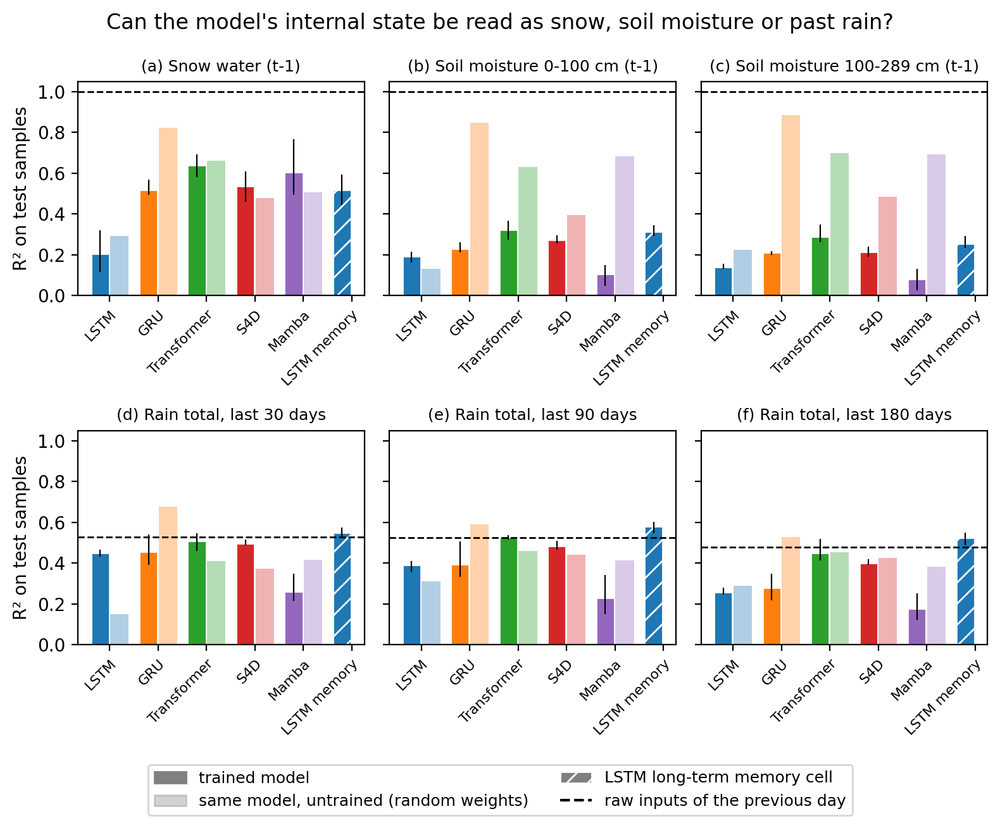

*Hình 5. R² dò trạng thái ẩn của 5 lõi với hai đối chứng (đầu vào thô t−1, mô hình khởi tạo ngẫu nhiên); 9.020 mẫu train, 10.511 mẫu test.*

- Đối chứng đầu vào thô đã cho R² = 1 với tuyết và ẩm đất (hai đích này chính là đầu vào ngày t−1), nên không lõi nào vượt được ở bốn đích này: dò không cho biết thêm gì.
- Với mưa cộng dồn, đầu vào thô t−1 chỉ cho R² 0,53/0,53/0,48 (30/90/180 ngày). Chỉ **ô nhớ c của LSTM** vượt cả hai đối chứng: +0,023 ± 0,022 (30 ngày), +0,056 ± 0,032 (90 ngày), +0,045 ± 0,034 (180 ngày); đầu ra các lõi khác không vượt (`Tables/G_probe.csv`, `G_probe_gain.csv`). Phần vượt nhỏ: ô nhớ LSTM mang thêm một ít thông tin mưa tích lũy so với đầu vào ngày t−1.
- GRU khởi tạo ngẫu nhiên đã cho R² 0,82–0,88 với tuyết, ẩm đất: trạng thái ẩn ngẫu nhiên vẫn giữ được đầu vào gần nhất, nên đối chứng (b) là cần thiết để không đọc nhầm R² cao thành "mô hình học được".

## 10. C2 — ví dụ một ngày lũ

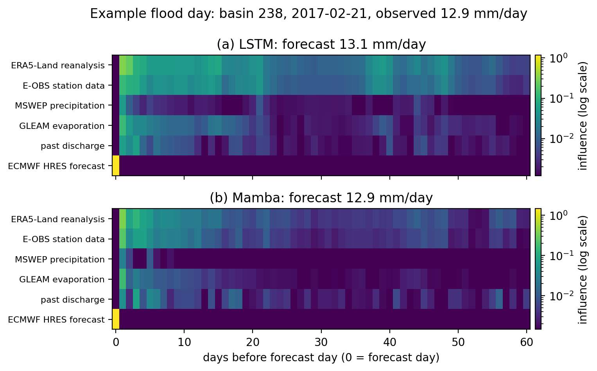

*Hình 6. Bản đồ nhiệt |IG| theo ngày trễ × nhóm nguồn (thang màu log) của LSTM và Mamba, lưu vực 238, ngày 21/02/2017.*

Lưu vực 238, ngày 21/02/2017, `qmax` đo 12,94 mm/ngày (mức rất cao): LSTM dự báo 13,11, Mamba 12,86. Ở cả hai lõi, ô ảnh hưởng lớn nhất là ECMWF HRES ở ngày trễ 0, tức dự báo thời tiết của chính ngày t. Đây là dạng hình trang Giải thích của demo hiển thị cho từng lưu vực.

## 11. H — thông tin tương lai theo hạn

"Hạn k" là ngày đích t+k−1; pha quá khứ 364 ngày giống nhau ở bốn cách, pha dự báo 7 ngày khác nhau ([báo cáo H](../../05_Training/15_H_LamaHCEExt_Compare/15_H_LamaHCEExt_Compare.md) Mục 2). Tỉ phần |IG| của pha dự báo (mọi biến thời tiết tương lai, không tính thuộc tính tĩnh):

| Cách | LSTM hạn 1 → 7 | Mamba hạn 1 → 7 |
|---|---|---|
| Chỉ quá khứ | 0 (không có biến tương lai) | 0 |
| Lai | 9,6% → đỉnh 14,5% (hạn 2) → 9,9% | 5,5% → 8,1% → 4,9% |
| GEFS | 8,7% → 30,1% | 5,1% → 19,3% |
| Hoàn hảo | 7,8% → 24,6% | 6,2% → 22,7% |

(`Tables/GH_lead_summary.csv`.)

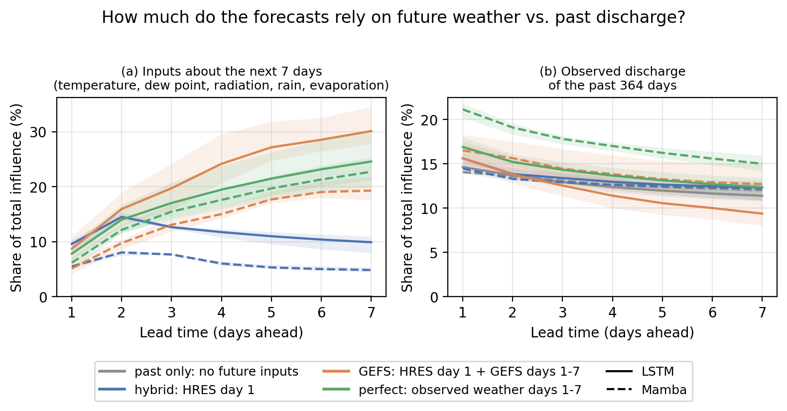

*Hình 7. Tỉ phần |IG| của pha dự báo theo hạn, 4 cách × 2 lõi; dải là 3 hạt giống.*

- **Cách lai** chỉ có ECMWF HRES ngày đầu; tỉ phần không tăng theo hạn và quay về khoảng 10% (LSTM) ở hạn 7. Mô hình vẫn dùng dự báo ngày đầu cho mọi hạn nhưng không có gì để dùng thêm cho các ngày sau, khớp với kết quả H: ECMWF HRES ngày đầu chỉ giúp hạn 1–2.
- **Cách GEFS** tăng đều theo hạn tới 30% (LSTM), gần bằng cách hoàn hảo: mô hình dựa vào dự báo nhiều ngày đúng như thiết kế (bước k chỉ thấy GEFS hạn k). Nhóm GEFS: LSTM 4,5% → 27,9%, Mamba 2,5% → 17,6%; ECMWF HRES trong cách này giảm 4,3% → 2,2% (LSTM).
- **Cách hoàn hảo** cũng tăng theo hạn nhưng NSE giảm chậm hơn hẳn GEFS (hạn 7: 0,64 so với 0,24 ở LSTM, báo cáo H Mục 7). Tỉ phần tương tự mà kỹ năng khác xa => khoảng cách GEFS – hoàn hảo đến từ **chất lượng** dự báo thời tiết ở hạn xa, không phải mô hình bỏ qua GEFS.
- Tỉ phần Q quá khứ giảm theo hạn ở 8/8 tổ hợp lõi × cách (ví dụ GEFS LSTM 15,7% → 9,4%, hoàn hảo Mamba 21,2% → 15,0%): Q hôm qua mất dần giá trị khi ngày đích ở xa.

## 12. H — nguồn, ngày dự báo và độ dài nhớ theo hạn

- **Nhóm nguồn** (Hình 8): thuộc tính tĩnh chiếm 20,8–32,9% ở mọi cách, hạn. Ở cách chỉ quá khứ, Mamba dựa vào ERA5L quá khứ khoảng 34% so với LSTM khoảng 27–29%.
- **Từng ngày trong pha dự báo** (Hình 9): ở hạn 7, cách hoàn hảo dựa vào ngày dự báo thứ 7 nhiều hơn ngày thứ 1 (LSTM 5,7% so với 2,7%, gấp 2,1 lần; Mamba gấp 2,6 lần), tức dựa vào thời tiết gần ngày đích. Cách GEFS gần như đều giữa các ngày (LSTM gấp 1,2 lần, Mamba 0,9 lần): ở bước k mô hình chỉ thấy GEFS hạn k nên mỗi ngày dự báo mang thông tin riêng, nhưng độ tin cậy của GEFS giảm theo hạn làm ngày gần ngày đích không trội lên.
- **Độ dài nhớ** (Hình 10): L90 tăng theo hạn ở 8/8 tổ hợp, tức dự báo xa dựa vào quá khứ dài hơn (trạng thái chậm như tuyết, ẩm đất). L50 chỉ 3–15 ngày.

| Cách | L90 LSTM hạn 1 → 7 (ngày) | L90 Mamba hạn 1 → 7 (ngày) |
|---|---|---|
| Chỉ quá khứ | 61,7 ± 9,5 → 77 ± 14,4 | 89,7 ± 18 → 121,7 ± 22,8 |
| Lai | 57,7 → 74,7 | 66,3 → 92,7 |
| GEFS | 99,3 ± 35 → 125,3 ± 35 | 106,3 → 148,3 |
| Hoàn hảo | 107 → 133 | 104,7 → 157,3 |

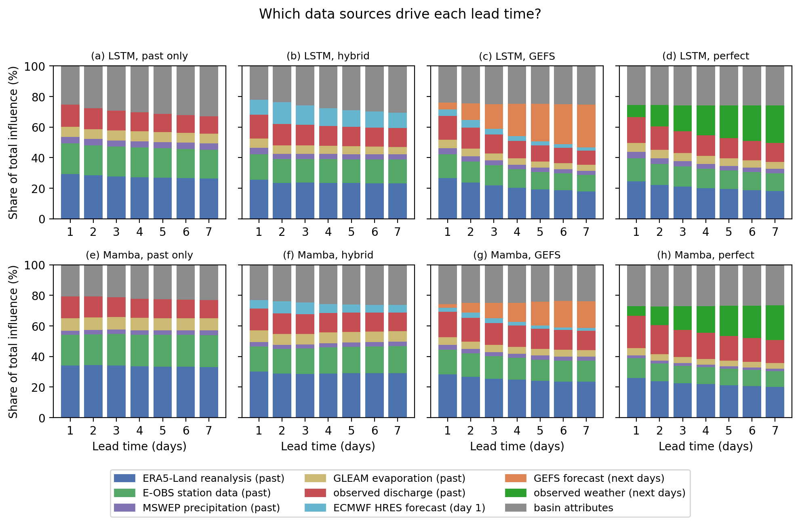

*Hình 8. Tỉ phần |IG| theo nhóm nguồn ở từng hạn, 4 cách × 2 lõi.*

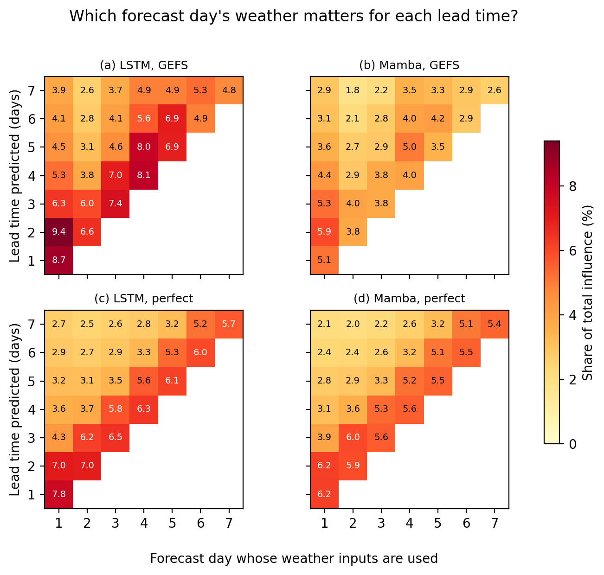

*Hình 9. Tỉ phần |IG| của từng ngày trong pha dự báo (trục ngang) ở từng hạn (trục dọc), cách GEFS và hoàn hảo.*

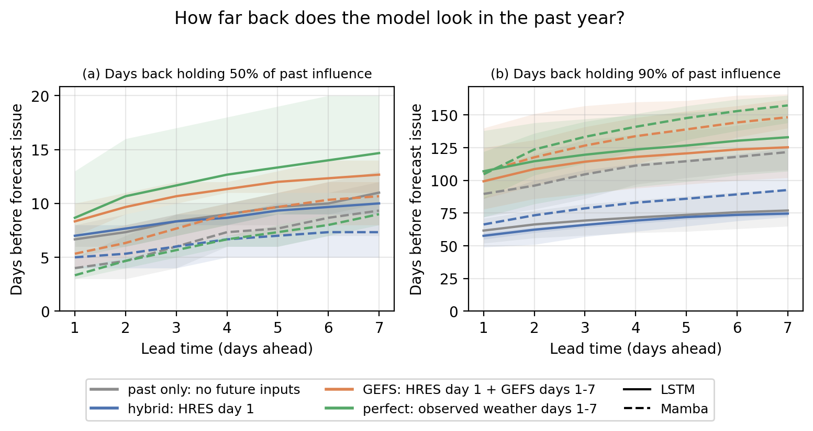

*Hình 10. L50, L90 theo hạn, 4 cách × 2 lõi; dải là 3 hạt giống.*

## 13. H — theo mức lưu lượng

Tỉ phần pha dự báo ở hạn 7, ngày đích mức rất cao so với mức thấp (`Tables/GH_strata_level.csv`):

| Cách | LSTM | Mamba |
|---|---|---|
| Lai | 10% so với 10% | 5% so với 5% |
| GEFS | 30% so với 31% | 21% so với 18% |
| Hoàn hảo | 33% so với 20% (+13,0 điểm %) | 30% so với 18% |

Chỉ cách hoàn hảo dựa vào thời tiết tương lai nhiều hơn khi ngày đích có lũ. Ở cách GEFS, tỉ phần gần như không đổi theo mức: mô hình không "tin" GEFS hơn vào ngày lũ, một khả năng là GEFS ở hạn xa kém phân biệt ngày mưa lớn (chưa kiểm kỹ năng GEFS theo mức mưa). Đây là chỗ một dự báo thời tiết nhiều ngày chất lượng cao hơn có thể cải thiện cảnh báo lũ (hướng khóa luận, `02_Pipeline.md` Mục 11).

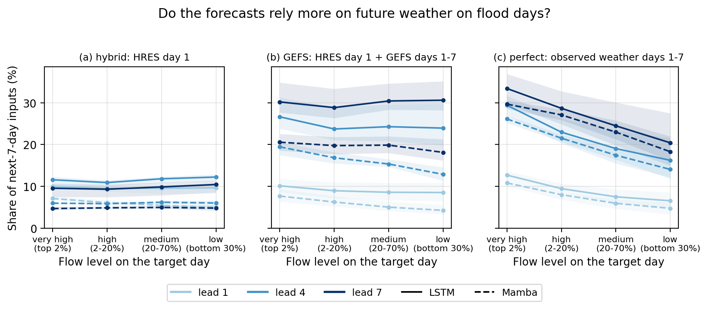

*Hình 11. Tỉ phần pha dự báo và L90 theo hạn, tách theo mức lưu lượng của ngày đích.*

## 14. Mamba so với LSTM

- **C2:** L90 của Mamba không phân biệt được với LSTM (0,86 × nhiễu); Mamba dựa vào ERA5L nhiều hơn (+4,5 ×) và vào thuộc tính tĩnh ít hơn (−4,7 ×). NSE validation hai lõi cũng trong một nhiễu (báo cáo C2).
- **H:** Mamba dựa vào thông tin tương lai **ít hơn** LSTM ở cách lai (−3,0 tới −19,6 × nhiễu theo hạn) và GEFS (−1,6 tới −2,8 ×), dựa vào pha quá khứ nhiều hơn (tới +3,7 × ở cách chỉ quá khứ hạn 7); ở cách hoàn hảo khác biệt dưới 1 × nhiễu. Hiệu L90 ở mọi cách tối đa 2,0 × nhiễu (`Tables/GH_core_diffs.csv`). Mamba kém LSTM 2,9–4,2 nhiễu ở hạn 7 của ba cách vận hành được (báo cáo H Mục 10); việc Mamba dùng GEFS ít hơn LSTM là một giải thích phù hợp với kết quả đó nhưng IG không chứng minh nhân quả.

## 15. Chi phí

| Notebook | Tổng | Phần tốn nhất | GPU đỉnh |
|---|---|---|---|
| `01_G_C2_XAI` | 1,47 giờ | Phần 4 (IG) 60 phút, Phần 6 12,2 phút | 5,38 GB |
| `02_G_H_XAI` | 4,45 giờ | Phần 4 (IG) 217,4 phút, Phần 6 16,9 phút, Phần 3 516 giây, Phần 2.2 464 giây | 4,31 GB |

Ở H, IG của Mamba mất khoảng 11,5 phút/run (đạt completeness ở bước tích phân thấp); LSTM cách hoàn hảo tốn nhất vì nhiều mẫu phải lên 2.048 bước.

## 16. Bàn giao cho demo

- Run demo: mỗi cấu hình hạt giống có NSE validation cao nhất (như C2 và H).
  - C2 (`Tables/G_demo_runs.csv`): LSTM 333 (0,7681), GRU 111 (0,7707), Transformer 222 (0,7479), S4D 222 (0,7445), Mamba 222 (0,7672).
  - H (`Tables/GH_demo_runs.csv`, theo cột `demo` của `H_handoff.csv`): LSTM past 333, Mamba past 333, LSTM hybrid 333, Mamba hybrid 222, LSTM gefs 222, Mamba gefs 111, LSTM perfect 222, Mamba perfect 333.
- Output Kaggle `demo/G_demo_basin.npz` (mỗi run × lưu vực: tỉ phần theo ngày trễ, theo nhóm, L50/L90, nhóm × ngày trễ 0–60) và `demo/GH_demo_basin.npz` (24 run × 451 lưu vực × 7 hạn: tỉ phần pha, nhóm, từng ngày dự báo, L50/L90, số mẫu) cho trang Giải thích của D3/D4; `g_summary.json`, `gh_summary.json` ghi mọi số trong báo cáo này.

## 17. Giới hạn

- **Mẫu nghiêng về ngày lũ** (phân tầng 4 mức), nên tỉ phần trung bình không đại diện cho một ngày bất kỳ; bảng theo mức cho số riêng từng mức.
- **IG phụ thuộc đường gốc.** Đường gốc là trung bình kỳ train nên thuộc tính tĩnh của một lưu vực gần trung bình có IG nhỏ dù mô hình dùng chúng; tỉ phần nhóm tĩnh chỉ so được giữa các lõi, không đọc thành "mức quan trọng tuyệt đối".
- **IG cho thấy mô hình nhạy với ô nào, không chứng minh nhân quả**, và chia thông tin trùng lặp giữa các biến tương quan (ví dụ mưa MSWEP, EOBS, ERA5L) theo cách phụ thuộc mô hình.
- **Đạo hàm Mamba và Transformer không lặp lại từng bit** trên GPU (`04_0_Cores_Check` Version 1); lệch nhỏ hơn nhiều so với khác biệt giữa hạt giống.
- **Dò trạng thái ẩn:** tuyết, ẩm đất vốn là đầu vào ngày t−1 nên dò không kiểm được với hai đích này; ridge chỉ bắt quan hệ tuyến tính.
- Một số mẫu không đạt completeness bị bỏ (C2 185 mẫu, H 748 lượt mẫu–hạn); độ nhạy khi bỏ mẫu tối đa khoảng 0,22 × nhiễu.

## 18. Nguồn

- Sundararajan, M., Taly, A., Yan, Q. (2017). Axiomatic Attribution for Deep Networks. ICML 2017 (Integrated Gradients, completeness).
- Kokhlikyan, N. và cs. (2020). Captum: A unified and generic model interpretability library for PyTorch. arXiv 2009.07896.
- Hu và cs. (2025). Environmental Modelling & Software 192:106527 (dò trạng thái ô LSTM).
- Konold và cs. (2026). BiasCast. HESS 30:5067–5096; dữ liệu Extended LamaH-CE, Zenodo 17119635 (CC BY-NC 4.0).
- Output Kaggle `01_G_C2_XAI` Version 1, `02_G_H_XAI` Version 1; [báo cáo C2](../../05_Training/13_C2_LamaHCEExt_Compare/13_C2_LamaHCEExt_Compare.md), [báo cáo H](../../05_Training/15_H_LamaHCEExt_Compare/15_H_LamaHCEExt_Compare.md).
- Fork `Ticasslo/neuralhydrology` tag `freeze-H2` (`840450f`).
